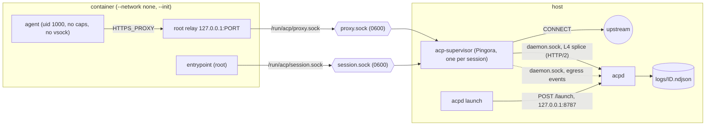
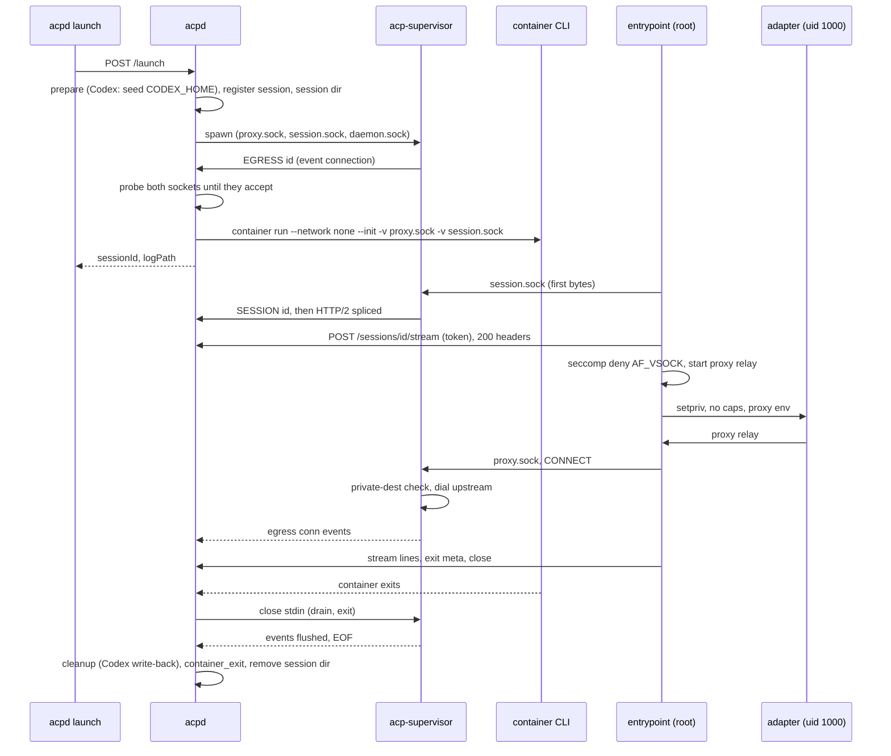

# Egress supervisor design

Every container the daemon launches has no network at all. Its only ways out are two Unix sockets, owned by a per-session `acp-supervisor` process (one Pingora process per session, spawned by `acpd`): one for the container's HTTP/2 session uplink, one for a CONNECT proxy. Phase 1 allows and logs every proxied connection. Phase 2 adds a deny-by-default allowlist built from the phase-1 logs. This doc assumes the merged daemon (`acpd`), `container` 1.4.1 on macOS 26 arm64, and the ubuntu:26.04 images.

## 1. Topology



- `container run --network none -v <dir>/proxy.sock:/run/acp/proxy.sock -v <dir>/session.sock:/run/acp/session.sock`. The runtime treats a `-v` whose source is a socket *file* specially and relays it to the host listener (`RuntimeService.swift:1148-1160`, `isSocket()` at `1524-1530`; the same relay `--ssh` uses, `1176-1187`). Mounting a directory that contains sockets goes over virtiofs instead and cannot connect.
- The host file mode maps into the container (host 0600 shows as `root:root 0600`), so uid 1000 cannot open either socket, with no in-container chmod needed.
- Each session has a private directory `$TMPDIR/acp-XXXXXX` (0700) with the two sockets, and runs with `--init` (the runtime's init is PID 1; see Threat notes). The supervisor must be listening on both before `container run`, because the runtime only mounts a socket file that exists; the daemon probes both (connect and close, which the supervisor ignores) for up to 3 s.
- The daemon has its own socket, `$TMPDIR/acpd-XXXXXX/daemon.sock` (directory 0700, socket 0600), which supervisors dial. The control API (`/launch`, for `acpd launch`) is a separate loopback TCP port, `127.0.0.1:8787`. Containers can reach neither.

## 2. The session uplink and the events

The supervisor splices `session.sock` to the daemon at L4, so HTTP/2 stays end to end between the entrypoint (client, `POST /sessions/:id/stream`) and the daemon's existing stream handler (server). Nothing is dialed until the container's first bytes arrive, so a readiness probe costs the daemon nothing. The supervisor opens the daemon connection and sends one line first, `SESSION <id>\n`; the daemon binds the connection to that session (the supervisor was started for it, so the container cannot pick another) and serves only that session's stream over it. Either direction ending ends the splice (HTTP/2 closes both ways when done).

The supervisor sends its proxy events to the daemon on a second connection that starts with `EGRESS <id>\n`, as plain NDJSON lines. The daemon wraps each in the envelope with `dir: "egress"` and writes it into `logs/<id>.ndjson` through the same 0600 writer. This was chosen over a second HTTP/2 stream because the daemon already parses lines and needs no framing here. On teardown the supervisor flushes its queue and closes the connection, and the daemon waits for that EOF before it writes the exit notes.

The entrypoint connects to `/run/acp/session.sock` (5 s per attempt, 15 s overall), handshakes with a 5 s timeout, posts the stream and waits 10 s for the daemon's response headers. A listener that is gone but whose socket file remains accepts a connect and then says nothing, which is why every step has a timeout. The agent starts only after the stream is accepted; a failure exits with a clear message naming the supervisor.

The launch and teardown order, end to end:



## 3. The supervisor process

`crates/acp-supervisor` builds `acp-supervisor` (`pingora-core =0.9.0`, no TLS backend, `httparse`, `tokio`):

```text
acp-supervisor --dir DIR --daemon-sock PATH --session ID
```

One `pingora_core::server::Server` with two `listening::Service`s on Unix sockets at 0600: the CONNECT app on `proxy.sock` and the splice app on `session.sock`. The custom `ShutdownSignalWatch` returns `FastShutdown` on stdin EOF or SIGINT and `GracefulTerminate` on SIGTERM, and flushes every open connection as an event with `error: "shutdown"` first; after `Server::run` returns, the event thread is drained and joined. Stdin EOF means a crashed or SIGKILLed daemon still takes every supervisor down with it.

Teardown, on every path (container exit, kill, setup failure, daemon SIGINT/SIGTERM): observe the container's exit; close the supervisor's stdin and wait for it (5 s cap, then kill); wait for the daemon-side event connection to reach EOF (5 s cap); write the cleanup note and `container_exit`; remove the session directory. If the supervisor dies while the container runs, the daemon logs a `container_error` ("the session supervisor exited unexpectedly") and stops the container.

### The CONNECT app

`process_new` always returns `None`; connections are never reused. There is no peer check, because the socket's mode is the access control.

1. Read the request head, up to 8 KiB, with a 10 s timeout, and parse it with `httparse`. A connection that closes before sending a byte (the readiness probe) is ignored. Bytes after the blank line (an early TLS ClientHello) are forwarded upstream.
2. Accept only `CONNECT host:port` with an explicit port of 1-65535 and a hostname or IP literal, lowercased, trailing dot stripped.
3. Resolve with `tokio::net::lookup_host`. Refuse any resolved address that is loopback, link-local, RFC 1918, CGNAT, ULA or unspecified (IPv4-mapped included): decision `deny`, rule `private-dest`, 403. Without this the proxy would bridge to the daemon's control port and every host service.
4. Dial each address, 10 s overall; reply `200 Connection Established`, flush, and run a counting `copy_bidirectional` until either side closes or shutdown fires. No idle timeout, because model API streams are long-lived.

| Status | Cause |
| --- | --- |
| 400 | Malformed head or authority (`bad-request`) |
| 403 | `private-dest` deny |
| 501 | Any method other than CONNECT (`plain-http` for an absolute `http://` URI, else `unsupported-method`) |
| 502 | DNS or dial failure |
| 504 | Connect timeout |

Plain HTTP is a deliberate exception to log-only: supporting it needs a second `ProxyHttp` service, for traffic that is rare here and that phase 2 would mostly deny anyway.

### Events

```json
{"ts":"…","dir":"egress","msg":{"event":"conn","session":"ID","started":"…","method":"CONNECT","host":"api.anthropic.com","port":443,"decision":"allow","rule":"phase1-allow-all","bytes_up":1234,"bytes_down":56789,"duration_ms":4200,"error":null}}
```

## 4. The entrypoint

The entrypoint starts as root (the Containerfiles have no `USER` line), in this order:

1. Open the uplink with the session token and wait for the daemon to accept the stream (section 2). Nothing else starts before that.
2. Listen on an ephemeral `127.0.0.1` port and relay each connection to `/run/acp/proxy.sock`. A client's end-of-stream is not forwarded to the proxy, because the runtime's socket relay drops data still in flight when it sees one (the spike measured about 30 KB lost out of 1 MiB and out of 8 MiB). The host side's end decides: after the client finishes, the other direction gets 5 s to end by itself, and when the host side ends the client is told (its end-of-stream is forwarded) and the relay closes. Clients that close early therefore show up in the proxy's logs as connections lasting about 5 s longer.
3. Install the seccomp filter (see Threat notes), then start the adapter through `env -u SESSION_ID -u ACP_UPLINK_TOKEN -u PROMPT -u SESSION_CWD setpriv --reuid=agent --regid=agent --init-groups --inh-caps=-all --bounding-set=-all --no-new-privs -- <adapter>`, with `HOME=/home/agent` and the proxy variables below. The `env -u` is needed because the SDK's `AcpAgent` can only add to the inherited environment. The agent has all five capability sets at zero and `NoNewPrivs: 1`; credentials and `CODEX_HOME` pass through.

```text
HTTPS_PROXY  https_proxy  HTTP_PROXY  http_proxy  ALL_PROXY  =  http://127.0.0.1:PORT
NO_PROXY     no_proxy                                         =  localhost,127.0.0.1
NODE_USE_ENV_PROXY=1
npm_config_proxy  npm_config_https_proxy                      =  http://127.0.0.1:PORT
```

What honours it: Claude Code, Codex (including its transport), Node 24.21 `fetch` and `https` with `NODE_USE_ENV_PROXY=1`, npm, git and curl. Node also lets `HTTP_PROXY` serve HTTPS requests, so a bypass test has to unset all of them. `git://` and `ssh://` do not work, by design. Codex's own sandbox blocks the network for tool commands in `workspace-write`, and makes `/tmp` read-only in `read-only`, so the bypass and positive checks for Codex need `agent-full-access`.

## 5. Phase 2 allowlist (design only)

The policy is one TOML file, passed by the daemon to every proxy with `--policy`:

```toml
[[allow]]
name = "anthropic-api"
host = "api.anthropic.com"   # exact match
ports = [443]                # default [443]

[[allow]]
name = "github-content"
suffix = "githubusercontent.com"  # the name itself or any subdomain
```

- Match on the normalized CONNECT host and port. `host` is an exact string match. `suffix` matches `h == s` or `h` ending in `"." + s`.
- The first matching rule wins, and its `name` becomes the log's `rule`.
- An IP literal matches only an identical `host` entry. `private-dest` applies before the policy and cannot be overridden.
- No match returns 403 with the body `egress denied: <host>:<port>` and a log line with `decision: "deny"` and `rule: null`.

To derive the first draft, run `jq -r 'select(.dir=="egress") | .msg | "\(.host):\(.port)"' logs/*.ndjson | sort | uniq -c` over the phase-1 runs. Codex downloads about 75 MB from several `*.oaiusercontent.com` hosts at startup, which the list has to include.

## 6. Verification

The bypass checks run inside the agent's own process tree, by asking the agent to run a script (`container exec` would start a process outside the agent's restrictions and test nothing). Each must fail, and fail fast:

- Direct TCP (curl `--noproxy '*'`, bash `/dev/tcp`), UDP, DNS (`getent`, a Node resolver aimed at 1.1.1.1 and at the proxy host), IPv6.
- Unset proxy env (all of it) plus Node `fetch`.
- `/proc/self/status` capabilities at 0 and `NoNewPrivs: 1`; `su`, `mount` and the setuid binaries gain nothing; `unshare -Urn` gets an empty network namespace.
- `proxy.sock` and `session.sock` opened directly (EACCES; `/run/acp` lists them as `root:root 0600`); no daemon socket anywhere in the container's filesystem; `/proc/1/fd`, `/proc/1/mem`, `/proc/1/environ` unreadable; `kill -9 1` refused.
- CONNECT to `127.0.0.1`, `localhost`, `[::1]` and the host's own addresses is answered 403 `private-dest`; an absolute-URI `GET` is answered 501 `plain-http`.

Positive checks, for each flavor: a web fetch, `npm install left-pad` and a `git clone` of `octocat/Hello-World`, with allow lines in `logs/<id>.ndjson` for the model API, example.com, registry.npmjs.org and github.com, all before `container_exit`. Lifecycle: SIGINT mid-session leaves no supervisor, no session directory and no container; killing the supervisor mid-session ends the session with a `container_error`; `kill -9` of the daemon makes the supervisors exit on stdin EOF.

## 7. As built

Spike findings (`container` 1.4.1):

- `--network none` leaves only `lo`: no routes, no resolver. TCP, UDP, DNS and IPv6 fail and loopback works.
- A `-v` whose source is a socket file is relayed to the host listener, in both container-root and any-path cases tested (two sockets in one container, paths in `/tmp`). The relay carries a full-duplex stream intact (32 MiB, 0 corrupt bytes, and a 32 MiB HTTP/2 streaming POST with a clean end of stream); the host listener can be replaced at the same path and later connections reach the new one. The source must exist when the container starts. With a stale socket file and no listener, `connect()` succeeds and then hangs.
- A half-close truncates in-flight data (about 30 KB out of 1 MiB and 8 MiB), so nothing here half-closes: HTTP/2 does not, and the entrypoint's relay does not forward a client's end-of-stream.
- Pingora 0.9.0 builds on macOS arm64 without TLS; `Server::run` returns normally on the custom shutdown signal; `add_uds` with 0600 works; a `Stream` needs an explicit flush after the 200; the peer address on a Unix socket is absent.
- The base image has its own uid 1000 user (`ubuntu`); the Containerfiles remove it so that `agent` is uid 1000.

What happens when the daemon is SIGKILLed: the supervisor exits (stdin EOF), but the container keeps running with no uplink or proxy, and the session directory, the daemon socket and the Codex temp `CODEX_HOME` (an `auth.json` copy) stay on disk. All of it lives under the state root `$TMPDIR/acpd-<uid>/` (0700), which a daemon locks (flock on `lock`) for its lifetime, so concurrent daemons refuse to start rather than sweep each other. `acpd serve` sweeps before it listens: containers with the label `acpd=1` (put on every `container run`) are killed and deleted, and `sessions/`, `scratch/` and `daemon/` are emptied (permissions are restored first, with links never followed, because the agent can `chmod 0000` its own mounted files) with no write-back. A directory that cannot be removed is logged and does not stop the daemon. Supervisors are deliberately not tracked by pid: a pid file plus a `ps` match could kill an unrelated process after pid reuse, and they exit on stdin EOF anyway. Verified by killing the daemon mid-session with Codex and restarting it: the container, the directories and the temp home were gone and the host `auth.json` and backup hashes were unchanged.

### Rejected alternatives

- **nft lockdown on an internal network.** A per-session `container network create --internal` (about 65 ms to create, 30 ms to delete, subnets handed out sequentially from 192.168.128.0/24), a root entrypoint loading an nft ruleset with `CAP_NET_ADMIN`, a proxy on `0.0.0.0` with a source-subnet check and the daemon on a TCP port the container could reach. It worked and passed the same bypass tests, but an internal network is already host-only, so the firewall only guarded the host's other services, at the price of a capability, a ruleset to get exactly right and read back, a gateway lookup and uid-based rules.
- **`--ssh` as the proxy channel.** `--ssh` relays the host socket named by `SSH_AUTH_SOCK` into the container (`RuntimeService.swift:1176-1187`). It worked, but it is the same relay as a socket-file `-v` (`1148-1160`), with one socket per container and a fixed guest path, and it overloads an unrelated feature.
- **`--publish-socket` dial-in for the uplink.** The container listens and the CLI creates the host path (`1164-1172`, direction `.outOf`), so the daemon has to dial in with retry. A dial before the entrypoint listens is accepted by the relay and then dropped, which needs a first-byte probe and redials, and it makes the entrypoint a server. Socket-file mounts invert this: the supervisor is the listener and the container the client.
- **Mounting a directory that holds the sockets.** That goes over virtiofs, which shows the socket inode but cannot connect it, in either direction (`ECONNREFUSED`).
- **Container stdio as the uplink.** `container run -i` gives a duplex pipe; stdout worked (8,000 lines, 8 MB, live), but stdin-to-stdout echo stalled with zero bytes returned at 1 MiB and above (256 KiB was fine), and one pipe cannot carry both the uplink and the proxy without multiplexing.
- **`container machine`.** It builds the same `ContainerConfiguration` as `run` with fixed values (default NAT network, all capabilities, a home mount) and exposes only cpus, memory, home-mount, virtualization and kernel. Per session it boots in about 4.6 s with a 16 GB default; it cannot remove the network.

### Threat notes

- **vsock bypass (measured, then closed).** Container processes share the VM's network namespace and the runtime applies no seccomp (`containerization` 0.52.0, `LinuxContainer.swift:511-517` for the namespaces, `:57-62` and `:519-534` for the missing seccomp). A socket-file mount is relayed by having the guest listen on the Unix socket and dial the host over vsock for each connection (`VsockProxy.swift:117-138`; the host side listens on vsock ports allocated upward from `0x1000_0000`, `LinuxContainer.swift:425` and `UnixSocketRelay.swift:setupHostVsockListener`). Spike: as uid 1000 under `--network none`, `socket(AF_VSOCK)` succeeded, and `connect(CID 2, port 0x10000000)` and `0x10000001` reached the host listeners behind both `proxy.sock` and `session.sock` (each echoed our bytes), so the 0600 permissions were no barrier. CIDs 1 and 3-8 on port 1024 (the unauthenticated vminitd gRPC, `AgentCommand.swift:46`, `Server.swift:121-125`) were refused or unreachable (`ENODEV`), so that API was not reachable from a guest process in this setup.
- **Mitigation 1: seccomp.** After the session stream is accepted and before the agent starts, the entrypoint applies two filters (the `seccompiler` crate, default allow) to itself with all threads; the agent inherits them. They are the entrypoint's own, not the runtime's.
  - `socket()` with domain `AF_VSOCK`, `AF_NETLINK` or `AF_PACKET` returns `EAFNOSUPPORT`. `AF_UNIX`, `AF_INET` and `AF_INET6` stay, because the agent reaches the proxy relay over loopback. Netlink and packet sockets are belt and braces (no NIC, no capabilities; `AF_PACKET` already failed with `EPERM`).
  - `io_uring_setup`, `io_uring_enter` and `io_uring_register` return `EPERM`, because `IORING_OP_SOCKET` creates sockets without calling `socket()`. Measured on the guest kernel (6.18.35): as uid 1000 `io_uring_setup` succeeded before the filter and failed with errno 1 after; `socket(AF_NETLINK)` and `socket(AF_VSOCK)` succeeded before and fail with 97 after. Claude Code, Codex, Node, npm and git all still work (Node falls back to its thread pool).
  - Re-running the vsock scan as uid 1000 inside a real session afterwards gives `socket(AF_VSOCK) failed errno=97` for the host and the local CIDs.
- **Mitigation 2: a session token.** The daemon makes a random 128-bit token per session and passes it only to the entrypoint (`-e ACP_UPLINK_TOKEN`, stripped from the agent's environment). The stream POST must carry it in `x-acp-token`, or the daemon answers 403 before touching the session's state. This is defense in depth for the case where something other than the entrypoint reaches `session.sock`; a POST with a wrong token was answered 403.
- **`--init`.** With `--init` the runtime runs its init (`/.cz-init`) as PID 1, with the entrypoint as its direct child. Without it the entrypoint is PID 1 and never reaps orphans (measured with a Node PID 1: one defunct process after `sh -c 'sleep 1 & exit'`, none with `--init`; in a real session the same command left 0). `container stop` reaches the entrypoint as SIGTERM, which it handles by recording a `terminated by SIGTERM` error, closing the uplink and exiting with code 2.
- **What the agent can still do:** use the proxy (by design), see its own filesystem and the mounted `/workspace` or `CODEX_HOME`, and spend CPU. It cannot open a socket other than AF_UNIX/AF_INET/AF_INET6, and it has no route anywhere except loopback.
- **Forged log lines.** The daemon and the entrypoint drop any line longer than 16 MiB whole, through its newline, and record a daemon-authored `line_truncated` meta event; a piece of an oversized line is never written as a record. Verified live with a 33 MiB line that embeds a forged `container_exit`: one `line_truncated` event, no forged record, and `acpd launch --follow` ended on the daemon's own `container_exit`. `--follow` stops only on `container_exit`, which is always the last event (errors are held and written before it), and gives up if the log stops growing and the daemon's control API stops answering.
- **Auth poisoning.** The agent can write anything into its `CODEX_HOME` copy. A write-back is refused unless the copy has the same top-level keys and `auth_mode`, the same `tokens.account_id` and `id_token` `sub` and email claims as the seed (decoded, not verified, never logged), and a `last_refresh` that is not more than 5 minutes in the future; the host file must also still be the same login. Verified live: a `9999-12-31` refresh gives `refused: last_refresh in the future`, an altered account gives `refused: account changed`, and the host hash is unchanged.
- **Unremovable homes.** The agent can `chmod 0000` a directory in its mounted home. Cleanup and the startup sweep restore permissions first (links are never followed), so the `auth.json` copy is always deleted. Verified live, including a `kill -9` and a restart.
- **Destinations.** `private-dest` covers every non-global range: loopback, RFC 1918, CGNAT, link-local, benchmarking, documentation, multicast, reserved and broadcast; for IPv6 also unique-local, site-local, Teredo, discard, NAT64 (`64:ff9b::/96`, `64:ff9b:1::/48`), 6to4 (through its embedded IPv4) and IPv4-mapped or -compatible addresses. It also refuses every address assigned to one of the host's own interfaces (read with `getifaddrs` on each CONNECT), global ones included, because a wildcard listener answers on all of them. CONNECT authorities that look like IPv4 must be canonical dotted quads, so `2130706433`, `0177.0.0.1`, `0x7f000001` and `127.1` are refused as malformed.
- **Supervisor channel.** Each supervisor gets a random secret in its environment (never the container's) and presents it in the `SESSION` and `EGRESS` preambles; only one event connection per session is accepted. A fake `EGRESS` preamble without the secret was closed by the daemon and nothing it sent reached the log.
- **Environments.** The supervisor starts from an empty environment (only `PATH`, `HOME`, `TMPDIR` and its secret), and `container run` starts from `HOME`, `PATH`, `TMPDIR`, `USER`, `LOGNAME` plus the variables the launch's profile names, so a Codex launch does not carry `CLAUDE_CODE_OAUTH_TOKEN`. Accepted and unchanged: the Claude agent's own environment holds the OAuth token, so a prompt-injected agent can send it to any host the proxy allows; closing that would need the proxy to inject the credential, which means intercepting TLS.
- **seccomp on x86_64.** The filter also covers the x32 syscall numbers (the `0x4000_0000` bit) when built for x86_64. That code is not compiled for the aarch64 images and was not exercised.
