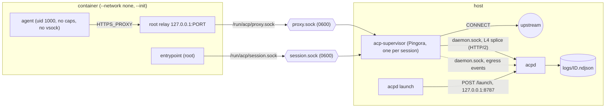
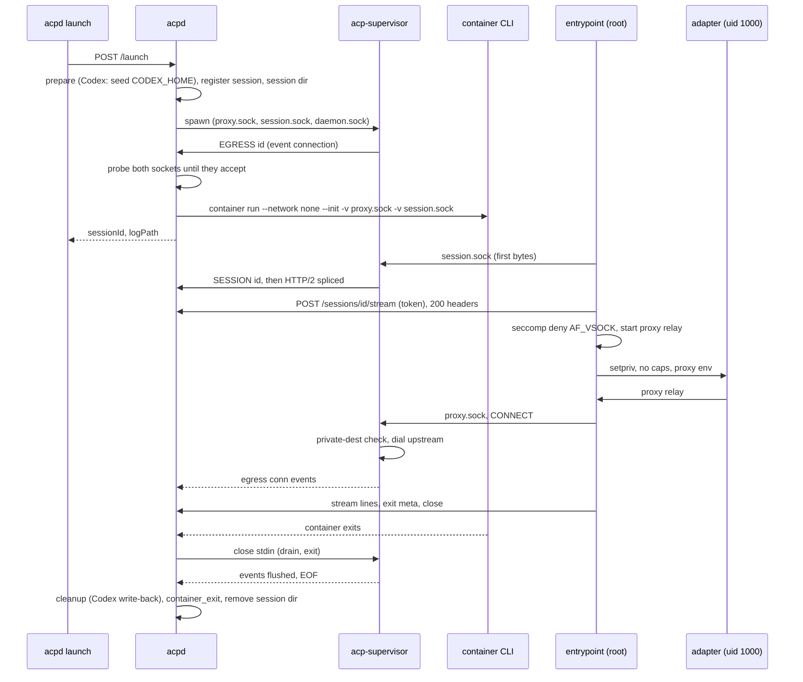
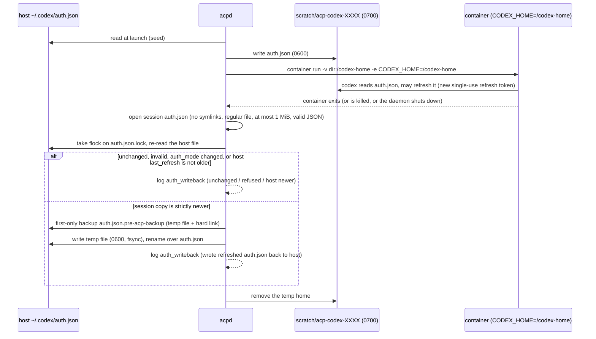

# acp-experiments

One host daemon, `acpd`, launches either a Claude or a Codex agent inside an Apple Container. Each container's entrypoint is an ACP client that spawns the agent's adapter ([claude-agent-acp](https://github.com/agentclientprotocol/claude-agent-acp) or [codex-acp](https://github.com/agentclientprotocol/codex-acp)) as a stdio subprocess, runs one session, and streams every JSON-RPC message to the daemon over HTTP/2. The container has no network: its only connections are two Unix sockets relayed by the container runtime. The daemon writes the stream to a per-session log file. Everything is Rust and uses the official [`agent-client-protocol`](https://github.com/agentclientprotocol/rust-sdk) crate.

## Layout

- `acpd/` is the daemon binary: `acpd serve` and `acpd launch --agent claude|codex "<prompt>" [--cwd DIR] [--follow]`. `profiles.rs` holds the per-agent launch profiles (image, env passed to the container, per-launch hook) and `codex_auth.rs` is Codex's credential seed and write-back hook.
- `crates/acp-supervisor/` is the per-session egress proxy (`acp-supervisor`), built on Pingora.
- `crates/acp-tap/` is the shared library: the log envelope, the h2c client and uplink, the daemon's server and session registry, and the entrypoint harness.
- `agents/claude/` and `agents/codex/` each hold the entrypoint binary, a Containerfile and `image/` with the pinned adapter (`claude-agent-acp` 0.93.0, `codex-acp` 2.2.2, installed with `npm ci`).



The launch and teardown order:



The daemon serves its control API (`/launch`) on `127.0.0.1:8787` (`PORT`) and keeps logs in `./logs` (`LOGS_DIR`). The container has no network. A per-session `acp-supervisor` process listens on two Unix sockets in a private directory, which are mounted into the container, and dials the daemon's own socket. The prompt and secrets reach containers through `-e NAME` with no value, so the container CLI inherits them from the daemon's environment and none appears on argv.

## Run

```bash
mise install                                            # pins the Rust toolchain
mise run build-images                                   # or: mise run build-image claude
mise run serve                                          # terminal 1; loads CLAUDE_CODE_OAUTH_TOKEN from mise.local.toml
mise run launch claude "Reply with the word pong" -- --follow   # terminal 2
mise run launch codex "Reply with the word pong" -- --follow
mise run check                                          # fmt --check, clippy -D warnings, tests
```

Prerequisites: [mise](https://mise.jdx.dev) and Apple `container` 1.4.1 on an Apple silicon Mac; `container` cannot be installed through mise. `mise.toml` pins Rust 1.97.1 (the crates' `rust-version` and the images' builder stage follow it) and defines the tasks (`build`, `test`, `lint`, `fmt`, `check`, `build-image`, `build-images`, `serve`, `launch`). Put `CLAUDE_CODE_OAUTH_TOKEN` in the uncommitted `mise.local.toml` (`[env]`), which mise loads on top of `mise.toml`; for Codex, `codex login` once. Extra flags go after `--`, for example `-- --cwd DIR --follow`.

The image build uses the repository root as its context: a Rust stage compiles the entrypoint for linux arm64, and the final `ubuntu:26.04` stage adds Node 24, the pinned adapter, the entrypoint and a non-root `agent` user.

Environment: `PORT` (default 8787), `LOGS_DIR`, `ACP_SUPERVISOR_BIN` (default: `acp-supervisor` next to `acpd`), `CLAUDE_IMAGE` (default `acp-claude:dev`), `CODEX_IMAGE` (default `acp-codex:dev`), `CODEX_HOST_HOME` (default `~/.codex`), `INITIAL_AGENT_MODE` (Codex, set it in the daemon's environment: `INITIAL_AGENT_MODE=read-only mise run serve`; `read-only`, `workspace-write`, `agent`, `agent-full-access`), `DAEMON_LOCAL_URL` (for `launch`).

The daemon starts without any credentials. A claude launch without `CLAUDE_CODE_OAUTH_TOKEN` in the daemon's environment, or a codex launch without `~/.codex/auth.json`, is refused with a 400 and a message naming what is missing.

## Egress

A container is started with `--network none`, so TCP, UDP, DNS and IPv6 all fail inside it. It has two sockets, `/run/acp/session.sock` and `/run/acp/proxy.sock`, which are socket *files* mounted with `-v`; the container runtime relays a mounted socket file to the host process listening on it. Both are mode 0600 on the host, which maps through, so only root in the container can open them.

- `session.sock` is the uplink. The supervisor splices it, byte for byte, to the daemon's socket, so the session stream stays HTTP/2 from the entrypoint (client) to the daemon's stream handler (server). The entrypoint starts nothing until the daemon has accepted the stream.
- `proxy.sock` is a CONNECT proxy in the supervisor. The root entrypoint relays a loopback port to it, and the adapter runs through `setpriv` as uid 1000 `agent` with every capability dropped and `no_new_privs`, in an environment built by the entrypoint: it carries `HTTPS_PROXY` and friends (pointing at the loopback relay), `NODE_USE_ENV_PROXY=1`, and not the session id or prompt. There is no firewall and no `NET_ADMIN`.

The proxy accepts only `CONNECT host:port`. It refuses destinations that are loopback, link-local, private, CGNAT, ULA or unspecified (`private-dest`, 403), so it cannot reach the daemon's control port or other host services, and refuses plain HTTP with 501 (`plain-http`). Phase 1 is otherwise allow-all. Each connection becomes one `dir: "egress"` line in the session log, written when the connection closes (connections still open at shutdown are flushed with `error: "shutdown"`); the supervisor sends them to the daemon over a second connection on the daemon socket, and its own diagnostics go to `logs/<id>.supervisor.log`:

```json
{"ts":"…","dir":"egress","msg":{"event":"conn","session":"7e759259","started":"…","method":"CONNECT","host":"api.anthropic.com","port":443,"decision":"allow","rule":"phase1-allow-all","bytes_up":1234,"bytes_down":56789,"duration_ms":4200,"error":null}}
```

Two more measures come from reading the runtime's source and testing it. The agent shares the VM's network namespace with the runtime's vsock relays, and nothing in the runtime restricts `socket(AF_VSOCK)`, so a process running as uid 1000 could dial the host-side relay ports directly and skip the sockets' 0600 permissions (measured: both `session.sock` and `proxy.sock` were reachable that way). The entrypoint therefore installs seccomp filters that make `socket()` fail with `EAFNOSUPPORT` for `AF_VSOCK` (and `AF_NETLINK`, `AF_PACKET`) and `io_uring_setup`/`enter`/`register` fail with `EPERM` (io_uring can create sockets without `socket()`), for itself and everything it starts, and each session's stream POST must carry a random token that only exists in the entrypoint's environment (stripped from the agent's). The container also runs with `--init`, so the runtime's init is PID 1: it reaps orphaned processes and passes `container stop` to the entrypoint as SIGTERM, which the entrypoint handles by ending the session cleanly. See `.runbook/egress-design.md`, "Threat notes".

To list the hosts a set of sessions used: `jq -r 'select(.dir=="egress") | .msg | "\(.host):\(.port)"' logs/*.ndjson | sort | uniq -c`. If the supervisor dies mid-session the daemon logs a `container_error` and stops the container. Every client must honour the proxy variables, which Claude Code, Codex, Node `fetch`/`https`, npm, git and curl all do; `git://` and `ssh://` do not work. Everything a session leaves on disk lives under one state root, `$TMPDIR/acpd-<uid>/` (0700): `sessions/` (the sockets and the supervisor's pid file), `scratch/` (the Codex temp homes with their `auth.json` copies) and `daemon/` (the daemon socket). The daemon holds an exclusive lock on `acpd-<uid>/lock` for its lifetime, so a second `acpd serve` refuses to start. When a daemon is killed with SIGKILL its supervisors exit by themselves (stdin EOF), but its containers keep running and its directories stay; the next `acpd serve` sweeps them on startup, before listening: it stops and deletes every container carrying the label `acpd=1` and deletes the directories (making them removable first, since an agent can `chmod 0000` its own mounted files) without writing anything back to the host, then logs what it removed. A directory it cannot remove is logged and does not stop the daemon; the lock and the ownership check of the state root are still fatal. Supervisors are not tracked: they exit by themselves when the daemon's end of their stdin closes. The design, the spike numbers and the rejected alternatives (nft lockdown, `--ssh`, `--publish-socket`, a directory mount, stdio) are in `.runbook/egress-design.md`.

## Working directory

By default the agent works in the image's empty `/workspace`. `--cwd DIR` (an absolute host path, or relative to where `launch` runs) bind-mounts that host directory read-write at `/workspace`. The daemon rejects a relative path, a path containing `:` or a directory that does not exist with 400.

## Shutdown

SIGINT and SIGTERM stop the daemon cleanly: it stops every running container, waits for each to exit and for its stream to drain, runs each session's cleanup, and exits. New launches get 503 meanwhile. Cleanup also runs if setup fails partway.

## Use of the Rust SDK

Both entrypoints use `agent-client-protocol` with the `process` feature. Claude adds `unstable_protocol_v2` and uses `Client.v2()` with the `schema::v2` types; Codex uses `Client.builder()` and `schema::v1`. The tap is the SDK's own hook, `AcpAgent::with_debug`, which reports every line written to the adapter's stdin and read from its stdout and stderr without altering it. `AcpAgent` also owns the child's lifetime: it races the protocol against the adapter's exit, terminates the process group after a bounded grace period, and ends on stdout EOF. Both entrypoints verify the `protocolVersion` in the initialize response and fail if it differs.

## Log format

`logs/<sessionId>.ndjson` has one envelope per line:

```json
{"ts": "2026-10-17T06:50:14.181Z", "dir": "client->agent", "msg": {"jsonrpc": "2.0", "id": 0, "method": "initialize", "params": {}}}
```

`dir` is `client->agent`, `agent->client`, `meta`, or `egress` (one line per proxied connection, see Egress). For the agent directions, `msg` is the raw JSON-RPC message (or `{"raw": "..."}` if a line did not parse). Meta events from the entrypoint: `start` (including `agent`), `agent_stderr`, `auto_approve`, `error`, `exit`, plus `auth_methods` for Codex. From the daemon: `container_exit`, `container_error` and, for Codex, `auth_writeback`. `container_exit` is written only after the stream has drained (or at once if none was accepted), so it is always the last line. `logs/<sessionId>.container.log` holds the container's stdout and stderr. The logs directory is created 0700 and every file 0600.

## Claude

ACP v2, which is a draft: the entrypoint sets `CLAUDE_AGENT_ACP_EXPERIMENTAL_V2=1`, sends `protocolVersion: 2`, and ends when the session goes idle after having been active. Both the SDK feature and the adapter flag are experimental, so versions are pinned. The token is passed with `-e CLAUDE_CODE_OAUTH_TOKEN`. The agent runs with the container's full environment, so with auto-approve it can run `env` and write the token into the session log; treat the logs as secret.

## Codex

ACP v1: codex-acp 2.2.2 hardcodes version 1 and has no v2 switch. Session updates are printed as they arrive, concurrently with the prompt request. The entrypoint makes no `authenticate` call, because the adapter's `chat-gpt` authenticate forces a token refresh on every launch; Codex reads the mounted `auth.json` itself, and the advertised method ids are logged as `auth_methods`.



The daemon reads the host `auth.json` per launch; it is not in the image, argv or env. No host `config.toml` is copied. The temp directory is removed after the write-back on every path: normal exit, container kill, spawn error, setup failure and daemon shutdown. The logs contain the account label, email and plan, and with auto-approve the agent can `cat /codex-home/auth.json` into the log, so treat them as secret.

Codex rewrites `auth.json` with a new single-use refresh token when it refreshes, so after the container exits the daemon writes the session's copy back under these rules:

- The session file is opened without following symlinks and only used if it is a regular file of at most 1 MiB that parses as JSON with a valid `last_refresh` and the same `auth_mode` as the seed.
- It replaces the host file only if its `last_refresh` is strictly newer than the host file's current one; otherwise the result is `host newer`.
- The compare and replace happen under an exclusive `flock` on `auth.json.lock` next to the host file.
- The first host file is saved once as `auth.json.pre-acp-backup`, created exclusively and never overwritten.
- The new file is written to a uniquely named exclusive-create 0600 temp file in the same directory, fsynced and renamed over the host file.

The outcome is logged as `auth_writeback` with a fixed reason string and no file content: `unchanged`, `host newer`, `wrote refreshed auth.json back to host`, `no auth.json in session home`, or a `refused: ...` or `failed: ...` reason. Two concurrent sessions that start from the same stale refresh token cannot both refresh, so the loser's refresh fails; this is inherent to per-session copies and is not serialized.

codex-acp 2.2.2 never sends the first `_meta.terminal_output_delta` of a command's output, so that first chunk is absent from Codex session logs (a command that prints three lines yields only the second and third). This was checked on the adapter's raw stdout with a minimal ACP client, so the tap, the splice and the daemon are not the cause; Claude sessions are not affected. The upstream issues [#166](https://github.com/agentclientprotocol/codex-acp/issues/166) (terminal handling differs from Zed) and [#365](https://github.com/agentclientprotocol/codex-acp/issues/365) ("out of turn") may be related, but that is unconfirmed.

Codex's default mode is `agent` (workspace-write sandbox, approvals on request). Whether Landlock engages inside the VM was not verified; the container is the real boundary. `INITIAL_AGENT_MODE=read-only` makes Codex request permission for writes, which the entrypoint auto-approves.

## Caveats

- Permission requests are auto-approved (the first `allow_once` option, else `allow_always`, else the first option). The agent can run any tool inside the container with no human in the loop.
- The control API binds `127.0.0.1` with no authentication on `/launch`, so any local process can start containers that use your Claude token or ChatGPT login and mount host directories with `--cwd`.
- The relay between the host and container sockets is Apple `container`'s socket-file mount; it loses in-flight data on a half-close (about 30 KB out of 1 MiB), so nothing here half-closes. The entrypoint's proxy relay holds a client's end-of-stream back, which shows up as proxy connections lasting about 5 s longer than the client's.
- The supervisor's sockets must exist before the container starts, and a socket file whose listener is gone accepts a connect and then hangs, so every step on the container side has a timeout.
- Codex downloads large artifacts from `*.oaiusercontent.com` on startup, so a phase-2 allowlist has to include them.
- There is no `agent_exit` meta event: the SDK owns the adapter process and does not report its exit status, so a crash shows up as an `error` event carrying the SDK's message.
