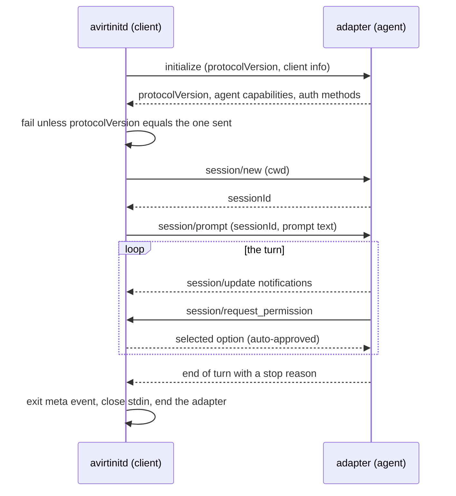

# Status: implemented

## Roles

| ACP role | avirt process | Runs as | Transport |
| --- | --- | --- | --- |
| Client | avirtinitd, the workload container's root process | root | The adapter's stdin and stdout |
| Agent | The harness's ACP adapter (claude-agent-acp or codex-acp) and every tool it starts | uid 1000 (`agent`) | Its own stdin and stdout |

`avirtinitd` is one binary for both harnesses. `AVIRT_AGENT`, set in each workload image, selects the conversation: `claude` speaks ACP v2 and `codex` speaks ACP v1. Any other value exits 64. The client is built on the `agent-client-protocol` crate 3.4.0 with the `process` and `unstable_protocol_v2` features, and sends `claude-container` or `codex-container`, version `0.0.0`, as its implementation info. The per-harness details are in [Claude harness](./acp-claude.md) and [Codex harness](./acp-codex.md).

## Adapter process

avirtinitd spawns the adapter as a stdio subprocess, the ACP stdio transport: newline-delimited JSON-RPC 2.0 on stdin and stdout, with stderr free for diagnostics. The command line is:

```text
env -u AVIRT_WORKLOAD_ID -u AVIRT_PROMPT -u AVIRT_CWD -u AVIRT_UPLINK_TOKEN -u AVIRT_AGENT \
  setpriv --reuid=agent --regid=agent --init-groups --inh-caps=-all --bounding-set=-all --no-new-privs \
  -- <adapter command>
```

The adapter command is a bare name found on `PATH`, which the image sets to start with `/opt/agent/node_modules/.bin`. The adapter's environment is avirtinitd's own, minus the five `AVIRT_*` variables, plus `HOME=/home/agent`, the proxy variables pointing at avirtinitd's TCP proxy to `proxy.sock`, `NO_PROXY=localhost,127.0.0.1`, `NODE_USE_ENV_PROXY=1`, and the harness's extra variables. The confinement is in [workload hardening](./workload-hardening.md#agent-process).

The adapter starts only after these steps, in order:

1. `AVIRT_WORKLOAD_ID`, `AVIRT_PROMPT` and `AVIRT_UPLINK_TOKEN` are present and non-empty, else avirtinitd exits 64. `AVIRT_CWD` defaults to `/workspace`.
2. avirthostd has accepted `POST /workloads/<id>/stream` on the workload's HTTP/2 connection to its mediator (see [workload topology](./workload-topology.md#connection-to-the-mediator)), and avirtinitd has written the `start` meta event.
3. avirtinitd's TCP proxy to `proxy.sock` is listening (see [workload topology](./workload-topology.md#tcp-proxy-to-proxysock)).
4. The seccomp filters are installed (see [workload hardening](./workload-hardening.md#seccomp)).

The SDK's `AcpAgent` owns the adapter's lifetime. It races the protocol against the adapter's exit, so a dead adapter cannot hang a pending request. When the connection ends, it waits up to 1 s for the adapter to exit and then sends SIGKILL to the adapter's whole process group.

## JSON-RPC tap

The tap is the SDK's line hook, `AcpAgent::with_debug`, which reports every line the client writes to the adapter's stdin and every line it reads from the adapter's stdout and stderr, without altering them. Each line is trimmed, and an empty line is skipped.

| Adapter stream | Envelope `dir` | `msg` |
| --- | --- | --- |
| stdin | `client->agent` | The JSON-RPC message, or `{"raw": "..."}` if the line does not parse |
| stdout | `agent->client` | The same |
| stderr | `meta` | `{"event": "agent_stderr", "line": "..."}`, and the line is also written to avirtinitd's stderr |

A line over 16 MiB is not forwarded in any form and becomes a `line_truncated` meta event. Envelopes travel in `POST /workloads/<id>/stream`, one long-lived HTTP/2 POST of NDJSON on the workload's HTTP/2 connection to its mediator, and avirthostd writes them to `logs/<workload-id>.ndjson`. The envelope and every meta event are specified in [avirthostd API](./hostd-api.md#envelope).

Protocol lines are all reported before the ACP session returns. Stderr bytes still unread when the adapter exits cleanly can be lost. The Rust SDK answers a line it cannot parse by writing it back to the adapter's stdin, so one oversized line on stdout yields two `line_truncated` events.

avirtinitd also writes a human-readable view to its stdout, which avirthostd captures in `logs/<workload-id>.container.log`: the text of each agent message chunk as it streams, and `[<sessionUpdate>]` for every other update.

## Session lifecycle

One workload runs one ACP session with one prompt, the `prompt` of `POST /launch`.



1. **initialize.** avirtinitd sends `initialize` with the harness's protocol version and no client capabilities. If the response's `protocolVersion` differs from the one sent, the workload fails with a JSON-RPC invalid-params error whose data names both versions.
2. **authenticate.** Not sent. Both harnesses read their credentials from the environment or from files the workload container already holds (see [credentials](./egress-credentials.md#status-implemented)). For Codex, avirtinitd logs the advertised method ids as an `auth_methods` meta event.
3. **session/new.** avirtinitd sends the working directory, `AVIRT_CWD` or `/workspace`, and no MCP servers.
4. **session/prompt.** avirtinitd sends the prompt as one text content block.
5. **End of turn.** How the turn ends depends on the protocol version:
   - **ACP v1.** The `session/prompt` response ends the turn and carries the stop reason. Session updates are handled concurrently with the request, as they arrive.
   - **ACP v2.** The `session/prompt` response only acknowledges the prompt with a message id. avirtinitd discards updates queued before the prompt, and then follows the session's `state_update` notifications for its own session id: `running` or `requires_action` marks the session active, and the turn ends at the first `idle` that carries a stop reason, or at an `idle` after the session was active. An `idle` with a stop reason ends the turn even without a preceding `running`, which covers an immediate refusal.
6. **End.** avirtinitd writes the `exit` meta event with `stopReason`, ends the ACP connection, and closes `POST /workloads/<id>/stream`. It sends neither `session/cancel` nor `session/close`.

The exit code is 0 when the stop reason is `end_turn`, 1 for any other stop reason (`max_tokens`, `max_turn_requests`, `refusal`, `cancelled`), and 2 when the workload fails. avirthostd records it in `container_exit`.

## Client capabilities

| Capability | ACP surface | avirt |
| --- | --- | --- |
| File system | `fs/read_text_file`, `fs/write_text_file` (ACP v1 only) | Not advertised. The agent reads and writes files itself, inside the workload container. |
| Terminals | `terminal/create`, `terminal/output`, `terminal/wait_for_exit`, `terminal/kill`, `terminal/release` (ACP v1 only) | Not advertised. The agent runs commands itself, inside the workload container. |
| Permission requests | `session/request_permission` | Implemented: every request is approved automatically |
| Authentication and elicitation extensions | `auth`, `elicitation` (ACP v2) | Not advertised |

Under ACP v1, avirtinitd sends the default client capabilities, in which `fs.readTextFile`, `fs.writeTextFile` and `terminal` are false. The ACP v2 draft schema has no file system or terminal methods. An agent request for any method avirtinitd does not handle is answered with JSON-RPC error -32601 (method not found), and an unhandled notification is ignored.

### Permission requests

avirtinitd answers each `session/request_permission` by choosing the first option of kind `allow_once`, else the first of kind `allow_always`, else the first option. A request with no options is answered with the `cancelled` outcome. Each approval is logged as an `auto_approve` meta event with the option's `optionId` and `name`. No request is ever shown to an operator.

## Operator access

An operator reaches a session only by launching it and reading its log:

- `avirt launch --agent <agent> "<prompt>"` sends `POST /launch` to avirthostd, which starts the workload with that one prompt (see [operator CLI](./operator-cli.md) and [avirthostd API](./hostd-api.md#control-api)).
- `avirt launch --follow` streams `logs/<workload-id>.ndjson` until the `container_exit` meta event.

There is no way into a running session: no second prompt, no cancellation, and no permission decision. avirthostd has no route that stops one workload, and stopping avirthostd stops every running workload.

## Errors and timeouts

| Failure | Effect |
| --- | --- |
| A required variable is missing, or `AVIRT_AGENT` is unknown | Exit 64, before the connection to the mediator. Nothing reaches the workload log. |
| `POST /workloads/<id>/stream` cannot be opened within 15 s, or avirthostd refuses it | Exit 3, before the adapter starts. Each attempt allows 5 s to connect, 5 s for the HTTP/2 handshake and 4 s for avirthostd's answer, and a 403, 404, 409 or 410 is not retried. |
| avirtinitd's TCP proxy to `proxy.sock` or the seccomp filters cannot be installed | `error` meta event, exit 3, before the adapter starts |
| The protocol version in the initialize response differs | `error` and `exit` (`stopReason: "error"`) meta events, exit 2 |
| The adapter answers a request with a JSON-RPC error | The same, with the adapter's error as the message |
| The adapter exits or closes stdout mid-session | The same. Under ACP v2, the message is `agent disconnected before the prompt ran to completion`. There is no adapter exit-status event. |
| avirthostd refuses or loses `POST /workloads/<id>/stream` mid-session | The same, with the refusal or failure as the message |
| SIGTERM (`container stop`) | The same, with the message `terminated by SIGTERM` |

No ACP request and no prompt turn has a deadline. A session runs until its turn ends, the adapter exits, the connection to the mediator fails, or the workload is stopped. avirthostd stops a workload container with `container stop --time 5` when the mediator exits unexpectedly or avirthostd shuts down (see [lifecycle](./lifecycle.md#launch-and-teardown)). After the `exit` meta event, avirtinitd waits up to 10 s for avirthostd to drain `POST /workloads/<id>/stream`, or 5 s when it fails before the adapter starts.

# Status: planned

## Roles

The ACP client moves out of avirtinitd into avirtacp, the main workload process for ACP harnesses (see [components](./components.md#workload-container) and [roadmap](./roadmap.md#workload-process-split)).

| Process | UID | ACP part |
| --- | --- | --- |
| avirtinitd | 0 | None. It launches avirtacp, and launches the adapter at avirtacp's request, by the absolute path in `harness.toml`, as uid 1000 in the agent cgroup with the agent's security context. It hands the adapter's stdin, stdout and stderr pipes to avirtacp. |
| avirtacp | `avirt-run` | The ACP client. It reads `harness.toml`, drives the sessions, taps every JSON-RPC line, submits the envelopes to avirtnetd on `/run/avirt/streams/<role>.sock`, and serves the session control API. |
| Adapter | 1000 | The ACP agent, unchanged |

The tap and the envelope keep their implemented form. Envelopes reach avirthostd on the `/envelopes` stream with `seq` and `src: "workload"` (see [workload topology](./workload-topology.md#resuming-after-reconnect)). The adapter is never restarted: when it exits, avirtacp ends every session and exits (see [startup and failure semantics](./components.md#startup-and-failure-semantics)).

## `harness.toml`

Each harness base image holds the harness config file `/opt/agent/harness.toml` (see [workload lifecycle](./workload-lifecycle.md#base-images)). avirthostd reads it from the content-addressed cache to build the configuration layer, and avirtacp reads it at boot to start the adapter and speak to it.

```toml
name = "claude"
main_process = "avirtacp"

[adapter]
command = "/opt/agent/node_modules/.bin/claude-agent-acp"
protocol = 2
env = { CLAUDE_AGENT_ACP_EXPERIMENTAL_V2 = "1" }

[config]
managed_paths = ["/etc/claude-code"]
user_paths = ["/home/agent/.claude"]
```

| Key | Meaning |
| --- | --- |
| `name` | The harness name, which a launch's `agent` selects and the `start` event records |
| `main_process` | The main workload process that drives it: `avirtacp` for an ACP adapter, `avirtagent` for a native harness |
| `adapter.command` | The adapter's absolute path. A path outside `/opt/agent` fails the image build. |
| `adapter.args` | Arguments, empty by default |
| `adapter.protocol` | The ACP protocol version to send in `initialize` and require in its response: `1` or `2` |
| `adapter.env` | Variables the adapter always gets, on top of those in `/etc/avirt/launch.toml` |
| `config.managed_paths` | The paths where the harness reads configuration that overrides project and user configuration. The configuration layer writes them, and workspace layers may not touch them. |
| `config.user_paths` | The harness's user-level configuration directories under `/home/agent`. Workspace layers may not touch them, and avirtinitd writes placeholder files into them at boot. |

A `harness.toml` with an unknown key, a `main_process` this avirt release does not have, or a protocol version avirtacp does not speak fails the launch before any workload starts. Everything that varies per launch (the mode, the model, the placeholder wiring and the CA wiring) is in the configuration layer (see [workload lifecycle](./workload-lifecycle.md#configuration-layer)), never in `harness.toml`.

## Session lifecycle

avirtacp drives each session through the same steps as the implemented client, with these additions:

- **initialize.** Sent once per adapter, with `adapter.protocol`. avirtacp advertises no client capabilities.
- **authenticate.** Never sent. Every credential the agent holds is a placeholder that avirtinitd wrote before the adapter started (see [credentials](./egress-credentials.md#placeholders)).
- **session/new.** Sent with the working directory and an empty `mcpServers` list. The agent's only MCP server, avirtmcp, comes from the harness's managed MCP configuration in the overlay.
- **session/prompt.** Sent for the launch prompt, and for each prompt an operator sends through the session control API. A prompt that arrives while a turn runs is refused.
- **session/cancel.** Sent when an operator cancels the turn, or when the workload is being stopped. After `session/cancel`, avirtacp answers every pending `session/request_permission` with the `cancelled` outcome, as the ACP prompt-turn cancellation rules require, and waits for the turn to end with stop reason `cancelled`.
- **session/close.** Sent when a session ends, if the agent advertises it in `sessionCapabilities`. Otherwise avirtacp closes the adapter's stdin.

By default a launch runs as the implemented workload does: one prompt, one turn, then the session ends. A launch with `interactive: true` keeps the session open after each turn until an operator ends it, the workload's idle limit passes, or the workload is stopped.

## Client capabilities

| Capability | avirtacp |
| --- | --- |
| File system | Not advertised. avirtguestd serves the operator's file access to the workspace (see [components](./components.md#workload-container)). |
| Terminals | Not advertised |
| Permission requests | Decided by the launch's approval policy (see below) |
| Elicitation | Not advertised |

The launch's approval policy is one of:

| Policy | A permission request is |
| --- | --- |
| `auto` | Approved with the implemented option order and logged as `auto_approve`. The default. |
| `operator` | Sent to the attached operators through the session control API. The first answer wins. With no operator attached, it waits, and the turn's permission deadline applies. |
| `reject` | Answered with the first `reject_once` option, else `reject_always`, else `cancelled`, and logged as `auto_reject` |

Every decision is logged as a meta event with the request's `toolCallId`, the chosen `optionId` and who decided: `policy` or the operator's principal.

## Session control API

The session control API is how an operator reaches a running ACP session. avirtacp serves it on its session control stream, which avirtnetd carries on the workload's HTTP/2 connection to its mediator, and operators reach it through avirtapid.


| Operation | CLI | Effect | Cedar action |
| --- | --- | --- | --- |
| `Sessions/Attach` | `avirt session attach` | Streams the session's updates, tool calls, plans and permission requests and outcomes, as the envelopes the log holds, until the session ends | `attach_session` |
| `Sessions/Prompt` | `avirt session prompt` | Sends one prompt turn to an idle session | `prompt_session` |
| `Sessions/Cancel` | `avirt session cancel` | Sends `session/cancel` for the turn in progress | `cancel_session` |
| `Sessions/AnswerPermission` | `avirt session attach`, interactively | Answers one pending permission request with an `optionId` | `answer_permission` |
| `Sessions/End` | `avirt session end` | Ends the session | `end_session` |

The CLI commands are in [operator CLI](./operator-cli.md#sessions). avirtapid forwards the caller's authenticated identity. avirthostd authorizes every operation against the host policy snapshot before it forwards it, and avirtacp trusts only what arrives on its session control stream. The operator never speaks ACP and never reaches the adapter's stdio. Every operation and its outcome is an envelope on the `/envelopes` stream, so the workload log records who sent each prompt, cancellation and permission answer.

## Multi-session workloads

A multi-session workload runs several ACP sessions on one adapter connection. The launch prompt opens the first with `session/new`, and a `Sessions/Prompt` call that names no session id opens another. Every `Sessions` call then names its session id. Sessions share the workload container, its files and its egress policy, and each session id appears in the envelopes that concern it. A harness that does not advertise `session/close` runs one session per workload. The number of sessions per workload is capped by a host setting.

## Errors and timeouts

| Deadline | Value | On expiry |
| --- | --- | --- |
| `initialize` response | 30 s | The workload ends with `error`, before any session |
| `session/new` response | 60 s | That session fails. In a single-session workload, the workload ends. |
| Turn end after `session/cancel` | 30 s | avirtacp closes the adapter's stdin, and avirtinitd kills the agent cgroup |
| An `operator` permission request with no answer | 10 min | Answered with `cancelled` |
| An interactive session with no turn running | A launch option, 1 h by default | The session ends |

avirtacp suspends every deadline while the agent cgroup is frozen (see [freeze and reconnect](./workload-topology.md#freeze-and-reconnect)). A prompt turn itself has no deadline. A JSON-RPC error from the adapter fails only the request it answers. The adapter's exit, avirtnetd's exit or a lost connection to the mediator ends the workload as [startup and failure semantics](./components.md#startup-and-failure-semantics) describes.

# Open questions

1. **Session control API framing.** Whether the session control stream is its own HTTP/2 stream or a stream type inside the existing control stream, and whether avirtagent and avirtexec expose the same operations, is open (see [components](./components.md#open-questions)).
2. **ACP v2 stabilization.** claude-agent-acp speaks ACP v2 only behind an experimental flag. Whether avirtacp keeps ACP v1 for every harness until v2 is stable is open.
3. **Late subscribers.** Whether `Sessions/Attach` replays a session from its first envelope or only from the workload log's retained range is open.
