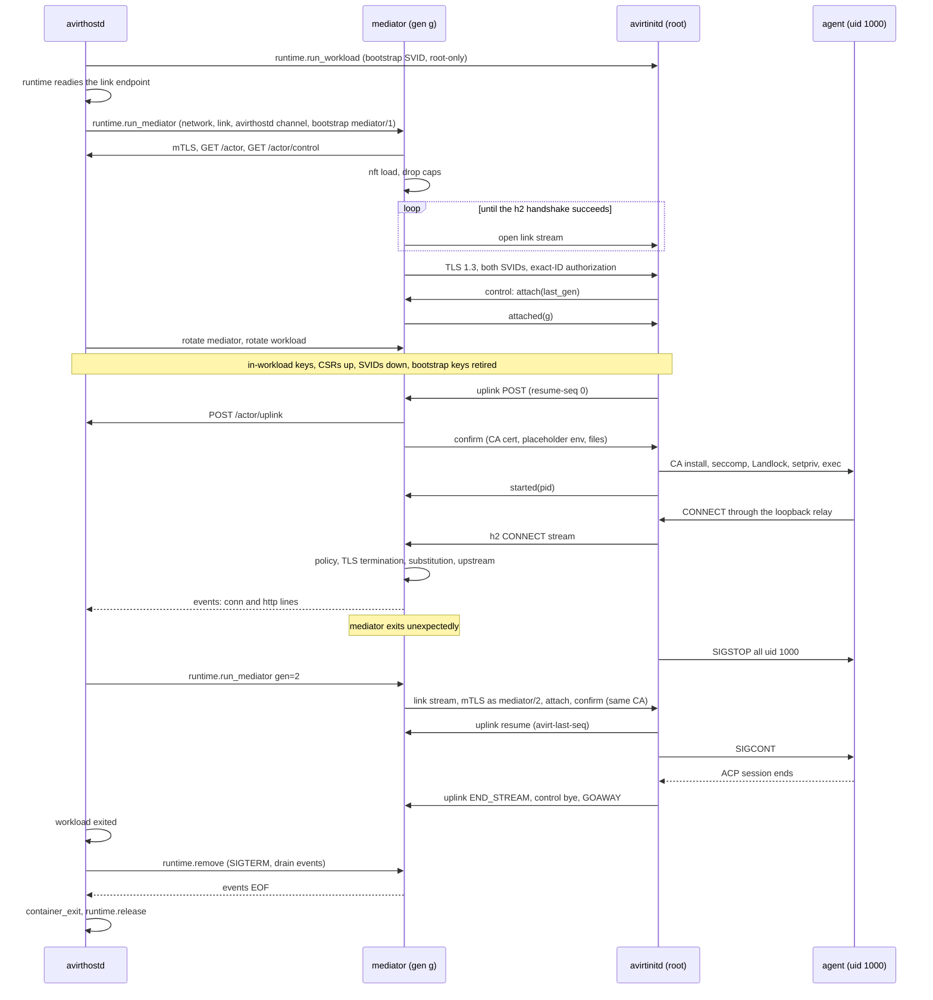

# Status: implemented

## Sockets

The workload runs with `--network none` and two Unix socket files mounted with `-v` from the actor's private directory `actors/<id>/` (0700). The container runtime relays a mounted socket file to the host process listening on it. Both files are mode 0600 on the host, which maps through, so only root in the workload can open them.

| Guest path | Host listener | Carries |
| --- | --- | --- |
| `/run/avirt/uplink.sock` | Mediator | The actor's HTTP/2 uplink (`POST /actors/<id>/stream`), spliced byte for byte to avirthostd |
| `/run/avirt/proxy.sock` | Mediator | The CONNECT proxy (see [egress](./egress.md)) |

The mediator dials avirthostd's socket `hostd/hostd.sock` (directory 0700, socket 0600). Each connection starts with one line naming its kind, the actor and the mediator's secret (see [identity](./identity.md)), read within 5 s:

- `ACTOR <id> <secret>`: `avirthostd` binds the connection to that actor and serves only that actor's stream route over it. Then HTTP/2 is spliced end to end between avirtinitd (client) and avirthostd's stream handler (server).
- `EGRESS <id> <secret>`: plain NDJSON egress events, one per proxied connection. `avirthostd` wraps each in the log envelope with `dir: "egress"`. Only one event connection per actor is accepted.

The mediator opens the `EGRESS` connection at startup. It dials an `ACTOR` connection only when the workload's first bytes arrive on `uplink.sock`, so a readiness probe (connect and close) costs avirthostd nothing.

## Uplink

`avirtinitd` connects to `uplink.sock` within 5 s, completes the HTTP/2 handshake within 5 s, posts the stream with its uplink token, and waits 4 s for the response headers. A failed attempt is retried after 300 ms, for 15 s overall. A 403, 404, 409 or 410 is final and is not retried. A socket file whose listener is gone accepts a connect and then says nothing, so every step has a timeout. `avirtinitd` starts neither the proxy relay nor the agent until avirthostd has accepted the stream, and fails with a message naming the mediator otherwise.

## Proxy relay

`avirtinitd` listens on an ephemeral `127.0.0.1` port and relays each connection to `proxy.sock`. The agent reaches it through `HTTPS_PROXY` and the related variables (see [workload hardening](./workload-hardening.md)).

Constraint: nothing on a relayed socket may half-close. With a `-v` socket-file mount, the peer's reply to a `SHUT_WR` sent immediately after the last write is lost. The relay therefore does not forward a client's end-of-stream. After the client finishes, each read on the other direction has a 30 s idle timeout. When the host side ends or a read idles out, the client is told and the relay closes. A proxied connection can therefore appear in the log longer than the client held it.

# Status: planned

## Link stream

The link is a byte stream between avirtinitd and the mediator that the compute runtime provides (see [compute runtimes](./compute-runtimes.md)): vsock that avirthostd dials into both VMs and splices, on the Containerization runtime, or a shared-volume Unix socket on Docker Desktop. The workload holds no host-relay socket mount. On Docker the endpoint is `/run/avirt/link/link.sock`, where avirtinitd listens and the mediator dials.

Roles are fixed whatever dials at the transport layer:

| Layer | Mediator | avirtinitd |
| --- | --- | --- |
| TLS 1.3 (mutual, SPIFFE) | Client | Server |
| HTTP/2 | Server | Client |

One h2 connection per mediator generation carries every stream:

| Stream | Request | Body |
| --- | --- | --- |
| control | `POST /link/control`, always the first stream | NDJSON messages in both directions, for the life of the connection |
| uplink | `POST /link/uplink` with `avirt-resume-seq: N` | The log envelopes, each carrying a `seq` |
| egress | `CONNECT host:port`, one per agent connection | Opaque bytes. The mediator answers with its local CONNECT listener's status: 403 for `private-dest`, 502 for DNS or dial failure, 400 for a bad authority |

The mediator splices each CONNECT stream into its local Pingora CONNECT listener on `/run/mediator/connect.sock`, writing a synthetic `CONNECT host:port` head plus `avirt-conn` (the h2 stream id, for log correlation).

The mediator opens the link with a 50 ms to 1 s backoff for 15 s, because dials made before avirtinitd listens end in EOF. It cannot distinguish a workload that is gone from one that is not ready, so avirthostd stops it explicitly.

## Gated launch

After the mutual TLS handshake (see [identity](./identity.md)):

1. `avirtinitd` → `{"t":"attach","last_gen":G}`
2. Mediator → `{"t":"attached","gen":g}`, echoing the generation from its SVID
3. Mediator → `{"t":"confirm","gen":g,"ca_pem":…,"env":{…placeholders…},"files":{"codex/auth.json":…},"mode":"audit"}`
4. `avirtinitd` installs the MITM CA, applies seccomp and Landlock, starts the agent, and replies `{"t":"started","pid":P}`

The mediator sends `confirm` only once all of these hold: its actor fetch succeeded, nft is loaded, the MITM CA and leaf cache are ready, and avirthostd has accepted the uplink. No agent process exists before `confirm`.

## Freeze and reconnect

When the control stream or the h2 connection fails, avirtinitd sends SIGSTOP to every uid-1000 process. It rescans `/proc` until a pass finds none still running, because tool processes can leave the agent's process group. It keeps listening on the link. If a mediator with a higher generation completes the handshake, `attach` and `confirm` within 30 s, avirtinitd sends SIGCONT. Otherwise it SIGKILLs the agent tree and exits 2 with `error: mediator lost`. Egress connections open through the lost mediator end, and clients retry them.

`avirthostd` restarts a mediator that exits unexpectedly, at most twice per actor, each time with the generation incremented. Once a newer generation is confirmed, avirtinitd sends GOAWAY on any older connection.

## Uplink resume

`avirthostd` tracks the highest `seq` it has written and returns it as `avirt-last-seq` when an uplink resumes. `avirtinitd` replays from a 4 MiB ring of sent envelopes and writes a `meta` `uplink_gap` event when the ring no longer covers the gap. `avirthostd` deduplicates by `seq`.

## Sequence

## avirthostd channel

`avirthostd` serves one channel per actor, provided by the runtime: vsock dialed by avirthostd into the mediator VM on the Containerization runtime, or `actors/<id>/c.sock` (0600, in a 0700 directory) file-mounted at `/run/avirt/hostd.sock` on Docker Desktop. The channel's identity binds the actor. The mediator is an h2 client over mutual TLS 1.3 (see [identity](./identity.md)).

| Request | Purpose |
| --- | --- |
| `GET /actor` | One JSON document per generation: `gen`, the policy, the MITM CA cert and key, `deny_addrs`, and the credential values for this actor's bindings. Held in memory only. |
| `GET /actor/control` | Long-lived. avirthostd pushes `rotate`, `bundle` and `stop` as NDJSON. |
| `POST /actor/uplink` | The workload's uplink, forwarded body for body |
| `POST /actor/events` | NDJSON egress events, written as `dir: "egress"` lines |
| `POST /actor/svid` | A CSR with an in-workload key, for the caller's own ID or, relayed, its actor's workload ID. Returns the SVID and the current bundle. |
| `POST /actor/codex/refresh` | Asks avirthostd to refresh Codex tokens (see [credentials](./credentials.md)) |

Mediator diagnostics go to stderr, which avirthostd writes to `logs/<actor-id>.mediator.log`. Losing the avirthostd channel is fatal to the mediator: it exits, the workload freezes, and avirthostd restarts the mediator or tears the actor down.
