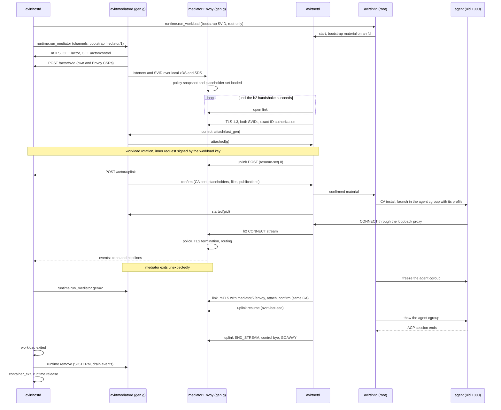

# Status: implemented

## Sockets

The workload runs with `--network none` and two Unix socket files mounted with `-v` from the actor's private directory `actors/<id>/` (0700). The container runtime relays a mounted socket file to the host process listening on it. Both files are mode 0600 on the host, which maps through, so only root in the workload can open them.

| Guest path | Host listener | Carries |
| --- | --- | --- |
| `/run/avirt/uplink.sock` | Mediator | The actor's HTTP/2 uplink (`POST /actors/<id>/stream`), spliced byte for byte to avirthostd |
| `/run/avirt/proxy.sock` | Mediator | The CONNECT proxy (see [egress](./egress.md)) |

The mediator dials avirthostd's socket `hostd/hostd.sock` (directory 0700, socket 0600). Each connection starts with one line naming its kind, the actor and the mediator's secret (see [identity](./identity.md)), read within 5 s:

- `ACTOR <id> <secret>`: `avirthostd` binds the connection to that actor and serves only that actor's stream route over it. Then HTTP/2 is spliced end to end between avirtinitd (client) and avirthostd's stream handler (server).
- `EGRESS <id> <secret>`: plain NDJSON egress events, one per proxied connection. `avirthostd` wraps each in the log envelope with `dir: "egress"`. Only one event connection per actor is accepted.

The mediator opens the `EGRESS` connection at startup. It dials an `ACTOR` connection only when the workload's first bytes arrive on `uplink.sock`, so a readiness probe (connect and close) costs avirthostd nothing.

## Uplink

`avirtinitd` connects to `uplink.sock` within 5 s, completes the HTTP/2 handshake within 5 s, posts the stream with its uplink token, and waits 4 s for the response headers. A failed attempt is retried after 300 ms, for 15 s overall. A 403, 404, 409 or 410 is final and is not retried. A socket file whose listener is gone accepts a connect and then says nothing, so every step has a timeout. `avirtinitd` starts neither the proxy relay nor the agent until avirthostd has accepted the stream, and fails with a message naming the mediator otherwise.

## Proxy relay

`avirtinitd` listens on an ephemeral `127.0.0.1` port and relays each connection to `proxy.sock`. The agent reaches it through `HTTPS_PROXY` and the related variables (see [workload hardening](./workload-hardening.md)).

Constraint: nothing on a relayed socket may half-close. With a `-v` socket-file mount, the peer's reply to a `SHUT_WR` sent immediately after the last write is lost. The relay therefore does not forward a client's end-of-stream. After the client finishes, each read on the other direction has a 30 s idle timeout. When the host side ends or a read idles out, the client is told and the relay closes. A proxied connection can therefore appear in the log longer than the client held it.

# Status: planned

## Runtime channels

The workload and the mediator have no network interface other than loopback. Every connection they make is on a channel that the compute runtime provides (see [compute runtimes](./compute-runtimes.md)). The workload has exactly one channel, the link. The mediator has four.

| Channel | Container end | Host end | Initiated by | TLS client and server |
| --- | --- | --- | --- | --- |
| Link | Workload: `/run/avirt/link.sock`, dialed by avirtnetd. Mediator: `/run/avirt/link.sock`, served by the mediator Envoy. | Spliced at L4 by avirthostd | The workload side | avirtnetd, the mediator Envoy |
| avirthostd channel | Mediator: `/run/avirt/hostd.sock` | avirthostd | avirtmediatord and the mediator Envoy | The mediator process, avirthostd |
| Service channel | Mediator: `/run/avirt/svc.sock` | avirthostd's service relay | avirtmediatord and the mediator Envoy | The mediator process, the destination |
| Ingress channel | Mediator: `/run/avirt/ingress.sock`, served by the mediator Envoy | avirthostd's service relay | avirthostd, for the front-door Envoy | The front-door Envoy, the mediator Envoy |

- **Containerization.** Each channel is a vsock connection between avirthostd and the guest, which the runtime's in-guest socket relay presents as the Unix socket above. The workload VM's vsock device has exactly one host listener, the link's, which avirthostd splices to the current mediator generation's link end; avirtnetd can therefore open a new link connection whenever it needs one. Every other host listener is on the mediator VM's device. `AF_VSOCK` is denied to every workload process, so only the runtime's relay uses the workload's vsock device.
- **Docker Desktop.** The link is a per-actor shared volume. The avirthostd and service channels are single-file bind mounts of the host's `actors/<id>/c.sock` and `actors/<id>/s.sock`. The ingress channel is open (see [components](./components.md#open-questions)).

Every runtime relay, splice and shared volume carries ciphertext only.

## Service relay

avirthostd's service relay reads only the TLS ClientHello's SNI on each service-channel connection, and splices the connection unchanged to the destination the SNI names, if that destination is in the actor's allowed set:

| SNI | Destination | Allowed when |
| --- | --- | --- |
| `<name>.svc.<td>` | The host component's listener `services/<name>.sock` | Always, for avirtsecretsd, avirtpolicyd, avirtdnsd, avirtoteld, avirtmcpgwd and avirtmodelgwd, and for avirtregistryd from a build job's service channel only |
| `frontdoor.svc.<td>` | The front-door Envoy's egress listener | Always |

The relay also serves one host-side listener for the front-door Envoy alone, `services/ingress-relay.sock`, checked with `SO_PEERCRED`. A connection there names its destination by SNI `<uuid>.ingress.<td>`, and the relay splices it to that actor's ingress channel at its current generation.

A connection with no SNI, an unknown SNI or a destination outside the set is closed before any byte is forwarded. The relay never terminates TLS. The destination authenticates the caller by its SVID and authorizes it (see [trust boundaries](./trust-boundaries.md#listeners)). The relay never connects one mediator to another. Only the front-door Envoy reaches a mediator's ingress channel, through `services/ingress-relay.sock`.

## Link stream

| Layer | Mediator Envoy | avirtnetd |
| --- | --- | --- |
| TLS 1.3 (mutual, SPIFFE) | Server | Client |
| HTTP/2 | Server | Client |

One h2 connection per mediator generation carries every stream. avirtnetd opens every stream, and the mediator Envoy routes each one:

| Stream | Request | Opened for | Routed to |
| --- | --- | --- | --- |
| control | `POST /link/control`, always the first stream | avirtnetd | avirtmediatord, NDJSON messages in both directions for the life of the connection |
| uplink | `POST /link/uplink` with `avirt-resume-seq: N` | Envelopes from avirtinitd, the session runner and avirtnetd, each carrying a `seq` | avirthostd, `POST /actor/uplink` |
| egress | `CONNECT host:port`, one per agent connection | The loopback proxy | The egress pipeline (see [egress](./egress.md#mediator-envoy-pipeline)) |
| guest CLI | `POST /link/guest-cli` | avirtguest's gRPC, through `guest.sock` | The front-door Envoy, then avirtproxyd, under the `guest-cli` principal (see [identity](./identity.md#trust-domain-and-ids)) |
| MCP | `POST /link/mcp` | avirtmcp, through `mcp.sock` | avirtmcpgwd |
| DNS | `POST /link/dns`, long-lived | avirtnetd's stub resolver, with length-prefixed DNS messages in both directions | libavirtenvoy's DNS policy, then avirtdnsd for avirt names or the front-door Envoy's DNS operation for public names (see [egress](./egress.md#workload-dns)) |
| ingress offers | `POST /link/ingress-offers`, long-lived | avirtnetd | libavirtenvoy, which sends one offer per inbound connection |
| ingress | `POST /link/ingress` with `avirt-ingress-id: I` | avirtnetd, accepting an ingress offer | The inbound connection waiting under `I` (see [ingress](#ingress)) |

An egress stream's response carries the pipeline's status, including the front-door Envoy's 403 `private-dest`, 502 and 504. The control, uplink, DNS and ingress-offer streams have reserved flow-control windows, so bulk egress and ingress streams cannot starve them.

avirtnetd dials `link.sock` with a 50 ms to 1 s backoff, because dials made before the mediator Envoy listens fail, for up to the 30 s launch budget (see [lifecycle](./lifecycle.md#launch-order)). A mediator cannot tell a workload that is gone from one that is not ready, so avirthostd stops it explicitly.

## Gated launch

After the mutual TLS handshake (see [identity](./identity.md)):

1. avirtnetd → `{"t":"attach","last_gen":G,"proto":P}`. A link protocol version that avirtmediatord does not support is refused with `{"t":"refused","reason":"protocol"}`.
2. avirtmediatord → `{"t":"attached","gen":g}`, echoing the generation from its SVID.
3. The first rotation of every SVID (see [identity](./identity.md#rotation)).
4. avirtnetd opens the uplink, and avirthostd accepts it.
5. avirtmediatord → `{"t":"confirm","gen":g,"ca_pem":…,"env":{…placeholders…},"files":{"codex/auth.json":…},"mode":"audit","policy_version":V,"publications":[…]}`
6. avirtnetd hands the confirmed material to avirtinitd. avirtinitd installs the MITM CA, writes the files, starts the session runner and avirtguestd, and launches the agent at the runner's request (see [components](./components.md#workload)). avirtnetd replies `{"t":"started","pid":P}`.

avirtmediatord sends `confirm` only once all of these hold: its actor fetch succeeded, its own and its Envoy's SVIDs are rotated, the mediator Envoy has its listeners, libavirtenvoy holds a valid policy snapshot and the actor's placeholder set, the MITM CA is loaded, and avirthostd has reported the accepted uplink with `{"t":"uplink_accepted"}` on `GET /actor/control`. libavirtenvoy reports its snapshot and placeholder readiness to avirtmediatord on a local status socket. No agent process exists before `confirm`.

## Freeze and reconnect

avirtnetd distinguishes three link transitions:

- **Rotation.** After an SVID rotation, avirtnetd opens a new connection to the same generation with its current SVID, sends `{"t":"reattach","gen":g}` on a new control stream, resumes the uplink by `seq` and reopens its DNS and ingress-offer streams, and only then sends GOAWAY on the old connection. Streams already open on the old connection may finish. Nothing is frozen.
- **Reconnect.** When a connection fails, avirtnetd reconnects to the same generation in the same way. While no connection of the current or a higher generation is attached, avirtnetd reports it to avirtinitd, which adds a `link` freeze hold.
- **Replacement.** A mediator with a higher generation completes the handshake, `attach` and `confirm`, and supersedes the older generation.

While any freeze hold is set, avirtinitd writes `1` to the agent cgroup's `cgroup.freeze` and waits until `cgroup.events` shows `frozen 1`. The freeze covers every process in the agent cgroup, including tools that left the agent's process group, and leaves avirtnetd, the session runner and avirtguestd running. If a connection to the same or a higher generation is attached and confirmed within 30 s, avirtinitd removes the `link` hold, and once no hold remains it writes `0` and the agent resumes. Otherwise it writes `1` to `cgroup.kill` and exits 2 with `error: mediator lost`. Egress connections open through the lost connection end, and clients retry them.

A workload whose guest offers no writable cgroup v2 hierarchy with `cgroup.freeze` and `cgroup.kill` does not start its agent.

`avirthostd` restarts a mediator that exits unexpectedly, at most twice per actor, each time with the generation incremented. Once a newer generation is confirmed, avirtnetd sends GOAWAY on any older connection, and avirthostd fences the older generation at every host listener (see [identity](./identity.md#authorization)).

## Uplink resume

`avirthostd` writes each envelope to the actor log before it counts its `seq` as written, tracks the highest `seq` it has written, and returns it as `avirt-last-seq` when an uplink resumes. avirtnetd replays from a 4 MiB ring of sent envelopes and writes a `meta` `uplink_gap` event when the ring no longer covers the gap. `avirthostd` deduplicates by `seq`. Uplink envelopes carry `src: "workload"` (see [trust boundaries](./trust-boundaries.md#event-provenance)). avirthostd stamps `src`, `actor` and `gen` on every envelope and event from the authenticated channel it arrived on, overriding any value the producer supplied, and keeps one `seq` domain per producer. avirthostd caps each actor's log by size. Past a soft cap it slows the uplink and the actor's events through flow control, so producers refuse new work with 503 rather than drop records. At the hard cap it ends the actor with a `container_error` that names the cap.

## Ingress

A guest port is reachable from outside the workload only through a port publication, and only through the front-door Envoy. Port publications are versioned state in avirthostd, separate from the immutable actor configuration. They are set at launch or added through avirthostd's API, each authorized by the `publish_port` action.

| Field | Meaning |
| --- | --- |
| `actor` | The publishing actor, and with it the workload's short ID and namespace |
| `port` | A `127.0.0.1` port in the workload, or the built-in `guestd` target, which avirtnetd forwards to `/run/avirt/streams/guestd.sock` |
| `protocol` | `tcp` for opaque bytes, or `http` |
| `expires` | When the publication ends, at the latest with the actor. The front-door Envoy and the destination mediator Envoy both enforce it locally. |

A published port is reachable as `<name>.<ns>.workload.host.avirt.internal:<port>`, and a virtual service record (see [components](./components.md#front-door-envoy)) can name it as its backend. Who may connect is policy: the front-door Envoy's host snapshot and the destination actor's `ingress` action.

Every inbound connection reaches the destination mediator Envoy from the front-door Envoy of its own host, on its ingress channel:

- **Same host.** The source mediator Envoy sends an h2 CONNECT stream with the avirt name as `:authority` to this host's front-door Envoy. The front-door Envoy resolves the name to its entity, evaluates the host snapshot, and opens a new mutual TLS connection as `/service/frontdoor` on the destination's ingress channel, carrying the source identity in `x-avirt-caller`.
- **Peered host.** The source mediator Envoy sends the stream to its own front-door Envoy, which forwards it to the peer's front-door Envoy over mutual TLS with federated bundles. The peer's front-door Envoy evaluates its own host snapshot and connects to the destination as above. The source front-door Envoy connects to the peer's peer listener and sets `x-avirt-caller` to the originating workload's identity, in its own trust domain. The receiving front-door Envoy accepts it only if that identity is in the trust domain of the peer front-door SVID that carried it, and otherwise refuses the stream with 403. Each front-door Envoy sets `x-avirt-caller` itself on the stream it originates.
- **avirtproxyd.** avirtproxyd reaches virtual services through the front-door Envoy in the same way.

The guest CLI stream takes the same first hop the other way round: the mediator Envoy sends it to the front-door Envoy, which authorizes the `guest-cli` principal against the host snapshot and forwards it to avirtproxyd.

The destination mediator Envoy accepts ingress connections only from `/service/frontdoor`. It then:

1. evaluates the actor snapshot's `ingress` action for the caller in `x-avirt-caller` and the port;
2. sends the offer `{"t":"ingress","id":I,"port":…}` on the ingress-offer stream;
3. waits for avirtnetd's `POST /link/ingress` with `avirt-ingress-id: I`, and relays bytes between the two.

avirtnetd accepts an offer only for an unexpired port in its current publication set, which arrives in `confirm` and in later `{"t":"publications"}` control messages. A revoked or expired publication closes its open ingress streams. avirtnetd connects only to `127.0.0.1:<port>`, never to its own loopback proxy port, its DNS stub or any other port it holds, and never to a socket under `/run/avirt` except `streams/guestd.sock` for the `guestd` target. For that target it passes the caller's identity, so avirtguestd can authorize each operation.

## Sequence

## avirthostd channel

`avirthostd` serves one avirthostd channel per actor (see [runtime channels](#runtime-channels)). The channel's identity binds the actor. avirtmediatord and the mediator Envoy are h2 clients over mutual TLS 1.3, each with its own SVID and its own routes (see [identity](./identity.md#authorization)).

| Request | Caller | Purpose |
| --- | --- | --- |
| `GET /actor` | avirtmediatord | One JSON document per generation: `gen`, the namespace, the workload's short ID and alias, its labels, the policy reference, the MITM CA cert and key, the credential binding references, and the port publications. It carries no credential value. Held in memory only. |
| `GET /actor/control` | avirtmediatord | Long-lived. avirthostd pushes `rotate`, `bundle`, `publications` and `stop` as NDJSON. |
| `POST /actor/svid` | avirtmediatord | A CSR for its own ID or its Envoy's, or a relayed workload-signed request (see [identity](./identity.md#rotation)). Returns the SVID and the current bundle. |
| `POST /actor/uplink` | Mediator Envoy | The workload's uplink, forwarded body for body |
| `POST /actor/events` | Mediator Envoy | NDJSON events, written as `dir: "egress"` lines with `src: "mediator"` |

The stderr of avirtmediatord and of the mediator Envoy goes to `logs/<actor-id>.mediator.log`. Losing the avirthostd channel is fatal to avirtmediatord: it exits, the mediator container exits, the workload freezes, and avirthostd restarts the mediator or tears the actor down.
