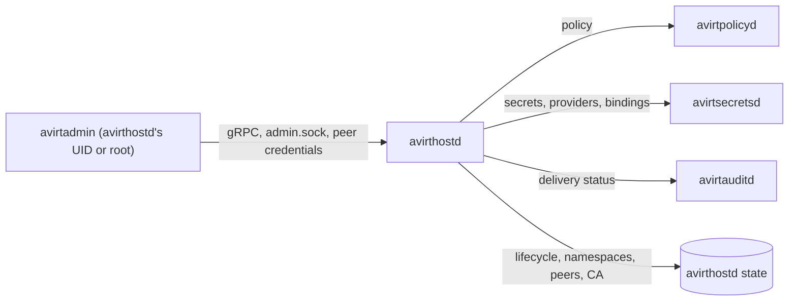

# Status: planned

`avirtadmin` is the host's local admin CLI, from `crates/avirtadmin`. All state belongs to other components (see [components](./components.md#host-services)). Running on the host as avirthostd's own UID or as root, it talks gRPC directly to avirthostd on `admin.sock`. This path bypasses avirtapid and avirtedgeproxyd. The operations on this page remain inaccessible to peers, workloads, and web UI users.

[avirt](./operator-cli.md) is the operator CLI, and [avirtguest](./guest-cli.md) is the guest CLI inside a workload container. Where the three overlap they share command names, flags, output formats, and exit codes.

## Connection and authentication

`admin.sock` is a Unix socket in avirthostd's runtime directory, 0600 and owned by the UID avirthostd runs as (see [trust boundaries](./trust-boundaries.md#listeners)). avirthostd reads the caller's credentials from the socket (`LOCAL_PEERCRED` on macOS, `SO_PEERCRED` on Linux) and accepts only its own UID or root. Each accepted call has the principal `Admin::"uid:<uid>"` and `via: "admin"` in its Cedar context. Except for [break-glass](#break-glass) commands, avirthostd evaluates calls against the host policy snapshot. avirtsecretsd performs this evaluation for secrets. A refused caller gets exit 3.

avirthostd serves its administration services itself and calls the responsible host services for other state. These are avirtpolicyd for policy, avirtsecretsd for secrets, providers, and bindings, and avirtauditd for audit delivery status. Each call authenticates as `/service/avirthostd` and includes the administrator principal.



The default host policy set holds the built-in policy `avirt-admin`, which permits `Admin` each action. Only avirthostd's admin socket produces an `Admin` principal. A host policy can narrow it with `forbid` policies, such as forbidding policy writes as root.

```cedar
@id("avirt-admin")
permit (principal is Admin, action, resource);

@id("no-policy-writes-as-root")
forbid (principal == Admin::"uid:0", action in [Action::"write_policy", Action::"set_policy_mode"], resource);
```

## Command tree

```text
avirtadmin
├── status
├── host
│   ├── info
│   ├── drain [--deadline DURATION]
│   └── resume
├── namespace
│   ├── create NS
│   ├── list
│   ├── inspect NS
│   └── rm NS
├── workload
│   ├── list [--namespace NS | --all-namespaces] [--selector K=V]...
│   ├── inspect WORKLOAD
│   ├── stop WORKLOAD [--grace DURATION]
│   └── rm WORKLOAD
├── policy
│   ├── list [--set NAME]
│   ├── show ID [--set NAME]
│   ├── validate FILE... [--set NAME]
│   ├── apply FILE... [--set NAME] [--dry-run]
│   ├── rm ID... [--set NAME]
│   ├── mode audit|enforce [--namespace NS]
│   ├── snapshot [--workload WORKLOAD]
│   ├── history [--set NAME]
│   └── schema
├── peer
│   ├── export [--address ADDR]...
│   ├── fingerprint [--long]
│   ├── enroll FILE|- [--host FQDN] [--fingerprint FP] [--address ADDR]... [--route SERVICE[/RPC]]... [--accept-policy-references]
│   ├── list
│   ├── inspect HOST
│   ├── set HOST [--address ADDR]... [--route ROUTE]... [--remove-route ROUTE]...
│   ├── refresh HOST
│   ├── suspend HOST | resume HOST
│   ├── distrust-root HOST FINGERPRINT
│   ├── revoke HOST
│   └── discover [--timeout DURATION]
├── ca
│   ├── status
│   ├── bundle
│   └── rotate --issuing | --root
├── secret
│   ├── define FILE | update FILE
│   ├── list [--scope SCOPE] | inspect SECRET
│   ├── rotate SECRET | revoke SECRET | login SECRET
│   ├── import SECRET [--from-file PATH]
│   ├── provider add FILE | list | status [NAME] | rm NAME
│   └── binding add FILE | list | inspect ID | rm ID
├── audit
│   ├── list [--workload WORKLOAD] [--principal P] [--action A] [--src SRC] [--since TIME]
│   ├── follow [same filters]
│   └── status
├── break-glass
│   ├── stop-all --reason TEXT
│   ├── lockdown --reason TEXT
│   ├── lift --reason TEXT
│   └── revoke-peer HOST --reason TEXT
├── completion SHELL
└── version
```

## Global flags

| Flag | Default | Meaning |
| --- | --- | --- |
| `--socket PATH` | `AVIRTADMIN_SOCKET`, else `$TMPDIR/avirt-<uid>/admin.sock` for the caller's own UID | avirthostd's admin socket. When running as root, specify the socket in avirthostd's runtime directory. |
| `--namespace NS`, `-n NS` | `default` | The namespace for namespaced commands |
| `--output FORMAT`, `-o FORMAT` | `text` | `text` or `json`, as in [output formats](./operator-cli.md#output-formats) |
| `--yes`, `-y` | Off | Skip the confirmation prompt on `namespace rm`, `peer revoke`, `ca rotate` and the break-glass commands. Without a terminal, those commands require it. |

avirtadmin has no `--context` and no `--host`. It administers only the host it runs on.

## Status, health, and draining

`avirtadmin status` reports avirthostd and each host service, from avirthostd's view of the supervisor's reports:

| Field | Meaning |
| --- | --- |
| `state` | Per component: `starting`, `ready`, `restarting`, `degraded` or `stopped` (see [all-in-one server image](./components.md#all-in-one-server-image)) |
| `essential` | Whether a degraded state refuses new launches: avirtsecretsd, avirtpolicyd, avirtedgeproxyd, avirtdnsd, avirtregistryd, and avirtmodelgwd |
| `restarts` | Restarts in the current 10-minute window |
| `admission` | `open`, or `refused` with each reason: a degraded required host service, `draining`, or `lockdown` |
| `policy` | The host policy snapshot's version, mode, and expiry |
| `workloads` | Live workloads, and workloads at their mediator restart limit |

`status` exits 0 when each component is `ready` and admission is open, and 6 otherwise, so a script can gate on it.

| Command | Does |
| --- | --- |
| `avirtadmin host info` | Prints the trust domain, the install id, the peer listener's addresses, the SPIFFE bundle's fingerprint, the runtime, and the protocol versions avirthostd supports |
| `avirtadmin host drain` | Refuses new launches, waits up to `--deadline` for running workloads to end, then ends the rest (see [operational ownership](./components.md#operational-ownership)) |
| `avirtadmin host resume` | Opens admission again after a drain |

## Namespaces

| Command | Does |
| --- | --- |
| `avirtadmin namespace create NS` | Creates a namespace. `NS` is a lowercase DNS label of at most 63 characters, rejected rather than truncated (see [avirt names](./dns.md#avirt-names)). |
| `avirtadmin namespace list`, `inspect NS` | As `avirt namespace list` and `inspect` |
| `avirtadmin namespace rm NS` | Removes an empty namespace. avirtadmin refuses a namespace with a live workload, a service, or a workspace repository with exit 5. It never removes `default`. |

## Workloads

`avirtadmin workload list`, `inspect`, `stop` and `rm` behave as the [`avirt workload`](./operator-cli.md#workloads) commands of the same name, over the same `Workloads` service on the admin socket, with `Admin` as principal. `--all-namespaces` lists each namespace's workloads. avirtadmin omits launch commands. Use avirt, avirtwebd, or avirtguest to create workloads.

## Policy

avirtpolicyd stores, validates, proves, compiles and distributes policy (see [egress policies](./egress-policies.md#policy-snapshots)). avirtadmin reaches it only through avirthostd. Policies are Cedar files, grouped in named **policy sets**: `host` is the host policy set, and a workload's policy reference names a set. A policy's `@id` identifies it within its set.

| Command | Does |
| --- | --- |
| `avirtadmin policy list` | Lists the set's policies by `@id`, with the version that last changed each |
| `avirtadmin policy show ID` | Prints one policy's text |
| `avirtadmin policy validate FILE...` | Validates the files against the avirt Cedar schema and runs the prover over the set as it would be with them applied. Validation leaves storage unchanged. Each failure identifies the policy and the property. |
| `avirtadmin policy apply FILE...` | Adds or replaces each policy in the files, by `@id`, in one new version of the set. Failure of validation or the prover leaves the version unchanged and causes exit 5. `--dry-run` runs `validate` and shows the resulting diff. |
| `avirtadmin policy rm ID...` | Removes policies in one new version |
| `avirtadmin policy mode audit\|enforce` | Sets the host default mode, or one namespace's mode with `--namespace` (see [modes](./egress-policies.md#modes)) |
| `avirtadmin policy snapshot` | Shows the host policy snapshot's version, schema, mode, issue and expiry times, sha256 and entity revision, or with `--workload` that workload's policy snapshot |
| `avirtadmin policy history` | Lists the set's versions with their time and the administrator principal that made each |
| `avirtadmin policy schema` | Prints the avirt Cedar schema text |

## Peers and enrollment

Enrollment follows [peering](./peering.md#enrollment). Each host's operator writes an enrollment file with `peer export`. The operators exchange files and compare fingerprints out of band. Each then enrolls the other's file with `peer enroll FILE --fingerprint FP`. The `avirtadmin peer` commands, with their flags and Cedar actions, are in [peering](./peering.md#avirtadmin).

## Trust domain and CA

The SPIFFE CA and its rotation schedule are in [issuer](./identity.md#issuer). The trust domain remains immutable for the life of the installation.

| Command | Does |
| --- | --- |
| `avirtadmin ca status` | Shows each root in the bundle and the current issuing CA, with their validity, and the next scheduled rotation of each |
| `avirtadmin ca bundle` | Prints the SPIFFE bundle as PEM. A peer enrolls from the enrollment file, which contains the bundle, never from this output. |
| `avirtadmin ca rotate --issuing` | Generates a new issuing CA now. New SVIDs chain to it, and existing SVIDs remain valid until expiry. |
| `avirtadmin ca rotate --root` | Generates a new root now and adds it to the bundle, as the scheduled rotation does. Peers pick it up on their next bundle refresh. |

No command prints a private key, and the workload MITM CAs lack an administration command.

## Secrets, providers, and bindings

avirtsecretsd stores each real credential and each secret record (see [secrets](./secrets.md)). avirtadmin manages them through avirthostd, which forwards each call to avirtsecretsd's Admin API with the `Admin` principal (see [APIs](./secrets.md#apis)). No command takes a secret value as an argument, and no output contains one. `SECRET` is `<scope>/<name>`, where the scope is `host` or a namespace.

| Command | Does |
| --- | --- |
| `avirtadmin secret define FILE` | Defines a secret from a record in the form in [secrets and references](./secrets.md#secrets-and-references) |
| `avirtadmin secret update FILE` | Replaces a secret's record. Updating a revoked secret restores it. |
| `avirtadmin secret list`, `inspect SECRET` | Lists secret records, or shows one with its provider, kind, owner, current version id, and refresh state |
| `avirtadmin secret rotate SECRET` | Forces a fetch, so new leases use the provider's current version (see [rotation and revocation](./secrets.md#rotation-and-revocation)) |
| `avirtadmin secret revoke SECRET` | Revokes the secret: no new lease, and each gateway drops its cached value |
| `avirtadmin secret login SECRET` | Clears `needs-login` after a new login |
| `avirtadmin secret import SECRET` | Writes a value into a provider that supports writes. The command reads the value from stdin or `--from-file`, never from argv. |
| `avirtadmin secret provider add FILE` | Adds a provider instance from its configuration, which specifies its type and the reference to the provider's own credential, never a value (see [providers](./secrets.md#providers)) |
| `avirtadmin secret provider list`, `status [NAME]` | Lists provider instances, or shows each one's state: `ready`, `degraded`, `rate-limited`, `unauthenticated`, `needs-user` or `locked` |
| `avirtadmin secret provider rm NAME` | Removes a provider instance without any secrets that use it |
| `avirtadmin secret binding add FILE` | Adds a binding from a record in the form in [bindings](./egress-credentials.md#bindings) |
| `avirtadmin secret binding list`, `inspect ID` | Lists bindings or shows one binding's secret reference and `workload` field, plus its credential injector, header, and destinations |
| `avirtadmin secret binding rm ID` | Removes a binding absent from all live workloads |

## Audit

Administration calls, workload management calls, and break-glass commands each produce events. avirthostd writes workload-scoped events to that workload's log for avirtauditd to deliver as OCSF (see [event provenance](./trust-boundaries.md#event-provenance)). It sends host-scoped events to avirtoteld (see [audit events](./secrets.md#audit-events)). These include namespace changes, policy writes, and break-glass commands.

| Command | Does |
| --- | --- |
| `avirtadmin audit list` | Reads events from the workload logs and the host-scoped record, filtered by `--workload`, `--principal`, `--action`, `--src` and `--since` |
| `avirtadmin audit follow` | As `list`, then streams new events |
| `avirtadmin audit status` | Shows avirtauditd's delivered offset against avirthostd's committed offset per log, and its sink's state |

## Break-glass

The break-glass commands apply when trust in policy, a peer, or the control plane fails. avirthostd authorizes them by peer credentials alone, without evaluating Cedar. They work with an unreachable avirtpolicyd or an expired host policy snapshot, and despite a policy that denies access to the administrator. Each command requires `--reason`. It requests confirmation unless the caller supplies `--yes`. Before acting, it records a `break_glass` event with the principal, the command, and the reason.

| Command | Does |
| --- | --- |
| `avirtadmin break-glass stop-all` | Stops each live workload on the host, in the teardown order in [lifecycle](./lifecycle.md#teardown) |
| `avirtadmin break-glass lockdown` | Refuses each new launch and each call that avirtapid forwards, until `lift`. Running workloads keep running. `admission` in `status` reads `lockdown`. |
| `avirtadmin break-glass lift` | Ends a lockdown |
| `avirtadmin break-glass revoke-peer HOST` | `peer revoke` without Cedar evaluation |

## Exit codes

The codes are those in [exit codes](./operator-cli.md#exit-codes). For avirtadmin, 3 also means avirthostd refused the caller's peer credentials, 6 also means `status` found a component not ready or admission refused, and 7 means connecting to `admin.sock` failed, which is the case whenever avirthostd isn't running.

## API and policy map

avirthostd serves each RPC on `admin.sock`. `avirt.v1` services are the ones avirtapid forwards for avirt, served here with `Admin` as principal, and `avirt.admin.v1` services exist only on `admin.sock`. avirthostd evaluates each action against the host policy snapshot with `via: "admin"`, except where the table specifies avirtsecretsd as the evaluator. Each action and entity is in the avirt Cedar schema (see [egress policies](./egress-policies.md#schema-text)). avirtsecretsd's Admin API is in [secrets](./secrets.md#apis).

| Command | RPC | Cedar action | Resource |
| --- | --- | --- | --- |
| `status` | `avirt.admin.v1.Host/GetStatus` | `inspect_host` | `Host` |
| `host info` | `avirt.admin.v1.Host/GetInfo` | `inspect_host` | `Host` |
| `host drain`, `host resume` | `avirt.admin.v1.Host/Drain`, `Host/Resume` | `drain_host` | `Host` |
| `namespace create` | `avirt.admin.v1.Namespaces/CreateNamespace` | `create_namespace` | The new `Namespace` |
| `namespace list` | `avirt.v1.Namespaces/ListNamespaces` | `list_namespaces` | `Host` |
| `namespace inspect` | `avirt.v1.Namespaces/GetNamespace` | `inspect_namespace` | `Namespace` |
| `namespace rm` | `avirt.admin.v1.Namespaces/DeleteNamespace` | `delete_namespace` | `Namespace` |
| `workload list` | `avirt.v1.Workloads/ListWorkloads` | `list_workloads` | `Namespace` |
| `workload inspect` | `avirt.v1.Workloads/GetWorkload` | `inspect_workload` | `Workload` |
| `workload stop` | `avirt.v1.Workloads/StopWorkload` | `stop_workload` | `Workload` |
| `workload rm` | `avirt.v1.Workloads/DeleteWorkload` | `delete_workload` | `Workload` |
| `policy list`, `show`, `snapshot`, `history`, `schema` | `avirt.admin.v1.Policy/ListPolicies`, `GetPolicy`, `GetSnapshot`, `ListVersions`, `GetSchema` | `read_policy` | `Host` |
| `policy validate` | `avirt.admin.v1.Policy/ValidatePolicies` | `read_policy` | `Host` |
| `policy apply`, `policy rm` | `avirt.admin.v1.Policy/ApplyPolicies`, `DeletePolicies` | `write_policy`, with `set` in the context | `Host` |
| `policy mode` | `avirt.admin.v1.Policy/SetMode` | `set_policy_mode`, with `mode`, and `namespace` for `--namespace`, in the context | `Host` |
| `peer export`, `peer fingerprint` | `avirt.admin.v1.Peers/ExportEnrollment`, `GetFingerprint` | None | None |
| `peer enroll` | `avirt.admin.v1.Peers/EnrollPeer` | `enroll_peer` | `Peer` |
| `peer set`, `refresh`, `suspend`, `resume`, `distrust-root` | `avirt.admin.v1.Peers/UpdatePeer`, `RefreshPeer`, `SuspendPeer`, `ResumePeer`, `DistrustRoot` | `update_peer` | `Peer` |
| `peer discover` | `avirt.admin.v1.Peers/DiscoverPeers` | None | None |
| `peer list`, `peer inspect` | `avirt.v1.Peers/ListPeers`, `GetPeer` | `list_peers`, `inspect_peer` | `Host`, `Peer` |
| `peer revoke` | `avirt.admin.v1.Peers/RevokePeer` | `revoke_peer` | `Peer` |
| `ca status`, `ca bundle` | `avirt.admin.v1.TrustDomain/GetCaStatus`, `GetBundle` | `inspect_host` | `Host` |
| `ca rotate` | `avirt.admin.v1.TrustDomain/RotateIssuingCa`, `RotateRoot` | `rotate_ca`, with `tier` in the context | `Host` |
| `secret define`, `update`, `rotate`, `revoke`, `import`, `login` | avirtsecretsd Admin API `DefineSecret`, `UpdateSecret`, `RotateSecret`, `RevokeSecret`, `ImportSecret`, `Login` | `manage_secret`, evaluated by avirtsecretsd, with `operation` `define`, `update`, `rotate`, `revoke`, `import` or `login` | `Secret` |
| `secret list`, `inspect` | avirtsecretsd Admin API `ListSecrets` | `manage_secret`, with `operation` `list` | `Secret` |
| `secret provider list`, `status` | avirtsecretsd Admin API `ProviderStatus` | `manage_provider`, with `operation` `list` or `status` | `Host` |
| `secret provider add`, `rm` | avirtsecretsd Admin API `DefineProvider`, `RemoveProvider` | `manage_provider`, with `operation` and `provider` in the context | `Host` |
| `secret binding add`, `list`, `inspect`, `rm` | avirtsecretsd Admin API `DefineBinding`, `ListBindings`, `RemoveBinding` | `manage_binding`, with `operation` in the context | `Binding` |
| `audit list`, `follow`, `status` | `avirt.admin.v1.Audit/ReadEvents`, `GetDeliveryStatus` | `read_audit` | `Host` |
| `break-glass stop-all`, `lockdown`, `lift`, `revoke-peer` | `avirt.admin.v1.BreakGlass/StopAll`, `Lockdown`, `Lift`, `RevokePeer` | None: peer credentials only | None |

`Host::"<td>"` is the host itself, keyed by its trust domain.

# Open questions

1. **Host-scoped audit record.** `audit list` and the break-glass event need a durable host-scoped record beside the workload logs. Whether host-scoped events get one that avirtauditd reads, rather than going to avirtoteld only, is open (see [secrets](./secrets.md#open-questions)).
2. **Issuing CA compromise.** `ca rotate --issuing` stops new SVIDs chaining to the old issuing CA, but SVIDs it signed remain valid until expiry. Early distrust of an issuing CA remains open. Recovery from a root key compromise is also open.
3. **Supervision outside the all-in-one image.** On a direct host install, the process that reports the state of components to avirthostd for `status` is open (see [components](./components.md#open-questions)).
4. **Admin socket while avirthostd is down.** avirtadmin has no path to the host services when avirthostd isn't running, so no break-glass command works then. Whether any administration operation needs a path that doesn't depend on avirthostd is open.
5. **Namespace creation by operators.** Allowing local or web UI users to create namespaces through avirtapid under policy, along with avirtadmin, remains open (see [components](./components.md#open-questions)).
