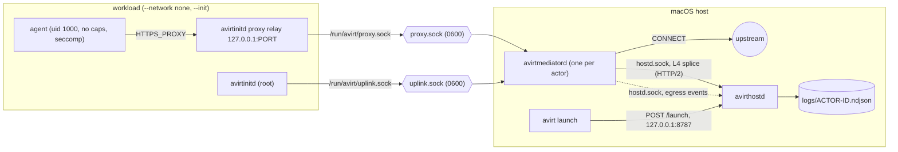
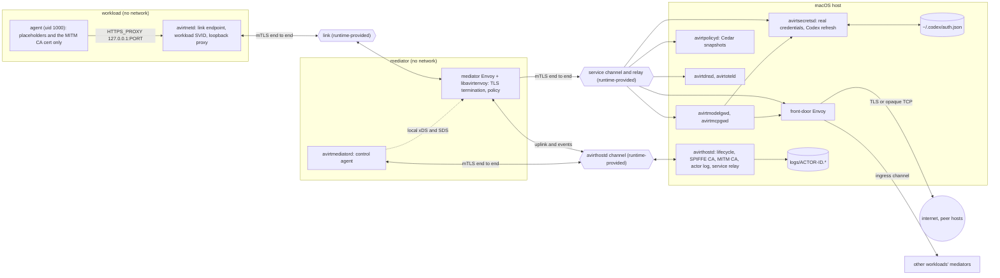

# Overview

`avirt` runs ACP agents (Claude through claude-agent-acp, Codex through codex-acp) inside isolated containers on an Apple silicon Mac, with all network egress mediated and logged. Every avirt binary is Rust, and the ACP client uses the official `agent-client-protocol` crate. The planned data plane is Envoy Proxy, extended by the Rust dynamic module libavirtenvoy.

Status: implemented. The current code has these components. The planned design is under [topology](#status-planned) and in [components](./components.md).

| Component | Binary | Runs | Role |
| --- | --- | --- | --- |
| avirthostd | `avirthostd` | On the host, one per user | Serves the control API, launches actors, owns real credentials, writes logs |
| CLI | `avirt` | On the host, per invocation | The operator command: `avirt launch` asks avirthostd to start an actor and can follow its log |
| Mediator | `avirtmediatord` | One per actor | Pingora egress proxy, link endpoint, and uplink relay to avirthostd |
| avirtinitd | `avirtinitd` | As root inside the workload, one per actor | ACP client that spawns the agent adapter, taps every JSON-RPC line, relays the agent's egress to the mediator, and applies the agent's sandbox |
| Agent | The adapter plus its tools | Inside the workload as uid 1000 | The ACP agent itself (`AVIRT_AGENT=claude\|codex`) |

An **actor** is one mediator plus one workload. The **workload** is the container that runs avirtinitd and the agent. One actor runs one ACP session. `avirthostd` launches actors on request (`avirt launch`) and writes each actor's JSON-RPC stream and egress events to `logs/<actor-id>.ndjson`.

The full planned component inventory, covering the host daemons, the mediator container, the workload container and the all-in-one server image, is in [components](./components.md).

# Topology

## Status: implemented

The mediator is a host process. The workload has no network. Its only connections are two Unix socket files that the container runtime relays to the mediator.

## Status: planned

The mediator runs in its own container, and like the workload it has no network interface other than loopback. Every connection either one makes is on a channel the compute runtime provides, and every such connection carries mutual TLS with SPIFFE identities end to end.

- **Workload.** Its only channel is the link to its mediator. avirtnetd terminates the link, holds the workload SVID, and serves the agent's loopback proxy.
- **Mediator.** avirtmediatord is the control agent, and the mediator Envoy with libavirtenvoy is the data plane. The mediator Envoy terminates the agent's TLS, evaluates Cedar policy locally, and sends each connection either directly to one of avirt's host components or to the front-door Envoy.
- **Host.** avirthostd owns actor lifecycle and the SPIFFE issuer, avirtsecretsd owns the real credentials, avirtpolicyd distributes policy snapshots, avirtmodelgwd and avirtmcpgwd inject model and MCP credentials, avirtregistryd stores and indexes workspace images, and the front-door Envoy is the single global policy enforcement point for workload-to-workload traffic, on the host and between hosts, for virtual services, for authorized host-local services and for external egress. It is also the only host component that opens connections off the host.
- **Names and namespaces.** Every workload is in one host-local namespace, and avirtdnsd resolves avirt names to the front-door Envoy of the host that serves them (see [components](./components.md#avirt-names)).

# Design invariants

Status: planned. These hold for every runtime and every phase once the planned design is in place.

1. No SPIFFE Workload API is exposed to either the mediator or the workload. `avirthostd` delivers each container's bootstrap SVID at launch and pushes every later SVID and trust bundle over an authenticated channel.
2. Long-lived private keys are generated inside the container or host component that uses them. `avirthostd` mints only a short-lived bootstrap key per container and does not keep it.
3. TLS terminates only at named endpoints: avirtnetd and the mediator Envoy on the link, avirtmediatord or the mediator Envoy and avirthostd on the avirthostd channel, and the mediator Envoy and its destination on the service and ingress channels. Runtime relays, the service relay, shared volumes and the front-door Envoy's tunnels carry ciphertext.
4. Every listener reachable across a container or host boundary requires mutual TLS from the first byte. The local listeners inside the workload that do not are enumerated in [trust boundaries](./trust-boundaries.md#local-exceptions).
5. uid 1000 in the workload never holds an SVID or its key, the SPIFFE bundle, a CA key, or a real credential.
6. The workload and the mediator have no network interface other than loopback, and the front-door Envoy is the only host component that opens connections off the host.
7. Each Envoy evaluates policy locally from a versioned snapshot. No request waits on a policy call, and a missing or expired snapshot denies.
8. The mediator holds no long-lived real credential for model or MCP traffic.
9. Every workload-to-workload connection passes through the front-door Envoy of each host it touches, and a mediator never connects to another mediator directly.

# Documents

* [Components](./components.md) - the component inventory, where each component runs, what it owns, its startup and failure semantics, its status, and how the current binaries map onto it
* [Trust boundaries and reachability](./trust-boundaries.md) - every listener's caller identity and allowed operations, and what each kind of compromise can reach
* [Actor topology and link protocol](./actor-topology.md) - the runtime channels, the service relay, the link streams, gated launch, freeze, reconnect and ingress
* [Identity and mTLS](./identity.md) - authentication on every hop, the SPIFFE trust domain and IDs, SVID issuance, rotation and federation
* [Egress, TLS termination and policy](./egress.md) - the CONNECT proxy, the mediator Envoy pipeline, front-door egress and destination checks, TLS termination, Cedar policy and its failure behavior
* [Credentials](./credentials.md) - how Claude and Codex credentials reach the agent, credential ownership and injection points, placeholders and Codex token refresh
* [Workload hardening](./workload-hardening.md) - seccomp, Landlock, capabilities and the agent's environment
* [Lifecycle and state](./lifecycle.md) - launch and teardown order, the state root, crash cleanup and path limits
* [Compute runtimes](./compute-runtimes.md) - the runtime interface, the Containerization runtime for Apple, Docker Desktop, and the Apple container CLI runtime the current code uses
* [Build and platforms](./build-and-platforms.md) - build targets, Swift gating, linking, signing, the CI matrix, the toolchain and host privileges per runtime
* [avirthostd API and log format](./hostd-api.md) - starting avirthostd, the control API, environment variables and the NDJSON log
* [avirt CLI](./cli.md) - the operator command that launches actors and follows their logs
* [Agents](./agents.md) - Claude and Codex specifics: ACP versions, modes, approvals and known limitations
* [Roadmap](./roadmap.md) - the planned phases and each phase's verification checklist
* [Performance metrics](./performance.md) - what to measure in each area, where, how, and which metrics are SLO candidates
