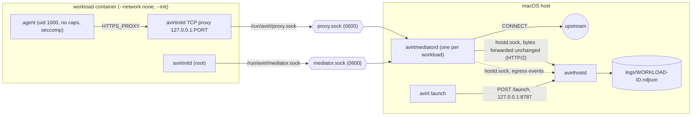
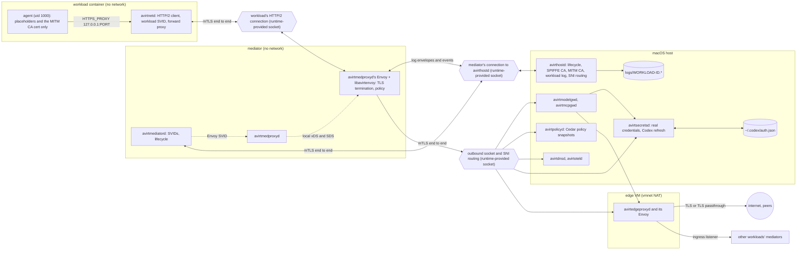

# Overview

`avirt` runs ACP agents (Claude through claude-agent-acp, Codex through codex-acp, see [ACP](./acp.md)) inside isolated containers on an Apple silicon Mac. A mediator handles and logs all network egress. Each avirt binary is Rust, and the ACP client uses the official `agent-client-protocol` crate. Envoy Proxy provides the planned data plane. Its Rust <!-- Envoy feature name. --><!-- vale ai-tells.OverusedVocabulary = NO -->dynamic module<!-- vale ai-tells.OverusedVocabulary = YES --> is libavirtenvoy.

Status: implemented. The current code has these components. See [topology](#status-planned) and [components](./components.md) for the planned design.

| Component | Binary | Runs | Role |
| --- | --- | --- | --- |
| avirthostd | `avirthostd` | On the host, one per user | Serves the control API and launches workloads. Stores real credentials (see [secrets](./secrets.md#status-implemented)) and writes logs |
| Operator CLI | `avirt` | On the host, per invocation | The operator CLI: `avirt launch` asks avirthostd to start a workload and can follow its log (see [operator CLI](./operator-cli.md#status-implemented)) |
| Mediator | `avirtmediatord` | One per workload | Pingora CONNECT proxy, and a TCP proxy that forwards avirtinitd's HTTP/2 connection on `mediator.sock` to avirthostd with the bytes unchanged |
| avirtinitd | `avirtinitd` | As root inside the workload container, one per workload | ACP client that spawns the agent adapter and taps each JSON-RPC line (see [ACP](./acp.md#status-implemented)). Also runs a TCP proxy from the agent's `HTTPS_PROXY` to `proxy.sock` and applies the agent's sandbox |
| Agent | The adapter plus its tools | Inside the workload container as uid 1000 | The ACP agent itself (`AVIRT_AGENT=claude\|codex`) |

A **workload** is the unit avirthostd launches and tears down. It consists of the **workload container**, which runs avirtinitd and the agent, plus its **mediator**. Each byte the agent sends out passes through the mediator. In the implemented system the mediator is the avirtmediatord host process. In the planned design it's a container that runs avirtmediatord, avirtmedproxyd and avirtmedproxyd's Envoy. One workload runs one ACP session (see [ACP](./acp.md#session-lifecycle)). `avirthostd` launches workloads on request (`avirt launch`) and writes each workload's JSON-RPC stream and egress events to `logs/<workload-id>.ndjson`.

The **control plane** is avirthostd plus the host services that configure and decide (such as avirtpolicyd and avirtsecretsd). avirtedgeproxyd, avirtmedproxyd, and their Envoys transport the traffic as the **data plane**.

The full planned component inventory, covering the host services, the mediator container, the workload container and the all-in-one server image, is in [components](./components.md).

# Topology

## Status: implemented

The mediator is a host process. The workload container has no network. Its only connections are two Unix socket files that the container runtime relays to the mediator.

## Status: planned

The mediator runs in its own container, and like the workload container it has no network interface other than loopback. Each connection either one makes is on a Unix socket the compute runtime provides, and each such connection uses mutual TLS with SPIFFE identities end to end. The full topology, with each traffic class hop by hop, is in [networking](./networking.md#topology).

- **Workload container.** Its only connection is its HTTP/2 connection to its mediator, whose client end is avirtnetd. avirtnetd holds the workload SVID and serves the agent's forward proxy.
- **Mediator.** avirtmediatord holds the mediator's connection to avirthostd, its SVIDs and the workload lifecycle, and avirtmedproxyd supervises the data plane, its Envoy with libavirtenvoy. The agent's TLS ends at that Envoy, which evaluates Cedar policy locally. It sends each connection either directly to one of avirt's host services or to avirtedgeproxyd.
- **Host.** avirthostd owns workload lifecycle and the SPIFFE issuer, avirtsecretsd stores the real credentials (see [secrets](./secrets.md)), avirtpolicyd distributes policy snapshots, avirtmodelgwd and avirtmcpgwd inject model and MCP credentials, avirtregistryd stores and indexes workspace images, and avirtedgeproxyd is the only global policy enforcement point and the only host service that opens connections off the host (see [components](./components.md#avirtedgeproxyd)).
- **Edge VM.** avirtedgeproxyd and its Envoy run in the edge VM, a Linux container and the only avirt VM with a network interface (see [edge VM](./components.md#edge-vm)).
- **Names and namespaces.** Each workload is in one host-local namespace, and avirtdnsd resolves avirt names to the edge proxy of the host that serves them (see [DNS](./dns.md#avirt-names)).

# Design invariants

Status: planned. These hold for each runtime and each phase once the planned design is in place.

1. Neither the mediator nor the workload container has access to a SPIFFE Workload API. `avirthostd` delivers each container's bootstrap SVID at launch and pushes each later SVID and trust bundle over an authenticated connection.
2. Containers and host services generate their own long-lived private keys internally. `avirthostd` generates only a short-lived bootstrap key per container and doesn't keep it.
3. TLS ends only at the endpoints listed here. For the workload's HTTP/2 connection to its mediator, these are avirtnetd and avirtmedproxyd's Envoy. For the mediator's connection to avirthostd, these are avirtmediatord or avirtmedproxyd's Envoy and avirthostd. For the mediator's outbound socket and its ingress listener, these are avirtmedproxyd's Envoy and its destination. The runtime's socket forwarding, avirthostd's SNI routing, Docker named volumes and avirtedgeproxyd's tunnels transport ciphertext.
4. Each listener reachable across a container or host boundary requires mutual TLS from the first byte. [Trust boundaries](./trust-boundaries.md#local-exceptions) lists the local listeners inside the workload container that don't.
5. uid 1000 in the workload container never possesses an SVID or its key, the SPIFFE bundle, a CA key, or a real credential.
6. The workload container and the mediator have no network interface other than loopback, avirtedgeproxyd is the only host service that opens connections off the host, and the edge VM it runs in is the only avirt VM with a network interface.
7. Each Envoy evaluates policy locally from a versioned policy snapshot. Requests never wait on a policy call. A missing or expired policy snapshot denies requests.
8. Long-lived real credentials for model or MCP traffic remain outside the mediator.
9. Each workload-to-workload connection passes through avirtedgeproxyd on each host it uses. A mediator never connects to another mediator directly.

# Documents

- [Components](./components.md) - the component inventory, where each component runs, what it owns, its startup and failure semantics, its status, and how the current binaries map onto it
- [Trust boundaries and reachability](./trust-boundaries.md) - each listener's caller identity and allowed operations, and what each kind of compromise can reach
- [Networking](./networking.md) - the whole network design: topology, addressing, each traffic class and its hops, runtime transports, listeners, and off-host enforcement
- [Workload topology and connections](./workload-topology.md) - the runtime-provided sockets, SNI routing, the HTTP/2 streams, launch handshake, freeze, reconnect, and ingress
- [DNS](./dns.md) - the avirt DNS zone, the name forms, and how workloads resolve names
- [Identity and mTLS](./identity.md) - authentication on each hop, the SPIFFE trust domain and IDs, SVID issuance, rotation, and federation
- [Egress and TLS termination](./egress.md) - the CONNECT proxy, the avirtmedproxyd pipeline, edge proxy egress and private-address blocks, workload DNS, TLS termination, and the MITM CA
- [Egress policies](./egress-policies.md) - the Cedar schema, enforcement points, name canonicalization, modes, policy snapshots, revocation, the prover, and failure behavior
- [Egress credentials](./egress-credentials.md) - how the agent receives Claude and Codex credentials, bindings and credential injectors, placeholders, the gateways, Codex token refresh, rotation, and revocation
- [Secrets](./secrets.md) - avirtsecretsd, providers, refresh, write-back, the broker, and SDS
- [Peering](./peering.md) - enrolling peers, trust bundles, the peer listener, and what crosses a peering
- [Security](./security.md) - the security principles and how the design meets them
- [Observability](./observability.md) - logs, audit logs and their integrity, metrics, traces, and the telemetry pipeline
- [Workload hardening](./workload-hardening.md) - seccomp, capabilities, security contexts and the agent's environment
- [Sandbox](./sandbox.md) - the Landlock rulesets for each workload and mediator process
- [Lifecycle and state](./lifecycle.md) - launch and teardown order, the runtime directory, crash cleanup, and path limits
- [Workload lifecycle and layers](./workload-lifecycle.md) - the workload container's layers from the avirt base to the per-workload writable layer. Assembly on each runtime and progression through boot, running, and teardown
- [Compute runtimes](./compute-runtimes.md) - the runtime interface, the Containerization runtime for Apple, Docker Desktop, and the Apple container CLI runtime the current code uses
- [Build and platforms](./build-and-platforms.md) - build targets, Swift gating, linking, signing, the CI matrix, the toolchain, and host privileges per runtime
- [avirthostd API and log format](./hostd-api.md) - starting avirthostd, the control API, environment variables, and the NDJSON log
- [Operator CLI](./operator-cli.md) - `avirt`, which launches workloads and follows their logs
- [Admin CLI](./admin-cli.md) - `avirtadmin`, the local admin CLI
- [Guest CLI](./guest-cli.md) - `avirtguest`, the guest CLI
- [ACP](./acp.md) - how avirt drives agents over ACP (with the [Claude](./acp-claude.md) and [Codex](./acp-codex.md) specifics)
- [Roadmap](./roadmap.md) - the planned phases and each phase's verification checklist
- [Performance metrics](./performance.md) - what to measure in each area, where, how, and which metrics are SLO candidates
