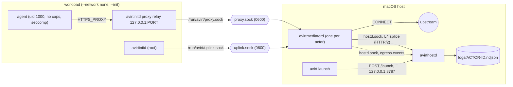
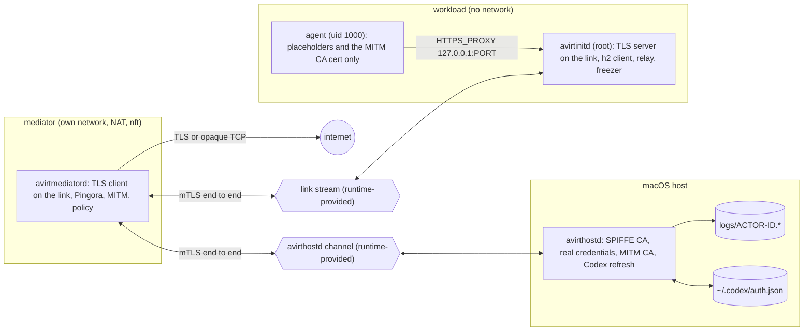

# Overview

`avirt` runs ACP agents (Claude through claude-agent-acp, Codex through codex-acp) inside isolated containers on an Apple silicon Mac, with all network egress mediated and logged. Everything is Rust and uses the official `agent-client-protocol` crate.

| Component | Binary | Runs | Role |
| --- | --- | --- | --- |
| avirthostd | `avirthostd` | On the host, one per user | Serves the control API, launches actors, owns real credentials, writes logs |
| CLI | `avirt` | On the host, per invocation | The operator command: `avirt launch` asks avirthostd to start an actor and can follow its log |
| Mediator | `avirtmediatord` | One per actor | Pingora egress proxy, link endpoint, and uplink relay to avirthostd |
| avirtinitd | `avirtinitd` | As root inside the workload, one per actor | ACP client that spawns the agent adapter, taps every JSON-RPC line, relays the agent's egress to the mediator, and applies the agent's sandbox |
| Agent | The adapter plus its tools | Inside the workload as uid 1000 | The ACP agent itself (`AVIRT_AGENT=claude\|codex`) |

An **actor** is one mediator plus one workload. The **workload** is the container that runs avirtinitd and the agent. One actor runs one ACP session. `avirthostd` launches actors on request (`avirt launch`) and writes each actor's JSON-RPC stream and egress events to `logs/<actor-id>.ndjson`.

The full planned component inventory, covering the host daemons, the mediator container, the workload container and the all-in-one server image, is in [components](./components.md).

# Topology

## Status: implemented

The mediator is a host process. The workload has no network. Its only connections are two Unix socket files that the container runtime relays to the mediator.

## Status: planned

The mediator runs in its own container on its own per-actor network. The workload exposes one link endpoint, and the mediator reaches it through a stream the compute runtime provides. Both streams carry mutual TLS with SPIFFE identities end to end. The mediator terminates the agent's TLS, substitutes credentials for placeholders, and enforces policy.

# Design invariants

Status: planned. These hold for every runtime and every phase once the planned design is in place.

1. No SPIFFE Workload API is exposed to either the mediator or the workload. `avirthostd` delivers each workload's bootstrap SVID at launch and pushes every later SVID and trust bundle over an authenticated channel.
2. Long-lived private keys are generated inside the workload or mediator that uses them. `avirthostd` mints only a short-lived bootstrap key per workload and does not keep it.
3. TLS on the link terminates only at avirtinitd and the mediator, and TLS on the avirthostd channel only at the mediator and avirthostd. Runtime relays, shared volumes and avirthostd-side vsock splicing carry ciphertext.
4. Every listener a guest can reach requires mutual TLS from the first byte.
5. uid 1000 in the workload never holds an SVID or its key, the SPIFFE bundle, a CA key, or a real credential.

# Documents

* [Components](./components.md) - the component inventory, where each component runs, its status, and how the current binaries map onto it
* [Actor topology and link protocol](./actor-topology.md) - the streams between avirtinitd, mediator and avirthostd, gated launch, freeze and reconnect
* [Identity and mTLS](./identity.md) - authentication on both hops, the SPIFFE trust domain, SVID issuance and rotation
* [Egress, TLS termination and policy](./egress.md) - the CONNECT proxy, destination checks, TLS termination, the policy file and the mediator's network
* [Credentials](./credentials.md) - how Claude and Codex credentials reach the agent, placeholders and Codex token refresh
* [Workload hardening](./workload-hardening.md) - seccomp, Landlock, capabilities and the agent's environment
* [Lifecycle and state](./lifecycle.md) - launch and teardown order, the state root, crash cleanup and path limits
* [Compute runtimes](./compute-runtimes.md) - the runtime interface, the Containerization runtime for Apple, Docker Desktop, and the Apple container CLI runtime the current code uses
* [Build and platforms](./build-and-platforms.md) - build targets, Swift gating, linking, signing, the CI matrix, the toolchain and host privileges per runtime
* [avirthostd API and log format](./hostd-api.md) - starting avirthostd, the control API, environment variables and the NDJSON log
* [avirt CLI](./cli.md) - the operator command that launches actors and follows their logs
* [Agents](./agents.md) - Claude and Codex specifics: ACP versions, modes, approvals and known limitations
* [Roadmap](./roadmap.md) - the planned phases and each phase's verification checklist
* [Performance metrics](./performance.md) - what to measure in each area, where, how, and which metrics are SLO candidates
