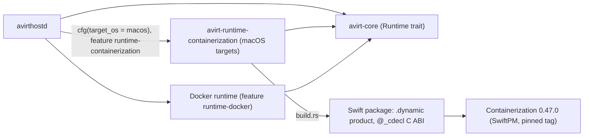

# Status: implemented

## Workspace layout

The root workspace includes `avirt-connect` for CONNECT authority parsing and destination checks. `mise run check` checks the root workspace. The implemented mediator uses the [Pingora CONNECT app](./egress.md#pingora-connect-app).

# Status: planned

## Targets

| Binary | Runs on | Targets |
| --- | --- | --- |
| `avirtinitd` | Linux guests (the workload container) | `aarch64-unknown-linux-musl`, `x86_64-unknown-linux-musl` |
| `avirtnetd`, `avirtguestd`, `avirtacp`, `avirtagent`, `avirtexec`, `avirtmcp`, `avirtguest` | Linux guests (the workload container), from the avirt base image | `aarch64-unknown-linux-musl`, `x86_64-unknown-linux-musl` |
| `avirtmediatord` | Linux guests (the mediator) | `aarch64-unknown-linux-musl`, `x86_64-unknown-linux-musl` |
| `avirthostd`, `avirtedgeproxyd`, `avirtapid` | The host | macOS arm64, Linux x86_64 and arm64, and Windows x86_64 and arm64 |
| `avirt` | The host | macOS arm64, Linux x86_64 and arm64, and Windows x86_64 and arm64 |
| `avirtsecrets-1password` | The host, as avirtsecretsd's provider plugin (see [1Password](./secrets-1password.md#plugin)) | macOS arm64 built with cgo (`CGO_ENABLED=1`), and Linux x86_64 and arm64 for the all-in-one server image built without it |

The guest binaries don't depend on the host OS. Each host build produces `avirthostd` and the `avirt` command-line tool side by side.

## Crates and runtime gating

| Crate | Contents |
| --- | --- |
| `crates/avirt-connect` | CONNECT authority parsing and destination checks |
| `crates/avirt-core` | The shared library, including the `Runtime` trait (see [compute runtimes](./compute-runtimes.md)) and the `api` module shared by `avirthostd` and the command-line tool |
| `crates/avirt` | The `avirt` operator CLI |
| `crates/avirthostd` | The host daemon |
| `crates/avirtmediatord` | The mediator |
| `crates/avirtinitd` | The workload container entrypoint |
| `crates/avirt-runtime-containerization` | The Containerization runtime: a Swift package and a `build.rs` |

`workloads/` contains only the image build directories (see [workload images](#workload-images)).

Runtime backends conform to the `Runtime` trait from `avirt-core`. During a build, target `cfg` and the cargo features `runtime-containerization` and `runtime-docker` select them. During execution, `AVIRT_RUNTIME` selects among those compiled in.

The build uses two target checks to control inclusion of the Containerization runtime:

- `crates/avirt-runtime-containerization` contains the Swift package, whose `.dynamic` product exports a `@_cdecl` C ABI. Its `build.rs` keys on `CARGO_CFG_TARGET_OS` (the target, not the host) and does nothing on non-macOS targets.

- `avirthostd` depends on that crate only under `[target.'cfg(target_os = "macos")'.dependencies]`.

## Workload images

Every workload image derives from the avirt base image (see [workload lifecycle](./workload-lifecycle.md#base-images)).

| Image | Directory | `FROM` | Adds |
| --- | --- | --- | --- |
| avirt base, `avirt-workload-base` | `workloads/base/` | `ubuntu:26.04` | `ca-certificates`, the `agent` user, the helper users and the `avirt-ws` group, `/workspace`, and every workload guest binary in the targets table |
| Claude harness base, `avirt-workload-claude` | `workloads/claude/` | The avirt base | Node, claude-agent-acp and `harness.toml`, under `/opt/agent` |
| Codex harness base, `avirt-workload-codex` | `workloads/codex/` | The avirt base | Node, codex-acp and `harness.toml`, under `/opt/agent` |
| avirt builder | `workloads/builder/` | The avirt base | `git`, avirt's layer tool and BuildKit |

`mise run build-images` builds the avirt base first and then every image derived from it. The image build fails a derived image whose layer chain doesn't begin with the avirt base's `diff_ids`, and a harness base with any entry or whiteout outside `/opt/agent`. avirthostd supplies harness configuration at launch as the configuration layer. Workload images exclude it.

The implemented images don't have this split: each Containerfile builds from `ubuntu:26.04` and compiles avirtinitd itself (see [Claude](./acp-claude.md#adapter) and [Codex](./acp-codex.md#adapter)).

## Rust data plane

Status: planned. avirtmediatord and avirtedgeproxyd use hyper 1.x for HTTP, h2 0.4.20 for HTTP/2, rustls 0.23 with the ring provider for TLS, tokio-rustls for asynchronous TLS and rcgen for certificate generation. Cedar evaluation runs in-process with `cedar-policy`. SPIFFE verification uses `SpiffeId`, `X509Svid` and `X509Bundle` from `spiffe`, with avirt's verifier, which checks the exact peer ID. It doesn't use a Workload API source.

The mediator binary targets Linux. avirtedgeproxyd is a host binary, including on macOS, and is a host service in the all-in-one image. HTTP parsing, upgrades, flow control, and TLS use the libraries. avirt provides policy, credentials, routing, limits, and lifecycle. The transport checks in [workload topology](./workload-topology.md#admission-and-flow-control) and [half-close behavior](./workload-topology.md#timeouts-and-keepalive) verify the system's properties.

## Linking

avirthostd loads the shim dylib through an `@executable_path` rpath. The distribution places the dylib next to the avirthostd binary. The Swift runtime comes from the OS.

## Containerization source

Apple doesn't publish a prebuilt Containerization artifact. The build compiles the library from source with SwiftPM at the pinned tag (0.47.0). `build.rs` uses a prebuilt shim dylib when `AVIRT_SWIFTSHIM_DIR` points at one, and builds from source otherwise. CI publishes the dylib as a checksummed artifact.

## Signing

- **Development.** macOS avirthostd builds use an ad-hoc signature with the `com.apple.security.virtualization` entitlement. `cargo run` and `cargo test` go through a signing runner configured in `.cargo/config.toml`, so test and run binaries contain the entitlement.
- **Distribution.** Distribution builds sign `avirthostd` with Developer ID and notarize it.
- **Secrets broker.** Distribution builds sign `avirtsecretsd` and `avirtsecrets-1password` with Developer ID and notarize them. Each has a stable signing identifier that keeps its designated requirements unchanged across releases (see [macOS Keychain](./secrets-keychain.md#code-signing-and-entitlements)).

## CI matrix

| Runner | Builds |
| --- | --- |
| macOS | The Swift dylib, then avirthostd, then signing, plus avirtedgeproxyd, avirtapid and the macOS `avirt` command-line tool |
| Linux | The guest binaries for both architectures, the Linux avirthostd and command-line tool |
| Windows, or Linux with `cargo-xwin` | The Windows avirthostd and command-line tool |

Constraint: only a macOS host can build the macOS avirthostd binary.

## Toolchain

mise pins Rust and defines the tasks on every OS: `serve` runs `avirthostd`, and `launch <agent> <prompt>` runs `avirt launch`. Swift comes from Xcode (`xcrun swift`), and the macOS tasks check that it's present.

## Host privileges per runtime

| Host | Runtime | Constraint |
| --- | --- | --- |
| macOS | Containerization | The avirthostd binary contains `com.apple.security.virtualization` |
| macOS | Docker Desktop | Docker Desktop running for the user |
| Linux | KVM microVM (planned) | Access to `/dev/kvm` |
| Windows | Hyper-V through HCS (planned) | Membership in Hyper-V Administrators |

## Guest artifacts

Kernel and initfs pins belong to each runtime. The Containerization runtime pins:

- the Kata Containers 3.32.0 arm64 `vmlinux` by URL and tarball sha256 `8736c054d9223974735394f822000823baef509e1c33405ec798240fa9b6e4b5`.
- the initfs `ghcr.io/apple/containerization/vminit:0.47.0`.

Both move together with the Containerization package version. Docker Desktop supplies its own kernel.

# Open questions

1. **Windows off-host enforcement.** The host rule that restricts new off-host connections to avirtedgeproxyd on Windows remains unspecified.
