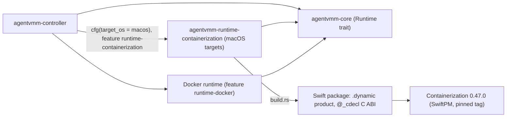

# Status: planned

## Targets

| Binary | Runs on | Targets |
| --- | --- | --- |
| `agentvmm-runner` | Linux guests (the workload) | `aarch64-unknown-linux-musl`, `x86_64-unknown-linux-musl` |
| `agentvmm-supervisor` | Linux guests (the supervisor) | `aarch64-unknown-linux-musl`, `x86_64-unknown-linux-musl` |
| `agentvmm-controller` | The host | macOS arm64, Linux x86_64 and arm64, Windows x86_64 and arm64 |
| `agentvmm` | The host | macOS arm64, Linux x86_64 and arm64, Windows x86_64 and arm64 |

The guest binaries do not depend on the host OS. The controller and the `agentvmm` CLI are built per host, side by side.

## Crates and runtime gating

| Crate | Contents |
| --- | --- |
| `crates/agentvmm-core` | The shared library, including the `Runtime` trait (see [compute runtimes](./compute-runtimes.md)) and the `api` module shared by the controller and the CLI |
| `crates/agentvmm-cli` | The `agentvmm` operator CLI |
| `crates/agentvmm-controller` | The host controller |
| `crates/agentvmm-supervisor` | The supervisor |
| `crates/agentvmm-runner` | The runner |
| `crates/agentvmm-runtime-containerization` | The Containerization runtime: a Swift package and a `build.rs` |

`workloads/claude/` and `workloads/codex/` hold only the image build directories.

Runtime backends implement the `Runtime` trait from `agentvmm-core`. They are selected at build time by target `cfg` and by the cargo features `runtime-containerization` and `runtime-docker`, and at run time by `AGENTVMM_RUNTIME` among those compiled in.

The Containerization runtime is gated by target in two places:

- `crates/agentvmm-runtime-containerization` holds the Swift package, whose `.dynamic` product exports a `@_cdecl` C ABI. Its `build.rs` keys on `CARGO_CFG_TARGET_OS` (the target, not the host) and does nothing on non-macOS targets.
- `agentvmm-controller` depends on that crate only under `[target.'cfg(target_os = "macos")'.dependencies]`.

## Linking

The shim dylib is loaded through an `@executable_path` rpath, so it ships next to the controller binary. The Swift runtime comes from the OS.

## Containerization source

Apple publishes no prebuilt Containerization artifact, so the library is built from source with SwiftPM at the pinned tag (0.47.0). `build.rs` uses a prebuilt shim dylib when `AGENTVMM_SWIFTSHIM_DIR` points at one, and builds from source otherwise. CI publishes the dylib as a checksummed artifact.

## Signing

- **Development.** macOS controller builds are ad-hoc signed with the `com.apple.security.virtualization` entitlement. `cargo run` and `cargo test` go through a signing runner configured in `.cargo/config.toml`, so test and run binaries carry the entitlement.
- **Distribution.** The controller is Developer ID signed and notarized.

## CI matrix

| Runner | Builds |
| --- | --- |
| macOS | The Swift dylib, then the controller, then signing, plus the macOS `agentvmm` CLI |
| Linux | The guest binaries for both architectures, and the Linux controller and CLI |
| Windows, or Linux with `cargo-xwin` | The Windows controller and CLI |

Constraint: the macOS controller can only be built on a macOS host.

## Toolchain

mise pins Rust and defines the tasks on every OS: `serve` runs `agentvmm-controller`, and `launch <agent> <prompt>` runs `agentvmm launch`. Swift comes from Xcode (`xcrun swift`), and the macOS tasks check that it is present.

## Host privileges per runtime

| Host | Runtime | Requirement |
| --- | --- | --- |
| macOS | Containerization | The controller binary carries `com.apple.security.virtualization` |
| macOS | Docker Desktop | Docker Desktop running for the user |
| Linux | KVM microVM (planned) | Access to `/dev/kvm` |
| Windows | Hyper-V through HCS (planned) | Membership in Hyper-V Administrators |

## Guest artifacts

Kernel and initfs pins belong to each runtime. The Containerization runtime pins:

- the kata-containers 3.32.0 arm64 `vmlinux` by URL and tarball sha256 `8736c054d9223974735394f822000823baef509e1c33405ec798240fa9b6e4b5`;
- the initfs `ghcr.io/apple/containerization/vminit:0.47.0`.

Both move together with the Containerization package version. Docker Desktop supplies its own kernel.
