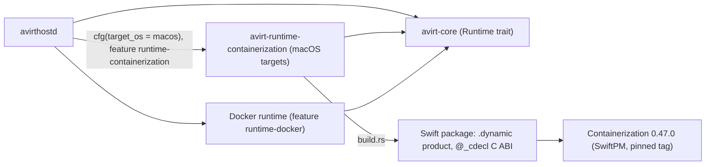

# Status: implemented

## Workspace layout

The root workspace includes `avirt-connect`, the CONNECT authority parser and destination checks shared by Pingora and Envoy. `avirtenvoy` is an excluded standalone workspace with its own `Cargo.lock`; root workspace builds do not include the Envoy SDK, bindgen or libclang. `mise run check` checks the root workspace; `mise run check-envoy` checks the excluded module with the SDK git source and libclang available. On a Linux host the module builds into `target/envoy-module/debug/libavirtenvoy.so`.

## Experimental host mediator module

The host mediator can select Envoy v1.40.0 while retaining the relayed `proxy.sock` and `mediator.sock`. Build and run instructions are in [egress](./egress.md#experimental-host-envoy-mode). The official Rust SDK is pinned to the same release commit; `cargo build --locked --manifest-path crates/avirtenvoy/Cargo.toml --target-dir target/envoy-module` builds the cdylib with libclang available, and the bootstrap names it by absolute filename.

The v1.40.0 [POSIX module loader](https://github.com/envoyproxy/envoy/blob/v1.40.0/source/extensions/dynamic_modules/posix/dynamic_modules.cc) uses `dlopen`, so the module loads into Envoy's own process. Upstream v1.40.0 [release assets](https://github.com/envoyproxy/envoy/releases/tag/v1.40.0) provide Linux arm64 and x86_64 binaries only. avirt ships and runs no darwin Envoy. In the implemented mode the Envoy binary is supplied by path and avirt neither installs nor downloads it; a binary is usable only if its version and compiled extensions satisfy the bootstrap validation test.

# Status: planned

## Targets

| Binary | Runs on | Targets |
| --- | --- | --- |
| `avirtinitd` | Linux guests (the workload container) | `aarch64-unknown-linux-musl`, `x86_64-unknown-linux-musl` |
| `avirtnetd`, `avirtguestd`, `avirtacp`, `avirtagent`, `avirtexec`, `avirtmcp`, `avirtguest` | Linux guests (the workload container), from the avirt base image | `aarch64-unknown-linux-musl`, `x86_64-unknown-linux-musl` |
| `avirtmediatord` | Linux guests (the mediator) | `aarch64-unknown-linux-musl`, `x86_64-unknown-linux-musl` |
| `libavirtenvoy` | Envoy, as a dynamic module: avirtmedproxyd's Envoy in the mediator and avirtedgeproxyd's Envoy in the edge VM, both Linux (see [Envoy delivery](#envoy-delivery)) | `aarch64-unknown-linux-gnu`, `x86_64-unknown-linux-gnu` |
| `avirthostd` | The host | macOS arm64, Linux x86_64 and arm64, Windows x86_64 and arm64 |
| `avirt` | The host | macOS arm64, Linux x86_64 and arm64, Windows x86_64 and arm64 |
| `avirtsecrets-1password` | The host, as avirtsecretsd's provider plugin (see [1Password](./secrets-1password.md#plugin)) | macOS arm64 built with cgo (`CGO_ENABLED=1`), and Linux x86_64 and arm64 for the all-in-one server image built without it |

The guest binaries do not depend on the host OS. `avirthostd` and the `avirt` CLI are built per host, side by side.

## Crates and runtime gating

| Crate | Contents |
| --- | --- |
| `crates/avirt-connect` | CONNECT authority parsing and destination checks shared by both CONNECT engines |
| `crates/avirt-core` | The shared library, including the `Runtime` trait (see [compute runtimes](./compute-runtimes.md)) and the `api` module shared by `avirthostd` and the CLI |
| `crates/avirt` | The `avirt` operator CLI |
| `crates/avirthostd` | The host daemon |
| `crates/avirtmediatord` | The mediator |
| `crates/avirtinitd` | The workload container entrypoint |
| `crates/avirtenvoy` | The Envoy dynamic module, a `cdylib` built as `libavirtenvoy` and excluded from the root workspace, that checks CONNECT destinations and reports connection events; Cedar policy and credential injection are planned |
| `crates/avirt-runtime-containerization` | The Containerization runtime: a Swift package and a `build.rs` |

`workloads/` holds only the image build directories (see [workload images](#workload-images)).

Runtime backends implement the `Runtime` trait from `avirt-core`. They are selected at build time by target `cfg` and by the cargo features `runtime-containerization` and `runtime-docker`, and at run time by `AVIRT_RUNTIME` among those compiled in.

The Containerization runtime is gated by target in two places:

- `crates/avirt-runtime-containerization` holds the Swift package, whose `.dynamic` product exports a `@_cdecl` C ABI. Its `build.rs` keys on `CARGO_CFG_TARGET_OS` (the target, not the host) and does nothing on non-macOS targets.
- `avirthostd` depends on that crate only under `[target.'cfg(target_os = "macos")'.dependencies]`.

## Workload images

Every workload image is derived from the avirt base image (see [workload lifecycle](./workload-lifecycle.md#base-images)).

| Image | Directory | `FROM` | Adds |
| --- | --- | --- | --- |
| avirt base, `avirt-workload-base` | `workloads/base/` | `ubuntu:26.04` | `ca-certificates`, the `agent` user, the helper users and the `avirt-ws` group, `/workspace`, and every workload guest binary in the targets table |
| Claude harness base, `avirt-workload-claude` | `workloads/claude/` | The avirt base | Node, claude-agent-acp and `harness.toml`, under `/opt/agent` |
| Codex harness base, `avirt-workload-codex` | `workloads/codex/` | The avirt base | Node, codex-acp and `harness.toml`, under `/opt/agent` |
| avirt builder | `workloads/builder/` | The avirt base | `git`, avirt's layer tool and BuildKit |

`mise run build-images` builds the avirt base first and then every image derived from it. The image build fails a derived image whose layer chain does not begin with the avirt base's `diff_ids`, and a harness base with any entry or whiteout outside `/opt/agent`. No workload image holds harness configuration, which avirthostd supplies at launch as the configuration layer.

The implemented images do not have this split: each Containerfile builds from `ubuntu:26.04` and compiles avirtinitd itself (see [Claude](./acp-claude.md#adapter) and [Codex](./acp-codex.md#adapter)).

## Envoy delivery

Envoy runs only on Linux. avirt ships and runs no darwin Envoy.

- **Image.** Every Envoy avirt runs comes from the official `envoyproxy/envoy:distroless-v1.40.0` image, pinned by index digest `sha256:23b72ac1fa94908b2ca7ebf194cc6083cd0d4913210c7d7453e4b2008ca26c84`. Its base is `gcr.io/distroless/base-nossl-debian13`, which has glibc.
- **Verification.** Upstream publishes no cosign signature, attestation or SBOM for the image. CI checks the Envoy binary in the image against the release's PGP-clearsigned `checksums.txt.asc`, verified with the Envoy maintainers key `0AFCE836BA4D1D35763C8523D8CDC3750181F31F` that is committed in the Envoy repository.
- **Pins.** The Envoy version, the image digest and the SDK rev, the v1.40.0 tag commit `9e5580933739775e8bce696a57a2e1bc99368f23`, move together in one change.
- **libavirtenvoy.** It is built only as a glibc Linux cdylib, `aarch64-unknown-linux-gnu` and, for amd64, `x86_64-unknown-linux-gnu`, and never for musl, because Envoy loads it into its glibc process with `dlopen`. Constraint: its glibc symbol versions must not exceed those of the runtime image's glibc.
- **Upgrade gate.** Every undefined `envoy_dynamic_module_callback_*` symbol in the module must be exported by the pinned Envoy, and Envoy's own `--mode validate` must pass inside the image.
- **License.** Envoy's Apache-2.0 `LICENSE` and `NOTICE` ship with every image that contains it.

## Linking

The shim dylib is loaded through an `@executable_path` rpath, so it ships next to the avirthostd binary. The Swift runtime comes from the OS.

## Containerization source

Apple publishes no prebuilt Containerization artifact, so the library is built from source with SwiftPM at the pinned tag (0.47.0). `build.rs` uses a prebuilt shim dylib when `AVIRT_SWIFTSHIM_DIR` points at one, and builds from source otherwise. CI publishes the dylib as a checksummed artifact.

## Signing

- **Development.** macOS avirthostd builds are ad-hoc signed with the `com.apple.security.virtualization` entitlement. `cargo run` and `cargo test` go through a signing runner configured in `.cargo/config.toml`, so test and run binaries carry the entitlement.
- **Distribution.** `avirthostd` is Developer ID signed and notarized.
- **Secrets broker.** `avirtsecretsd` and `avirtsecrets-1password` are Developer ID signed and notarized, each with a stable signing identifier, so their designated requirements hold across releases (see [macOS Keychain](./secrets-keychain.md#code-signing-and-entitlements)).

## CI matrix

| Runner | Builds |
| --- | --- |
| macOS | The Swift dylib, then avirthostd, then signing, plus the macOS `avirt` CLI |
| Linux | The guest binaries for both architectures, libavirtenvoy for both glibc targets with the Envoy upgrade gate, the Envoy image checksum check, and the Linux avirthostd and CLI |
| Windows, or Linux with `cargo-xwin` | The Windows avirthostd and CLI |

Constraint: the macOS avirthostd binary can only be built on a macOS host.

## Toolchain

mise pins Rust and defines the tasks on every OS: `serve` runs `avirthostd`, and `launch <agent> <prompt>` runs `avirt launch`. Swift comes from Xcode (`xcrun swift`), and the macOS tasks check that it is present.

## Host privileges per runtime

| Host | Runtime | Requirement |
| --- | --- | --- |
| macOS | Containerization | The avirthostd binary carries `com.apple.security.virtualization` |
| macOS | Docker Desktop | Docker Desktop running for the user |
| Linux | KVM microVM (planned) | Access to `/dev/kvm` |
| Windows | Hyper-V through HCS (planned) | Membership in Hyper-V Administrators |

## Guest artifacts

Kernel and initfs pins belong to each runtime. The Containerization runtime pins:

- the kata-containers 3.32.0 arm64 `vmlinux` by URL and tarball sha256 `8736c054d9223974735394f822000823baef509e1c33405ec798240fa9b6e4b5`;
- the initfs `ghcr.io/apple/containerization/vminit:0.47.0`.

Both move together with the Containerization package version. Docker Desktop supplies its own kernel.

# Open questions

1. **Envoy on Windows.** How a Windows host runs avirtedgeproxyd's Envoy is open. The likely shape is the edge VM in WSL2 or Hyper-V.
