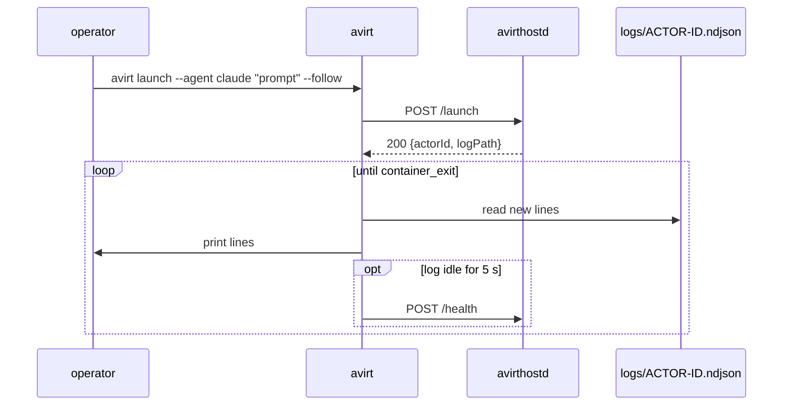

# Status: implemented

`avirt` is the operator command, from `crates/avirt`. It talks to a running [avirthostd](./hostd-api.md) instance over its control API, using the request and response types from the `api` module of `avirt-core`.

## launch

```text
avirt launch --agent claude|codex "<prompt>" [--cwd DIR] [--follow] [--port PORT] [--url URL]
```

| Option | Default | Meaning |
| --- | --- | --- |
| `--agent` | required | `claude` or `codex` |
| `<prompt>` | required | The prompt for the ACP session |
| `--cwd DIR` | none | Host directory to mount read-write at `/workspace`. A relative path is made absolute against the current directory. |
| `--follow`, `-f` | off | Print the actor log until the actor ends |
| `--port PORT` | `PORT`, else 8787 | Port of the local avirthostd |
| `--url URL` | `AVIRT_HOSTD_URL`, else the local avirthostd on `--port` | avirthostd URL |

`launch` posts `POST /launch` and prints the actor id and the log path. A refused launch prints avirthostd's status and error message and exits non-zero.

## Following

With `--follow`, `avirt` reads `logs/<actor-id>.ndjson` as it grows. It parses each line as JSON and stops only on the `container_exit` meta event, which is always the last line. If the log stops growing for 5 s, it calls `POST /health` with a 3 s timeout. If avirthostd does not answer, it exits with an error.



Through mise, `mise run launch <agent> "<prompt>"` runs `avirt launch`, and extra flags go after `--`, for example `mise run launch claude "Reply with pong" -- --cwd DIR --follow`.
