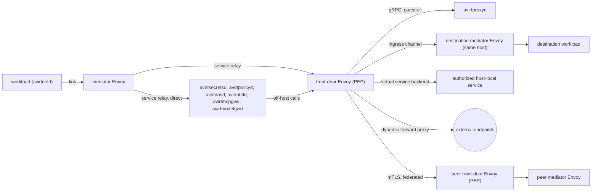
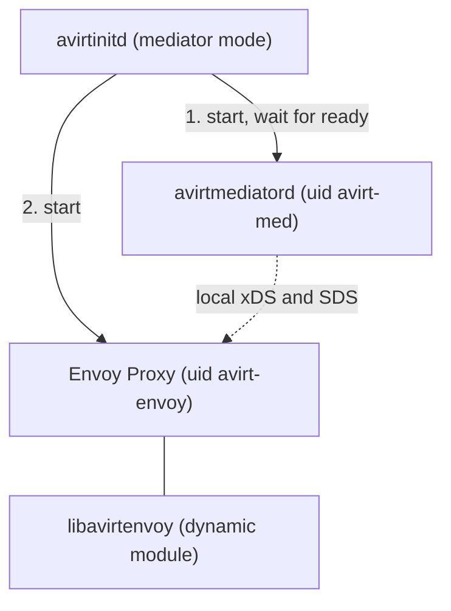
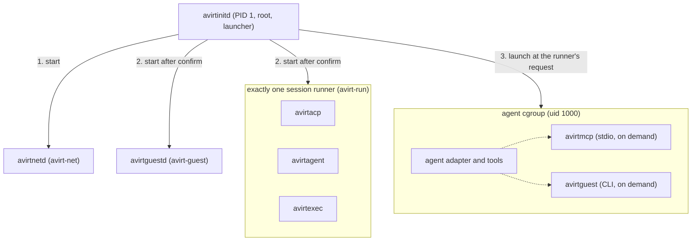
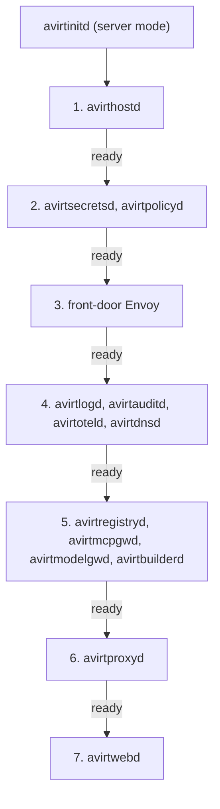
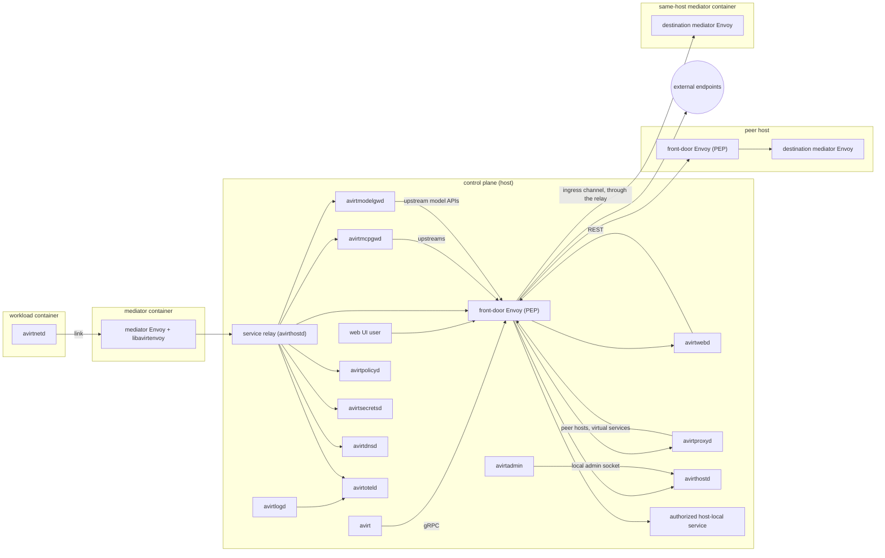

# Overview

`avirt`'s components fall into four placements. Host components make up the control plane. Each actor has a mediator container and a workload container. The all-in-one server image runs the host components in one container as a deployment mode. The Container column names the container a component lives in. Host-side components run directly on the host or together in the all-in-one server image.

An **actor** is the lifecycle unit: one mediator plus one workload. Workload and mediator are roles. Each role runs in its own container, which is its own VM on the Containerization runtime and a container on a shared kernel on Docker Desktop (see [compute runtimes](./compute-runtimes.md)).

| Component | Description | Container | Status |
| --- | --- | --- | --- |
| avirt | The CLI and TUI client | host | Partial |
| avirtadmin | The local admin CLI, which talks directly to avirthostd over a local Unix socket | host | Planned |
| avirtwebd | The backend for the avirt web UI | host | Planned |
| Front-door Envoy | The host's edge Envoy Proxy and the global policy enforcement point for workload traffic: it publishes virtual services, carries every workload-to-workload connection on this host and between hosts, fronts the host services for local clients and peer hosts, and is the only host component that opens connections off the host | host | Planned |
| avirthostd | Owns actor lifecycle, namespaces, workspaces and immutable actor configuration for a single host, and issues SPIFFE identities | host | Partial |
| avirtproxyd | A REST and gRPC proxy to the local avirthostd, to peer hosts, and to virtual services through the front-door Envoy | host | Planned |
| avirtdnsd | Makes local and peered workloads and virtual services addressable by name, resolving each name to the front-door Envoy of the host that serves it | host | Planned |
| avirtmcpgwd | The MCP gateway, where MCP upstream credentials are injected | host | Planned |
| avirtmodelgwd | The model gateway, where model credentials are injected | host | Planned |
| avirtregistryd | The host's OCI registry for workspace images: it runs zot as a supervised child process and adds avirt's own secondary index and search API (see [workspaces](./workspaces.md#avirtregistryd)) | host | Planned |
| avirtbuilderd | Builds repository OCI artifacts from version control in disposable sandboxed jobs, so that workloads start quickly | host | Planned |
| avirtpolicyd | Stores, validates, proves, compiles and distributes versioned Cedar policy snapshots for the host | host | Planned |
| avirtsecretsd | Holds secrets from providers, owns credential refresh, and serves the actor-scoped credential broker API and an Envoy secret discovery service (SDS) for TLS identity | host | Planned |
| avirtlogd | Acquires workload container logs, transforms them, and sends them to avirtoteld for delivery as OpenTelemetry Logs | host | Planned |
| avirtauditd | Audit logging, delivered as OCSF | host | Planned |
| avirtoteld | The OpenTelemetry Collector | host | Planned |
| avirtinitd | One minimal supervisor with three role modes: PID 1 and launcher in the workload, and supervisor in the mediator container and in the all-in-one server image | workload, mediator, all-in-one | Partial |
| avirtmediatord | The mediator's per-actor control agent: link coordination, Envoy configuration, readiness, lifecycle and identity rotation | mediator | Partial |
| Envoy Proxy | The mediator Envoy: the mediator's data plane for all of the workload's ingress and egress | mediator | Planned |
| libavirtenvoy | The Envoy dynamic module: CONNECT destination checks and connection events; Cedar policy and credential injection are planned | mediator, host | Partial |
| avirtacp | Runs an agent workload through the Agent Client Protocol | workload | Partial |
| avirtagent | Runs an agent workload through its native harness | workload | Planned |
| avirtexec | Generic execution | workload | Planned |
| avirtnetd | Guest networking: the link endpoint and holder of the workload SVID, the egress gateway, the DNS stub resolver, the ingress gateway and the guest control gRPC API | workload | Partial |
| avirtguestd | Workload services: a file server and an MCP server | workload | Planned |
| avirtmcp | A stdio MCP server, launched by the agent, that relays to avirtmcpgwd | workload | Planned |
| avirtguest | The guest CLI in workload images, which reaches avirtproxyd through avirtnetd, the mediator Envoy and the front-door Envoy | workload | Planned |

Partial means the component's function exists in the current code but not yet as the component described here. The next section says where each partial function lives.

# Status: implemented

The current code has four functional binaries, the shared `avirt-core` and `avirt-connect` libraries, and the optional `avirtenvoy` dynamic module, and they carry the implemented parts of the inventory as follows.

| Binary | Container | Carries |
| --- | --- | --- |
| `avirt` | host | The CLI. It talks to avirthostd directly over HTTP on `127.0.0.1:8787` (`POST /launch`), or the URL in `AVIRT_HOSTD_URL`. |
| `avirthostd` | host | The host daemon: the control API, actor launch and teardown, the Codex `auth.json` seed and write-back, and the actor logs in `logs/<actor-id>.ndjson`. |
| `avirtmediatord` | host, one process per actor | The mediator as a host process: one Pingora server with the CONNECT proxy on `proxy.sock` and the uplink splice to avirthostd on `uplink.sock`. |
| `avirtinitd` | workload, as root | The workload's root process and image entrypoint. Together with the harness in `avirt-core`, it contains the ACP client that avirtacp carries in the planned design (it spawns the adapter as uid 1000 under seccomp and taps every JSON-RPC line), and the loopback egress relay to `proxy.sock` that avirtnetd carries in the planned design. |

`avirtinitd` is not PID 1 in the current code. The workload runs with `--init`, so the runtime's init is PID 1 and avirtinitd is its direct child (see [workload hardening](./workload-hardening.md)). There is no mediator container: the mediator is the host process above. Landlock is not applied by the current code. The optional host mediator Envoy loads libavirtenvoy for CONNECT destination checks. The front-door Envoy and the other host daemons are not implemented.

# Status: planned

## Host components

Each host component owns the state in its Owns column, and no other component writes it. avirthostd passes references to secrets and policies (binding ids and policy ids) in actor configuration, never secret values.

| Component | Owns | Talks to |
| --- | --- | --- |
| avirt | Nothing. It is the CLI and TUI client. | avirtproxyd over gRPC, through the front-door Envoy's local client listener |
| avirtadmin | Nothing. It is the local admin CLI. | avirthostd directly, over avirthostd's local admin Unix socket, where avirthostd authenticates it by peer credentials (see [trust boundaries](./trust-boundaries.md#listeners)). It does not go through avirtproxyd or the front-door Envoy. |
| avirtwebd | Web UI user authentication and sessions, and the web UI's static assets, bundled into its binary (see [web UI](#web-ui)). It acts for web UI users the way avirt acts for its user. | avirtproxyd over REST, through the front-door Envoy. Web UI users reach it, and its static assets, through the front-door Envoy. |
| Front-door Envoy | Policy enforcement for every workload-to-workload connection on this host and between hosts, the published virtual services, connections to authorized host-local services, and the host's off-host connections. It also fronts avirthostd, avirtproxyd, avirtmcpgwd, avirtmodelgwd and avirtwebd for local clients and peer hosts, and carries every off-host connection the host daemons make. | avirt, web UI users, mediator Envoys (through the service relay, in both directions), the host services it fronts, authorized host-local services, peer hosts' front-door Envoys, external endpoints, avirtsecretsd (SDS), avirtpolicyd, avirtdnsd, avirthostd (virtual service records) |
| avirthostd | Actor lifecycle (launch, generations, teardown, the startup sweep), namespaces, immutable actor configuration (namespace, workload short ID and alias, labels, image digest, resolved workspace image digest, policy reference, credential binding references), port publications and virtual service records as versioned state, the entity revisions it sends to avirtpolicyd, the SPIFFE issuer, each actor's MITM CA, the durable actor log, the workload stdio log files on the Containerization runtime, the service relay, resource admission and the artifact store | The compute runtime, each mediator's avirthostd channel, avirtpolicyd and avirtsecretsd (to validate the references it stores), the front-door Envoy (virtual service records), avirtproxyd (inbound, through the front-door Envoy), avirtadmin (inbound, on its local admin Unix socket), avirtbuilderd |
| avirtproxyd | Nothing durable. It forwards REST and gRPC calls to the local avirthostd, to peer hosts' avirtproxyd through the front-door Envoy, and to virtual services through the front-door Envoy. It forwards the caller's authenticated identity and rejects caller-supplied identity headers. Workloads use it to manage other workloads (see [workload management](#workload-management)). | avirt and avirtguest over gRPC and avirtwebd over REST, all through the front-door Envoy, avirthostd, avirtbuilderd, avirtregistryd, peer avirtproxyd instances |
| avirtdnsd | The avirt name zone. It answers every name under `host.avirt.internal` with this host's front-door Envoy address, and every name under an enrolled peer's host name with that peer's front-door Envoy address (see [avirt names](#avirt-names)). | Mediator Envoys (through the service relay), the front-door Envoy, avirthostd (namespaces, workloads, virtual services and enrolled peers) |
| avirtmcpgwd | MCP sessions. It injects MCP upstream credentials that it obtains from avirtsecretsd, scopes tool discovery and invocation by actor, and never retries a mutating tool call automatically. | Mediator Envoys (through the service relay), avirtsecretsd, MCP upstreams through the front-door Envoy |
| avirtmodelgwd | Model routing, per-actor model budgets and the Codex refresh endpoint. It injects model credentials that it obtains from avirtsecretsd. | Mediator Envoys (through the service relay), avirtsecretsd, upstream model APIs through the front-door Envoy |
| avirtregistryd | Workspace images and their registry storage, in zot under avirtregistryd's own durable state directory, with zot's `sync`, `ui`, `userprefs`, `events` and `metrics` extensions off and its listener on loopback, accepting only mTLS from a private CA avirtregistryd holds in memory. Its secondary index is its own SQLite database, updated with every write and reconciled against zot's catalog. It makes every off-host registry connection. | avirtbuilderd, avirthostd, avirtproxyd and build job mediator Envoys (its `WorkspaceRegistry` API), zot, avirtsecretsd (registry credentials), off-host registries through the front-door Envoy |
| avirtbuilderd | Build scheduling. It watches version control such as git and runs each build in a disposable sandboxed job with no host control or signing authority. | Repositories through the front-door Envoy, avirtregistryd |
| avirtpolicyd | Cedar policy storage, schema validation, the Cedar policy prover, compilation, and versioned snapshot distribution (see [egress](./egress.md#policy)). The prover statically analyses every policy set before a snapshot built from it is distributed, and reasons precisely about entity-hierarchy membership such as `in Namespace::"team-a"`. It rejects any policy that applies `like` to anything other than a canonicalized external host. Each snapshot pairs a policy version with an entity revision from avirthostd. | libavirtenvoy in every mediator Envoy and in the front-door Envoy, avirthostd (entity revisions in, host snapshot out) |
| avirtsecretsd | Provider access, every real credential, the Codex refresh token, credential refresh with one owner per credential, placeholder issuance, the actor-scoped credential broker API, and SDS for the front-door Envoy's TLS identity (see [credentials](./credentials.md)) | Secret providers (off-host ones through the front-door Envoy), avirtmodelgwd, avirtmcpgwd, avirtmediatord and mediator Envoys (broker API), the front-door Envoy (SDS), avirthostd (actor and binding registrations) |
| avirtlogd | Workload log delivery. It acquires the workload containers' stdout, stderr and console logs with a runtime-adapted method, transforms them, and sends them to avirtoteld for delivery as OpenTelemetry Logs (see [workload logs](#workload-logs)). | The host-written log files it tails, avirtoteld |
| avirtauditd | Audit delivery as OCSF. It reads avirthostd's committed actor logs by offset and keeps the raw security events beside the OCSF form. | avirthostd's actor logs, an OCSF sink through the front-door Envoy |
| avirtoteld | The OpenTelemetry Collector, possibly a wrapper around Grafana Alloy | Mediator Envoys (through the service relay), avirtlogd, the host components, downstream telemetry backends through the front-door Envoy |

avirthostd's sequence-numbered actor log (see [actor topology](./actor-topology.md#uplink-resume)) is the durable record. avirtauditd consumes it asynchronously, and avirtlogd consumes the workload log files asynchronously, so telemetry or OCSF backpressure delays only them and never stalls an actor. Every event carries the provenance labels defined in [trust boundaries](./trust-boundaries.md#event-provenance).

## Namespaces and labels

A **namespace** is a grouping of workloads and a trust and access boundary for policy, and nothing more.

- Every workload is in exactly one namespace, fixed when the workload is created. The default is `default`.
- Creating a workload in a namespace requires authorization for that namespace. avirthostd evaluates it against the host's Cedar snapshot.
- A namespace scopes names: virtual service names and their aliases are unique within their namespace. A workload is named by its short ID, which is unique on the host.
- Workloads can manage other workloads, under policy (see [workload management](#workload-management)).
- A namespace name is a lowercase DNS label of at most 63 characters (see [avirt names](#avirt-names)).
- A namespace is local to its host. A namespace with the same name on another host is a different namespace, and anything on another host is addressed fully qualified: by its peered name, by an identity in that host's trust domain, and by a Cedar entity qualified by that host.

A **label** is a free-form key and value on a workload or a virtual service, used for selection and grouping, for example `project`, `repo` or `clone-of`. Policy can use labels as attributes, but a label is not a trust boundary by itself. Setting a label key is itself authorized: keys under the reserved prefix `avirt.internal/` are set only by avirthostd, and the host policy can reserve further prefixes for the principals it names.

In Cedar, a `Workload` is `in` its `Namespace`, so policies can say `principal in Namespace::"team-a"`, and labels are entity tags (see [egress](./egress.md#policy)). In SPIFFE, the namespace is part of every actor identity (see [identity](./identity.md#trust-domain-and-ids)).

## Workload IDs

Every actor has a canonical ID, a UUIDv7 that avirthostd generates when it creates the actor. It is never reused. SPIFFE IDs carry it (`/ns/<ns>/actor/<uuid>/…`, see [identity](./identity.md#trust-domain-and-ids)), and so do Cedar entities (`Workload::"<ns>/<uuid>"`) and the `actor` field of every log record.

The workload's short ID is the last 8 hexadecimal characters of the UUIDv7, for example `7e759259` for `0192f3a4-5b6c-7d8e-9f01-23457e759259`. Constraint: the leading bits of a UUIDv7 are a millisecond timestamp, so the short ID is always taken from its trailing random bits, never from its prefix. The short ID is only a DNS handle: authorization never uses it.

The short ID is unique on the host among live workloads and among ended workloads whose names are still within their DNS TTL. When a new UUIDv7's short ID clashes with one of them, avirthostd discards that UUIDv7 and generates another, up to 8 times. If every attempt clashes, it refuses the launch with 503 and records the clash.

## avirt names

| Form | Names | Resolves to |
| --- | --- | --- |
| `<id>.<ns>.workload.host.avirt.internal`, `<alias>-<id>.<ns>.workload.host.avirt.internal`, `<generated>.<ns>.workload.host.avirt.internal` | A workload on this host | This host's front-door Envoy |
| `<name>.<ns>.svc.host.avirt.internal`, `<alias>.<ns>.svc.host.avirt.internal` | A virtual service on this host | This host's front-door Envoy |
| `<id>.workload.host.avirt.internal`, `<alias>-<id>.workload.host.avirt.internal`, `<generated>.workload.host.avirt.internal`, `<name>.svc.host.avirt.internal`, `<alias>.svc.host.avirt.internal` | The same entity as the long form in the `default` namespace | This host's front-door Envoy |
| `<id>.<ns>.workload.<host>`, `<alias>-<id>.<ns>.workload.<host>`, `<generated>.<ns>.workload.<host>`, `<name>.<ns>.svc.<host>`, `<alias>.<ns>.svc.<host>` | A workload or virtual service on the enrolled peer host `<host>` | That peer's front-door Envoy |

- **Workload name forms.** A workload's first DNS label is its `<id>`, `<alias>-<id>` if it has an alias, or its `<generated>` name. All three name the same workload.
  - `<id>` is the workload's short ID, exactly 8 lowercase hexadecimal characters (`[0-9a-f]{8}`). It is only a DNS handle. The workload's canonical ID is the actor's UUIDv7, which SPIFFE IDs and Cedar entities carry (see [workload IDs](#workload-ids)).
  - `<alias>-<id>` parses unambiguously, because `<id>` is always the last 8 characters.
  - `<generated>` is a hyphenated `<adverb>-<adjective>-<noun>` name, such as `quietly-brave-otter`, which avirthostd always generates at creation with the `petname` crate. It is lowercase `a`-`z` and hyphens only, and unique per host and namespace among live workloads: on a collision avirthostd generates another. The word lists are chosen so that the longest combination fits in 63 characters, and the noun list holds no 8-character word made only of hex digits, so a generated name never parses as `<alias>-<id>`.
- **Service name forms.** A virtual service's first DNS label is its `<name>` or one of its aliases. All of them name the same service.
- **DNS label syntax.** Every DNS label in an avirt name is lowercase: `a`-`z`, `0`-`9` and `-`, at most 63 characters. Aliases, service names and namespace names are validated to that form.
- **Aliases grant nothing.** Name resolution maps every form of a name to the same entity (see [egress](./egress.md#name-resolution)), and authorization uses the entity, keyed by the workload's ID or the service's name. Neither a workload's alias nor its generated name is ever used for authorization: the ID is.

DNS limits each label to 63 octets and a whole name to 253 characters in text form, without the trailing dot. These caps follow from them:

| Item | Cap | Derivation |
| --- | --- | --- |
| Workload alias | 54 characters | 63, less the hyphen and the 8-character ID |
| Generated workload name | 63 characters | One label, guaranteed by the word lists |
| Service name, service alias | 63 characters | One label |
| Namespace name | 63 characters | One label |
| Local name | 156 characters at most | 63 + 1 + 63 + 1 + 28 for `workload.host.avirt.internal`, within 253 |
| Peer host name (`<host>`) | 116 characters | `<alias>-<id>.<ns>.workload.` takes at most 63 + 1 + 63 + 1 + 8 + 1 = 137 characters, and 253 − 137 = 116. The `svc` form would allow 121, so 116 is the binding cap. |

avirthostd validates every alias, service name and namespace name when it is created, and enrollment validates a peer's host name. A name that exceeds its cap or breaks the label syntax is rejected, never truncated.

`host` in the local forms is a literal label, in the way `host.docker.internal` is. avirtdnsd answers these names, and it is the only component that does.

The mediator Envoy sends every connection to an avirt name, local or peered, to this host's front-door Envoy over the service relay, whatever address the name resolved to, so it never needs a peer's address. The front-door Envoy resolves the name to its canonical entity (see [egress](./egress.md#name-resolution)), routes a local one to the destination's mediator Envoy, and routes a peered one to the peer's front-door Envoy at the address avirtdnsd returns for it. A workload name reaches only the ports that workload publishes (see [actor topology](./actor-topology.md#ingress)).

## Workload management

A workload can manage other workloads: create, list, inspect, stop and delete them. The agent runs avirtguest, which reaches avirtproxyd through avirtnetd, the mediator Envoy and the front-door Envoy. The calling workload is the principal, as `Workload::"<ns>/<uuid>"` with `via: "guest-cli"` in the context, and avirthostd authorizes every call per action and per resource (namespace, labels, credential bindings, policy reference) against the host snapshot. Nothing is permitted by default.

These constraints bound what a workload can do through this path, whatever the policy permits:

- **No greater authority.** A workload can create a workload only in a namespace where it may itself create workloads, only with credential bindings it holds itself, and only from a workspace image it may itself launch (`launch_workspace`, see [workspaces](./workspaces.md#policy)). The child's policy reference is the creator's own, or one the host policy names as assignable by that creator. The child's resource requests are charged to the creator's namespace budget.
- **Reserved labels.** A workload never sets a label under `avirt.internal/`. avirthostd sets them on every workload it creates.
- **Lineage.** avirthostd records each workload's creator in `avirt.internal/creator` (the creator's UUIDv7, or the local or web UI user) and its root in `avirt.internal/root`, the user at the top of the chain. The lineage depth is capped by host configuration, and a create past the cap is refused.
- **Lifetime.** A child ends when its creator ends, unless the policy permits a detached child.
- **No self-escalation.** A workload cannot change its own namespace, labels, bindings or policy reference, which are immutable, and cannot publish ports on a workload it did not create unless the policy permits it.
- **Host scope.** A workload manages workloads on its own host. Managing a peer's workloads goes through that peer's avirtproxyd, under the peer's policy for the caller's fully qualified identity.
- **No host administration.** Namespace creation, peer enrollment, policy writes and other host administration are not available to workload principals.
- **Audit.** Every management call is an event with the caller, the action, the resource and the lineage.

## Front-door Envoy

The front-door Envoy is the host's edge Envoy Proxy, the single global policy enforcement point for workload traffic, and the only host component that opens connections off the host.

- **Workload to workload.** Every connection from one workload to another passes through the front-door Envoy, on the same host and between hosts: mediator Envoy, front-door Envoy, destination mediator Envoy, destination workload. Between hosts it passes both hosts' front-door Envoys, and each evaluates its own host's snapshot.
- **Virtual services.** Services that workloads expose are published at the front-door Envoy, from avirthostd's virtual service records. A record has a name, a namespace, labels, a port, and a backend: a port that a workload publishes, or an authorized host-local service.
- **Host-local services.** A service running on the host itself outside avirt, such as one bound to the host's `127.0.0.1`, is reachable only as the backend of a virtual service record. The destination check refuses every other host address.
- **External endpoints.** Mediator Envoys reach the egress listener through the service relay (see [actor topology](./actor-topology.md#runtime-channels)) for connections to external endpoints, which it serves as a dynamic forward proxy.
- **Clients.** On the local client listener it fronts avirthostd, avirtproxyd, avirtmcpgwd, avirtmodelgwd and avirtwebd: avirt reaches avirtproxyd over gRPC, avirtwebd reaches it over REST, and web UI users reach avirtwebd. On the peer listener it serves enrolled peer hosts only local published ports, virtual services, the SPIFFE bundle endpoint and avirtproxyd, never avirthostd, avirtmcpgwd or avirtmodelgwd.
- **avirtguest.** avirtguest reaches avirtproxyd over gRPC from inside the workload: avirtnetd, the mediator Envoy, the front-door Envoy, avirtproxyd. The front-door Envoy authorizes its `guest-cli` principal against the host snapshot as it does other workload traffic.
- **Host daemons.** Every off-host connection a host daemon makes goes through it: avirtmodelgwd and avirtmcpgwd calling upstreams, avirtsecretsd calling remote secret providers, avirtoteld and avirtauditd exporting, avirtbuilderd fetching sources, and avirtproxyd calling peers.

Traffic from a mediator Envoy to avirt's own host components (avirtsecretsd, avirtoteld, avirtmcpgwd, avirtmodelgwd, avirtdnsd and avirtpolicyd, and avirtregistryd for build jobs only) does not pass through the front-door Envoy. It goes directly to each component through the service relay, with mutual TLS and X.509-SVIDs on both sides.

libavirtenvoy in the front-door Envoy authorizes each caller by its SVID, resolves avirt names to canonical entities and denies names that resolve to none, evaluates the host's Cedar snapshot, resolves external names, applies the destination check to every resolved address (see [egress](./egress.md#front-door-egress)), and records one event per connection. To reach a destination mediator Envoy it opens its own mutual TLS connection as `/service/frontdoor` on that mediator's ingress channel, and carries the authenticated source identity in `x-avirt-caller`, which it sets after removing any the request carried. It injects no credentials, and the bytes it carries between workloads and inside re-originated tunnels stay opaque to it. `x-avirt-caller` is a header on the outer h2 CONNECT stream the front-door Envoy originates, never part of the tunnelled bytes. It appears exactly once, and a missing, repeated or unparseable one is refused. When avirtproxyd, avirtmodelgwd or avirtmcpgwd call through the front-door Envoy on behalf of a caller, they carry that caller's identity in `x-avirt-caller`. The front-door Envoy accepts it only from those three services and only for a caller the service is serving (for a gateway, the actor and generation of the mediator Envoy SVID on its inbound connection), and it authorizes both the service and the originating principal.

## Policy and credential placement

| Point | Policy | Credentials |
| --- | --- | --- |
| Mediator Envoy | The actor's Cedar snapshot (`resolve`, `connect`, `intercept`, `passthrough`, `request` and `ingress`), after resolving avirt names to entities, plus the structural checks: authority normalization, `Host` matching, the leak scan and the Codex refresh intercept | Only narrow, short-lived, actor-scoped credentials for bindings that must be injected at the mediator |
| Front-door Envoy | The host's Cedar snapshot, after resolving avirt names to entities: caller authorization, workload-to-workload connections on this host and between hosts, virtual services, host-local services, external endpoints, the destination check and peer routing | None |
| avirtmodelgwd | Its per-actor model rules and budgets | Model credentials, obtained per request from avirtsecretsd |
| avirtmcpgwd | Its per-actor tool scope | MCP upstream credentials, obtained from avirtsecretsd |
| avirthostd | The host snapshot, for control-plane actions: `create_workload`, `list_workloads`, `inspect_workload`, `stop_workload`, `delete_workload`, label keys, `attach_binding`, `publish_port` and `publish_service` | None |

## Host mediator

Status: implemented. avirtmediatord runs on the host with Pingora as its default CONNECT engine. Its experimental Envoy mode starts a supervised Envoy child with a static bootstrap and avirtenvoy's destination filter. Both modes use the existing proxy and uplink sockets and event envelope; see [egress](./egress.md#experimental-host-envoy-mode). `avirt-connect` provides the authority and destination checks shared by Pingora and the excluded `avirtenvoy` module. Cedar, TLS and credential functions are planned.

## Mediator container

Each actor has one mediator container, a sidecar to its workload. The mediator has no network interface other than loopback. Its only connections are the four runtime-provided channels described in [actor topology](./actor-topology.md#runtime-channels): the link, the avirthostd channel, the service channel and the ingress channel.

| Component | What it does | Talks to |
| --- | --- | --- |
| avirtinitd (mediator mode) | Starts avirtmediatord and then Envoy, each under its own UID. Exits as soon as either child exits. | Its children |
| avirtmediatord | The control agent. It fetches the actor's configuration, generates its own key and the mediator Envoy's key, rotates both SVIDs, serves Envoy's configuration and TLS identity over local xDS and SDS sockets, receives libavirtenvoy's readiness reports on a local status socket, runs the link control stream and gated launch, and reports readiness. It proxies no traffic. | avirthostd (avirthostd channel), avirtsecretsd (placeholders, through the service relay), the mediator Envoy (local xDS, SDS and status sockets), avirtnetd (the link control stream, routed to it by Envoy) |
| Envoy Proxy | The data plane. It terminates the link, serves the agent's CONNECT streams and DNS queries, and sends each connection to a host component or to the front-door Envoy. It accepts the front-door Envoy's connections to published ports on the ingress channel. | avirtnetd, avirthostd (uplink and events), the host components, the front-door Envoy |
| libavirtenvoy | Evaluates the actor's Cedar snapshot locally, normalizes authorities, resolves avirt names to entities, applies DNS policy, mints leaf certificates from the actor's MITM CA, runs the leak scan, injects mediator-bound credentials, routes the Codex refresh intercept, and writes events | avirtpolicyd, avirtsecretsd (broker API), avirtdnsd |

## Workload container

The workload container runs the agent or other workload. `avirtinitd` is PID 1 and the launcher: it starts every other process with that process's own UID, capabilities, seccomp filter and Landlock ruleset, and none of them inherits avirtinitd's (see [workload hardening](./workload-hardening.md#process-profiles)). It runs exactly one session runner (avirtacp, avirtagent or avirtexec), alongside avirtnetd and avirtguestd.

| Process | UID | What it does | Talks to |
| --- | --- | --- | --- |
| avirtinitd | 0 | PID 1, the launcher, lifecycle and freeze authority. It holds no SVID. Root is required to start children under other UIDs, create the agent cgroup, write the system CA bundle and `/etc/resolv.conf`, bind the DNS stub resolver's port 53 sockets for avirtnetd, and freeze and kill the agent cgroup. | Its children, over one launcher socket per role, `/run/avirt/init/<role>.sock` |
| avirtnetd | `avirt-net` | The link endpoint: TLS client and h2 client on the link, holding the workload SVID and key in memory. It owns the uplink (sequence numbers and the replay ring), the loopback egress proxy, the DNS stub resolver (see [egress](./egress.md#workload-dns)), the ingress forwarder and the guest control gRPC API, and serves the stream sockets the other workload processes use. | The mediator Envoy (link), workload processes over loopback and Unix sockets |
| avirtacp | `avirt-run` | Runs an agent workload through the Agent Client Protocol and exposes a client control protocol through the mediator. avirtinitd launches the adapter at its request and hands it the adapter's stdio pipes. It taps every JSON-RPC line and submits the envelopes to avirtnetd. It carries the ACP client that is part of avirtinitd in the current code. | The ACP adapter (stdio), avirtnetd, avirtinitd |
| avirtagent | `avirt-run` | Runs an agent workload through its native harness | The agent's harness, avirtnetd, avirtinitd |
| avirtexec | `avirt-run` | Generic execution | avirtnetd, avirtinitd |
| avirtguestd | `avirt-guest`, in the workspace group `avirt-ws` it shares with the agent | A file server for remote file management and snapshotting, and an MCP server with workspace and snapshot tools, on `/run/avirt/streams/guestd.sock` only. It reaches the agent's files through the workspace group and its default ACLs (see [workload hardening](./workload-hardening.md#process-profiles)). | avirtnetd (ingress), avirtinitd (quiesce) |
| Agent | 1000 | The adapter and every tool it runs, in the agent cgroup | avirtnetd's loopback proxy and agent sockets |
| avirtmcp | 1000 | A stdio MCP server that the agent launches on demand. It relays MCP to avirtmcpgwd through avirtnetd's MCP socket and the mediator. | The agent (stdio), avirtnetd |
| avirtguest | 1000 | The guest CLI, run on demand. It reaches avirtproxyd over gRPC through avirtnetd's guest CLI socket, the mediator Envoy and the front-door Envoy, and avirtnetd forwards its requests under the principal `/ns/<ns>/actor/<uuid>/workload/guest-cli` (see [identity](./identity.md#trust-domain-and-ids)). It manages other workloads under policy (see [workload management](#workload-management)). | avirtnetd |

avirtguestd's MCP tool surface:

- **Workspace tools.** List, stat, read, write and remove, on paths under the actor's declared workspace roots only. Paths are resolved beneath the root without following symlinks or magic links out of it, and writes are bounded by the workspace quota.
- **Snapshot tools.** Create a snapshot of a workspace root, and list snapshots. A snapshot quiesces the workspace by asking avirtinitd to freeze the agent cgroup for the duration of the copy.

The surface has no command execution and no path outside the workspace roots. avirtguestd listens only on `/run/avirt/streams/guestd.sock`, never on a loopback port, so the agent cannot reach it. Its file server and MCP server are reachable only through the `guestd` ingress target, which avirtnetd forwards to that socket with the caller's identity (see [actor topology](./actor-topology.md#ingress)). The agent's own MCP configuration names only avirtmcp.

## Startup and failure semantics

### Workload

1. avirtinitd creates `/run/avirt` and the agent cgroup, reads the bootstrap SVID, unlinks it, and starts avirtnetd with the bootstrap material on an inherited file descriptor.
2. avirtnetd opens the link, completes mutual TLS, attaches, takes part in the first rotation, and has its uplink accepted by avirthostd (see [actor topology](./actor-topology.md#gated-launch)).
3. On `confirm`, avirtnetd passes the confirmed material to avirtinitd. avirtinitd installs the MITM CA, writes the placeholder files, and starts the session runner and avirtguestd.
4. The session runner asks avirtinitd to launch the agent. avirtinitd launches it as uid 1000 in the agent cgroup, with the placeholder environment and its profile, and avirtnetd reports `started`.

avirtinitd keeps a set of freeze holds (`link` and `snapshot`) and freezes the agent cgroup while the set is non-empty. It tells the session runner when the cgroup freezes and thaws, and the runner suspends its adapter deadlines while it is frozen.

No agent process exists before the link, the workload identity, the MITM CA, the placeholders, the actor's policy snapshot in the mediator Envoy and the accepted uplink are all in place.

| Event | Effect |
| --- | --- |
| The link fails with no replacement connection | avirtinitd adds a `link` freeze hold. If a connection to the same or a higher mediator generation is attached and confirmed within 30 s it removes the hold, otherwise it kills the cgroup and exits 2 with `mediator lost` (see [actor topology](./actor-topology.md#freeze-and-reconnect)). |
| avirtnetd exits | avirtinitd freezes the agent cgroup, then kills it and exits 2. The workload identity lives only in avirtnetd, so the actor ends. |
| The session runner exits | avirtinitd lets avirtnetd drain the uplink, kills the agent cgroup and exits. |
| The agent exits | The session runner ends the session. The agent is never restarted. |
| avirtguestd exits | avirtinitd restarts it at most twice with backoff. Its file and MCP requests fail meanwhile. |
| A launch profile cannot be applied | The process it was for does not start. For the agent, the actor ends before any agent process exists. |

### Mediator

1. avirtinitd starts avirtmediatord. It reads the bootstrap SVID, fetches `GET /actor`, generates its own key and the mediator Envoy's key, completes the first rotation of both, and prepares Envoy's configuration.
2. Once avirtmediatord reports ready, avirtinitd starts Envoy. Envoy's bootstrap names only the local xDS and SDS sockets, so it serves nothing until avirtmediatord delivers its listeners and its SVID.
3. libavirtenvoy loads the actor's policy snapshot from avirtpolicyd and the actor's placeholder set from avirtsecretsd, and reports each on the local status socket. avirthostd reports the accepted uplink to avirtmediatord with `{"t":"uplink_accepted"}` on `GET /actor/control`. avirtmediatord sends `confirm` only once it has all three.

| Event | Effect |
| --- | --- |
| avirtmediatord or Envoy exits | avirtinitd stops the other, and the mediator container exits. avirthostd starts a new generation, at most twice per actor. |
| The avirthostd channel is lost | avirtmediatord exits, with the effect above. |
| avirtpolicyd is unreachable | libavirtenvoy keeps evaluating its current snapshot until the snapshot expires, then denies (see [egress](./egress.md#policy-failure-behavior)). |
| avirtsecretsd is unreachable | Requests that need a mediator-injected credential are refused. Model and MCP traffic depends only on the gateways. |

### All-in-one server image

avirtinitd in server mode starts the host components in this order, each under its own UID and each able to read only its own secrets. Each step waits for the previous step's readiness.

1. avirthostd
2. avirtsecretsd and avirtpolicyd
3. The front-door Envoy
4. avirtlogd, avirtauditd, avirtoteld and avirtdnsd
5. avirtregistryd, then avirtmcpgwd, avirtmodelgwd and avirtbuilderd
6. avirtproxyd
7. avirtwebd

Readiness is local: a daemon is ready once it holds its SVID and serves its listener, and no daemon's readiness waits on an off-host connection. avirtsecretsd is ready before it has fetched any remote secret, so the front-door Envoy's identity (from avirtsecretsd's SDS) and host snapshot (from avirtpolicyd) are available before anything needs to leave the host. The front-door Envoy answers 503 on a route whose backend has not yet started.

If avirthostd exits, the deployment exits, every actor ends, and the next start sweeps them (see [lifecycle](./lifecycle.md)). Every other daemon is restarted with exponential backoff, at most 5 times in 10 minutes. A daemon that exhausts that budget is marked degraded and restarted with a capped slow backoff, and running actors keep running. While an essential daemon (avirtsecretsd, avirtpolicyd, the front-door Envoy, avirtdnsd, avirtregistryd or avirtmodelgwd) is degraded, avirthostd refuses new launches with 503. avirtlogd, avirtauditd, avirtoteld, avirtbuilderd, avirtmcpgwd, avirtproxyd and avirtwebd are not essential: their callers see errors while they are down, and avirthostd's durable actor log keeps every record avirtauditd has not yet delivered. Shutdown runs in reverse order, and the front-door Envoy stops accepting first.

## Host request paths

The front-door Envoy fronts avirthostd, avirtproxyd, avirtmcpgwd, avirtmodelgwd and avirtwebd for clients and peer hosts, and carries every workload-to-workload, virtual service, host-local service and external connection. avirt, avirtwebd and avirtguest reach avirtproxyd through the front-door Envoy, and avirtadmin reaches avirthostd directly over its local admin socket. A mediator Envoy reaches avirt's own host components directly through the service relay. Every connection off the host leaves from a front-door Envoy.

## Web UI

The web UI is a separate frontend app in the repository, a single-page app likely built with Vite, React and React Router. The same UI may also ship in a Tauri desktop app. avirtwebd bundles the built static assets into its binary and serves them through the front-door Envoy, and it is the web UI's only backend: it reaches avirtproxyd over REST through the front-door Envoy.

avirtwebd authenticates web UI users.

| Kind | Methods |
| --- | --- |
| Authentication | Username and password, magic code or link by email, WebAuthn, generic OAuth2, and generic OIDC |
| Multi-factor authentication | TOTP, magic code or link by email, and WebAuthn |

## Workload logs

avirtlogd acquires the workload containers' logs with a method adapted to each runtime, and on both runtimes that method is tailing log files that the host side writes. It transforms each record and sends it to avirtoteld, which delivers it as OpenTelemetry Logs.

- **Containerization.** Containerization persists no container stdio. avirthostd supplies one writer per stream (`LinuxProcessConfiguration.stdout` and `.stderr`), so stdout and stderr arrive separately in avirthostd's process through the Swift dylib. Workloads run with `terminal = false`, because terminal mode merges the streams and rejects a stderr writer.
- **Docker Desktop.** avirtlogd reads Docker's container log files.
- **The Apple container CLI runtime.** That runtime writes a merged raw `stdio.log` (no stream tag, no timestamps, no rotation) and a `vminitd.log` under `~/Library/Application Support/com.apple.container/containers/<id>/`. avirtlogd does not use them.

On the Containerization runtime, avirthostd's writer is on the read path of the workload's output, so a blocking writer would stall the workload through vsock, vminitd and pipe backpressure, and a write that throws is dropped silently. The writer therefore never blocks:

1. It copies each chunk and enqueues it in a bounded per-actor ring with a byte cap. On overflow it drops the chunk and records a synthetic `dropped_bytes` record with the count.
2. It stamps each chunk with its receive time and attaches the trusted identity: the actor's UUIDv7, namespace, workload short ID and stream. Chunks are arbitrary page-sized reads with no timestamps of their own.
3. It frames lines, marking partial lines, flushing on a timer or a size threshold, and capping line length. Invalid UTF-8 is carried as base64.
4. It flushes on `close()`.

A dedicated writer thread behind the ring writes the per-actor NDJSON file `logs/<actor-id>.stdio.ndjson` (0640, group readable only by avirtlogd's UID), one record per line, `{ts, actor, ns, workload, stream, partial, text|b64}`, with rotation and a disk cap. avirtlogd tails these files with persisted offsets, a filelog-style receiver with checkpoint storage, so a restarted avirtlogd resumes where it stopped. avirtlogd needs only read access to that directory. The VMs, vsock and the virtualization entitlement stay in avirthostd.

The VM console, the guest kernel's console plus vminitd's own logs, comes from Containerization's `bootLog` as a file or file handle. avirtlogd reads it as a separate source with `stream=console`.

Workload log content is untrusted, console text included. The identity attributes on each record come from trusted runtime and host metadata: the fields avirthostd writes on the Containerization runtime, and avirthostd's records of each container on Docker Desktop. Fields parsed from log content never override them.

## Operational ownership

Status: planned. These items have no phase yet (see [roadmap](./roadmap.md#unscheduled)).

- **Resource admission and accounting.** avirthostd reserves CPU, memory, disk, PIDs and egress bandwidth budgets for both containers of an actor before it creates either, accounts the shared services' cost against the host, and refuses a launch that does not fit with a 503.
- **Artifact store.** avirthostd owns a content-addressed store for the runtime artifacts: kernels, initfs images and unpacked images. Workspace images live in avirtregistryd, and avirthostd pulls them by digest. It verifies every artifact's digest when the artifact is written and again when a workload is created from it, and garbage-collects artifacts that no actor configuration or retention rule references.
- **Builds.** avirtbuilderd schedules builds. Each build that processes untrusted content runs in a disposable build job, an actor that avirthostd creates with the build profile, with no access to avirtproxyd or avirthostd's control API and no signing keys. A job pushes only to its staging repository, and avirtbuilderd checks the output and promotes it (see [workspaces](./workspaces.md#builds)).
- **Rollout and version compatibility.** Every protocol (the link, the avirthostd channel, the broker API, the policy snapshot format) carries a version, and each side refuses a version it does not support with a named error. An upgrade drains the host first: avirthostd refuses new launches, waits up to a deadline for running actors to end, and then ends the rest.

# Open questions

1. **Per-service Envoys.** A single front-door Envoy fronts avirthostd, avirtproxyd, avirtmcpgwd, avirtmodelgwd and avirtwebd, with separate listeners. Whether any of those services also has its own Envoy Proxy behind the front-door Envoy is open.
2. **The client control protocol.** avirtacp exposes a client control protocol through the mediator. Its definition, its link stream, its permissions for session input, cancellation and lifecycle, and whether avirtagent and avirtexec expose the same one, are open.
3. **The peer host label.** In a peered name such as `<id>.<ns>.workload.<host>`, whether `<host>` is the peer's bare enrolled name or a fully qualified DNS name of the peer is open. Either way it is capped at 116 characters.
4. **Reuse of generated names.** Whether a generated name can be given to a new workload once its workload is gone, which risks confusion through DNS caches and old references, or is never reused, which slowly exhausts a namespace's name space, is open.
5. **Namespace creation.** Who may create a namespace, and what creating one grants its creator by default, is open.
6. **Namespace-scoped resources.** Workloads, workload and virtual service names and workspace repositories are namespace-scoped. Which other resources are (quotas, credential bindings, the right to publish services, policies) is open.
7. **Docker Desktop ingress channel.** On Docker Desktop, container-side listeners do not cross to the host, so avirthostd cannot open an ingress connection into a mediator container. How the ingress channel reaches a mediator there is open.
8. **Docker Desktop channel socket ownership.** A file-mounted host socket appears in the container as `root:root 0660`, while avirtmediatord and the mediator Envoy run under their own UIDs. How those UIDs are given access without root is open.
9. **Docker Desktop log files.** Docker's container log files live inside the Docker Desktop VM. How avirtlogd on the macOS host reaches them, by a file path the VM shares or through Docker's logs API, is open.
10. **Host component supervision outside the all-in-one image.** On a direct host install, which process starts and restarts the host components and hands each its one-time enrollment token is open.
11. **DNS answers under transparent TCP.** When transparent TCP is designed, whether DNS answers inside the workload become per-name synthetic addresses that avirtnetd maps back to names, which raw TCP without SNI or `Host` needs in order to be routed by name, is open.
12. **Web UI user accounts.** Where web UI user accounts and their credentials are stored, in avirtwebd, in avirthostd, or in a separate store, is open.
13. **Web UI user identity.** How a web UI user's identity is carried from avirtwebd to avirtproxyd, and how it maps to a Cedar principal, is open.
14. **Web UI sessions.** Session handling for web UI users, including lifetime, renewal and revocation, is open.
15. **Web UI listener.** Which front-door Envoy listener web UI users reach avirtwebd through is open.
16. **Frontend repository layout.** Where the web UI's frontend app lives in the repository is open.
17. **Local user principal.** How a local caller on the front-door Envoy's local client listener is represented as a Cedar principal and carried in `x-avirt-caller` is open.
18. **Peer revocation.** How an operator revokes an enrolled peer's bundle before it expires, for example after a peer root compromise, and how the front-door Envoy then closes that peer's open connections, is open.
19. **Enforcing the off-host rule on the host.** The front-door Envoy is the only host component that opens connections off the host. Which host mechanism enforces that for the other daemons, beyond their configuration, is open.
20. **Host Codex CLI coordination.** avirtsecretsd takes `auth.json.lock` when it refreshes, but the host's own Codex CLI does not. How a concurrent refresh by the host CLI is prevented or detected is open.
