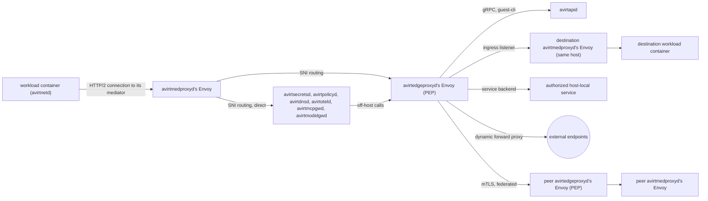
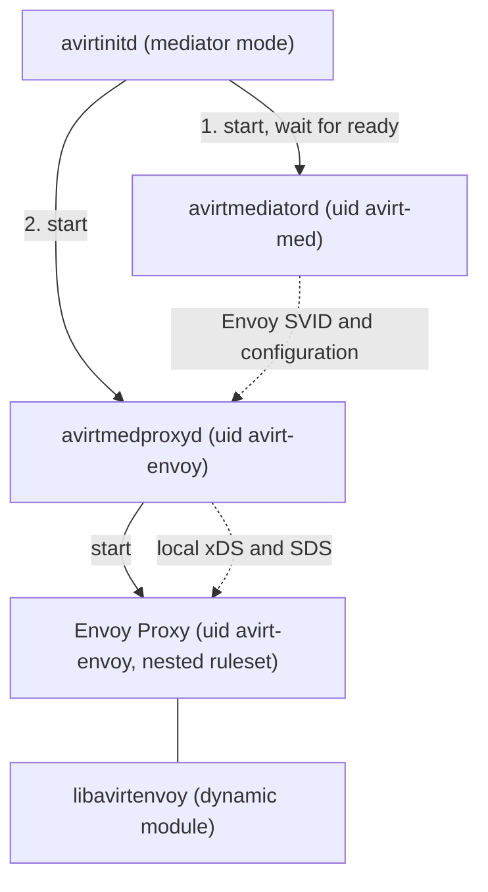
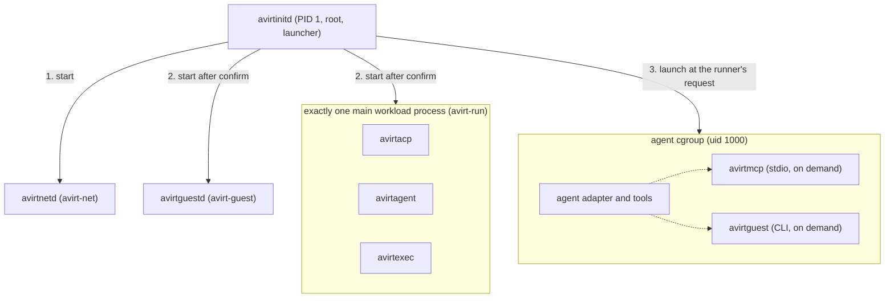
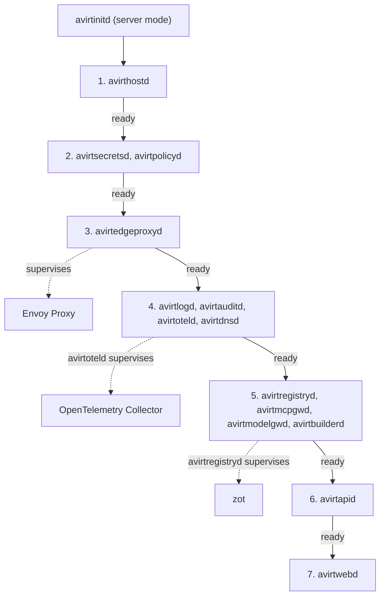

# Overview

`avirt`'s components fall into five placements. avirthostd and the host services that configure and decide make up the control plane, and avirtedgeproxyd and avirtmedproxyd with their Envoys are the data plane. Each workload has a workload container and a mediator container. The edge VM runs avirtedgeproxyd and its Envoy, and is the only avirt VM with a network interface (see [edge VM](#edge-vm)). As a deployment mode, the all-in-one server image runs the host services in one container. The Container column identifies the container a component runs in. Host-side components run directly on the host or together in the all-in-one server image.

A **workload** is the lifecycle unit, like a pod with a sidecar. Its **workload container** runs avirtinitd and the agent or another main workload process. Its **mediator** is the per-workload mediator container that runs avirtmediatord, avirtmedproxyd, and avirtmedproxyd's Envoy. Each runs in its own container, which is its own VM on the Containerization runtime and a container on a shared kernel on Docker Desktop (see [compute runtimes](./compute-runtimes.md)).

| Component | Description | Container | Status |
| --- | --- | --- | --- |
| avirt | The command-line tool and TUI client (see [operator CLI](./operator-cli.md)) | host | Partial |
| avirtadmin | The local admin CLI, which talks directly to avirthostd over a local Unix socket (see [admin CLI](./admin-cli.md)) | host | Planned |
| avirtwebd | The backend for the avirt web UI | host | Planned |
| avirtedgeproxyd | The edge proxy supervises the host's edge Envoy Proxy with libavirtenvoy and serves it local xDS and SDS. Through that Envoy it's the global policy enforcement point for workload traffic. It publishes services and handles each workload-to-workload connection on this host and between hosts. It fronts the host services for local clients and peers and is the only host service that opens connections off the host | edge | Planned |
| avirthostd | Owns workload lifecycle, namespaces, workspaces and immutable workload configuration for one host, and issues SPIFFE identities | host | Partial |
| avirtapid | The API server: a REST and gRPC API in front of the local avirthostd, peers' avirtapid and services, reached through avirtedgeproxyd | host | Planned |
| [avirtdnsd](./dns.md) | Makes local and peered workloads and services addressable by name, resolving each name to the edge proxy of the host that serves it | host | Planned |
| avirtmcpgwd | The MCP gateway, which injects MCP upstream credentials | host | Planned |
| avirtmodelgwd | The model gateway, which injects model credentials | host | Planned |
| avirtregistryd | The host's OCI registry for workspace images: it runs zot as a supervised child process and adds avirt's own secondary index and search API (see [workspaces](./workspace-registry.md#avirtregistryd)) | host | Planned |
| avirtbuilderd | Builds repository OCI artifacts from version control in disposable sandboxed jobs, so that workloads start quickly | host | Planned |
| avirtpolicyd | Stores, validates, proves, compiles and distributes versioned Cedar policy snapshots for the host | host | Planned |
| [avirtsecretsd](./secrets.md) | Stores secrets from providers. Credential refresh is its responsibility. Serves the workload-scoped credential broker API and an Envoy secret discovery service (SDS) for mediator-injected bindings | host | Planned |
| avirtlogd | Acquires and transforms workload container logs. Sends them to avirtoteld for delivery as OpenTelemetry Logs (see [observability](./observability.md#workload-stdout-and-stderr)) | host | Planned |
| avirtauditd | Audit logging: it reads the workload logs and each component's audit log and delivers them as OCSF (see [observability](./observability.md#audit)) | host | Planned |
| avirtoteld | The OpenTelemetry Collector for the host, with a Rust front end supervising a pinned Collector built with the OpenTelemetry Collector Builder (see [observability](./observability.md#avirtoteld)) | host | Planned |
| avirtinitd | One minimal supervisor with three role modes. Acts as PID 1 and launcher in the workload container. Supervises the mediator container, edge VM, and all-in-one server image | workload, mediator, edge, all-in-one | Partial |
| avirtmediatord | The mediator's control process: the mediator's connection to avirthostd, the `/control` stream, readiness, generations, lifecycle and identity rotation for itself and avirtmedproxyd's Envoy | mediator | Partial |
| avirtmedproxyd | The mediator proxy: it supervises the mediator's Envoy Proxy with libavirtenvoy and serves it local xDS and SDS | mediator | Planned |
| Envoy Proxy | The data plane: avirtmedproxyd's Envoy handles the workload's ingress and egress in full, and avirtedgeproxyd's Envoy handles the host's | mediator, edge | Planned |
| libavirtenvoy | An Envoy <!-- Envoy feature name. --><!-- vale ai-tells.OverusedVocabulary = NO -->dynamic module<!-- vale ai-tells.OverusedVocabulary = YES --> that evaluates Cedar policy (embedding the `cedar-policy` crate) and injects HTTP and gRPC credentials. The implemented module only checks CONNECT destinations and reports connection events | mediator, edge | Partial |
| avirtacp | Runs an agent workload through the Agent Client Protocol (see [ACP](./acp.md)) | workload | Partial |
| avirtagent | Runs an agent workload through its native harness | workload | Planned |
| avirtexec | Generic execution | workload | Planned |
| avirtnetd | Provides guest networking with the client end of the workload's HTTP/2 connection to its mediator and stores the workload SVID. Provides the forward proxy and DNS stub resolver. Also provides the reverse proxy and guest control gRPC API | workload | Partial |
| avirtguestd | Workload services: a file server and an MCP server | workload | Planned |
| avirtmcp | A stdio MCP server, launched by the agent, that relays to avirtmcpgwd | workload | Planned |
| avirtguest | The guest CLI in workload images, which reaches avirtapid through avirtnetd, avirtmedproxyd, and avirtedgeproxyd (see [guest CLI](./guest-cli.md)) | workload | Planned |

Partial means the component's function exists in the current code but not yet as the component described here. See the next section for where each partial function runs.

# Status: implemented

Current code consists of four functional binaries, the shared `avirt-core` and `avirt-connect` libraries, and the optional `avirtenvoy` HTTP filter module, which provide the working functions in this table.

| Binary | Container | Responsibilities |
| --- | --- | --- |
| `avirt` | host | The command-line tool. It talks to avirthostd directly over HTTP on `127.0.0.1:8787` (`POST /launch`), or the URL in `AVIRT_HOSTD_URL`. |
| `avirthostd` | host | The host daemon provides the control API and workload launch and teardown. Handles the Codex `auth.json` seed and write-back, and the workload logs in `logs/<workload-id>.ndjson`. |
| `avirtmediatord` | host, one process per workload | The mediator as a host process: one Pingora server with the CONNECT proxy on `proxy.sock`, and on `mediator.sock` a TCP proxy that forwards avirtinitd's HTTP/2 connection to avirthostd with the bytes unchanged. |
| `avirtinitd` | workload, as root | The workload container's root process and image entrypoint. Together with the harness in `avirt-core`, it contains the ACP client that avirtacp provides in the planned design (it spawns the adapter as uid 1000 under seccomp and taps each JSON-RPC line, see [ACP](./acp.md)), and the TCP proxy to `proxy.sock` that avirtnetd's forward proxy replaces in the planned design. |

`avirtinitd` isn't PID 1 in the current code. With `--init` on the workload container, the runtime's init is PID 1 and avirtinitd is its direct child (see [workload hardening](./workload-hardening.md)). avirt doesn't have a mediator container. Instead, the mediator runs as the host process in the table, and current code doesn't apply Landlock. When avirtmediatord supervises its optional Envoy, that Envoy loads libavirtenvoy for CONNECT destination checks. None of avirtedgeproxyd, avirtmedproxyd, or the other host services exist.

# Status: planned

## Host services

The state in a host service's Owns column belongs to that service, and no other component writes it. avirthostd passes references to secrets and policies (binding ids and policy ids) in workload configuration, never secret values.

| Component | Owns | Talks to |
| --- | --- | --- |
| avirt | Nothing. It's the command-line tool and TUI client (see [operator CLI](./operator-cli.md)). | avirtapid over gRPC, through avirtedgeproxyd's local client listener |
| avirtadmin | Nothing. It's the local admin CLI (see [admin CLI](./admin-cli.md)). | avirthostd directly, over avirthostd's `admin.sock`, where avirthostd authenticates it by peer credentials (see [trust boundaries](./trust-boundaries.md#listeners)). It doesn't go through avirtapid or avirtedgeproxyd. |
| avirtwebd | Web UI user authentication and sessions, and the web UI's static assets, bundled into its binary (see [web UI](#web-ui)). It acts for web UI users the way avirt acts for its user. | avirtapid over REST, through avirtedgeproxyd. Web UI users reach it, and its static assets, through avirtedgeproxyd. |
| avirtedgeproxyd | Its Envoy's configuration, served to the Envoy over local xDS and SDS: listeners, clusters, its SVID and key, the SPIFFE bundle and the active peers' bundles (see [peering](./peering.md#trust-bundles)). Through its Envoy, policy enforcement for each workload-to-workload connection on this host and between hosts, the published services, connections to authorized host-local services, and the host's off-host connections. It also fronts avirthostd, avirtapid, avirtmcpgwd, avirtmodelgwd and avirtwebd for local clients and peers, and relays each off-host connection the host services make. | Its Envoy (local xDS and SDS), avirthostd (its SVID from the issuer, service records and enrollment records), avirt, web UI users, avirtmedproxyd's Envoys (through avirthostd's SNI routing, in both directions), the host services it fronts, authorized host-local services, peers' avirtedgeproxyd, external endpoints, avirtpolicyd, avirtdnsd |
| avirthostd | Workload lifecycle (launch, generations, teardown, the startup cleanup), namespaces, immutable workload configuration (namespace, workload short ID and alias, labels, image digest, resolved workspace image digest, configuration layer digest, policy reference, credential binding references), port publications and service records as versioned state, peer enrollment records (see [peering](./peering.md#enrollment-record)), the entity revisions it sends to avirtpolicyd, the SPIFFE issuer, each workload's MITM CA, the durable workload log, the files containing workload stdio logs on the Containerization runtime, SNI routing, resource admission, the content-addressed cache, and each launch's configuration layer (see [workload lifecycle](./workload-lifecycle.md#configuration-layer)) | The compute runtime, each mediator's connection to avirthostd, avirtpolicyd (entity revisions and policy writes), avirtsecretsd (to check the references it stores, and its Admin API), avirtauditd (delivery status), avirtedgeproxyd (its SVID, service records and enrollment records), avirtapid (inbound, through avirtedgeproxyd), avirtadmin (inbound, on its local <!-- Preserve the admin socket interface name with its Unix transport qualifier. --><!-- vale project.WordList = NO -->admin Unix socket<!-- vale project.WordList = YES -->), avirtbuilderd |
| avirtapid | Nothing durable. It forwards REST and gRPC calls to the local avirthostd. Calls to peers' avirtapid and services go through avirtedgeproxyd. It forwards the caller's authenticated identity and rejects caller-supplied identity headers. Workloads use it to manage other workloads (see [workload management](#workload-management)). | avirt and avirtguest over gRPC and avirtwebd over REST, all through avirtedgeproxyd, avirthostd, avirtbuilderd, avirtregistryd, peers' avirtapid |
| avirtdnsd | The avirt DNS zone, which resolves each avirt name to the edge proxy of the host that serves it (see [DNS](./dns.md#the-avirtdnsd-zone)). | avirtmedproxyd's Envoys (through SNI routing), avirtedgeproxyd, avirthostd (namespaces, workloads, services and active peers) |
| avirtmcpgwd | MCP sessions. It injects MCP upstream credentials that it obtains from avirtsecretsd, scopes tool discovery and invocation by workload, and never retries a mutating tool call automatically. | avirtmedproxyd's Envoys (through SNI routing), avirtsecretsd, MCP upstreams through avirtedgeproxyd |
| avirtmodelgwd | Model routing, per-workload model budgets and the Codex refresh endpoint. It injects model credentials that it obtains from avirtsecretsd. | avirtmedproxyd's Envoys (through SNI routing), avirtsecretsd, upstream model APIs through avirtedgeproxyd |
| avirtregistryd | Workspace images and their registry storage, in zot under avirtregistryd's own state directory, with zot's `sync`, `ui`, `userprefs`, `events` and `metrics` extensions off and its listener on loopback, accepting only mTLS from a private CA avirtregistryd holds in memory. Its secondary index is its own SQLite database, updated with each write and reconciled against zot's catalog. It makes each off-host registry connection. | avirtbuilderd, avirthostd, avirtapid and build jobs' avirtmedproxyd Envoys (its `WorkspaceRegistry` API), zot, avirtsecretsd (registry credentials), off-host registries and peers' registries through avirtedgeproxyd |
| avirtbuilderd | Build scheduling. It watches version control such as git and runs each build in a disposable sandboxed job with no host control or signing authority. | Repositories through avirtedgeproxyd, avirtregistryd |
| avirtpolicyd | Cedar policy storage, schema validation, the Cedar policy prover, compilation, and versioned snapshot distribution (see [egress policies](./egress-policies.md)). The prover statically analyses each policy set before a snapshot built from it undergoes distribution, and reasons precisely about entity-hierarchy membership such as `in Namespace::"team-a"`. It rejects any policy that applies `like` to anything other than a canonicalized external host or a canonicalized request path. Each snapshot pairs a policy version with an entity revision from avirthostd. | libavirtenvoy in each avirtmedproxyd's Envoy and in avirtedgeproxyd's Envoy, avirthostd (entity revisions and policy writes in, host policy snapshot out) |
| avirtsecretsd | Provider access, each real credential, the Codex refresh token, credential refresh with one owner per credential, placeholder issuance, the workload-scoped credential broker API, and SDS for the `binding/<id>` secrets of mediator-injected bindings (see [credentials](./egress-credentials.md) and [secrets](./secrets.md#sds)) | Secret providers through their provider plugins (off-host ones through avirtedgeproxyd), avirtmodelgwd, avirtmcpgwd, avirtmediatord and avirtmedproxyd's Envoys (broker API), avirtmedproxyd's Envoys (SDS), avirthostd (workload and binding registrations, and the Admin API) |
| avirtlogd | Workload stdio log delivery. It acquires the workload containers' stdout, stderr and console logs with a runtime-adapted method. It transforms them and sends them to avirtoteld for delivery as OpenTelemetry Logs (see [observability](./observability.md#workload-stdout-and-stderr)). | The host-written log files it tails, avirtoteld |
| avirtauditd | Audit delivery as OCSF. It reads avirthostd's committed workload logs and each component's audit log by offset, and keeps the raw security events beside the OCSF form (see [observability](./observability.md#audit-logs)). | The workload logs and audit logs, avirthostd (delivery status), an OCSF sink through avirtedgeproxyd |
| avirtoteld | Telemetry delivery: a Rust front end supervising a pinned OpenTelemetry Collector built with the OpenTelemetry Collector Builder (see [observability](./observability.md#avirtoteld)) | avirtmedproxyd's Envoys (through SNI routing), avirtmediatord, avirtlogd, the host services, avirtedgeproxyd, downstream telemetry backends through avirtedgeproxyd |

avirthostd's sequence-numbered workload log (see [workload topology](./workload-topology.md#resuming-after-reconnect)) is the durable record. avirtauditd consumes it and the components' audit logs asynchronously, and avirtlogd consumes the files containing workload stdio logs asynchronously, so telemetry or OCSF backpressure delays only them and never stalls a workload (see [observability](./observability.md)). Each event includes the provenance labels defined in [trust boundaries](./trust-boundaries.md#event-provenance).

## Namespaces and labels

A **namespace** is only a grouping of workloads and a trust and access boundary for policy.

- Each workload is in exactly one namespace, fixed when avirthostd creates the workload. The default is `default`.
- Creating a workload in a namespace requires authorization for that namespace. avirthostd evaluates it against the host's Cedar policy snapshot.
- Service names and their aliases are unique within their namespace. A workload uses its short ID as its name, unique on the host.
- Workloads can manage other workloads, under policy (see [workload management](#workload-management)).
- A namespace name is a lowercase DNS label of at most 63 characters (see [avirt names](#avirt-names)).
- A namespace is local to its host. A namespace with the same name on another host is a different namespace, and references to anything on another host must use fully qualified identifiers. Use its peered name and an identity in that host's trust domain, along with a Cedar entity qualified by that host.

A **label** is a free-form key and value on a workload or a service, used for selection and grouping, such as `project`, `repo` or `clone-of`. Policy can use labels as attributes, but a label isn't a trust boundary by itself. Setting a label key is itself authorized: only avirthostd sets keys under the reserved prefix `avirt.internal/`, and the host policy can reserve further prefixes for the principals it names.

In Cedar, a `Workload` is `in` its `Namespace`, so policies can say `principal in Namespace::"team-a"`, and labels are entity tags (see [egress policies](./egress-policies.md#tags)). In SPIFFE, the namespace is part of each workload identity (see [identity](./identity.md#trust-domain-and-ids)).

## Workload IDs

Each workload has a canonical ID, a UUIDv7 that avirthostd generates when it creates the workload. It's never reused. SPIFFE IDs include it (`/ns/<ns>/workload/<uuid>/…`, see [identity](./identity.md#trust-domain-and-ids)), and so do Cedar entities (`Workload::"<ns>/<uuid>"`) and the `workload` field of each log record.

The workload's short ID is the last 8 hexadecimal characters of the UUIDv7, such as `7e759259` for `0192f3a4-5b6c-7d8e-9f01-23457e759259`. A UUIDv7's leading bits are a millisecond timestamp. Always derive the short ID from the trailing random bits, never the prefix. Authorization never uses the short ID, which is only a DNS handle.

Short IDs must be unique on the host for live workloads and ended workloads whose names are still within their DNS TTL. When a new UUIDv7's short ID clashes with one of them, avirthostd discards that UUIDv7 and generates another, up to 8 times. If each attempt clashes, it refuses the launch with 503 and records the clash.

## avirt names

Each workload and service has local and peered avirt names under `host.avirt.internal` or an active peer's host name, which is the peer's FQDN (see [peering](./peering.md#peer-host-names)), and avirtdnsd is the only component that answers them. The name forms, label syntax, length caps and the rejection rule are in [DNS](./dns.md#avirt-names).

## Workload management

A workload can manage other workloads: create, list, inspect, stop, and delete them. The agent runs avirtguest (see [guest CLI](./guest-cli.md)), which reaches avirtapid through avirtnetd, avirtmedproxyd, and avirtedgeproxyd. The calling workload is the principal, as `Workload::"<ns>/<uuid>"` with `via: "guest-cli"` in the context, and avirthostd authorizes each call per action and per resource (namespace, labels, credential bindings, policy reference) against the host policy snapshot. The default denies all actions.

These constraints bound what a workload can do through this path, whatever the policy permits:

- **No greater authority.** A workload can create a workload only in a namespace where it may itself create workloads. It must hold the credential bindings itself and have permission to launch the workspace image (`launch_workspace`, see [workspaces](./workspaces.md#policy)). The child's policy reference is the creator's own, or one the host policy names as assignable by that creator. The child's resource requests count against the creator's namespace budget.
- **Reserved labels.** A workload never sets a label under `avirt.internal/`. avirthostd sets them on each workload it creates.
- **Delegation chain.** avirthostd records each workload's creator in `avirt.internal/creator` (the creator's UUIDv7, or the local or web UI user) and its root in `avirt.internal/root`, the user at the top of the chain. Host configuration caps the delegation chain depth. avirthostd refuses a create past the cap.
- **Lifetime.** A child ends when its creator ends, unless the policy permits a detached child.
- **No self-escalation.** A workload can't change its own namespace, labels, bindings or policy reference, which are immutable, and can't publish ports on a workload it didn't create unless the policy permits it.
- **Host scope.** A workload manages workloads on its own host. Managing a peer's workloads goes through that peer's avirtapid, under the peer's policy for the caller's fully qualified identity (see [peering](./peering.md#workload-management-across-hosts)).
- **No host administration.** Namespace creation, peer enrollment, policy writes and other host administration aren't available to workload principals.
- **Audit.** Each management call is an event with the caller, the action, the resource, and the delegation chain.

## avirtedgeproxyd

avirtedgeproxyd is the host's edge proxy. It supervises an Envoy Proxy with libavirtenvoy loaded, the way avirtregistryd supervises zot, and serves that Envoy local xDS and SDS. These configure its listeners and clusters, plus its `/service/avirtedgeproxyd` SVID and key from avirthostd's issuer. They include the SPIFFE bundle and the active peers' bundles. Through that Envoy it's the only global policy enforcement point for workload traffic, and the only host service that opens connections off the host. The [edge VM](#edge-vm) runs it.

- **Workload to workload.** Each connection from one workload to another passes through avirtedgeproxyd, on the same host and between hosts: avirtmedproxyd, avirtedgeproxyd, the destination avirtmedproxyd, the destination workload container. Between hosts it passes both hosts' avirtedgeproxyd, and each evaluates its own host policy snapshot (see [peering](./peering.md#workload-traffic)).
- **Services.** avirtedgeproxyd publishes services that workloads expose, using avirthostd's service records. A record has a name, a namespace, labels, a port, and a backend: a port that a workload publishes, or an authorized host-local service.
- **Host-local services.** A service running on the host itself outside avirt, such as one bound to the host's `127.0.0.1`, is reachable only as the backend of a service record. The private-address block refuses each other host address. How the edge VM connects to such a backend is open (see [networking](./networking.md#open-questions)).
- **External endpoints.** avirtmedproxyd's Envoys connect to the egress listener through avirthostd's SNI routing (see [workload topology](./workload-topology.md#sni-routing)) for connections to external endpoints, for which avirtedgeproxyd's Envoy is a <!-- Envoy feature name. --><!-- vale ai-tells.OverusedVocabulary = NO -->dynamic forward proxy<!-- vale ai-tells.OverusedVocabulary = YES -->.
- **Clients.** On the local client listener, which local clients reach through `edgeproxy.sock` in the runtime directory, it fronts avirthostd, avirtapid, avirtmcpgwd, avirtmodelgwd and avirtwebd: avirt reaches avirtapid over gRPC and avirtwebd reaches it over REST. Web UI users on this machine connect to avirtwebd through a host loopback port that the runtime forwards into the edge VM. avirtadmin isn't a client of avirtedgeproxyd: it uses `admin.sock`. On the peer listener, which peers reach through the host's peer port on the addresses in `peering.listen` (default port 8788), and which doesn't exist while that list is empty (see [peering](./peering.md#peer-listener)), it serves active peers only local published ports, services, the SPIFFE bundle endpoint and avirtapid, never avirthostd, avirtmcpgwd, or avirtmodelgwd.
- **avirtguest.** avirtguest reaches avirtapid over gRPC from inside the workload container: avirtnetd, avirtmedproxyd, avirtedgeproxyd, avirtapid. avirtedgeproxyd authorizes its `guest-cli` principal against the host policy snapshot as it does other workload traffic.
- **Host services.** Each off-host connection a host service makes goes through it. This includes upstream calls from avirtmodelgwd and avirtmcpgwd, and remote secret provider calls from avirtsecretsd. It includes exports from avirtoteld and avirtauditd, source fetches from avirtbuilderd, peer imports from avirtregistryd, and peer calls from avirtapid.

Traffic from avirtmedproxyd's Envoy to avirt's own host services (avirtsecretsd, avirtoteld, avirtmcpgwd, avirtmodelgwd, avirtdnsd and avirtpolicyd, and avirtregistryd for build jobs only) doesn't pass through avirtedgeproxyd. avirthostd's SNI routing forwards this traffic directly to each component. Both sides use mutual TLS and X.509-SVIDs.

libavirtenvoy in avirtedgeproxyd's Envoy authorizes each caller by its SVID. Name resolution maps avirt names to canonical entities. libavirtenvoy denies names that resolve to none. After evaluating the host's Cedar policy snapshot, it resolves external names and applies the private-address block to each resolved address (see [egress](./egress.md#edge-proxy-egress)). Connection logging produces one event per connection. To reach a destination mediator it opens its own mutual TLS connection as `/service/avirtedgeproxyd` to that mediator's ingress listener, and includes the authenticated source identity in `x-avirt-caller`, which it sets after removing any the request included. It injects no credentials, and the bytes it forwards between workloads and inside the TLS connections that avirtmedproxyd's Envoy opens to the upstream remain opaque to it. `x-avirt-caller` is a header on the outer h2 CONNECT stream avirtedgeproxyd's Envoy originates, never part of the tunnelled bytes. Require exactly one copy of that header. The proxy refuses a missing, repeated, or unparseable header. When avirtapid, avirtregistryd, avirtmodelgwd or avirtmcpgwd call through avirtedgeproxyd on behalf of a caller, they include that caller's identity in `x-avirt-caller`. avirtedgeproxyd accepts it only from those four services and only for a caller the service is serving (for a gateway, the workload and generation of the `/mediator/<gen>/medproxy` SVID on its inbound connection, or a peer import for avirtregistryd), and it authorizes both the service and the originating principal.

## Edge VM

avirtedgeproxyd and its Envoy run in a Linux container, never directly on macOS. The edge VM runs only avirtedgeproxyd and its Envoy, under avirtinitd, and never shares a VM with another host service. On a direct macOS install each other host service runs natively on the Mac.

| Runtime | Edge VM |
| --- | --- |
| Containerization | A Containerization VM with one vmnet NAT interface |
| Docker Desktop | A container with normal container networking |

In the all-in-one server image, avirtedgeproxyd runs in the image's container with the other host services, and the nftables rule in [off-host enforcement](./networking.md#linux-and-the-all-in-one-server-image) confines off-host flows to its Envoy.

- **Network.** The edge VM is the only avirt VM with a network interface, and its Envoy dials upstreams and peers directly. avirthostd's start check asserts that the edge VM is the only avirt VM with a network device (see [edge VM network](./networking.md#edge-vm-network)). The design doesn't include a relay component.
- **Host addresses.** avirthostd pushes the host's own interface addresses to avirtedgeproxyd and updates them on change, and libavirtenvoy refuses those addresses as well as the private ranges (see [edge proxy egress](./egress.md#edge-proxy-egress)).
- **Local clients.** The avirt command-line tool reaches the local client listener through `edgeproxy.sock` in the runtime directory, a Unix socket backed by vsock. avirtadmin doesn't go through the edge proxy: it uses `admin.sock`.
- **Web UI users.** Web UI users on this machine connect to a host loopback port that the runtime forwards into the edge VM.
- **Peers.** Peers dial the host's address on the peer port, 8788 by default and off unless configuration sets `peering.listen`. The runtime publishes that port into the edge VM's peer listener: on Containerization with the port publishing that `container run --publish` exposes, and on Docker Desktop with `-p`. Peers authenticate by SVID, so the forwarded source address isn't needed for authorization.
- **Host services.** avirtedgeproxyd reaches avirtapid, avirthostd's control API and the other host services that run natively on the Mac over vsock-backed Unix sockets, the same mechanism the mediators use, and never over the network.

## Policy and credential placement

| Point | Policy | Credentials |
| --- | --- | --- |
| avirtmedproxyd's Envoy | The workload's Cedar policy snapshot (`resolve`, `connect`, `intercept`, `passthrough`, `request` and `ingress`), after resolving avirt names to entities, plus the non-policy checks: authority normalization, `Host` matching, the placeholder misuse check, and the Codex refresh intercept | Only narrow, short-lived, workload-scoped credentials for bindings that require injection at the mediator |
| avirtedgeproxyd's Envoy | The host's Cedar policy snapshot, after resolving avirt names to entities: caller authorization, workload-to-workload connections on this host and between hosts, services, host-local services, external endpoints, the private-address block and peer routing | None |
| avirtmodelgwd | Its per-workload model rules and budgets | Model credentials, obtained per request from avirtsecretsd |
| avirtmcpgwd | Its per-workload tool scope | MCP upstream credentials, obtained from avirtsecretsd |
| avirthostd | The host policy snapshot, for control-plane actions: `create_workload`, `list_workloads`, `inspect_workload`, `stop_workload`, `delete_workload`, `set_label`, `attach_binding`, `publish_port`, `publish_service` and `launch_workspace` | None |

## Host mediator

Status: implemented. avirtmediatord runs on the host with Pingora as its default CONNECT engine. Its experimental Envoy mode starts a supervised Envoy child with a static bootstrap and avirtenvoy's destination filter. Both modes keep the existing sockets and event envelope. Their `proxy.sock` and `mediator.sock` behavior follows [egress](./egress.md#experimental-host-envoy-mode). `avirt-connect` provides the authority and destination checks shared by Pingora and the excluded `avirtenvoy` module. Plans include Cedar, TLS, and credential functions.

## Mediator container

Each workload has one mediator container, a sidecar to its workload container. The mediator has no network interface other than loopback. Its only connections are the four Unix sockets the compute runtime provides, described in [workload topology](./workload-topology.md#runtime-provided-sockets). These provide the workload's HTTP/2 connection to its mediator on `/run/avirt/workload.sock` and the mediator's connection to avirthostd, plus the mediator's outbound socket to avirthostd and avirtmedproxyd's ingress listener.

| Component | What it does | Talks to |
| --- | --- | --- |
| avirtinitd (mediator mode) | Starts avirtmediatord and then avirtmedproxyd, each under its own UID and with its own Landlock ruleset (see [sandbox](./sandbox.md#mediator)). Exits as soon as either child exits. | Its children |
| avirtmediatord | The mediator's control process. It maintains the mediator's connection to avirthostd and fetches the workload's configuration. It generates its own key and the key of avirtmedproxyd's Envoy, then rotates both SVIDs. avirtmedproxyd receives the Envoy's SVID and key and the configuration for its listeners from this process. avirtmediatord receives libavirtenvoy's readiness reports on a local status socket. It runs the `/control` stream and launch handshake and reports readiness. It proxies no traffic. | avirthostd (the mediator's connection to avirthostd), avirtsecretsd (placeholders, through SNI routing), avirtmedproxyd (the Envoy's SVID and configuration), libavirtenvoy (status socket), avirtnetd (the `/control` stream, routed to it by avirtmedproxyd's Envoy) |
| avirtmedproxyd | The mediator proxy. It starts its Envoy under its own UID, applying the Envoy's Landlock ruleset as a nested domain, serves it listeners, clusters, its SVID and key and the trust bundle over local xDS and SDS on `/run/avirt/xds.sock`, and exits when its Envoy exits. | avirtmediatord, its Envoy (local xDS and SDS) |
| Envoy Proxy | avirtmedproxyd's Envoy, the data plane. It's the endpoint for the workload's HTTP/2 connection to its mediator and serves the agent's CONNECT streams and DNS queries. It sends each connection to a host service or to avirtedgeproxyd. It accepts avirtedgeproxyd's connections to published ports on its ingress listener. | avirtnetd, avirthostd (the `/envelopes` stream and events), the host services, avirtedgeproxyd |
| libavirtenvoy | Evaluates the workload's Cedar policy snapshot locally and normalizes authorities. Resolves avirt names to entities and applies DNS policy. Mints leaf certificates from the workload's MITM CA and runs the placeholder misuse check. Injects mediator-bound credentials and routes the Codex refresh intercept. Writes events | avirtpolicyd, avirtsecretsd (broker API), avirtdnsd |

## Workload container

An agent or another main workload process runs inside the workload container. `avirtinitd` is PID 1 and the launcher: it starts each other process with that process's own UID, capabilities, seccomp filter and Landlock ruleset, and none of them inherits avirtinitd's (see [workload hardening](./workload-hardening.md#security-contexts) and [sandbox](./sandbox.md#per-process-rulesets)). It runs exactly one main workload process (avirtacp, avirtagent or avirtexec) together with avirtnetd and avirtguestd.

Each workload container's root filesystem is a harness base image derived from the avirt base image, then the workspace layers, the configuration layer and the per-workload writable layer (see [workload lifecycle](./workload-lifecycle.md)). The avirt base contains each workload binary in the table below, and the harness base adds only the harness and its adapter under `/opt/agent`.

| Process | UID | What it does | Talks to |
| --- | --- | --- | --- |
| avirtinitd | 0 | PID 1, the launcher, lifecycle, and freeze authority. It doesn't have an SVID. It needs root to start children under other UIDs, create the agent cgroup, write the system CA bundle and `/etc/resolv.conf`, bind the DNS stub resolver's port 53 sockets and the forward proxy's `127.0.0.1` listener for avirtnetd, freeze the agent cgroup, and end every process in it. | Its children, over one launcher socket per role, `/run/avirt/init/<role>.sock` |
| avirtnetd | `avirt-net` | The client end of the workload's HTTP/2 connection to its mediator: TLS client and h2 client on `/run/avirt/mediator.sock`. Stores the workload SVID and key in memory. It owns the `/envelopes` stream (sequence numbers and the replay ring), the forward proxy on the listener avirtinitd hands it, the DNS stub resolver (see [egress](./egress.md#workload-dns)), the reverse proxy and the guest control gRPC API, and serves the local service sockets the other workload processes use. | avirtmedproxyd's Envoy. Workload processes connect over loopback and Unix sockets |
| avirtacp | `avirt-run` | Runs an agent workload through the Agent Client Protocol and exposes a session control API through the mediator (see [ACP](./acp.md#session-control-api)). avirtinitd launches the adapter at its request and hands it the adapter's stdio pipes. It taps each JSON-RPC line and submits the envelopes to avirtnetd. It provides the ACP client that's part of avirtinitd in the current code. | The ACP adapter (stdio), avirtnetd, avirtinitd |
| avirtagent | `avirt-run` | Runs an agent workload through its native harness | The agent's harness, avirtnetd, avirtinitd |
| avirtexec | `avirt-run` | Generic execution | avirtnetd, avirtinitd |
| avirtguestd | `avirt-guest`, in the workspace group `avirt-ws` it shares with the agent | A file server for remote file management and workspace snapshots, and an MCP server with workspace and workspace snapshot tools, on `/run/avirt/streams/guestd.sock` only. It reaches the agent's files through the workspace group and its default ACLs (see [workload hardening](./workload-hardening.md#security-contexts)). | avirtnetd (ingress), avirtinitd (quiesce) |
| Agent | 1000 | The adapter and each tool it runs, in the agent cgroup | avirtnetd's forward proxy and agent sockets |
| avirtmcp | 1000 | A stdio MCP server that the agent launches on demand. It relays MCP to avirtmcpgwd through avirtnetd's MCP socket and the mediator. | The agent (stdio), avirtnetd |
| avirtguest | 1000 | The guest CLI, run on demand (see [guest CLI](./guest-cli.md)). It reaches avirtapid over gRPC through avirtnetd's guest CLI socket, avirtmedproxyd and avirtedgeproxyd, and avirtnetd forwards its requests under the principal `/ns/<ns>/workload/<uuid>/guest-cli` (see [identity](./identity.md#trust-domain-and-ids)). It manages other workloads under policy (see [workload management](#workload-management)). | avirtnetd |

avirtguestd's MCP tool surface:

- **Workspace tools.** List, stat, read, write and remove, on paths under the workload's declared workspace roots only. avirtguestd resolves paths beneath the root without following symlinks or magic links out of it. It limits writes to the workspace quota.
- **Workspace snapshot tools.** Create a workspace snapshot of a workspace root, and list workspace snapshots. A workspace snapshot quiesces the workspace by asking avirtinitd to freeze the agent cgroup for the duration of the copy.

These tools don't execute commands or access paths outside the workspace roots. avirtguestd listens only on `/run/avirt/streams/guestd.sock`, never on a loopback port, so the agent can't connect to it. Its file server and MCP server are reachable only through the `guestd` ingress target, which avirtnetd forwards to that socket with the caller's identity (see [workload topology](./workload-topology.md#ingress)). For its own MCP configuration, the agent uses only avirtmcp.

## Startup and failure semantics

### Workload

1. avirtinitd creates `/run/avirt` and the agent cgroup, then reads and unlinks the bootstrap SVID. It binds the forward proxy's listener on `127.0.0.1` and starts avirtnetd with the bootstrap SVID and key and that listener on inherited file descriptors.
2. avirtnetd opens the workload's HTTP/2 connection to its mediator, completes mutual TLS, attaches, takes part in the first rotation, and has its `/envelopes` stream accepted by avirthostd (see [workload topology](./workload-topology.md#launch-handshake)).
3. On `confirm`, avirtnetd passes the `confirm` contents to avirtinitd. avirtinitd installs the MITM CA and writes the placeholder files. It then starts the main workload process and avirtguestd.
4. The main workload process asks avirtinitd to launch the agent. avirtinitd launches it as uid 1000 in the agent cgroup, with the placeholder environment and its security context, and avirtnetd reports `started`.

A set in avirtinitd records active freeze reasons, whose possible values are `connection` and `workspace-snapshot`. avirtinitd freezes the agent cgroup whenever this set is non-empty. It tells the main workload process when the cgroup freezes and thaws, and the main workload process suspends its adapter deadlines while it's frozen.

Starting any agent process requires the workload's connection to its mediator and its workload identity. The MITM CA and placeholders must also be in place. The workload's policy snapshot in avirtmedproxyd's Envoy and the accepted `/envelopes` stream must be ready.

| Event | Effect |
| --- | --- |
| The workload's connection to its mediator fails with no replacement connection | avirtinitd adds a `connection` freeze reason. If a connection to the same or a higher mediator generation attaches and completes confirmation within 30 s it removes the reason, otherwise it kills the cgroup and exits 2 with `mediator lost` (see [workload topology](./workload-topology.md#freeze-and-reconnect)). |
| avirtnetd exits | avirtinitd freezes the agent cgroup, then kills it and exits 2. Only avirtnetd stores the workload identity. Its exit ends the workload. |
| The main workload process exits | avirtinitd lets avirtnetd drain the `/envelopes` stream, kills the agent cgroup, and exits. |
| The agent exits | The main workload process ends the session. Never restart the agent. |
| avirtguestd exits | avirtinitd restarts it at most twice with backoff. Its file and MCP requests fail meanwhile. |
| Applying a security context fails | The intended process doesn't start. For the agent, the workload ends before any agent process exists. |

### Mediator

1. avirtinitd starts avirtmediatord. avirtmediatord reads the bootstrap SVID and fetches `GET /workload`. It generates its own key and the key of avirtmedproxyd's Envoy, then completes the first rotation of both and prepares the Envoy's configuration.
2. Once avirtmediatord reports ready, avirtinitd starts avirtmedproxyd, which takes the Envoy's SVID and configuration from avirtmediatord and starts its Envoy. The Envoy's bootstrap specifies only avirtmedproxyd's local xDS and SDS socket, so it serves nothing until avirtmedproxyd delivers its listeners and its SVID.
3. libavirtenvoy loads the workload's policy snapshot from avirtpolicyd and the workload's placeholders from avirtsecretsd, and reports each on the local status socket. avirthostd reports the accepted `/envelopes` stream to avirtmediatord with `{"t":"envelopes_accepted"}` on `GET /workload/control`. avirtmediatord sends `confirm` only once it has all three.

| Event | Effect |
| --- | --- |
| avirtmediatord or avirtmedproxyd exits (avirtmedproxyd exits when its Envoy exits) | avirtinitd stops the other, and the mediator container exits. avirthostd starts a new generation, at most twice per workload. |
| The mediator loses its connection to avirthostd | avirtmediatord exits, with the effect preceding. |
| avirtpolicyd is unreachable | libavirtenvoy continues evaluating its current policy snapshot until it expires, then denies (see [egress](./egress-policies.md#policy-failure-behavior)). |
| avirtsecretsd is unreachable | The proxy refuses requests that need a mediator-injected credential. Model and MCP traffic depends only on the gateways. |

### All-in-one server image

avirtinitd in server mode starts the host services in this order, each under its own UID and each able to read only its own secrets. Each step waits for the previous step's readiness. avirtedgeproxyd supervises its Envoy. avirtregistryd supervises zot, and avirtoteld supervises its OpenTelemetry Collector. Each supervises one child process.

1. avirthostd
2. avirtsecretsd and avirtpolicyd
3. avirtedgeproxyd
4. avirtlogd, avirtauditd, avirtoteld, and avirtdnsd
5. avirtregistryd, then avirtmcpgwd, avirtmodelgwd, and avirtbuilderd
6. avirtapid
7. avirtwebd

Readiness is local: a daemon is ready once it holds its SVID and serves its listener, and no daemon's readiness waits on an off-host connection. avirtsecretsd is ready before it has fetched any remote secret, and avirtedgeproxyd's identity (from avirthostd's issuer) and host policy snapshot (from avirtpolicyd) are available before anything needs to leave the host. avirtedgeproxyd is ready once its Envoy serves its listeners, and its Envoy answers 503 on a route whose backend hasn't yet started.

If avirthostd exits, the deployment exits, each workload ends, and the next start sweeps them (see [lifecycle](./lifecycle.md)). avirtinitd restarts each other daemon with exponential backoff, at most 5 times in 10 minutes. It marks a daemon degraded once it uses every restart in that budget and restarts it with a capped slow backoff. Running workloads continue running. While a required host service (avirtsecretsd, avirtpolicyd, avirtedgeproxyd, avirtdnsd, avirtregistryd or avirtmodelgwd) has degraded status, avirthostd refuses new launches with 503. avirtlogd, avirtauditd, avirtoteld, avirtbuilderd, avirtmcpgwd, avirtapid and avirtwebd aren't essential: their callers see errors while they're down, and avirthostd's durable workload log keeps each record avirtauditd hasn't yet delivered. Shutdown runs in reverse order, and avirtedgeproxyd stops accepting first.

## Host request paths

avirtedgeproxyd fronts avirthostd, avirtapid, avirtmcpgwd, avirtmodelgwd and avirtwebd for clients and peers, and relays each workload-to-workload, service, host-local service and external connection. avirt, avirtwebd and avirtguest reach avirtapid through avirtedgeproxyd, and avirtadmin reaches avirthostd directly over its local <!-- Preserve the admin socket interface name. --><!-- vale project.WordList = NO -->admin socket<!-- vale project.WordList = YES -->. avirtmedproxyd's Envoy reaches avirt's own host services directly through avirthostd's SNI routing. Each connection off the host leaves from an avirtedgeproxyd. Each path, hop by hop, is in [networking](./networking.md#connection-types).

## Web UI

The web UI is a separate frontend app in the repository, a single-page app likely built with Vite, React, and React Router. The same UI may also run in a Tauri desktop app. avirtwebd bundles the built static assets into its binary and serves them through avirtedgeproxyd, and it's the web UI's only backend: it reaches avirtapid over REST through avirtedgeproxyd.

avirtwebd authenticates web UI users.

| Kind | Methods |
| --- | --- |
| Authentication | Username and password, magic code or link by email, WebAuthn, generic OAuth 2.0, and generic OIDC |
| Multi-factor authentication | TOTP, magic code or link by email, and WebAuthn |

## Workload stdio logs

avirtlogd acquires the workload containers' stdout, stderr and console logs by tailing log files that the host side writes, and sends each record to avirtoteld, which delivers it as OpenTelemetry Logs. The method on each runtime, avirthostd's writer on the Containerization runtime and the identity attributes on each record are in [observability](./observability.md#workload-stdout-and-stderr).

## Operational ownership

Status: planned. These items have no phase yet (see [roadmap](./roadmap.md#unscheduled)).

- **Resource admission and accounting.** avirthostd reserves CPU, memory, disk, PIDs and egress bandwidth budgets for both containers of a workload before it creates either. It accounts the shared services' cost against the host and refuses a launch that doesn't fit with a 503.
- **Content-addressed cache.** A content-addressed store belonging to avirthostd holds the runtime artifacts: kernels, initfs images, the unpacked avirt base, harness base and mediator images, and configuration layers. Workspace images live in avirtregistryd, and avirthostd pulls them by digest. It verifies each artifact's digest when writing the artifact and again when creating a workload from it, and garbage-collects artifacts that no workload configuration or retention rule references.
- **Builds.** avirtbuilderd schedules builds. Each build that processes untrusted content runs in a disposable build job, a workload that avirthostd creates with the build security context, with no access to avirtapid or avirthostd's control API and no signing keys. A job pushes only to its staging repository, and avirtbuilderd checks the output and promotes it (see [workspaces](./workspace-build.md#builds)).
- **Rollout and version compatibility.** Each protocol (the control messages on the workload's HTTP/2 connection to its mediator, the mediator's connection to avirthostd, the broker API, the policy snapshot format) has a version, and each side refuses a version it doesn't support with a named error. An upgrade drains the host first. avirthostd refuses new launches and waits up to a deadline for running workloads to end. It then ends the rest.

# Open questions

1. **Per-service Envoys.** One avirtedgeproxyd fronts avirthostd, avirtapid, avirtmcpgwd, avirtmodelgwd and avirtwebd, with separate listeners. Per-service Envoys remain undecided. The design has yet to specify whether any of those services has its own Envoy Proxy behind avirtedgeproxyd's Envoy.
2. **The session control API.** Its framing, and whether avirtagent and avirtexec expose the same one, are open in [ACP](./acp.md#session-control-api).
3. **Namespace creation.** The design has yet to specify who may create a namespace or what creating one grants its creator by default.
4. **Namespace-scoped resources.** Workloads, workload and service names and workspace repositories are namespace-scoped, and secrets are host-scoped or namespace-scoped (see [secrets](./secrets.md#scoping)). Which other resources are (quotas, credential bindings, the right to publish services, policies) is open.
5. **Docker Desktop ingress listener.** On Docker Desktop, container-side listeners don't cross to the host, so avirthostd can't open a connection to avirtmedproxyd's ingress listener in a mediator container. How inbound connections connect to a mediator there is open.
6. **Docker Desktop socket ownership.** With file-mounted host sockets appearing as `root:root 0660` inside the container while avirtmediatord and avirtmedproxyd run under their own UIDs, the design has yet to specify how to grant those UIDs access without root.
7. **Docker Desktop log files.** Docker's container log files live inside the Docker Desktop VM. How avirtlogd on the macOS host accesses them, by a path the VM shares or through Docker's logs API, is open.
8. **Host service supervision outside the all-in-one image.** On a direct host install, which process starts and restarts the host services and hands each its one-time enrollment token is open.
9. **Web UI user accounts.** The design has yet to place storage for web UI user accounts and their credentials in avirtwebd, avirthostd, or a separate store.
10. **Web UI user identity.** The design has yet to specify how avirtwebd sends a web UI user's identity to avirtapid or how it maps to a Cedar principal.
11. **Web UI sessions.** Session handling for web UI users, including lifetime, renewal and revocation, is open.
12. **Web UI listener.** Web UI users reach a host loopback port that the runtime forwards into the edge VM. Which avirtedgeproxyd listener in the edge VM that port reaches is open.
13. **Frontend repository layout.** Where the web UI's frontend app belongs in the repository is open.
14. **Local user principal.** The design has yet to specify the Cedar principal for a local caller on avirtedgeproxyd's local client listener or how `x-avirt-caller` conveys it.
15. **Content filter prototype.** On macOS a Network Extension content filter drops each non-loopback flow from avirt-signed host processes. Whether it holds needs a prototype, and dropping avirt-signed processes is the property to test (see [networking](./networking.md#open-questions)).
