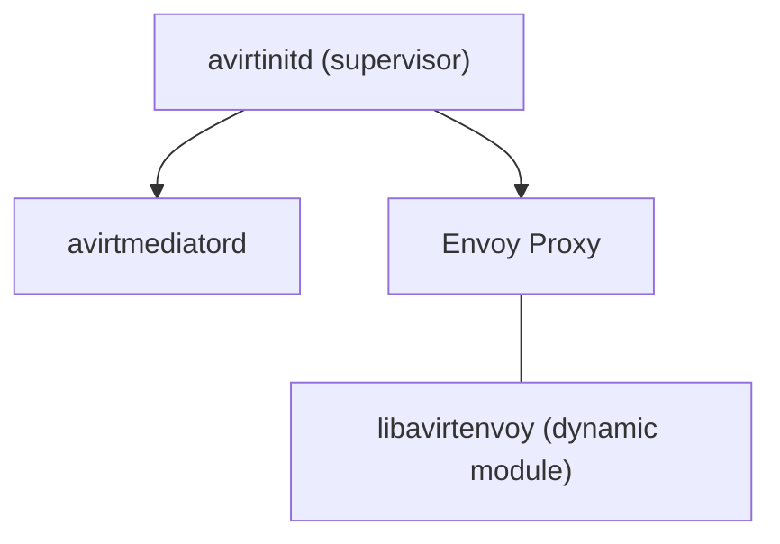
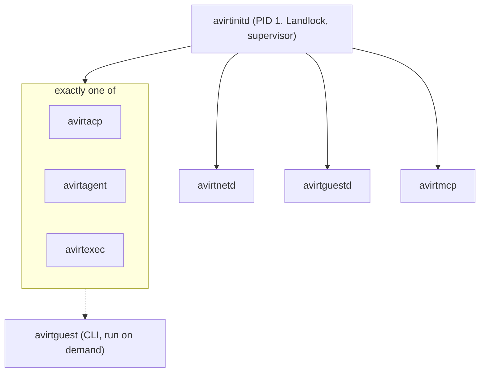
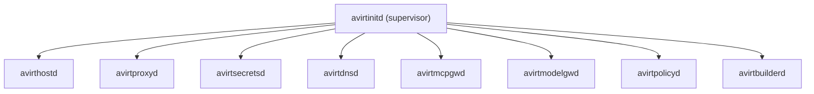
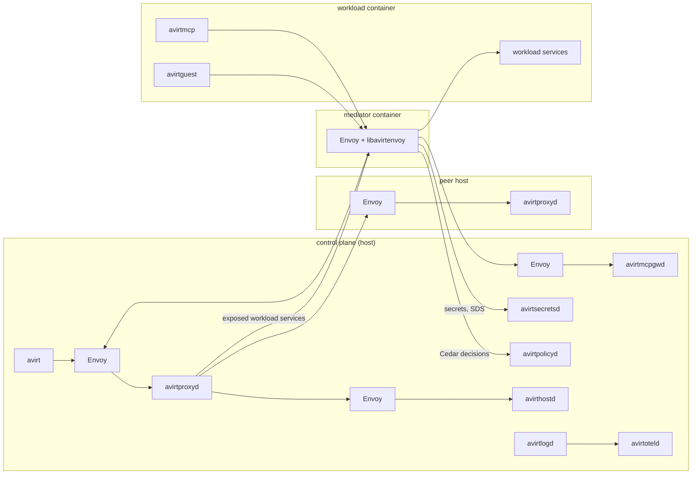

# Overview

`avirt`'s components fall into four placements. Host components make up the control plane. Each actor has a mediator container and a workload container. The all-in-one server image runs the host components in one container as a deployment mode. The Container column names the container a component lives in. Host-side components run directly on the host or together in the all-in-one server image.

| Component | Description | Container | Status |
| --- | --- | --- | --- |
| avirt | The CLI and TUI client | host | Partial |
| avirtadmin | The local admin CLI | host | Planned |
| avirthostd | Manages workloads, workspaces, secrets and Cedar policies for a single host | host | Partial |
| avirtproxyd | A REST and gRPC proxy to the local avirthostd and to peer hosts, and to workload services through each mediator | host | Planned |
| avirtdnsd | Makes local and peered workloads addressable by name | host | Planned |
| avirtmcpgwd | The MCP gateway | host | Planned |
| avirtmodelgwd | The model gateway | host | Planned |
| avirtbuilderd | Builds repository OCI artifacts from version control so that workloads start quickly | host | Planned |
| avirtpolicyd | Caches and executes Cedar policies for the host | host | Planned |
| avirtsecretsd | Brokers secrets from providers and serves an Envoy secret discovery service | host | Planned |
| avirtlogd | Collects and transforms logs | host | Planned |
| avirtauditd | Audit logging, delivered as OCSF | host | Planned |
| avirtoteld | The OpenTelemetry Collector | host | Planned |
| avirtinitd | PID 1, sandbox and process supervisor in the workload; supervisor in the mediator container | workload, mediator | Partial |
| avirtmediatord | The workload mediator daemon | mediator | Partial |
| Envoy Proxy | Proxies all network ingress to and egress from the workload and brokers credentials | mediator | Planned |
| libavirtenvoy | An Envoy dynamic module that provides avirt's extensions | mediator | Planned |
| avirtacp | Runs an agent workload through the Agent Client Protocol | workload | Partial |
| avirtagent | Runs an agent workload through its native harness | workload | Planned |
| avirtexec | Generic execution | workload | Planned |
| avirtnetd | Guest networking: egress gateway, ingress gateway and guest control gRPC API | workload | Partial |
| avirtguestd | Workload services: a file server and an MCP server | workload | Planned |
| avirtmcp | A guest-side stdio MCP server that relays to avirtmcpgwd | workload | Planned |
| avirtguest | A CLI in workload images that talks to avirtproxyd through the mediator | workload | Planned |

Partial means the component's function exists in the current code but not yet as the component described here. The next section says where each partial function lives.

# Status: implemented

The current code has four binaries and the shared `avirt-core` library, and they carry the implemented parts of the inventory as follows.

| Binary | Container | Carries |
| --- | --- | --- |
| `avirt` | host | The CLI. It talks to avirthostd directly over HTTP on `127.0.0.1:8787` (`POST /launch`), or the URL in `AVIRT_HOSTD_URL`. |
| `avirthostd` | host | The host daemon: the control API, actor launch and teardown, the Codex `auth.json` seed and write-back, and the actor logs in `logs/<actor-id>.ndjson`. |
| `avirtmediatord` | host, one process per actor | The mediator as a host process: one Pingora server with the CONNECT proxy on `proxy.sock` and the uplink splice to avirthostd on `uplink.sock`. |
| `avirtinitd` | workload, as root | The workload's root process and image entrypoint. Together with the harness in `avirt-core`, it contains the ACP client that avirtacp carries in the planned design (it spawns the adapter as uid 1000 under seccomp and taps every JSON-RPC line), and the loopback egress relay to `proxy.sock` that avirtnetd carries in the planned design. |

`avirtinitd` is not PID 1 in the current code. The workload runs with `--init`, so the runtime's init is PID 1 and avirtinitd is its direct child (see [workload hardening](./workload-hardening.md)). There is no mediator container: the mediator is the host process above. Landlock is not applied by the current code. None of Envoy, libavirtenvoy or the other host daemons exist.

# Status: planned

## Host components

| Component | What it does | Talks to |
| --- | --- | --- |
| avirt | The CLI and TUI client | avirtproxyd |
| avirtadmin | The local admin CLI | See open questions |
| avirthostd | Manages workloads, workspaces (OCI artifacts), secrets and Cedar policies for a single host. It is fronted by its own Envoy Proxy. | avirtproxyd (inbound, through its Envoy), the compute runtime, avirtbuilderd's artifacts |
| avirtproxyd | A REST and gRPC proxy to the local avirthostd and, through their own avirtproxyd, to peer hosts. It is fronted by its own Envoy Proxy. It also reaches workload services through each workload's mediator. | avirt, avirtguest (through the mediator), avirthostd, peer avirtproxyd instances, mediator Envoy |
| avirtdnsd | Makes local and peered workloads addressable by name | avirthostd, peer hosts |
| avirtmcpgwd | The MCP gateway. It is fronted by its own Envoy Proxy. | avirtmcp, through the mediator's Envoy |
| avirtmodelgwd | The model gateway. It is fronted by its own Envoy Proxy. | Workloads through the mediator's Envoy, upstream model APIs |
| avirtbuilderd | Monitors version control such as git and builds repository OCI artifacts, so that workloads start quickly | Repositories, avirthostd |
| avirtpolicyd | Caches and executes Cedar policies for the host | libavirtenvoy, avirthostd |
| avirtsecretsd | Brokers secrets from various providers and serves an Envoy secret discovery service (SDS) | libavirtenvoy, Envoy, secret providers |
| avirtlogd | Collects and transforms logs | avirtoteld |
| avirtauditd | Audit logging, delivered as OCSF | An OCSF sink |
| avirtoteld | The OpenTelemetry Collector, possibly a wrapper around Grafana Alloy | avirtlogd, downstream telemetry backends |

## Mediator container

Each actor has one mediator container, a sidecar to its workload. `avirtinitd` runs in it as the supervisor.

| Component | What it does | Talks to |
| --- | --- | --- |
| avirtinitd | Supervises avirtmediatord and Envoy Proxy | Its children |
| avirtmediatord | The workload mediator daemon | The workload, avirthostd |
| Envoy Proxy | Proxies all network ingress to and egress from the workload, including traffic to the MCP gateway and other host services, and traffic from avirtproxyd that exposes workload services to the host. It brokers HTTP and gRPC credentials. | The workload, avirtmcpgwd, avirtmodelgwd, avirtproxyd, upstream hosts |
| libavirtenvoy | An Envoy dynamic module that provides avirt's extensions | avirtpolicyd, avirtsecretsd |

## Workload container

The workload container runs the agent or other workload. `avirtinitd` is PID 1, a lightweight sandbox (Landlock) and process supervisor. It sandboxes and supervises exactly one of avirtacp, avirtagent or avirtexec, alongside avirtnetd, avirtguestd and avirtmcp.

| Component | What it does | Talks to |
| --- | --- | --- |
| avirtinitd | PID 1. Applies the sandbox (Landlock) and supervises the other workload processes. | Its children |
| avirtacp | Runs an agent workload through the Agent Client Protocol, and exposes a client control protocol through the workload's mediator. It carries the ACP client that is part of avirtinitd in the current code. | The ACP adapter, the mediator |
| avirtagent | Runs an agent workload through its native harness | The agent's harness, the mediator |
| avirtexec | Generic execution | The mediator |
| avirtnetd | Guest networking: the guest-side egress gateway that sends all network traffic through the mediator, an ingress gateway that exposes guest localhost ports through the mediator, and the guest control gRPC API. It carries the loopback egress relay that is part of avirtinitd in the current code. | Workload processes over loopback, the mediator |
| avirtguestd | Workload services: a file server for remote file management and snapshotting through the mediator, and an MCP server with the same tool surface as avirtguestsh | The mediator |
| avirtmcp | A guest-side stdio MCP server that relays to avirtmcpgwd through the workload's mediator | The agent (stdio), the mediator |
| avirtguest | A CLI installed in workload images that talks to avirtproxyd through the mediator, authenticated as the workload | The mediator, avirtproxyd |

avirtguest is a command that workload processes run, not a supervised daemon.

## All-in-one server image

The all-in-one server image is a deployment mode that runs the host components in one container. `avirtinitd` supervises avirthostd, avirtproxyd, avirtsecretsd, avirtdnsd, avirtmcpgwd, avirtmodelgwd, avirtpolicyd and avirtbuilderd.

## Host request paths

Each Envoy below is the one that fronts the daemon after it. The paths that leave a workload pass through that actor's mediator Envoy.

# Open questions

1. **avirtguestsh.** avirtguestd's MCP server has the same tool surface as avirtguestsh, which is not defined anywhere in the inventory.
2. **Observability daemons in the all-in-one image.** avirtlogd, avirtauditd and avirtoteld are host components but are not in the all-in-one image's supervised list.
3. **libavirtenvoy's path to host services.** libavirtenvoy runs inside the mediator container's Envoy and calls the host-level avirtpolicyd and avirtsecretsd. The channel those calls travel over from the mediator container is not specified.
4. **SPIFFE identity for the new daemons.** [Identity and mTLS](./identity.md) defines SVIDs for avirthostd, avirtinitd in the workload and the mediator. It does not say how the new host daemons, Envoy, the per-process workload components or avirtinitd in the mediator container get identities, or how peer hosts' trust domains federate for avirtproxyd and avirtdnsd.
5. **avirtguest's identity.** avirtguest authenticates as the workload, but a design invariant in [architecture](./architecture.md) keeps the workload SVID and its key away from uid 1000. Which credential avirtguest presents, and to whom, is open.
6. **Link endpoint owner.** The planned [link stream](./actor-topology.md) terminates mutual TLS at avirtinitd. With avirtnetd carrying the egress and ingress gateways and avirtacp exposing the client control protocol, which process terminates the link is open.
7. **avirtmediatord beside Envoy.** Envoy proxies all of the workload's ingress and egress and brokers credentials, while the planned [egress](./egress.md) design puts the CONNECT proxy, TLS termination, placeholder substitution and policy in avirtmediatord on Pingora. The split of these duties between avirtmediatord and Envoy is open.
8. **avirtadmin's target.** avirt talks to avirtproxyd, but the inventory does not say whether avirtadmin talks to avirthostd directly, to avirtproxyd, or to something else.
9. **Fronting Envoys in the all-in-one image.** `avirthostd`, avirtproxyd, avirtmcpgwd and avirtmodelgwd are each fronted by their own Envoy Proxy, but those Envoys are not in the all-in-one image's supervised list. Whether they load libavirtenvoy is also open.
10. **Model traffic path.** Whether the agent's model API traffic goes through avirtmodelgwd or straight out through the mediator's Envoy, and where the model credentials are substituted, is not specified.
11. **Two guest MCP servers.** avirtguestd serves an MCP and avirtmcp relays MCP to avirtmcpgwd. How an agent is configured with each, and whether avirtguestd's MCP is also reachable through avirtmcpgwd, is open.
12. **Workspaces and builder artifacts.** `avirthostd` manages workspaces as OCI artifacts and avirtbuilderd builds repository OCI artifacts. Whether these are the same artifacts, and how a workspace reaches a workload, is open.
13. **The client control protocol.** avirtacp exposes a client control protocol through the mediator. Its definition, and whether avirtagent and avirtexec expose the same one, is open.
14. **avirtinitd in three roles.** `avirtinitd` runs as PID 1 in the workload, as the supervisor in the mediator container and as the supervisor in the all-in-one image. Whether these are one binary with modes, and whether the mediator container and the all-in-one image apply a Landlock sandbox, is open.
15. **avirtdnsd's reach.** Whether workload name resolution goes through avirtdnsd from inside the mediator, and the naming scheme for local and peered workloads, is open.
