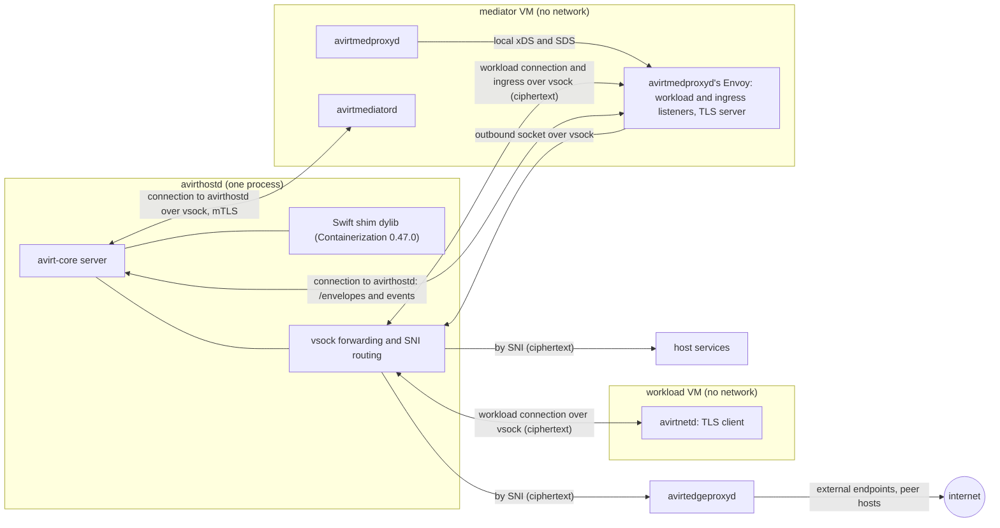
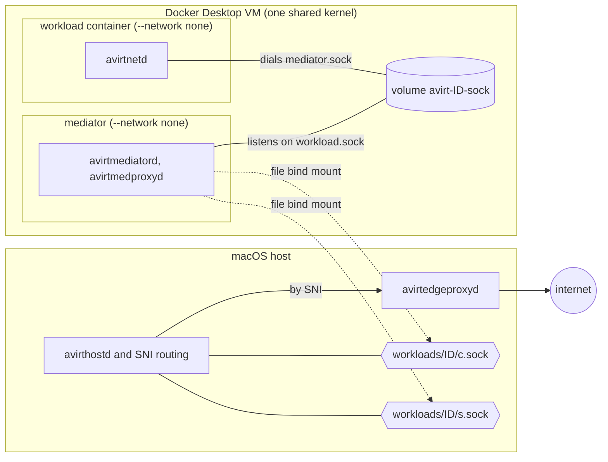

# Apple container CLI runtime

Status: implemented. It is removed once the Containerization runtime matches current behavior.

`avirthostd` drives the Apple `container` CLI directly. Constraints:

- It requires Apple `container` 1.5.0 or later on an Apple silicon Mac.
- `container` cannot be installed through mise.
- With a socket file that still exists but whose listener is gone, `connect()` succeeds and then hangs.
- A directory mount that contains sockets goes over virtiofs and cannot connect a socket in either direction.
- The runtime's guest is the kata-containers 3.32.0 arm64 kernel (`vmlinux-6.18.35-197-debug`) with Containerization 0.47.0's vminit.
- The runtime applies no seccomp, so avirtinitd applies its own filters (see [workload hardening](./workload-hardening.md)).

# Runtime interface

Status: planned.

`avirthostd` drives one `Runtime` per process, selected by `AVIRT_RUNTIME` (`containerization`, the default on macOS, or `docker`). Backends implement the trait in `avirt-core` and are compiled in by target and cargo feature (see [build and platforms](./build-and-platforms.md)).

```rust
#[async_trait]
pub trait Runtime: Send + Sync {
    fn props(&self) -> &RuntimeProps;
    /// Run the workload container; return once the mediator can be wired to its socket.
    async fn run_workload(&self, spec: &WorkloadSpec) -> Result<Running>;
    /// Run the mediator, connected to the workload container's socket and to its
    /// avirthostd, outbound and ingress sockets.
    async fn run_mediator(&self, spec: &MediatorSpec, workload: &Running) -> Result<Running>;
    /// SIGTERM, `grace`, SIGKILL, delete. Idempotent.
    async fn remove(&self, c: &Running, grace: Duration) -> Result<()>;
    /// True only when the runtime confirms the workload container or mediator no longer exists.
    async fn gone(&self, c: &Running) -> Result<bool>;
    /// Delete any named volume, host socket file or per-workload directory.
    async fn release(&self, workload: &WorkloadId) -> Result<()>;
    /// Remove every VM, container, network, volume and directory avirthostd could have left behind.
    async fn sweep(&self) -> Result<SweepReport>;
}

pub struct RuntimeProps {
    pub isolation: Isolation,          // VmPerWorkload | SharedKernel
    pub host_socket_paths: usize,      // per-workload host socket paths subject to the 104-byte limit
}
```

- **`Running`** holds the runtime handle plus the workload container's or mediator's stdout, stderr and exit status.
- **Specs** are runtime-neutral: the layer stack (the harness base, the workspace layers and the configuration layer, see [workload lifecycle](./workload-lifecycle.md#layer-stack)), the environment, the workspace mount, the labels (`avirt=1`, `avirt.workload`, `avirt.role`), and the extra capabilities the role needs. Neither spec has a network: the workload and the mediator have no interface other than loopback on every runtime.
- **Unix sockets.** The runtime provides the sockets for the workload's HTTP/2 connection to its mediator, the mediator's connection to avirthostd, the mediator's outbound socket to avirthostd and avirtmedproxyd's ingress listener, each presented inside the container as a Unix socket under `/run/avirt/` (see [workload topology](./workload-topology.md#runtime-provided-sockets) and [networking](./networking.md)).
- **Hardening.** `avirtinitd` applies all agent hardening on every runtime, and the runtime adds only its native outer layer.
- **Freeze and resume** are performed by avirtinitd, the same way on every runtime.
- **Isolation.** `isolation` is written into the `start` meta event.

# Containerization runtime

Status: planned. This is the Apple runtime.

`avirthostd` hosts the VMs itself, through Apple's `containerization` package. The package is wrapped in a Swift shim exporting a `@_cdecl` C ABI and linked into avirthostd as a dylib.

## Host requirements

- The avirthostd binary carries the `com.apple.security.virtualization` entitlement and is ad-hoc signed for development. `cargo run` and `cargo test` go through a signing runner (see [build and platforms](./build-and-platforms.md)).
- The Swift shim is a SwiftPM `.dynamic` product, loaded through an `@executable_path` rpath.
- Containerization 0.47.0 is pinned. The kernel, the vminit image and the package version move together.

## Guest artifacts

- **Kernel.** The kata-containers 3.32.0 arm64 `vmlinux`, pinned by URL and by the release tarball's sha256 `8736c054d9223974735394f822000823baef509e1c33405ec798240fa9b6e4b5`. It is extracted once and cached in avirthostd's runtime directory.
- **Init filesystem.** It comes from `ghcr.io/apple/containerization/vminit:0.47.0` through `initfsReference`, stored in avirthostd's own runtime directory.
- **Images.** The avirt base, harness base and mediator images are unpacked into avirthostd's own content-addressed cache, also in the runtime directory. Each workload container's writable root block device is an APFS `clonefile` copy of its composed root filesystem with the configuration layer unpacked into it (see [workload lifecycle](./workload-lifecycle.md#assembly-per-runtime)).

## Networking

- **Workload VM:** no network.
- **Mediator VM:** no network. Its connections are the four Unix sockets below.

## Unix sockets

Each socket is backed by a vsock connection between avirthostd and a guest, which Containerization's vsock-to-Unix-socket forwarder presents as a Unix socket under `/run/avirt/`.

| Socket | vsock direction | Host side |
| --- | --- | --- |
| Workload connection (`mediator.sock`, `workload.sock`) | The workload VM dials avirthostd's listener on its own vsock device, and avirthostd dials into the current mediator VM | avirthostd forwards the bytes unchanged between the two connections |
| Connection to avirthostd (`hostd.sock`) | The mediator VM dials avirthostd's listener on its own vsock device | avirthostd |
| Outbound socket to avirthostd (`svc.sock`) | The mediator VM dials avirthostd's listener on its own vsock device | avirthostd's SNI routing |
| avirtmedproxyd's ingress listener (`ingress.sock`) | avirthostd dials into the mediator VM | avirthostd's SNI routing |

TLS runs end to end between the guests and the destinations, so the bytes avirthostd forwards are only ciphertext. TLS roles are fixed regardless of who dials (see [workload topology](./workload-topology.md)).

Constraints:

- The workload VM's vsock device has exactly one host listener, for the workload's connection to its mediator. Every other host vsock listener is on a mediator VM's device.
- Every host vsock listener is reachable by any process in its mediator VM. The listener for the mediator's connection to avirthostd runs the mutual TLS handshake before reading any application byte, and SNI routing reads only the TLS ClientHello before forwarding the connection unchanged to a destination that does.
- Containerization's default launch applies no OCI seccomp, so avirtinitd applies the workload container's filters itself, including the `AF_VSOCK` denial for every process it launches.
- There are no host socket files, so `host_socket_paths` is 0.
- The guest kernel provides Landlock ABI 7 (see [sandbox](./sandbox.md#workload-kernels)).

## Workload stdio

The workload container runs with `terminal = false`, and avirthostd supplies separate non-blocking writers for stdout and stderr, which feed `logs/<workload-id>.stdio.ndjson`. The VM console comes from `bootLog`. avirtlogd tails both (see [observability](./observability.md#workload-stdout-and-stderr)).

## State

Each VM's runtime directory is `containers/<id>/` in avirthostd's runtime directory. On startup avirthostd's sweep removes every stale `containers/<id>/` directory and stops any VM it still owns (see [lifecycle](./lifecycle.md)).



# Docker Desktop runtime

Status: planned.

| Primitive | Docker Desktop 4.95.0 |
| --- | --- |
| Isolation | One shared linuxkit kernel (7.0.14) and one rootful daemon. A kernel escape is root over every workload's container and mediator, including the MITM CA keys and short-lived credentials in mediator memory. |
| Workload connection | A per-workload Docker named volume `avirt-<id8>-sock`, mounted in both containers, holding one socket that appears as `/run/avirt/workload.sock` in the mediator and as `/run/avirt/mediator.sock` in the workload container. avirtmedproxyd's Envoy listens on it and avirtnetd dials. The hop stays inside the VM. A 0600 socket gives uid 1000 `EACCES`. |
| Connection to avirthostd | A single-file bind mount of the host `workloads/<id>/c.sock` at `/run/avirt/hostd.sock`, connected from the container. It appears as `root:root 0660` and reconnects after a listener restart. Directory mounts and container-side listeners do not cross to the host. The mediator's dial retries, because a transient gRPC `Canceled` can occur on this mount. |
| Outbound socket to avirthostd | A single-file bind mount of the host `workloads/<id>/s.sock` at `/run/avirt/svc.sock`, served by avirthostd's SNI routing, with the same properties as the connection to avirthostd |
| avirtmedproxyd's ingress listener | Open, because container-side listeners do not cross to the host (see [components](./components.md#open-questions)) |
| Host socket paths | `c.sock` and `s.sock` (104-byte limit) |
| Workload image | A composed image of the harness base's layers, the workspace layers and the configuration layer, loaded through the Docker API and tagged `avirt.internal/composed:<hex>` (see [workload lifecycle](./workload-lifecycle.md#assembly-per-runtime)). The container's writable layer is the per-workload writable layer. |
| Mediator network | `--network none` (only `lo`) |
| Workload network | `--network none` (only `lo`, no docker.sock, no `/run/host-services`) |
| Workload outer layer | `--cap-drop ALL --cap-add SETUID,SETGID,SETPCAP,KILL,NET_BIND_SERVICE --security-opt no-new-privileges`, with Docker's default seccomp profile left in place. The default profile blocks io_uring, bpf, userfaultfd, perf, mount, setns, unshare, `CLONE_NEWUSER`, keyctl and `AF_VSOCK`/`AF_PACKET`/`AF_ALG`. avirtinitd's filter adds ptrace, memfd_create, process_vm_* and `AF_NETLINK`. |
| Mediator outer layer | `--cap-drop ALL --cap-add SETUID,SETGID --security-opt no-new-privileges`, with Docker's default seccomp profile left in place. avirtinitd in mediator mode needs only `SETUID` and `SETGID`, to start avirtmediatord and avirtmedproxyd under their own UIDs. |
| AF_VSOCK | No host surface, though the kernel has vsock. `avirtinitd` still denies it. |
| Landlock | ABI v8, unprivileged with `no_new_privs` (see [sandbox](./sandbox.md#workload-kernels)) |
| Logs | Docker's container log files, which avirtlogd reads (see [observability](./observability.md#workload-stdout-and-stderr)). Constraint: the containers use the `json-file` log driver with `max-size` and `max-file` set. |
| Lifecycle | `docker run`, `rm -f`. avirtinitd is PID 1 in both containers. Containers and volumes are swept with `--filter label=avirt=1`. |

Docker Desktop workloads must never use `--pid=host` or mount docker.sock. Each named volume is mounted only by its own workload's two containers.


