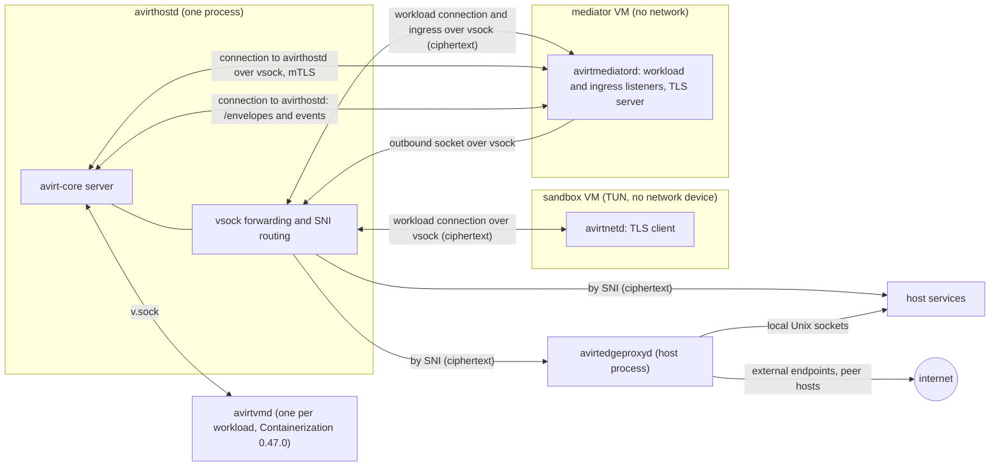
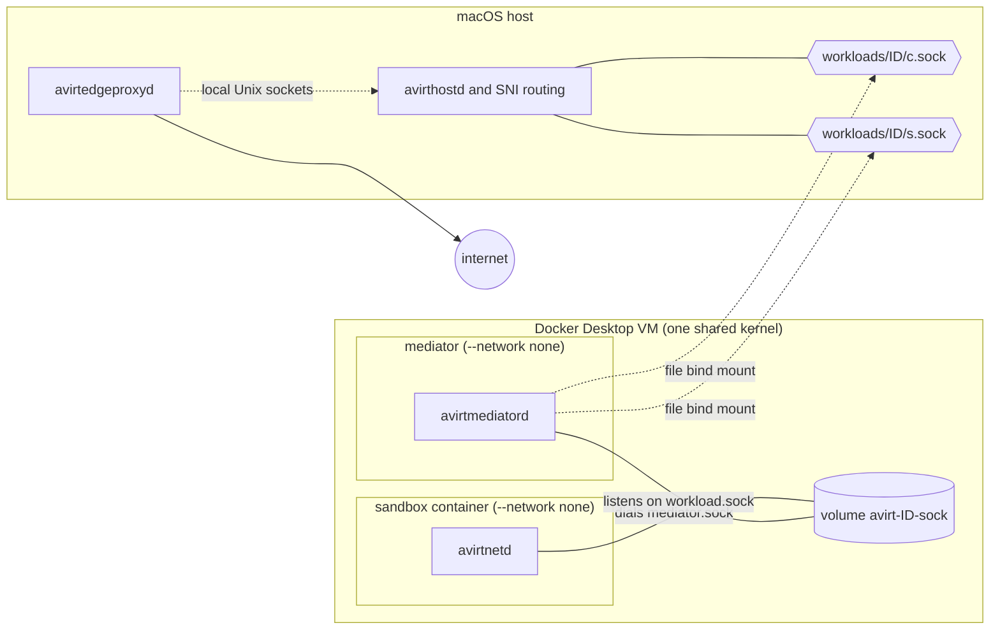

<!-- Preserve the exact runtime name from the glossary. -->

# Apple container CLI runtime

Status: implemented. Remove this runtime once the Containerization runtime matches current behavior.

`avirthostd` drives the Apple `container` command-line tool directly. Constraints:

- It requires Apple `container` 1.5.0 or later on an Apple silicon Mac.
- mise can't install `container`.
- With a socket file that still exists but without a listener, `connect()` succeeds and then hangs.
- A directory mount that contains sockets goes over virtiofs and can't connect a socket in either direction.
- The runtime's guest is the Kata Containers 3.32.0 arm64 kernel (`vmlinux-6.18.35-197-debug`) with Containerization 0.47.0's vminit.
- The runtime omits seccomp, so avirtinitd applies its own filters (see [workload hardening](./workload-hardening.md)).

# Runtime interface

Status: implemented. One `Runtime` per process runs the workloads, and `AVIRT_RUNTIME` selects it: `container` or `containerization`, the default. `Runtime::open` allocates a workload's resources and returns a `WorkloadHandle`. `Runtime::sweep` ends what a previous avirthostd left running. The handle starts the mediator and the container and reports how they end. It also stops them and removes the workload's state. Each runtime starts the mediator as an avirtmediatord host process. The trait is in `avirt-core`.

Status: planned. The interface below replaces the implemented one and adds a `docker` backend that `AVIRT_RUNTIME=docker` selects. Builds include the backends by target and cargo feature (see [build and platforms](./build-and-platforms.md)).

```rust
#[async_trait]
pub trait Runtime: Send + Sync {
    fn props(&self) -> &RuntimeProps;
    /// Run the sandbox container; return once the mediator can be wired to its socket.
    async fn run_workload(&self, spec: &WorkloadSpec) -> Result<Running>;
    /// Run the mediator, connected to the sandbox container's socket and to its
    /// avirthostd, outbound and ingress sockets.
    async fn run_mediator(&self, spec: &MediatorSpec, workload: &Running) -> Result<Running>;
    /// SIGTERM, `grace`, SIGKILL, delete. Idempotent.
    async fn remove(&self, c: &Running, grace: Duration) -> Result<()>;
    /// True only when the runtime confirms the sandbox container or mediator no longer exists.
    async fn gone(&self, c: &Running) -> Result<bool>;
    /// Delete any named volume, host socket file or per-workload directory.
    async fn release(&self, workload: &WorkloadId) -> Result<()>;
    /// Remove every VM, container, network, volume and directory avirthostd could have left behind.
    async fn sweep(&self) -> Result<SweepReport>;
}

pub struct RuntimeProps {
    pub isolation: Isolation,          // VmPerWorkload | SharedKernel
    pub host_socket_paths: usize,      // per-workload host socket paths subject to the 104-byte limit
}
```

- **`Running`** holds the runtime handle plus the sandbox container's or mediator's stdout, stderr, and exit status.
- **Specs** are runtime-neutral. They include the layer stack (the harness base plus workspace layers and the configuration layer, see [workload lifecycle](./workload-lifecycle.md#layer-stack)). They also include the environment, workspace mount, labels (`avirt=1`, `avirt.workload`, `avirt.role`), and extra capabilities the role needs. Both specs omit network devices, and avirthostd refuses a sandbox container launch with one. avirtinitd creates the sandbox container's TUN and nftables REDIRECT rules. The mediator has only loopback.
- **Unix sockets.** The runtime provides the sockets for the workload's HTTP/2 connection to its mediator, the mediator's connection to avirthostd, the mediator's outbound socket to avirthostd and avirtmediatord's ingress listener, each presented inside the container as a Unix socket under `/run/avirt/` (see [workload topology](./workload-topology.md#runtime-provided-sockets) and [networking](./networking.md)).
- **Hardening.** `avirtinitd` applies all agent hardening on every runtime, and the runtime adds only its native outer layer.
- **Freeze and resume.** avirtinitd freezes and resumes the agent cgroup the same way on every runtime.
- **Isolation.** The `start` meta event includes `isolation`.

# Containerization runtime

Status: implemented. This is the Apple runtime and the default on macOS. `avirthostd` starts one `avirtvmd` helper per workload and talks to it over `v.sock`. That helper, a Swift process holding the `com.apple.security.virtualization` entitlement, boots the sandbox container in its own VM through Apple's `containerization` package. The VM has no network device. The workload's `proxy.sock` and `mediator.sock`, host socket files, appear under `/run/avirt/` along with the profile's shares, and the mediator is the avirtmediatord host process. Containerization 0.47.0's vminit and the Kata Containers 3.32.0 arm64 kernel make up the guest, both cached in avirthostd's runtime directory. Console, stdout, and stderr go to `logs/<workload-id>.stdio.ndjson` through the helper, and each VM keeps its files in `containers/<id>/` in the runtime directory.

## Host requirements

Status: implemented.

- The `avirtvmd` binary holds the `com.apple.security.virtualization` entitlement with an ad-hoc signature for development, and the `build-vmd` task builds and signs it. avirthostd links no Swift and doesn't need the entitlement.
- The runtime pins Containerization 0.47.0. The kernel, the vminit image, and the package version move together.

## Guest artifacts

Status: implemented.

- **Kernel.** The Kata Containers 3.32.0 arm64 `vmlinux`, pinned by URL and by the release tarball's sha256 `8736c054d9223974735394f822000823baef509e1c33405ec798240fa9b6e4b5`. avirthostd extracts it once and caches it in its runtime directory.
- **Init filesystem.** This comes from `ghcr.io/apple/containerization/vminit:0.47.0` through `initfsReference`, stored in avirthostd's own runtime directory.

Status: planned. Guest kernels need TUN, nftables REDIRECT and connection tracking, including IPv6 original-destination lookup, which avirtinitd configures before it starts the other guest processes. The avirt base, harness base, and mediator images live in avirthostd's own content-addressed cache in the runtime directory. Every sandbox container's writable root block device is an APFS `clonefile` copy of its composed root filesystem with the configuration layer unpacked into it (see [workload lifecycle](./workload-lifecycle.md#layer-stack)).

## Workload stdio

Status: implemented.

The sandbox container runs with `terminal = false`, and avirtvmd supplies separate non-blocking writers for stdout and stderr, which feed `logs/<workload-id>.stdio.ndjson`. The VM console comes from `bootLog`. avirtlogd tails both (see [observability](./observability.md#workload-stdout-and-stderr)).

## State

Status: implemented.

Each VM uses `containers/<id>/` within avirthostd's runtime directory. On startup avirthostd's sweep removes every stale `containers/<id>/` directory and stops any VM it still owns (see [lifecycle](./lifecycle.md)).

## Networking

Status: planned. The remaining sections describe the planned design, which keeps the avirtvmd helper for each sandbox VM and adds a mediator VM with vsock sockets.

- **Sandbox VM:** no network device. In the planned design avirtinitd configures a TUN and nftables REDIRECT, and avirtnetd transfers each flow to the mediator.
- **Mediator VM:** in the planned design it has no network, and its connections are the four Unix sockets below.

## Unix sockets

Each socket has a backing vsock connection between avirthostd and a guest. Containerization's vsock-to-Unix-socket forwarder presents it inside the guest as a Unix socket under `/run/avirt/`.

| Socket | vsock direction | Host side |
| --- | --- | --- |
| Workload connection (`mediator.sock`, `workload.sock`) | The sandbox VM dials avirthostd's listener on its own vsock device, and avirthostd dials into the current mediator VM | avirthostd forwards the bytes unchanged between the two connections |
| Connection to avirthostd (`hostd.sock`) | The mediator VM dials avirthostd's listener on its own vsock device | avirthostd |
| Outbound socket to avirthostd (`svc.sock`) | The mediator VM dials avirthostd's listener on its own vsock device | avirthostd's SNI routing |
| avirtmediatord's ingress listener (`ingress.sock`) | avirthostd dials into the mediator VM | avirthostd's SNI routing |

TLS runs end to end between the guests and the destinations. avirthostd forwards only ciphertext. TLS roles remain the same regardless of who dials (see [workload topology](./workload-topology.md)).

Constraints:

- The sandbox VM's vsock device has exactly one host listener, for the workload's connection to its mediator. Every other host vsock listener is on a mediator VM's device.
- Every host vsock listener is reachable by any process in its mediator VM. The listener for the mediator's connection to avirthostd runs the mutual TLS handshake before reading any application data, and SNI routing reads only the TLS ClientHello before forwarding the connection unchanged to a destination that does.
- Containerization's default launch omits OCI seccomp, so avirtinitd applies the sandbox container's filters itself, including the `AF_VSOCK` denial for every process it launches.
- This runtime operates without host socket files, so `host_socket_paths` is 0.
- The guest kernel provides Landlock ABI 7 (see [Landlock](./landlock.md#workload-kernels)).



# Docker Desktop runtime

Status: planned.

| Primitive | Docker Desktop 4.95.0 |
| --- | --- |
| Isolation | One shared linuxkit kernel (7.0.14) and one rootful daemon. A kernel escape gives root access to every sandbox container and mediator, including the MITM CA keys and short-lived credentials in mediator memory. |
| Workload connection | A per-workload Docker named volume `avirt-<id8>-sock`, mounted in both containers, containing one socket that appears as `/run/avirt/workload.sock` in the mediator and as `/run/avirt/mediator.sock` in the sandbox container. avirtmediatord listens on it and avirtnetd dials. The hop stays inside the VM. A 0600 socket gives uid 1000 `EACCES`. |
| Connection to avirthostd | A single-file bind mount of the host `workloads/<id>/c.sock` at `/run/avirt/hostd.sock`, connected from the container. The mount appears as `root:root 0660` and reconnects after a listener restart. Neither directory mounts nor container-side listeners cross to the host. The mediator's dial retries, because a transient gRPC `Canceled` can occur on this mount. |
| Outbound socket to avirthostd | A single-file bind mount of the host `workloads/<id>/s.sock` at `/run/avirt/svc.sock`, served by avirthostd's SNI routing, with the same properties as the connection to avirthostd |
| avirtmediatord's ingress listener | Open, because container-side listeners don't cross to the host (see [components](./components.md#open-questions)) |
| Host socket paths | `c.sock` and `s.sock` (104-byte limit) |
| Sandbox image | A composed image of the harness base's layers, the workspace layers and the configuration layer, loaded through the Docker API and tagged `avirt.internal/composed:<hex>` (see [workload lifecycle](./workload-lifecycle.md#assembly-per-runtime)). The container's writable layer is the per-workload writable layer. |
| Mediator network | `--network none` (only `lo`) |
| Sandbox network | `--network none`, with a TUN configured by avirtinitd. No `docker.sock` or `/run/host-services` |
| Workload outer layer | `--cap-drop ALL --cap-add SETUID,SETGID,SETPCAP,KILL,NET_BIND_SERVICE,NET_ADMIN --device /dev/net/tun --security-opt no-new-privileges`, with Docker's default seccomp profile left in place. The default profile blocks io_uring, bpf, userfaultfd, perf, mount, setns, unshare, `CLONE_NEWUSER`, keyctl and `AF_VSOCK`/`AF_PACKET`/`AF_ALG`. avirtinitd's filter adds ptrace, memfd_create, process_vm_* and `AF_NETLINK`. |
| Mediator outer layer | `--cap-drop ALL --cap-add SETUID,SETGID --security-opt no-new-privileges`, retaining Docker's default seccomp profile. avirtinitd in mediator mode needs only `SETUID` and `SETGID` to start avirtmediatord under its own UID. |
| AF_VSOCK | No host surface, though the kernel has vsock. `avirtinitd` still denies it. |
| Landlock | ABI v8, unprivileged with `no_new_privs` (see [Landlock](./landlock.md#workload-kernels)) |
| Logs | Docker's container log files, which avirtlogd reads (see [observability](./observability.md#workload-stdout-and-stderr)). Constraint: the containers use the `json-file` log driver with `max-size` and `max-file` set. |
| Lifecycle | `docker run`, `rm -f`. avirtinitd is PID 1 in both containers. The startup cleanup sweeps containers and volumes with `--filter label=avirt=1`. |

avirtinitd needs `/dev/net/tun` and `NET_ADMIN` only during setup, and drops that capability from the bounding set before starting other processes. This configuration still needs a runtime check.

Docker Desktop workloads must never use `--pid=host` or mount `docker.sock`. Only the workload's two containers mount its named volume.


