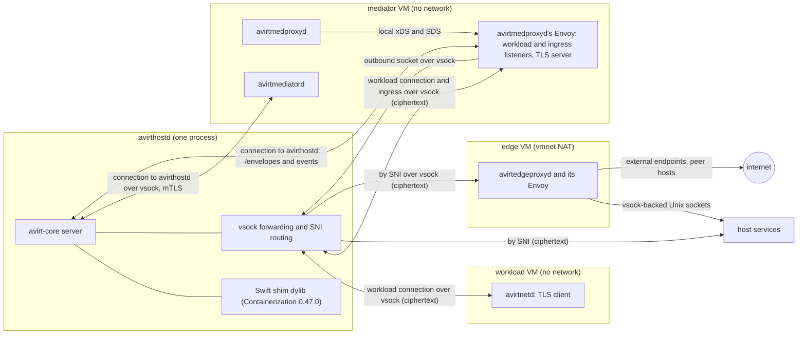
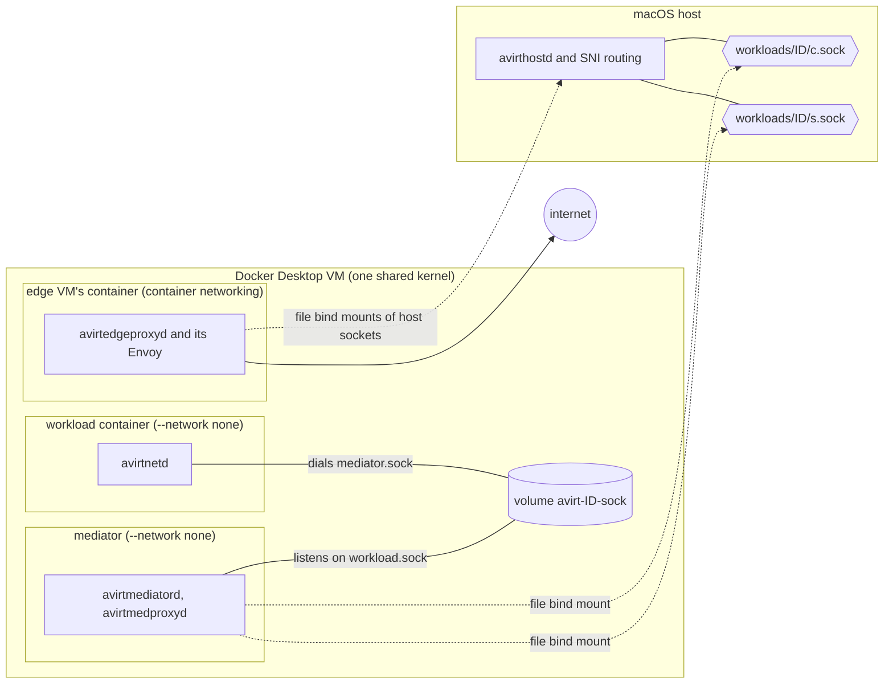

<!-- Preserve the exact runtime name from the glossary. -->
<!-- vale project.WordList = NO -->

# Apple container CLI runtime

<!-- vale project.WordList = YES -->

Status: implemented. Remove this runtime once the Containerization runtime matches current behavior.

`avirthostd` drives the Apple `container` command-line tool directly. Constraints:

- It requires Apple `container` 1.5.0 or later on an Apple silicon Mac.
- mise can't install `container`.
- With a socket file that still exists but without a listener, `connect()` succeeds and then hangs.
- A directory mount that contains sockets goes over virtiofs and can't connect a socket in either direction.
- The runtime's guest is the Kata Containers 3.32.0 arm64 kernel (`vmlinux-6.18.35-197-debug`) with Containerization 0.47.0's vminit.
- The runtime omits seccomp, so avirtinitd applies its own filters (see [workload hardening](./workload-hardening.md)).

# Runtime interface

Status: planned.

`avirthostd` drives one `Runtime` per process, selected by `AVIRT_RUNTIME` (`containerization`, the default on macOS, or `docker`). Backends conform to the trait in `avirt-core`. Builds include them by target and cargo feature (see [build and platforms](./build-and-platforms.md)).

```rust
#[async_trait]
pub trait Runtime: Send + Sync {
    fn props(&self) -> &RuntimeProps;
    /// Run the workload container; return once the mediator can be wired to its socket.
    async fn run_workload(&self, spec: &WorkloadSpec) -> Result<Running>;
    /// Run the mediator, connected to the workload container's socket and to its
    /// avirthostd, outbound and ingress sockets.
    async fn run_mediator(&self, spec: &MediatorSpec, workload: &Running) -> Result<Running>;
    /// SIGTERM, `grace`, SIGKILL, delete. Idempotent.
    async fn remove(&self, c: &Running, grace: Duration) -> Result<()>;
    /// True only when the runtime confirms the workload container or mediator no longer exists.
    async fn gone(&self, c: &Running) -> Result<bool>;
    /// Delete any named volume, host socket file or per-workload directory.
    async fn release(&self, workload: &WorkloadId) -> Result<()>;
    /// Remove every VM, container, network, volume and directory avirthostd could have left behind.
    async fn sweep(&self) -> Result<SweepReport>;
}

pub struct RuntimeProps {
    pub isolation: Isolation,          // VmPerWorkload | SharedKernel
    pub host_socket_paths: usize,      // per-workload host socket paths subject to the 104-byte limit
}
```

- **`Running`** holds the runtime handle plus the workload container's or mediator's stdout, stderr, and exit status.
- **Specs** are runtime-neutral. They include the layer stack (the harness base plus workspace layers and the configuration layer, see [workload lifecycle](./workload-lifecycle.md#layer-stack)). They also include the environment, workspace mount, labels (`avirt=1`, `avirt.workload`, `avirt.role`), and extra capabilities the role needs. Neither spec has a network: the workload and the mediator have no interface other than loopback on every runtime.
- **Unix sockets.** The runtime provides the sockets for the workload's HTTP/2 connection to its mediator, the mediator's connection to avirthostd, the mediator's outbound socket to avirthostd and avirtmedproxyd's ingress listener, each presented inside the container as a Unix socket under `/run/avirt/` (see [workload topology](./workload-topology.md#runtime-provided-sockets) and [networking](./networking.md)).
- **Hardening.** `avirtinitd` applies all agent hardening on every runtime, and the runtime adds only its native outer layer.
- **Freeze and resume.** avirtinitd freezes and resumes the agent cgroup the same way on every runtime.
- **Isolation.** The `start` meta event includes `isolation`.

# Containerization runtime

Status: planned. This is the Apple runtime.

`avirthostd` hosts the VMs itself, through Apple's `containerization` package. A Swift shim wraps the package and exports a `@_cdecl` C ABI. The avirthostd build links the shim as a dylib.

## Host requirements

- The avirthostd binary contains the `com.apple.security.virtualization` entitlement and uses an ad-hoc signature for development. `cargo run` and `cargo test` go through a signing runner (see [build and platforms](./build-and-platforms.md)).
- The Swift shim is a SwiftPM `.dynamic` product, loaded through an `@executable_path` rpath.
- The runtime pins Containerization 0.47.0. The kernel, the vminit image, and the package version move together.

## Guest artifacts

- **Kernel.** The Kata Containers 3.32.0 arm64 `vmlinux`, pinned by URL and by the release tarball's sha256 `8736c054d9223974735394f822000823baef509e1c33405ec798240fa9b6e4b5`. avirthostd extracts it once and caches it in its runtime directory.
- **Init filesystem.** It comes from `ghcr.io/apple/containerization/vminit:0.47.0` through `initfsReference`, stored in avirthostd's own runtime directory.
- **Images.** avirthostd unpacks the avirt base, harness base, and mediator images into its own content-addressed cache, also in the runtime directory. Each workload container's writable root block device is an APFS `clonefile` copy of its composed root filesystem with the configuration layer unpacked into it (see [workload lifecycle](./workload-lifecycle.md#assembly-per-runtime)).

## Networking

- **Workload VM:** no network.
- **Mediator VM:** no network. Its connections are the four Unix sockets below.
- **Edge VM.** It has one vmnet NAT interface. avirthostd's start check asserts that this is the only avirt VM with a network device. It runs only avirtedgeproxyd and its Envoy, under avirtinitd. The runtime publishes the peer port into its peer listener with the port publishing that `container run --publish` exposes, and forwards a host loopback port into it for web UI users. `edgeproxy.sock` in the runtime directory is a Unix socket backed by vsock into it, and avirtedgeproxyd reaches avirtapid, avirthostd's control API and the other host services over vsock-backed Unix sockets, as the mediators do (see [edge VM](./components.md#edge-vm)).

## Unix sockets

Each socket has a backing vsock connection between avirthostd and a guest. Containerization's vsock-to-Unix-socket forwarder presents it inside the guest as a Unix socket under `/run/avirt/`.

| Socket | vsock direction | Host side |
| --- | --- | --- |
| Workload connection (`mediator.sock`, `workload.sock`) | The workload VM dials avirthostd's listener on its own vsock device, and avirthostd dials into the current mediator VM | avirthostd forwards the bytes unchanged between the two connections |
| Connection to avirthostd (`hostd.sock`) | The mediator VM dials avirthostd's listener on its own vsock device | avirthostd |
| Outbound socket to avirthostd (`svc.sock`) | The mediator VM dials avirthostd's listener on its own vsock device | avirthostd's SNI routing |
| avirtmedproxyd's ingress listener (`ingress.sock`) | avirthostd dials into the mediator VM | avirthostd's SNI routing |

TLS runs end to end between the guests and the destinations. avirthostd forwards only ciphertext. TLS roles remain the same regardless of who dials (see [workload topology](./workload-topology.md)).

Constraints:

- The workload VM's vsock device has exactly one host listener, for the workload's connection to its mediator. Every other host vsock listener is on a mediator VM's device.
- Every host vsock listener is reachable by any process in its mediator VM. The listener for the mediator's connection to avirthostd runs the mutual TLS handshake before reading any <!-- Preserve the TLS protocol term application data. --><!-- vale project.WordList = NO -->application data<!-- vale project.WordList = YES -->, and SNI routing reads only the TLS ClientHello before forwarding the connection unchanged to a destination that does.
- Containerization's default launch omits OCI seccomp, so avirtinitd applies the workload container's filters itself, including the `AF_VSOCK` denial for every process it launches.
- This runtime operates without host socket files, so `host_socket_paths` is 0.
- The guest kernel provides Landlock ABI 7 (see [sandbox](./sandbox.md#workload-kernels)).

## Workload stdio

The workload container runs with `terminal = false`, and avirthostd supplies separate non-blocking writers for stdout and stderr, which feed `logs/<workload-id>.stdio.ndjson`. The VM console comes from `bootLog`. avirtlogd tails both (see [observability](./observability.md#workload-stdout-and-stderr)).

## State

Each VM uses `containers/<id>/` within avirthostd's runtime directory. On startup avirthostd's sweep removes every stale `containers/<id>/` directory and stops any VM it still owns (see [lifecycle](./lifecycle.md)).



# Docker Desktop runtime

Status: planned.

| Primitive | Docker Desktop 4.95.0 |
| --- | --- |
| Isolation | One shared linuxkit kernel (7.0.14) and one rootful daemon. A kernel escape gives root access to every workload's container and mediator, including the MITM CA keys and short-lived credentials in mediator memory. |
| Workload connection | A per-workload Docker named volume `avirt-<id8>-sock`, mounted in both containers, containing one socket that appears as `/run/avirt/workload.sock` in the mediator and as `/run/avirt/mediator.sock` in the workload container. avirtmedproxyd's Envoy listens on it and avirtnetd dials. The hop stays inside the VM. A 0600 socket gives uid 1000 `EACCES`. |
| Connection to avirthostd | A single-file bind mount of the host `workloads/<id>/c.sock` at `/run/avirt/hostd.sock`, connected from the container. The mount appears as `root:root 0660` and reconnects after a listener restart. Neither directory mounts nor container-side listeners cross to the host. The mediator's dial retries, because a transient gRPC `Canceled` can occur on this mount. |
| Outbound socket to avirthostd | A single-file bind mount of the host `workloads/<id>/s.sock` at `/run/avirt/svc.sock`, served by avirthostd's SNI routing, with the same properties as the connection to avirthostd |
| avirtmedproxyd's ingress listener | Open, because container-side listeners don't cross to the host (see [components](./components.md#open-questions)) |
| Host socket paths | `c.sock` and `s.sock` (104-byte limit) |
| Workload image | A composed image of the harness base's layers, the workspace layers and the configuration layer, loaded through the Docker API and tagged `avirt.internal/composed:<hex>` (see [workload lifecycle](./workload-lifecycle.md#assembly-per-runtime)). The container's writable layer is the per-workload writable layer. |
| Mediator network | `--network none` (only `lo`) |
| Workload network | `--network none` (only `lo`, without `docker.sock` or `/run/host-services`) |
| Edge VM | A container running only avirtedgeproxyd and its Envoy under avirtinitd, with normal container networking, the only avirt container with a network. Docker publishes the peer port into it with `-p`. The container connects to the host sockets through single-file bind mounts, as the mediators do. How `edgeproxy.sock` and avirthostd's SNI routing reach its listeners is open (see [networking](./networking.md#open-questions)). |
| Workload outer layer | `--cap-drop ALL --cap-add SETUID,SETGID,SETPCAP,KILL,NET_BIND_SERVICE --security-opt no-new-privileges`, with Docker's default seccomp profile left in place. The default profile blocks io_uring, bpf, userfaultfd, perf, mount, setns, unshare, `CLONE_NEWUSER`, keyctl and `AF_VSOCK`/`AF_PACKET`/`AF_ALG`. avirtinitd's filter adds ptrace, memfd_create, process_vm_* and `AF_NETLINK`. |
| Mediator outer layer | `--cap-drop ALL --cap-add SETUID,SETGID --security-opt no-new-privileges`, retaining Docker's default seccomp profile. avirtinitd in mediator mode needs only `SETUID` and `SETGID` to start avirtmediatord and avirtmedproxyd, each under its own UID. |
| AF_VSOCK | No host surface, though the kernel has vsock. `avirtinitd` still denies it. |
| Landlock | ABI v8, unprivileged with `no_new_privs` (see [sandbox](./sandbox.md#workload-kernels)) |
| Logs | Docker's container log files, which avirtlogd reads (see [observability](./observability.md#workload-stdout-and-stderr)). Constraint: the containers use the `json-file` log driver with `max-size` and `max-file` set. |
| Lifecycle | `docker run`, `rm -f`. avirtinitd is PID 1 in both containers. The startup cleanup sweeps containers and volumes with `--filter label=avirt=1`. |

Docker Desktop workloads must never use `--pid=host` or mount `docker.sock`. Only the workload's two containers mount its named volume.


