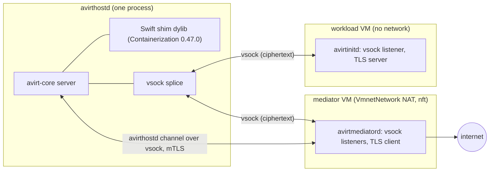
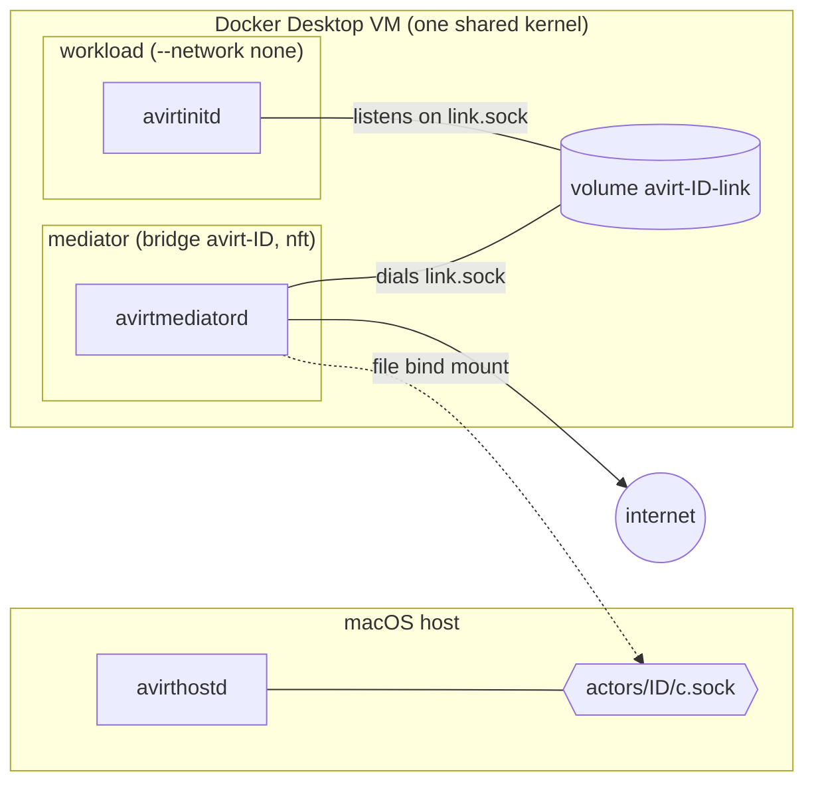

# Apple container CLI runtime

Status: implemented. It is removed once the Containerization runtime matches current behavior.

`avirthostd` drives the Apple `container` CLI directly. Constraints:

- It requires Apple `container` 1.5.0 or later on an Apple silicon Mac.
- `container` cannot be installed through mise.
- With a socket file that still exists but whose listener is gone, `connect()` succeeds and then hangs.
- A directory mount that contains sockets goes over virtiofs and cannot connect a socket in either direction.
- The runtime's guest is the kata-containers 3.32.0 arm64 kernel (`vmlinux-6.18.35-197-debug`) with Containerization 0.47.0's vminit.
- The runtime applies no seccomp, so avirtinitd applies its own filters (see [workload hardening](./workload-hardening.md)).

# Runtime interface

Status: planned.

`avirthostd` drives one `Runtime` per process, selected by `AVIRT_RUNTIME` (`containerization`, the default on macOS, or `docker`). Backends implement the trait in `avirt-core` and are compiled in by target and cargo feature (see [build and platforms](./build-and-platforms.md)).

```rust
#[async_trait]
pub trait Runtime: Send + Sync {
    fn props(&self) -> &RuntimeProps;
    /// Run the workload; return once the mediator can be wired to its link endpoint.
    async fn run_workload(&self, spec: &WorkloadSpec) -> Result<Running>;
    /// Create the actor network and run the mediator, connected to the
    /// workload's link endpoint and to the avirthostd channel.
    async fn run_mediator(&self, spec: &MediatorSpec, workload: &Running) -> Result<Running>;
    /// SIGTERM, `grace`, SIGKILL, delete. Idempotent.
    async fn remove(&self, c: &Running, grace: Duration) -> Result<()>;
    /// True only when the runtime confirms the workload or mediator no longer exists.
    async fn gone(&self, c: &Running) -> Result<bool>;
    /// Delete the actor's network and any link volume or per-actor directory.
    async fn release(&self, actor: &ActorId) -> Result<()>;
    /// Remove every VM, container, network, volume and directory avirthostd could have left behind.
    async fn sweep(&self) -> Result<SweepReport>;
}

pub struct RuntimeProps {
    pub isolation: Isolation,          // VmPerWorkload | SharedKernel
    pub host_socket_paths: usize,      // per-actor host socket paths subject to the 104-byte limit
    pub dns_allow: Vec<SocketAddr>,    // the mediator's nft resolver exception
    pub deny_extra: Vec<IpNet>,        // runtime-specific additions to deny4 and deny6
}
```

- **`Running`** holds the runtime handle plus the workload's or mediator's stdout, stderr and exit status.
- **Specs** are runtime-neutral: the image, the environment, the workspace mount, the labels (`avirt=1`, `avirt.actor`, `avirt.role`), and the extra capabilities the role needs.
- **Hardening.** `avirtinitd` applies all agent hardening on every runtime, and the runtime adds only its native outer layer.
- **Freeze and resume** are performed by avirtinitd, the same way on every runtime.
- **Isolation.** `isolation` is written into the `start` meta event.

# Containerization runtime

Status: planned. This is the Apple runtime.

`avirthostd` hosts the VMs itself, through Apple's `containerization` package. The package is wrapped in a Swift shim exporting a `@_cdecl` C ABI and linked into avirthostd as a dylib.

## Host requirements

- The avirthostd binary carries the `com.apple.security.virtualization` entitlement and is ad-hoc signed for development. `cargo run` and `cargo test` go through a signing runner (see [build and platforms](./build-and-platforms.md)).
- The Swift shim is a SwiftPM `.dynamic` product, loaded through an `@executable_path` rpath.
- Containerization 0.47.0 is pinned. The kernel, the vminit image and the package version move together.

## Guest artifacts

- **Kernel.** The kata-containers 3.32.0 arm64 `vmlinux`, pinned by URL and by the release tarball's sha256 `8736c054d9223974735394f822000823baef509e1c33405ec798240fa9b6e4b5`. It is extracted once and cached in avirthostd's state root.
- **Init filesystem.** It comes from `ghcr.io/apple/containerization/vminit:0.47.0` through `initfsReference`, stored in avirthostd's own state root.
- **Images.** The workload and mediator images are unpacked into avirthostd's own image store, also in the state root.

## Networking

- **Workload VM:** no network.
- **Mediator VM:** a `VmnetNetwork` NAT interface, which can reach the host, the host's LAN, peer VMs and the internet. The mediator's nftables rules (see [egress](./egress.md)) therefore apply in full: the NAT subnet and gateway fall under the private ranges, and peer VMs with them. DNS goes to public resolvers (`dns_allow = [1.1.1.1:53, 9.9.9.9:53]`) configured through Containerization's DNS configuration.

## Link and avirthostd channel

The link is vsock spliced by avirthostd. Each guest listens on a vsock port, and avirthostd dials both and splices the two connections at L4. TLS runs end to end between avirtinitd and the mediator, so avirthostd relays only ciphertext. The avirthostd channel is also vsock, dialed by avirthostd into the mediator VM. In both cases TLS roles are fixed regardless of who dials (see [actor topology](./actor-topology.md)).

Constraints:

- Every host vsock listener avirthostd opens is reachable by any guest uid, including 1000. Each one runs the mutual TLS handshake before reading any application byte.
- Containerization's default launch applies no OCI seccomp, so avirtinitd applies the workload's filters itself, including the `AF_VSOCK` denial.
- There are no host socket files, so `host_socket_paths` is 0.

## State

Each VM's runtime directory is `containers/<id>/` in avirthostd's state root. On startup avirthostd's sweep removes every stale `containers/<id>/` directory and stops any VM it still owns (see [lifecycle](./lifecycle.md)).



# Docker Desktop runtime

Status: planned.

| Primitive | Docker Desktop 4.95.0 |
| --- | --- |
| Isolation | One shared linuxkit kernel (7.0.14) and one rootful daemon. A kernel escape is root over every actor's workload and mediator, including the CA keys and access tokens in mediator memory. |
| Link | A per-actor named volume `avirt-<id8>-link` at `/run/avirt/link` in both containers. avirtinitd listens on `link.sock` there and the mediator dials. The hop stays inside the VM. A root 0600 socket gives uid 1000 `EACCES`. |
| avirthostd channel | A single-file bind mount of the host `actors/<id>/c.sock` at `/run/avirt/hostd.sock`, connected from the container. It appears as `root:root 0660` and reconnects after a listener restart. Directory mounts and container-side listeners do not cross to the host. The mediator's dial retries, because a transient gRPC `Canceled` can occur on this mount. |
| Host socket paths | `c.sock` (104-byte limit) |
| Actor network | `docker network create --label avirt=1 avirt-<id8>`, a bridge network isolated from other networks. Embedded DNS at 127.0.0.11 forwards to `192.168.65.7`, so `dns_allow = [192.168.65.7:53]`. `host.docker.internal` (192.168.65.254) reaches services bound only to the Mac's 127.0.0.1. The `192.168.0.0/16` drop blocks it, as it does the LAN IP and router. `--internal` networks have no DNS and no internet. |
| Workload network | `--network none` (only `lo`, no docker.sock, no `/run/host-services`) |
| Workload outer layer | `--cap-drop ALL --cap-add SETUID,SETGID,SETPCAP,KILL --security-opt no-new-privileges`, with Docker's default seccomp profile left in place. The default profile blocks io_uring, bpf, userfaultfd, perf, mount, setns, unshare, `CLONE_NEWUSER`, keyctl and `AF_VSOCK`/`AF_PACKET`/`AF_ALG`. avirtinitd's filter adds ptrace, memfd_create, process_vm_* and `AF_NETLINK`. |
| Mediator outer layer | `--cap-add CAP_NET_ADMIN`, dropped after nft |
| AF_VSOCK | No host surface, though the kernel has vsock. `avirtinitd` still denies it. |
| Landlock | ABI v8, unprivileged with `no_new_privs` |
| Lifecycle | `docker run`, `--init`, `rm -f`. Containers, networks and volumes are swept with `--filter label=avirt=1`. |

Docker Desktop actors must never use `--pid=host` or mount docker.sock. Each link volume is mounted only by its own actor's two containers.


