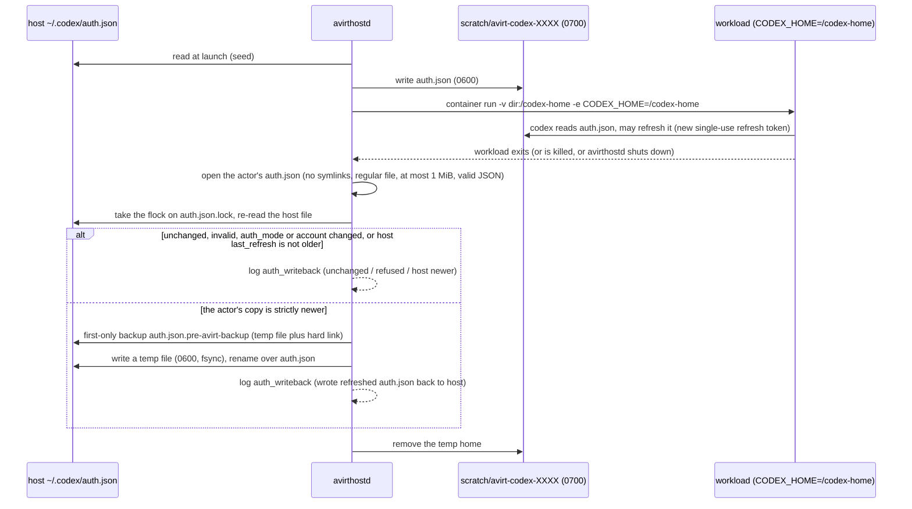

# Status: implemented

`avirthostd` starts without credentials and checks them per launch. A claude launch without `CLAUDE_CODE_OAUTH_TOKEN` in avirthostd's environment, or a codex launch without `~/.codex/auth.json` (`CODEX_HOST_HOME` overrides the directory), is refused with a 400 naming what is missing. Secrets reach the workload through `-e NAME` with no value, so the container CLI inherits them from avirthostd's environment and none appears on argv. `container run` starts from `HOME`, `PATH`, `TMPDIR`, `USER` and `LOGNAME` plus the variables the agent's profile names, so a Codex workload does not carry `CLAUDE_CODE_OAUTH_TOKEN`.

## Claude

`CLAUDE_CODE_OAUTH_TOKEN` is passed with `-e` and is in the agent's environment. With auto-approve, the agent can read it and send it to any host the proxy allows or write it into the actor log. Treat logs as secret.

## Codex

`avirthostd` reads the host `auth.json` per launch. It is never in the image, on argv or in the environment, and no host `config.toml` is copied. Codex rewrites `auth.json` with a new single-use refresh token when it refreshes, so after the workload exits avirthostd writes the actor's copy back under these rules:

- The actor's file is opened without following symlinks, and is used only if it is a regular file of at most 1 MiB that parses as JSON.
- It must have the same top-level keys, the same `auth_mode`, and the same account identity as the seed: `tokens.account_id`, and the `id_token` `sub` and email claims, decoded but not verified and never logged.
- Its `last_refresh` must be valid and at most 5 minutes in the future.
- It replaces the host file only if its `last_refresh` is strictly newer than the host file's current one, and only if the host file is still the same login. Otherwise the result is `host newer` or a refusal.
- The compare and replace happen under an exclusive `flock` on `auth.json.lock` next to the host file.
- The first host file is saved once as `auth.json.pre-avirt-backup`, created exclusively and never overwritten.
- The new file is written to a uniquely named, exclusively created 0600 temp file (`auth.json.avirt-tmp-<random>`) in the same directory, fsynced, and renamed over the host file.

The outcome is logged as the `auth_writeback` meta event with a fixed reason string and no file content:

- `unchanged`
- `host newer`
- `wrote refreshed auth.json back to host`
- `no auth.json in actor home`
- a `refused: ...` or `failed: ...` reason

The temp home is removed after the write-back on every path: normal exit, workload kill, spawn error, setup failure and avirthostd shutdown. If the workload cannot be confirmed gone after stop, kill and delete attempts, cleanup and write-back are skipped, the temp home is left for the next startup sweep, and a `container_error` says so.

Constraint: two concurrent actors that start from the same stale refresh token cannot both refresh, so the second one's refresh fails. Logs contain the account label, email and plan. With auto-approve, the agent can copy `/codex-home/auth.json` into the log.

# Status: planned

The workload holds placeholders only. `avirthostd` keeps every real credential and the Codex refresh token. The mediator gets the access tokens for its actor's bindings in `GET /actor`, holds them in memory, and substitutes them on the way out.

## Placeholders

- **Format.** A placeholder is an exact string issued by the mediator: a client-acceptable prefix, then `avirtph`, then 32 random base64url characters.
- **Substitution.** It happens only inside the one bound header of a request whose host, port and path prefix match the credential's binding.
- **Leak scan.** Any issued placeholder, or the bare `avirtph` marker, found anywhere else in a request gets `403 credential-misplaced` in both policy modes. That covers other headers, the request target, the first 1 MiB of the body, and any host.
- **Control characters.** A real value containing CR, LF or NUL is never substituted.
- **No other locations.** Body, query and path substitution is not supported.

## Claude Code

These facts hold for Claude Code 2.1.300, as bundled by agent-sdk 0.3.300.

- **Token.** The variable is `CLAUDE_CODE_OAUTH_TOKEN`. Claude Code treats it as a credential with no refresh token, no expiry and scope `user:inference`, sends it as `Authorization: Bearer` with `anthropic-beta: oauth-2025-04-20`, and never refreshes it (on a 401 it keeps the supplied token).
- **Placeholder.** `sk-ant-oat01-avirtph<32>`.
- **Binding.** `api.anthropic.com:443`, paths `/v1/*` and `/api/*`, header `authorization: Bearer {}`.
- **`ANTHROPIC_API_KEY`** (not configured by default). It uses the same mechanism with header `x-api-key` and placeholder `sk-ant-api03-avirtph<32>`, which satisfies Claude Code's key-format check for non-first-party base URLs.

## Codex

These facts hold for Codex 0.160.1.

The host `~/.codex/auth.json` stays with avirthostd. `avirtinitd` writes the agent's `CODEX_HOME/auth.json` (`/home/agent/.codex`, image-local, no host mount) from `confirm.files`:

- **`id_token` and `access_token`** become `<real header>.<real payload>.avirtph<32>`. That is a structurally valid JWT with the real claims and a placeholder signature.
  - Codex decodes JWT payloads without checking signatures, and requires three non-empty segments.
  - A token that fails to decode fails the whole `auth.json` load.
  - Codex reads the access token's `exp`, so keeping the real payload makes its proactive refresh fire at the real expiry, within its 5-minute window.
- **`refresh_token`** becomes `avirtph<32>`.
- **`account_id` and `last_refresh`** are copied as they are.
- **Binding.** `chatgpt.com:443` `/backend-api/*` and `api.openai.com:443` `/v1/*`, header `authorization: Bearer {}`. `ChatGPT-Account-ID` comes from `tokens.account_id` and is sent unchanged. The Responses API runs over WSS at `/backend-api/codex/responses` with the auth headers on the upgrade request, which is where substitution happens (see [egress](./egress.md)).

## Codex refresh

Codex refreshes proactively, and also on a 401: it reloads `auth.json` from disk, then refreshes, then gives up. The refresh is a JSON POST to `https://auth.openai.com/oauth/token` with `{client_id, grant_type: "refresh_token", refresh_token}`. Every response field (`id_token`, `access_token`, `refresh_token`) is optional. Codex re-parses the `id_token`, saves the tokens, and sets `last_refresh`. Refresh tokens rotate, and reusing an old one is a permanent failure, so exactly one owner, avirthostd, holds the refresh token.

The mediator intercepts that POST, recognizing the refresh placeholder in its body, and does not forward it. It calls `POST /actor/codex/refresh`, and avirthostd then:

1. takes the `auth.json.lock` flock and re-reads the host file;
2. returns the host's tokens if its `last_refresh` is newer than this actor's seed, because another actor or the host CLI already refreshed;
3. otherwise performs the real refresh, single-flight across actors, writes the host file atomically with the same backup, temp, fsync and rename procedure as above, and returns the new access and id tokens.

The mediator mints new placeholders, keeps the old ones valid for 60 s, and answers the agent with `{"id_token","access_token","refresh_token"}` (the refresh placeholder unchanged) plus `expires_in`. Two actors refreshing at once both succeed. If interception fails for a client, `CODEX_REFRESH_TOKEN_URL_OVERRIDE` can point Codex at a mediator-served path instead.
