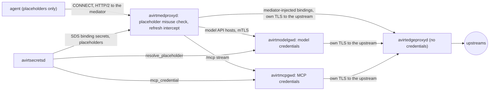
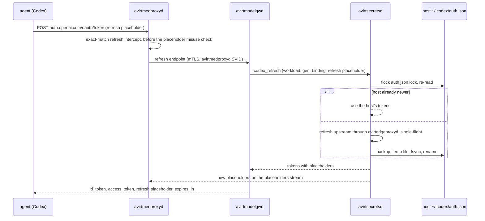

# Status: implemented

`avirthostd` starts without credentials and checks them per launch. A claude launch without `CLAUDE_CODE_OAUTH_TOKEN` in avirthostd's environment, or a codex launch without `~/.codex/auth.json` (`CODEX_HOST_HOME` overrides the directory), is refused with a 400 naming what is missing. Secrets reach the workload container through `-e NAME` with no value, so the container CLI inherits them from avirthostd's environment and none appears on argv. `container run` starts from `HOME`, `PATH`, `TMPDIR`, `USER` and `LOGNAME` plus the variables in the agent's per-agent launch settings, so a Codex workload container does not carry `CLAUDE_CODE_OAUTH_TOKEN`.

## Claude

`CLAUDE_CODE_OAUTH_TOKEN` is passed with `-e` and is in the agent's environment. With auto-approve, the agent can read it and send it to any host the proxy allows or write it into the workload log. Treat logs as secret.

## Codex


`avirthostd` reads the host `auth.json` per launch. It is never in the image, on argv or in the environment, and no host `config.toml` is copied. Codex rewrites `auth.json` with a new single-use refresh token when it refreshes, so after the workload container exits avirthostd writes the workload's copy back under these rules:

- The workload's file is opened without following symlinks, and is used only if it is a regular file of at most 1 MiB that parses as JSON.
- It must have the same top-level keys, the same `auth_mode`, and the same account identity as the seed: `tokens.account_id`, and the `id_token` `sub` and email claims, decoded but not verified and never logged.
- Its `last_refresh` must be valid and at most 5 minutes in the future.
- It replaces the host file only if its `last_refresh` is strictly newer than the host file's current one, and only if the host file is still the same login. Otherwise the result is `host newer` or a refusal.
- The compare and replace happen under an exclusive `flock` on `auth.json.lock` next to the host file.
- The first host file is saved once as `auth.json.pre-avirt-backup`, created exclusively and never overwritten.
- The new file is written to a uniquely named, exclusively created 0600 temp file (`auth.json.avirt-tmp-<random>`) in the same directory, fsynced, and renamed over the host file.

The outcome is logged as the `auth_writeback` meta event with a fixed reason string and no file content:

- `unchanged`
- `host newer`
- `wrote refreshed auth.json back to host`
- `no auth.json in workload home`
- a `refused: ...` or `failed: ...` reason

The temp home is removed after the write-back on every path: normal exit, workload container kill, spawn error, setup failure and avirthostd shutdown. If the workload container cannot be confirmed gone after stop, kill and delete attempts, cleanup and write-back are skipped, the temp home is left for the next startup cleanup, and a `container_error` says so.

Constraint: two concurrent workloads that start from the same stale refresh token cannot both refresh, so the second one's refresh fails. Logs contain the account label, email and plan. With auto-approve, the agent can copy `/codex-home/auth.json` into the log.

# Status: planned

The workload container holds placeholders only. avirtsecretsd holds every real credential and the Codex refresh token, and it is the only component that reads a secret provider or refreshes a credential. Its secret model, providers, leases, write-back and APIs are in [secrets](./secrets.md). This document covers the injection side: bindings, placeholders, the credential injectors and the harness specifics. avirthostd's workload configuration names a workload's credential bindings by id, and avirthostd neither reads nor refreshes any credential.

These hold for every credential:

- A real credential is injected only on a request under TLS interception, at the one credential injector its binding names, for the workload it is attached to, on the destinations the binding names.
- avirtedgeproxyd injects nothing and never sees a real credential: the injecting component opens its own TLS connection to the upstream inside the tunnel.
- No credential is ever injected under TLS passthrough.
- No long-lived real credential for model or MCP traffic is ever in the mediator.
- No real credential is ever logged. Events record a credential's binding, location and outcome only.

## Bindings

A binding is a record in avirtsecretsd. It names the secret that backs it, the placeholder the workload sees, the credential injector, the header to inject, and the destinations it is bound to.

```yaml
name: claude-oauth
secret: secret:host/claude-oauth             # a secret reference
workload: {env: CLAUDE_CODE_OAUTH_TOKEN, shape: "sk-ant-oat01-"}
injector: avirtmodelgwd                      # avirtmodelgwd, avirtmcpgwd or mediator
inject: {header: authorization, value: "Bearer {}"}
bind: [{host: api.anthropic.com, port: 443, paths: ["/v1/*", "/api/*"]}]
```

| Field | Meaning |
| --- | --- |
| `name` | The binding id. Workload configuration and `attach_binding` name it. |
| `secret` | The secret reference that backs it, `secret:<scope>/<name>` (see [secrets](./secrets.md#secrets-and-references)). A binding backed by a namespace-scoped secret attaches only to workloads in that namespace. |
| `workload` | What the workload sees: an environment variable or a file path, and the client-acceptable prefix of its placeholder (`shape`). A binding without `workload` gives the workload nothing, and its credential is added to matching requests instead of substituted (see [HTTP injection](#http-injection)). |
| `injector` | The one credential injector: `avirtmodelgwd`, `avirtmcpgwd` or `mediator`. |
| `inject` | The header and its value template, where `{}` is the real value. `encode: basic` with `user: <name>` makes `{}` the base64 of `<name>:<value>`. |
| `bind` | The destinations: each a canonical host, a port, and path patterns with `*` matching any characters, compared with the canonical request path (see [request path canonicalization](./egress-policies.md#request-path-canonicalization)). For a gRPC binding, `protocol: grpc`, and the paths name `/<package>.<Service>/<Method>`. |

Constraints:

- Bindings are host administration: avirtadmin creates, changes and removes them, never a workload principal.
- A binding's `bind` hosts are external hosts. A binding never names an avirt name or a host service.
- A launch attaches bindings by id. avirthostd authorizes `attach_binding` for each one against the host policy snapshot (see [egress policies](./egress-policies.md#actions)), and then registers the workload's bindings with avirtsecretsd.
- Two bindings attached to one workload never overlap: no host, port and path is matched by both.

## Credential injectors

| Credential | Injected at | The mediator holds |
| --- | --- | --- |
| Claude OAuth token, Anthropic API keys | avirtmodelgwd | Placeholders only |
| Codex access and id tokens | avirtmodelgwd | Placeholders only |
| Codex refresh token | Never injected. avirtsecretsd uses it to refresh. | The refresh placeholder only |
| MCP upstream credentials | avirtmcpgwd | Nothing |
| Other bindings that must be injected at the mediator, such as a git host token | avirtmedproxyd | A short-lived, workload-scoped credential for that binding, in memory |



## avirtsecretsd

avirtsecretsd's side is in [secrets](./secrets.md): secrets and their references, providers, versions and leases, the registration of each live workload's namespace, generation, binding ids and credential injectors by avirthostd (see [APIs](./secrets.md#apis)), write-back of the credentials it owns, and its storage at rest. Binding records live in its `bindings.d/`, written only through its Admin API, and a binding's issued placeholders are returned to avirthostd at registration.

## Credential broker API and SDS

avirtsecretsd serves the credential injectors through two interfaces (see [secrets](./secrets.md#apis) for its other APIs).

- **SDS** delivers to each avirtmedproxyd Envoy, and to nothing else, one `generic_secret` per mediator-injected binding of its own workload, named `binding/<binding id>` (see [SDS](./secrets.md#sds)). An SDS stream from avirtmedproxyd's Envoy is accepted only for a live workload at its current generation. avirtsecretsd serves no TLS identity: avirtmedproxyd's Envoy gets its SVID from avirtmedproxyd's local SDS, and avirtedgeproxyd's Envoy gets its SVID and trust bundles from avirtedgeproxyd's local SDS, which is never sent a bearer credential, a placeholder or a refresh token.
- **The credential broker API** is workload-scoped, on avirtsecretsd's host service listener (see [trust boundaries](./trust-boundaries.md#listeners)).

| Operation | Caller | Returns |
| --- | --- | --- |
| `placeholders` | avirtmediatord, avirtmedproxyd's Envoy | A stream of its workload's issued placeholders and placeholder copies of files, for `confirm` and for the placeholder misuse check |
| `resolve_placeholder` | avirtmodelgwd | A lease on the real value of one placeholder, for one request |
| `mcp_credential` | avirtmcpgwd | A lease on the upstream credential for one of the workload's MCP bindings and one MCP server, with no placeholder involved |
| `codex_refresh` | avirtmodelgwd, presenting the workload's refresh placeholder | Codex tokens with placeholders after a refresh (see [Codex refresh](#codex-refresh)) |
| `revocations` | avirtmodelgwd, avirtmcpgwd | A stream of the cached values the gateway must drop (see [rotation and revocation](#rotation-and-revocation)) |

Host services' own credentials, such as avirtregistryd's registry logins, come from avirtsecretsd's Service API (`GetCredential`, see [APIs](./secrets.md#apis)), never from the broker, and never for a workload's binding.

Every retrieval is authorized by workload, generation, service and binding, and then by `read_secret` against the host policy snapshot (see [authorization](./secrets.md#authorization)):

- the caller's SVID names the service, or the workload and generation for avirtmediatord and avirtmedproxyd's Envoy;
- a gateway names the workload and generation it acts for, which must equal those in the avirtmedproxyd SVID on the connection it is serving;
- the binding must be in that workload's configuration, as avirthostd registered it at launch, after authorizing `attach_binding` for it. avirtsecretsd refuses a superseded generation and a binding used at the wrong credential injector;
- `codex_refresh` must present the refresh placeholder issued to that workload for that binding;
- a binding attached to a workload that another workload created must be one the creator holds itself (see [workloads that create workloads](#workloads-that-create-workloads));
- the placeholder must be one issued to that workload for that binding, and the request's host, port and path must match the binding.

A gateway keeps a resolved value in memory only, and no longer than its lease's `expires` (see [scoping](./secrets.md#scoping)).

## Placeholders

- **Format.** A placeholder is an exact string that avirtsecretsd issues per workload and binding: a client-acceptable prefix, then `avirtph`, then 32 random base64url characters.
- **Handles, not secrets.** A placeholder grants nothing by itself. It is resolved only at its binding's credential injector, for its own workload, on its own destinations.
- **Issuance.** avirtsecretsd issues a workload's placeholders when avirthostd registers the workload. They stay the same across mediator generations, because the agent's environment does, and change only when a Codex refresh issues new ones.
- **Delivery.** avirtmediatord fetches the workload's placeholders and sends them in `confirm` (`env` and `files`, see [launch handshake](./workload-topology.md#launch-handshake)). avirtinitd puts each value at the environment variable or file path that the configuration layer names (see [workload lifecycle](./workload-lifecycle.md#configuration-layer)).
- **Substitution.** It happens only inside the one bound header of a request whose host, port and path match the credential's binding, at the credential injector the binding names.
- **TLS passthrough.** No credential is ever injected under TLS passthrough.
- **Placeholder misuse check.** avirtmedproxyd rejects, with `403 credential-misplaced` in both policy modes, any issued placeholder, or the bare `avirtph` marker, found anywhere else in a request. That covers other headers, the request target before and after percent-decoding, the first 1 MiB of the body, and any host: the CONNECT authority, the SNI and `Host`. The Codex refresh intercept's exact match is evaluated before the scan.
- **DNS.** A DNS query whose name holds the `avirtph` marker gets `NXDOMAIN` and a `dns` event with `rcode` `NXDOMAIN` and `rule: "credential-misplaced"`. Host and DNS names are compared case-insensitively, because both are lowercased before the check.
- **Scope of the scan.** The placeholder misuse check detects misuse. It does not prevent exfiltration: it does not see a body past 1 MiB, an encoded placeholder, websocket frames, or passthrough connections.
- **Control characters.** A real value containing CR, LF or NUL is never substituted.
- **No other locations.** Body, query and path substitution is not supported.
- **Logs.** Placeholder values never appear in an avirt event, and exported log content is redacted for the placeholder misuse check's patterns (see [content and redaction](./observability.md#content-and-redaction)).

## libavirtenvoy injection

libavirtenvoy in avirtmedproxyd's Envoy injects only the bindings whose `injector` is `mediator`. It receives each one's value as the SDS resource `binding/<binding id>`, keeps it in memory only, and uses whatever version avirtsecretsd last pushed. While a binding's resource is absent, every matching request fails with 503 and a `cred` outcome of `rejected`.

### HTTP injection

On an intercepted request whose host, port and canonical path match a mediator-injected binding:

- **With a placeholder** (the binding has `workload`): the bound header must hold exactly the binding's placeholder in the value template's position, and libavirtenvoy replaces it with the real value. A bound header that holds anything else is refused with 403 `credential-rejected` and a `cred` outcome of `rejected`.
- **Without a placeholder**: libavirtenvoy sets the bound header to the rendered template, replacing any value the request carried.

avirtmedproxyd then opens its own TLS connection to the upstream through avirtedgeproxyd (see [egress](./egress.md#avirtmedproxyd-pipeline)), and the `http` event records `cred: [{name, location, action}]`.

### gRPC

A binding with `protocol: grpc` makes avirtmedproxyd offer ALPN `h2` and `http/1.1` downstream for its destination, so the agent's gRPC client can speak h2 on the intercepted connection. Injection then works per call: the call's `:path` is the canonical path the binding's paths match, the bound header is gRPC metadata on the call's HEADERS frame, and trailers are never touched. The placeholder misuse check covers the call's metadata, its `:path` and its first 1 MiB of messages. A destination with no gRPC binding is offered `http/1.1` only, and an h1 `Upgrade` cannot be made on an h2 downstream connection.

## avirtmodelgwd

avirtmedproxyd sends every intercepted request for a model API host to avirtmodelgwd over a new mutual TLS connection, which avirthostd routes by SNI without terminating TLS, with the original host as `:authority` (see [egress](./egress.md#avirtmedproxyd-pipeline)). For each request, avirtmodelgwd:

1. takes the workload and generation from the avirtmedproxyd SVID on the connection, and refuses a superseded generation;
2. finds the workload's binding whose destinations match the host, port and path. A request that matches none is forwarded with no injection;
3. reads the placeholder from the bound header, and calls `resolve_placeholder` with the workload, generation, binding, placeholder, host, port and path, unless it holds the value in its cache;
4. substitutes the real value, refusing one with CR, LF or NUL;
5. applies its per-workload model rules and budgets;
6. opens the upstream connection through avirtedgeproxyd, with the workload as the originating caller in `x-avirt-caller`, and runs TLS to the upstream inside it, verifying it against bundled webpki roots;
7. posts a `src: "gateway"` event with the credential's binding, location and outcome.

A request whose bound header holds a value other than the workload's placeholder for that binding is refused with 403 `credential-rejected`. A websocket upgrade is a request like any other, and avirtmodelgwd injects on the upgrade request only (see [egress](./egress.md#websockets)). avirtmodelgwd also serves the Codex refresh endpoint (see [Codex refresh](#codex-refresh)).

## avirtmcpgwd

The agent's MCP configuration names only avirtmcp (see [workload lifecycle](./workload-lifecycle.md#configuration-layer)). avirtmcp relays MCP through avirtnetd's `mcp.sock` and the `/mcp` stream to avirtmcpgwd, and no MCP traffic passes through avirtnetd's forward proxy. No placeholder exists for an MCP credential: the workload never sees one in any form.

- An MCP binding names one upstream MCP server, its URL and its credential. avirtmcpgwd exposes to each workload only the servers its MCP bindings name, and only the tools its per-workload tool scope allows.
- avirtmcpgwd obtains each upstream credential with `mcp_credential`, for the workload and generation in the avirtmedproxyd SVID on the `/mcp` stream, and injects it into the upstream HTTP request's bound header.
- An MCP server's OAuth tokens are an `oauth` secret that avirtsecretsd owns and refreshes (see [write-back](./secrets.md#write-back)).
- Upstream connections go through avirtedgeproxyd with the workload in `x-avirt-caller`, so the host policy snapshot's `connect` applies to both avirtmcpgwd and the workload (see [egress policies](./egress-policies.md#enforcement-points)).
- avirtmcpgwd never retries a mutating tool call automatically.

## Claude Code

These facts hold for Claude Code 2.1.300, as bundled by agent-sdk 0.3.300. The rest of the harness is in [Claude harness](./acp-claude.md).

- **Token.** The variable is `CLAUDE_CODE_OAUTH_TOKEN`. Claude Code treats it as a credential with no refresh token, no expiry and scope `user:inference`, sends it as `Authorization: Bearer` with `anthropic-beta: oauth-2025-04-20`, and never refreshes it (on a 401 it keeps the supplied token).
- **Placeholder.** `sk-ant-oat01-avirtph<32>`.
- **Binding.** `api.anthropic.com:443`, paths `/v1/*` and `/api/*`, header `authorization: Bearer {}`, injected at avirtmodelgwd.
- **`ANTHROPIC_API_KEY`** (not configured by default). It uses the same mechanism with header `x-api-key` and placeholder `sk-ant-api03-avirtph<32>`, which satisfies Claude Code's key-format check for non-first-party base URLs.

## Codex

These facts hold for Codex 0.160.1. The rest of the harness is in [Codex harness](./acp-codex.md).

The host `~/.codex/auth.json` is a `document` secret that avirtsecretsd owns through its `codex` provider (see [providers](./secrets.md#providers)). avirtsecretsd builds the placeholder copy below and serves it with the workload's placeholders, avirtmediatord sends it in `confirm.files`, and `avirtinitd` writes the agent's `CODEX_HOME/auth.json` (`/home/agent/.codex`, image-local, no host mount) from `confirm.files`:

- **`id_token` and `access_token`** become `<real header>.<real payload>.avirtph<32>`. That is a structurally valid JWT with the real claims and a placeholder signature.
  - Codex decodes JWT payloads without checking signatures, and requires three non-empty segments.
  - A token that fails to decode fails the whole `auth.json` load.
  - Codex reads the access token's `exp`, so keeping the real payload makes its proactive refresh fire at the real expiry, within its 5-minute window.
- **`refresh_token`** becomes `avirtph<32>`.
- **`account_id` and `last_refresh`** are copied as they are.
- **Binding.** `chatgpt.com:443` `/backend-api/*` and `api.openai.com:443` `/v1/*`, header `authorization: Bearer {}`, injected at avirtmodelgwd. `ChatGPT-Account-ID` comes from `tokens.account_id` and is sent unchanged. The Responses API runs over WSS at `/backend-api/codex/responses` with the auth headers on the upgrade request, which is where avirtmodelgwd injects them (see [egress](./egress.md#websockets)).

The workload and its logs therefore reveal the account's email and plan, which the real JWT payloads carry.

## Codex refresh

Codex refreshes proactively, and also on a 401: it reloads `auth.json` from disk, then refreshes, then gives up. The refresh is a JSON POST to `https://auth.openai.com/oauth/token` with `{client_id, grant_type: "refresh_token", refresh_token}`. Every response field (`id_token`, `access_token`, `refresh_token`) is optional. Codex re-parses the `id_token`, saves the tokens, and sets `last_refresh`. Refresh tokens rotate, and reusing an old one is a permanent failure, so exactly one owner, avirtsecretsd, holds the refresh token.

avirtmedproxyd's refresh intercept matches exactly a `POST` to `auth.openai.com:443` path `/oauth/token` whose JSON body has `grant_type` equal to `refresh_token` and `refresh_token` equal to this workload's refresh placeholder. It does not forward the request upstream. It sends it to avirtmodelgwd's refresh endpoint, which calls the broker's `codex_refresh`. Any other request that carries the refresh placeholder meets the placeholder misuse check. avirtsecretsd then refreshes through its write-back (see [write-back](./secrets.md#write-back)): under `auth.json.lock` it uses the host's tokens if another workload or the host CLI already refreshed, and otherwise performs the real refresh single-flight across workloads and writes the host file atomically, marking the secret `needs-login` on any uncertain outcome. It then issues new id and access tokens with placeholders, keeps the old placeholders valid for 60 s, and sends the new placeholders on avirtmedproxyd's `placeholders` stream.

avirtmodelgwd answers the agent with `{"id_token","access_token","refresh_token"}` (the refresh placeholder unchanged) plus `expires_in`. Two workloads refreshing at once both succeed. If interception fails for a client, `CODEX_REFRESH_TOKEN_URL_OVERRIDE` can point Codex at a mediator-served path instead.



## Generation fencing

Every credential retrieval is bound to the workload's current mediator generation:

- avirtsecretsd refuses every broker call from, or on behalf of, a superseded generation, and avirthostd reports every replacement with `SetGeneration` (see [APIs](./secrets.md#apis)).
- A gateway acts for the generation in the avirtmedproxyd SVID on the connection it is serving, and refuses a superseded one. It drops its cached values for a workload when the workload's generation changes.
- A mediator-injected value lives only in the memory of the avirtmedproxyd Envoy whose SDS stream received it. avirtsecretsd closes a superseded generation's SDS streams once its successor is confirmed, and that generation's leases end with them.
- Placeholders are per workload, not per generation, so the next generation serves the same ones.

## Rotation and revocation

avirtsecretsd's rotation and revocation of secrets are in [secrets](./secrets.md#rotation-and-revocation). At the credential injectors:

- **Rotation.** A gateway resolves per request and uses a new version on its next request. avirtmedproxyd's Envoy receives a new version of `binding/<binding id>` over SDS. The workload's placeholders do not change.
- **Revocation.** A revoked secret's SDS resources are removed and a revocation reaches each gateway on its `revocations` stream, after which it drops its cached value. Requests on the binding's destinations are then refused with 403 `credential-rejected`, and the placeholder in the workload grants nothing.
- **Policy change.** When a new host policy snapshot applies, avirthostd re-evaluates `attach_binding` for every live workload's bindings, and withdraws each binding the new policy snapshot denies from that workload's registration. The workload keeps running without it.
- **Placeholder rotation.** Placeholders change only on a Codex refresh. The old ones stay valid for 60 s, and then meet the placeholder misuse check as any other unknown `avirtph` value does.
- **Workload end.** Deregistration at teardown ends every lease and placeholder of the workload and closes its SDS streams.
- **Login loss.** A secret in `needs-login` refuses every refresh and resolve until an operator logs in again.

Open connections are not closed by any of these: a credential is checked per request, so the next request on an open connection sees the change.

## What the workload sees

| The workload can see | The workload never sees |
| --- | --- |
| Its placeholders, in its environment and placeholder files | Any real credential, at any credential injector |
| The real JWT header and payload of the Codex id and access tokens, including the account's email and plan | The Codex refresh token, real or encoded, and any JWT signature |
| The names of the variables and files the configuration layer wires | Any MCP credential, in any form |
| The MITM CA certificate | The MITM CA key |
| Which requests get 403 `credential-misplaced` or `credential-rejected` | Which binding a request matched, beyond what its own requests reveal |

These hold for guest root as for uid 1000: the real credentials never enter the workload container, so a full compromise of the workload container yields only the placeholders (see [trust boundaries](./trust-boundaries.md#compromise-scope)). A compromised mediator gains the workload's placeholders and its mediator-injected short-lived credentials, and no model or MCP credential.

## Build jobs

A build job is a workload with the build security context (see [workspace builds](./workspace-build.md#build-jobs)), and its credentials follow the same rules as any workload's:

- avirtbuilderd names the job's bindings when it asks avirthostd to create the job, and avirthostd authorizes `attach_binding` for each one with `HostService::"avirtbuilderd"` as the principal. A job gets only the bindings for its own sources.
- A private source's credential is a mediator-injected binding without a placeholder, for the source's host and repository paths only. For GitHub it is a short-lived installation token with read-only contents permission for that repository, injected as `authorization: Basic` with user `x-access-token`.
- Injection happens only during the fetch step. The build runner reports the end of the fetch step to avirtinitd before any build command starts, and avirtmediatord passes it to libavirtenvoy, which from then on drops the credential, refuses the binding, and evaluates every new connection as if `intercept` were forbidden. The report can only end the fetch step, never restart it.
- Build commands therefore get no injected credential and no termination, and their environment trusts only the CA bundle of the build's base image.
- Off-host registry credentials belong to avirtregistryd, through avirtsecretsd's Service API, never to a build job: a job reaches its inputs and its staging repository only through avirtregistryd's grant (see [workspace builds](./workspace-build.md#build-jobs)).

## Workloads that create workloads

A workload that creates another workload through the guest CLI (see [workload management](./components.md#workload-management)) can attach to it only bindings it holds itself, and avirthostd still authorizes `attach_binding` for each one with the creator as the principal.

- **Separate placeholders.** The child gets its own placeholders for each binding, issued to its own workload. The creator never sees them, and a creator's placeholder used in the child's requests is unknown to the child's avirtmedproxyd and meets the placeholder misuse check.
- **Delegation chain.** avirtsecretsd records each child binding's creator. When a binding is withdrawn from a workload, it is withdrawn from every descendant that holds it through that workload.
- **Lifetime.** A child that ends with its creator is deregistered like any workload. A detached child keeps its bindings until it ends or they are withdrawn.

# Open questions

1. **Placeholder files and refresh.** A Codex refresh changes the placeholders in `auth.json`, which Codex rewrites itself from the refresh response. Whether avirtinitd also rewrites the file from the `placeholders` stream, for a client that does not, is open.
2. **gRPC downstream.** Offering h2 downstream only for destinations with a gRPC binding means an agent's gRPC client to any other intercepted host fails to negotiate. Whether `request` policy can also select h2 for a destination is open.
3. **Revocation reach.** Withdrawing a binding stops new injections, but a credential already sent upstream stays valid at the upstream for its own lifetime. Revoking it there is the provider owner's task (see [secrets](./secrets.md#rotation-and-revocation)).
