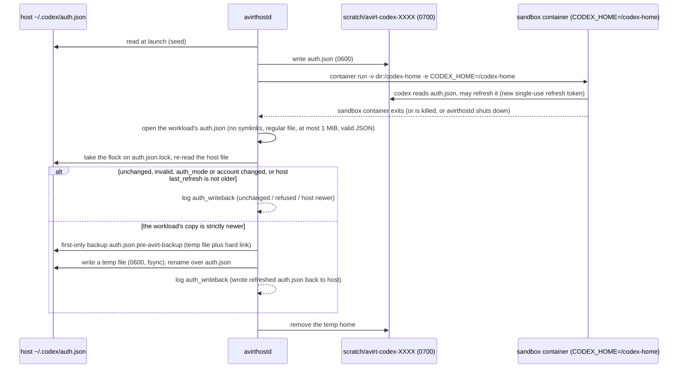
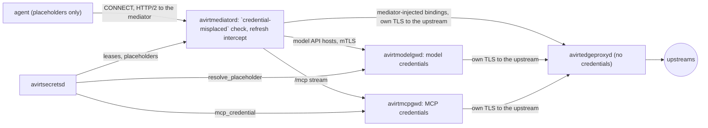
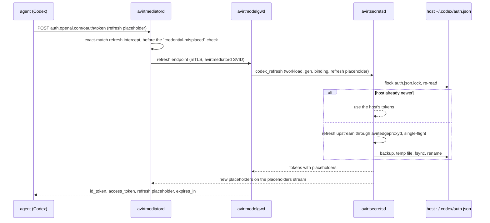

# Status: implemented

`avirthostd` starts without credentials and checks them per launch. avirthostd refuses a Claude launch without `CLAUDE_CODE_OAUTH_TOKEN` in its environment or a Codex launch without `~/.codex/auth.json` (`CODEX_HOST_HOME` overrides the directory). It returns 400 with the missing credential's name. The container command-line tool inherits secrets from avirthostd's environment through `-e NAME` with no value. The values never appear on argv. `container run` starts from `HOME`, `PATH`, `TMPDIR`, `USER` and `LOGNAME` plus the variables in the agent's per-agent launch settings, so a Codex sandbox container doesn't contain `CLAUDE_CODE_OAUTH_TOKEN`.

## Claude

avirthostd passes `CLAUDE_CODE_OAUTH_TOKEN` with `-e`, placing it in the agent's environment. With auto-approve, the agent can read it and send it to any host the proxy allows or write it into the workload log. Treat logs as secret.

## Codex



`avirthostd` reads the host `auth.json` per launch. It's never in the image, on argv or in the environment, and avirthostd excludes the host `config.toml`. Codex rewrites `auth.json` with a new single-use refresh token when it refreshes, so after the sandbox container exits avirthostd writes the workload's copy back under these rules:

- avirthostd opens the workload's file without following symlinks. It uses only a regular file of at most 1 MiB that parses as JSON.
- Its top-level keys and `auth_mode` must match the seed. The account identity must also match: `tokens.account_id` plus the `id_token` `sub` and email claims. avirthostd decodes these claims without verification or logging.
- Its `last_refresh` must be valid and at most 5 minutes in the future.
- It replaces the host file only if its `last_refresh` is strictly newer than the host file's current one, and only if the host file is still the same login. Otherwise the result is `host newer` or a refusal.
- The compare and replace happen under an exclusive `flock` on `auth.json.lock` next to the host file.
- avirthostd saves the first host file once as `auth.json.pre-avirt-backup`, with exclusive creation. It never overwrites the backup.
- avirthostd writes the new content to a uniquely named 0600 temp file (`auth.json.avirt-tmp-<random>`) in the same directory, using exclusive creation. It fsyncs the file before renaming it over the host file.

avirthostd logs the outcome as an `auth_writeback` meta event containing a fixed reason string without file content:

- `unchanged`
- `host newer`
- `wrote refreshed auth.json back to host`
- `no auth.json in workload home`
- a `refused: ...` or `failed: ...` reason

After write-back, avirthostd always removes the temp home. This covers normal exit, sandbox container stop or termination, spawn errors, setup failures, and avirthostd shutdown. If `stop`, `kill`, and `delete` attempts fail to confirm removal, avirthostd skips cleanup and write-back. It leaves the temp home for the next startup cleanup and records a `container_error`.

Constraint: two concurrent workloads that start from the same stale refresh token can't both refresh, so the second one's refresh fails. Logs contain the account label, email, and plan. With auto-approve, the agent can copy `/codex-home/auth.json` into the log.

# Status: planned

avirt supplies the sandbox container with placeholders only. avirtsecretsd contains every real credential and the Codex refresh token, and it's the only component that reads a secret provider or refreshes a credential. Its secret model, providers, leases, write-back and APIs are in [secrets](./secrets.md). This document covers injection, including bindings and placeholders, the credential injectors, and the harness specifics. avirthostd's workload configuration names a workload's credential bindings by id, and avirthostd neither reads nor refreshes any credential.

These hold for every credential:

- A credential injector injects a real credential only under TLS or SSH interception, for the attached workload and the binding's destinations. Injection requires the credential injector specified by the binding.
- avirtedgeproxyd never injects or sees real credentials. The injecting component opens its own TLS connection to the upstream inside the tunnel.
- Credential injectors never inject credentials under TLS passthrough.
- The mediator never receives long-lived real credentials for model or MCP traffic.
- Logs exclude real credentials. Events record only a credential's binding, location, and outcome.

## Bindings

A binding is a record in avirtsecretsd. It specifies the backing secret and the workload's placeholder. It also specifies the credential injector, the header to inject, and the bound destinations.

```yaml
name: claude-oauth
secret: secret:host/claude-oauth             # a secret reference
workload: {env: CLAUDE_CODE_OAUTH_TOKEN, placeholder_prefix: "sk-ant-oat01-"}
injector: avirtmodelgwd                      # avirtmodelgwd, avirtmcpgwd or mediator
inject: {header: authorization, value: "Bearer {}"}
bind: [{host: api.anthropic.com, port: 443, paths: ["/v1/*", "/api/*"]}]
```

| Field | Meaning |
| --- | --- |
| `name` | The binding id. Workload configuration and `attach_binding` name it. |
| `secret` | The secret reference that backs it, `secret:<scope>/<name>` (see [secrets](./secrets.md#secrets-and-references)). A binding backed by a namespace-scoped secret attaches only to workloads in that namespace. |
| `workload` | The environment variable or path that receives the placeholder, plus its initial prefix (`placeholder_prefix`). The prefix lets the client accept the placeholder as a token of the right kind. A binding without `workload` omits the placeholder. Its injector adds the credential to matching requests instead of substituting it (see [HTTP injection](#http-injection)). |
| `injector` | The one credential injector: `avirtmodelgwd`, `avirtmcpgwd` or `mediator`. |
| `inject` | An SSH key or certificate (`ssh: {key\|cert}`), or an HTTP header and its value template, where `{}` is the credential value. `encode: basic` with `user: <name>` makes `{}` the base64 of `<name>:<value>`. |
| `bind` | Destinations with a canonical host and port plus path patterns. `*` matches any characters in the canonical request path (see [request path canonicalization](./egress-policies.md#request-path-canonicalization)). For a gRPC binding, `protocol: grpc`, and the paths name `/<package>.<Service>/<Method>`. |

Constraints:

- Bindings are host administration: only avirtadmin can create bindings or change or remove them. Workload principals lack these permissions.
- A binding's `bind` hosts are external hosts. Bindings exclude avirt hostnames and host services.
- A launch attaches bindings by id. avirthostd authorizes `attach_binding` for each one against the host policy snapshot (see [egress policies](./egress-policies.md#actions)), and then registers the workload's bindings with avirtsecretsd.
- Bindings attached to one workload must have disjoint matches over host, port, and path.

## Credential injectors

| Credential | Injected at | The mediator holds |
| --- | --- | --- |
| Claude OAuth token, Anthropic API keys | avirtmodelgwd | Placeholders only |
| Codex access and id tokens | avirtmodelgwd | Placeholders only |
| Codex refresh token | Never injected. avirtsecretsd uses it to refresh. | The refresh placeholder only |
| MCP upstream credentials | avirtmcpgwd | Nothing |
| Other bindings requiring injection at the mediator, such as a git HTTPS token or an SSH key or certificate | avirtmediatord | A short-lived, workload-scoped credential for that binding, in memory |



## avirtsecretsd

avirtsecretsd's side is in [secrets](./secrets.md): secrets and their references, providers, versions and leases, the registration of each live workload's namespace, generation, binding ids and credential injectors by avirthostd (see [APIs](./secrets.md#apis)), write-back of credentials whose `owner` is `avirtsecretsd`, and its storage at rest. Its `bindings.d/` stores binding records, which only its Admin API can write. Registration returns the binding's issued placeholders to avirthostd.

## Credential broker API

avirtsecretsd serves credential injectors through its workload-scoped broker API on its host service listener (see [secrets](./secrets.md#apis)). The broker authenticates the caller's SVID and authorizes the workload, generation, binding, and injector for every lease. TLS identities and trust bundles come from avirthostd.

| Operation | Caller | Returns |
| --- | --- | --- |
| `placeholders` | avirtmediatord | A stream of its workload's issued placeholders and placeholder copies of files, for `confirm` and for the `credential-misplaced` check |
| `resolve_placeholder` | avirtmodelgwd | A lease on the credential value of one placeholder, for one request |
| `mcp_credential` | avirtmcpgwd | A lease on the upstream credential for one of the workload's MCP bindings and one MCP server, with no placeholder involved |
| `codex_refresh` | avirtmodelgwd, presenting the workload's refresh placeholder | Codex tokens with placeholders after a refresh (see [Codex refresh](#codex-refresh)) |
| `binding_credential` | avirtmediatord | A lease for the real, short-lived credential behind its own workload's mediator-injected binding |
| `revocations` | avirtmediatord, avirtmodelgwd, avirtmcpgwd | A stream of the cached values the gateway must drop (see [rotation and revocation](#rotation-and-revocation)) |

Host services' own credentials, such as avirtregistryd's registry logins, come from avirtsecretsd's Service API (`GetCredential`, see [APIs](./secrets.md#apis)), never from the broker, and never for a workload's binding.

avirtsecretsd checks each retrieval by workload, generation, service, and binding. It then checks `read_secret` against the host policy snapshot (see [authorization](./secrets.md#authorization)):

- the caller's SVID names the service, or the workload and generation for avirtmediatord.
- a gateway specifies the workload and generation it acts for, which must equal those in the avirtmediatord SVID on the connection it's serving.
- the workload's configuration must include the binding. avirthostd registers it at launch after authorizing `attach_binding`. avirtsecretsd refuses a superseded generation and a binding used at the wrong credential injector.
- `codex_refresh` must present the refresh placeholder issued to that workload for that binding.
- a binding attached to a workload that another workload created must be one the creator holds itself (see [workloads that create workloads](#workloads-that-create-workloads)).
- the placeholder must belong to that workload and binding. The request's host, port, and path must match the binding.

A gateway keeps a resolved value in memory only, and no longer than its lease's `expires` (see [scoping](./secrets.md#scoping)).

## Placeholders

- **Format.** A placeholder is an exact string that avirtsecretsd issues per workload and binding: a client-acceptable prefix followed by `avirtph` and 32 random base64url characters.
- **Resolution.** A placeholder alone can't grant access. Only its binding's credential injector resolves it for its own workload and destinations.
- **Issuance.** avirtsecretsd issues a workload's placeholders when avirthostd registers the workload. They remain unchanged across mediator generations because the agent's environment also remains unchanged. Only a Codex refresh changes placeholders.
- **Delivery.** avirtmediatord fetches the workload's placeholders and sends them in `confirm` (`env` and `files`, see [launch handshake](./workload-topology.md#launch-handshake)). avirtinitd puts each value at the environment variable or path that the configuration layer names (see [workload lifecycle](./workload-lifecycle.md#configuration-layer)).
- **Substitution.** It happens only inside the one bound header of a request whose host, port and path match the credential's binding, at the credential injector the binding names.
- **TLS passthrough.** Credential injectors never inject credentials under TLS passthrough.
- **`credential-misplaced` check.** avirtmediatord rejects in both policy modes, with `403 credential-misplaced` for HTTP or trailers-only HTTP 200 and `grpc-status: 7` for gRPC, any issued placeholder, or the bare `avirtph` marker, found anywhere else in a request. That covers other headers, the request target before and after percent-decoding, the first 1 MiB of the body, and any host: the CONNECT authority, the SNI and `Host`. avirtmediatord checks the Codex refresh intercept's exact match before scanning. Body forwarding starts after a short deadline or byte threshold. A later placeholder hit resets the stream and logs `credential-misplaced`.
- **DNS.** A DNS query whose name holds the `avirtph` marker gets `NXDOMAIN` and a `dns` event with `rcode` `NXDOMAIN` and `rule: "credential-misplaced"`. avirtmediatord compares host and DNS names without case distinctions, converting both to lowercase before the check.
- **Scope of the scan.** This check detects misuse within its scope. It can't prevent exfiltration through body content past 1 MiB, encoded placeholders, or passthrough connections. avirtmediatord scans websocket client data across fragments with a bounded matcher and checks control frames separately. It refuses unnegotiated extensions and strips `permessage-deflate`. A hit closes with 1008. Both relay directions preserve frame boundaries.
- **Control characters.** Credential injectors never substitute a credential value containing CR, LF, or NUL.
- **HTTP locations.** HTTP credential substitution uses headers only, excluding bodies, queries, paths, and trailers. SSH bindings use a key or certificate during upstream authentication.
- **Logs.** avirt events exclude placeholder values. Log export redacts content matching the `credential-misplaced` check's patterns (see [content and redaction](./observability.md#content-and-redaction)).

## Mediator injection

avirtmediatord injects only the bindings whose `injector` is `mediator`. It fetches each value with `binding_credential` from the broker API and holds the lease in memory only. It renews before `expires`, uses the current version on the next request and drops the value at expiry or revocation. Without an unexpired lease that avirtsecretsd hasn't revoked, each matching request fails with 503 and a `cred` outcome of `rejected`.

### HTTP injection

avirtmediatord authorizes and serializes one canonical request. It refuses duplicate bound headers, disagreement between `:authority` and Host, ambiguous Content-Length or Transfer-Encoding, and trailers that include client credentials. An absolute-form authority must agree with Host and the flow's hostname before conversion to origin-form. Before injecting exactly one credential, avirtmediatord strips hop-by-hop fields. An httparse pre-check examines every HTTP/1 request head before hyper normalizes it. Redirects and each request on a reused connection require a fresh authorization check.

On an intercepted request whose host, port and canonical path match a mediator-injected binding:

- **With a placeholder** (the binding has `workload`): the bound header must contain exactly the binding's placeholder in the value template's position, and avirtmediatord replaces it with the credential value. avirtmediatord refuses any other value in the bound header with 403 `credential-rejected` and a `cred` outcome of `rejected`.
- **Without a placeholder**: avirtmediatord sets the bound header to the rendered template, replacing any value the request contained.

avirtmediatord then opens its own TLS connection to the upstream through avirtedgeproxyd (see [egress](./egress.md#how-avirtmediatord-handles-egress)), and the `http` event records `cred: [{name, location, action}]`.

### gRPC

Every intercepted TLS destination offers `h2` and `http/1.1`. A binding's `protocol: grpc` selects gRPC path matching. The client's TLS ALPN selects the HTTP version. Binding paths match the call's canonical `:path`, and bound headers become metadata on HEADERS. avirtmediatord refuses trailers that include client credentials. Binary metadata encoding requires an explicit binding contract. A refusal is a trailers-only HTTP 200 with `grpc-status: 7`, including `credential-misplaced`. Body forwarding starts after a short deadline or byte threshold so bidirectional calls progress. A later scan hit resets the stream and records the rejection.

### SSH injection

An SSH binding fixes the upstream username, host, port, pinned host key, and credential together. The guest authenticates with a per-workload placeholder key. avirtmediatord obtains the upstream key or certificate through `binding_credential` and keeps it in memory. It connects upstream during authentication. A pin mismatch fails authentication. avirtmediatord presents host certificates from the workload's host CA only for hosts permitted for SSH interception. The guest's `@cert-authority` configuration helps cooperating clients and doesn't enforce access.

By default avirtmediatord permits only exec of `git-upload-pack`, `git-receive-pack`, or `git-upload-archive`, with one single-quoted canonical repository path and no shell syntax. The mediator authorizes the command and constructs its own upstream exec string. Shell, `pty-req`, forwarding, environment other than `GIT_PROTOCOL`, and subsystems require explicit permission. avirtmediatord refuses SFTP on a repository-bound binding and caps sessions and channels per workload.

Each git HTTPS binding installs `url.insteadOf` rules for its own host, and policy denies port 22 there unless an SSH binding exists. SSH interception supports SSH-only remotes and permitted non-git operations. Port and binding determine SSH classification before dialing. The mediator skips probe connections.

### Recipient trust

A binding requires trust in its recipient. An upstream can return an injected credential in a body, redirect, metadata, or frame. Prefer short-lived, narrowly scoped or sender-constrained credentials when supported. Only avirtsecretsd holds refresh tokens. Response scanning is optional and can't guarantee detection.

## avirtmodelgwd

avirtmediatord sends every intercepted request for a model API host to avirtmodelgwd over a new mutual TLS connection, which avirthostd routes by SNI without decrypting TLS, with the original host as `:authority` (see [egress](./egress.md#how-avirtmediatord-handles-egress)). For each request, avirtmodelgwd:

1. takes the workload and generation from the avirtmediatord SVID on the connection, and refuses a superseded generation.
2. finds the workload's binding whose destinations match the host, port, and path. avirtmodelgwd forwards requests without a match, omitting credential injection.
3. reads the placeholder from the bound header, and calls `resolve_placeholder` with the workload, generation, binding, placeholder, host, port and path, unless its cache contains the value.
4. substitutes the credential value, refusing one with CR, LF, or NUL.
5. applies its per-workload model rules and budgets.
6. opens the upstream connection through avirtedgeproxyd, with the workload as the originating caller in `x-avirt-caller`, and runs TLS to the upstream inside it, verifying it against bundled webpki roots.
7. posts a `src: "gateway"` event with the credential's binding, location, and outcome.

avirtmodelgwd refuses a request with 403 `credential-rejected` if its bound header contains a value other than that workload's placeholder for the binding. A websocket upgrade is a request like any other, and avirtmodelgwd injects on the upgrade request only (see [egress](./egress.md#websockets)). avirtmodelgwd also serves the Codex refresh endpoint (see [Codex refresh](#codex-refresh)).

## avirtmcpgwd

The agent's MCP configuration names only avirtmcp (see [workload lifecycle](./workload-lifecycle.md#configuration-layer)). avirtmcp relays MCP through avirtnetd's `mcp.sock` and the `/mcp` stream to avirtmcpgwd, and no MCP traffic passes through avirtnetd's forward proxy. MCP credentials lack placeholders. avirt never supplies these credentials to the workload. The recipient trust constraint still applies.

- An MCP binding specifies one upstream MCP server with its URL and credential. avirtmcpgwd limits each workload to the servers in its MCP bindings and the tools allowed by its per-workload tool scope.
- avirtmcpgwd fetches each upstream credential with `mcp_credential`, for the workload and generation in the avirtmediatord SVID on the `/mcp` stream, and injects it into the upstream HTTP request's bound header.
- An MCP server's OAuth tokens belong to avirtsecretsd, which refreshes them as an `oauth` secret (see [write-back](./secrets.md#write-back)).
- Upstream connections go through avirtedgeproxyd with the workload in `x-avirt-caller`, so the host policy snapshot's `connect` applies to both avirtmcpgwd and the workload (see [egress policies](./egress-policies.md#enforcement-points)).
- avirtmcpgwd never retries a mutating tool call automatically.

## Claude Code

The following behavior applies to Claude Code 2.1.300, bundled by agent-sdk 0.3.300. The rest of the harness is in [Claude harness](./acp-claude.md).

- **Token.** The variable is `CLAUDE_CODE_OAUTH_TOKEN`. Claude Code treats it as a credential with scope `user:inference` and without a refresh token or expiry. It sends `Authorization: Bearer` with `anthropic-beta: oauth-2025-04-20`. It never refreshes the token. A 401 leaves the supplied token unchanged.
- **Placeholder.** `sk-ant-oat01-avirtph<32>`.
- **Binding.** `api.anthropic.com:443`, paths `/v1/*` and `/api/*`, header `authorization: Bearer {}`, injected at avirtmodelgwd.
- **`ANTHROPIC_API_KEY`** (not configured by default). It uses the same mechanism with header `x-api-key` and placeholder `sk-ant-api03-avirtph<32>`, which satisfies Claude Code's key-format check for non-first-party base URLs.

## Codex

For Codex 0.160.1, the following behavior applies. Other harness behavior is in [Codex harness](./acp-codex.md).

The host `~/.codex/auth.json` is a `document` secret that avirtsecretsd owns through its `codex` provider (see [providers](./secrets.md#providers)). avirtsecretsd builds a placeholder copy and serves it with the workload's placeholders. avirtmediatord sends it in `confirm.files`. `avirtinitd` writes the agent's `CODEX_HOME/auth.json` (`/home/agent/.codex`, image-local, no host mount) from `confirm.files`:

- **`id_token` and `access_token`** become `<real header>.<real payload>.avirtph<32>`. That's a structurally valid JWT with the real claims and a placeholder signature.
  - Codex decodes JWT payloads without checking signatures, and requires three non-empty segments.
  - A token that fails to decode fails the whole `auth.json` load.
  - Codex reads the access token's `exp`, so keeping the real payload makes its refresh before expiry use the real expiry, within its 5-minute window.
- **`refresh_token`** becomes `avirtph<32>`.
- **`account_id` and `last_refresh`** remain unchanged in the copy.
- **Binding.** `chatgpt.com:443` `/backend-api/*` and `api.openai.com:443` `/v1/*`, header `authorization: Bearer {}`, injected at avirtmodelgwd. `ChatGPT-Account-ID` comes from `tokens.account_id` and remains unchanged on requests. The Responses API runs over WSS at `/backend-api/codex/responses` with the auth headers on the upgrade request, which is where avirtmodelgwd injects them (see [egress](./egress.md#websockets)).

The workload and its logs reveal the account's email and plan, which the real JWT payloads contain.

## Codex refresh

Codex refreshes before expiry and on a 401. After a 401, it reloads `auth.json` from disk and tries to refresh before giving up. The refresh is a JSON POST to `https://auth.openai.com/oauth/token` with `{client_id, grant_type: "refresh_token", refresh_token}`. Every response field (`id_token`, `access_token`, `refresh_token`) is optional. Codex re-parses the `id_token` before saving the tokens and setting `last_refresh`. Refresh tokens rotate, and reusing an old one is a permanent failure, so exactly one owner, avirtsecretsd, holds the refresh token.

avirtmediatord's refresh intercept matches exactly a `POST` to `auth.openai.com:443` path `/oauth/token` whose JSON body has `grant_type` equal to `refresh_token` and `refresh_token` equal to this workload's refresh placeholder. avirtmediatord sends the intercepted request only to avirtmodelgwd's refresh endpoint. That endpoint calls the broker's `codex_refresh`. Any other request that contains the refresh placeholder meets the `credential-misplaced` check. avirtsecretsd then refreshes through its write-back (see [write-back](./secrets.md#write-back)): under `auth.json.lock` it uses the host's tokens if another workload or the host command-line tool already refreshed, and otherwise performs one real refresh shared across workloads. With `auth.json.lock` still held, avirtsecretsd writes the host file atomically and marks the secret record `needs-login` on any uncertain outcome. The broker then issues new id and access tokens with placeholders. It keeps old placeholders valid for 60 s and sends new placeholders on avirtmediatord's `placeholders` stream.

avirtmodelgwd answers the agent with `{"id_token","access_token","refresh_token"}` (the refresh placeholder unchanged) plus `expires_in`. When two workloads refresh at once, both succeed. If interception fails for a client, `CODEX_REFRESH_TOKEN_URL_OVERRIDE` can point Codex at a mediator-served path instead.



## Generation fencing

Credential retrieval requires the workload's current mediator generation:

- avirtsecretsd refuses every broker call from, or on behalf of, a superseded generation, and avirthostd reports every replacement with `SetGeneration` (see [APIs](./secrets.md#apis)).
- A gateway acts for the generation in the avirtmediatord SVID on the connection it's serving, and refuses a superseded one. It drops its cached values for a workload when the workload's generation changes.
- Only the avirtmediatord whose broker call received a mediator-injected value stores it, in memory. Once successor confirmation completes, avirtsecretsd refuses the superseded generation's calls and ends its leases.
- Placeholders belong to the workload and remain unchanged across generations.

## Rotation and revocation

avirtsecretsd's rotation and revocation of secrets are in [secrets](./secrets.md#rotation-and-revocation). At the credential injectors:

- **Rotation.** A gateway resolves per request and uses a new version on its next request. avirtmediatord renews its lease and uses the new version on its next request. The workload's placeholders don't change.
- **Revocation.** avirtsecretsd ends the revoked secret's leases and notifies each injector on its `revocations` stream. Each injector then drops its cached value. Credential injectors refuse requests to the binding's destinations with 403 `credential-rejected`. The workload's placeholder can't grant access.
- **Policy change.** When a new host policy snapshot takes effect, avirthostd re-evaluates `attach_binding` for every live workload's bindings, and withdraws each binding the new policy snapshot denies from that workload's registration. The workload keeps running without it.
- **Placeholder rotation.** Placeholders change only on a Codex refresh. The old ones remain valid for 60 s, and then meet the `credential-misplaced` check as any other unknown `avirtph` value does.
- **Workload end.** Deregistration at teardown ends every lease and placeholder of the workload and closes the streams of placeholders and revocation notices on the broker API for that workload.
- **Login loss.** A secret in `needs-login` refuses every refresh and resolve until an operator logs in again.

These changes leave open connections intact. Credential injectors check each request, so the next request on an open connection sees the change.

## Workload visibility

| The workload can see | The workload never sees |
| --- | --- |
| Its placeholders in its environment and placeholder files | A credential stored at any credential injector, except one that an upstream returns in a response |
| The real JWT header and payload of the Codex id and access tokens, including the account's email and plan | The Codex refresh token, real or encoded, and any JWT signature |
| The names of the variables and files the configuration layer wires | Any MCP credential, in any form |
| The MITM CA certificate | The MITM CA key |
| Which requests get 403 `credential-misplaced` or `credential-rejected` | Which binding a request matched, beyond what its own requests reveal |

Root in the sandbox container has the same visibility as uid 1000. avirt supplies no real credentials to the sandbox container, but a trusted upstream can return an injected credential. A compromise can expose those returned values along with placeholders (see [trust boundaries](./trust-boundaries.md#compromise-scope)). A compromised mediator gains the workload's placeholders and its mediator-injected short-lived credentials, and no model or MCP credential.

## Build jobs

A build job is a workload with the build security context (see [workspace builds](./workspace-build.md#build-jobs)), and its credentials follow the same rules as any workload's:

- avirtbuilderd names the job's bindings when it asks avirthostd to create the job, and avirthostd authorizes `attach_binding` for each one with `HostService::"avirtbuilderd"` as the principal. A job gets only the bindings for its own sources.
- A private source's credential is a mediator-injected binding without a placeholder, for the source's host and repository paths only. For GitHub it's a short-lived installation token with read-only contents permission for that repository, injected as `authorization: Basic` with user `x-access-token`.
- Injection happens only during the fetch step. The build runner reports the end of the fetch step to avirtinitd before any build command starts, and avirtinitd passes it through avirtnetd to avirtmediatord, which then drops the credential and refuses the binding. avirtmediatord checks every new connection as though policy forbade `intercept`. The report can only end the fetch step, never restart it.
- Build commands run without injected credentials or TLS termination. Their environment trusts only the CA bundle of the build's base image.
- Off-host registry credentials belong to avirtregistryd, through avirtsecretsd's Service API, never to a build job: a job reaches its inputs and its staging repository only through avirtregistryd's grant (see [workspace builds](./workspace-build.md#build-jobs)).

## Workloads that create workloads

A workload that creates another workload through the guest CLI (see [workload management](./components.md#workload-management)) can attach to it only bindings it holds itself, and avirthostd still authorizes `attach_binding` for each one with the creator as the principal.

- **Separate placeholders.** The child gets its own placeholders for each binding, issued to its own workload. The creator never sees them, and a creator's placeholder used in the child's requests is unknown to the child's avirtmediatord and meets the `credential-misplaced` check.
- **Delegation chain.** avirtsecretsd records each child binding's creator. Withdrawing a workload's binding also withdraws it from every descendant that obtained it through that workload.
- **Lifetime.** avirthostd deregisters a child that ends with its creator like any workload. Detached children keep their bindings until workload completion or binding withdrawal.

# Open questions

1. **Placeholder files and refresh.** A Codex refresh changes the placeholders in `auth.json`, which Codex writes from the refresh response. Whether avirtinitd also rewrites the file from the `placeholders` stream, for a client that doesn't, is open.
2. **Revocation reach.** Withdrawing a binding stops new injections, but a credential already sent upstream remains valid there for the credential's lifetime. Revoking it there is the provider owner's task (see [secrets](./secrets.md#rotation-and-revocation)).
