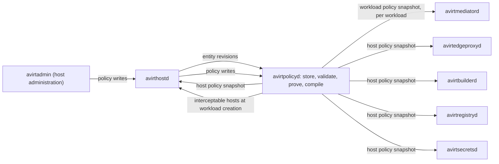

# Status: implemented

The current code has no policy engine. The CONNECT app allows every destination that passes the private-address block and logs it under rule `allow-all` (see [egress](./egress.md#pingora-connect-app)).

# Status: planned

Egress, ingress, and control-plane policy uses Cedar. avirtpolicyd stores policies and validates them against the avirt Cedar schema. It runs the Cedar policy prover before compiling the policies and distributing versioned policy snapshots. Each enforcement point stores a policy snapshot and checks it locally with the embedded `cedar-policy` crate. Requests proceed without waiting on a policy call. Credential bindings are records in avirtsecretsd (see [egress credentials](./egress-credentials.md#bindings)). Policy governs only which workloads may attach them (`attach_binding`).

## Enforcement points

| Point | Policy snapshot | Actions | Principal |
| --- | --- | --- | --- |
| avirtmediatord | Workload policy snapshot | `resolve`, `connect`, `intercept`, `passthrough` and `request` for its workload's egress, and `ingress` for connections to its workload's published ports | Its own `Workload` for egress, the caller in `x-avirt-caller` for `ingress` |
| avirtedgeproxyd | Host policy snapshot | `resolve` for its DNS proxy, and `connect` for every stream on its egress and peer listeners: workload-to-workload, services, host-local services, external endpoints, the `/guest-cli` stream, internal names under a peer's host name, and every host service's off-host connection | Caller's SVID, identifying a local or peer `Workload` or a `HostService`. For a gateway or avirtapid call on behalf of a caller, also the originating principal |
| avirthostd | Host policy snapshot | Workloads, labels, bindings, ports, services, namespaces, peers, sessions, logs and `launch_workspace`, and host administration (see [actions](#actions)) | Caller: a `Workload` through `guest-cli`, a `User` through avirtapid, `Admin` on the admin socket, or a `HostService` |
| avirtsecretsd | Host policy snapshot | `read_secret`, `manage_secret`, `manage_provider` and `manage_binding` (see [secrets](./secrets.md#cedar)) | avirtmediatord's `Workload`, a gateway's or host service's `HostService`, or `Admin` |
| avirtbuilderd | Host policy snapshot | `build_workspace`, `watch_workspace`, `inspect_build`, `cancel_build`, `inspect_watch` and `unwatch_workspace` (see [workspace builds](./workspace-build.md#policy)) | The caller avirtapid forwards, or `HostService::"avirtbuilderd"` |
| avirtregistryd | Host policy snapshot | `push_workspace`, `pull_workspace`, `import_workspace`, `export_workspace` and `delete_workspace` (see [workspace registry](./workspace-registry.md#policy)) | The caller avirtapid forwards, a `HostService`, or a build job's `Workload` |

The command-to-action maps are in [operator CLI](./operator-cli.md#api-and-policy-map), [admin CLI](./admin-cli.md#api-and-policy-map), and [guest CLI](./guest-cli.md#api-and-policy-map).

A connection between two workloads needs permission at three points. The source workload's avirtmediatord checks `connect` against the source workload's policy snapshot. avirtedgeproxyd checks `connect` against the host policy snapshot, and the destination workload's avirtmediatord checks `ingress` against the destination workload's policy snapshot. Between hosts, each host's avirtedgeproxyd checks its own host policy snapshot. All these checks must permit the connection.

Gateways don't run Cedar. avirtmodelgwd applies its per-workload model rules and budgets, and avirtmcpgwd applies its per-workload tool scope (see [components](./components.md#policy-and-credential-placement)).



## Schema

The avirt Cedar schema has one version number, which every policy snapshot names. A policy set validates against it in Cedar's strict mode before the prover sees it. Every avirt action is in this one schema, including the workspace actions that [workspaces](./workspaces.md#policy), [workspace builds](./workspace-build.md#policy) and [workspace registry](./workspace-registry.md#policy) describe and avirtsecretsd's actions that [secrets](./secrets.md#cedar) describes.

### Entities

| Entity | Id | Parents | Attributes | Tags |
| --- | --- | --- | --- | --- |
| `Host` | `<td>`, the host itself, keyed by its trust domain: the resource of host-scoped actions | None | None | None |
| `Peer` | `<host>`, an enrolled peer (see [peering](./peering.md#entities)) | None | `trust_domain` | None |
| `Namespace` | `<ns>` on this host, `<host>/<ns>` for an enrolled peer's namespace | Its `Peer`, for a peer's namespace | None | None |
| `Workload` | `<ns>/<uuid>`, keyed by the workload's canonical UUIDv7 (see [components](./components.md#workload-ids)), or `<host>/<ns>/<uuid>` for a peer's workload | Its `Namespace` | `agent` (`claude` or `codex`), absent for a workload without an agent, such as a build job | Its labels |
| `Service` | `<ns>/<name>`, a service keyed by its name | Its `Namespace` | `backend` (`workload` or `host-local`) | Its labels |
| `HostService` | `<name>`, an avirt host service such as `avirtapid` or `avirtmodelgwd`, or `<host>/<name>` for an enrolled peer's component, such as `<host>/avirthostd` calling `Workloads/KeepAlive` (see [peering](./peering.md#workload-management-across-hosts)) | None | None | None |
| `Admin` | `uid:<uid>`, the avirtadmin caller authenticated by peer credentials | None | None | None |
| `User` | A local or web UI user, the caller avirtapid forwards for avirt and avirtwebd. Its id form is open (see [components](./components.md#open-questions)). | None | None | None |
| `Destination` | `<protocol>/<host-or-ip>:<port>`, an external endpoint | None | `host` (canonicalized) or `ip` (an `ipaddr`), `port`, `protocol` (`tcp`, `udp` or `icmp`), `kind` (`external` or `model`) | None |
| `DnsName` | `<host>`, a public name in a DNS query | None | `host` (canonicalized) | None |
| `Secret` | `<scope>/<name>`, a secret in avirtsecretsd (see [secrets](./secrets.md#secrets-and-references)) | Its `Namespace`, none for a host-scoped secret | `provider`, `kind` | Its tags |
| `Binding` | `<id>`, a credential binding in avirtsecretsd | None | `injector` (`avirtmodelgwd`, `avirtmcpgwd` or `mediator`), `secret` | None |
| `WorkspaceRepository` | `<ns>/<name>` (see [workspaces](./workspaces.md#policy)) | Its `Namespace` | None | None |
| `WorkspaceImage` | `<ns>/<name>@<digest>` | Its `WorkspaceRepository` | `producer`, `provenance`, `base`, `source`, `revision`, `trigger` | Its manifest annotations |

Constraints:

- A peer's `Workload` has empty sets of attributes and tags. avirtedgeproxyd builds it from the identity the peer's avirtedgeproxyd asserts, qualified by that peer's host. The local host has only this information about it.
- A workload's short ID, alias and generated name aren't attributes. They're DNS handles only, and name resolution maps each of them to the entity before evaluation (see [name resolution](#name-resolution)).
- The id form of a `User` principal, local or web UI, is open (see [components](./components.md#open-questions)).

### Tags

A workload's or service's labels are its entity tags, with string values. Policies read them with `hasTag` and `getTag`. Only avirthostd sets keys under `avirt.internal/`:

| Key | Value |
| --- | --- |
| `avirt.internal/creator` | The creator's UUIDv7, or the local or web UI user |
| `avirt.internal/root` | The user at the top of the delegation chain |
| `avirt.internal/build` | The build id, on a build job |
| `avirt.internal/workspace` | The workspace repository, on a build job |

A label isn't a trust boundary by itself: a policy that keys on a label trusts whoever may set that key, which `set_label` governs.

### Actions

Every control-plane action includes `via` in its context, except avirtsecretsd's administration actions, which avirtadmin alone reaches through avirthostd. An action that specifies a session takes the ACP session id in `session`, and one that omits it applies to every session of the workload.

| Action | Evaluated by | Principal | Resource | Context |
| --- | --- | --- | --- | --- |
| `resolve` | avirtmediatord, avirtedgeproxyd | `Workload`, `HostService` | The entity for an internal name (`Workload`, `Service`, or a peer's `Namespace`), or a `DnsName` | `qtype` (the query type, such as `A`, `AAAA` or `HTTPS`), `via`, `server` |
| `connect` | avirtmediatord, avirtedgeproxyd | `Workload`, `HostService` | The entity for an internal name, a peer's `Namespace`, `Peer::"<host>"` for a control-plane call to a peer (see [peering](./peering.md)), `HostService::"avirtapid"` for the `/guest-cli` stream, or a `Destination` | `port`, `protocol`, `via`, `name_from` (`dns`, `connect` or `none`) |
| `intercept` | avirtmediatord | `Workload` | `Destination` at any permitted port | `protocol` (`tls` or `ssh`) |
| `passthrough` | avirtmediatord | `Workload` | `Destination` | `detected` (`tls`, `quic`, `http`, `ssh` or `unknown`) |
| `request` | avirtmediatord | `Workload` | `Destination` | `method`, `path` (canonicalized), `query` (whether the target had a query string), `protocol` (`http/1.1`, `h2` or `ssh`), optional `upgrade` |
| `ingress` | Destination workload's avirtmediatord | The caller in `x-avirt-caller`: `Workload` or `HostService` | The destination `Workload` | `port`, `protocol` (`tcp`, `udp` or `http`) |
| `create_workload` | avirthostd | The caller | The new workload's `Namespace` | `via`, `depth` (the new workload's delegation chain depth), `detached`, `agent` |
| `list_workloads` | avirthostd | The caller | `Namespace` | `via` |
| `inspect_workload`, `stop_workload`, `delete_workload` | avirthostd | The caller | The target `Workload` | `via` |
| `extend_sandbox` | avirthostd, per path at creation (see [Landlock](./landlock.md#extra-paths)) | The caller | The new workload's `Namespace` | `via`, `path`, `access` (`read` or `write`) |
| `set_label` | avirthostd, per label at creation | The caller | The workload's or service's `Namespace` | `via`, `key`, `value` |
| `attach_binding` | avirthostd, per binding at creation | The caller | `Binding` | `via`, `namespace` (the new workload's `Namespace`) |
| `publish_port` | avirthostd | The caller | The publishing `Workload` | `via`, `port`, `protocol` |
| `unpublish_port` | avirthostd | The caller | The publishing `Workload` | `via`, `port` |
| `publish_service` | avirthostd | The caller | The `Service` the record creates | `via`, `port`, `backend` (`workload` or `host-local`), `backend_address` for a host-local backend |
| `list_services` | avirthostd | The caller | `Namespace` | `via` |
| `inspect_service`, `delete_service` | avirthostd | The caller | `Service` | `via` |
| `list_namespaces`, `list_peers` | avirthostd | The caller | `Host` | `via` |
| `inspect_namespace` | avirthostd | The caller | `Namespace` | `via` |
| `attach_session` | avirthostd, before it forwards the session control API (see [ACP](./acp.md#session-control-api)) | The caller | The session's `Workload` | `via`, `session` |
| `prompt_session`, `cancel_session`, `answer_permission`, `end_session` | avirthostd, per operation | The caller | The session's `Workload` | `via`, `session` |
| `read_log` | avirthostd, per call | The caller | The target `Workload` | `via`, `source` (`acp`, `egress`, `meta` or `stdio`) |
| `launch_workspace` | avirthostd, at launch order step 1 | The caller | `WorkspaceImage` | `via`, `namespace`, `agent`, `workload_image`, `allow_local` |
| `inspect_host`, `drain_host`, `read_audit` | avirthostd | `Admin` | `Host` | `via` |
| `create_namespace`, `delete_namespace` | avirthostd | `Admin` | The `Namespace` | `via` |
| `read_policy` | avirthostd | `Admin` | `Host` | `via`, `set` when the call specifies one set |
| `write_policy` | avirthostd, before it forwards the write to avirtpolicyd | `Admin` | `Host` | `via`, `set` |
| `set_policy_mode` | avirthostd | `Admin` | `Host` | `via`, `mode` (`audit` or `enforce`), `namespace` when it sets one namespace's mode rather than the host default |
| `enroll_peer`, `update_peer`, `revoke_peer` | avirthostd | `Admin` | The `Peer` | `via` |
| `inspect_peer` | avirthostd | The caller | `Peer` | `via` |
| `rotate_ca` | avirthostd | `Admin` | `Host` | `via`, `tier` (`issuing` or `root`) |
| `read_secret` | avirtsecretsd, per lease | `Workload` (avirtmediatord's workload), `HostService` | `Secret` | `via` (`mediator`, `gateway` or `service`), `binding` |
| `manage_secret` | avirtsecretsd | `Admin` | `Secret` | `operation` (`define`, `update`, `rotate`, `revoke`, `import`, `login` or `list`) |
| `manage_provider` | avirtsecretsd | `Admin` | `Host` | `operation` (`define`, `remove`, `list` or `status`), `provider` |
| `manage_binding` | avirtsecretsd | `Admin` | `Binding` | `operation` (`define`, `list` or `remove`) |
| `build_workspace`, `watch_workspace` | avirtbuilderd | The caller, or `HostService::"avirtbuilderd"` for a prebuild | `WorkspaceRepository` | `via`, and the build or watch context in [workspace builds](./workspace-build.md#policy) |
| `inspect_build`, `cancel_build` | avirtbuilderd | The caller | The build's `WorkspaceRepository` | `via`, `build` (the build id) |
| `inspect_watch`, `unwatch_workspace` | avirtbuilderd | The caller | The watched `WorkspaceRepository` | `via`, `prebuild_policy` |
| `push_workspace`, `import_workspace`, `export_workspace` | avirtregistryd | The caller, or a `HostService` | `WorkspaceRepository` | `via`, and the context in [workspace registry](./workspace-registry.md#policy). For an import from a peer, `registry` is `peer:<host>` (see [peering](./peering.md#workspace-images)). |
| `pull_workspace`, `delete_workspace` | avirtregistryd | The caller, a `HostService`, or a build job's `Workload` | `WorkspaceImage` | `via`, and `purpose` for `pull_workspace`: `client`, `launch`, `build-input`, `include`, or `peer-import` for a peer importing the image |

`via` names the path a request came by:

| Value | Meaning |
| --- | --- |
| `egress` | The workload's own flow or DNS query |
| `guest-cli` | The workload's `guest-cli` principal, through avirtapid |
| `gateway` | An upstream connection that avirtmodelgwd or avirtmcpgwd makes for a workload. Policy checks both the gateway and the workload. |
| `service` | A host service's own connection |
| `client` | A `User`, through avirtapid |
| `admin` | avirtadmin, on avirthostd's admin socket |
| `mediator` | avirtmediatord reading its workload's binding values, for `read_secret` |

### Schema text

```cedarschema
entity Host;

entity Peer {
  trust_domain: String,
};

entity Namespace in [Peer];

entity Workload in [Namespace] {
  agent?: String,
} tags String;

entity Service in [Namespace] {
  backend: String,
} tags String;

entity HostService;

entity Admin;

entity User;

entity Destination {
  host?: String,
  ip?: ipaddr,
  port: Long,
  protocol: String,
  kind: String,
};

entity DnsName {
  host: String,
};

entity Secret in [Namespace] {
  provider: String,
  kind: String,
} tags String;

entity Binding {
  injector: String,
  secret: Secret,
};

entity WorkspaceRepository in [Namespace];

entity WorkspaceImage in [WorkspaceRepository] {
  producer: String,
  provenance: String,
  base: String,
  source?: String,
  revision?: String,
  trigger: String,
} tags String;

type Caller = { via: String };

type Session = { via: String, session?: String };

// Data plane: avirtmediatord and avirtedgeproxyd

action resolve appliesTo {
  principal: [Workload, HostService],
  resource: [Workload, Service, Namespace, DnsName],
  context: { qtype: String, via: String, server: String },
};

action connect appliesTo {
  principal: [Workload, HostService],
  resource: [Workload, Service, Namespace, Peer, HostService, Destination],
  context: { port: Long, protocol: String, via: String, name_from: String },
};

action intercept appliesTo {
  principal: [Workload],
  resource: [Destination],
  context: { protocol: String },
};

action passthrough appliesTo {
  principal: [Workload],
  resource: [Destination],
  context: { detected: String },
};

action request appliesTo {
  principal: [Workload],
  resource: [Destination],
  context: { method: String, path: String, query: Bool, protocol: String, upgrade?: String },
};

action ingress appliesTo {
  principal: [Workload, HostService],
  resource: [Workload],
  context: { port: Long, protocol: String },
};

// avirthostd: workloads, ports, services, namespaces, peers, sessions and logs

action create_workload appliesTo {
  principal: [Workload, HostService, Admin, User],
  resource: [Namespace],
  context: { via: String, depth: Long, detached: Bool, agent?: String },
};

action list_workloads, list_services appliesTo {
  principal: [Workload, HostService, Admin, User],
  resource: [Namespace],
  context: Caller,
};

action inspect_workload, stop_workload, delete_workload appliesTo {
  principal: [Workload, HostService, Admin, User],
  resource: [Workload],
  context: Caller,
};

action extend_sandbox appliesTo {
  principal: [Workload, HostService, Admin, User],
  resource: [Namespace],
  context: { via: String, path: String, access: String },
};

action set_label appliesTo {
  principal: [Workload, HostService, Admin, User],
  resource: [Namespace],
  context: { via: String, key: String, value: String },
};

action attach_binding appliesTo {
  principal: [Workload, HostService, Admin, User],
  resource: [Binding],
  context: { via: String, namespace: Namespace },
};

action publish_port appliesTo {
  principal: [Workload, HostService, Admin, User],
  resource: [Workload],
  context: { via: String, port: Long, protocol: String },
};

action unpublish_port appliesTo {
  principal: [Workload, HostService, Admin, User],
  resource: [Workload],
  context: { via: String, port: Long },
};

action publish_service appliesTo {
  principal: [Workload, HostService, Admin, User],
  resource: [Service],
  context: { via: String, port: Long, backend: String, backend_address?: String },
};

action inspect_service, delete_service appliesTo {
  principal: [Workload, HostService, Admin, User],
  resource: [Service],
  context: Caller,
};

action list_namespaces, list_peers appliesTo {
  principal: [Workload, HostService, Admin, User],
  resource: [Host],
  context: Caller,
};

action inspect_namespace appliesTo {
  principal: [Workload, HostService, Admin, User],
  resource: [Namespace],
  context: Caller,
};

action attach_session, prompt_session, cancel_session, answer_permission, end_session appliesTo {
  principal: [Workload, HostService, Admin, User],
  resource: [Workload],
  context: Session,
};

action read_log appliesTo {
  principal: [Workload, HostService, Admin, User],
  resource: [Workload],
  context: { via: String, source: String },
};

action launch_workspace appliesTo {
  principal: [Workload, HostService, Admin, User],
  resource: [WorkspaceImage],
  context: { via: String, namespace: Namespace, agent: String, workload_image: String, allow_local: Bool },
};

// avirthostd: host administration, for Admin only

action inspect_host, drain_host, read_audit appliesTo {
  principal: [Admin],
  resource: [Host],
  context: Caller,
};

action create_namespace, delete_namespace appliesTo {
  principal: [Admin],
  resource: [Namespace],
  context: Caller,
};

action read_policy appliesTo {
  principal: [Admin],
  resource: [Host],
  context: { via: String, set?: String },
};

action write_policy appliesTo {
  principal: [Admin],
  resource: [Host],
  context: { via: String, set: String },
};

action set_policy_mode appliesTo {
  principal: [Admin],
  resource: [Host],
  context: { via: String, mode: String, namespace?: Namespace },
};

action enroll_peer, update_peer, revoke_peer appliesTo {
  principal: [Admin],
  resource: [Peer],
  context: Caller,
};

action inspect_peer appliesTo {
  principal: [Workload, HostService, Admin, User],
  resource: [Peer],
  context: Caller,
};

action rotate_ca appliesTo {
  principal: [Admin],
  resource: [Host],
  context: { via: String, tier: String },
};

// avirtsecretsd

action read_secret appliesTo {
  principal: [Workload, HostService],
  resource: [Secret],
  context: { via: String, binding?: Binding },
};

action manage_secret appliesTo {
  principal: [Admin],
  resource: [Secret],
  context: { operation: String },
};

action manage_provider appliesTo {
  principal: [Admin],
  resource: [Host],
  context: { operation: String, provider?: String },
};

action manage_binding appliesTo {
  principal: [Admin],
  resource: [Binding],
  context: { operation: String },
};

// avirtbuilderd

action build_workspace appliesTo {
  principal: [Workload, HostService, Admin, User],
  resource: [WorkspaceRepository],
  context: {
    via: String,
    kind: String,
    source_types: Set<String>,
    source_hosts: Set<String>,
    github_owners: Set<String>,
    includes: Set<String>,
    provenance: String,
    config_source: String,
    secret_allows: Set<String>,
    trigger: String,
    ref: String,
    owner: String,
    prebuild_policy?: String,
  },
};

action watch_workspace appliesTo {
  principal: [Workload, HostService, Admin, User],
  resource: [WorkspaceRepository],
  context: { via: String, repository: String, config: String, events: Set<String>, schedule?: String },
};

action inspect_build, cancel_build appliesTo {
  principal: [Workload, HostService, Admin, User],
  resource: [WorkspaceRepository],
  context: { via: String, build: String },
};

action inspect_watch, unwatch_workspace appliesTo {
  principal: [Workload, HostService, Admin, User],
  resource: [WorkspaceRepository],
  context: { via: String, prebuild_policy: String },
};

// avirtregistryd

action push_workspace appliesTo {
  principal: [Workload, HostService, Admin, User],
  resource: [WorkspaceRepository],
  context: { via: String, producer: String },
};

action pull_workspace appliesTo {
  principal: [Workload, HostService, Admin, User],
  resource: [WorkspaceImage],
  context: { via: String, purpose: String },
};

action import_workspace appliesTo {
  principal: [Workload, HostService, Admin, User],
  resource: [WorkspaceRepository],
  context: { via: String, registry: String, reference: String },
};

action export_workspace appliesTo {
  principal: [Workload, HostService, Admin, User],
  resource: [WorkspaceRepository],
  context: { via: String, registry: String, reference: String, allow_local: Bool },
};

action delete_workspace appliesTo {
  principal: [Workload, HostService, Admin, User],
  resource: [WorkspaceImage],
  context: Caller,
};
```

## Name resolution

Before evaluating any policy, the enforcing process (avirtedgeproxyd for workload-to-workload connections and services, avirtmediatord for its own decisions) parses an avirt destination name and resolves it to a canonical Cedar entity:

- `7e759259.team-a.workload.host.avirt.internal`, `build-7e759259.team-a.workload.host.avirt.internal`, and `quietly-brave-otter.team-a.workload.host.avirt.internal` all resolve to `Workload::"team-a/0192f3a4-5b6c-7d8e-9f01-23457e759259"`. This entity uses the workload's UUIDv7 as its key. It has short ID `7e759259` and parent `Namespace::"team-a"` on this host.
- the `default` namespace's short form, `7e759259.workload.host.avirt.internal`, resolves to the same entity as its long form.
- `db.team-a.svc.host.avirt.internal` and every alias of that service resolve to `Service::"team-a/db"`.
- An internal name under a peer's host name, `7e759259.team-a.workload.<host>` or `db.team-a.svc.<host>`, resolves locally to the peer's `Namespace::"<host>/team-a"`, because only the peer maps its own short IDs and aliases. The peer's avirtedgeproxyd resolves the name to its own entity and checks its own host policy snapshot.
- An invalid label or a length exceeding the caps in [DNS](./dns.md#internal-names) makes a name malformed.
- Both modes deny a name that resolves to no known entity before policy evaluation.

Namespace rules use entities, such as `principal in Namespace::"team-a"` and `resource in Namespace::"team-a"`, never string patterns over internal names. `Namespace::"<host>/team-a" in Namespace::"<host>/team-a"` holds, so `resource in Namespace::"<host>/team-a"` matches every internal name under a peer's host name in that namespace. A peer's namespaces are in its `Peer`, so `resource in Peer::"<host>"` matches every internal name under that peer's host name.

An authority that specifies an avirt host service, such as `avirtsecretsd.svc.<td>`, never reaches policy: avirtmediatord refuses it with 403 (see [egress](./egress.md#how-avirtmediatord-handles-egress)).

### External host canonicalization

The parser canonicalizes each external host once. Later checks always use the canonical form:

1. The authority must be ASCII. A client sends an internationalized name in its A-label (`xn--`) form. The parser rejects a non-ASCII authority as malformed (400 `bad-request`).
2. After converting the authority to lowercase, the parser strips one trailing dot.
3. A valid label is 1 to 63 characters of `a`-`z`, `0`-`9`, `-`, and `_`, and the whole name is at most 253 characters. Anything outside these constraints makes the name malformed.
4. A name whose last label is all digits must be a canonical dotted quad and becomes an IP literal. Examples of malformed authorities include `2130706433`, `0177.0.0.1`, `0x7f000001`, and `127.1`.
5. An IPv6 literal arrives bracketed (`[2001:db8::1]:443`). Parsing converts it into an `ipaddr`. avirtmediatord canonicalizes IPv4-mapped addresses before synthetic-table lookup, and `private-dest` checks the real upstream destination.

A real IP literal becomes a `Destination` with `ip` and no `host`, so no hostname rule and no `like` pattern can match it: it's permitted only by a policy that compares `resource.ip`, by equality or with `isInRange`.

The parser canonicalizes the SNI under TLS passthrough and the `Host` header under TLS interception the same way. On a named flow both must equal the flow name (`Host` may omit a default port), and avirtmediatord refuses `encrypted_client_hello`. Names come only from the mediator's synthetic DNS table or a CONNECT authority. avirtmediatord logs SNI and Host on a real-address flow without assigning it a name.

### Request path canonicalization

`context.path` for `request` is the request target's path after canonicalization:

1. avirtmediatord serializes the target in origin form (`/…`). An absolute-form authority must agree with Host and the flow name before conversion. A disagreement or an asterisk form gets 400.
2. After dropping the query string, the parser records whether there was one in `context.query`.
3. For percent-encoded unreserved characters (`A`-`Z`, `a`-`z`, `0`-`9`, `-`, `.`, `_`, `~`), the parser decodes the characters. It converts other percent-encodings to uppercase and retains them, so `%2F` stays `%2F` and never becomes a segment separator.
4. After that decoding, the parser removes dot segments.
5. Return 400 for a path with an encoded dot segment that survives step 4, a backslash, a NUL, any other control character, or an empty segment (`//`).

The upstream receives the canonical path with the original query string. The path in the `http` event is the canonical path.

### Restrictions on `like`

The prover rejects any policy that uses `like` anywhere except these two operands:

| Operand | Pattern form |
| --- | --- |
| `resource.host` of a `Destination` or `DnsName` | An exact name with no `*`, or `*.` followed by a suffix of at least two labels, with no other `*`. `*.github.com` matches every name under `github.com` and not `github.com` itself. |
| `context.path` of `request` | Any pattern. `*` matches any characters, `/` included. |

The host form maps each pattern to exactly one DNS subtree, which makes the MITM CA's name constraints exact (see [MITM CA name constraints](#mitm-ca-name-constraints)). Patterns never apply to internal names or to label values. IP literals also fall outside their scope.

## Decision semantics

Cedar's own semantics apply to every decision: a request requires an applicable `permit`, and any applicable `forbid` overrides every `permit`. These constraints also apply:

- A Cedar evaluation error is a deny, in both modes, even when the policy that fails is a `permit`.
- Each policy contains a unique `@id`. The event's `rule` is the `@id` of a determining policy, the lexicographically first when more than one determines the decision.
- A decision without a determining policy records a reserved rule name instead: `default-deny` (no permit applied), `unknown-name` (an internal name that resolves to no entity), `evaluation-error`, or `snapshot-expired`. The prover rejects a policy whose `@id` is a reserved rule name.

For one flow, avirtmediatord evaluates, in order:

| Step | Action | Question | On permit | On deny |
| --- | --- | --- | --- | --- |
| 1 | `resolve` | May the workload learn this name's address? Checked per DNS query, independently of any later flow. | Return the answer. | `NXDOMAIN`, in both modes |
| 2 | `connect` | May the workload use this destination, protocol and port (0 for ICMP)? | Continue | 403 `egress denied: <host>:<port>` |
| 3 | `intercept` | Should avirtmediatord act as the TLS or SSH server at this permitted port? | TLS or SSH interception | Check `passthrough` |
| 4 | `passthrough` | May this external flow reach its endpoint with the detected protocol? | Forward under that protocol's checks | 403 `egress denied: <host>:<port>` |
| 5 | `request` | For intercepted TLS, cleartext HTTP or intercepted SSH, may the workload send this method and path? Checked per request, including a websocket upgrade request. | Forward the request. | 403 `request denied`, or trailers-only HTTP 200 with `grpc-status: 7` for gRPC |

Constraints:

- The `connect` check must permit access even when `intercept` permits TLS interception. An `intercept` permission alone can't grant access to a destination.
- `intercept` accepts `protocol: tls` or `ssh` on any permitted port. avirtmediatord selects SSH from the port and binding before dialing. For an SSH request, `method` is the exec command and `path` is its canonical repository path.
- An internal name always takes TLS passthrough without step 3. avirtedgeproxyd and the destination workload's avirtmediatord run the authorization checks.
- A model API host under TLS passthrough goes to avirtedgeproxyd like any external endpoint, without a credential. The injectors add credentials only on intercepted requests (see [egress credentials](./egress-credentials.md#credential-injectors)).
- avirtmediatord acts as the cleartext HTTP server, checking authorization per request without credential injection. Opaque passthrough grants access to the endpoint and whatever it tunnels. Distinguishing names on a shared endpoint requires interception. TLS and QUIC Initial checks still require matching SNI for named flows.
- Publication doesn't grant ingress permission. The host policy snapshot and the destination's `ingress` policy must both permit the caller.

## Modes

Each policy snapshot contains a mode, `audit` or `enforce`. The host configuration sets a mode per namespace, with a host default for namespaces it doesn't name. A workload policy snapshot contains its namespace's mode. The host policy snapshot contains the host default and the per-namespace modes. avirtedgeproxyd applies the mode of the caller's namespace to a workload caller, and the host default to a host service and a peer.

In audit mode, the enforcement point allows a decision with no permit or with a forbid. It logs the decision as `would-deny`, with the rule that would have decided. In enforce mode it denies the decision and logs `deny`. A mode change is a new policy snapshot, which applies to open connections through [revocation](#revocation-of-open-flows).

These apply as evaluated in both modes:

- `resolve` decisions, so a denied name never leaves the mediator.
- `intercept` decisions, so audit mode never changes which connections use TLS interception.
- every action that avirthostd, avirtbuilderd, avirtregistryd, and avirtsecretsd check, so audit mode never widens control-plane authority or credential access.
- a deny for `unknown-name`, `evaluation-error` or `snapshot-expired`.

The following checks apply in both policy modes: authority parsing and canonicalization (400), the `private-dest` check (403 `private-dest`), `Host` and SNI matching (421 and close), the `credential-misplaced` check (403, or trailers-only HTTP 200 with `grpc-status: 7` for gRPC), credential bindings (the injector uses a credential only on its own binding), the Codex refresh intercept's exact match, caller authentication, and generation fencing.

## Policy snapshots

### Contents

A policy snapshot has a scope, one workload or the host, and contains:

- `scope`, `workload:<uuid>` or `host`.
- `version`, increasing within its scope and never reused, including across avirtpolicyd restarts, because avirtpolicyd keeps the last version per scope in its state directory.
- `schema`, the avirt Cedar schema version.
- `mode`, and in the host policy snapshot the per-namespace modes.
- `issued` and `lifetime`.
- the compiled policy set and its sha256.
- the entity revision used to build it, and the entities it contains.
- the peer table, which maps each enrolled peer's trust domain to the peer's host name, so that a caller's SPIFFE ID in `x-avirt-caller` resolves to a qualified entity. Every workload policy snapshot and the host policy snapshot include it.

### Building

avirthostd manages the entities: namespaces, workloads, services and their labels, and the `Peer` entities and peer namespaces it builds from its enrollment records (see [peering](./peering.md#enrollment-record)). It sends avirtpolicyd each new entity revision, numbered in one increasing sequence. Enrolling, updating, or revoking a peer creates a new revision. A peer's workloads and host services never come from an entity revision: avirtedgeproxyd builds them from the identity a peer's avirtedgeproxyd asserts, in that peer's `Peer` and namespace.

Policy sets group the policies. The host policy set applies to every decision on the host. A policy set identified by name applies to a workload only when the workload's configuration references it. The reference is immutable for the workload's life (see [workload management](./components.md#workload-management) for which references a creator may assign). Policy writes are host administration, through avirtadmin.

- **Workload policy snapshot.** avirtpolicyd builds it from the host policy set, the policy sets the workload's configuration references, and the current entity revision. It contains the workload's own entity and the entities its decisions can involve. These include the workloads and services of every namespace that some policy in the set can let this workload connect to or receive connections from, as the prover determines. The enforcement point denies a decision that specifies an entity the policy snapshot lacks, because the entity doesn't resolve.
- **Host policy snapshot.** avirtpolicyd builds it from the host policy set, every referenced policy set with each of its policies scoped to the workloads whose configuration references it, and the full entity revision.

avirtpolicyd builds a new policy snapshot for every policy write that changes a set the scope uses, every entity revision that changes an entity the scope contains, and every mode change. Each decision sees one consistent policy and entity state.

### Distribution

Over its host service listener, avirtpolicyd streams policy snapshots, authenticated as `/service/avirtpolicyd`:

- each avirtmediatord subscribes, through avirthostd's SNI routing, only to its own workload's scope. It identifies itself with the workload and generation in its SVID.
- avirtedgeproxyd, avirthostd, avirtbuilderd, avirtregistryd and avirtsecretsd subscribe to the host scope.

A subscription specifies the version the subscriber has applied. avirtpolicyd sends the current policy snapshot whenever it's newer, always in full, never as a delta. The subscriber acknowledges each version it applies or rejects, with the reason. For each subscriber, avirtpolicyd records the applied version. This makes the time from a write to its enforcement at every point observable.

At launch, avirtpolicyd builds a new workload's policy snapshot after avirthostd registers the workload with it (see [lifecycle](./lifecycle.md#launch-order)). The workload's mediator waits until avirtmediatord has applied it before sending `confirm` (see [workload topology](./workload-topology.md#launch-handshake)). Deregistration at teardown ends the workload's scope.

### Validation and versioning

Each subscriber completes all validation checks on a new policy snapshot before applying it:

- its scope is the one subscribed to.
- the subscriber supports its schema version.
- the policy set's sha256 matches.
- its version is higher than the current one.

The subscriber then swaps it in atomically. Each decision uses exactly one policy snapshot and records that snapshot's `version` as `policy_version` in its event. If a policy snapshot fails validation, the subscriber rejects it in full and continues using the current one.

### Expiry

`lifetime` is a host setting, 1 h by default. A subscriber measures expiry on its own monotonic clock from the moment it applied the policy snapshot, so a guest clock that drifts can't extend or shorten it. avirtpolicyd reissues every policy snapshot at half its lifetime with a new version, even when nothing changed. An expired policy snapshot denies every new connection, request and DNS query and every control-plane action, in both modes, until a valid one applies.

## Revocation of open flows

When a new policy snapshot applies, or the current one expires, avirtmediatord and avirtedgeproxyd each re-evaluates every open connection against the new state:

- **avirtmediatord, egress.** The connection's `connect`, and `intercept` or `passthrough` for its path. avirtmediatord closes a connection whose path the new state would change. It closes an intercepted connection when `intercept` no longer permits it, even if `passthrough` now permits it. The client reconnects onto the new path. An upgraded websocket connection also needs a new `request` check for its upgrade request.
- **avirtmediatord, ingress.** Every open inbound connection's `ingress`.
- **avirtedgeproxyd.** Each open stream's `connect`, for each principal in the original check.

In enforce mode, the enforcement point closes each connection the new state denies at once. Its CONNECT stream gets `RST_STREAM`, and its `conn` event records `error: "revoked"` with the deciding rule and the new `policy_version`. In audit mode the connection remains open, and the enforcement point writes a `would-deny` event.

A model API stream to avirtmodelgwd gets a grace of 15 minutes before it's closed, at avirtmediatord and, for the gateway's upstream connection, at avirtedgeproxyd. Every other connection gets none.

Revocation also follows from changes outside policy:

- host listeners close a superseded mediator generation's connections after its successor's confirmation (see [identity](./identity.md#authorization)).
- a revoked or expired port publication closes its open ingress streams (see [workload topology](./workload-topology.md#ingress)).
- an ended workload's connections end with it, and its entity leaves the next entity revision, so every name that resolved to it now resolves to none.
- a withdrawn credential binding stops resolving, without closing connections (see [egress credentials](./egress-credentials.md#rotation-and-revocation)).

## The prover

The prover runs inside avirtpolicyd on every candidate policy set, before avirtpolicyd builds any snapshot from it. A failed check stops the write. avirtpolicyd reports which check failed and leaves the current policy snapshots in use without building a new one. Host configuration sets a time bound for each check. A check also fails if it doesn't produce a result within that bound.

### Checks

1. **Validation.** The set validates against the schema in strict mode.
2. **Ids.** Each policy has an `@id`, unique across every set that can apply together. Reserved rule names can't serve as policy IDs.
3. **`like`.** Every `like` is on an allowed operand with an allowed pattern form (see [restrictions on `like`](#restrictions-on-like)).
4. **Invariants.** The set passes the checks for all invariants that the host policy declares.

By reasoning symbolically over the schema, the prover obtains results that hold for every request and every entity state the schema admits, including precise results for entity-hierarchy membership such as `in Namespace::"team-a"`.

### Invariants

An invariant is itself written in Cedar, as one of:

| Kind | Holds when |
| --- | --- |
| Limit on permitted requests | Within the invariant's scope, the candidate set permits only requests that the boundary set also permits. |
| Required allow | Within the invariant's scope, the candidate set permits every request that the required set permits. |
| Condition that requires denial | Within the invariant's scope, the candidate set denies all requests. |

Each invariant has an id and a scope: one or more actions, and the principal and resource entity types it covers. The prover omits a candidate policy annotated `@exempt("<invariant id>")` from that invariant's check. Only host administration writes policies. A limit on permitted requests scoped to `connect` from a `Workload` to a `Workload` or `Service` can permit only connections within a namespace. Connections from outside the namespace require a policy exempt from that invariant. A condition that requires permission can keep the model API reachable for every agent workload, preventing any referenced set from forbidding it. With a condition that requires denial, an invariant scoped to `create_workload` can rule out workload creation everywhere.

### MITM CA name constraints

When avirthostd creates a workload, it asks the prover for the set of hosts the workload's policy snapshot can permit `intercept` for, given the workload's own entity as principal. The prover computes it from the policies alone:

- each `permit` for `intercept` that can apply to the workload contributes the hosts its conditions allow. An exact `resource.host` contributes that name, and `*.<suffix>` contributes the subtree under `<suffix>`.
- a `permit` that doesn't constrain `resource.host` to such a set makes the set unbounded.
- where every `connect` permit that can apply also constrains the host, the prover intersects the set with the hosts `connect` can permit.
- a `forbid` for `intercept` whose only condition is a host constraint contributes excluded subtrees.
- `intercept` for an IP literal contributes the addresses or ranges its `resource.ip` conditions allow.

avirthostd then issues the CA (see [egress](./egress.md#mitm-ca-and-leaf-certificates)):

- **A bounded set.** The CA contains X.509 name constraints. Its permitted DNS subtrees are exactly the set's names and subtrees, and its excluded DNS subtrees are the excluded ones. Its permitted IP subtrees are the interceptable addresses, and with none, it excludes `0.0.0.0/0` and `::/0`, because a CA with only DNS constraints leaves IP names unconstrained. A leaf for any other name fails validation in the agent.
- **An empty set.** avirthostd leaves the workload without a MITM CA, `confirm` contains none, and every external connection requires permission from `passthrough`.
- **An unbounded set.** The CA contains no name constraints.

The constraints remain fixed for the workload's life, because the CA serves every generation. avirtmediatord also refuses to issue a leaf outside the CA's constraints. A later policy snapshot that permits `intercept` for such a host can't make avirtmediatord accept the connection as its TLS endpoint. The connection takes TLS passthrough if `passthrough` permits it. Otherwise, avirtmediatord denies it.

## Policy failure behavior

- An avirtmediatord process without a policy snapshot isn't ready. avirtmediatord waits before sending `confirm`, which prevents the agent from starting.
- avirtedgeproxyd without a host policy snapshot refuses every stream with 503, and avirthostd refuses every launch and control-plane call with 503. avirtbuilderd, avirtregistryd and avirtsecretsd refuse the calls subject to their authorization checks with 503.
- When avirtpolicyd is unreachable, subscribers continue using their current policy snapshots until they expire. An expired policy snapshot denies every new connection, request, DNS query, and control-plane action, in both modes.
- When a new policy snapshot applies, or the current one expires, avirtmediatord and avirtedgeproxyd each re-evaluates its open flows (see [revocation of open flows](#revocation-of-open-flows)).
- If a candidate policy set fails the prover, avirtpolicyd leaves the current policy snapshot in use without building a new one.
- A Cedar evaluation error is a deny, in both modes.
- An internal name that resolves to no entity is a deny, in both modes, before evaluation.
- In audit mode, the enforcement point allows a decision with no permit or with a forbid and logs it as `would-deny`, except for the exemptions in [modes](#modes). In enforce mode it denies the decision.
- The checks listed in [modes](#modes) apply regardless of policy mode.
- avirtedgeproxyd applies the same rules to the host policy snapshot.

## Worked examples

The `@id` annotation becomes the event's `rule`.

### Namespaces and workloads

Each workload in `team-a` may connect to every workload and service in `team-a`. Only one workload may connect to the `db` service. avirtedgeproxyd checks both permissions, with the destination workload's avirtmediatord's `ingress` as the third check.

```cedar
@id("team-a-internal")
permit (principal in Namespace::"team-a", action == Action::"connect", resource in Namespace::"team-a");

@id("team-a-internal-ingress")
permit (principal in Namespace::"team-a", action == Action::"ingress", resource in Namespace::"team-a");

@id("team-a-db-only-from-build")
forbid (principal, action == Action::"connect", resource == Service::"team-a/db")
unless { principal == Workload::"team-a/0192f3a4-5b6c-7d8e-9f01-23457e759259" };
```

### External destinations

Claude connects to the Anthropic API with intercepted TLS, which lets avirtmodelgwd substitute its placeholder. Codex connects to the ChatGPT backend and the OpenAI auth endpoint the same way. It also downloads large artifacts from `*.oaiusercontent.com` hosts at startup. An enforce-mode policy must permit these hosts, here under TLS passthrough.

```cedar
@id("anthropic")
permit (principal, action == Action::"connect", resource)
when { resource has host && resource.host == "api.anthropic.com" && resource.port == 443 };

@id("anthropic-http")
permit (principal, action == Action::"request", resource)
when {
  resource has host && resource.host == "api.anthropic.com" &&
  ((["GET", "POST"].contains(context.method) && context.path like "/v1/*") ||
   context.path like "/api/*")
};

@id("openai")
permit (principal, action in [Action::"connect", Action::"request"], resource)
when {
  principal has agent && principal.agent == "codex" &&
  resource has host && ["chatgpt.com", "api.openai.com", "auth.openai.com"].contains(resource.host)
};

@id("oai-content")
permit (principal, action == Action::"connect", resource)
when { resource has host && resource.host like "*.oaiusercontent.com" };

@id("oai-content-opaque")
forbid (principal, action == Action::"intercept", resource)
when { resource has host && resource.host like "*.oaiusercontent.com" };

@id("oai-content-passthrough")
permit (principal, action == Action::"passthrough", resource)
when { resource has host && resource.host like "*.oaiusercontent.com" && context.detected == "tls" };

@id("npm")
permit (principal, action in [Action::"connect", Action::"request"], resource)
when { resource has host && resource.host == "registry.npmjs.org" };

@id("github")
permit (principal in Namespace::"team-a", action in [Action::"connect", Action::"request"], resource)
when { resource has host && (resource.host == "github.com" || resource.host like "*.github.com") };
```

### Bounded interception

A broad `intercept` permit makes the set of interceptable hosts unbounded, so the workload's MITM CA contains no name constraints:

```cedar
@id("intercept-443")
permit (principal, action == Action::"intercept", resource)
when { resource has port && resource.port == 443 };
```

Naming the hosts bounds it. With these policies and the preceding `oai-content-opaque` forbid, the CA's permitted DNS subtrees are `api.anthropic.com`, `chatgpt.com`, `api.openai.com`, `auth.openai.com`, `registry.npmjs.org`, and the subtree `github.com` (which also covers `github.com` itself). Its excluded subtree is `oaiusercontent.com`. The CA excludes all IP addresses.

```cedar
@id("intercept-model-apis")
permit (principal, action == Action::"intercept", resource)
when {
  resource has host &&
  ["api.anthropic.com", "chatgpt.com", "api.openai.com", "auth.openai.com"].contains(resource.host)
};

@id("intercept-registries")
permit (principal, action == Action::"intercept", resource)
when { resource has host && (resource.host == "registry.npmjs.org" || resource.host like "*.github.com") };
```

### DNS

The mediator always enforces `resolve`. Each name a workload looks up needs a permit, separately from `connect`. Here `team-a` resolves only its own internal names and the public names it may access.

```cedar
@id("team-a-resolve-internal")
permit (principal in Namespace::"team-a", action == Action::"resolve", resource in Namespace::"team-a");

@id("team-a-resolve-public")
permit (principal in Namespace::"team-a", action == Action::"resolve", resource)
when {
  resource has host &&
  (resource.host == "github.com" || resource.host like "*.github.com" || resource.host == "registry.npmjs.org") &&
  ["A", "AAAA", "HTTPS"].contains(context.qtype)
};
```

### IP literals

An IP literal matches no hostname rule, so it needs its own permit on `resource.ip`.

```cedar
@id("internal-mirror")
permit (principal in Namespace::"team-a", action in [Action::"connect", Action::"passthrough"], resource)
when { resource has ip && resource.ip.isInRange(ip("203.0.113.0/24")) && resource.port == 443 };
```

### Workload management, labels, and bindings

A `ci` workload in `team-a` manages workloads in `team-a` through the guest CLI, at most two levels deep. It may set only `project` labels and attach only the GitHub binding. avirthostd still applies the constraints in [workload management](./components.md#workload-management): the child can receive only bindings the creator has.

```cedar
@id("team-a-ci-manages-team-a")
permit (
  principal in Namespace::"team-a",
  action in [Action::"list_workloads", Action::"inspect_workload", Action::"stop_workload", Action::"delete_workload"],
  resource in Namespace::"team-a"
)
when { context.via == "guest-cli" && principal.hasTag("role") && principal.getTag("role") == "ci" };

@id("team-a-ci-creates")
permit (principal in Namespace::"team-a", action == Action::"create_workload", resource == Namespace::"team-a")
when { context.via == "guest-cli" && principal.hasTag("role") && principal.getTag("role") == "ci" && context.depth <= 2 };

@id("team-a-ci-labels")
permit (principal in Namespace::"team-a", action == Action::"set_label", resource == Namespace::"team-a")
when { context.via == "guest-cli" && context.key == "project" };

@id("team-a-ci-github-binding")
permit (principal in Namespace::"team-a", action == Action::"attach_binding", resource == Binding::"github-team-a")
when { context.via == "guest-cli" && context.namespace == Namespace::"team-a" };
```

### Ports and services

Workloads in `team-a` may publish port 8080 as HTTP. Only an administrator may publish a service with a host-local backend.

```cedar
@id("team-a-publish-8080")
permit (principal in Namespace::"team-a", action == Action::"publish_port", resource in Namespace::"team-a")
when { context.port == 8080 && context.protocol == "http" };

@id("host-local-services-admin-only")
forbid (principal, action == Action::"publish_service", resource)
when { context.backend == "host-local" }
unless { principal is Admin };
```

### Peers

Workloads in `team-a` may reach the `team-a` namespace of the peer `mac-studio.example.com`. On this host the destination is the peer's namespace. On `mac-studio.example.com`, the caller is the fully qualified `Workload::"<this host>/team-a/<uuid>"`, and the peer's own policy snapshot decides. The rest of the peering policy model is in [peering](./peering.md#policy).

```cedar
@id("team-a-to-mac-studio")
permit (principal in Namespace::"team-a", action in [Action::"resolve", Action::"connect"], resource in Namespace::"mac-studio.example.com/team-a");
```

### Limits on permitted requests

The boundary set of an invariant scoped to `connect` from a `Workload` to a `Workload` or `Service` permits connections within `team-a` only. Before avirtpolicyd builds any policy snapshot, the prover checks every candidate set against this boundary. It omits policies annotated `@exempt` with the invariant's id, such as `xns-team-a-to-shared` below. The boundary set defines the check, and avirtpolicyd never distributes it.

```cedar
@id("boundary-same-namespace")
permit (principal, action == Action::"connect", resource is Workload)
when { principal is Workload && principal in Namespace::"team-a" && resource in Namespace::"team-a" };

@id("boundary-same-namespace-services")
permit (principal, action == Action::"connect", resource is Service)
when { principal is Workload && principal in Namespace::"team-a" && resource in Namespace::"team-a" };
```

```cedar
@id("xns-team-a-to-shared")
@exempt("namespace-isolation")
permit (principal in Namespace::"team-a", action == Action::"connect", resource == Service::"shared/cache");
```

# Open questions

1. **Internal names under a peer's host name below the namespace.** The local host resolves an internal name under a peer's host name to that peer's namespace, so local policy can't distinguish one peer workload from another. It remains open whether avirtedgeproxyd should look up the name at the peer to resolve it to the peer's entities (see [peering](./peering.md#evaluation-on-each-side)).
2. **Limits on permitted requests over every namespace.** A limit on permitted requests is a Cedar policy set. Cedar lacks a variable that binds the principal's namespace to the resource's, which requires the example to name `team-a`. avirtpolicyd could generate one boundary per namespace from the entity revision. Or the prover could gain a built-in namespace isolation invariant. The choice remains open.
3. **Per-namespace modes for host services.** A host service's off-host connection uses the host default mode. The choice remains open for a component acting for a workload, such as avirtmodelgwd: should it use the workload's namespace mode?
4. **Policy authorship.** Policy writes are host administration through avirtadmin. It remains open whether namespace owners may write their own policy sets within a limit on permitted requests.
