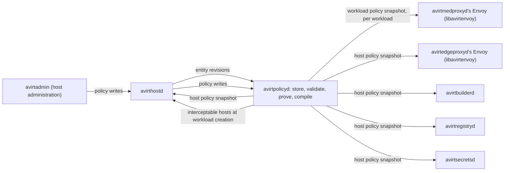

# Status: planned

The current code has no policy engine. The CONNECT app allows every destination that passes the private-address block and logs it under rule `allow-all` (see [egress](./egress.md#pingora-connect-app)).

Egress, ingress and control-plane policy is Cedar. avirtpolicyd stores the policies, validates them against the avirt Cedar schema, runs the Cedar policy prover over them, compiles them, and distributes versioned policy snapshots. Each enforcement point holds a policy snapshot and evaluates it locally with the embedded `cedar-policy` crate, so no request waits on a policy call. Credential bindings are not policy: they are records in avirtsecretsd (see [egress credentials](./egress-credentials.md#bindings)), and policy governs only which workloads may attach them (`attach_binding`).

## Enforcement points

| Point | Policy snapshot | Actions | Principal |
| --- | --- | --- | --- |
| avirtmedproxyd's Envoy (libavirtenvoy) | The workload policy snapshot | `resolve`, `connect`, `intercept`, `passthrough` and `request` for its workload's egress, and `ingress` for connections to its workload's published ports | Its own `Workload` for egress, the caller in `x-avirt-caller` for `ingress` |
| avirtedgeproxyd's Envoy (libavirtenvoy) | The host policy snapshot | `resolve` for its DNS proxy, and `connect` for every stream on its egress and peer listeners: workload-to-workload, services, host-local services, external endpoints, the `/guest-cli` stream, peered names, and every host service's off-host connection | The caller's SVID: a local `Workload`, a peer `Workload`, or a `HostService`, plus the originating principal for a call that a gateway or avirtapid makes on a caller's behalf |
| avirthostd | The host policy snapshot | Workloads, labels, bindings, ports, services, namespaces, peers, sessions, logs and `launch_workspace`, and host administration (see [actions](#actions)) | The caller: a `Workload` through `guest-cli`, a `User` through avirtapid, `Admin` on the admin socket, or a `HostService` |
| avirtsecretsd | The host policy snapshot | `read_secret`, `manage_secret`, `manage_provider` and `manage_binding` (see [secrets](./secrets.md#cedar)) | avirtmedproxyd's `Workload`, a gateway's or host service's `HostService`, or `Admin` |
| avirtbuilderd | The host policy snapshot | `build_workspace`, `watch_workspace`, `inspect_build`, `cancel_build`, `inspect_watch` and `unwatch_workspace` (see [workspace builds](./workspace-build.md#policy)) | The caller avirtapid forwards, or `HostService::"avirtbuilderd"` |
| avirtregistryd | The host policy snapshot | `push_workspace`, `pull_workspace`, `import_workspace`, `export_workspace` and `delete_workspace` (see [workspace registry](./workspace-registry.md#policy)) | The caller avirtapid forwards, a `HostService`, or a build job's `Workload` |

Each CLI's commands map to these actions in its API and policy map: [operator CLI](./operator-cli.md#api-and-policy-map), [admin CLI](./admin-cli.md#api-and-policy-map) and [guest CLI](./guest-cli.md#api-and-policy-map).

A connection between two workloads is evaluated at three points: the source avirtmedproxyd's `connect` against the source workload's policy snapshot, avirtedgeproxyd's `connect` against the host policy snapshot, and the destination avirtmedproxyd's `ingress` against the destination workload's policy snapshot. Between hosts, each host's avirtedgeproxyd evaluates its own host policy snapshot. Every point must permit the connection.

The gateways evaluate no Cedar. avirtmodelgwd applies its per-workload model rules and budgets, and avirtmcpgwd its per-workload tool scope (see [components](./components.md#policy-and-credential-placement)).



## Schema

The avirt Cedar schema has one version number, which every policy snapshot names. A policy set validates against it in Cedar's strict mode before the prover sees it. Every avirt action is in this one schema, including the workspace actions that [workspaces](./workspaces.md#policy), [workspace builds](./workspace-build.md#policy) and [workspace registry](./workspace-registry.md#policy) describe and avirtsecretsd's actions that [secrets](./secrets.md#cedar) describes.

### Entities

| Entity | Id | Parents | Attributes | Tags |
| --- | --- | --- | --- | --- |
| `Host` | `<td>`, the host itself, keyed by its trust domain: the resource of host-scoped actions | None | None | None |
| `Peer` | `<host>`, an enrolled peer (see [peering](./peering.md#entities)) | None | `trust_domain` | None |
| `Namespace` | `<ns>` on this host, `<host>/<ns>` for an enrolled peer's namespace | Its `Peer`, for a peer's namespace | None | None |
| `Workload` | `<ns>/<uuid>`, keyed by the workload's canonical UUIDv7 (see [components](./components.md#workload-ids)), or `<host>/<ns>/<uuid>` for a peer's workload | Its `Namespace` | `agent` (`claude` or `codex`), absent for a workload that runs no agent, such as a build job | Its labels |
| `Service` | `<ns>/<name>`, a service keyed by its name | Its `Namespace` | `backend` (`workload` or `host-local`) | Its labels |
| `HostService` | `<name>`, an avirt host service such as `avirtapid` or `avirtmodelgwd`, or `<host>/<name>` for an enrolled peer's component, such as `<host>/avirthostd` calling `Workloads/KeepAlive` (see [peering](./peering.md#workload-management-across-hosts)) | None | None | None |
| `Admin` | `uid:<uid>`, the avirtadmin caller authenticated by peer credentials | None | None | None |
| `User` | A local or web UI user, the caller avirtapid forwards for avirt and avirtwebd. Its id form is open (see [components](./components.md#open-questions)). | None | None | None |
| `Destination` | `<host>:<port>` or `<ip>:<port>`, an external endpoint | None | `host` (canonicalized) or `ip` (an `ipaddr`), `port`, `kind` (`external` or `model`) | None |
| `DnsName` | `<host>`, a public name in a DNS query | None | `host` (canonicalized) | None |
| `Secret` | `<scope>/<name>`, a secret in avirtsecretsd (see [secrets](./secrets.md#secrets-and-references)) | Its `Namespace`, none for a host-scoped secret | `provider`, `kind` | Its tags |
| `Binding` | `<id>`, a credential binding in avirtsecretsd | None | `injector` (`avirtmodelgwd`, `avirtmcpgwd` or `mediator`), `secret` | None |
| `WorkspaceRepository` | `<ns>/<name>` (see [workspaces](./workspaces.md#policy)) | Its `Namespace` | None | None |
| `WorkspaceImage` | `<ns>/<name>@<digest>` | Its `WorkspaceRepository` | `producer`, `provenance`, `base`, `source`, `revision`, `trigger` | Its manifest annotations |

Constraints:

- A peer's `Workload` carries no attributes and no tags. avirtedgeproxyd builds it from the identity the peer's avirtedgeproxyd asserts, qualified by that peer's host, and nothing else about it is known locally.
- A workload's short ID, alias and generated name are not attributes. They are DNS handles only, and name resolution maps each of them to the entity before evaluation (see [name resolution](#name-resolution)).
- The id form of a `User` principal, local or web UI, is open (see [components](./components.md#open-questions)).

### Tags

A workload's or service's labels are its entity tags, with string values. Policies read them with `hasTag` and `getTag`. Keys under `avirt.internal/` are set only by avirthostd:

| Key | Value |
| --- | --- |
| `avirt.internal/creator` | The creator's UUIDv7, or the local or web UI user |
| `avirt.internal/root` | The user at the top of the delegation chain |
| `avirt.internal/build` | The build id, on a build job |
| `avirt.internal/workspace` | The workspace repository, on a build job |

A label is not a trust boundary by itself: a policy that keys on a label trusts whoever may set that key, which `set_label` governs.

### Actions

Every control-plane action carries `via` in its context, except avirtsecretsd's administration actions, which avirtadmin alone reaches through avirthostd. An action that names a session takes the ACP session id in `session`, and one that omits it applies to every session of the workload.

| Action | Evaluated by | Principal | Resource | Context |
| --- | --- | --- | --- | --- |
| `resolve` | avirtmedproxyd, avirtedgeproxyd | `Workload`, `HostService` | An avirt name's entity (`Workload`, `Service`, or a peer's `Namespace`), or a `DnsName` | `qtype` (the query type, such as `A`, `AAAA` or `HTTPS`), `via` |
| `connect` | avirtmedproxyd, avirtedgeproxyd | `Workload`, `HostService` | An avirt name's entity, a peer's `Namespace`, `Peer::"<host>"` for a control-plane call to a peer (see [peering](./peering.md)), `HostService::"avirtapid"` for the `/guest-cli` stream, or a `Destination` | `port`, `via` |
| `intercept` | avirtmedproxyd | `Workload` | `Destination` on port 443 | None |
| `passthrough` | avirtmedproxyd | `Workload` | `Destination` | `plaintext` |
| `request` | avirtmedproxyd | `Workload` | `Destination` | `method`, `path` (canonicalized), `query` (whether the target had a query string) |
| `ingress` | Destination avirtmedproxyd | The caller in `x-avirt-caller`: `Workload` or `HostService` | The destination `Workload` | `port`, `protocol` (`tcp` or `http`) |
| `create_workload` | avirthostd | The caller | The new workload's `Namespace` | `via`, `depth` (the new workload's delegation chain depth), `detached`, `agent` |
| `list_workloads` | avirthostd | The caller | `Namespace` | `via` |
| `inspect_workload`, `stop_workload`, `delete_workload` | avirthostd | The caller | The target `Workload` | `via` |
| `extend_sandbox` | avirthostd, per path at creation (see [sandbox](./sandbox.md#extra-sandbox-paths)) | The caller | The new workload's `Namespace` | `via`, `path`, `access` (`read` or `write`) |
| `set_label` | avirthostd, per label at creation | The caller | The workload's or service's `Namespace` | `via`, `key`, `value` |
| `attach_binding` | avirthostd, per binding at creation | The caller | `Binding` | `via`, `namespace` (the new workload's `Namespace`) |
| `publish_port` | avirthostd | The caller | The publishing `Workload` | `via`, `port`, `protocol` |
| `unpublish_port` | avirthostd | The caller | The publishing `Workload` | `via`, `port` |
| `publish_service` | avirthostd | The caller | The `Service` the record creates | `via`, `port`, `backend` (`workload` or `host-local`), `backend_address` for a host-local backend |
| `list_services` | avirthostd | The caller | `Namespace` | `via` |
| `inspect_service`, `delete_service` | avirthostd | The caller | `Service` | `via` |
| `list_namespaces`, `list_peers` | avirthostd | The caller | `Host` | `via` |
| `inspect_namespace` | avirthostd | The caller | `Namespace` | `via` |
| `attach_session` | avirthostd, before it forwards the session control API (see [ACP](./acp.md#session-control-api)) | The caller | The session's `Workload` | `via`, `session` |
| `prompt_session`, `cancel_session`, `answer_permission`, `end_session` | avirthostd, per operation | The caller | The session's `Workload` | `via`, `session` |
| `read_log` | avirthostd, per call | The caller | The target `Workload` | `via`, `source` (`acp`, `egress`, `meta` or `stdio`) |
| `launch_workspace` | avirthostd, at launch order step 1 | The caller | `WorkspaceImage` | `via`, `namespace`, `agent`, `workload_image`, `allow_local` |
| `inspect_host`, `drain_host`, `read_audit` | avirthostd | `Admin` | `Host` | `via` |
| `create_namespace`, `delete_namespace` | avirthostd | `Admin` | The `Namespace` | `via` |
| `read_policy` | avirthostd | `Admin` | `Host` | `via`, `set` when one set is named |
| `write_policy` | avirthostd, before it forwards the write to avirtpolicyd | `Admin` | `Host` | `via`, `set` |
| `set_policy_mode` | avirthostd | `Admin` | `Host` | `via`, `mode` (`audit` or `enforce`), `namespace` when it sets one namespace's mode rather than the host default |
| `enroll_peer`, `update_peer`, `revoke_peer` | avirthostd | `Admin` | The `Peer` | `via` |
| `inspect_peer` | avirthostd | The caller | `Peer` | `via` |
| `rotate_ca` | avirthostd | `Admin` | `Host` | `via`, `tier` (`issuing` or `root`) |
| `read_secret` | avirtsecretsd, per lease | `Workload` (avirtmedproxyd's workload), `HostService` | `Secret` | `via` (`mediator`, `gateway` or `service`), `binding` |
| `manage_secret` | avirtsecretsd | `Admin` | `Secret` | `operation` (`define`, `update`, `rotate`, `revoke`, `import`, `login` or `list`) |
| `manage_provider` | avirtsecretsd | `Admin` | `Host` | `operation` (`define`, `remove`, `list` or `status`), `provider` |
| `manage_binding` | avirtsecretsd | `Admin` | `Binding` | `operation` (`define`, `list` or `remove`) |
| `build_workspace`, `watch_workspace` | avirtbuilderd | The caller, or `HostService::"avirtbuilderd"` for a prebuild | `WorkspaceRepository` | `via`, and the build or watch context in [workspace builds](./workspace-build.md#policy) |
| `inspect_build`, `cancel_build` | avirtbuilderd | The caller | The build's `WorkspaceRepository` | `via`, `build` (the build id) |
| `inspect_watch`, `unwatch_workspace` | avirtbuilderd | The caller | The watched `WorkspaceRepository` | `via`, `prebuild_policy` |
| `push_workspace`, `import_workspace`, `export_workspace` | avirtregistryd | The caller, or a `HostService` | `WorkspaceRepository` | `via`, and the context in [workspace registry](./workspace-registry.md#policy). For an import from a peer, `registry` is `peer:<host>` (see [peering](./peering.md#workspace-images)). |
| `pull_workspace`, `delete_workspace` | avirtregistryd | The caller, a `HostService`, or a build job's `Workload` | `WorkspaceImage` | `via`, and `purpose` for `pull_workspace`: `client`, `launch`, `build-input`, `include`, or `peer-import` for a peer importing the image |

`via` names the path a request came by:

| Value | Meaning |
| --- | --- |
| `egress` | The workload's own CONNECT or DNS query |
| `guest-cli` | The workload's `guest-cli` principal, through avirtapid |
| `gateway` | An upstream connection that avirtmodelgwd or avirtmcpgwd makes for a workload, evaluated for both the gateway and the workload |
| `service` | A host service's own connection |
| `client` | A `User`, through avirtapid |
| `admin` | avirtadmin, on avirthostd's admin socket |
| `mediator` | avirtmedproxyd's Envoy reading its workload's binding values, for `read_secret` |

### Schema text

```cedarschema
entity Host;

entity Peer {
  trust_domain: String,
};

entity Namespace in [Peer];

entity Workload in [Namespace] {
  agent?: String,
} tags String;

entity Service in [Namespace] {
  backend: String,
} tags String;

entity HostService;

entity Admin;

entity User;

entity Destination {
  host?: String,
  ip?: ipaddr,
  port: Long,
  kind: String,
};

entity DnsName {
  host: String,
};

entity Secret in [Namespace] {
  provider: String,
  kind: String,
} tags String;

entity Binding {
  injector: String,
  secret: Secret,
};

entity WorkspaceRepository in [Namespace];

entity WorkspaceImage in [WorkspaceRepository] {
  producer: String,
  provenance: String,
  base: String,
  source?: String,
  revision?: String,
  trigger: String,
} tags String;

type Caller = { via: String };

type Session = { via: String, session?: String };

// Data plane: avirtmedproxyd and avirtedgeproxyd

action resolve appliesTo {
  principal: [Workload, HostService],
  resource: [Workload, Service, Namespace, DnsName],
  context: { qtype: String, via: String },
};

action connect appliesTo {
  principal: [Workload, HostService],
  resource: [Workload, Service, Namespace, Peer, HostService, Destination],
  context: { port: Long, via: String },
};

action intercept appliesTo {
  principal: [Workload],
  resource: [Destination],
  context: {},
};

action passthrough appliesTo {
  principal: [Workload],
  resource: [Destination],
  context: { plaintext: Bool },
};

action request appliesTo {
  principal: [Workload],
  resource: [Destination],
  context: { method: String, path: String, query: Bool },
};

action ingress appliesTo {
  principal: [Workload, HostService],
  resource: [Workload],
  context: { port: Long, protocol: String },
};

// avirthostd: workloads, ports, services, namespaces, peers, sessions and logs

action create_workload appliesTo {
  principal: [Workload, HostService, Admin, User],
  resource: [Namespace],
  context: { via: String, depth: Long, detached: Bool, agent?: String },
};

action list_workloads, list_services appliesTo {
  principal: [Workload, HostService, Admin, User],
  resource: [Namespace],
  context: Caller,
};

action inspect_workload, stop_workload, delete_workload appliesTo {
  principal: [Workload, HostService, Admin, User],
  resource: [Workload],
  context: Caller,
};

action extend_sandbox appliesTo {
  principal: [Workload, HostService, Admin, User],
  resource: [Namespace],
  context: { via: String, path: String, access: String },
};

action set_label appliesTo {
  principal: [Workload, HostService, Admin, User],
  resource: [Namespace],
  context: { via: String, key: String, value: String },
};

action attach_binding appliesTo {
  principal: [Workload, HostService, Admin, User],
  resource: [Binding],
  context: { via: String, namespace: Namespace },
};

action publish_port appliesTo {
  principal: [Workload, HostService, Admin, User],
  resource: [Workload],
  context: { via: String, port: Long, protocol: String },
};

action unpublish_port appliesTo {
  principal: [Workload, HostService, Admin, User],
  resource: [Workload],
  context: { via: String, port: Long },
};

action publish_service appliesTo {
  principal: [Workload, HostService, Admin, User],
  resource: [Service],
  context: { via: String, port: Long, backend: String, backend_address?: String },
};

action inspect_service, delete_service appliesTo {
  principal: [Workload, HostService, Admin, User],
  resource: [Service],
  context: Caller,
};

action list_namespaces, list_peers appliesTo {
  principal: [Workload, HostService, Admin, User],
  resource: [Host],
  context: Caller,
};

action inspect_namespace appliesTo {
  principal: [Workload, HostService, Admin, User],
  resource: [Namespace],
  context: Caller,
};

action attach_session, prompt_session, cancel_session, answer_permission, end_session appliesTo {
  principal: [Workload, HostService, Admin, User],
  resource: [Workload],
  context: Session,
};

action read_log appliesTo {
  principal: [Workload, HostService, Admin, User],
  resource: [Workload],
  context: { via: String, source: String },
};

action launch_workspace appliesTo {
  principal: [Workload, HostService, Admin, User],
  resource: [WorkspaceImage],
  context: { via: String, namespace: Namespace, agent: String, workload_image: String, allow_local: Bool },
};

// avirthostd: host administration, for Admin only

action inspect_host, drain_host, read_audit appliesTo {
  principal: [Admin],
  resource: [Host],
  context: Caller,
};

action create_namespace, delete_namespace appliesTo {
  principal: [Admin],
  resource: [Namespace],
  context: Caller,
};

action read_policy appliesTo {
  principal: [Admin],
  resource: [Host],
  context: { via: String, set?: String },
};

action write_policy appliesTo {
  principal: [Admin],
  resource: [Host],
  context: { via: String, set: String },
};

action set_policy_mode appliesTo {
  principal: [Admin],
  resource: [Host],
  context: { via: String, mode: String, namespace?: Namespace },
};

action enroll_peer, update_peer, revoke_peer appliesTo {
  principal: [Admin],
  resource: [Peer],
  context: Caller,
};

action inspect_peer appliesTo {
  principal: [Workload, HostService, Admin, User],
  resource: [Peer],
  context: Caller,
};

action rotate_ca appliesTo {
  principal: [Admin],
  resource: [Host],
  context: { via: String, tier: String },
};

// avirtsecretsd

action read_secret appliesTo {
  principal: [Workload, HostService],
  resource: [Secret],
  context: { via: String, binding?: Binding },
};

action manage_secret appliesTo {
  principal: [Admin],
  resource: [Secret],
  context: { operation: String },
};

action manage_provider appliesTo {
  principal: [Admin],
  resource: [Host],
  context: { operation: String, provider?: String },
};

action manage_binding appliesTo {
  principal: [Admin],
  resource: [Binding],
  context: { operation: String },
};

// avirtbuilderd

action build_workspace appliesTo {
  principal: [Workload, HostService, Admin, User],
  resource: [WorkspaceRepository],
  context: {
    via: String,
    kind: String,
    source_types: Set<String>,
    source_hosts: Set<String>,
    github_owners: Set<String>,
    includes: Set<String>,
    provenance: String,
    config_source: String,
    secret_allows: Set<String>,
    trigger: String,
    ref: String,
    owner: String,
    prebuild_policy?: String,
  },
};

action watch_workspace appliesTo {
  principal: [Workload, HostService, Admin, User],
  resource: [WorkspaceRepository],
  context: { via: String, repository: String, config: String, events: Set<String>, schedule?: String },
};

action inspect_build, cancel_build appliesTo {
  principal: [Workload, HostService, Admin, User],
  resource: [WorkspaceRepository],
  context: { via: String, build: String },
};

action inspect_watch, unwatch_workspace appliesTo {
  principal: [Workload, HostService, Admin, User],
  resource: [WorkspaceRepository],
  context: { via: String, prebuild_policy: String },
};

// avirtregistryd

action push_workspace appliesTo {
  principal: [Workload, HostService, Admin, User],
  resource: [WorkspaceRepository],
  context: { via: String, producer: String },
};

action pull_workspace appliesTo {
  principal: [Workload, HostService, Admin, User],
  resource: [WorkspaceImage],
  context: { via: String, purpose: String },
};

action import_workspace appliesTo {
  principal: [Workload, HostService, Admin, User],
  resource: [WorkspaceRepository],
  context: { via: String, registry: String, reference: String },
};

action export_workspace appliesTo {
  principal: [Workload, HostService, Admin, User],
  resource: [WorkspaceRepository],
  context: { via: String, registry: String, reference: String, allow_local: Bool },
};

action delete_workspace appliesTo {
  principal: [Workload, HostService, Admin, User],
  resource: [WorkspaceImage],
  context: Caller,
};
```

## Name resolution

Before evaluating any policy, the enforcing Envoy (avirtedgeproxyd's for workload-to-workload connections and services, avirtmedproxyd's for its own decisions) parses an avirt destination name and resolves it to a canonical Cedar entity:

- `7e759259.team-a.workload.host.avirt.internal`, `build-7e759259.team-a.workload.host.avirt.internal` and `quietly-brave-otter.team-a.workload.host.avirt.internal` all resolve to `Workload::"team-a/0192f3a4-5b6c-7d8e-9f01-23457e759259"`, the entity keyed by the workload's UUIDv7 whose short ID is `7e759259`, whose parent is `Namespace::"team-a"` on this host;
- the `default` namespace's short form, `7e759259.workload.host.avirt.internal`, resolves to the same entity as its long form;
- `db.team-a.svc.host.avirt.internal` and every alias of that service resolve to `Service::"team-a/db"`;
- a peered name, `7e759259.team-a.workload.<host>` or `db.team-a.svc.<host>`, resolves locally to the peer's `Namespace::"<host>/team-a"`, because only the peer maps its own short IDs and aliases; the peer's avirtedgeproxyd resolves the name to its own entity and evaluates its own host policy snapshot;
- a name with an invalid label, or one longer than the caps in [DNS](./dns.md#avirt-names), is malformed;
- a name that resolves to no known entity is denied before policy evaluation, in both modes.

Rules about namespaces are written on entities, for example `principal in Namespace::"team-a"` and `resource in Namespace::"team-a"`, never as string patterns over avirt names. `Namespace::"<host>/team-a" in Namespace::"<host>/team-a"` holds, so `resource in Namespace::"<host>/team-a"` matches every peered name in that namespace, and a peer's namespaces are in its `Peer`, so `resource in Peer::"<host>"` matches every peered name of that host.

An authority that names an avirt host service, such as `avirtsecretsd.svc.<td>`, never reaches policy: avirtmedproxyd refuses it with 403 (see [egress](./egress.md#avirtmedproxyd-pipeline)).

### External host canonicalization

Every external host is canonicalized once, at the point that parses it, and every later check uses the canonical form:

1. The authority must be ASCII. A client sends an internationalized name in its A-label (`xn--`) form, and a non-ASCII authority is malformed (400 `bad-request`).
2. It is lowercased, and one trailing dot is stripped.
3. Each label is 1 to 63 characters of `a`-`z`, `0`-`9`, `-` and `_`, and the whole name is at most 253 characters. Anything else is malformed.
4. A name whose last label is all digits must be a canonical dotted quad, and becomes an IP literal. `2130706433`, `0177.0.0.1`, `0x7f000001` and `127.1` are malformed.
5. An IPv6 literal arrives bracketed (`[2001:db8::1]:443`) and is parsed into an `ipaddr`. An IPv4-mapped or IPv4-compatible IPv6 literal is refused by the private-address block.

An IP literal becomes a `Destination` with `ip` and no `host`, so no hostname rule and no `like` pattern can match it: it is permitted only by a policy that compares `resource.ip`, by equality or with `isInRange`.

The SNI under TLS passthrough and the `Host` header under TLS interception are canonicalized the same way, and must equal the canonical CONNECT host (`Host` may omit a default port). The caller's spelling of the CONNECT authority, SNI or `Host` therefore cannot change the outcome.

### Request path canonicalization

`context.path` for `request` is the request target's path after canonicalization:

1. The target must be in origin form (`/…`). An absolute or asterisk form is refused with 400.
2. The query string is dropped, and `context.query` records whether there was one.
3. Percent-encoded unreserved characters (`A`-`Z`, `a`-`z`, `0`-`9`, `-`, `.`, `_`, `~`) are decoded, and other percent-encodings are uppercased and kept, so `%2F` stays `%2F` and never becomes a segment separator.
4. Dot segments are removed after that decoding.
5. A path with an encoded dot segment that survives step 4, a backslash, a NUL, any other control character, or an empty segment (`//`) is refused with 400.

The upstream receives the canonical path with the original query string. The path in the `http` event is the canonical path.

### Restrictions on `like`

The prover rejects any policy that uses `like` anywhere except these two operands:

| Operand | Pattern form |
| --- | --- |
| `resource.host` of a `Destination` or `DnsName` | An exact name with no `*`, or `*.` followed by a suffix of at least two labels, with no other `*`. `*.github.com` matches every name under `github.com` and not `github.com` itself. |
| `context.path` of `request` | Any pattern. `*` matches any characters, `/` included. |

The host form maps each pattern to exactly one DNS subtree, which is what makes the MITM CA's name constraints exact (see [MITM CA name constraints](#mitm-ca-name-constraints)). No pattern applies to an avirt name, a label value or an IP literal.

## Decision semantics

Cedar's own semantics apply to every decision: a request is denied unless some `permit` applies, and any applicable `forbid` overrides every `permit`. On top of that:

- A Cedar evaluation error is a deny, in both modes, even when the erroring policy is a `permit`.
- Every policy carries a unique `@id`. The event's `rule` is the `@id` of a determining policy, the lexicographically first when several determine the decision.
- A decision that no policy determined records a reserved rule name instead: `default-deny` (no permit applied), `unknown-name` (an avirt name that resolves to no entity), `evaluation-error`, or `snapshot-expired`. The prover rejects a policy whose `@id` is a reserved rule name.

For one agent connection avirtmedproxyd evaluates, in order:

| Step | Action | Question | On permit | On deny |
| --- | --- | --- | --- | --- |
| 1 | `resolve` | May the workload learn this name's address? Evaluated per DNS query, independently of any later CONNECT. | The answer is returned. | `NXDOMAIN`, in both modes |
| 2 | `connect` | May the workload reach this destination and port at all? | Continue | 403 `egress denied: <host>:<port>` |
| 3 | `intercept` | For an external endpoint or model API host on port 443, should avirtmedproxyd terminate the agent's TLS? | TLS interception | Evaluate `passthrough` |
| 4 | `passthrough` | May this external connection take TLS passthrough? `context.plaintext` is true for a connection that does not start with a TLS ClientHello. | TLS passthrough | 403 `egress denied: <host>:<port>` |
| 5 | `request` | On an intercepted connection, may this method and path be sent? Evaluated per request, including a websocket upgrade request. | The request is forwarded. | 403 `request denied` |

Constraints:

- `intercept` grants no reachability. A permitted `intercept` without a permitted `connect` reaches nothing.
- `intercept` is evaluated only on port 443. On any other port an external connection must be permitted by `passthrough`.
- An avirt name never reaches step 3: it always takes TLS passthrough, and avirtedgeproxyd and the destination avirtmedproxyd authorize it.
- A model API host under TLS passthrough goes to avirtedgeproxyd like any external endpoint and carries no credential, because credentials are injected only on intercepted requests (see [egress credentials](./egress-credentials.md#credential-injectors)).
- `request` sees only intercepted connections. A passthrough connection is governed by `connect` and `passthrough` alone, and its bytes are never inspected.
- The `ingress` decision at the destination avirtmedproxyd is independent of the publication: a published port is reachable only by callers that both the host policy snapshot and the destination's `ingress` permit.

## Modes

Every policy snapshot carries a mode, `audit` or `enforce`. The host configuration sets a mode per namespace, with a host default for namespaces it does not name. A workload policy snapshot carries its namespace's mode. The host policy snapshot carries the host default and the per-namespace modes, and avirtedgeproxyd applies the mode of the caller's namespace to a workload caller, and the host default to a host service and a peer.

In audit mode, a decision with no permit, or with a forbid, is allowed and logged as `would-deny`, with the rule that would have decided. In enforce mode it is denied and logged as `deny`. A mode change is a new policy snapshot, and it applies to open connections through [revocation](#revocation-of-open-flows).

These apply as evaluated in both modes:

- `resolve` decisions, so a denied name never leaves the mediator;
- `intercept` decisions, so audit mode never changes which connections are terminated;
- every action that avirthostd, avirtbuilderd, avirtregistryd and avirtsecretsd evaluate, so audit mode never widens control-plane authority or credential access;
- a deny for `unknown-name`, `evaluation-error` or `snapshot-expired`.

These non-policy checks are not policy and apply in both modes: authority parsing and canonicalization (400), the private-address block (403 `private-dest`), `Host` and SNI matching (421 and close), the placeholder misuse check (403 `credential-misplaced`), credential bindings (a credential is injected only on its own binding), the Codex refresh intercept's exact match, caller authentication and generation fencing.

## Policy snapshots

### Contents

A policy snapshot has a scope, one workload or the host, and carries:

- `scope`, `workload:<uuid>` or `host`;
- `version`, increasing within its scope and never reused, including across avirtpolicyd restarts, because avirtpolicyd keeps the last version per scope in its state directory;
- `schema`, the avirt Cedar schema version;
- `mode`, and in the host policy snapshot the per-namespace modes;
- `issued` and `lifetime`;
- the compiled policy set and its sha256;
- the entity revision it was built against, and the entities it carries;
- the peer table, which maps each enrolled peer's trust domain to its peer host name, so that a caller's SPIFFE ID in `x-avirt-caller` resolves to a qualified entity. Every workload policy snapshot and the host policy snapshot carry it.

### Building

avirthostd owns the entities: namespaces, workloads, services and their labels, and the `Peer` entities and peer namespaces it builds from its enrollment records (see [peering](./peering.md#enrollment-record)). It sends avirtpolicyd each new entity revision, numbered in one increasing sequence, and enrolling, updating or revoking a peer is a new revision. A peer's workloads and host services never come from an entity revision: avirtedgeproxyd builds them from the identity a peer's avirtedgeproxyd asserts, in that peer's `Peer` and namespace.

Policies are grouped in policy sets. The host policy set applies to every decision on the host. A named policy set applies to a workload only when the workload's configuration references it, and the reference is immutable for the workload's life (see [workload management](./components.md#workload-management) for which references a creator may assign). Policy writes are host administration, through avirtadmin.

- **Workload policy snapshot.** avirtpolicyd builds it from the host policy set, the policy sets the workload's configuration references, and the current entity revision. It carries the workload's own entity and the entities its decisions can involve: the workloads and services of every namespace that some policy in the set can let the workload reach or be reached from, as the prover determines. A decision that names an entity the policy snapshot lacks resolves to no entity and is denied.
- **Host policy snapshot.** avirtpolicyd builds it from the host policy set, every referenced policy set with each of its policies scoped to the workloads whose configuration references it, and the full entity revision.

A new policy snapshot is built for every policy write that changes a set the scope uses, every entity revision that changes an entity the scope carries, and every mode change. Every decision sees one consistent policy and entity state.

### Distribution

avirtpolicyd streams policy snapshots over its host service listener, authenticated as `/service/avirtpolicyd`:

- libavirtenvoy in each avirtmedproxyd Envoy subscribes, through avirthostd's SNI routing, to its own workload's scope, as the workload and generation in its SVID. It gets no other scope.
- avirtedgeproxyd, avirthostd, avirtbuilderd, avirtregistryd and avirtsecretsd subscribe to the host scope.

A subscription names the version the subscriber holds, and avirtpolicyd sends the current policy snapshot whenever it is newer. Every policy snapshot is sent whole, never as a delta. The subscriber acknowledges each version it applies or rejects, with the reason, and avirtpolicyd records each subscriber's applied version, so the time from a write to its enforcement at every point is observable.

A new workload's policy snapshot is built at launch, after avirthostd registers the workload with avirtpolicyd (see [lifecycle](./lifecycle.md#launch-order)), and the workload's mediator never sends `confirm` before libavirtenvoy has applied it (see [workload topology](./workload-topology.md#launch-handshake)). Deregistration at teardown ends the workload's scope.

### Validation and versioning

Each subscriber validates a new policy snapshot completely before applying it:

- its scope is the one subscribed to;
- its schema version is supported;
- the policy set's sha256 matches;
- its version is higher than the current one.

It then swaps it in atomically. Every decision uses exactly one policy snapshot, and its event records that policy snapshot's `version` as `policy_version`. A policy snapshot that fails validation is rejected whole, and the current one stays in force.

### Expiry

`lifetime` is a host setting, 1 h by default. A subscriber measures expiry on its own monotonic clock from the moment it applied the policy snapshot, so a guest clock that drifts cannot extend or shorten it. avirtpolicyd reissues every policy snapshot at half its lifetime with a new version, even when nothing changed. An expired policy snapshot denies every new connection, request and DNS query and every control-plane action, in both modes, until a valid one applies.

## Revocation of open flows

When a new policy snapshot applies, or the current one expires, each Envoy re-evaluates every open connection against the new state:

- **avirtmedproxyd, egress.** The connection's `connect`, and `intercept` or `passthrough` for its path. A connection whose path the new state would change is closed: an intercepted connection that is no longer permitted `intercept` is closed even if `passthrough` now permits it, and the client reconnects onto the new path. An upgraded websocket connection is also re-evaluated for its upgrade request's `request`.
- **avirtmedproxyd, ingress.** Every open inbound connection's `ingress`.
- **avirtedgeproxyd.** Every open stream's `connect`, for each principal it was evaluated for.

Each connection the new state denies in enforce mode is closed at once: its CONNECT stream gets `RST_STREAM`, and its `conn` event records `error: "revoked"` with the deciding rule and the new `policy_version`. In audit mode it stays open and a `would-deny` event is written.

A model API stream to avirtmodelgwd gets a grace of 15 minutes before it is closed, at avirtmedproxyd and, for the gateway's upstream connection, at avirtedgeproxyd. Every other connection gets none.

Revocation also follows from changes outside policy:

- a superseded mediator generation's connections are closed once its successor is confirmed (see [identity](./identity.md#authorization));
- a revoked or expired port publication closes its open ingress streams (see [workload topology](./workload-topology.md#ingress));
- an ended workload's connections end with it, and its entity leaves the next entity revision, so every name that resolved to it now resolves to none;
- a withdrawn credential binding stops resolving, without closing connections (see [egress credentials](./egress-credentials.md#rotation-and-revocation)).

## The prover

The prover runs inside avirtpolicyd on every candidate policy set before any policy snapshot is built from it. A set that fails any check produces no policy snapshot, the write is refused with the failing check named, and the current policy snapshots stay in force. The prover has a time bound per check, a host setting, and a check it cannot decide within it fails.

### Checks

1. **Validation.** The set validates against the schema in strict mode.
2. **Ids.** Every policy has an `@id`, unique across every set that can apply together, and none is a reserved rule name.
3. **`like`.** Every `like` is on an allowed operand with an allowed pattern form (see [restrictions on `like`](#restrictions-on-like)).
4. **Policy invariants.** The set satisfies every invariant the host policy declares.

The prover reasons symbolically over the schema, so its results hold for every request and every entity state the schema admits, and it reasons precisely about entity-hierarchy membership such as `in Namespace::"team-a"`.

### Policy invariants

A policy invariant is itself written in Cedar, as one of:

| Kind | Holds when |
| --- | --- |
| Permissions boundary | Within the invariant's scope, the candidate set permits no request that the boundary set does not also permit. |
| Required allow | Within the invariant's scope, the candidate set permits every request that the required set permits. |
| Guardrail | Within the invariant's scope, the candidate set permits no request. |

Each invariant has an id and a scope: one or more actions, and the principal and resource entity types it covers. A candidate policy annotated `@exempt("<invariant id>")` is left out of that invariant's check, and only host administration writes policies. For example, a permissions boundary scoped to `connect` from a `Workload` to a `Workload` or `Service` that permits only connections within a namespace states that no permit reaches a namespace from outside it unless a policy exempt from that invariant allows it. A required-allow invariant can keep the model API reachable for every agent workload, so that no referenced set can forbid it. A guardrail scoped to `create_workload` can rule out workload creation everywhere.

### MITM CA name constraints

When avirthostd creates a workload, it asks the prover for the set of hosts the workload's policy snapshot can permit `intercept` for, given the workload's own entity as principal. The prover computes it from the policies alone:

- each `permit` for `intercept` that can apply to the workload contributes the hosts its conditions allow: an exact `resource.host` contributes that name, and `*.<suffix>` contributes the subtree under `<suffix>`;
- a `permit` that does not constrain `resource.host` to such a set makes the set unbounded;
- where every `connect` permit that can apply also constrains the host, the set is intersected with the hosts `connect` can permit;
- a `forbid` for `intercept` whose only condition is a host constraint contributes excluded subtrees;
- `intercept` for an IP literal contributes the addresses or ranges its `resource.ip` conditions allow.

avirthostd then mints the CA (see [egress](./egress.md#mitm-ca-and-leaf-certificates)):

- **A bounded set.** The CA carries X.509 name constraints. Its permitted DNS subtrees are exactly the set's names and subtrees, and its excluded DNS subtrees are the excluded ones. Its permitted IP subtrees are the interceptable addresses, and with none, it excludes `0.0.0.0/0` and `::/0`, because a CA with only DNS constraints leaves IP names unconstrained. A leaf for any other name fails validation in the agent.
- **An empty set.** avirthostd issues no MITM CA, `confirm` carries none, and every external connection must be permitted by `passthrough`.
- **An unbounded set.** The CA carries no name constraints.

The constraints are fixed for the workload's life, because the CA serves every generation. libavirtenvoy also refuses to mint a leaf outside the CA's constraints, so a later policy snapshot that permits `intercept` for such a host cannot terminate its TLS: the connection takes TLS passthrough if `passthrough` is permitted for it, and is denied otherwise.

## Policy failure behavior

- An avirtmedproxyd Envoy without a policy snapshot is not ready, so avirtmediatord sends no `confirm` and no agent starts.
- avirtedgeproxyd without a host policy snapshot refuses every stream with 503, and avirthostd refuses every launch and control-plane call with 503. avirtbuilderd, avirtregistryd and avirtsecretsd refuse the calls they authorize with 503.
- When avirtpolicyd is unreachable, every subscriber keeps its current policy snapshot until it expires. An expired policy snapshot denies every new connection, request, DNS query and control-plane action, in both modes.
- When a new policy snapshot applies, or the current one expires, each Envoy re-evaluates its open flows (see [revocation of open flows](#revocation-of-open-flows)).
- A candidate policy set that fails the prover produces no policy snapshot, and the current one stays in force.
- A Cedar evaluation error is a deny, in both modes.
- An avirt name that resolves to no entity is a deny, in both modes, before evaluation.
- In audit mode, a decision with no permit, or with a forbid, is allowed and logged as `would-deny`, except for the exemptions in [modes](#modes). In enforce mode it is denied.
- The non-policy checks in [modes](#modes) apply in both modes.
- avirtedgeproxyd applies the same rules to the host policy snapshot.

## Worked examples

The `@id` annotation becomes the event's `rule`.

### Namespaces and workloads

Every workload in `team-a` may reach every workload and service in `team-a`. Only one workload may reach the `db` service. avirtedgeproxyd evaluates both, with the destination avirtmedproxyd's `ingress` as the third check.

```cedar
@id("team-a-internal")
permit (principal in Namespace::"team-a", action == Action::"connect", resource in Namespace::"team-a");

@id("team-a-internal-ingress")
permit (principal in Namespace::"team-a", action == Action::"ingress", resource in Namespace::"team-a");

@id("team-a-db-only-from-build")
forbid (principal, action == Action::"connect", resource == Service::"team-a/db")
unless { principal == Workload::"team-a/0192f3a4-5b6c-7d8e-9f01-23457e759259" };
```

### External destinations

Claude reaches the Anthropic API with intercepted TLS, so its placeholder is substituted at avirtmodelgwd. Codex reaches the ChatGPT backend and the OpenAI auth endpoint the same way, and downloads large artifacts from several `*.oaiusercontent.com` hosts at startup, which an enforce-mode policy has to permit, here under TLS passthrough.

```cedar
@id("anthropic")
permit (principal, action == Action::"connect", resource)
when { resource has host && resource.host == "api.anthropic.com" && resource.port == 443 };

@id("anthropic-http")
permit (principal, action == Action::"request", resource)
when {
  resource has host && resource.host == "api.anthropic.com" &&
  ((["GET", "POST"].contains(context.method) && context.path like "/v1/*") ||
   context.path like "/api/*")
};

@id("openai")
permit (principal, action in [Action::"connect", Action::"request"], resource)
when {
  principal has agent && principal.agent == "codex" &&
  resource has host && ["chatgpt.com", "api.openai.com", "auth.openai.com"].contains(resource.host)
};

@id("oai-content")
permit (principal, action == Action::"connect", resource)
when { resource has host && resource.host like "*.oaiusercontent.com" };

@id("oai-content-opaque")
forbid (principal, action == Action::"intercept", resource)
when { resource has host && resource.host like "*.oaiusercontent.com" };

@id("oai-content-passthrough")
permit (principal, action == Action::"passthrough", resource)
when { resource has host && resource.host like "*.oaiusercontent.com" && !context.plaintext };

@id("npm")
permit (principal, action in [Action::"connect", Action::"request"], resource)
when { resource has host && resource.host == "registry.npmjs.org" };

@id("github")
permit (principal in Namespace::"team-a", action in [Action::"connect", Action::"request"], resource)
when { resource has host && (resource.host == "github.com" || resource.host like "*.github.com") };
```

### Bounded interception

A broad `intercept` permit makes the set of interceptable hosts unbounded, so the workload's MITM CA carries no name constraints:

```cedar
@id("intercept-443")
permit (principal, action == Action::"intercept", resource)
when { resource has port && resource.port == 443 };
```

Naming the hosts bounds it. With these policies and the `oai-content-opaque` forbid above, the CA's permitted DNS subtrees are `api.anthropic.com`, `chatgpt.com`, `api.openai.com`, `auth.openai.com`, `registry.npmjs.org` and the subtree `github.com` (which also covers `github.com` itself), and its excluded subtree is `oaiusercontent.com`. Every IP address is excluded.

```cedar
@id("intercept-model-apis")
permit (principal, action == Action::"intercept", resource)
when {
  resource has host &&
  ["api.anthropic.com", "chatgpt.com", "api.openai.com", "auth.openai.com"].contains(resource.host)
};

@id("intercept-registries")
permit (principal, action == Action::"intercept", resource)
when { resource has host && (resource.host == "registry.npmjs.org" || resource.host like "*.github.com") };
```

### DNS

`resolve` is always enforced, so every name a workload looks up needs a permit, separately from `connect`. Here `team-a` resolves its own avirt names, the public names it may reach, and nothing else.

```cedar
@id("team-a-resolve-internal")
permit (principal in Namespace::"team-a", action == Action::"resolve", resource in Namespace::"team-a");

@id("team-a-resolve-public")
permit (principal in Namespace::"team-a", action == Action::"resolve", resource)
when {
  resource has host &&
  (resource.host == "github.com" || resource.host like "*.github.com" || resource.host == "registry.npmjs.org") &&
  ["A", "AAAA", "HTTPS"].contains(context.qtype)
};
```

### IP literals

An IP literal matches no hostname rule, so it needs its own permit on `resource.ip`.

```cedar
@id("internal-mirror")
permit (principal in Namespace::"team-a", action in [Action::"connect", Action::"passthrough"], resource)
when { resource has ip && resource.ip.isInRange(ip("203.0.113.0/24")) && resource.port == 443 };
```

### Workload management, labels and bindings

A `ci` workload in `team-a` manages workloads in `team-a` through the guest CLI, at most two levels deep, may set only `project` labels, and may attach only the GitHub binding. avirthostd still applies the constraints in [workload management](./components.md#workload-management): the child gets no binding the creator does not hold.

```cedar
@id("team-a-ci-manages-team-a")
permit (
  principal in Namespace::"team-a",
  action in [Action::"list_workloads", Action::"inspect_workload", Action::"stop_workload", Action::"delete_workload"],
  resource in Namespace::"team-a"
)
when { context.via == "guest-cli" && principal.hasTag("role") && principal.getTag("role") == "ci" };

@id("team-a-ci-creates")
permit (principal in Namespace::"team-a", action == Action::"create_workload", resource == Namespace::"team-a")
when { context.via == "guest-cli" && principal.hasTag("role") && principal.getTag("role") == "ci" && context.depth <= 2 };

@id("team-a-ci-labels")
permit (principal in Namespace::"team-a", action == Action::"set_label", resource == Namespace::"team-a")
when { context.via == "guest-cli" && context.key == "project" };

@id("team-a-ci-github-binding")
permit (principal in Namespace::"team-a", action == Action::"attach_binding", resource == Binding::"github-team-a")
when { context.via == "guest-cli" && context.namespace == Namespace::"team-a" };
```

### Ports and services

Workloads in `team-a` may publish port 8080 as HTTP. Only an administrator may publish a service with a host-local backend.

```cedar
@id("team-a-publish-8080")
permit (principal in Namespace::"team-a", action == Action::"publish_port", resource in Namespace::"team-a")
when { context.port == 8080 && context.protocol == "http" };

@id("host-local-services-admin-only")
forbid (principal, action == Action::"publish_service", resource)
when { context.backend == "host-local" }
unless { principal is Admin };
```

### Peers

Workloads in `team-a` may reach the `team-a` namespace of the peer `mac-studio.example.com`. On this host the destination is the peer's namespace. On `mac-studio.example.com`, the caller is the fully qualified `Workload::"<this host>/team-a/<uuid>"`, and the peer's own policy snapshot decides. The rest of the peering policy model is in [peering](./peering.md#policy).

```cedar
@id("team-a-to-mac-studio")
permit (principal in Namespace::"team-a", action in [Action::"resolve", Action::"connect"], resource in Namespace::"mac-studio.example.com/team-a");
```

### Permissions boundary

The boundary set of an invariant scoped to `connect` from a `Workload` to a `Workload` or `Service`: connections within `team-a` only. The prover checks every candidate set against it before any policy snapshot is built, leaving out the policies annotated `@exempt` with the invariant's id, such as `xns-team-a-to-shared` below. A boundary set is checked against, never distributed.

```cedar
@id("boundary-same-namespace")
permit (principal, action == Action::"connect", resource is Workload)
when { principal is Workload && principal in Namespace::"team-a" && resource in Namespace::"team-a" };

@id("boundary-same-namespace-services")
permit (principal, action == Action::"connect", resource is Service)
when { principal is Workload && principal in Namespace::"team-a" && resource in Namespace::"team-a" };
```

```cedar
@id("xns-team-a-to-shared")
@exempt("namespace-isolation")
permit (principal in Namespace::"team-a", action == Action::"connect", resource == Service::"shared/cache");
```

# Open questions

1. **Peered names below the namespace.** A peered name resolves locally to the peer's namespace, so local policy cannot distinguish one peer workload from another. Whether avirtedgeproxyd should resolve peered names to the peer's entities, through a lookup at the peer, is open (see [peering](./peering.md#evaluation-on-each-side)).
2. **Permissions boundaries over every namespace.** A permissions boundary is a Cedar policy set, and Cedar has no variable that binds the principal's namespace to the resource's, so the example names `team-a`. Whether avirtpolicyd generates one boundary per namespace from the entity revision, or the prover gains a built-in namespace isolation invariant, is open.
3. **Per-namespace modes for host services.** A host service's off-host connection is evaluated in the host default mode. Whether a component acting for a workload, such as avirtmodelgwd, should use the workload's namespace mode is open.
4. **Policy authorship.** Policy writes are host administration through avirtadmin. Whether namespace owners may write their own policy sets, bounded by a permissions boundary, is open.
