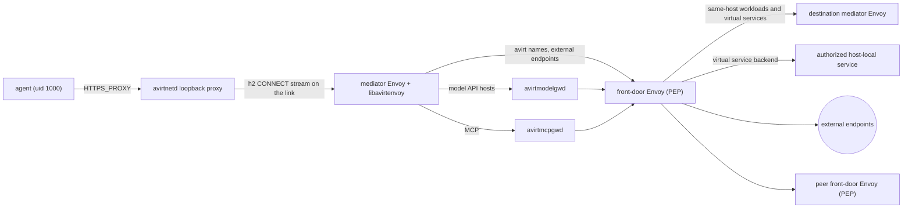

# Status: implemented

## Path

The workload runs with `--network none`, so TCP, UDP, DNS and IPv6 all fail inside it and only loopback works. The agent's only way out is avirtinitd's loopback relay, which forwards to the mediator's CONNECT proxy on `proxy.sock` (see [actor topology](./actor-topology.md)). Every client must honour the proxy variables. Claude Code, Codex, Node `fetch` and `https` (with `NODE_USE_ENV_PROXY=1`), npm, git and curl all do. `git://` and `ssh://` do not work.

## Mediator process

```text
avirtmediatord --dir DIR --hostd-sock PATH --actor ID
```

It runs one Pingora 0.9.0 `Server` with two Unix-socket services at 0600: the CONNECT app on `proxy.sock` and the uplink splice on `uplink.sock`. Stdin EOF or SIGINT means fast shutdown and SIGTERM graceful shutdown with no grace-period delay and at most one second for service runtimes to drain. Either way it first flushes every open connection as an event with `error: "shutdown"`. Stdin EOF ties its lifetime to avirthostd's, so a SIGKILLed avirthostd takes every mediator down with it.

## Experimental host Envoy mode

Pingora is the default engine. `avirtmediatord --proxy-engine envoy --envoy-bin /absolute/path/to/envoy --envoy-module /absolute/path/to/libavirtenvoy.dylib` selects the experimental Envoy v1.40.0 engine. The equivalent environment variables are `AVIRT_PROXY_ENGINE=envoy`, `AVIRT_ENVOY_BIN` and `AVIRT_ENVOY_MODULE`; avirthostd forwards only these additional configuration variables to its mediator child. The remaining mediator arguments and the secret source are unchanged.

The mediator writes a static `envoy.json` at 0600 in the actor directory and starts Envoy through a guardian child. Envoy listens on `envoy.sock` at 0600. The existing `proxy.sock` accept loop relays bytes to that listener; Envoy accepts HTTP/1.1 CONNECT only, the avirtenvoy HTTP filter checks destinations, and a dynamic forward proxy cluster opens raw TCP tunnels. The module and filter are mandatory local bootstrap resources; a load failure prevents listener readiness. The `uplink.sock` splice, ACTOR and EGRESS preambles, secrets and workload relay are unchanged.

The guardian receives no mediator secret and watches a pipe held by avirtmediatord. EOF kills and reaps Envoy, including when avirtmediatord is killed. Envoy and its guardian run in their own process group, separate from avirtmediatord. Envoy exit shuts down avirtmediatord with exit status 1. On shutdown, avirtmediatord closes the guardian pipe, kills the entire Envoy process group and drains the module event reader before the relay connections close and before closing EGRESS. The stdin watch runs on a dedicated thread, so shutdown does not wait for avirthostd to close stdin. Open streams are reported with `error: "shutdown"` using their latest module snapshot.

The module checks all resolved addresses with the shared Pingora destination policy and reads current host interfaces on every resolution. It replaces the upstream authority with the first checked numeric address, so the forward proxy cannot resolve the original name again. No fallback to later addresses is implemented. Each stream starts with `deny`/`undecided`; it becomes `allow`/`allow-all` only after destination checks and the authority rewrite succeed. DNS failures retain `allow`/`allow-all` with error `"dns"`. A stream that completes before a decision has error `"aborted"`; an open undecided stream flushed at shutdown remains `deny`/`undecided` with error `"shutdown"`. Body callbacks accumulate byte counts and emit progress snapshots at most once per second per stream; completion always emits final totals. Module snapshots retain the original host and are converted to the existing `conn` event shape with the actor stamped by avirtmediatord.

Runtime parity is unverified. Envoy may reject a malformed HTTP head before the module runs, in which case there is no module connection event. Envoy's upstream failure statuses and plain-method classification differ from Pingora's status table below. Exact event counts, byte counts, early tunnel data, long streams, and shutdown behavior require live validation. This mode remains opt-in; the phase 4 parity gates are pending.

To prepare an end-to-end run, build the mediator and host daemon with `cargo build --locked -p avirtmediatord -p avirthostd`, build the module with `cargo build --locked --manifest-path crates/avirtenvoy/Cargo.toml --target-dir target/envoy-module`, and supply an Envoy v1.40.0 binary with the HTTP dynamic-module and dynamic forward proxy extensions. On macOS use the absolute `target/envoy-module/debug/libavirtenvoy.dylib` path. The bootstrap validation test runs only when both `AVIRT_ENVOY_BIN` and `AVIRT_ENVOY_MODULE` are set; otherwise it prints `skipped: set AVIRT_ENVOY_BIN and AVIRT_ENVOY_MODULE` and returns, without searching PATH. Set both variables, then run `cargo test -p avirtmediatord envoy_validates_bootstrap_when_available -- --nocapture` to validate that the supplied binary loads the generated bootstrap and module. Start avirthostd with those variables and `AVIRT_PROXY_ENGINE=envoy`, then use the normal launch command. Run the regression suite and both agents' positive checks before claiming parity.

### Status: planned

HTTP/2 CONNECT, generation restart, fencing and workload freeze are planned.

## Pingora CONNECT app

Connections are never reused, and there is no peer check, because the socket's mode is the access control.

1. Read the request head (at most 8 KiB, 10 s timeout) and parse it with `httparse`. A connection that closes before sending a byte (a readiness probe) is ignored. Bytes after the blank line, such as an early TLS ClientHello, are forwarded upstream.
2. Accept only `CONNECT host:port` with an explicit port of 1–65535 written as 1 to 5 ASCII digits, with no sign or leading zero and a hostname or IP literal, lowercased, with any trailing dot stripped. An authority that looks like IPv4 must be a canonical dotted quad, so `2130706433`, `0177.0.0.1`, `0x7f000001` and `127.1` are malformed.
3. Resolve the name with `tokio::net::lookup_host` and apply the destination check below.
4. Dial each address, 10 s overall. Reply `200 Connection Established`, flush, and copy in both directions with byte counts until either side closes or shutdown fires. There is no idle timeout, because model API streams are long-lived.

| Status | Cause |
| --- | --- |
| 400 | Malformed head or authority (`bad-request`) |
| 403 | `private-dest` |
| 501 | Any method other than CONNECT (`plain-http` for an absolute `http://` URI, else `unsupported-method`) |
| 502 | DNS or dial failure |
| 504 | Connect timeout |

Every other destination is allowed and logged under rule `allow-all`.

## Destination check (`private-dest`)

A resolved address is refused when it is in any non-global range: loopback, RFC 1918, CGNAT, link-local, benchmarking, documentation, multicast, reserved and broadcast, and for IPv6 also unique-local, site-local, Teredo, discard, NAT64 (`64:ff9b::/96`, `64:ff9b:1::/48`), 6to4 (through its embedded IPv4) and IPv4-mapped or IPv4-compatible addresses. IPv6 also refuses IPv4-translated `::ffff:0:0:0/96`, benchmarking `2001:2::/48`, ORCHID `2001:10::/28`, ORCHIDv2 `2001:20::/28`, documentation `3fff::/20` and segment-routing SIDs `5f00::/16`. Every address assigned to one of the host's own interfaces is also refused, global ones included, read with `getifaddrs` on each CONNECT. If host interfaces cannot be read, the connection is refused with 403, rule `private-dest` and error `"host addresses"`.

## Events

Each proxied connection becomes one `dir: "egress"` line in `logs/<actor-id>.ndjson`, written when the connection closes. Connections still open at shutdown are flushed with `error: "shutdown"`.

```json
{"ts":"…","dir":"egress","msg":{"event":"conn","actor":"7e759259","started":"…","method":"CONNECT","host":"api.anthropic.com","port":443,"decision":"allow","rule":"allow-all","bytes_up":1234,"bytes_down":56789,"duration_ms":4200,"error":null}}
```

To list the hosts a set of actors used: `jq -r 'select(.dir=="egress") | .msg | "\(.host):\(.port)"' logs/*.ndjson | sort | uniq -c`.


# Status: planned

## Transport scope

The workload has no network interface other than loopback, and neither does the mediator. Supported workload egress is proxy-aware traffic: a client honours the proxy variables and opens `CONNECT host:port` to avirtnetd's loopback proxy. Name resolution inside the workload behaves as expected through avirtnetd's DNS stub resolver (see [workload DNS](#workload-dns)). Workload processes also use the named link streams in [actor topology](./actor-topology.md#link-stream) for the guest CLI, MCP and ingress. Transparent TCP and UDP are separate planned features, each needing its own security design and checks, and nothing in this document provides them.

## Path



Every connection from the mediator Envoy to avirtmodelgwd, avirtmcpgwd or the front-door Envoy runs over the service relay (see [actor topology](./actor-topology.md#runtime-channels)) with mutual TLS and SPIFFE identities.

## Mediator Envoy pipeline

The mediator Envoy serves the link as an h2 listener on `/run/avirt/link.sock` and terminates each agent `CONNECT` stream. libavirtenvoy runs these steps as Envoy filters:

1. **Authority.** It parses the authority with the same rules as the implemented CONNECT app: an explicit port of 1–65535 written as 1 to 5 ASCII digits, with no sign or leading zero, a hostname or IP literal, lowercased, with any trailing dot stripped, and a canonical dotted quad for anything that looks like IPv4. A malformed authority gets 400 `bad-request`. avirtnetd's loopback proxy answers any method other than CONNECT with 501, `plain-http` for an absolute `http://` URI and `unsupported-method` otherwise. An IP-literal authority is an external endpoint whose resource has an `ip` attribute and no `host`, so no hostname rule and no `like` pattern can match it: it is permitted only by a policy that names that exact address in `resource.ip`.
2. **Classification.** It classifies the destination as one of:
   - an avirt name (see [components](./components.md#avirt-names)), which it resolves to its canonical entity (see [name resolution](#name-resolution)); a name that resolves to no entity is denied before policy evaluation;
   - a model API host that avirtmodelgwd serves, such as `api.anthropic.com`, `chatgpt.com`, `api.openai.com` and `auth.openai.com`;
   - an external endpoint, for any other name or IP literal.

   An authority that names an avirt host component, such as `avirtsecretsd.svc.<td>`, is refused with 403: the agent never reaches a host component through the loopback proxy. Host components are reached only by the mediator's own processes and by the named link streams (MCP to avirtmcpgwd, the guest CLI through the front-door Envoy).
3. **`connect`.** It evaluates the `connect` action against the actor's policy snapshot. A deny in enforce mode gets 403 with the body `egress denied: <host>:<port>`.
4. **`intercept` or `passthrough`.** For an external endpoint or model API host on port 443 it evaluates `intercept`. If it is permitted, Envoy replies `200` and terminates the agent's TLS with a leaf certificate from the actor's MITM CA, with ALPN `http/1.1`. Otherwise, and on any other port, it evaluates `passthrough`, and the connection takes the opaque path only if that is permitted; with neither permitted the connection is denied. Every avirt name takes the opaque path, authorized at the front-door Envoy.
5. **Requests.** On a terminated connection, for each request:
   - `Host` must equal the CONNECT host, else 421;
   - it evaluates `request` with the method and path;
   - it runs the Codex refresh intercept, an exact endpoint and schema match evaluated before the leak scan (see [credentials](./credentials.md#codex-refresh));
   - it runs the leak scan (see [credentials](./credentials.md#placeholders));
   - it injects any credential whose binding names the mediator as its injection point.
6. **Upstream.** Model API requests go to avirtmodelgwd over a new mutual TLS connection with the original host as `:authority`. MCP reaches avirtmcpgwd on the link's MCP stream, not through CONNECT. A request to any other external endpoint is re-originated: Envoy opens an h2 CONNECT stream to the front-door Envoy with `:authority` set to the original `host:port`, and runs a new TLS session to the upstream inside it, verifying the upstream against bundled webpki roots, with ALPN `h2` and `http/1.1`. A request that carries `Upgrade` forces `http/1.1`, because an h1 upgrade cannot be bridged onto h2.
7. **Opaque path.** An opaque connection is relayed byte for byte to the front-door Envoy, inside an h2 CONNECT stream that carries the original authority. That covers every avirt name, local or peered: the mediator Envoy never connects to another mediator Envoy or to a peer itself. For an external endpoint, Envoy's TLS inspector reads the agent's first bytes before forwarding any. They must be a ClientHello whose SNI equals the CONNECT host, so an allowed host on a shared CDN address cannot carry a request for another name. A connection that does not start with TLS is closed, unless a `passthrough` permit for that destination has `context.plaintext` true. No credential is ever injected on the opaque path.
8. **Events.** It writes the `conn` and `http` events.

Constraints:

- The mediator Envoy resolves no external names, because it has no network and no resolver of its own. The front-door Envoy resolves them when it dials.
- Downstream (agent-facing) TLS is HTTP/1.1 only. Upstream may be h2.

## Front-door egress

The front-door Envoy's egress listener accepts h2 CONNECT streams over mutual TLS from mediator Envoys and from host components. It is the policy enforcement point for every workload-to-workload connection on this host and between hosts, for virtual services, for host-local services and for external endpoints. For each stream, libavirtenvoy:

1. authorizes the caller's SVID: a mediator Envoy of a live actor at its current generation, or a host component that the host snapshot lists. A call from avirtproxyd, avirtmodelgwd or avirtmcpgwd made on behalf of a caller carries that caller in `x-avirt-caller`, and the host snapshot is evaluated for both the service and the originating principal (see [components](./components.md#front-door-envoy));
2. resolves an avirt authority to its canonical entity, denying one that resolves to none, and canonicalizes an external host;
3. evaluates the host snapshot's `connect` for the caller and the destination entity;
4. routes by destination:
   - a local workload's published port, or a virtual service whose backend is one: a new mutual TLS connection as `/service/frontdoor` on the destination mediator's ingress channel, with the caller's identity in `x-avirt-caller` (see [actor topology](./actor-topology.md#ingress));
   - a virtual service whose backend is an authorized host-local service: a dial to the backend address in the record, the one host address the destination check lets through, and only for that record;
   - the `guest-cli` stream from a mediator Envoy: to avirtproxyd, with `x-avirt-caller` set to the `guest-cli` principal (see [identity](./identity.md#trust-domain-and-ids));
   - a peered avirt name: the stream is forwarded to the peer's peer listener, at the front-door address in that peer's enrollment record as avirtdnsd returns it, authenticated as the enrolled peer's `/service/frontdoor`;
   - an external endpoint: it resolves the name and applies the destination check below to every resolved address;
5. dials, 10 s overall, only the addresses it checked, with no re-resolution in any later layer, and checks every retry's address again; then replies `200`, and relays bytes in both directions with no idle timeout, because model API streams are long-lived.

| Status | Cause |
| --- | --- |
| 403 | `private-dest`, an avirt name that resolves to no entity, or a caller or destination the host snapshot denies in enforce mode |
| 502 | DNS or dial failure |
| 504 | Connect timeout |

The destination check refuses an address in any non-global range listed under [destination check](#destination-check-private-dest), and any address assigned to one of the host's own interfaces, global ones included. The interface addresses are read with `getifaddrs` on each connection, so an address added while an actor runs is covered.

The front-door Envoy never sees the plaintext of a re-originated connection: the TLS session inside the tunnel runs between the mediator Envoy or gateway and the upstream. Workload-to-workload bytes are opaque to it too. It records one `conn` event per connection, attributed to the caller's actor, with `src: "frontdoor"`.

## Workload DNS

Workload processes get normal DNS answers, for avirt names and for public names, because many tools resolve a name before they connect.

1. avirtinitd binds UDP and TCP port 53 on `127.0.0.53` as root, hands the sockets to avirtnetd, and writes `/etc/resolv.conf` to point at `127.0.0.53`.
2. avirtnetd's stub resolver accepts each query and sends it over the link on the DNS stream (see [actor topology](./actor-topology.md#link-stream)).
3. libavirtenvoy in the mediator Envoy evaluates the `resolve` action for the name. A name the actor may not reach gets `NXDOMAIN`. `resolve` is always enforced, in audit mode too, so a denied name never leaves the mediator.
4. It sends avirt names to avirtdnsd. It sends public names to the front-door Envoy's DNS operation, which is not a resolver tunnel: the front-door Envoy parses each query, evaluates the host snapshot's `resolve` for the caller and the name, resolves it itself, evaluates `resolve` again for every name in a CNAME chain, and returns a size-limited answer. A compromised mediator therefore cannot bypass the host's DNS policy.
5. It records a `dns` event for every query.

Public names get their real answers. Answers for avirt names follow avirtdnsd's model: they carry the front-door Envoy's address. A proxy-aware client still sends the name in its CONNECT, which is what the mediator Envoy routes by, and a CONNECT to a bare front-door address carries no name to route by and is refused. Direct DNS to any other address fails, because the workload has no network. DNS is an exfiltration channel, so every query is subject to policy and logged.

## Websockets

After termination the downstream connection is h1, so a websocket upgrade arrives as an ordinary `GET` with `Upgrade: websocket`. It passes through the request steps, where the leak scan runs and the request is logged. A model API upgrade goes to avirtmodelgwd, which injects the credential on the upgrade request. Codex's Responses API runs over WSS with its auth headers on the upgrade request. On a `101`, both sides switch to relaying bytes. Frames are neither substituted nor scanned. The `http` event is written when the upgraded connection closes, with its byte counts.

## MITM CA and leaf certificates

`avirthostd` mints one MITM CA per actor (rcgen, ECDSA P-256, CN `avirt actor <uuid>`, 7-day validity, `KeyCertSign` only), so that it survives mediator restarts, and passes the cert and key to avirtmediatord in `GET /actor`. avirtmediatord hands them to libavirtenvoy over the local SDS socket. libavirtenvoy mints leaves on demand and caches up to 256 per host: P-256, SAN set to the host, 24 h validity, chain of leaf plus CA. The CA key never enters the workload.

The CA is scoped to what the actor's policy can intercept. When it creates the actor, avirthostd asks avirtpolicyd's prover for the set of hosts the actor's snapshot can permit `intercept` for:

- **A bounded set.** The CA carries X.509 name constraints whose permitted DNS subtrees are exactly those hosts and domains, so a leaf for any other name fails validation in the agent.
- **An empty set.** avirthostd issues no MITM CA, `confirm` carries none, and every external connection must be permitted by `passthrough`.
- **An unbounded set.** The CA carries no name constraints.

A later snapshot that permits `intercept` for a host outside the CA's constraints cannot terminate that host's TLS: the connection takes the opaque path if `passthrough` is permitted for it, and is denied otherwise.

## CA delivery into the workload

The CA cert arrives in `confirm`. Before the agent starts, avirtinitd:

1. writes `/run/avirt/ca.pem`,
2. appends it to `/etc/ssl/certs/ca-certificates.crt` (image-local, as root),
3. writes `/run/avirt/ca-bundle.pem` (system bundle plus the actor CA).

It then sets `NODE_EXTRA_CA_CERTS=/run/avirt/ca.pem`, and sets `SSL_CERT_FILE`, `CURL_CA_BUNDLE`, `REQUESTS_CA_BUNDLE`, `GIT_SSL_CAINFO`, `npm_config_cafile` and `CODEX_CA_CERTIFICATE` all to `/run/avirt/ca-bundle.pem`.

| Client | Trust behavior |
| --- | --- |
| Claude Code 2.1.300 | No certificate pinning. `CLAUDE_CODE_CERT_STORE` defaults to `bundled,system`, and it appends `NODE_EXTRA_CA_CERTS`. It does not load `SSL_CERT_FILE`. |
| Codex 0.160.1 | No pinning. rustls with native roots. `CODEX_CA_CERTIFICATE` takes precedence over `SSL_CERT_FILE`, and both its HTTP and websocket clients add the bundle. |
| npm | Honors `NODE_EXTRA_CA_CERTS` and `cafile`. No pinning. |
| git | Honors `GIT_SSL_CAINFO`. No pinning. |

A client that rejects the actor CA needs a policy that forbids `intercept` and permits `passthrough` for its hosts. Those hosts are then audited at L4 only and get no credential injection.

## Events

Each connection becomes one `conn` event, each terminated request one `http` event, and each workload DNS query one `dns` event. libavirtenvoy in the mediator Envoy posts them to avirthostd on `POST /actor/events` (`src: "mediator"`), the front-door Envoy posts its own `conn` and `dns` events (`src: "frontdoor"`), and avirtmodelgwd and avirtmcpgwd post the credential outcome of every request they serve (`src: "gateway"`). Each producer queues its events in a bounded ring and never blocks a worker thread on delivery, and numbers them in its own `seq` domain so avirthostd can deduplicate them across reconnects. While an actor's ring is full, its Envoy refuses that actor's new connections, requests and DNS queries with 503 until the ring drains, so no event is dropped silently. The front-door Envoy keeps one ring per actor, so one actor's backlog never stalls another's. Every event carries `actor`, `gen` and `seq` (see [trust boundaries](./trust-boundaries.md#event-provenance)).

The `http` event has these fields:

- `conn_id`, `method`, `host`,
- `path` (query string dropped) and `query: bool`,
- `status`, `bytes_up`, `bytes_down`, `duration_ms`,
- `decision` (`allow`, `deny` or `would-deny`), `rule` (the id of the Cedar policy that decided), `mode`, `policy_version`,
- `cred: [{name, location, action: "injected"|"rejected"}]`, for credentials the mediator Envoy injects itself. The gateways' own events record theirs.

The `dns` event has `name`, `qtype`, `rcode`, `decision`, `rule` and `policy_version`.

Secret values, placeholder values, header values and bodies are never logged.

## Policy

Egress policy is Cedar. avirtpolicyd stores the policies, validates them against the avirt Cedar schema, runs the Cedar policy prover over them, compiles them, and distributes versioned snapshots. libavirtenvoy evaluates them locally in each Envoy with the embedded `cedar-policy` crate, so no request waits on a policy call.

| Element | Values |
| --- | --- |
| Principal | `Workload::"<ns>/<uuid>"`, keyed by the actor's canonical UUIDv7 and `in Namespace::"<ns>"`, with attributes `short_id`, `agent`, `gen`, `alias` and `generated_name`, and the workload's labels as tags. In the front-door Envoy's host snapshot, also `HostService::"<name>"` for avirt host components, and peer workloads `Workload::"<host>/<ns>/<uuid>"` in `Namespace::"<host>/<ns>"`. avirthostd's snapshot also has `Admin::"uid:<uid>"` for avirtadmin and the local and web UI user principals. |
| Actions | `resolve` (per DNS query), `connect` (per CONNECT), `intercept` (whether to terminate TLS), `passthrough` (whether an external connection may take the opaque path), `request` (per HTTP request on a terminated connection), `ingress` (per inbound connection to a published port). Evaluated by avirthostd: `create_workload`, `list_workloads`, `inspect_workload`, `stop_workload`, `delete_workload` (see [workload management](./components.md#workload-management)), `attach_binding` (per credential binding a workload is launched with), `publish_port`, and `publish_service` (per virtual service record, with a host-local backend as context), and `launch_workspace`. Evaluated by avirtbuilderd: `build_workspace` and `watch_workspace`. Evaluated by avirtregistryd: `push_workspace`, `pull_workspace`, `import_workspace`, `export_workspace` and `delete_workspace` (see [workspaces](./workspaces.md#policy)). |
| Resource | For an avirt name, its canonical entity: `Workload` or `Service` (a virtual service), in its `Namespace`, with the port as context. For an external endpoint, `Destination::"<host>:<port>"` with attributes `host` (canonicalized) or, for an IP literal, `ip`, plus `port` and `kind` (`external` or `model`). For `create_workload` and `list_workloads`, the `Namespace`. For the other workload management actions, the target `Workload`. For the workspace actions, `WorkspaceRepository::"<ns>/<name>"` (`build_workspace`, `watch_workspace`, `push_workspace`, `import_workspace`, `export_workspace`) or `WorkspaceImage::"<ns>/<name>@<digest>"` (`pull_workspace`, `delete_workspace`, `launch_workspace`), in its repository and its `Namespace`, with `producer`, `base`, `source`, `revision`, `trigger` and the manifest annotations as tags. |
| Context | `port` for avirt destinations, `method` and `path` for `request`, `caller` for `ingress`, `qtype` for `resolve`, `plaintext` for `passthrough`, `via` (`guest-cli` for a workload caller) and the creator's lineage for workload management, and for the workspace actions the context in [workspaces](./workspaces.md#policy): `kind`, `source_types`, `source_hosts`, `github_owners`, `includes`, `trigger`, `ref` and `owner` for builds, `events` and `schedule` for watches, `producer` for push, `purpose` for pull, `registry` and `reference` for import and export, and `namespace`, `agent` and `workload_image` for launch |

### Name resolution

Before evaluating any policy, the enforcing Envoy (the front-door Envoy for workload-to-workload connections and virtual services, the mediator Envoy for its own decisions) parses an avirt destination name and resolves it to a canonical Cedar entity:

- `7e759259.team-a.workload.host.avirt.internal`, `build-7e759259.team-a.workload.host.avirt.internal` and `quietly-brave-otter.team-a.workload.host.avirt.internal` all resolve to `Workload::"team-a/0192f3a4-5b6c-7d8e-9f01-23457e759259"`, the entity keyed by the actor's UUIDv7 whose short ID is `7e759259`, whose parent is `Namespace::"team-a"` on this host. The alias `build` and the generated name are attributes of the entity and play no part in its identity;
- the `default` namespace's short form, `7e759259.workload.host.avirt.internal`, resolves to the same entity as its long form;
- `db.team-a.svc.host.avirt.internal` and every alias of that service resolve to `Service::"team-a/db"`;
- a peered name `7e759259.team-a.workload.<host>` resolves to `Workload::"<host>/team-a/0192f3a4-5b6c-7d8e-9f01-23457e759259"`, qualified by the peer host;
- a name with an invalid label, or one longer than the caps in [components](./components.md#avirt-names), is malformed;
- a name that resolves to no known entity is denied before policy evaluation.

Rules about namespaces are written on entities, for example `principal in Namespace::"team-a"` and `resource in Namespace::"team-a"`, never as string patterns over avirt names. Cedar `like` matching is for external destinations only, and applies to the canonicalized host: lowercased, with no trailing dot, and with its characters validated, so the caller's spelling of the CONNECT authority, SNI or `Host` cannot change the outcome.

```cedar
@id("team-a-internal")
permit (principal in Namespace::"team-a", action == Action::"connect", resource in Namespace::"team-a");

@id("team-a-db-only-from-build")
forbid (principal, action == Action::"connect", resource == Service::"team-a/db")
unless { principal == Workload::"team-a/0192f3a4-5b6c-7d8e-9f01-23457e759259" };

@id("team-a-ci-manages-team-a")
permit (
  principal in Namespace::"team-a",
  action in [Action::"create_workload", Action::"list_workloads", Action::"inspect_workload", Action::"stop_workload", Action::"delete_workload"],
  resource in Namespace::"team-a"
)
when { context.via == "guest-cli" && principal.hasTag("role") && principal.getTag("role") == "ci" };

@id("github")
permit (principal in Namespace::"team-a", action == Action::"connect", resource)
when { resource has host && (resource.host == "github.com" || resource.host like "*.github.com") };
```

### External destinations

```cedar
@id("anthropic")
permit (principal, action == Action::"connect", resource)
when { resource has host && resource.host == "api.anthropic.com" && resource.port == 443 };

@id("anthropic-http")
permit (principal, action == Action::"request", resource)
when {
  resource has host && resource.host == "api.anthropic.com" &&
  ((["GET", "POST"].contains(context.method) && context.path like "/v1/*") ||
   context.path like "/api/*")
};

@id("oai-content")
permit (principal, action == Action::"connect", resource)
when { resource has host && (resource.host == "oaiusercontent.com" || resource.host like "*.oaiusercontent.com") };

@id("oai-content-opaque")
forbid (principal, action == Action::"intercept", resource)
when { resource has host && (resource.host == "oaiusercontent.com" || resource.host like "*.oaiusercontent.com") };

@id("oai-content-passthrough")
permit (principal, action == Action::"passthrough", resource)
when { resource has host && (resource.host == "oaiusercontent.com" || resource.host like "*.oaiusercontent.com") && !context.plaintext };

@id("npm")
permit (principal, action in [Action::"connect", Action::"request"], resource)
when { resource has host && resource.host == "registry.npmjs.org" };

@id("intercept-443")
permit (principal, action == Action::"intercept", resource)
when { resource has port && resource.port == 443 };
```

The `@id` annotation becomes the event's `rule`. Codex downloads large artifacts from several `*.oaiusercontent.com` hosts at startup, so an enforce-mode policy has to permit them. Credential bindings are not policy: they are records in avirtsecretsd (see [credentials](./credentials.md)).

### Snapshots

A snapshot has a scope (one actor, or the host), and carries:

- `version`, increasing within its scope;
- `schema`, the avirt Cedar schema version;
- `mode`, `audit` or `enforce`;
- `issued` and `expires`;
- the compiled policy set and its sha256;
- the entity revision it was built against.

avirthostd owns the entities: namespaces, workloads, virtual services and their labels. It sends avirtpolicyd each new entity revision, and avirtpolicyd builds an actor's snapshot from the host's policy set, the policy reference in the actor's configuration and the current entity revision, so every decision sees one consistent policy and entity state. Peer entities come only from the identity a peer front-door Envoy asserts, qualified by that peer's host. Before it distributes any snapshot, the Cedar policy prover checks the policy set statically: that it validates against the schema, and the properties the host policy declares, such as no permit that reaches a namespace from outside it unless a named policy allows it. The prover reasons precisely about entity-hierarchy membership. The prover also rejects any policy that applies `like` to anything other than a canonicalized external host. A policy set that fails produces no snapshot. avirtpolicyd streams every new version to the subscribed libavirtenvoy over the service relay, and the host snapshot to avirthostd, authenticated as `/service/avirtpolicyd`. libavirtenvoy and avirthostd validate a new snapshot completely before applying it: the schema version is supported, the hash matches, the version is higher than the current one, and it has not expired. It then swaps it in atomically. Every decision uses exactly one snapshot, and its event records that snapshot's `policy_version`. A snapshot that fails validation is rejected whole, and the current one stays in force.

## Policy failure behavior

- A mediator Envoy without a snapshot is not ready, so avirtmediatord sends no `confirm` and no agent starts.
- When avirtpolicyd is unreachable, libavirtenvoy keeps its current snapshot until `expires`. An expired snapshot denies every new connection, request and DNS query, in both modes.
- When a new snapshot applies, or the current one expires, each Envoy re-evaluates every open connection's `connect`, `intercept` and `passthrough` decisions and closes at once each connection the new state denies. A model API stream to avirtmodelgwd gets a grace of 15 minutes before it is closed.
- A Cedar evaluation error is a deny, in both modes.
- An avirt name that resolves to no entity is a deny, in both modes, before evaluation.
- In audit mode, a decision with no permit, or with a forbid, is allowed and logged as `would-deny`. In enforce mode it is denied. `intercept` and `resolve` are exempt: their decisions apply as evaluated in both modes.
- These checks apply in both modes: authority parsing (400), the destination check (403 `private-dest`), `Host` matching (421), the leak scan (403 `credential-misplaced`), credential bindings (a credential is injected only on its own binding), and the refresh intercept's exact match.
- The front-door Envoy applies the same rules to the host snapshot.

## Mediator network

The mediator has no network interface other than loopback, on every runtime. It has no NAT, no bridge, no resolver and no firewall ruleset, and it runs without `CAP_NET_ADMIN`. Its only connections are the runtime-provided channels in [actor topology](./actor-topology.md#runtime-channels). The destination check runs at the front-door Envoy, where external names are resolved, and the front-door Envoy is the only host component that opens connections off the host.
