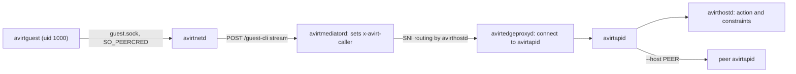

# Status: planned

`avirtguest`, from `crates/avirtguest`, is the guest CLI inside a workload container. The avirt base image includes it at `/usr/local/bin/avirtguest`, so every workload container has it (see [workload lifecycle](./workload-lifecycle.md#layer-stack)). The agent and the tools it runs use it to manage other workloads on the host, under policy (see [workload management](./components.md#workload-management)). It runs as uid 1000. Within the agent cgroup, it uses the agent's security context (see [workload hardening](./workload-hardening.md#security-contexts)).

[avirt](./operator-cli.md) is the operator CLI, and [avirtadmin](./admin-cli.md) is the admin CLI. avirtguest's commands are a subset of avirt's, with the same names, flags, output formats, and exit codes.

## Path

avirtguest speaks gRPC to avirtapid. Its identity comes solely from the socket it connects on, without an SVID, key, or token.

1. avirtguest connects to `/run/avirt/agent/guest.sock`, which avirtnetd restricts to uid 1000 using `SO_PEERCRED`.
2. avirtnetd opens a `guest-cli` HTTP/2 stream, `POST /guest-cli`, to avirtmediatord on the workload's HTTP/2 connection to its mediator (see [HTTP/2 streams](./workload-topology.md#http2-streams)).
3. avirtmediatord removes any `x-avirt-caller` supplied on the request, then sets `x-avirt-caller` to `spiffe://<td>/ns/<ns>/workload/<uuid>/guest-cli`. It sends the stream to avirtedgeproxyd on the mediator's outbound socket to avirthostd, which routes it by SNI without decrypting TLS.
4. avirtedgeproxyd accepts that principal only from an avirtmediatord SVID of the same workload at its current generation. It evaluates `connect` for the workload and `HostService::"avirtapid"` with `via: "guest-cli"` against the host policy snapshot. It then sets `x-avirt-caller` itself and forwards the stream to avirtapid.
5. avirtapid accepts `x-avirt-caller` only from `/service/avirtedgeproxyd`, and forwards the call to avirthostd, or with `--host` to an enrolled peer's avirtapid.
6. avirthostd evaluates the command's action against the host policy snapshot, with `Workload::"<ns>/<uuid>"` as principal and `via: "guest-cli"`, and applies the workload management constraints.



A build job lacks guest CLI access: avirthostd refuses a `guest-cli` stream from a build job (see [build jobs](./workspace-build.md#build-jobs)).

## Command tree

```text
avirtguest
├── launch --agent AGENT PROMPT [launch flags]
├── workload
│   ├── list [--selector K=V]... [--watch]
│   ├── inspect WORKLOAD
│   ├── wait WORKLOAD [--timeout DURATION]
│   ├── stop WORKLOAD [--grace DURATION]
│   └── rm WORKLOAD
├── port
│   ├── publish WORKLOAD PORT [--protocol tcp|http] [--expires DURATION]
│   ├── list WORKLOAD
│   └── rm WORKLOAD PORT
├── session
│   ├── list WORKLOAD
│   ├── attach WORKLOAD [--session ID] [--from SEQ]
│   ├── prompt WORKLOAD TEXT [--session ID]
│   ├── cancel WORKLOAD [--session ID]
│   ├── answer WORKLOAD TOOL-CALL-ID OPTION-ID [--session ID]
│   └── end WORKLOAD [--session ID]
├── logs WORKLOAD [--follow] [--source SOURCE]... [--since SEQ|TIME]
├── whoami
├── completion SHELL
└── version
```

Each command takes the flags and arguments of the [avirt](./operator-cli.md#command-tree) command of the same name, except for the differences below.

| Flag | Default | Meaning |
| --- | --- | --- |
| `--namespace NS`, `-n NS` | The workload's own namespace | The namespace for namespaced commands |
| `--host HOST` | This host | Run the command on an enrolled peer, through the peer's avirtapid and under the peer's policy for this workload's fully qualified identity |
| `--output FORMAT`, `-o FORMAT` | `text` | `text` or `json`, as in [output formats](./operator-cli.md#output-formats) |

avirtguest has no `--context` and no `--socket`: the socket is always `/run/avirt/agent/guest.sock`.

`avirtguest launch` takes every `avirt launch` flag except `--cwd`, plus `--detached`:

| Flag | Meaning |
| --- | --- |
| `--cwd` | avirtguest rejects this flag because a workload can't mount a host directory. |
| `--workspace REF` | Any reference except `dir:`, which needs host sources |
| `--binding ID` | Only a binding that this workload itself has |
| `--policy REF` | This workload's own policy reference, or one the host policy names as assignable by it. Default: its own. |
| `--namespace NS` | Only a namespace where this workload may itself create workloads |
| `--detached` | The child keeps running after this workload ends, if the policy permits a detached child. Without it, the child ends when this workload ends. |

`avirtguest whoami` prints the workload's principal, canonical UUIDv7, short ID, namespace, labels and delegation chain (`avirt.internal/creator`, `avirt.internal/root` and its depth), as the host records them.

## Compared with avirt

| Capability | avirt | avirtguest |
| --- | --- | --- |
| Launch, list, inspect, wait, stop, and remove workloads | Yes, under policy | Yes (subject to policy and the workload management constraints) |
| Mount a host directory (`--cwd`) | Yes | No |
| Port publications | Yes, under policy | On workloads it created, and on others only if the policy permits |
| Services (`service`) | Yes, under policy | No |
| Sessions and logs | Yes, under policy | Yes, under policy |
| Namespaces and peers (`namespace`, `peer`) | List and inspect | No |
| Workspaces (`workspace`) | Yes, under policy | No (see [workspaces](./workspaces.md#open-questions)) |
| Contexts | Yes | No: one fixed socket |
| Commands on an enrolled peer (`--host`) | Yes | Yes, under the peer's policy |
| Host administration | No, that's [avirtadmin](./admin-cli.md) | No |
| Change its own namespace, labels, bindings, or policy reference | Not applicable | No: they're immutable |
| TUI | Yes | No |

## Authorization

Both avirtedgeproxyd and avirthostd must permit each call:

- **avirtedgeproxyd.** `connect` from the workload to `HostService::"avirtapid"` with `via: "guest-cli"`, against the host policy snapshot. avirtedgeproxyd refuses workloads without a policy grant for guest CLI access before avirtapid receives a byte.
- **avirthostd.** The command's action in the [API and policy map](#api-and-policy-map), per action and per resource, against the host policy snapshot. The default decision is denial.

For a command with `--host`, the local avirtedgeproxyd evaluates the connection to the peer. The peer's avirthostd evaluates the command against the peer's host policy snapshot for the workload's identity qualified by this host.

The `guest-cli` principal is inside the agent's trust boundary. avirtguest runs as uid 1000, so any process the agent runs can open the guest CLI socket, and every grant to `guest-cli` is a grant to the agent (see [trust boundaries](./trust-boundaries.md#compromise-scope)). A policy grants it exactly the workload management the agent may do.

```cedar
@id("team-a-orchestrator-drives-children")
permit (
  principal in Namespace::"team-a",
  action in [Action::"create_workload", Action::"list_workloads", Action::"inspect_workload", Action::"stop_workload", Action::"attach_session", Action::"prompt_session", Action::"cancel_session", Action::"read_log"],
  resource in Namespace::"team-a"
)
when { context.via == "guest-cli" && principal.hasTag("role") && principal.getTag("role") == "orchestrator" };

@id("team-a-guest-cli-reaches-apid")
permit (principal in Namespace::"team-a", action == Action::"connect", resource == HostService::"avirtapid")
when { context.via == "guest-cli" };
```

## Workload management constraints

The constraints in [workload management](./components.md#workload-management) bound every avirtguest call, whatever the policy permits. They limit authority to the caller's own authority and prohibit reserved labels, self-escalation, and host administration. Other limits cover delegation depth, the child's lifetime, and host scope. Each call requires an audit event. avirthostd enforces these constraints. avirtguest leaves all such validation to avirthostd. A call that breaks one exits 3, with the constraint named in the error:

| Error | Constraint |
| --- | --- |
| `namespace not permitted for creator` | `--namespace` names a namespace where the caller may not create workloads |
| `binding not held by creator` | A `--binding` the caller doesn't hold |
| `workspace not permitted for creator` | `launch_workspace` denied for the caller |
| `policy not assignable by creator` | A `--policy` that's neither the caller's nor assignable by it |
| `reserved label` | A `--label` key under `avirt.internal/` |
| `delegation chain depth exceeded` | The child's delegation chain would exceed the host's depth cap |
| `detached child not permitted` | `--detached` without a permit |
| `not the creator` | `port publish` on a workload the caller didn't create, without a permit |

## Exit codes

The codes are those in [exit codes](./operator-cli.md#exit-codes). For avirtguest, 3 also means avirtedgeproxyd refused the `guest-cli` stream, and 7 means connecting to `guest.sock` failed or the workload's connection to its mediator is down.

## API and policy map

avirtguest calls the same `avirt.v1` RPCs as avirt, and avirthostd evaluates the same actions with the workload as principal and `via: "guest-cli"`. Every action is in the action list in [egress policies](./egress-policies.md#actions).

| Command | RPC | Cedar action | Resource |
| --- | --- | --- | --- |
| Every command | The `guest-cli` stream to avirtapid | `connect`, at avirtedgeproxyd | `HostService::"avirtapid"` |
| `launch` | `Workloads/CreateWorkload` | `create_workload`, plus `set_label` per label, `attach_binding` per binding, `publish_port` per `--publish`, and `launch_workspace` for `--workspace` | The `Namespace`, then each label's `Namespace`, each `Binding`, the new `Workload`, the `WorkspaceImage` |
| `workload list` | `Workloads/ListWorkloads`, `Workloads/WatchWorkloads` | `list_workloads` | `Namespace` |
| `workload inspect`, `workload wait` | `Workloads/GetWorkload`, `Workloads/WaitWorkload` | `inspect_workload` | `Workload` |
| `workload stop` | `Workloads/StopWorkload` | `stop_workload` | `Workload` |
| `workload rm` | `Workloads/DeleteWorkload` | `delete_workload` | `Workload` |
| `port publish` | `Ports/PublishPort` | `publish_port` | `Workload` |
| `port list` | `Ports/ListPorts` | `inspect_workload` | `Workload` |
| `port rm` | `Ports/UnpublishPort` | `unpublish_port` | `Workload` |
| `session list` | `Sessions/ListSessions` | `inspect_workload` | `Workload` |
| `session attach` | `Sessions/Attach` | `attach_session` | `Workload` |
| `session prompt`, `cancel`, `answer` | `Sessions/Prompt`, `Cancel`, `AnswerPermission` | `prompt_session`, `cancel_session`, `answer_permission` | `Workload` |
| `session end` | `Sessions/End` | `end_session` | `Workload` |
| `logs` | `Logs/ReadLog` | `read_log`, with `source` in the context | `Workload` |
| `whoami` | `Identity/WhoAmI` | None beyond `connect` | None |

The context of `create_workload` for avirtguest also includes `detached`, for `--detached`.

# Open questions

1. **Sessions of other workloads.** Whether to permit `prompt_session` and `answer_permission` from one workload into another's session at all, or only from a workload into its own children's sessions, is open.
2. **Logs of the caller's own workload.** Whether to permit `logs` on the calling workload itself is open. Its workload log contains the prompts and tool output of the agent that asks.
3. **Workspaces from inside a workload container.** Whether avirtguest gains `workspace search` or `workspace build` is open (see [workspaces](./workspaces.md#open-questions)).
4. **Peer delegation chain.** How a child launched on a peer with `--host` records its creator, whose identity is in another trust domain, and whether it ends when its creator ends, is open.
