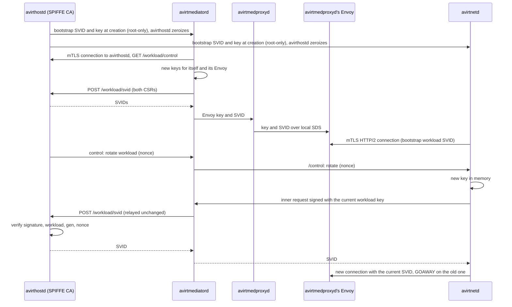
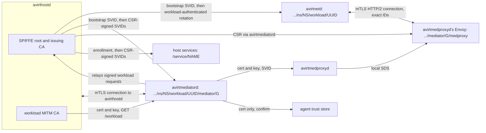

# Status: implemented

## Connection token

`avirthostd` draws a random 128-bit token per workload and passes it only to avirtinitd (`-e AVIRT_CONNECTION_TOKEN`, inherited by name, removed from the agent's environment). The `POST /workloads/<id>/stream` request on the workload's HTTP/2 connection to its mediator must contain it in `x-avirt-token`. A missing or wrong token gets a 403 before the workload's state changes.

## Mediator secret

Each mediator gets a random secret in its environment (`AVIRT_MEDIATOR_SECRET`, never in the workload container's) and presents it in both connection headers on avirthostd's socket (`WORKLOAD <id> <secret>` and `EGRESS <id> <secret>`). avirthostd closes a connection whose header lacks the right secret and discards its output without logging it. The mediator starts from an empty environment: only `PATH`, `HOME`, `TMPDIR` and its secret.

# Status: planned

Every hop between avirt components that crosses a container or host boundary uses mutual TLS 1.3 with SPIFFE X.509-SVIDs (see [trust boundaries](./trust-boundaries.md#listeners)). This replaces the connection token and the mediator secret.

## Trust domain and IDs

The trust domain is installation-unique: `<install-id>.avirt`, where `<install-id>` is 26 lowercase base32 characters drawn at random when avirthostd first initializes its state directory, and kept there for the life of the installation.

| Holder | SPIFFE ID | Lifetime |
| --- | --- | --- |
| avirthostd | `spiffe://<td>/service/avirthostd` | avirthostd process |
| Each other host service | `spiffe://<td>/service/<name>`, for avirtapid, avirtwebd, avirtregistryd, avirtdnsd, avirtmcpgwd, avirtmodelgwd, avirtbuilderd, avirtpolicyd, avirtsecretsd, avirtlogd, avirtauditd, and avirtoteld | The component's process |
| avirtedgeproxyd, served to its Envoy | `spiffe://<td>/service/avirtedgeproxyd` | The avirtedgeproxyd process |
| avirtnetd (the workload container) | `spiffe://<td>/ns/<ns>/workload/<uuid>` | Workload |
| avirtmediatord | `spiffe://<td>/ns/<ns>/workload/<uuid>/mediator/<gen>` | One mediator generation |
| avirtmedproxyd's Envoy | `spiffe://<td>/ns/<ns>/workload/<uuid>/mediator/<gen>/medproxy` | One mediator generation |

The namespace, the workload's canonical ID and the mediator generation are part of the signed URI. `<uuid>` is the workload's UUIDv7, which avirt never reuses (see [components](./components.md#workload-ids)). The 8-character short ID never appears in a SPIFFE ID. A namespace is local to its host (see [components](./components.md#namespaces-and-labels)), and each host has its own trust domain, so cross-host identities and policy references always include that host's trust domain.

Inside the workload container only avirtnetd holds an SVID. The identities of other processes come from their connecting sockets, checked with `SO_PEERCRED`. avirtnetd forwards avirtguest's requests under the principal `spiffe://<td>/ns/<ns>/workload/<uuid>/guest-cli`, which never has an SVID. avirtnetd opens a `/guest-cli` HTTP/2 stream on its connection to the mediator, and avirtmedproxyd sets that principal in `x-avirt-caller` on the request it forwards to avirtedgeproxyd, after removing any `x-avirt-caller` the request contained. avirtedgeproxyd accepts the principal only from the SVID of avirtmedproxyd's Envoy in the same workload. It checks the principal against the host policy snapshot as it does other workload traffic. It sets `x-avirt-caller` itself on the request forwarded to avirtapid. avirtapid accepts `x-avirt-caller` only from `/service/avirtedgeproxyd`, and passes the calling workload to avirthostd, which authorizes each operation per action and per resource against the host policy snapshot, within the constraints in [workload management](./components.md#workload-management). The `guest-cli` principal is within the agent's trust boundary. avirtguest runs as uid 1000, so any process the agent runs can use the guest CLI socket. Grants to `guest-cli` also grant the agent that authority. It separates control-plane calls from egress in policy and logs. Its authority equals the policy's grant to the workload and never exceeds uid 1000's authority.

## Issuer

`avirthostd` holds the SPIFFE CA in two tiers:

- **Root.** An ECDSA P-256 root, generated with the trust domain and stored in avirthostd's state directory (`ca/`, see [lifecycle](./lifecycle.md#durable-state)). It's valid for one year and signs only issuing CAs. avirthostd generates a new root 30 days before the current one expires and adds it to the bundle at once. Peers and services trust both during the overlap. avirthostd removes the old root from the bundle at expiry.
- **Issuing CA.** An ECDSA P-256 intermediate, kept in memory only, valid for 7 days, and signed by the root. It signs every SVID. avirthostd generates one at start and a successor at 50 % of the current one's lifetime, without restarting, and every SVID contains its full chain. SVIDs expire no later than their issuing CA.

SVIDs contain:

- exactly one URI SAN, and for avirtedgeproxyd's SVID one DNS SAN per name in `peering.hosts`,
- `CA:false`,
- `digitalSignature` key usage,
- `serverAuth` and `clientAuth` extended key usage,
- a 1 h lifetime.

The root and issuing CA certificates constrain names. Their permitted URI subtree is `<td>`. They permit only the dNSName subtrees in `peering.hosts`, or none when it's empty. avirtedgeproxyd's SVID alone contains those names, as DNS SANs beside its one URI SAN, which the SPIFFE X509-SVID format allows (see [peer host names](./peering.md#peer-host-names)). `avirtadmin ca rotate` rotates either tier on demand (see [admin CLI](./admin-cli.md#trust-domain-and-ca)).

The startup cleanup still ends every workload that an earlier avirthostd process left, because workload state doesn't persist across an avirthostd restart. The SPIFFE root and bundle do persist, so host services and peers keep verifying the host's SVIDs across restarts.

Verification on every side uses the `spiffe` crate's types (`SpiffeId`, `X509Svid`, `X509Bundle`) with a rustls verifier that chains only to the SPIFFE bundle and then authorizes the exact peer ID. Envoys verify with the bundle they receive over SDS and check authorization with SAN matchers and libavirtenvoy. Constraint: avirt can't use `spiffe-rustls`, because it builds its verifiers only from an `X509Source`. That source requires a Workload API endpoint, which avirt excludes (invariant 1 in [architecture](./architecture.md#design-invariants)).

## Attestation

`avirthostd` creates exactly two containers per workload and records which runtime handle and which runtime-provided Unix sockets belong to which workload and generation. It signs a CSR only for an ID its own records assign:

- `/ns/<ns>/workload/<uuid>/mediator/<gen>`, on that mediator's connection to avirthostd, authenticated by avirtmediatord's current SVID.
- `/ns/<ns>/workload/<uuid>/mediator/<gen>/medproxy`, on the same connection, requested by avirtmediatord for the key it generated for avirtmedproxyd's Envoy.
- `/ns/<ns>/workload/<uuid>`, relayed by that workload's current mediator, and only inside a workload-authenticated request (see [rotation](#rotation)).
- `/service/<name>`, on the issuer socket, for a component that presents a one-time enrollment token or its current `/service/<name>` SVID.

In the all-in-one server image, avirtinitd in server mode passes each host service a one-time enrollment token from avirthostd on an inherited file descriptor, and the component exchanges it for its first SVID.

## Bootstrap

`avirthostd` issues one bootstrap SVID and key per container (10-minute lifetime) and gives them to the runtime at container creation. It then zeroizes its copy.

| Runtime | Mediator | Workload container |
| --- | --- | --- |
| Containerization | A root-only (0400) file written into the VM's root filesystem before boot, or the init process's environment | The same, delivered to the root avirtinitd |
| Docker Desktop | `AVIRT_SVID`, `AVIRT_SVID_KEY`, `AVIRT_BUNDLE`, inherited by name, never on argv | The same, read by the root avirtinitd |

avirtinitd reads the material and unlinks the file or scrubs the variables. It passes the material on an inherited file descriptor to its only user: avirtmediatord in the mediator or avirtnetd in the workload container. uid 1000 can't get it:

- reading `/proc/<pid>/environ` or another process's memory requires a matching uid or `CAP_SYS_PTRACE`, every holder runs under its own UID, and the agent's seccomp filter denies `ptrace` and `process_vm_readv`.
- avirtinitd removes the file before starting the agent.
- avirtinitd excludes it from the agent's environment.

The bootstrap delivery is the only issuance path that doesn't require proof of a current key, and it never passes through the mediator. A workload whose avirtnetd exits loses its key, and ends.

## Rotation

`avirthostd` initiates every rotation over `GET /workload/control`, pushing `{"t":"rotate","target":"mediator"|"medproxy"|"workload","nonce":N}` and `{"t":"bundle"}`.

- **Mediator.** avirtmediatord generates a fresh P-256 key in memory and sends a CSR to `POST /workload/svid`, authenticated by its current SVID.
- **avirtmedproxyd's Envoy.** avirtmediatord generates the Envoy's fresh key and sends its CSR the same way. It gives the key and SVID to avirtmedproxyd, which delivers them to its Envoy over local SDS. A compromised avirtmediatord can get an SVID for avirtmedproxyd's Envoy for a key of its choice. Its authority remains unchanged because avirtmediatord already has more authority than that Envoy.
- **Workload.** avirtnetd generates a fresh key and builds a CSR. It wraps the CSR in an inner request `{csr, workload, gen, nonce}` and signs the inner request with its current workload key. It sends the signed request with its current SVID on the `/control` stream. The mediator relays it unchanged. avirthostd accepts it only if the signature verifies against an unexpired workload SVID (or the bootstrap SVID) for that workload, `gen` equals the relaying mediator's generation, and `nonce` equals the nonce it pushed. A compromised mediator, which doesn't hold the workload key, can't get a workload SVID for its own key.

`avirthostd` returns each SVID, with the bundle, down the same path. The first rotation of every container happens as soon as the workload's HTTP/2 connection to its mediator attaches. This retires bootstrap keys within seconds. Later rotations happen at 50 % of the lifetime. A rotated SVID takes effect on a new connection, because TLS 1.3 lacks renegotiation. New connections present the current SVIDs and receive new streams. The old connection gets GOAWAY. Streams already open on it may finish.

At the peer certificate's `not_after`, either side closes the connection and its streams end. Clients retry, and the `/envelopes` stream resumes by `seq`. If avirthostd is unreachable, rotation can't happen and avirtmediatord exits, so the agent freezes and the workload ends after 30 s.

Host services rotate their own SVIDs on the issuer socket at 50 % of the lifetime, each CSR authenticated by the current SVID.

## Authorization

- **Workload connection.** avirtnetd requires the peer ID `…/ns/<own ns>/workload/<own uuid>/mediator/<g>/medproxy` with `g ≥ last_gen`. A higher `g` supersedes the older connection, and an equal `g` is a rotation or a reconnect to the same generation (see [workload topology](./workload-topology.md#freeze-and-reconnect)), never a reason to freeze. avirtmedproxyd's Envoy requires exactly `…/ns/<own ns>/workload/<own uuid>`. A stale endpoint from another workload fails on the workload ID, and an old mediator fails on `g`.
- **Connection to avirthostd.** `avirthostd` presents `/service/avirthostd`. It accepts `/ns/<ns>/workload/<uuid>/mediator/<g>` for every route, and `/ns/<ns>/workload/<uuid>/mediator/<g>/medproxy` for `POST /workload/envelopes` and `POST /workload/events` only, in both cases for the connection's recorded workload and current generation. The listener completes this handshake before reading any <!-- Preserve the TLS protocol term application data. --><!-- vale project.WordList = NO -->application data<!-- vale project.WordList = YES -->.
- **Generation fencing.** avirthostd publishes the live set of workloads and their current generations to every host listener that accepts mediator SVIDs: the host services and avirtedgeproxyd. Listeners refuse connections from a superseded generation. Once successor confirmation completes, they close the superseded generation's open connections.
- **Ingress listener.** avirtmedproxyd's Envoy accepts connections on its ingress listener only from its own host's `/service/avirtedgeproxyd`, and takes the caller's identity from the `x-avirt-caller` header that avirtedgeproxyd sets.
- **Host services.** Each accepts the SVIDs of avirtmedproxyd's Envoy for live workloads and current generations for workload-scoped operations, and the specific `/service/<name>` IDs it lists for service operations (see [trust boundaries](./trust-boundaries.md#listeners)).

## Federation

Peered hosts federate explicitly, and never share a CA key (see [peering](./peering.md)).

- **Enrollment.** Operators enroll each other's hosts out of band, from enrollment files compared by fingerprint (see [enrollment](./peering.md#enrollment) and [admin CLI](./admin-cli.md#peers-and-enrollment)). avirthostd stores the enrollment records, avirtedgeproxyd serves each peer's bundle to its Envoy over local SDS, and avirtdnsd answers an active peer's peered names.
- **Bundle refresh.** avirtedgeproxyd's Envoy serves the host's bundle, in the SPIFFE bundle format, on the mutual TLS peer listener, and avirthostd refreshes each enrolled peer's bundle from it (see [trust bundles](./peering.md#trust-bundles)). Constraint: the endpoint requires client authentication. This differs from the SPIFFE bundle endpoint specification, which forbids client authentication.
- **Authorization after authentication.** A valid SVID from an enrolled trust domain authenticates its holder only. avirtedgeproxyd's peer listener (port 8788 by default, and absent unless configuration sets `peering.listen`) accepts only `spiffe://<peer td>/service/avirtedgeproxyd`, and evaluates the host policy snapshot for the peer identity in `x-avirt-caller`, accepting only identities in that peer's own trust domain. avirtapid accepts peer callers only for the routes their enrollment allows.

## Two separate CAs

| | SPIFFE CA | Workload MITM CA |
| --- | --- | --- |
| Key storage | avirthostd only: the root in the state directory, the issuing CA in memory | avirthostd, and in memory in the workload's avirtmediatord, avirtmedproxyd and avirtmedproxyd's Envoy (libavirtenvoy). The same CA serves every generation of the workload. It's name-constrained to the hosts the workload's policy can intercept, and a workload whose policy can intercept none has no MITM CA (see [egress](./egress.md#mitm-ca-and-leaf-certificates)). |
| Trusted by | The SVID verifiers in avirtnetd, avirtmediatord, the Envoys, avirthostd and the host services, each configured with the SPIFFE bundle alone and never with system or web roots | The agent's trust store and CA variables |
| Signs | Issuing CAs and SVIDs (URI SAN, name-constrained to `<td>`) | Upstream leaf certificates (DNS SAN, `serverAuth` only) |

avirt never writes the SPIFFE bundle to `/etc/ssl` or to any file in the workload container. Verifiers reject certificates signed by the other CA.

