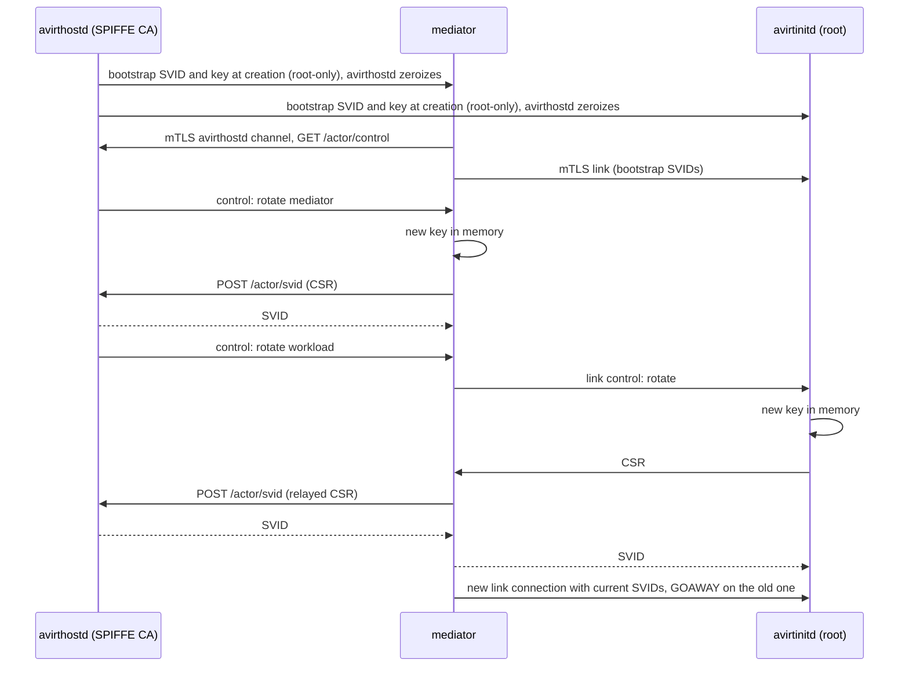
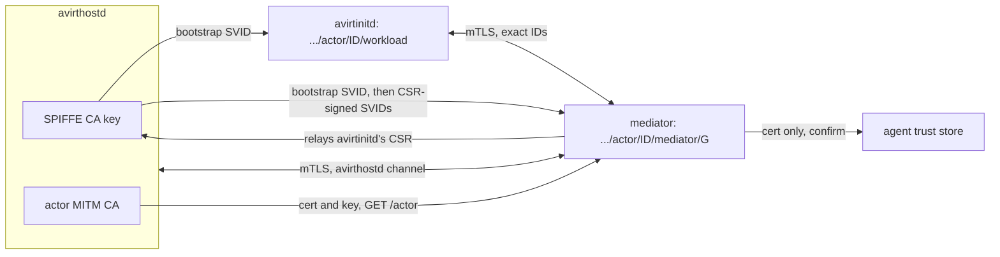

# Status: implemented

## Uplink token

`avirthostd` draws a random 128-bit token per actor and passes it only to avirtinitd (`-e AVIRT_UPLINK_TOKEN`, inherited by name, removed from the agent's environment). The stream POST must carry it in `x-avirt-token`. A missing or wrong token gets a 403 before the actor's state changes.

## Mediator secret

Each mediator gets a random secret in its environment (`AVIRT_MEDIATOR_SECRET`, never in the workload's) and presents it in both preambles on avirthostd's socket (`ACTOR <id> <secret>` and `EGRESS <id> <secret>`). A preamble without the right secret is closed, and nothing it sent reaches the log. The mediator starts from an empty environment: only `PATH`, `HOME`, `TMPDIR` and its secret.

# Status: planned

Both hops (avirtinitd and mediator, mediator and avirthostd) use mutual TLS 1.3 with SPIFFE X.509-SVIDs. This replaces the uplink token and the mediator secret.

## Trust domain and IDs

The trust domain is per install: `avirt.<host>`, where `<host>` is the lowercased short hostname reduced to `[a-z0-9-]`.

| Workload | SPIFFE ID | Lifetime |
| --- | --- | --- |
| avirthostd | `spiffe://avirt.<host>/hostd` | avirthostd process |
| avirtinitd (in the workload) | `spiffe://avirt.<host>/actor/<id>/workload` | Actor |
| Mediator | `spiffe://avirt.<host>/actor/<id>/mediator/<gen>` | One mediator generation |

The actor id and the mediator generation are part of the signed URI. Actor ids are never reused.

## Issuer

`avirthostd` holds the trust-domain CA: ECDSA P-256, generated at avirthostd startup, kept in memory only, valid for 7 days, and regenerated on every start (the startup sweep ends every older actor). It signs CSRs into X.509-SVIDs with:

- exactly one URI SAN,
- `CA:false`,
- `digitalSignature` key usage,
- `serverAuth` and `clientAuth` extended key usage,
- a 1 h lifetime.

The CA certificate is name-constrained: the permitted URI subtree is `avirt.<host>`, and no dNSName subtree is permitted.

Verification on every side uses the `spiffe` crate's types (`SpiffeId`, `X509Svid`, `X509Bundle`) with a rustls verifier that chains only to the SPIFFE bundle and then authorizes the exact peer ID. Constraint: `spiffe-rustls` cannot be used, because it builds its verifiers only from an `X509Source`, which always requires a Workload API endpoint, and no Workload API exists (invariant 1 in [architecture](./architecture.md)).

## Attestation

`avirthostd` creates exactly two workloads per actor and records which runtime handle, link and avirthostd channel belong to which actor and generation. It signs a CSR only for the ID its own records assign to the channel the CSR arrived on:

- `/actor/<id>/mediator/<gen>`, on that mediator's avirthostd channel;
- `/actor/<id>/workload`, relayed by that actor's current mediator.

## Bootstrap

`avirthostd` mints one bootstrap SVID and key per workload (10-minute lifetime), hands them to the runtime when it creates the workload, and zeroizes its copy.

| Runtime | Mediator | Workload |
| --- | --- | --- |
| Containerization | A root-only (0400) file written into the VM's root filesystem before boot, or the init process's environment | The same, delivered to the root avirtinitd |
| Docker Desktop | `AVIRT_SVID`, `AVIRT_SVID_KEY`, `AVIRT_BUNDLE`, inherited by name, never on argv | The same, read by the root avirtinitd |

`avirtinitd` and the mediator read the material, unlink the file or scrub the variables, and keep it in memory. uid 1000 cannot obtain it:

- reading `/proc/<avirtinitd>/environ` or avirtinitd's memory requires a matching uid or `CAP_SYS_PTRACE`, and the agent's seccomp filter denies `ptrace` and `process_vm_readv`;
- the file is removed before the agent starts;
- the agent's environment is built without it.

## Rotation

`avirthostd` initiates every rotation over `GET /actor/control`, pushing `{"t":"rotate","target":"mediator"|"workload"}` and `{"t":"bundle"}`.

1. The target generates a fresh P-256 key in memory and sends a CSR. The mediator posts its own to `POST /actor/svid`. `avirtinitd` sends its own on the link control stream, and the mediator relays it.
2. `avirthostd` authorizes the CSR as above and returns the SVID, with the bundle, down the same path.

The first rotation of both workloads happens as soon as the link is attached, so the bootstrap keys are retired within seconds. Later rotations happen at 50 % of the lifetime. A rotated SVID takes effect on a new connection, because TLS 1.3 has no renegotiation: the mediator opens a new link stream and a new avirthostd stream, both sides present their current SVIDs, new streams move to the new connection, and the old connection gets GOAWAY. Streams already open on it may finish.

At the peer certificate's `not_after`, either side closes the connection and its streams end. Clients retry, and the uplink resumes by `seq`. If avirthostd is unreachable, rotation cannot happen and the mediator exits, so the workload freezes and the actor ends after 30 s.

## Authorization

- **Link:** `avirtinitd` requires the peer to be `…/actor/<own id>/mediator/<g>` with `g ≥ last_gen`. A higher `g` supersedes the older connection, and an equal `g` is a rotation. The mediator requires exactly `…/actor/<own id>/workload`. A stale endpoint from another actor fails on the actor id, and an old mediator fails on `g`.
- **avirthostd channel:** `avirthostd` presents `/hostd` and requires `/actor/<id>/mediator/<g>` for the channel's recorded actor. The `avirthostd` vsock listener completes this handshake before reading any application byte.

## Two separate CAs

| | SPIFFE CA | Actor MITM CA |
| --- | --- | --- |
| Key lives in | avirthostd only | avirthostd and the actor's mediator |
| Trusted by | The SVID verifiers in avirtinitd, the mediator and avirthostd, each configured with the SPIFFE bundle alone and never with system or web roots | The agent's trust store and CA variables |
| Signs | SVIDs (URI SAN, name-constrained to `avirt.<host>`) | Upstream leaf certificates (DNS SAN, `serverAuth` only) |

The SPIFFE bundle is never written to `/etc/ssl` or to any file in the workload. A certificate signed by one CA is never accepted where the other is expected.

