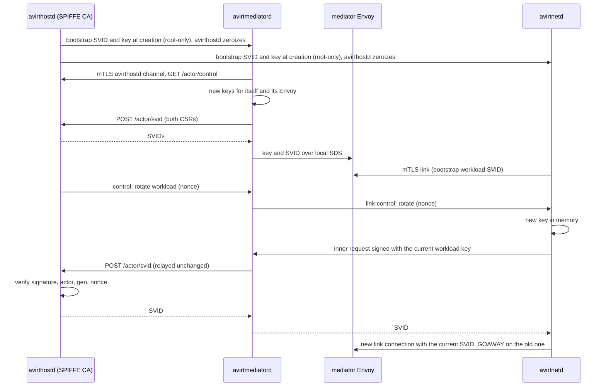
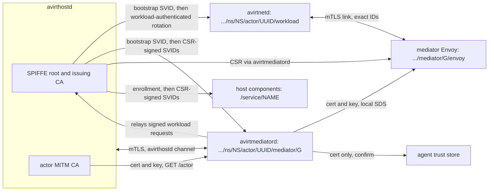

# Status: implemented

## Uplink token

`avirthostd` draws a random 128-bit token per actor and passes it only to avirtinitd (`-e AVIRT_UPLINK_TOKEN`, inherited by name, removed from the agent's environment). The stream POST must carry it in `x-avirt-token`. A missing or wrong token gets a 403 before the actor's state changes.

## Mediator secret

Each mediator gets a random secret in its environment (`AVIRT_MEDIATOR_SECRET`, never in the workload's) and presents it in both preambles on avirthostd's socket (`ACTOR <id> <secret>` and `EGRESS <id> <secret>`). A preamble without the right secret is closed, and nothing it sent reaches the log. The mediator starts from an empty environment: only `PATH`, `HOME`, `TMPDIR` and its secret.

# Status: planned

Every hop between avirt components that crosses a container or host boundary uses mutual TLS 1.3 with SPIFFE X.509-SVIDs (see [trust boundaries](./trust-boundaries.md#listeners)). This replaces the uplink token and the mediator secret.

## Trust domain and IDs

The trust domain is installation-unique: `<install-id>.avirt`, where `<install-id>` is 26 lowercase base32 characters drawn at random when avirthostd first initializes its durable state directory, and kept there for the life of the installation.

| Holder | SPIFFE ID | Lifetime |
| --- | --- | --- |
| avirthostd | `spiffe://<td>/service/avirthostd` | avirthostd process |
| Each other host component | `spiffe://<td>/service/<name>`, for avirtproxyd, avirtwebd, avirtregistryd, avirtdnsd, avirtmcpgwd, avirtmodelgwd, avirtbuilderd, avirtpolicyd, avirtsecretsd, avirtlogd, avirtauditd and avirtoteld | The component's process |
| Front-door Envoy | `spiffe://<td>/service/frontdoor` | The Envoy process |
| avirtnetd (the workload) | `spiffe://<td>/ns/<ns>/actor/<uuid>/workload` | Actor |
| avirtmediatord | `spiffe://<td>/ns/<ns>/actor/<uuid>/mediator/<gen>` | One mediator generation |
| Mediator Envoy | `spiffe://<td>/ns/<ns>/actor/<uuid>/mediator/<gen>/envoy` | One mediator generation |

The namespace, the actor's canonical ID and the mediator generation are part of the signed URI. `<uuid>` is the actor's UUIDv7, which is never reused (see [components](./components.md#workload-ids)); the 8-character short ID never appears in a SPIFFE ID. A namespace is local to its host (see [components](./components.md#namespaces-and-labels)), and each host has its own trust domain, so an identity from another host is always fully qualified by that host's trust domain, and cross-host policy names it that way.

Inside the workload only avirtnetd holds an SVID. The other workload processes are local principals, identified by the socket they connect on and checked with `SO_PEERCRED`. avirtnetd forwards avirtguest's requests under the principal `spiffe://<td>/ns/<ns>/actor/<uuid>/workload/guest-cli`, which is never issued as an SVID: avirtnetd opens a `guest-cli` link stream, and the mediator Envoy sets that principal in `x-avirt-caller` on the request it forwards to the front-door Envoy, after removing any `x-avirt-caller` the request carried. The front-door Envoy accepts the principal only from a mediator Envoy SVID of the same actor, authorizes it against the host snapshot as it does other workload traffic, and sets `x-avirt-caller` itself on the request it forwards to avirtproxyd. avirtproxyd accepts `x-avirt-caller` only from `/service/frontdoor`, and passes the calling workload to avirthostd, which authorizes each operation per action and per resource against the host snapshot, within the constraints in [workload management](./components.md#workload-management). The `guest-cli` principal is within the agent's trust boundary: avirtguest runs as uid 1000, so any process the agent runs can use the guest CLI socket, and anything granted to `guest-cli` is granted to the agent. It separates control-plane calls from egress in policy and logs, carries exactly the authority the policy grants the workload, and never more than uid 1000 holds.

## Issuer

`avirthostd` holds the SPIFFE CA in two tiers:

- **Root.** An ECDSA P-256 root, generated with the trust domain and stored in avirthostd's durable state directory (`ca/`, see [lifecycle](./lifecycle.md#durable-state)). It is valid for one year and signs only issuing CAs. A new root is generated 30 days before the current one expires and added to the bundle at once, so peers and services trust both during the overlap, and the old root leaves the bundle when it expires.
- **Issuing CA.** An ECDSA P-256 intermediate, kept in memory only, valid for 7 days and signed by the root. It signs every SVID. avirthostd generates one at start and a successor at 50 % of the current one's lifetime, without restarting, and every SVID carries its full chain. No SVID outlives the issuing CA that signed it.

SVIDs carry:

- exactly one URI SAN,
- `CA:false`,
- `digitalSignature` key usage,
- `serverAuth` and `clientAuth` extended key usage,
- a 1 h lifetime.

The root and issuing CA certificates are name-constrained: the permitted URI subtree is `<td>`, and no dNSName subtree is permitted.

The startup sweep still ends every actor that an earlier avirthostd process left, because actor state does not survive an avirthostd restart. The trust anchors do survive it, so host services and peers keep verifying the host's SVIDs across restarts.

Verification on every side uses the `spiffe` crate's types (`SpiffeId`, `X509Svid`, `X509Bundle`) with a rustls verifier that chains only to the SPIFFE bundle and then authorizes the exact peer ID. Envoys verify with the bundle they receive over SDS and authorize with SAN matchers and libavirtenvoy. Constraint: `spiffe-rustls` cannot be used, because it builds its verifiers only from an `X509Source`, which always requires a Workload API endpoint, and no Workload API exists (invariant 1 in [architecture](./architecture.md#design-invariants)).

## Attestation

`avirthostd` creates exactly two containers per actor and records which runtime handle, link and avirthostd channel belong to which actor and generation. It signs a CSR only for an ID its own records assign:

- `/ns/<ns>/actor/<uuid>/mediator/<gen>`, on that mediator's avirthostd channel, authenticated by avirtmediatord's current SVID;
- `/ns/<ns>/actor/<uuid>/mediator/<gen>/envoy`, on the same channel, requested by avirtmediatord for the key it generated for its Envoy;
- `/ns/<ns>/actor/<uuid>/workload`, relayed by that actor's current mediator, and only inside a workload-authenticated request (see [rotation](#rotation));
- `/service/<name>`, on the issuer socket, for a component that presents a one-time enrollment token or its current `/service/<name>` SVID.

In the all-in-one server image, avirtinitd in server mode passes each host component a one-time enrollment token from avirthostd on an inherited file descriptor, and the component exchanges it for its first SVID.

## Bootstrap

`avirthostd` mints one bootstrap SVID and key per container (10-minute lifetime), hands them to the runtime when it creates the container, and zeroizes its copy.

| Runtime | Mediator | Workload |
| --- | --- | --- |
| Containerization | A root-only (0400) file written into the VM's root filesystem before boot, or the init process's environment | The same, delivered to the root avirtinitd |
| Docker Desktop | `AVIRT_SVID`, `AVIRT_SVID_KEY`, `AVIRT_BUNDLE`, inherited by name, never on argv | The same, read by the root avirtinitd |

avirtinitd reads the material, unlinks the file or scrubs the variables, and passes it on an inherited file descriptor to the one process that uses it: avirtmediatord in the mediator, avirtnetd in the workload. uid 1000 cannot obtain it:

- reading `/proc/<pid>/environ` or another process's memory requires a matching uid or `CAP_SYS_PTRACE`, every holder runs under its own UID, and the agent's seccomp filter denies `ptrace` and `process_vm_readv`;
- the file is removed before the agent starts;
- the agent's environment is built without it.

The bootstrap delivery is the only issuance path that does not require proof of a current key, and it never passes through the mediator. A workload that loses its key, because avirtnetd exits, ends.

## Rotation

`avirthostd` initiates every rotation over `GET /actor/control`, pushing `{"t":"rotate","target":"mediator"|"envoy"|"workload","nonce":N}` and `{"t":"bundle"}`.

- **Mediator.** avirtmediatord generates a fresh P-256 key in memory and posts a CSR to `POST /actor/svid`, authenticated by its current SVID.
- **Mediator Envoy.** avirtmediatord generates the Envoy's fresh key, posts its CSR the same way, and delivers the key and SVID to Envoy over the local SDS socket. A compromised avirtmediatord can therefore obtain an Envoy SVID for a key of its choice, and nothing more, since it already holds more authority than its Envoy.
- **Workload.** avirtnetd generates a fresh key and builds a CSR. It wraps the CSR in an inner request `{csr, actor, gen, nonce}`, signs the inner request with its current workload key, and sends it with its current SVID on the link control stream. The mediator relays it unchanged. avirthostd accepts it only if the signature verifies against an unexpired workload SVID (or the bootstrap SVID) for that actor, `gen` equals the relaying mediator's generation, and `nonce` equals the nonce it pushed. A compromised mediator, which does not hold the workload key, cannot obtain a workload SVID for its own key.

`avirthostd` returns each SVID, with the bundle, down the same path. The first rotation of every container happens as soon as the link is attached, so the bootstrap keys are retired within seconds. Later rotations happen at 50 % of the lifetime. A rotated SVID takes effect on a new connection, because TLS 1.3 has no renegotiation: new connections present the current SVIDs, new streams move to them, and the old connection gets GOAWAY. Streams already open on it may finish.

At the peer certificate's `not_after`, either side closes the connection and its streams end. Clients retry, and the uplink resumes by `seq`. If avirthostd is unreachable, rotation cannot happen and avirtmediatord exits, so the workload freezes and the actor ends after 30 s.

Host components rotate their own SVIDs on the issuer socket at 50 % of the lifetime, each CSR authenticated by the current SVID.

## Authorization

- **Link.** avirtnetd requires the peer to be `…/ns/<own ns>/actor/<own uuid>/mediator/<g>/envoy` with `g ≥ last_gen`. A higher `g` supersedes the older connection, and an equal `g` is a rotation or a reconnect to the same generation (see [actor topology](./actor-topology.md#freeze-and-reconnect)), never a reason to freeze. The mediator Envoy requires exactly `…/ns/<own ns>/actor/<own uuid>/workload`. A stale endpoint from another actor fails on the actor id, and an old mediator fails on `g`.
- **avirthostd channel.** `avirthostd` presents `/service/avirthostd`. It accepts `/ns/<ns>/actor/<uuid>/mediator/<g>` for every channel route, and `/ns/<ns>/actor/<uuid>/mediator/<g>/envoy` for `POST /actor/uplink` and `POST /actor/events` only, in both cases for the channel's recorded actor and current generation. The listener completes this handshake before reading any application byte.
- **Generation fencing.** avirthostd publishes the live set of actors and their current generations to every host listener that accepts mediator SVIDs: the host components and the front-door Envoy. A connection from a superseded generation is refused, and open connections from it are closed once its successor is confirmed.
- **Ingress channel.** A mediator Envoy accepts connections on its ingress listener only from its own host's `/service/frontdoor`, and takes the caller's identity from the `x-avirt-caller` header that the front-door Envoy sets.
- **Host components.** Each accepts mediator Envoy SVIDs of live actors and current generations for actor-scoped operations, and the specific `/service/<name>` IDs it lists for service operations (see [trust boundaries](./trust-boundaries.md#listeners)).

## Federation

Peered hosts federate explicitly, and never share a CA key.

- **Enrollment.** An operator enrolls a peer by its trust domain, its host name (the `<host>` label in its avirt names), its front-door Envoy's address and the bootstrap bundle obtained out of band. avirtdnsd answers the peer's avirt names from this record. The enrollment is stored by avirthostd and served to the front-door Envoy and the host components through SDS.
- **Bundle refresh.** Each front-door Envoy serves its host's bundle at a SPIFFE bundle endpoint on its peer listener, and each host refreshes an enrolled peer's bundle from it, authenticated with the bundle it already holds.
- **Authorization after authentication.** A valid SVID from an enrolled trust domain authenticates its holder only. The front-door Envoy's peer listener accepts only `spiffe://<peer td>/service/frontdoor`, and evaluates the host snapshot for the peer identity in `x-avirt-caller`, accepting only identities in that peer's own trust domain. avirtproxyd accepts peer callers only for the routes their enrollment allows.

## Two separate CAs

| | SPIFFE CA | Actor MITM CA |
| --- | --- | --- |
| Key lives in | avirthostd only: the root in the durable state directory, the issuing CA in memory | avirthostd, and in memory in the actor's avirtmediatord and mediator Envoy (libavirtenvoy). The same CA serves every generation of the actor. It is name-constrained to the hosts the actor's policy can intercept, and an actor whose policy can intercept none has no MITM CA (see [egress](./egress.md#mitm-ca-and-leaf-certificates)). |
| Trusted by | The SVID verifiers in avirtnetd, avirtmediatord, the Envoys, avirthostd and the host components, each configured with the SPIFFE bundle alone and never with system or web roots | The agent's trust store and CA variables |
| Signs | Issuing CAs and SVIDs (URI SAN, name-constrained to `<td>`) | Upstream leaf certificates (DNS SAN, `serverAuth` only) |

The SPIFFE bundle is never written to `/etc/ssl` or to any file in the workload. A certificate signed by one CA is never accepted where the other is expected.

