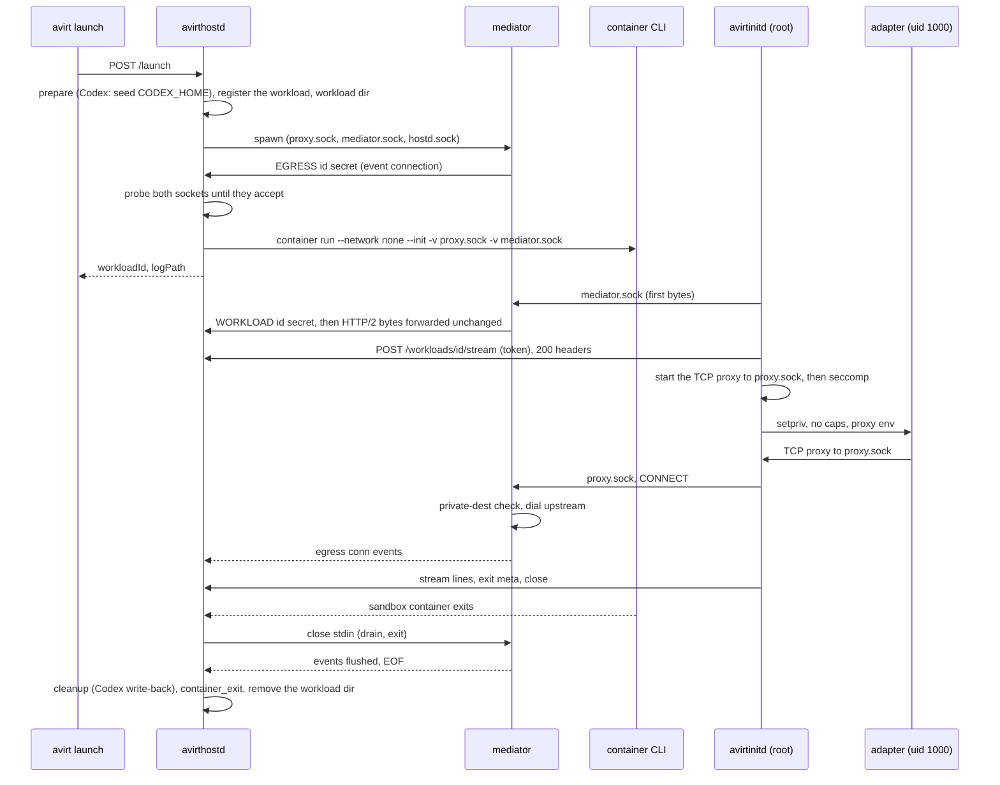

# Status: implemented

## Launch and teardown

The diagram shows the Apple container CLI runtime. Containerization starts the same workload through its avirtvmd helper.

- The mediator must be listening on both sockets before `container run`, because the runtime mounts only a socket file that exists. `avirthostd` probes both (connect and close) for up to 3 s.
- Teardown runs in the same order on every path (sandbox container exit, forced stop, setup failure, avirthostd SIGINT or SIGTERM):
  1. observe the sandbox container's exit.
  2. let the workload's HTTP/2 connection to its mediator drain while the mediator still forwards its bytes: wait 1 s if avirthostd hasn't accepted a stream yet, then up to 10 s for an active stream to end.
  3. close the mediator's stdin and wait for it (5 s, then force it to stop).
  4. wait for the avirthostd-side event connection to reach EOF (5 s).
  5. write the cleanup outcome and `container_exit`.
  6. remove the workload directory.
- If the mediator exits while the sandbox container runs, avirthostd logs a `container_error` ("the workload mediator exited unexpectedly") and stops the sandbox container.
- avirthostd drops a workload's state once it writes the cleanup outcome and the `POST /workloads/<id>/stream` request has drained. A later `POST /workloads/<id>/stream` for an exited workload gets 410.

## avirthostd shutdown

SIGINT and SIGTERM stop avirthostd cleanly:

1. Stop every running sandbox container.
2. Wait for each sandbox container to exit and for its `POST /workloads/<id>/stream` request to drain.
3. Run each workload's cleanup.
4. Exit.

New launches get 503 meanwhile. Cleanup also runs when setup fails partway.

## Runtime directory

The runtime directory, `$TMPDIR/avirt-<uid>/` (0700), contains everything a workload leaves on disk:

| Path | Holds |
| --- | --- |
| `workloads/` | Each workload's private directory with its sockets |
| `scratch/` | Codex temp homes with their `auth.json` copies |
| `hostd/` | The socket mediators dial |
| `containers/<id>/` | Each VM's state on the Containerization runtime, which the helper creates and teardown removes |
| `cache/` | The guest kernel (the Kata Containers 3.32.0 arm64 `vmlinux`, verified against its pinned sha256), the init filesystem, and the composed root filesystems on the Containerization runtime. Startup cleanup removes only stale temporary entries |
| `images/` | The imported images on the Containerization runtime. Startup cleanup removes only stale temporary blobs |
| `lock` | Held with an exclusive flock for avirthostd's lifetime, so a second `avirthostd` refuses to start |

## Crash cleanup

When SIGKILL stops avirthostd:

- its mediators exit by themselves on stdin EOF.
- on the Apple container command-line runtime, its sandbox containers keep running, with no connection to the mediator or proxy. On Containerization, each avirtvmd helper stops its VM when its stdin closes, so no VM keeps running after avirthostd exits.
- its directories, its socket and any Codex temp home stay on disk.

The next `avirthostd` sweeps before it listens:

1. On the command-line runtime, it stops and deletes every container labelled `avirt=1` (the label goes on every `container run`). On Containerization, it lists the helpers and stops each one still running. It then removes that workload's directories. A workload whose helper still runs after the stop stays on disk for the next startup.
2. It restores permissions and then empties `workloads/`, `scratch/`, and `hostd/`, without following links, because the agent can `chmod 0000` its own mounted files.
3. It skips host write-back and logs what it removed.

avirthostd logs any directory it can't remove and continues. The lock and the ownership check of the runtime directory are fatal. avirthostd doesn't track mediators by pid, since they exit on stdin EOF.

# Status: planned

## Runtime directory additions

The planned design adds these to the runtime directory:

| Path | Holds |
| --- | --- |
| `admin.sock` | avirthostd's admin socket for avirtadmin, 0600 and owned by avirthostd's UID (see [admin CLI](./admin-cli.md)) |
| `edgeproxy.sock` | avirtedgeproxyd's `edgeproxy.sock`, 0600 and user-owned (see [trust boundaries](./trust-boundaries.md#listeners)) |

Every planned runtime adds `services/`, which holds the host services' listener sockets (`services/<name>.sock`, 0660 with a group containing only the UIDs allowed to connect, see [trust boundaries](./trust-boundaries.md#listeners)) and avirthostd's issuer socket.

## Durable state

avirthostd stores state that must persist beyond the runtime directory in its state directory: `~/Library/Application Support/avirt/` on macOS and `$XDG_STATE_HOME/avirt/` on Linux, 0700.

| Path | Holds |
| --- | --- |
| `install-id` | The installation id that specifies the trust domain (see [identity](./identity.md#trust-domain-and-ids)) |
| `ca/` | The SPIFFE root key (0600) and the root certificates in the bundle |
| `peers/` | The enrollment records of enrolled peers, with their trust domains and bundles (see [peering](./peering.md#enrollment-record)) |
| `secretsd/` | avirtsecretsd's state: `secrets.d/`, `bindings.d/` and `state.journal`, with no secret values (see [secrets](./secrets.md)) |

The startup cleanup never touches the state directory.

## Launch order

1. For a launch with a workspace, resolve the reference through avirtregistryd and check permission for `launch_workspace` for the resolved image (see [workspaces](./workspaces.md#resolution)). When another workload is the caller, apply the constraints in [workload management](./components.md#workload-management) and record its delegation chain. Check the workload's alias and namespace name against the DNS label syntax and length caps, rejecting rather than truncating (see [components](./dns.md#avirt-hostnames)). Assign the workload's canonical UUIDv7 and its short ID, unique on the host, regenerating on a clash (see [components](./components.md#workload-ids)), and a generated `<adverb>-<adjective>-<noun>` name unique in the namespace among live workloads. Use the host's Cedar policy snapshot to check permission for the workload's creation in its namespace, each label key it contains, each credential binding it attaches (`attach_binding`), and each port it publishes (`publish_port`). Admit the workload against the host's resource budgets. A refused launch gets 403 or 503.
2. Prepare the workload: id, the bootstrap SVIDs (sandbox container and mediator/1), the MITM CA, the configuration layer (see [workload lifecycle](./workload-lifecycle.md#configuration-layer)), the workload directory, the workload's configuration with its policy and binding references, the listeners for the mediator's connection to avirthostd and its outbound socket to avirthostd, and the workload's registration with avirtsecretsd (namespace, generation, binding ids and credential injectors) and avirtpolicyd.
3. Run the sandbox container (`runtime.run_workload`).
4. Wait for the runtime to ready the sandbox container's socket for its connection to the mediator. On the Containerization runtime, wait for the workload guest's vsock-to-Unix-socket forwarder to answer. On Docker, the Docker named volume already exists.
5. `runtime.run_mediator`: run the mediator with `gen=1` and its Unix sockets. It has no network.
6. The workload's HTTP/2 connection to its mediator opens. avirtnetd dials with a 50 ms to 1 s backoff, because early dials fail, for up to the 30 s budget of step 7. On the Containerization runtime avirthostd forwards the connection's bytes unchanged to the mediator's `workload.sock`.
7. The workload is live once avirthostd accepts the `/envelopes` stream. With no `/envelopes` stream within 30 s of step 3, avirthostd tears it down.

`avirtinitd` creates `/run/avirt` itself in each container. On the Containerization runtime, avirtvmd writes the workload's stdout, stderr, and console to `logs/<workload-id>.stdio.ndjson` from the moment the sandbox container starts (see [observability](./observability.md#workload-stdout-and-stderr)).

## Teardown

1. The sandbox container exits and the `/envelopes` stream drains.
2. `avirthostd` calls `runtime.remove` on the mediator: SIGTERM, then event flush and GOAWAY, with a 5 s limit before forcing it to stop.
3. `avirthostd` waits for the events EOF and writes `container_exit`.
4. It removes the workload's generations from the live generation set at every host listener, and its registrations with avirtsecretsd and avirtpolicyd.
5. It calls `runtime.release`, which deletes both VMs or containers, and any Docker named volume, host socket file or per-workload directory.

An absent sandbox container and one that's not ready look the same to the mediator. avirthostd always stops the mediator explicitly. If the mediator exits, avirthostd restarts it while restarts remain. Otherwise it stops the sandbox container and records a `container_error`.

## Startup cleanup

At startup, under the lock, avirthostd calls `runtime.sweep`:

1. On the Containerization runtime, it stops any VM it still owns and removes every stale `containers/<id>/` directory in the runtime directory.
2. On Docker, it removes every container and volume labelled `avirt=1`.
3. It removes `workloads/*`, including stale socket files.

avirthostd keeps the kernel, initfs, and image caches in the runtime directory.

## Path length

Constraint: host Unix socket paths must be under 104 bytes. The Containerization runtime operates without host socket files. On Docker, `$TMPDIR/avirt-<uid>/workloads/<id8>/c.sock` and `s.sock` come to about 90 bytes under macOS's `/var/folders/…/T/`. `avirthostd` computes the longest per-workload host socket path for its runtime at startup, and refuses to start beyond 100 bytes with a message suggesting a shorter `TMPDIR`.
