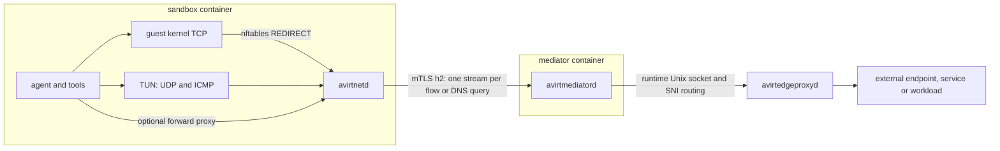

# Status: planned

The sandbox VM has no network device. avirtinitd configures a TUN and nftables REDIRECT rules inside it. The guest kernel handles TCP. avirtnetd forwards each flow over a mutually authenticated HTTP/2 connection to the workload's mediator. avirtmediatord enforces the workload policy snapshot, and avirtedgeproxyd enforces the host policy snapshot and opens upstream sockets. Only avirtedgeproxyd opens connections off the host.

## Topology

avirtmediatord is one process with one UID and the SVID `/ns/<ns>/workload/<uuid>/mediator/<gen>`. Its process restrictions allow the operations that its traffic inspection, credential injection, and lifecycle handling need. avirtedgeproxyd and avirtapid are separate processes. [Workload topology](./workload-topology.md) specifies the sockets, handshake, and lifecycle streams. [Trust boundaries](./trust-boundaries.md) lists listeners and caller identities.

## Guest networking

avirtinitd opens the TUN with `IFF_TUN | IFF_NO_PI` and assigns IPv4 and IPv6 addresses and default routes. It hands its descriptor to avirtnetd. IPv6 addresses use `IFA_F_NODAD`. The exact TUN prefixes remain a configuration choice.

The TUN belongs to avirtnetd, and no other workload process reads its packets.

nftables redirects TCP to avirtnetd's transparent listeners, except loopback and the listeners' own ports. IPv4 uses `SO_ORIGINAL_DST`. A separate IPv6-only listener uses `IP6T_SO_ORIGINAL_DST`. Each listener refuses an original destination that's loopback, unspecified, multicast, link-local, or within the TUN's own prefixes. UDP and TCP port 53, regardless of destination address, reach the DNS handler. The TUN reader also routes UDP port 53 to that handler.

avirtnetd receives other UDP and ICMP packets through the TUN. TCP that reaches the TUN gets RST, so removing the REDIRECT rules breaks TCP rather than providing another route. avirtnetd silently drops multicast, broadcast, mDNS, and link-local packets. It maps upstream errors to the correct flow and drops errors with forged quotations. Refusals produce TCP RST or an appropriate ICMP administrative-prohibition or port-unreachable error.

Fragment handling requires either bounded reassembly, with at most 32 fragments, 64 KiB, and 2 s, or a high MTU with Fragmentation Needed and Packet Too Big responses. The fragment strategy needs a runtime test before use. TCP Fast Open and MPTCP don't work end to end across split TCP and fall back. avirtinitd sets `net.mptcp.enabled=0`. Seccomp denies `IPPROTO_MPTCP`.

Only avirtinitd needs `CAP_NET_ADMIN` during setup. It drops that capability from the bounding set before starting other processes. The agent has no capabilities. Seccomp denies `AF_PACKET`, `AF_NETLINK`, and `AF_VSOCK`, while permitting unprivileged `SOCK_DGRAM` ICMP echo through `ping_group_range`. The Containerization VM starts without a network device. Docker uses `--network none`. Support for `/dev/net/tun` with setup-time `NET_ADMIN` still needs a runtime check.

The loopback HTTP CONNECT forward proxy remains available to explicitly configured clients. avirt doesn't set proxy environment variables by default. Both transparent flows and forward-proxy flows pass through the same mediator policy checks.

## HTTP/2 streams

| Traffic | Stream | Destination and framing |
| --- | --- | --- |
| TCP | CONNECT | One stream per flow, with the original IP address and port, or the forward proxy's CONNECT authority |
| UDP | CONNECT-UDP | One immutable destination per stream with RFC 9298 Context ID and DATAGRAM capsules |
| ICMP echo | Extended CONNECT with `:protocol` `icmp` | One checked destination per stream. Messages contain `{type, id, seq, payload}` |
| DNS | POST `/dns` | One stream per query, with a DoH-style request and response |
| TCP ingress | Extended CONNECT on `/ingress` with `:protocol` `connect-tcp` | A published port on a destination workload |
| UDP ingress | CONNECT-UDP | One authenticated association per stream to a published UDP port |

avirtedgeproxyd accepts the flow protocols from mediators and authorized host services. Its peer listener supports the same flow protocols between hosts. Every connection across a container or host boundary uses mutual TLS. The principal comes from the caller's SVID, never from a packet's source address. `x-avirt-caller` states the originating principal only on paths whose sender may set it.

TCP half-close maps to HTTP/2 `END_STREAM`. Every tunnel explicitly shuts down its sending side and drains the peer with a deadline. It logs the result. Resetting or dropping an h2 stream discards queued data, and a dropped stream doesn't establish that the peer received its bytes.

UDP uses connected upstream sockets. Its flow key includes the source address and source port as well as the destination. The receiver checks capsule length before allocation, with a limit of 65,535 bytes for UDP. An oversize capsule resets the stream. Receivers release HTTP/2 flow-control capacity on read before dropping a datagram. Without capacity, a sender drops the whole datagram before writing its first byte. Queues have bounds, and scheduling provides fair progress when peers read and write within their limits. Stalled readers and writers require tests in both directions. A separate HTTP/2 connection for bulk traffic remains an option to assess.

## Names and DNS

avirtmediatord maintains a bounded, persistent table of synthetic addresses for each workload. It never reassigns an address to a different name during that workload's lifetime, including across mediator restarts. Allocation fails when the table is full. Entries remain valid while flows are active and until their leases expire after the DNS answer's TTL. The mediator never reuses a live address. Synthetic answers use `198.18.0.0/15` and a ULA `/64`. Selecting the exact IPv6 range remains open.

avirtmediatord canonicalizes IPv4-mapped IPv6 addresses to IPv4 before table lookup.

### Flow names

A synthetic address obtains its destination name only through this table, with `name_from: dns`. An explicit CONNECT authority gives `name_from: connect`. All other addresses have `name_from: none` and require policy for the IP destination. avirtmediatord logs SNI and HTTP Host observed on a real-address flow, but never uses them to assign a name to that flow. It refuses unknown synthetic addresses. Synthetic ranges aren't exceptions to the edge's `private-dest` check: the edge resolves and checks the real upstream address.

### Query handling

For each query avirtmediatord evaluates `resolve`, including every name in a CNAME chain. avirtedgeproxyd parses external DNS requests and obtains real answers. It never forwards arbitrary DNS bytes. avirtdnsd resolves [internal names](./dns.md#internal-names). The workload receives synthetic answers for both external and internal names. DNS has its own concurrency and admission limits, a query-type allowlist, and size and rate limits. Supported query types are A, AAAA, HTTPS, SVCB, and CNAME. MX and TXT need permission.

The synthesizer rewrites address hints and removes `ech`. For intercepted names it also removes `h3`. It handles SVCB AliasMode, TargetName, `port`, and the consistency of `mandatory` and `no-default-alpn` after those removals. Intercepted HTTP responses omit `Alt-Svc`. Rewritten answers prevent guest DNSSEC validation. Encrypted DNS to a permitted endpoint is a possible channel under that endpoint's policy. Encoded data in permitted DNS names is another possible channel.

## Policy and endpoint checks

A `Destination` has ID `<protocol>/<host-or-ip>:<port>` and a `protocol` attribute. `connect` runs once per flow with `port`, `protocol`, `via`, and `name_from`. ICMP uses port 0. `name_from` is `dns`, `connect`, or `none`. `resolve` also receives the DNS server. `via: egress` means the workload's own flow or DNS query.

`intercept` receives `protocol: tls` or `ssh` and can permit any port. `passthrough` receives `detected: tls`, `quic`, `http`, `ssh`, or `unknown`. `request` receives the protocol, `http/1.1`, `h2`, or `ssh`, and the upgrade when applicable. For SSH, its method is the exec command and its path is the canonical repository path. `ingress` and `publish_port` support UDP as well as TCP and HTTP. [Egress policies](./egress-policies.md) specifies the entities and enforcement points.

### Address checks

avirtedgeproxyd resolves external names and checks every address before dialing it. `private-dest` rejects non-global and host-interface addresses for every flow protocol. A routing-socket watcher supplies host interface addresses without enumerating interfaces on every flow. avirtedgeproxyd dials only checked addresses and repeats the checks on retries. Internal names resolve to workload or service entities. An authorized service record permits only its recorded backend.

A peer connection can use only the peer's enrolled addresses and never the host's own addresses.

Passthrough grants access to the checked endpoint, including whatever that endpoint tunnels. Policy needs interception to distinguish names that share an endpoint. On a named TLS or QUIC flow, SNI must equal the flow name, and avirtmediatord refuses a ClientHello with `encrypted_client_hello`. HTTP Host must equal the flow name. A mismatch gets 421, while an SNI mismatch closes the flow.

## HTTP and TLS

TLS interception works on any permitted port and offers `h2` and `http/1.1` downstream. This includes gRPC without a special ALPN switch. avirtmediatord verifies upstream TLS and applies request policy and credential binding checks to every request, redirect, and request on a reused connection. hyper acts as the cleartext HTTP server and serializes new upstream requests. Cleartext HTTP receives request policy and `credential-misplaced` checks, but never credential injection.

`101` and h2c upgrades need explicit policy permission.

### Request parsing

avirtmediatord authorizes and serializes the same canonical request. It refuses duplicate bound headers, disagreement between `:authority` and Host, ambiguous Content-Length or Transfer-Encoding, and credential-bearing trailers. Absolute-form authority must agree with Host and the flow name. Serialization converts it to origin-form. avirtmediatord strips hop-by-hop fields before injecting exactly one credential. An httparse pre-check examines every HTTP/1 request head before hyper can normalize ambiguity. Refusal may close the connection. Connection pooling and HTTP/1.1 keep-alive remain available with per-request authorization. HTTP/1, HTTP/2, and RFC 8441 translation need differential tests. gRPC binary metadata requires an explicit encoding contract.

### Streaming

A gRPC authorization refusal is a trailers-only HTTP 200 with `grpc-status: 7`, including `credential-misplaced` refusals. Other HTTP requests receive 403 `credential-misplaced`. A request body starts forwarding after a short deadline or byte threshold rather than waiting for the full placeholder scan. If the scan finds a placeholder after avirtmediatord has forwarded bytes, avirtmediatord resets the stream and logs `credential-misplaced`. This lets bidirectional gRPC make progress before the scan finishes.

SSE streams pass without buffering or a duration limit, subject to idle timeout. The 15-minute revocation grace applies only to model API traffic. websocket upgrades pass request policy and placeholder checks. The relay strips `permessage-deflate` and refuses extensions that weren't negotiated. It scans unmasked client data across fragments and continuation frames with a bounded streaming matcher. Control frames have a separate scan. A hit closes with 1008 and records credential rejection. Both directions are frame-aware so an injected Close can't split an upstream frame. Encoded placeholders can evade the scan.

## QUIC

QUIC uses passthrough after bounded Initial inspection on any port. A datagram whose first byte has both top bits set, `0xc0`, enters QUIC parsing. Failure to parse such a long-header packet is a refusal. Other datagrams, including RTP with `0x80` and QUIC with the fixed bit cleared under RFC 9287, use ordinary UDP policy.

Initial inspection supports QUIC v1 and v2 salts and reassembles CRYPTO from offset 0 into contiguous data, across at most 4 datagrams, 4 KiB, and 2 s. Inspection refuses contradictory retransmissions. Valid Initials split across datagrams must pass. Coalesced packets, Retry, and Version Negotiation require explicit handling. No 0-RTT data leaves before authorization. Real-client tests must include out-of-order CRYPTO, Retry, and 0-RTT.

avirt supplies the long-header and frame parser. rustls QUIC key derivation alone doesn't parse these structures. quinn with avirt's bounded Initial parser is the passthrough direction. The interception stack remains undecided, and QUIC interception isn't planned. Intercepted names omit `h3` in DNS and `Alt-Svc` in HTTP responses. avirtmediatord refuses QUIC to those names so clients fall back to TCP.

## SSH and git

A git HTTPS binding installs `url.insteadOf` rules for its own host. Policy denies port 22 to that host unless an SSH binding exists. This isn't a universal git rewrite. SSH interception supports SSH-only remotes and policy-authorized non-git operations.

Classification as SSH, HTTP, or TLS happens from the port and policy before dialing. Port 22 or an SSH binding selects SSH, without a probe dial or wait for server-first bytes. avirtmediatord uses russh and a per-workload SSH host CA, presenting host certificates only for hosts in the SSH intercept set.

The guest's `@cert-authority` entry in `/etc/ssh/ssh_known_hosts` helps cooperating clients but isn't an enforcement boundary.

### Authentication and commands

The guest authenticates with a per-workload placeholder key, never `none`. A binding fixes the upstream username, host, port, pinned host key, and credential together. avirtmediatord connects upstream during authentication, so a host-key pin mismatch fails authentication. Upstream keys or certificates come from `binding_credential` and stay in mediator memory. Session and channel counts have per-workload caps.

By default, avirtmediatord supports only exec of `git-upload-pack`, `git-receive-pack`, and `git-upload-archive`. The command must match a strict grammar: one command and one single-quoted path, with shell syntax rejected. With the canonical path and authorization checked, avirtmediatord constructs its own upstream exec string. Shell, `pty-req`, environment requests other than `GIT_PROTOCOL`, forwarding, and subsystems need explicit policy permission. A repository-bound binding never permits SFTP.

## Echo with ICMP

The `icmp` stream supports ping only. Traceroute remains deferred. Opening the stream fixes and checks the destination, with 403 for a target outside the permitted scope. Messages contain `{type, id, seq, payload}` and no destination. Both the mediator and edge check type, length, and rate. Echo payloads are at most 512 bytes. The workload rate is 5 requests/s with burst 10, and each destination has a 1 request/s limit. Outstanding requests have a cap.

avirtedgeproxyd uses unprivileged ICMP datagram sockets and avirtnetd constructs reply packets. Linux rewrites the ICMP identifier, so Linux reply matching can't depend on it. Unrelated errors and private-hop information aren't returned to the workload. ICMP streams expire after 10 s idle. UDP streams expire after 60 s idle.

## Ingress and peers

A TCP publication uses `/ingress` extended CONNECT with `:protocol` `connect-tcp` to connect to the destination mediator. Before avirtnetd opens the published loopback port, the destination mediator checks the authenticated source and its workload's `ingress` policy. These authorization boundaries apply to both same-host traffic and traffic through a peer's edge proxy.

UDP publications also require authorization. Each UDP association binds the authenticated caller, destination workload and generation, publication, protocol, and tunnel. The association also includes reply permission, expiry, revocation, and amplification limits. avirtnetd opens one ephemeral loopback UDP socket per inbound stream, and edge proxies also use CONNECT-UDP for UDP published ports.

## Restrictions on host connections

On macOS a content filter restricts TCP and UDP socket flows to the permitted executables. ICMP isn't covered by that filter. Every avirt host daemon other than avirtedgeproxyd also runs under a process sandbox profile that denies non-loopback inet sockets. In the all-in-one Linux image, nftables enforces the host restriction by UID. Child processes access external services through their parent daemon and avirtedgeproxyd. avirthostd refuses launches when required host enforcement isn't active.

Every host-side vsock listener and runtime control channel must appear in the listener inventory. Destination checks occur outside the VM. Only a workload's own mediator accepts its SVID. The bypass suite runs from unrestricted root inside the guest as well as from the agent's process tree. It includes runtime processes and inherited descriptors.

## Limits, events, and verification

The mediator and edge enforce per-workload admission, memory, work, and bandwidth limits. The shared edge also has host-wide and per-peer limits. DNS concurrency has bounds, handshakes have deadlines, scheduling is fair, and control streams keep reserved capacity. Raise `RLIMIT_NOFILE` to support the configured limits. The default UDP limit is 64 sessions per workload. TCP streams have finite idle timeouts at both the mediator and edge.

Connection events record `proto`, `dst_ip`, and `name_from` alongside the workload identity, policy decision, and bytes. Each DNS query has its own event. Flow spans state `network.transport`. Drops, rate refusals, table exhaustion, timeout, and drain outcomes require counters and events. [Observability](./observability.md) and [performance](./performance.md) specify the records and measurements.

A binding requires trust in its recipient. Upstreams that receive injected credentials can send them back in a body, redirect, metadata, or frame. Prefer short-lived, narrowly scoped, or sender-constrained credentials where supported. Refresh tokens remain broker-only. Optional response scanning isn't a guarantee. Other residual channels include permitted passthrough, encoded DNS names, ICMP payloads, and timing. Docker also shares a kernel between containers.

Verification must establish that permitted TCP, UDP, ICMP, and DNS succeed, denied flows produce an event, and no flow leaves except through the mediator and edge. Tests cover both IP families, deleted nftables rules, unrestricted root, capsule allocation bounds and stalled peers, DNS table persistence and exhaustion, HTTP ambiguity, gRPC streaming, websocket fragments, SSH channel denial and host-key pinning, half-close, and explicit drain. QUIC real-client behavior, keepalive, UDP idle timeout, and h2 header-list and rapid-reset limits still need conformance coverage. CONNECT-UDP codecs require interoperability and fuzzing. The choices to assess are `skimasque-core`, `hopf-masque`, and a codec in avirt.
