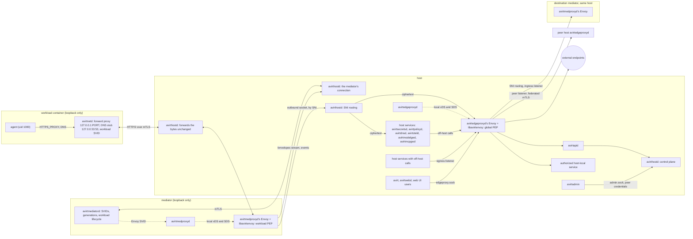
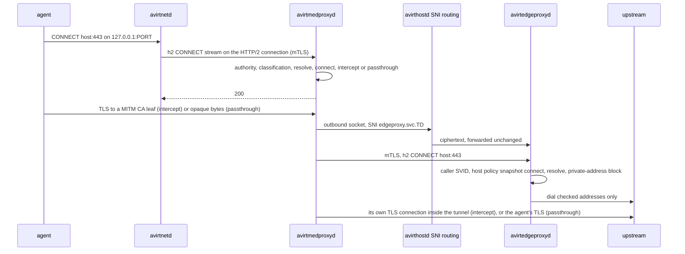
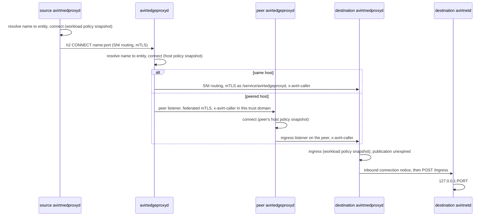

# Overview

This document is the map of avirt's network model. It names every path a byte can take and the policy enforcement point (PEP) and identity on each hop, and it links to the document that specifies each part. Where this document and a linked document differ, the linked document is the specification.

The model rests on four rules:

- The workload container and the mediator have no network interface other than loopback. Every connection either one makes runs on a Unix socket the compute runtime provides, backed by vsock, a bind mount or a Docker named volume (see [workload topology](./workload-topology.md#runtime-provided-sockets)).
- The workload container's only connection is its HTTP/2 connection to its own mediator, and the agent's only way onto that connection is avirtnetd's forward proxy and DNS stub.
- avirtedgeproxyd is the single global PEP for workload-to-workload, service, host-local service and external connections, and the only host service that opens connections off the host.
- Every hop that crosses a container or host boundary carries mutual TLS with SPIFFE identities from the first byte, and every hop in between where avirthostd routes by SNI or forwards the bytes unchanged carries ciphertext only (see [identity](./identity.md)).

# Status: implemented

The current code runs on the Apple container CLI runtime (see [compute runtimes](./compute-runtimes.md#apple-container-cli-runtime)). Its topology diagram is in [architecture](./architecture.md#status-implemented).

## Paths

| Path | Hops | Enforcement | Authentication |
| --- | --- | --- | --- |
| Agent to external | Agent, `HTTPS_PROXY` to avirtinitd's TCP proxy to `proxy.sock` on an ephemeral `127.0.0.1` port, `/run/avirt/proxy.sock`, avirtmediatord's CONNECT app on the host, upstream | The CONNECT app: authority parsing and the private-address block (see [CONNECT app](./egress.md#connect-app)). Every destination that passes is allowed under rule `allow-all`. | None on avirtinitd's TCP proxy. Only root in the workload container can open `proxy.sock` (0600). |
| The workload's HTTP/2 connection to its mediator, which today carries only log envelopes | avirtinitd, `/run/avirt/uplink.sock`, avirtmediatord, `hostd/hostd.sock`, avirthostd | avirthostd's `POST /workloads/<id>/stream` route (see [connection to the mediator](./workload-topology.md#connection-to-the-mediator)) | The `WORKLOAD <id> <secret>` connection header with the mediator secret, then `x-avirt-token` on `POST /workloads/<id>/stream` (see [identity](./identity.md#status-implemented)) |
| Egress events | avirtmediatord, `hostd/hostd.sock`, avirthostd | One event connection per workload | The `EGRESS <id> <secret>` connection header |
| CLI to avirthostd | `avirt`, cleartext HTTP/2 on `127.0.0.1:8787` (or `AVIRT_HOSTD_URL`), avirthostd | None | None: any local process can call the control API (see [control API](./hostd-api.md#control-api)) |

- **Workload network.** The workload container runs with `--network none`. TCP, UDP, DNS and IPv6 to anything but loopback fail inside it. avirtinitd sets `HTTPS_PROXY`, `https_proxy`, `HTTP_PROXY`, `http_proxy`, `ALL_PROXY`, `npm_config_proxy` and `npm_config_https_proxy` to avirtinitd's TCP proxy, `NO_PROXY` and `no_proxy` to `localhost,127.0.0.1`, and `NODE_USE_ENV_PROXY=1` (see [egress path](./egress.md#path)).
- **Off-host path.** avirtmediatord is a host process, and it resolves names with the host resolver and dials upstreams itself. If any resolved address fails the private-address block, the whole CONNECT is refused with 403 `private-dest`.
- **Socket domains.** avirtinitd's seccomp filter makes `socket()` with `AF_VSOCK`, `AF_NETLINK` or `AF_PACKET` return `EAFNOSUPPORT` for itself and the agent (see [seccomp](./workload-hardening.md#seccomp)).
- **Half-close constraint.** Nothing on a socket file that the runtime relays may half-close, so avirtinitd's TCP proxy never forwards a client's end-of-stream, and once the client has finished each read on the other direction has a 30 s idle timeout (see [TCP proxy to `proxy.sock`](./workload-topology.md#tcp-proxy-to-proxysock)).
- **Protocols.** The CONNECT app accepts only `CONNECT host:port`, with a hostname, a canonical dotted quad or a bracketed IPv6 literal. Any other method gets 501. Bytes inside the tunnel are opaque, so TLS, h2, gRPC and websockets pass through unseen. There is no UDP path.
- **Listeners.** avirthostd: `127.0.0.1:8787` (TCP) and `hostd/hostd.sock` (0600, in a 0700 directory). avirtmediatord: `workloads/<id>/proxy.sock` and `workloads/<id>/uplink.sock` (0600, in the 0700 workload directory). avirtinitd: its TCP proxy to `proxy.sock`, on an ephemeral `127.0.0.1` port inside the workload container. Every host path is under the runtime directory `$TMPDIR/avirt-<uid>/` (see [runtime directory](./lifecycle.md#runtime-directory)).
- **Failure.** avirtinitd starts neither its TCP proxy nor the agent until avirthostd has accepted `POST /workloads/<id>/stream` on the workload's HTTP/2 connection to its mediator, and gives up after 15 s. The mediator's stdin EOF ties its lifetime to avirthostd's. Each proxied connection becomes one `dir: "egress"` event when it closes, and connections still open at shutdown are flushed with `error: "shutdown"` (see [events](./egress.md#events)).

# Status: planned

## Topology

Each placement and what runs there is in [components](./components.md). The Unix sockets and SNI routing are in [workload topology](./workload-topology.md#runtime-provided-sockets), and the design invariants this topology satisfies are in [architecture](./architecture.md#design-invariants).

## Addressing and naming

### Zones and name forms

avirtdnsd answers the avirt DNS zone and is the only component that does. A local name ends in `<ns>.workload.host.avirt.internal` or `<ns>.svc.host.avirt.internal`, with a short form for the `default` namespace, and a peered name ends in `<ns>.workload.<host>` or `<ns>.svc.<host>` for an enrolled peer `<host>`. The name forms, the label syntax and the length caps are in [DNS](./dns.md#avirt-names).

avirt's host services are named by SNI `<name>.svc.<td>` in the trust domain (see [SNI routing](./workload-topology.md#sni-routing)), never by avirt names, and an agent CONNECT to one of those names is refused with 403.

### IDs

| ID | Form | Used for |
| --- | --- | --- |
| Canonical ID | The workload's UUIDv7, never reused | SPIFFE IDs (`/ns/<ns>/workload/<uuid>/…`), Cedar entities (`Workload::"<ns>/<uuid>"`), the `workload` field of every log record |
| Short ID | The UUIDv7's last 8 hex characters, unique on the host among live workloads and among ended ones still within their DNS TTL | The `<id>` DNS label only. Authorization never uses it. |
| Alias, generated name | `<alias>-<id>` and `<adverb>-<adjective>-<noun>` | DNS labels only. Both resolve to the canonical entity and grant nothing. |

Workload IDs are specified in [components](./components.md#workload-ids).

### Namespaces

Every workload is in exactly one namespace, fixed at creation, and the namespace scopes service names and aliases. A namespace is local to its host: anything on another host is addressed fully qualified, by its peered name, by an identity in that host's trust domain and by a Cedar entity qualified by that host (see [namespaces and labels](./components.md#namespaces-and-labels)).

### What a name resolves to

| Name | Asked from | DNS answer | Where a connection to it goes |
| --- | --- | --- | --- |
| A local avirt name | A workload, through avirtnetd's stub, the `/dns` stream and libavirtenvoy's `resolve` check, then [avirtdnsd](./dns.md#the-avirtdnsd-zone) | This host's avirtedgeproxyd address | avirtmedproxyd sends the CONNECT to this host's avirtedgeproxyd, which resolves the name to its canonical entity and routes to the destination's avirtmedproxyd |
| A peered avirt name | The same | The peer's avirtedgeproxyd address, from its enrollment record | avirtmedproxyd still sends the CONNECT to this host's avirtedgeproxyd, which forwards it to the peer's avirtedgeproxyd (see [peering](./peering.md#workload-traffic)) |
| A public name | A workload, through the same stub and `resolve` check, then avirtedgeproxyd's DNS proxy | The real answer, with `resolve` evaluated for every name in a CNAME chain | The CONNECT carries the name. avirtedgeproxyd resolves it again when it dials, and the private-address block applies. |
| A denied name | A workload | `NXDOMAIN`, in audit mode too | Nothing |
| Any name, asked of another address | A workload | None: the workload has no network | Nothing |

A proxy-aware client sends the name in its CONNECT, and the Envoys route by that name, never by the address DNS returned. A CONNECT to a bare avirtedgeproxyd address carries no name and is refused. avirtdnsd and the stub resolver are specified in [DNS](./dns.md), the query path and its `resolve` check in [workload DNS](./egress.md#workload-dns), and name-to-entity resolution in [egress policies](./egress-policies.md#name-resolution).

## Connection types

Every connection between two workloads is evaluated at three points, the source avirtmedproxyd, the avirtedgeproxyd of each host it touches, and the destination avirtmedproxyd, and every point must permit it (see [enforcement points](./egress-policies.md#enforcement-points)).

| Type | Hops | PEPs | Identity on each leg |
| --- | --- | --- | --- |
| Workload to external | Agent, avirtnetd's forward proxy, the workload's HTTP/2 connection to its mediator, avirtmedproxyd, SNI routing, avirtedgeproxyd's egress listener, upstream | avirtmedproxyd: workload policy snapshot `resolve`, `connect`, `intercept` or `passthrough`, `request`. avirtedgeproxyd: host policy snapshot `connect` and the private-address block. | Agent to avirtnetd: none, loopback. avirtnetd to avirtmedproxyd: workload SVID and avirtmedproxyd's SVID. SNI routing: ciphertext. avirtmedproxyd to avirtedgeproxyd: avirtmedproxyd's SVID and `/service/avirtedgeproxyd`. Upstream: webpki TLS, with avirtmedproxyd opening its own TLS connection to the upstream inside the tunnel under TLS interception, or the agent's own TLS under TLS passthrough. |
| Workload to model API | Agent, avirtnetd's forward proxy, the workload's HTTP/2 connection to its mediator, avirtmedproxyd, SNI routing, avirtmodelgwd, avirtedgeproxyd's egress listener, upstream | avirtmedproxyd as above. avirtmodelgwd: per-workload model rules and budgets. avirtedgeproxyd: host policy snapshot for avirtmodelgwd and the originating workload. | avirtmedproxyd to avirtmodelgwd: avirtmedproxyd's SVID and `/service/avirtmodelgwd`. avirtmodelgwd to avirtedgeproxyd: `/service/avirtmodelgwd` with the workload in `x-avirt-caller`. Upstream: avirtmodelgwd's TLS, with the injected credential. |
| Workload to same-host workload | Source avirtmedproxyd, SNI routing, avirtedgeproxyd's egress listener, SNI routing through `services/ingress-relay.sock`, the destination avirtmedproxyd's ingress listener, the `/inbound-notices` and `/ingress` HTTP/2 streams, avirtnetd, `127.0.0.1:<port>` | Source avirtmedproxyd: `resolve` and `connect`. avirtedgeproxyd: host policy snapshot `connect`. Destination avirtmedproxyd: `ingress` for the caller and port, and the publication's expiry. | Source leg as above. avirtedgeproxyd to destination: a new mTLS connection as `/service/avirtedgeproxyd`, with the source identity in `x-avirt-caller`. The bytes stay opaque to avirtedgeproxyd. |
| Workload to peer workload | Source avirtmedproxyd, this host's avirtedgeproxyd, the peer's peer listener, the peer's avirtedgeproxyd, then as same-host on the peer | Source avirtmedproxyd. This host's avirtedgeproxyd, against this host's host policy snapshot. The peer's avirtedgeproxyd, against its own host policy snapshot. The peer's destination avirtmedproxyd: `ingress`. | Between the two avirtedgeproxyd instances: `/service/avirtedgeproxyd` on both sides with federated bundles, and `x-avirt-caller` set to the originating workload in this host's trust domain, which the peer accepts only in the trust domain of the SVID that carried it (see [peering](./peering.md#workload-traffic)) |
| Workload to host service | avirtmedproxyd or avirtmediatord, SNI routing by `<name>.svc.<td>`, `services/<name>.sock` | The component's own authorization of the caller's SVID, workload and generation. No avirtedgeproxyd. | avirtmedproxyd's or avirtmediatord's SVID and `/service/<name>`. The agent reaches a host service only through a named HTTP/2 stream: `/dns` to avirtdnsd, `/mcp` to avirtmcpgwd, `/otlp` to avirtoteld, and the registry socket to avirtregistryd for a build job. |
| Workload to host-local service | Source avirtmedproxyd, avirtedgeproxyd's egress listener, the backend address in a service record | avirtmedproxyd: `connect` to the `Service`. avirtedgeproxyd: host policy snapshot `connect`, and a dial to that record's backend only, the one host address the private-address block lets through. | Source leg as above. avirtedgeproxyd to the backend: whatever the backend speaks, from the host. |
| Inbound to a published port or service | A workload or avirtapid on this host, or a peer's avirtedgeproxyd on the peer listener, then avirtedgeproxyd, SNI routing through `services/ingress-relay.sock`, the destination avirtmedproxyd's ingress listener, avirtnetd, `127.0.0.1:<port>` or `guestd` | avirtedgeproxyd: host policy snapshot `connect`, publication expiry. Destination avirtmedproxyd: `ingress`. avirtnetd: only unexpired ports in its publication set. avirtguestd authorizes each operation for the `guestd` target. | `/service/avirtedgeproxyd` on the ingress listener, with the source in `x-avirt-caller` |
| avirt, avirtwebd, avirtguest to avirtapid | avirt over gRPC and avirtwebd over REST, on `edgeproxy.sock`, then avirtedgeproxyd, avirtapid, avirthostd. avirtguest: `guest.sock`, the `/guest-cli` HTTP/2 stream, avirtmedproxyd, SNI routing, avirtedgeproxyd, avirtapid, avirthostd. With `--host`, avirtapid forwards through avirtedgeproxyd to the peer's avirtapid. | avirtedgeproxyd: host policy snapshot `connect` to `HostService::"avirtapid"`. avirthostd: the control-plane action, and for `guest-cli` the workload management constraints. A peer's avirtapid: the peer's host policy snapshot and the enrollment's routes. | `edgeproxy.sock`: the socket's mode, as the local user, `via: "client"`. avirtguest: `SO_PEERCRED` on `guest.sock`, then the `…/workload/guest-cli` principal that avirtmedproxyd sets in `x-avirt-caller`. avirtedgeproxyd to avirtapid: `/service/avirtedgeproxyd` with `x-avirt-caller`. avirtapid to avirthostd: `/service/avirtapid`. |
| avirtadmin to avirthostd | `admin.sock` in the runtime directory, directly | avirthostd: host policy snapshot, as `Admin::"uid:<uid>"`, `via: "admin"` | Peer credentials (`LOCAL_PEERCRED` on macOS, `SO_PEERCRED` on Linux), avirthostd's own UID or root only. No TLS, no avirtedgeproxyd. |
| Host services off-host | The host service, an h2 CONNECT stream to avirtedgeproxyd's egress listener, upstream | avirtedgeproxyd: host policy snapshot `connect` for the host service, and for the originating principal on a call made on a caller's behalf, plus the private-address block | `/service/<name>`, with `x-avirt-caller` from avirtapid, avirtmodelgwd and avirtmcpgwd only. Child processes reach the network only through their parent daemon: secret provider plugins through avirtsecretsd's local egress socket, the Collector through avirtoteld, and zot not at all. |
| Build jobs | The build runner's registry socket, avirtmedproxyd, SNI routing by `avirtregistryd.svc.<td>`, avirtregistryd. Every other connection: avirtnetd's forward proxy, avirtmedproxyd, avirtedgeproxyd. | avirtregistryd: the job's grant (inputs, cache scopes, `staging/<build-id>`). avirtmedproxyd and avirtedgeproxyd: the job's workload policy snapshot and the host policy snapshot. avirthostd refuses a build job's `/guest-cli` stream. | The job's workload SVID only. BuildKit's containers use the build VM's loopback, so they reach only avirtnetd's forward proxy. |

The specifications are: [avirtmedproxyd pipeline](./egress.md#avirtmedproxyd-pipeline) and [edge proxy egress](./egress.md#edge-proxy-egress) for egress, [ingress](./workload-topology.md#ingress) for inbound connections, [avirtedgeproxyd](./components.md#avirtedgeproxyd) for services and host-local services, [peering](./peering.md) and [federation](./identity.md#federation) for peers, [guest CLI path](./guest-cli.md#path), [operator CLI contexts](./operator-cli.md#contexts-and-authentication), [admin CLI connection](./admin-cli.md#connection-and-authentication), [provider plugins](./secrets.md#provider-plugin-interface), [avirtoteld](./observability.md#avirtoteld) and [build jobs](./workspace-build.md#build-jobs).

### Workload to external

### Workload to workload

## Transports by runtime

Every runtime presents the same Unix sockets inside the containers under `/run/avirt/`. TLS roles are fixed whichever side dials, and every runtime relay, every hop where avirthostd forwards the bytes unchanged and every shared volume carries ciphertext only.

| Socket | Today, Apple container CLI | Containerization | Docker Desktop |
| --- | --- | --- | --- |
| Agent egress | `proxy.sock`, a host socket file relayed by the runtime, plaintext CONNECT | An h2 CONNECT stream on the workload's HTTP/2 connection to its mediator | The same as Containerization |
| Log envelopes | `uplink.sock`, a host socket file, whose bytes avirtmediatord forwards unchanged to `hostd.sock` | The `/envelopes` HTTP/2 stream, which avirtmedproxyd forwards on the mediator's connection to avirthostd | The same as Containerization |
| Workload's HTTP/2 connection to its mediator | None | A vsock connection from the workload VM to avirthostd's one listener on that VM's device, whose bytes avirthostd forwards unchanged to the current mediator generation's vsock connection | A per-workload Docker named volume `avirt-<id8>-sock`, with avirtmedproxyd's Envoy listening on `/run/avirt/workload.sock` and avirtnetd dialing it as `/run/avirt/mediator.sock`, inside the Docker Desktop VM |
| Mediator's connection to avirthostd | `hostd/hostd.sock` with the connection headers | vsock from the mediator VM | A single-file bind mount of `workloads/<id>/c.sock` |
| Mediator's outbound socket to avirthostd | None | vsock from the mediator VM to avirthostd's SNI routing | A single-file bind mount of `workloads/<id>/s.sock` |
| avirtmedproxyd's ingress listener | None | vsock from avirthostd into the mediator VM | Open (see [components](./components.md#open-questions)) |
| Host socket paths under the 104-byte limit | `proxy.sock`, `uplink.sock`, `hostd.sock` | None | `c.sock`, `s.sock` |

`AF_VSOCK` is denied to every workload process on every runtime, so only the runtime's own relay uses the workload VM's vsock device. The protocol of the workload's HTTP/2 connection to its mediator (TLS 1.3, then h2, with avirtnetd as client) is the same on every runtime. The sockets are specified in [workload topology](./workload-topology.md#runtime-provided-sockets) and per runtime in [compute runtimes](./compute-runtimes.md#unix-sockets) and [Docker Desktop](./compute-runtimes.md#docker-desktop-runtime). The path-length rule is in [lifecycle](./lifecycle.md#path-length).

## Protocols

| Protocol | Behavior |
| --- | --- |
| CONNECT over h1 | The agent's only egress protocol. avirtnetd's forward proxy accepts `CONNECT host:port` and answers any other method with 501 (`plain-http` for an absolute `http://` URI, `unsupported-method` otherwise). |
| CONNECT over h2 | Every hop after avirtnetd: one HTTP/2 stream per agent connection, and one stream per connection from avirtmedproxyd, a gateway or a host service to avirtedgeproxyd. `x-avirt-caller` is a header on the outer stream, never in the tunnelled bytes. |
| TLS on port 443 | Under TLS interception, when `intercept` is permitted, avirtmedproxyd's Envoy terminates it with a MITM CA leaf, with agent-facing ALPN `http/1.1`, and opens its own TLS connection to the upstream with ALPN `h2` and `http/1.1`. Otherwise TLS passthrough, when `passthrough` is permitted (see [avirtmedproxyd pipeline](./egress.md#avirtmedproxyd-pipeline)). |
| TLS passthrough | avirtmedproxyd's Envoy reads the first bytes before forwarding any. They must be a ClientHello whose SNI equals the canonical CONNECT host, so an allowed host on a shared address cannot carry another name. A connection that does not start with TLS is closed unless the `passthrough` permit has `context.plaintext` true. No credential is injected. Every avirt name takes TLS passthrough, authorized at avirtedgeproxyd. |
| gRPC | Under TLS passthrough, as bytes. Under TLS interception, agent-facing h2 is offered only for a destination that one of the workload's gRPC bindings names (see [gRPC credentials](./egress-credentials.md#grpc)). |
| Websockets | An `Upgrade` request forces h1 upstream. The upgrade request passes the request checks and the placeholder misuse check, and frames are relayed unscanned after `101` (see [websockets](./egress.md#websockets)). |
| DNS | UDP and TCP on `127.0.0.53:53` inside the workload container, carried as length-prefixed messages on the long-lived `/dns` HTTP/2 stream (see [workload DNS](./egress.md#workload-dns)) |
| UDP, QUIC and HTTP/3 | Unsupported. No UDP leaves the workload container except DNS to the stub, so a client that tries HTTP/3 falls back to TCP through the proxy. Transparent TCP and UDP are separate planned features with their own security design (see [transport scope](./egress.md#transport-scope)). |
| `git://`, `ssh://` and other clients that ignore the proxy variables | Unsupported. They fail, because the workload has no network. |
| IPv6 | The workload has no IPv6 route. A CONNECT may name a bracketed IPv6 literal, which only a policy naming that `resource.ip` can permit. The private-address block covers the IPv6 non-global ranges, and IPv4-mapped and IPv4-compatible literals are refused (see [external host canonicalization](./egress-policies.md#external-host-canonicalization)). avirtedgeproxyd's Envoy dials IPv6 upstreams where the host has an IPv6 route. |

## Ports and listeners

Every listener's caller identity and allowed operations are in [trust boundaries](./trust-boundaries.md#listeners), and the workload container's listeners exempt from mutual TLS in [local exceptions](./trust-boundaries.md#local-exceptions). This inventory names where each one is.

| Placement | Listener | Transport |
| --- | --- | --- |
| Workload container | avirtnetd's forward proxy `127.0.0.1:PORT`, an ephemeral port | TCP, loopback |
| Workload container | DNS stub `127.0.0.53:53` | UDP and TCP, loopback |
| Workload container | Agent sockets `/run/avirt/agent/guest.sock` and `/run/avirt/agent/mcp.sock` | Unix, uid 1000 only |
| Workload container | Local service sockets `/run/avirt/streams/<role>.sock`, launcher sockets `/run/avirt/init/<role>.sock` | Unix, one helper UID each |
| Workload container | Published ports, `127.0.0.1:<port>`, served by workload processes | TCP, loopback, reached only through avirtnetd's reverse proxy |
| Mediator | avirtmedproxyd's Envoy: the workload's connection `/run/avirt/workload.sock`, the ingress listener `/run/avirt/ingress.sock` | Runtime-provided Unix socket, mTLS 1.3, h2 |
| Mediator | avirtmedproxyd's local xDS and SDS `/run/avirt/xds.sock`, libavirtenvoy's status socket, the Envoy's admin socket | Unix, local |
| Host | avirthostd's end of the mediator's connection, one per workload | Runtime-provided Unix socket, mTLS 1.3, h2 |
| Host | avirthostd's SNI routing: each mediator's outbound socket, and `services/ingress-relay.sock` for avirtedgeproxyd | Runtime-provided Unix socket and Unix, TLS not terminated |
| Host | Host service listeners `services/<name>.sock` (0660 with a group), the issuer `services/issuer.sock` | Unix, mTLS 1.3 (the issuer accepts an enrollment token or a current SVID) |
| Host | avirtedgeproxyd's local client listener `edgeproxy.sock` and avirthostd's `admin.sock`, in the runtime directory | Unix, 0600, user-owned |
| Host | avirtedgeproxyd's local xDS and SDS for its Envoy, and the Envoy's admin socket | Unix, local |
| Host | avirtedgeproxyd's egress listener | mTLS 1.3, h2, for avirtmedproxyd through SNI routing and for host services |
| Host | avirtedgeproxyd's peer listener, on the `peering.listen` addresses, default port 8788, and absent while `peering.listen` is empty | TCP on the host network, mTLS 1.3 with federated bundles, with the SPIFFE bundle endpoint (see [peer listener](./peering.md#peer-listener)) |
| Host | zot, `127.0.0.1:<port>` | Loopback TCP, mTLS from avirtregistryd's private CA |
| Host | Workload stdio logs `logs/<workload-id>.stdio.ndjson` | Files, not a listener, read by avirtlogd |

The peer listener is the only listener on a non-loopback address.

## Off-host enforcement

avirtedgeproxyd is the only host service that opens connections off the host. The host enforces this below the daemons' configuration, so a compromised or misconfigured daemon still cannot reach the network directly. The mediator and the workload container need no host rule, because they have no network interface.

### macOS host

A Network Extension content filter, shipped as a system extension in the avirt app bundle, enforces the rule on a direct macOS install.

- **Scope.** The filter evaluates every new non-loopback flow. It identifies the process that opened the flow from the flow's `sourceProcessAuditToken` and checks the process's code signature against the avirt designated requirement. Flows from processes outside avirt's signing identity are allowed unchanged.
- **Rule.** A flow from the Envoy binary that avirtedgeproxyd runs is allowed. A flow from any other avirt-signed process is dropped: every host service, avirthostd and its Containerization shim, zot, the OpenTelemetry Collector and every secret provider plugin avirt ships. Loopback and Unix-socket connections are not filtered.
- **Identity.** The filter keys on the code signature, not the UID, so it holds when every host service runs as the user's own UID.
- **Fail closed.** avirthostd reads the filter's state from `NEFilterManager` at start and while it runs. While the filter is not enabled and running, avirthostd refuses new launches with 503, and it records the state in the `start` meta event of every workload.
- **DNS.** avirtedgeproxyd's Envoy resolves external names with its own resolver against the configured upstream servers, so its queries are its own flows. No other host service resolves an external name: each one hands the name to avirtedgeproxyd in its CONNECT.
- **Install.** The system extension requires the content filter entitlement, a Developer ID signature, the app in `/Applications`, and the user's approval in System Settings or an MDM profile that pre-approves it.

### Linux and the all-in-one server image

In the all-in-one server image, avirtinitd in server mode installs an nftables ruleset in the container's network namespace before it starts any host service, and then drops `CAP_NET_ADMIN`.

- **Rule.** In an `inet` family output chain with policy `drop`: accept everything on `lo`, accept established and related traffic, accept new flows with `meta skuid` equal to the UID of avirtedgeproxyd's Envoy, and drop the rest. The same chain covers TCP, UDP (including DNS) and IPv6.
- **Identity.** Each host service already runs under its own UID in the image (see [all-in-one server image](./components.md#all-in-one-server-image)), and a child process such as zot, the Collector or a provider plugin runs under its parent's UID or its own, never that of avirtedgeproxyd's Envoy.
- **Fail closed.** If the ruleset cannot be installed, avirtinitd starts no host service and the image exits.

## Failure behavior

| Event | Effect | Specified in |
| --- | --- | --- |
| The workload's HTTP/2 connection to its mediator fails with no replacement | avirtnetd reconnects. The agent cgroup is frozen while no connection of the current or a higher generation is attached, and killed after 30 s. Open egress streams end and clients retry. | [freeze and reconnect](./workload-topology.md#freeze-and-reconnect) |
| The mediator exits | avirthostd starts a new generation, at most twice per workload. The new generation's SVIDs supersede the old ones at every listener. | [mediator container](./components.md#mediator-container) |
| The mediator's connection to avirthostd is lost | avirtmediatord exits, with the effect above | [connection to avirthostd](./workload-topology.md#connection-to-avirthostd) |
| avirthostd's SNI routing sees no SNI, an unknown SNI or a destination outside the workload's set | avirthostd closes the connection before forwarding a byte | [SNI routing](./workload-topology.md#sni-routing) |
| A destination is denied | 400 `bad-request`, 403 (policy, `private-dest`, a host service authority, a name with no entity), 421 (`Host` mismatch), 501 (not CONNECT). A denied DNS name gets `NXDOMAIN`. | [avirtmedproxyd pipeline](./egress.md#avirtmedproxyd-pipeline), [edge proxy egress](./egress.md#edge-proxy-egress) |
| Upstream DNS or dial fails | 502, or 504 after the 10 s connect timeout | [edge proxy egress](./egress.md#edge-proxy-egress) |
| An Envoy has no valid policy snapshot | avirtmedproxyd is not ready and no agent starts. avirtedgeproxyd refuses every stream with 503. An expired policy snapshot denies every new connection, request and DNS query. | [policy failure behavior](./egress-policies.md#policy-failure-behavior) |
| A policy snapshot change or expiry | Each Envoy re-evaluates its open flows | [revocation of open flows](./egress-policies.md#revocation-of-open-flows) |
| A workload's event ring is full | Its Envoy refuses that workload's new connections, requests and DNS queries with 503 until the ring drains | [events](./egress.md#events-1) |
| A publication is revoked or expires | Its open ingress streams close | [ingress](./workload-topology.md#ingress) |
| The off-host filter is not active | avirthostd refuses new launches with 503 | [off-host enforcement](#off-host-enforcement) |

## Observability

| Signal | Producer | Specified in |
| --- | --- | --- |
| `conn`, `http` and `dns` events in the workload log, with `src` `mediator`, `edgeproxy` or `gateway` | avirtmedproxyd, avirtedgeproxyd, the gateways | [events](./egress.md#events-1), [event provenance](./trust-boundaries.md#event-provenance) |
| `CONNECT` and per-request spans | avirtmedproxyd, avirtedgeproxyd, the gateways | [egress spans](./observability.md#egress-spans) |
| Trace context across hops, never to external endpoints and only `traceparent` to peers | Every hop | [propagation](./observability.md#propagation), [external endpoints](./observability.md#external-endpoints) |
| Connection and egress metrics | avirtnetd, the mediator, the Envoys | [workload connection](./performance.md#workload-connection-to-the-mediator), [egress](./performance.md#egress), [libavirtenvoy metrics](./observability.md#libavirtenvoy-metrics), [Envoy stats](./observability.md#envoy-stats) |
| Alerts, such as `EventRingRefusing` and `PolicySnapshotExpiring` | Grafana rules | [alerts](./observability.md#alerts) |

The bypass checks that prove the workload has no other way out are in the [regression suite](./roadmap.md#regression-suite).

# Open questions

1. **Host service path to the egress listener.** avirtedgeproxyd's egress listener accepts host services, but the host-side socket or address they dial, and how it is restricted to host service UIDs, is not specified.
2. **Development builds on macOS.** An ad-hoc signed development build cannot carry the content filter entitlement. Whether such a build runs with the off-host rule enforced only by configuration, marked in the `start` meta event, or uses a pf anchor that blocks by address for the processes it can name, is open.
3. **Host-local backends and avirt's own listeners.** Whether a service record may name a host-local backend on a port that an avirt component listens on, such as zot's loopback port, or the host's address check excludes those ports, is open.
