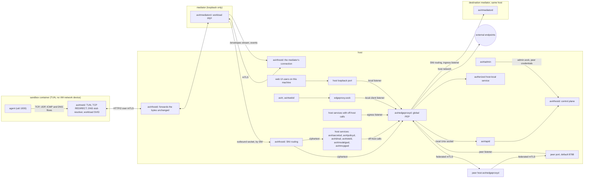
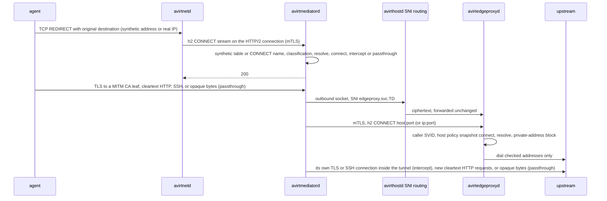
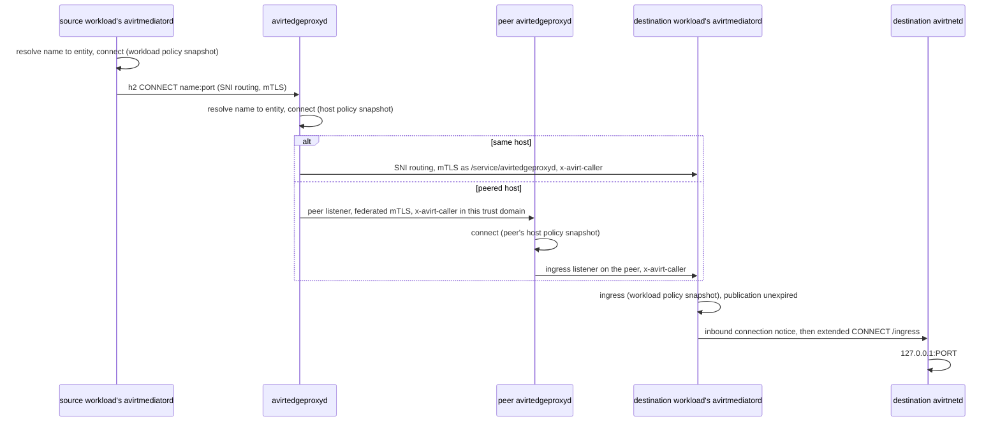

# Status: implemented

The current code runs on the Apple container CLI runtime (see [compute runtimes](./compute-runtimes.md#apple-container-cli-runtime)). Its topology diagram is in [architecture](./architecture.md#status-implemented).

## Paths

| Path | Hops | Enforcement | Authentication |
| --- | --- | --- | --- |
| Agent to external | Agent, `HTTPS_PROXY` to avirtinitd's TCP proxy to `proxy.sock` on an ephemeral `127.0.0.1` port, `/run/avirt/proxy.sock`, avirtmediatord's CONNECT app on the host, upstream | The CONNECT app: authority parsing and the private-address block (see [CONNECT app](./egress.md#pingora-connect-app)). Rule `allow-all` permits each destination that passes. | None on avirtinitd's TCP proxy. Only root in the sandbox container can open `proxy.sock` (0600). |
| The workload's HTTP/2 connection to its mediator, which today transports only log envelopes | avirtinitd, `/run/avirt/mediator.sock`, avirtmediatord, `hostd/hostd.sock`, avirthostd | avirthostd's `POST /workloads/<id>/stream` route (see [connection to the mediator](./workload-topology.md#connection-to-the-mediator)) | The `WORKLOAD <id> <secret>` connection header with the mediator secret, then `x-avirt-token` on `POST /workloads/<id>/stream` (see [identity](./identity.md#status-implemented)) |
| Egress events | avirtmediatord, `hostd/hostd.sock`, avirthostd | One event connection per workload | The `EGRESS <id> <secret>` connection header |
| Operator CLI to avirthostd | `avirt`, cleartext HTTP/2 on `127.0.0.1:8787` (or `AVIRT_HOSTD_URL`), avirthostd | None | None: any local process can call the control API (see [control API](./hostd-api.md#control-api)) |

- **Workload network.** The sandbox container runs with `--network none`. TCP, UDP, DNS and IPv6 to anything but loopback fail inside it. avirtinitd sets `HTTPS_PROXY`, `https_proxy`, `HTTP_PROXY`, `http_proxy`, `ALL_PROXY`, `npm_config_proxy` and `npm_config_https_proxy` to avirtinitd's TCP proxy, `NO_PROXY` and `no_proxy` to `localhost,127.0.0.1`, and `NODE_USE_ENV_PROXY=1` (see [egress path](./egress.md#path)).
- **Off-host path.** avirtmediatord is a host process, and it resolves names with the host resolver and dials upstreams itself. If any resolved address fails the private-address block, avirtmediatord refuses the whole CONNECT with 403 `private-dest`.
- **Socket domains.** avirtinitd's seccomp filter makes `socket()` with `AF_VSOCK`, `AF_NETLINK` or `AF_PACKET` return `EAFNOSUPPORT` for itself and the agent (see [seccomp](./workload-hardening.md#seccomp)).
- **Half-close constraint.** Nothing on a socket file that the runtime relays may half-close, so avirtinitd's TCP proxy never forwards a client's end-of-stream, and once the client has finished each read on the other direction has a 30 s idle timeout (see [TCP proxy to `proxy.sock`](./workload-topology.md#tcp-proxy-to-proxysock)).
- **Protocols.** The CONNECT app accepts only `CONNECT host:port`, with a hostname, a canonical dotted quad, or a bracketed IPv6 literal. Any other method gets 501. Bytes inside the tunnel are opaque, so TLS, h2, gRPC, and websockets pass through unseen. UDP has no path through this proxy.
- **Listeners.** avirthostd: `127.0.0.1:8787` (TCP) and `hostd/hostd.sock` (0600, in a 0700 directory). avirtmediatord: `workloads/<id>/proxy.sock` and `workloads/<id>/mediator.sock` (0600, in the 0700 workload directory). avirtinitd: its TCP proxy to `proxy.sock`, on an ephemeral `127.0.0.1` port inside the sandbox container. Each host path is under the runtime directory `$TMPDIR/avirt-<uid>/` (see [runtime directory](./lifecycle.md#runtime-directory)).
- **Failure.** avirtinitd doesn't start its TCP proxy or the agent until avirthostd has accepted `POST /workloads/<id>/stream` on the workload's HTTP/2 connection to its mediator, and gives up after 15 s. The mediator's stdin EOF ties its lifetime to avirthostd's. Each proxied connection becomes one `dir: "egress"` event when it closes, and the mediator flushes connections still open at shutdown with `error: "shutdown"` (see [events](./egress.md#events)).

# Status: planned

On Containerization, the sandbox VM has no network device. avirtinitd configures a TUN and nftables REDIRECT rules inside it. The guest kernel handles TCP. avirtnetd forwards each flow over a mutually authenticated HTTP/2 connection to the workload's mediator. avirtmediatord enforces the workload policy snapshot, and avirtedgeproxyd enforces the host policy snapshot and opens upstream sockets. Only avirtedgeproxyd opens connections off the host.

## Overview

This document is the map of avirt's network model. It identifies each path a byte can take and the policy enforcement point (PEP) and identity on each hop, and it links to the document that specifies each part. Where this document and a linked document differ, the linked document is the specification.

The model rests on four rules:

- The workload connects to its mediator through a Unix socket that the compute runtime provides. The mediator has no network interface other than loopback and uses runtime-provided Unix sockets backed by vsock, a bind mount or a Docker named volume (see [workload topology](./workload-topology.md#runtime-provided-sockets)).
- avirtnetd provides the workload's HTTP/2 connection to its mediator. Every flow through the TUN, TCP REDIRECT, optional forward proxy or DNS stub resolver uses that connection.
- avirtedgeproxyd is the only global PEP for workload-to-workload, service, host-local service and external connections, and the only host service that opens connections off the host. It runs on the host (see [where avirtedgeproxyd runs](./components.md#where-avirtedgeproxyd-runs)).
- Each hop that crosses a container or host boundary uses mutual TLS with SPIFFE identities from the first byte, and each intermediate hop where avirthostd routes by SNI or forwards the bytes unchanged transmits ciphertext only (see [identity](./identity.md)).

## Topology

avirtedgeproxyd runs on the host for both runtimes. Each placement is in [components](./components.md). The runtime-provided Unix sockets and SNI routing are in [workload topology](./workload-topology.md#runtime-provided-sockets), and the design invariants are in [architecture](./architecture.md#design-invariants).

avirtmediatord is one process with one UID and the SVID `/ns/<ns>/workload/<uuid>/mediator/<gen>`. Its process restrictions allow the operations that its traffic inspection, credential injection, and lifecycle handling need. avirtedgeproxyd and avirtapid are separate processes. [Workload topology](./workload-topology.md) specifies the sockets, handshake, and lifecycle streams. [Trust boundaries](./trust-boundaries.md) lists listeners and caller identities.

## Guest networking

avirtinitd opens the TUN with `IFF_TUN | IFF_NO_PI` and assigns IPv4 and IPv6 addresses and default routes. It hands its descriptor to avirtnetd. IPv6 addresses use `IFA_F_NODAD`. The exact TUN prefixes remain a configuration choice.

The TUN belongs to avirtnetd, and no other workload process reads its packets.

nftables redirects TCP to avirtnetd's transparent listeners, except loopback and the listeners' own ports. IPv4 uses `SO_ORIGINAL_DST`. A separate IPv6-only listener uses `IP6T_SO_ORIGINAL_DST`. Each listener refuses an original destination that's loopback, unspecified, multicast, link-local, or within the TUN's own prefixes. UDP and TCP port 53, regardless of destination address, reach the DNS stub resolver. The TUN reader also routes UDP port 53 to that resolver.

avirtnetd receives other UDP and ICMP packets through the TUN. TCP that reaches the TUN gets RST, so removing the REDIRECT rules breaks TCP rather than providing another route. avirtnetd silently drops multicast, broadcast, mDNS, and link-local packets. It maps upstream errors to the correct flow and drops errors with forged quotations. Refusals produce TCP RST or an appropriate ICMP administrative-prohibition or port-unreachable error.

Fragment handling requires either bounded reassembly, with at most 32 fragments, 64 KiB, and 2 s, or a high MTU with Fragmentation Needed and Packet Too Big responses. The fragment strategy needs a runtime test before use. TCP Fast Open and MPTCP don't work end to end across split TCP and fall back. avirtinitd sets `net.mptcp.enabled=0`. Seccomp denies `IPPROTO_MPTCP`.

Only avirtinitd needs `CAP_NET_ADMIN` during setup. It drops that capability from the bounding set before starting other processes. The agent has no capabilities. Seccomp denies `AF_PACKET`, `AF_NETLINK`, and `AF_VSOCK`, while `ping_group_range` permits unprivileged `SOCK_DGRAM` ICMP echo sockets. The Containerization VM starts without a network device. Docker uses `--network none`. Support for `/dev/net/tun` with `NET_ADMIN` before avirtinitd drops privileges still needs a runtime check.

The loopback HTTP CONNECT forward proxy remains available to explicitly configured clients. avirt doesn't set proxy environment variables by default. Both transparent flows and forward-proxy flows pass through the same mediator policy checks.

## HTTP/2 streams

| Traffic | Stream | Destination and framing |
| --- | --- | --- |
| TCP | CONNECT | One stream per flow, with the original IP address and port, or the forward proxy's CONNECT authority |
| UDP | CONNECT-UDP | One immutable destination per stream with RFC 9298 Context ID and DATAGRAM capsules |
| ICMP echo | Extended CONNECT with `:protocol` `icmp` | One checked destination per stream. Messages contain `{type, id, seq, payload}` |
| DNS | POST `/dns` | One stream per query, with DNS over HTTPS (RFC 8484) requests and responses |
| TCP ingress | Extended CONNECT on `/ingress` with `:protocol` `connect-tcp` | A published port on a destination workload |
| UDP ingress | CONNECT-UDP | One authenticated association per stream to a published UDP port |

avirtedgeproxyd accepts CONNECT, CONNECT-UDP and `icmp` streams, and forwarded HTTP from mediators and authorized host services. Its peer listener supports CONNECT, CONNECT-UDP and `icmp` streams, and forwarded HTTP between hosts. Every connection across a container or host boundary uses mutual TLS. The principal comes from the caller's SVID, never from a packet's source address. `x-avirt-caller` states the originating principal only on paths whose sender may set it.

TCP half-close maps to HTTP/2 `END_STREAM`. Every tunnel explicitly shuts down its sending side and drains the peer with a deadline. It logs the result. Resetting or dropping an h2 stream discards queued data, and a dropped stream doesn't establish that the peer received its bytes.

UDP uses connected upstream sockets. Its flow key includes the source address and source port as well as the destination. The receiver checks capsule length before allocation, with a limit of 65,535 bytes for UDP. An oversize capsule resets the stream. Receivers release HTTP/2 flow-control capacity on read before dropping a datagram. Without capacity, a sender drops the whole datagram before writing its first byte. Queues have bounds, and scheduling provides fair progress when peers read and write within their limits. Stalled readers and writers require tests in both directions. UDP streams expire after 60 s idle. A separate HTTP/2 connection for bulk traffic remains an option to assess.

## Addressing and naming

### Zones and name forms

avirtdnsd answers the avirt DNS zone and is the only component that does. A local name ends in `<ns>.workload.host.avirt.internal` or `<ns>.svc.host.avirt.internal`, with a short form for the `default` namespace, and an avirt hostname under a peer's host name ends in `<ns>.workload.<host>` or `<ns>.svc.<host>` for an enrolled peer `<host>`. The name forms, the label syntax and the length caps are in [DNS](./dns.md#avirt-hostnames).

avirt's host services use SNI names `<name>.svc.<td>` in the trust domain (see [SNI routing](./workload-topology.md#sni-routing)), never avirt hostnames, and the mediator refuses an agent CONNECT to one of those names with 403.

### IDs

| ID | Form | Used for |
| --- | --- | --- |
| Canonical ID | The workload's UUIDv7, never reused | SPIFFE IDs (`/ns/<ns>/workload/<uuid>/…`), Cedar entities (`Workload::"<ns>/<uuid>"`), the `workload` field of each log record |
| Short ID | The UUIDv7's last 8 hex characters, unique on the host among live workloads and among ended ones still within their DNS TTL | The `<id>` DNS label only. Authorization never uses it. |
| Alias, generated name | `<alias>-<id>` and `<adverb>-<adjective>-<noun>` | DNS labels only. Both resolve to the canonical entity and grant nothing. |

[Components](./components.md#workload-ids) specifies workload IDs.

### Namespaces

Each workload is in exactly one namespace, fixed at creation, and the namespace scopes service names and aliases. A namespace is local to its host. References to anything on another host must use fully qualified identifiers: its avirt hostname under that host's name and an identity in that host's trust domain, along with a Cedar entity qualified by that host (see [namespaces and labels](./components.md#namespaces-and-labels)).

### Name resolution results

| Name | Asked from | DNS answer | Where a connection to it goes |
| --- | --- | --- | --- |
| A local avirt hostname | A workload, through avirtnetd's stub, the `/dns` stream and avirtmediatord's `resolve` check, then [avirtdnsd](./dns.md#the-avirtdnsd-zone) | A synthetic address for this name | avirtmediatord sends the HTTP/2 stream for the flow to this host's avirtedgeproxyd, which resolves the name to its canonical entity and routes to the destination workload's avirtmediatord |
| An avirt hostname under a peer's host name | The same | A synthetic address for this name | avirtmediatord still sends the HTTP/2 stream for the flow to this host's avirtedgeproxyd, which forwards it to the peer's avirtedgeproxyd (see [peering](./peering.md#workload-traffic)) |
| A public name | A workload, through the same stub and `resolve` check, then avirtedgeproxyd's DNS proxy | A synthetic answer, with `resolve` evaluated for each name in a CNAME chain | The flow includes the name. avirtedgeproxyd resolves it again when it dials, and the private-address block applies. |
| A denied name | A workload | `NXDOMAIN`, in audit mode too | Nothing |
| Any name, asked of another address | A workload | The same policy-checked synthetic answer or `NXDOMAIN` | Port 53 on any address reaches `/dns` |

The mediator gets a flow's name from its synthetic address table or an explicit CONNECT authority. SNI and Host on flows to literal IP addresses outside the synthetic ranges are observations, never names for policy. A bare edge address doesn't grant access. [DNS](./dns.md) specifies avirtdnsd and the DNS stub resolver. [Workload DNS](./egress.md#workload-dns) specifies the query path and its `resolve` check. See [egress policies](./egress-policies.md#name-resolution) for name-to-entity resolution.

## Names and DNS

avirtmediatord maintains a bounded synthetic address table for each workload. It never reassigns an address to a different name during that workload's lifetime, including across mediator restarts. Allocation fails when the table is full. Entries remain valid while flows are active and until the DNS answer's TTL expires. An expired entry's address stays bound to its name. Synthetic answers use `198.18.0.0/15` and a ULA `/64`. Selecting the exact IPv6 range remains open.

avirtmediatord canonicalizes IPv4-mapped IPv6 addresses to IPv4 before table lookup.

### Destination names

A synthetic address obtains its destination name only through this table, with `name_from: dns`. An explicit CONNECT authority gives `name_from: connect`. All other addresses have `name_from: none` and require policy for the IP destination. avirtmediatord logs SNI and HTTP Host observed on a flow to a literal IP address outside the synthetic ranges, but never uses them to assign a name to that flow. It refuses unknown synthetic addresses. Synthetic ranges aren't exceptions to the edge's `private-dest` check: the edge resolves and checks the real upstream address.

### Query handling

For each query avirtmediatord evaluates `resolve`, including every name in a CNAME chain. avirtedgeproxyd parses external DNS requests and obtains real answers. It never forwards arbitrary DNS bytes. avirtdnsd resolves [avirt hostnames](./dns.md#avirt-hostnames). The workload receives synthetic answers for both external and avirt hostnames. DNS has its own concurrency and admission limits, a query-type allowlist, and size and rate limits. Supported query types are A, AAAA, HTTPS, SVCB, and CNAME. MX and TXT need permission.

avirtmediatord rewrites address hints and removes `ech`. For intercepted names it also removes `h3`. It handles SVCB AliasMode, TargetName, `port`, and the consistency of `mandatory` and `no-default-alpn` after those removals. Intercepted HTTP responses omit `Alt-Svc`. Rewritten answers prevent guest DNSSEC validation. Encrypted DNS to a permitted endpoint is a possible channel under that endpoint's policy. Encoded data in permitted DNS names is another possible channel.

## Policy and endpoint checks

A `Destination` has ID `<protocol>/<host-or-ip>:<port>` and a `protocol` attribute. `connect` runs once per flow with `port`, `protocol`, `via`, and `name_from`. ICMP uses port 0. `name_from` is `dns`, `connect`, or `none`. `resolve` also receives the DNS server. `via: egress` means the workload's own flow or DNS query.

`intercept` receives `protocol: tls` or `ssh` and can permit any port. `passthrough` receives `detected: tls`, `quic`, `http`, `ssh`, or `unknown`. `request` receives the protocol, `http/1.1`, `h2`, or `ssh`, and the upgrade when applicable. For SSH, its method is the exec command and its path is the canonical repository path. `ingress` and `publish_port` support UDP as well as TCP and HTTP. [Egress policies](./egress-policies.md) specifies the entities and enforcement points.

### Address checks

avirtedgeproxyd resolves external names and checks every address before dialing it. `private-dest` rejects non-global addresses and addresses assigned to the host's interfaces for every protocol. A watcher using a routing socket supplies host interface addresses without enumerating interfaces on every flow. avirtedgeproxyd dials only checked addresses. It repeats the checks on retries. avirt hostnames resolve to Workload or Service entities. An authorized service record permits only its recorded backend.

A peer connection can use only the peer's enrolled addresses and never the host's own addresses.

Passthrough grants access to the checked endpoint, including whatever that endpoint tunnels. Policy needs interception to distinguish names that share an endpoint. On a named TLS or QUIC flow, SNI must equal the flow's hostname, and avirtmediatord refuses a ClientHello with `encrypted_client_hello`. HTTP Host must equal the flow's hostname. A mismatch gets 421, while an SNI mismatch closes the flow.

## HTTP and TLS

TLS interception works on any permitted port and offers `h2` and `http/1.1` downstream. The client's TLS ALPN selects the HTTP version, including for gRPC. avirtmediatord verifies upstream TLS and applies request policy and credential binding checks to every request, redirect, and request on a reused connection. hyper acts as the cleartext HTTP server and serializes new upstream requests. Cleartext HTTP receives request policy and `credential-misplaced` checks, but never credential injection.

`101` and h2c upgrades need explicit policy permission.

### Request parsing

avirtmediatord authorizes and serializes the same canonical request. It refuses duplicate bound headers, disagreement between `:authority` and Host, ambiguous Content-Length or Transfer-Encoding, and trailers that include client credentials. Absolute-form authority must agree with Host and the flow's hostname. Serialization converts it to origin-form. avirtmediatord strips hop-by-hop fields before injecting exactly one credential. An httparse pre-check examines every HTTP/1 request head before hyper can normalize ambiguity. Refusal may close the connection. Connection pooling and HTTP/1.1 keep-alive remain available with per-request authorization. HTTP/1, HTTP/2, and RFC 8441 translation need differential tests. gRPC binary metadata requires an explicit encoding contract.

### Streaming

A gRPC policy denial is a trailers-only HTTP 200 with `grpc-status: 7`, including `credential-misplaced` refusals. Other HTTP requests receive 403 `credential-misplaced`. A request body starts forwarding after a short deadline or byte threshold rather than waiting for the full placeholder scan. If the scan finds a placeholder after avirtmediatord has forwarded bytes, avirtmediatord resets the stream and logs `credential-misplaced`. This lets bidirectional gRPC make progress before the scan finishes.

SSE streams pass without buffering or a duration limit, subject to idle timeout. The 15-minute revocation grace applies only to model API traffic. Websocket upgrades pass request policy and placeholder checks. The relay strips `permessage-deflate` and refuses extensions that weren't negotiated. It scans unmasked client data across fragments and continuation frames with a bounded streaming matcher. Control frames have a separate scan. A hit closes with 1008 and records rejection of client credentials. The relay parses websocket frames in both directions so an injected Close can't split an upstream frame. Encoded placeholders can evade the scan.

## QUIC

QUIC uses passthrough after bounded Initial inspection on any port. A datagram whose first byte has both top bits set, `0xc0`, enters QUIC parsing. Failure to parse such a long-header packet is a refusal. Other datagrams, including RTP with `0x80` and QUIC with the fixed bit cleared under RFC 9287, use ordinary UDP policy.

Initial inspection supports QUIC v1 and v2 salts and reassembles CRYPTO from offset 0 into contiguous data, across at most 4 datagrams, 4 KiB, and 2 s. Inspection refuses contradictory retransmissions. Valid Initials split across datagrams must pass. Coalesced packets, Retry, and Version Negotiation require explicit handling. No 0-RTT data leaves before authorization. Real-client tests must include out-of-order CRYPTO, Retry, and 0-RTT.

avirt supplies the long-header and frame parser. rustls QUIC key derivation alone doesn't parse these structures. For passthrough, avirt uses quinn with its bounded Initial parser. avirt doesn't intercept QUIC. Intercepted names omit `h3` in DNS and `Alt-Svc` in HTTP responses. avirtmediatord refuses QUIC to those names so clients fall back to TCP.

## SSH and git

A git HTTPS binding installs `url.insteadOf` rules for its own host. Policy denies port 22 to that host unless an SSH binding exists. This isn't a universal git rewrite. SSH interception supports SSH-only remotes and policy-authorized non-git operations.

Classification as SSH, HTTP, or TLS happens from the port and policy before dialing. Port 22 or an SSH binding selects SSH, without a probe dial or wait for the server to speak first. avirtmediatord uses russh and the workload's host CA, presenting host certificates only for hosts permitted for SSH interception.

The guest's `@cert-authority` entry in `/etc/ssh/ssh_known_hosts` helps cooperating clients but isn't an enforcement boundary.

### Authentication and commands

The guest authenticates with a per-workload placeholder key, never `none`. A binding fixes the upstream username, host, port, pinned host key, and credential together. avirtmediatord connects upstream during authentication, so a host-key pin mismatch fails authentication. Upstream keys or certificates come from `binding_credential` and stay in mediator memory. Session and channel counts have per-workload caps.

By default, avirtmediatord supports only exec of `git-upload-pack`, `git-receive-pack`, and `git-upload-archive`. The command must match a strict grammar: one command and one single-quoted path, with shell syntax rejected. With the canonical path and authorization checked, avirtmediatord constructs its own upstream exec string. Shell, `pty-req`, environment requests other than `GIT_PROTOCOL`, forwarding, and subsystems need explicit policy permission. A repository-bound binding never permits SFTP.

## ICMP echo

The `icmp` stream supports ping only. Traceroute remains deferred. Opening the stream fixes and checks the destination, with 403 for a target outside the permitted scope. Messages contain `{type, id, seq, payload}` and no destination. Both the mediator and edge check type, length, and rate. Echo payloads are at most 512 bytes. The workload rate is 5 requests/s with burst 10, and each destination has a 1 request/s limit. Outstanding requests have a cap.

avirtedgeproxyd uses unprivileged ICMP datagram sockets and avirtnetd constructs reply packets. Linux rewrites the ICMP identifier, so Linux reply matching can't depend on it. Unrelated errors and information about private intermediate hops aren't returned to the workload. ICMP streams expire after 10 s idle.

## Ingress and peers

A TCP publication uses `/ingress` extended CONNECT with `:protocol` `connect-tcp` to connect to the destination mediator. Before avirtnetd opens the published loopback port, the destination mediator checks the authenticated source and its workload's `ingress` policy. These authorization boundaries apply to both same-host traffic and traffic through a peer's edge proxy.

UDP publications also require authorization. Each UDP association binds the authenticated caller, destination workload and generation, publication, protocol, and tunnel. The association also includes reply permission, expiry, revocation, and amplification limits. avirtnetd opens one ephemeral loopback UDP socket per inbound stream, and edge proxies also use CONNECT-UDP for UDP published ports.

## Connection types

Connections between two workloads require checks at these points: the source workload's avirtmediatord and the avirtedgeproxyd of each host it touches, plus the destination workload's avirtmediatord. Each point must permit it (see [enforcement points](./egress-policies.md#enforcement-points)).

| Type | Hops | PEPs | Identity on each leg |
| --- | --- | --- | --- |
| Workload to external | Agent, avirtnetd through TCP REDIRECT, the TUN or its optional forward proxy, the workload's HTTP/2 connection to its mediator, avirtmediatord, SNI routing, avirtedgeproxyd's egress listener, upstream | avirtmediatord: workload policy snapshot `resolve`, `connect`, `intercept` or `passthrough`, `request`. avirtedgeproxyd checks `connect` against the host policy snapshot and applies the private-address block. | Agent to avirtnetd: no TLS inside the sandbox container. avirtnetd to avirtmediatord: workload SVID and avirtmediatord's SVID. SNI routing: ciphertext. avirtmediatord to avirtedgeproxyd: avirtmediatord's SVID and `/service/avirtedgeproxyd`. TLS upstreams use webpki. Under TLS interception, avirtmediatord opens its own TLS connection to the upstream inside the tunnel. TLS passthrough uses the agent's own TLS. |
| Workload to model API | Agent, avirtnetd through TCP REDIRECT, the TUN or its optional forward proxy, the workload's HTTP/2 connection to its mediator, avirtmediatord, SNI routing, avirtmodelgwd, avirtedgeproxyd's egress listener, upstream | avirtmediatord applies the checks in the preceding row. avirtmodelgwd: per-workload model rules and budgets. avirtedgeproxyd: host policy snapshot for avirtmodelgwd and the originating workload. | avirtmediatord to avirtmodelgwd: avirtmediatord's SVID and `/service/avirtmodelgwd`. avirtmodelgwd to avirtedgeproxyd: `/service/avirtmodelgwd` with the workload in `x-avirt-caller`. Upstream: avirtmodelgwd's TLS, with the injected credential. |
| Workload to same-host workload | Source workload's avirtmediatord, SNI routing, avirtedgeproxyd's egress listener, SNI routing through `services/ingress-relay.sock`, the destination workload's avirtmediatord's ingress listener, the `/inbound-notices` and `/ingress` HTTP/2 streams for TCP or CONNECT-UDP for UDP, avirtnetd, `127.0.0.1:<port>` | Source workload's avirtmediatord: `resolve` and `connect`. avirtedgeproxyd: host policy snapshot `connect`. Destination workload's avirtmediatord: `ingress` for the caller and port, and the publication's expiry. | The source uses the identities in the preceding row. avirtedgeproxyd to destination: a new mTLS connection as `/service/avirtedgeproxyd`, with the source identity in `x-avirt-caller`. avirtedgeproxyd treats the bytes as opaque. |
| Workload to peer workload | Source workload's avirtmediatord, this host's avirtedgeproxyd, the peer's listener on its host, the peer's avirtedgeproxyd, then as same-host on the peer | Source workload's avirtmediatord. This host's avirtedgeproxyd, against this host's host policy snapshot. The peer's avirtedgeproxyd, against its own host policy snapshot. The destination workload's avirtmediatord on the peer: `ingress`. | Between the two avirtedgeproxyd instances: `/service/avirtedgeproxyd` on both sides with federated bundles, and `x-avirt-caller` set to the originating workload in this host's trust domain, which the peer accepts only in the trust domain of the SVID that supplied it (see [peering](./peering.md#workload-traffic)) |
| Workload to host service | avirtmediatord, SNI routing by `<name>.svc.<td>`, `services/<name>.sock` | The component's own authorization of the caller's SVID, workload, and generation. The path bypasses avirtedgeproxyd. | avirtmediatord's SVID and `/service/<name>`. Workload processes connect to a host service only through a named HTTP/2 stream: `/dns` to avirtdnsd, `/mcp` to avirtmcpgwd, `/otlp` to avirtoteld, and the registry socket to avirtregistryd for a build job. |
| Workload to host-local service | Source workload's avirtmediatord, avirtedgeproxyd's egress listener, the backend address in a service record | avirtmediatord: `connect` to the `Service`. avirtedgeproxyd checks `connect` against the host policy snapshot. It dials only that record's backend, the one host address the private-address block allows. | The source leg uses the preceding identities. avirtedgeproxyd to the backend: whatever the backend speaks from the host. |
| Inbound to a published port or service | A workload or avirtapid on this host, or a peer's avirtedgeproxyd on the peer listener, then avirtedgeproxyd, SNI routing through `services/ingress-relay.sock`, the destination workload's avirtmediatord's ingress listener, avirtnetd, `127.0.0.1:<port>` or `guestd` | avirtedgeproxyd: host policy snapshot `connect`, publication expiry. Destination workload's avirtmediatord: `ingress`. avirtnetd: only unexpired ports in its publication set. avirtguestd authorizes each operation for the `guestd` target. | `/service/avirtedgeproxyd` on the ingress listener, with the source in `x-avirt-caller` |
| avirt, avirtwebd, avirtguest to avirtapid | avirt over gRPC and avirtwebd over REST, on `edgeproxy.sock` in the runtime directory, avirtedgeproxyd's local Unix socket, then avirtedgeproxyd, avirtapid's local Unix socket, avirtapid, avirthostd. avirtguest: `guest.sock`, the `/guest-cli` HTTP/2 stream, avirtmediatord, SNI routing, avirtedgeproxyd, avirtapid, avirthostd. With `--host`, avirtapid forwards through avirtedgeproxyd to the peer's avirtapid. | avirtedgeproxyd requires the host policy snapshot to permit `connect` to `HostService::"avirtapid"`. avirthostd: the control-plane action, and for `guest-cli` the workload management constraints. A peer's avirtapid checks the peer's host policy snapshot and the enrollment's routes. | `edgeproxy.sock`: the socket's mode, as the local user, `via: "client"`. avirtguest: `SO_PEERCRED` on `guest.sock`, then the `…/workload/guest-cli` principal that avirtmediatord sets in `x-avirt-caller`. avirtedgeproxyd to avirtapid: `/service/avirtedgeproxyd` with `x-avirt-caller`. avirtapid to avirthostd: `/service/avirtapid`. |
| Web UI users to avirtwebd | A browser on this machine, avirtedgeproxyd's loopback listener on the host, avirtedgeproxyd, avirtwebd's local Unix socket, avirtwebd | avirtwebd: web UI user authentication (see [web UI](./components.md#web-ui)) | Browser to the host loopback port: none. avirtedgeproxyd to avirtwebd: `/service/avirtedgeproxyd`. |
| avirtadmin to avirthostd | `admin.sock` in the runtime directory, directly | avirthostd: host policy snapshot, as `Admin::"uid:<uid>"`, `via: "admin"` | Peer credentials (`LOCAL_PEERCRED` on macOS, `SO_PEERCRED` on Linux), avirthostd's own UID or root only. TLS and avirtedgeproxyd are absent from this path. |
| Host services off-host | The host service, avirtedgeproxyd's egress listener (CONNECT, CONNECT-UDP, `icmp` or forwarded HTTP), upstream from the host network | avirtedgeproxyd checks `connect` against the host policy snapshot for the host service. For a call made on a caller's behalf, it also checks the originating principal. It applies the private-address block | `/service/<name>`, with `x-avirt-caller` from avirtapid, avirtmodelgwd, and avirtmcpgwd only. Child processes connect to the network only through their parent daemon. Secret provider plugins use avirtsecretsd's local egress socket, and the Collector uses avirtoteld. zot never opens an off-host connection. |
| Build jobs | The build runner's registry socket, avirtmediatord, SNI routing by `avirtregistryd.svc.<td>`, avirtregistryd. Each other connection: avirtnetd through TCP REDIRECT, the TUN or its optional forward proxy, avirtmediatord, avirtedgeproxyd. | avirtregistryd: the job's grant (inputs, cache scopes, `staging/<build-id>`). avirtmediatord and avirtedgeproxyd: the job's workload policy snapshot and the host policy snapshot. avirthostd refuses a build job's `/guest-cli` stream. | The job's workload SVID only. BuildKit's containers send flows through avirtnetd's TCP REDIRECT or TUN, or its optional forward proxy. |

See the specifications for each path. [how avirtmediatord handles egress](./egress.md#how-avirtmediatord-handles-egress) and [edge proxy egress](./egress.md#edge-proxy-egress) for egress, [ingress](./workload-topology.md#ingress) for inbound connections, [avirtedgeproxyd](./components.md#avirtedgeproxyd) for services and host-local services, [peering](./peering.md) and [federation](./identity.md#federation) for peers, [guest CLI path](./guest-cli.md#path), [operator CLI contexts](./operator-cli.md#contexts-and-authentication), [admin CLI connection](./admin-cli.md#connection-and-authentication), [provider plugins](./secrets.md#provider-plugin-interface), [avirtoteld](./observability.md#avirtoteld), and [build jobs](./workspace-build.md#build-jobs).

### Workload to external

This sequence shows a TCP flow. UDP and ICMP use the stream types in [HTTP/2 streams](#http2-streams).

### Workload to workload

This sequence shows TCP ingress. UDP publications use CONNECT-UDP and the association rules in [ingress and peers](#ingress-and-peers).

## Transports by runtime

All runtimes present the same Unix sockets inside the containers under `/run/avirt/`. The dialing side never changes TLS roles. In the planned runtimes, each runtime relay and each hop where avirthostd forwards bytes unchanged transmits ciphertext only, as does each shared volume.

| Socket | Today, Apple container CLI | Containerization | Docker Desktop |
| --- | --- | --- | --- |
| Agent egress | `proxy.sock`, a host socket file relayed by the runtime, plaintext CONNECT | CONNECT, CONNECT-UDP or `icmp` streams on the workload's HTTP/2 connection to its mediator | The same as Containerization |
| Log envelopes | `mediator.sock`, a host socket file, whose bytes avirtmediatord forwards unchanged to `hostd.sock` | The `/envelopes` HTTP/2 stream, which avirtmediatord forwards on the mediator's connection to avirthostd | The same as Containerization |
| Workload's HTTP/2 connection to its mediator | None | A vsock connection from the sandbox VM to avirthostd's one listener on that VM's device, whose bytes avirthostd forwards unchanged to the current mediator generation's vsock connection | A per-workload Docker named volume `avirt-<id8>-sock`, with avirtmediatord listening on `/run/avirt/workload.sock` and avirtnetd dialing it as `/run/avirt/mediator.sock`, inside the Docker Desktop VM |
| Mediator's connection to avirthostd | `hostd/hostd.sock` with the connection headers | vsock from the mediator VM | A single-file bind mount of `workloads/<id>/c.sock` |
| Mediator's outbound socket to avirthostd | None | vsock from the mediator VM to avirthostd's SNI routing | A single-file bind mount of `workloads/<id>/s.sock` |
| avirtmediatord's ingress listener | None | vsock from avirthostd into the mediator VM | Open (see [components](./components.md#open-questions)) |
| avirthostd's SNI routing to avirtedgeproxyd's egress listener | None | Host Unix socket | Host Unix socket |
| avirtedgeproxyd to host services and `services/ingress-relay.sock` | None | Host Unix sockets | Host Unix sockets |
| Local client listener, `edgeproxy.sock` | None | Host Unix socket | Host Unix socket |
| Web UI users | None | TCP listener on the host's loopback interface | TCP listener on the host's loopback interface |
| Peer listener (`peering.listen`, default 8788) | None | TCP listener on the host | TCP listener on the host |
| Host socket paths under the 104-byte limit | `proxy.sock`, `mediator.sock`, `hostd.sock` | None | `c.sock`, `s.sock` |

avirtedgeproxyd reaches host services over local Unix sockets. Each service accepts mutual TLS connections. Peer authentication checks the exact SVID against the enrolled trust domain's bundle and never authorizes by source address.

On every runtime, the `AF_VSOCK` denial applies to every workload process. Only the runtime's own relay uses the sandbox VM's vsock device. For the workload's HTTP/2 connection to its mediator, the protocol (TLS 1.3, then h2, with avirtnetd as client) is the same on each runtime. [Workload topology](./workload-topology.md#runtime-provided-sockets) specifies the sockets. [Compute runtimes](./compute-runtimes.md#unix-sockets) and [Docker Desktop](./compute-runtimes.md#docker-desktop-runtime) specify them per runtime. [Lifecycle](./lifecycle.md#path-length) specifies the path-length rule.

## Protocols

| Protocol | Behavior |
| --- | --- |
| CONNECT and cleartext HTTP over h1 | The optional loopback forward proxy accepts configured clients' CONNECT requests. avirtmediatord acts as the cleartext HTTP server and checks requests, never forwarding them as raw bytes. |
| Extended CONNECT | `/ingress` uses RFC 8441 with `:protocol: connect-tcp` and a single-use ingress ID (see [ingress](./workload-topology.md#ingress)). |
| CONNECT over h2 | Each hop after avirtnetd uses one HTTP/2 stream per agent connection. Each connection from avirtmediatord, a gateway, or a host service to avirtedgeproxyd also uses one stream. `x-avirt-caller` is a header on the outer stream, never in the tunnelled bytes. |
| TLS on any port | On any port, when policy permits `intercept`, avirtmediatord is the agent's TLS endpoint using a MITM CA leaf. It offers agent-facing ALPN `h2` and `http/1.1` and opens its own TLS connection upstream with ALPN `h2` and `http/1.1`. Otherwise policy must permit `passthrough` (see [HTTP and TLS](#http-and-tls)). |
| TLS passthrough | On a named flow, the ClientHello SNI must equal the flow's hostname, and avirtmediatord refuses the `encrypted_client_hello` extension. On a flow to a literal IP address outside the synthetic ranges, avirtmediatord logs SNI but never matches it as a policy name. Credential injection stays off (see [HTTP and TLS](#http-and-tls)). |
| gRPC | Under TLS passthrough, as bytes. Under TLS interception, agent-facing h2 is available on every destination. Refusals use trailers-only `200` with `grpc-status: 7` (see [HTTP and TLS](#http-and-tls)). |
| Websockets | Websocket upgrades use HTTP/1 upstream. The upgrade request passes request policy and the `credential-misplaced` check. The relay scans client frames across fragments, and the relay parses websocket frames in both directions (see [websockets](./egress.md#websockets)). |
| DNS | Queries to UDP and TCP port 53 at any address use one `POST /dns` HTTP/2 stream per query with `application/dns-message` bodies and a separate stream limit (see [workload DNS](./egress.md#workload-dns)). |
| UDP and QUIC | UDP uses CONNECT-UDP. QUIC passthrough requires bounded Initial inspection. Intercepted names refuse QUIC so clients fall back to TCP (see [QUIC](#quic)). |
| SSH and raw TCP | Raw TCP uses REDIRECT without proxy variables. SSH interception requires a binding and policy. Git prefers HTTPS with per-binding rewrites (see [SSH and git](#ssh-and-git)). |
| IPv6 | Default IPv6 routes use the TUN. Flows to literal IP addresses outside the synthetic ranges refuse IPv4-mapped and IPv4-compatible literals, and the full [private-address block](./egress.md#private-address-block-private-dest) applies. avirtmediatord canonicalizes IPv4-mapped addresses before synthetic table lookup. avirtedgeproxyd dials IPv6 upstreams where the host has an IPv6 route. |

## Ports and listeners

Each listener's caller identity and allowed operations are in [trust boundaries](./trust-boundaries.md#listeners), and the sandbox container's listeners exempt from mutual TLS in [local exceptions](./trust-boundaries.md#local-exceptions). This inventory names where each one is.

| Placement | Listener | Transport |
| --- | --- | --- |
| Sandbox container | TUN `avirt0` and IPv4 and IPv6 TCP REDIRECT listeners | TUN descriptor and TCP. avirtnetd checks the original destination. |
| Sandbox container | avirtnetd's optional forward proxy `127.0.0.1:PORT`, an ephemeral port | TCP, loopback |
| Sandbox container | DNS stub resolver sockets, with TCP and UDP port 53 redirected from any address | UDP and TCP, loopback |
| Sandbox container | Agent sockets `/run/avirt/agent/guest.sock` and `/run/avirt/agent/mcp.sock` | Unix, uid 1000 only |
| Sandbox container | Local service sockets `/run/avirt/streams/<role>.sock`, launcher sockets `/run/avirt/init/<role>.sock` | Unix, one UID per process |
| Sandbox container | Published ports, `127.0.0.1:<port>`, served by workload processes | TCP or UDP, loopback, reached only through avirtnetd's reverse proxy |
| Mediator | avirtmediatord: the workload's connection `/run/avirt/workload.sock`, the ingress listener `/run/avirt/ingress.sock` | Runtime-provided Unix socket, mTLS 1.3, h2 |
| Host | avirtedgeproxyd's egress listener | Unix, mTLS 1.3, h2. SNI routing for mediators and direct calls from host services |
| Host | avirthostd's end of the mediator's connection, one per workload | Runtime-provided Unix socket, mTLS 1.3, h2 |
| Host | avirthostd's SNI routing: each mediator's outbound socket, and `services/ingress-relay.sock` for avirtedgeproxyd | Runtime-provided Unix socket and Unix, TLS forwarded unchanged |
| Host | Host service listeners `services/<name>.sock` (0660 with a group), the issuer `services/issuer.sock` | Unix, mTLS 1.3 (the issuer accepts an enrollment token or a current SVID) |
| Host | avirtedgeproxyd's local client listener `edgeproxy.sock`, and avirthostd's `admin.sock`, in the runtime directory | Unix, 0600, user-owned |
| Host | avirtedgeproxyd's loopback listener for web UI users | TCP, loopback |
| Host | The peer port, on the `peering.listen` addresses, default port 8788, and absent while `peering.listen` is empty | TCP on the host network |
| Host | zot, `127.0.0.1:<port>` | Loopback TCP, mTLS from avirtregistryd's private CA |
| Host | Workload stdio logs `logs/<workload-id>.stdio.ndjson` | Files, not a listener, read by avirtlogd |

The peer listener is the only avirt listener on a non-loopback host address.

Every host vsock listener and runtime control socket belongs in this document's listener tables. Destination checks occur outside the VM. Only a workload's own mediator accepts its SVID. The bypass suite runs from unrestricted root inside the guest as well as from the agent's process tree, and it includes runtime processes and inherited descriptors.

## Restrictions on host connections

avirtedgeproxyd is the only host service that opens connections off the host. The host enforces this below the daemons' configuration, so a compromised or misconfigured daemon still can't reach the network directly. Workload traffic enters the host through the mediator's sockets.

### External resolution

avirtedgeproxyd resolves external names with its own resolver against the configured upstream servers. Its DNS cache honors answer time-to-live values. It resolves again when dialing and applies the private-address check to every resolved address, including on retries. A routing-socket watcher maintains the host address set, and avirtedgeproxyd refuses connections if that set isn't available (see [edge proxy egress](./egress.md#edge-proxy-egress)). Other host services send names to avirtedgeproxyd rather than resolving them externally themselves.

### macOS host

A Network Extension content filter, distributed as a system extension in the avirt app bundle, enforces the rule on a direct macOS install.

- **Scope.** The filter evaluates each new non-loopback TCP or UDP socket flow. It doesn't see ICMP. It identifies the process that opened the flow from the flow's `sourceProcessAuditToken` and checks the process's code signature against the avirt `designated requirement`. The filter allows flows from processes outside avirt's signing identity unchanged.
- **Rule.** The filter permits non-loopback flows from the signed avirtedgeproxyd binary and drops them from every other avirt-signed host process, including avirthostd, avirtapid, avirtsecretsd, gateways, and their children. The signature check must also match avirtedgeproxyd's signing identifier. Matching the shared signing identity alone never grants access. Loopback and Unix-socket connections remain available.
- **Identity.** The filter keys on the code signature, not the UID, so it holds when each host service runs as the user's own UID.
- **Fail closed.** avirthostd reads the filter's state from `NEFilterManager` at start and while it runs. While the filter isn't enabled and running, avirthostd refuses new launches with 503, and it records the state in the `start` meta event of each workload.
- **Install.** The system extension requires the content filter entitlement, a Developer ID signature, the app in `/Applications`, and the user's approval in System Settings or an MDM profile that pre-approves it.

Every avirt daemon on the host other than avirtedgeproxyd runs under a macOS Seatbelt profile that denies non-loopback inet sockets, closing the content filter's ICMP gap. Child processes access external services through their parent daemon and avirtedgeproxyd. avirthostd refuses launches when required host enforcement isn't active.

### Linux and the all-in-one server image

In the all-in-one server image, avirtinitd in server mode installs an nftables ruleset in the container's network namespace before it starts any host service, and then drops `CAP_NET_ADMIN`.

- **Rule.** The ruleset uses an `inet` family output chain with policy `drop`. The chain accepts loopback traffic and established or related traffic. New flows require `meta skuid` equal to avirtedgeproxyd's UID. The chain drops all other traffic. The same chain covers TCP, UDP (including DNS), ICMP, and IPv6.
- **Identity.** Each host service already runs under its own UID in the image (see [all-in-one server image](./components.md#all-in-one-server-image)), and a child process such as zot, the Collector or a provider plugin runs under its parent's UID or its own, never that of avirtedgeproxyd.
- **Fail closed.** If installing the ruleset fails, avirtinitd doesn't start any host service and the image exits.

## Limits, events, and verification

The mediator and edge enforce per-workload admission, memory, work, and bandwidth limits. The shared edge also has host-wide and per-peer limits. DNS concurrency has bounds, handshakes have deadlines, scheduling is fair, and control streams keep reserved capacity. Raise `RLIMIT_NOFILE` to support the configured limits. The default UDP limit is 64 sessions per workload. TCP streams have finite idle timeouts at both the mediator and edge.

Connection events record `proto`, `dst_ip`, and `name_from` alongside the workload identity, policy decision, and bytes. Each DNS query has its own event. Flow spans state `network.transport`. Drops, rate-limit rejections, table exhaustion, timeout, and connection drain results require counters and events. [Observability](./observability.md) and [performance](./performance.md) specify the records and measurements.

A binding requires trust in its recipient. Upstreams that receive injected credentials can send them back in a body, redirect, metadata, or frame. Prefer short-lived, narrowly scoped, or sender-constrained credentials where supported. Only avirtsecretsd holds refresh tokens. Optional response scanning isn't a guarantee. Other residual channels include permitted passthrough, encoded DNS names, ICMP payloads, and timing. Docker also shares a kernel between containers.

Verification must establish that permitted TCP, UDP, ICMP, and DNS succeed, denied flows produce an event, and no flow leaves except through the mediator and edge. Tests cover both IP families, deleted nftables rules, unrestricted root, capsule allocation bounds and stalled peers, synthetic address table persistence and exhaustion, HTTP ambiguity, gRPC streaming, websocket fragments, refusal of non-exec SSH channels and forwarding requests and host-key pinning, half-close, and explicit drain. QUIC real-client behavior, keepalive, UDP idle timeout, and h2 header-list and rapid-reset limits still need conformance coverage. CONNECT-UDP codecs require interoperability and fuzzing. The choices to assess are `skimasque-core`, `hopf-masque`, and a codec in avirt.

## Failure behavior

| Event | Effect | Specified in |
| --- | --- | --- |
| The workload's HTTP/2 connection to its mediator fails with no replacement | avirtnetd reconnects. avirtinitd freezes the agent cgroup while it lacks an attached connection of the current or a higher generation, and ends every process in that cgroup after 30 s. Open egress streams end and clients retry. | [freeze and reconnect](./workload-topology.md#freeze-and-reconnect) |
| The mediator exits | avirthostd starts a new generation, at most twice per workload. The new generation's SVID supersedes the old one at each listener. | [mediator container](./components.md#mediator-container) |
| The mediator loses its connection to avirthostd | avirtmediatord exits, with the preceding effect | [connection to avirthostd](./workload-topology.md#connection-to-avirthostd) |
| avirthostd's SNI routing receives an unknown SNI or a destination outside the workload's set, or doesn't receive SNI | avirthostd closes the connection before forwarding a byte | [SNI routing](./workload-topology.md#sni-routing) |
| The proxy denies a destination | 400 `bad-request`, 403 (policy, `private-dest`, a host service authority, a name with no entity), 421 (`Host` mismatch), TCP RST or ICMP `admin-prohibited` for refused direct flows. A denied DNS name gets `NXDOMAIN`. | [how avirtmediatord handles egress](./egress.md#how-avirtmediatord-handles-egress), [edge proxy egress](./egress.md#edge-proxy-egress) |
| Upstream DNS or dial fails | 502, or 504 after the 10 s connect timeout | [edge proxy egress](./egress.md#edge-proxy-egress) |
| A proxy process has no valid policy snapshot | avirtmediatord isn't ready and no agent starts. avirtedgeproxyd refuses each stream with 503. An expired policy snapshot denies each new connection, request, and DNS query. | [policy failure behavior](./egress-policies.md#policy-failure-behavior) |
| A policy snapshot change or expiry | Each proxy process re-evaluates its open flows | [revocation of open flows](./egress-policies.md#revocation-of-open-flows) |
| A workload's event ring is full | Its proxy process refuses that workload's new connections, requests and DNS queries with 503 until the ring drains | [events](./egress.md#events-1) |
| Publication revocation or expiry | Its open ingress streams close | [ingress](./workload-topology.md#ingress) |
| The host content filter isn't active | avirthostd refuses new launches with 503 | [restrictions on host connections](#restrictions-on-host-connections) |

## Observability

| Signal | Producer | Specified in |
| --- | --- | --- |
| `conn`, `http` and `dns` events in the workload log, with `src` `mediator`, `edgeproxy` or `gateway` | avirtmediatord, avirtedgeproxyd, the gateways | [events](./egress.md#events-1), [event `src` field](./trust-boundaries.md#src) |
| Flow and per-request spans | avirtmediatord, avirtedgeproxyd, the gateways | [egress spans](./observability.md#egress-spans) |
| Trace context across hops, never to external endpoints and only `traceparent` to peers | Each hop | [propagation](./observability.md#propagation), [external endpoints](./observability.md#external-endpoints) |
| Connection and egress metrics | avirtnetd, the mediator, the proxies | [workload connection](./performance.md#workload-connection-to-the-mediator), [egress](./performance.md#egress), and [metrics from avirtmediatord and avirtedgeproxyd](./observability.md#metrics-from-avirtmediatord-and-avirtedgeproxyd) |
| Alerts, such as `EventRingRefusing` and `PolicySnapshotExpiring` | Grafana rules | [alerts](./observability.md#alerts) |

The bypass checks that prove the workload has no other way out are in the [regression suite](./roadmap.md#regression-suite).

# Open questions

1. **Development builds on macOS.** An ad-hoc signed development build can't have the content filter entitlement. How development enforces the restriction on host connections remains open.
2. **Host-local backends and avirt's own listeners.** Service records need a rule for ports that avirt components listen on, such as zot's loopback port.
3. **Content filter and Seatbelt prototype.** Verify that the rule based on the signature and signing identifier of the executable allows avirtedgeproxyd and drops non-loopback flows from every other avirt-signed process, including one running under the same UID. Its signing identifier must remain stable across updates. Verify that Seatbelt blocks non-loopback ICMP from other avirt daemons, including a ping from avirthostd.
