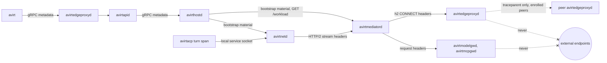
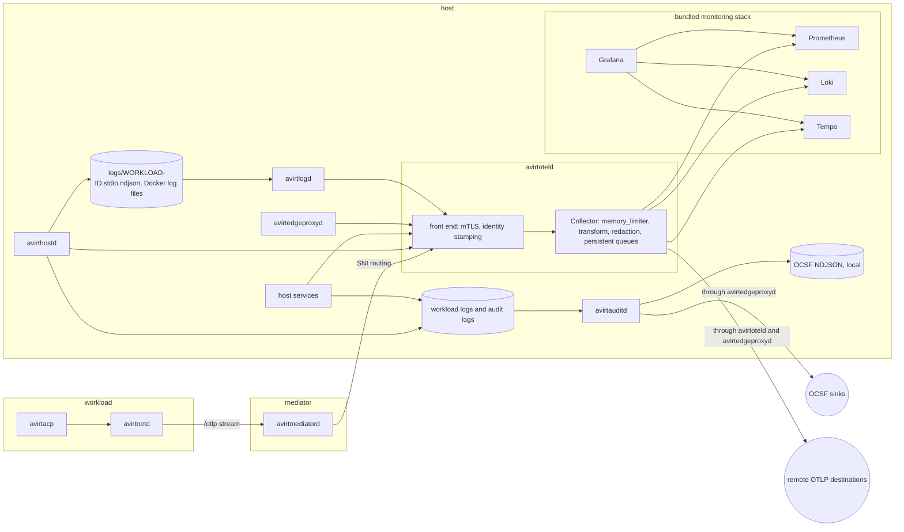

# Overview

avirt produces two kinds of output.

- **Durable records** have an owner and sequence numbers. These include the workload log, audit logs, and workload stdio logs. Each has exactly one writer. Producers never drop records silently: a producer that can't hand over a record refuses new work, or writes a record of what it couldn't keep.
- **Telemetry** is logs, metrics and traces delivered as OpenTelemetry through avirtoteld. It's a view for operators. No record, audit event or policy decision depends on its delivery, and telemetry backpressure never refuses work or stalls a workload.

| Signal | Kind | Producers | Store | Status |
| --- | --- | --- | --- | --- |
| Workload log | Durable record | avirtinitd, the mediator, avirthostd | `logs/<workload-id>.ndjson` | Implemented |
| Sandbox container and mediator output | Durable record | The runtime, avirthostd | `logs/<workload-id>.container.log`, `.mediator.log` | Implemented |
| Workload stdio log | Durable record | avirthostd's stdio writers | `logs/<workload-id>.stdio.ndjson` | Planned |
| Audit logs | Durable record | avirthostd and the host services | Each component's audit log, delivered as OCSF by avirtauditd | Planned |
| Logs | Telemetry | avirtlogd, each daemon, avirthostd's event copies | avirtoteld's destinations | Planned |
| Metrics | Telemetry | Each daemon | avirtoteld's destinations | Planned |
| Traces | Telemetry | Each daemon, avirtacp | avirtoteld's destinations | Planned |

# Status: implemented

## Workload log

avirthostd creates the logs directory 0700 and each file in it 0600, owned by the UID avirthostd runs as. Each launch gets three files (see [log files](./hostd-api.md#log-files)):

| File | Writer | Contents |
| --- | --- | --- |
| `logs/<workload-id>.ndjson` | avirthostd | The workload log: one envelope per line |
| `logs/<workload-id>.container.log` | The `container` command-line tool process | Its stdout and stderr, which contain the sandbox container's |
| `logs/<workload-id>.mediator.log` | avirtmediatord | The mediator's stderr |

The workload ID is 8 random hexadecimal characters. A launch never reuses an ID that already has a log file in the directory. avirthostd never deletes a log file.

The envelope has fields `{ts, dir, msg}` in that order, with `ts` an RFC 3339 UTC time in milliseconds and `dir` one of `client->agent`, `agent->client`, `meta` and `egress` (see [envelope](./hostd-api.md#envelope) and [meta events](./hostd-api.md#meta-events)). Log lines come from these sources:

- **Workload lines.** avirtinitd builds each envelope and stamps `ts` from the sandbox container's clock. It sends the envelope in the body of `POST /workloads/<id>/stream`, the one request on the workload's HTTP/2 connection to its mediator (on `mediator.sock`), which today transports only log envelopes. avirthostd splits the request body into lines and writes each line as it arrived. It replaces a line longer than 16 MiB with its own `line_truncated` event.
- **Egress lines.** The mediator sends one NDJSON `conn` event per proxied connection on its `EGRESS` connection (see [events](./egress.md#events)). avirthostd wraps each in an envelope with `dir: "egress"` and its own `ts`.
- **avirthostd's events.** avirthostd writes `line_truncated`, `auth_writeback`, `container_error` and `container_exit` itself, with its own `ts`, and holds the errors, the cleanup outcome and `container_exit` until the stream has drained, so `container_exit` is the last line.

avirthostd doesn't check the envelopes in that request. The sandbox container may have written any `meta` line other than the four listed, and it can write a line that looks like one of those four. Only avirthostd's own lines are host-observed.

## avirthostd's output

avirthostd writes plain text lines to its stdout and stderr: its listening address and logs directory, `launched <id>`, launch failures, the startup cleanup's results, log write failures, h2 connection errors, and shutdown progress. They don't include a level or workload field beyond the text.

## Content and access

The workload log contains each JSON-RPC line between avirtinitd and the adapter, including the prompt in the `start` event, the agent's output and each tool call's input and output. Redaction is absent. The Claude token is in the agent's environment, so the agent can write it into the log (see [egress credentials](./egress-credentials.md#claude)). Only the UID avirthostd runs as, and root, can read the files.

## Metrics and traces

Metrics don't have code yet. [Performance metrics](./performance.md) describes the planned metrics.

# Status: planned

## Logging

### Workload log

The workload log remains avirthostd's durable record of a workload. In the planned design each line also includes `workload` (the canonical UUIDv7), `gen`, `seq` and `src`, stamped by avirthostd from the authenticated connection the line arrived on (see [the event's `src` field](./trust-boundaries.md#src) and [log resume](./workload-topology.md#resuming-after-reconnect)), and `trace` and `span` when the producer recorded the line inside a span. avirthostd stamps `ts` on receipt and keeps the producer's time as `ts_src`.

avirthostd never sends the whole workload log to avirtoteld. After writing a `meta`, `conn`, `http` or `dns` event, avirthostd emits a copy as an OpenTelemetry log record with the event's fields, and never a copy of an ACP line. If avirthostd can't hand a copy to avirtoteld, it counts the copy in `avirt.telemetry.shed`. The record remains in the workload log.

### Workload stdout and stderr

avirtlogd acquires the sandbox containers' output from files the host side writes, with a method per runtime. It never reads the sandbox container's memory, its vsock devices or the runtime's own directories.

- **Containerization.** Containerization doesn't persist container stdio. avirthostd supplies one writer per stream (`LinuxProcessConfiguration.stdout` and `.stderr`), so stdout and stderr arrive separately in avirthostd's process through the Swift dylib. Workloads run with `terminal = false`, because terminal mode merges the streams and rejects a stderr writer. The writers frame the output into `logs/<workload-id>.stdio.ndjson`, as described below.
- **Docker Desktop.** avirthostd creates each container with the `json-file` log driver and a `max-size` and `max-file` cap. avirtlogd reads those files, and takes each record's identity from avirthostd's record of the container, never from the file (see [components](./components.md#open-questions) for how to access the files).
- **The Apple container CLI runtime.** That runtime writes a merged raw `stdio.log` (without stream tags, timestamps, or rotation) and a `vminitd.log` under `~/Library/Application Support/com.apple.container/containers/<id>/`. avirtlogd doesn't read them. The implemented `container.log` is the only copy of that runtime's output.

On the Containerization runtime, avirthostd's writer is on the read path of the sandbox container's output. Blocking would stall the sandbox container through vsock, vminitd, and pipe backpressure. A write that throws silently drops the output. The writer must never block:

1. It copies each chunk and enqueues it in a bounded per-workload ring with a byte cap. On overflow it drops the chunk and records a synthetic `dropped_bytes` record with the count.
2. It stamps each chunk with its receive time and attaches the trusted identity: the workload's UUIDv7, namespace, short ID, and stream. Chunks are arbitrary page-sized reads with no timestamps of their own.
3. It frames lines and marks partial lines. It flushes on a timer or a size threshold and caps line length. It encodes invalid UTF-8 as base64.
4. It flushes on `close()`.

A dedicated writer thread behind the ring writes the per-workload NDJSON file `logs/<workload-id>.stdio.ndjson` (0640, group readable only by avirtlogd's UID), one record per line as `{ts, workload, ns, short_id, stream, partial, text|b64}`. The writer rotates files and caps their total disk usage. Rotation never removes a segment that avirtlogd hasn't checkpointed past. At the disk cap the writer stops writing and its ring fills. The writer drops further chunks and counts them in a `dropped_bytes` record without stalling the workload. avirtlogd needs only read access to that directory. The VMs, vsock and the virtualization entitlement stay in avirthostd.

The VM console, the guest kernel's console plus vminitd's own logs, comes from Containerization's `bootLog` as a file or file handle. avirtlogd reads it as a separate source with `stream=console`.

Workload stdio log content is untrusted, console text included. The identity attributes on each record come from trusted runtime and host metadata: the fields avirthostd writes on the Containerization runtime, and avirthostd's records of each container on Docker Desktop. Fields parsed from log content never override them.

avirtlogd tails each file with persisted offsets and advances an offset only after avirtoteld accepts the records before it. While avirtoteld refuses, avirtlogd stops reading, and the file is the buffer.

### OpenTelemetry Logs

avirtlogd turns each stdio record into one OpenTelemetry log record:

| Log record field | Source |
| --- | --- |
| `Timestamp` | The record's `ts`, the receive time avirthostd stamped |
| `ObservedTimestamp` | When avirtlogd read the record |
| `Body` | `text` as a string, or `b64` decoded to bytes |
| `SeverityNumber` | Unset. avirtlogd never parses a severity out of workload output. |
| `log.iostream` | `stdout` or `stderr`, omitted for the console |
| `avirt.stream` | `stdout`, `stderr` or `console` |
| `avirt.partial` | Set on a line that the writer split at its length cap |
| Resource `service.name` | `avirt-workload` |
| Resource identity | `avirt.workload.id`, `avirt.namespace`, `avirt.workload.short_id`, from the record's trusted fields |

avirtlogd joins the partial records of one line up to the writer's line cap, and emits a `dropped_bytes` record as a log record with `event.name` `avirt.stdio.dropped` at severity `WARN` and adds its count to `avirt.stdio.dropped_bytes`. It applies redaction (see [content and redaction](#content-and-redaction)) before it sends anything.

### Host service logs

Each avirt daemon logs through `tracing` with a JSON formatter on stderr, one object per line, and also exports each record as OpenTelemetry Logs through the `tracing` log bridge when the deployment includes avirtoteld. stderr is the local copy: avirtinitd captures each child's stderr in server mode, and a direct host install sends it to the supervisor's log. avirtmediatord writes stderr to `logs/<workload-id>.mediator.log` and exports through the mediator's outbound socket to avirthostd, which routes the connection to avirtoteld by SNI. `AVIRT_LOG` sets the filter, in `tracing`'s directive syntax, and defaults to `info`.

### Severity

| Level | `SeverityNumber` | Use |
| --- | --- | --- |
| `ERROR` | 17 | An operation failed, the system refused it, or a workload ended abnormally: `container_error`, `error`, `credential-misplaced`, an audit chain break |
| `WARN` | 13 | Work continued with degraded status, or the system dropped and counted something: retries, `line_truncated`, `envelope_gap`, `dropped_bytes`, `deny` and `would-deny` decisions, telemetry dropped with an explicit count |
| `INFO` | 9 | Lifecycle milestones and decisions that allowed: launch, `start`, `started`, `exit`, `container_exit`, rotations, policy snapshot swaps, `allow` decisions |
| DEBUG | 5 | Per-request and per-stream detail. Off by default. |
| `TRACE` | 1 | Wire-level detail. Off by default, and never enabled for a component that handles credentials. |

### Field conventions

- An attribute uses its OpenTelemetry semantic convention name where one exists (`error.type`, `server.address`, `server.port`, `http.*`, `rpc.*`, `gen_ai.*`, `log.iostream`), and otherwise a name in the `avirt.` namespace, dot-separated, with snake_case segments.
- Event names in the workload log stay as [meta events](./hostd-api.md#meta-events) and [events](./egress.md#events-1) define them. Their OpenTelemetry copies include `event.name` `avirt.<component>.<event>`, such as `avirt.hostd.container_exit` and `avirt.egress.conn`.
- Times are UTC. NDJSON records use RFC 3339 with milliseconds, and OpenTelemetry records use nanoseconds since the epoch.
- Identity attributes come only from trusted metadata. A field parsed from workload output, or an attribute a producer sets under a reserved key, never overrides them.

| Attribute | Meaning | Set by |
| --- | --- | --- |
| `avirt.workload.id` | The workload's canonical UUIDv7 (see [workload IDs](./components.md#workload-ids)) | avirthostd, avirtoteld |
| `avirt.workload.short_id` | The 8-character DNS handle. Never used for joins or authorization. | avirthostd, avirtoteld |
| `avirt.namespace` | The workload's namespace | avirthostd, avirtoteld |
| `avirt.gen` | The mediator generation | avirthostd, avirtoteld |
| `avirt.src` | `hostd`, `edgeproxy`, `gateway`, `secrets`, `mediator` or `workload` | avirthostd, avirtoteld |
| `avirt.trust_domain` | The host's trust domain | avirtoteld |
| `avirt.agent` | `claude` or `codex` | avirthostd |
| `avirt.decision`, `avirt.rule`, `avirt.mode`, `avirt.policy_version` | A policy decision's outcome, deciding rule, mode, and policy snapshot | avirtmediatord, avirtedgeproxyd, avirthostd |
| `service.name` | The component, such as `avirthostd`, `avirtmediatord` or `avirtedgeproxyd` | The producer |

### Content and redaction

Workload logs, workload stdio and ACP content are secret. They can contain prompts and tool output, along with source code. The Codex account email and plan may appear too. Any credential the agent can read may appear in them.

- **Never logged.** Secret values, placeholder values, header values, request and response bodies, query strings and the contents of `auth.json` never appear in an avirt event, a host service log, a span or a metric (see [events](./egress.md#events-1)). avirt's own events about credentials record fixed reason strings and binding names.
- **Redaction.** Before export, avirtlogd and avirtoteld replace each match of the `credential-misplaced` check's patterns (see [placeholders](./egress-credentials.md#placeholders)) and of known credential formats, such as provider API key prefixes, JWTs and PEM private keys, with `[redacted:<kind>]`, and count each replacement in `avirt.log.redactions`. Redaction narrows exposure. It doesn't make content safe to share.
- **Content off by default.** By default, avirt never records the `gen_ai.input.messages`, `gen_ai.output.messages`, `gen_ai.tool.call.arguments`, and `gen_ai.tool.call.result` attributes, which the semantic conventions mark Opt-In. A namespace can opt in to content in local telemetry, and remote export sends content only for a namespace that opts in to it separately.
- **Remote export.** Export workload stdio log bodies only for namespaces the host configuration specifies. Export only the metadata of each other telemetry record.

| Reader | What | How |
| --- | --- | --- |
| A local user, a web UI user, or a workload | One workload's log, by source | `Logs/ReadLog` through avirtapid, authorized by `read_log` with `source` (`acp`, `egress`, `meta` or `stdio`) in the context (see [logs](./operator-cli.md#logs)). The default denies all actions, and a workload caller must follow [workload management](./components.md#workload-management). |
| avirtadmin | Any workload's log | avirthostd's admin socket, as `Admin::"uid:<uid>"` |
| avirtauditd | Each workload log and audit log, read-only | Group read on the files, by offset |
| avirtlogd | Workload stdio files, read-only | Group read on `logs/*.stdio.ndjson` (see [listeners](./trust-boundaries.md#listeners)) |

Each `read_log` call, allowed or denied, is an audit event.

## Audit

### Audit and logs

| | Audit | Logs and other telemetry |
| --- | --- | --- |
| Purpose | Who did what, under which decision | Operating and debugging the system |
| Completeness | Each audit event without sampling or dropping | Sampled, and dropped and counted under backpressure |
| Content | Metadata only, excluding prompts, tool output, and secret values | Metadata, and content only where a namespace opts in |
| Integrity | Hash-chained, with signed checkpoints | None beyond transport |
| Delivery | avirtauditd, as OCSF, to audit sinks | avirtoteld, as OTLP, to telemetry backends |
| Backpressure | Producers refuse new work, and the host refuses launches at its audit disk cap | Producers drop and count |

avirtauditd never sends audit events through avirtoteld, so no telemetry setting can drop or delay one.

### Audit logs

Each component that makes audit events writes them to its own audit log (see [peering](./peering.md#observability-and-audit) for peer enrollment events), an append-only NDJSON file it alone writes, in its own state directory and with its own `seq` domain. avirtauditd reads each audit log by offset.

| Audit log | Writer | Holds |
| --- | --- | --- |
| Workload logs | avirthostd | Each workload's events (see [workload log](#workload-log-1)) |
| Host audit log | avirthostd | Workload management calls, administration calls, namespace, label, binding, port and service changes, peer enrollment, `read_log` calls, SVID issuance refusals |
| Policy audit log | avirtpolicyd | Policy writes, prover results and rejections, policy snapshot builds, and distribution |
| Credential audit log | avirtsecretsd | Binding registrations, placeholder issuance, credential fetches by the broker API, refreshes and their outcomes, provider errors |
| Web UI audit log | avirtwebd | Authentication and MFA attempts and outcomes, session creation, and revocation |
| Build and registry audit logs | avirtbuilderd, avirtregistryd | Builds, promotions, pushes, pulls, imports, exports and deletions, with their Cedar decisions |

### Audit events

avirtauditd maps each audit event to an OCSF 1.9.0 class, keeps `src` (see [the event's `src` field](./trust-boundaries.md#src)), and keeps the original event in `raw_data`.

| Events | OCSF class |
| --- | --- |
| Workload management calls (`create_workload`, `list_workloads`, `inspect_workload`, `stop_workload`, `delete_workload`), with the caller, the action, the resource, and the delegation chain | API Activity (6003) |
| Each avirtadmin call, with `Admin::"uid:<uid>"` | API Activity (6003) |
| `read_log` calls | API Activity (6003) |
| Launch, `started`, `container_error` and `container_exit` | Application Lifecycle (6002) |
| Namespace, label, binding, port publication, and service changes | Entity Management (3004) |
| Policy writes, prover rejections, and policy snapshot distribution | Entity Management (3004) |
| `conn` events, each decision including `allow`, with the deciding rule, mode and `policy_version` | Network Activity (4001) |
| `http` events, with their `cred` entries | HTTP Activity (4002) |
| `dns` events | DNS Activity (4003) |
| Credential injection, rejection, refresh and broker fetches, from the gateways, avirtmediatord, and avirtsecretsd | <!-- OCSF event class name. --><!-- vale write-good.TooWordy = NO -->Authorize Session<!-- vale write-good.TooWordy = YES --> (3003) |
| Web UI authentication and MFA, peer enrollment, and SVID issuance refusals | Authentication (3002) |
| `auto_approve` permission approvals | API Activity (6003) |
| Audit chain breaks, `envelope_gap` and `line_truncated` | Application Error (6008) |

ACP lines aren't audit events. avirtauditd maps the `start` event without its `prompt`.

### Delivery

- **Default.** avirtauditd writes OCSF records as NDJSON under its own state directory, one file per day.
- **Sinks.** The host configuration can name further sinks, such as an HTTPS endpoint of a SIEM. avirtauditd reaches each off-host sink through avirtedgeproxyd, as `/service/avirtauditd`, under the host policy snapshot.
- **Order and acknowledgement.** avirtauditd delivers each audit log in `seq` order, and advances its offset for a sink only once the sink acknowledges the batch. A sink that's down delays only that sink.

### Integrity

- Each audit log line and each workload log line includes `prev`, the SHA-256 of the previous line's bytes in the same file.
- After every 1000 lines and every 60 s, the writer appends a `checkpoint` record with the `seq` and the hash of the chain's head, signed with its current SVID key and including the SVID chain.
- avirtauditd verifies `seq` continuity, each `prev` and each checkpoint signature against the trust bundle, and delivers the checkpoints to each sink with the records they cover.
- A break is itself an audit event, at `ERROR`, naming the file, the `seq` and the expected and found hashes, and avirtauditd raises the `AuditChainBroken` alert.

A compromised writer can rewrite what it hasn't yet delivered. The chain proves integrity only from the last checkpoint a sink stores. Delivery lag bounds that window.

### Retention

- avirthostd and each audit log writer keep a file until each sink has acknowledged it and the local retention period has passed, 30 days by default. They never delete unacknowledged records.
- At the audit disk cap, avirthostd refuses new launches with 503 and each audit log writer refuses the operations it would record.
- avirthostd retains an ended workload's log for the same period, then removes it with the workload's record (see [operator CLI](./operator-cli.md#open-questions)).
- Workload stdio logs are kept 7 days by default after the workload ends, and aren't audit records.

## Metrics

### Naming

- Producers export each instrument in [performance metrics](./performance.md) as `avirt.<name>`, such as `avirt.launch.agent_started` and `avirt.egress.connect_setup`. This document adds only the pipeline's own instruments: `avirt.telemetry.shed`, `avirt.stdio.dropped_bytes` and `avirt.log.redactions`.
- For a metric whose How column says Span, the producer records both a span of that name and a duration histogram of that name. Sampling never thins the histogram.
- Units are UCUM. Producers record durations in `s`, as the semantic conventions require, and the Unit column of performance metrics is the dashboard display unit.
- Where the semantic conventions define a metric, avirt emits it too: `http.server.request.duration` and `http.client.request.duration` from avirtmediatord and avirtedgeproxyd, `rpc.server.call.duration` from avirtapid and avirthostd, and `gen_ai.client.token.usage` and `gen_ai.client.operation.duration` from avirtmodelgwd.
- Counters and histograms use cumulative temporality, so a failed export doesn't lose counts. The next successful export includes them.

### Attributes and cardinality

| Allowed as a metric attribute | Bound |
| --- | --- |
| `service.name`, `avirt.src`, `avirt.runtime` | Fixed sets |
| `avirt.namespace` | The host's namespaces, capped at 100 values per instrument |
| `avirt.agent`, `gen_ai.provider.name`, `gen_ai.request.model` | The harnesses and the models avirtmodelgwd routes |
| `avirt.decision`, `avirt.mode`, `avirt.dest.kind` (`external`, `model`, `avirt`, `host-component`) | Fixed sets |
| `avirt.rule` | The `@id`s of the current policy set |
| `error.type`, `avirt.reason` | The documented error kinds and reasons |
| `http.request.method`, `http.response.status_code`, `rpc.method`, `rpc.status_code` | The semantic conventions' sets and avirt's own APIs |

Metric attributes must exclude the workload's UUIDv7 and short ID, alias, and generated name. They must exclude external hosts, DNS names, paths, conversation or tool call IDs, trace IDs, and user names. These belong on spans, log records, and exemplars.

- **The workload ID.** Host-level instruments don't include workload IDs. An exemplar on a histogram point includes the trace and span IDs of a measurement, and the trace's resource includes `avirt.workload.id`. A dashboard can move from a slow bucket to the workload through its trace.
- **Per-workload instruments.** `mem.workload`, `mem.mediator`, `cpu.workload`, `cpu.mediator`, `disk.workload` and `connection.frozen_total` describe one workload each, and include `avirt.workload.id`. Their series end with the workload, and the host's live workload limit bounds them.
- **Enforcement.** Each SDK instrument has a cardinality limit of 2000 series, past which points go to the `otel.metric.overflow` series. avirtoteld removes each metric attribute outside the preceding table, and `avirt.workload.id` from each instrument except the per-workload ones.

### Without a collector

When avirtoteld isn't deployed, producers export nothing over OTLP and write each workload's summaries into its workload log as `meta` `metric` events (see [collection](./performance.md#collection)).

### Metrics from avirtmediatord and avirtedgeproxyd

avirtmediatord and avirtedgeproxyd record counters, gauges and histograms through avirt's OpenTelemetry path. Their metrics include connection counts, active streams, TLS handshake results, upstream dial latency, DNS cache outcomes, datagram drops, rejections for exceeding rate limits, exhaustion of the synthetic address table, timeouts and results of draining connections under the same cardinality limits as other daemons. avirtmediatord also records lifecycle and readiness metrics. Each process uses its binary name as `service.name`.

| Instrument | Kind | Attributes |
| --- | --- | --- |
| `avirt.egress.decisions` | Counter | `avirt.decision`, `avirt.rule`, `avirt.mode`, `avirt.dest.kind`, `avirt.action` |
| `avirt.egress.errors` | Counter | `error.type` |
| `avirt.egress.policy_eval` | Histogram | `avirt.action` |
| `avirt.egress.substitution` | Histogram | None |
| `avirt.egress.leaf` | Histogram, and a counter by `avirt.cache` (`hit` or `miss`) | `avirt.cache` |
| `avirt.policy.snapshot_version` | Gauge | `avirt.scope` (`workload` or `host`) |
| `avirt.policy.snapshot_expiry` | Gauge, seconds until the current policy snapshot expires | `avirt.scope` |
| `avirt.events.ring_depth` | Gauge | None |
| `avirt.events.refused` | Counter, work refused because the event ring was full | None |
| `avirt.credentials.injections` | Counter | `avirt.outcome` (`injected`, `rejected`), `avirt.location` |
| `avirt.credentials.leak_scan_hits` | Counter | None |

## Traces

### Propagation

Trace context is W3C Trace Context in the `traceparent` header, gRPC metadata or JSON-RPC `_meta`, and avirt propagates no `tracestate` or `baggage` of its own.

- **Control plane.** avirt starts a trace for each command and sends `traceparent` to avirtapid through avirtedgeproxyd, whose span joins it. avirtapid and avirthostd continue it.
- **Into the workload.** avirthostd puts the launch span's `traceparent` into each container's bootstrap material and into `GET /workload`, so avirtmediatord's and avirtnetd's start spans join the launch trace.
- **Across the workload's connection to its mediator.** avirtnetd sets `traceparent` on each HTTP/2 stream it opens. On an egress stream it uses the main workload process's current turn span, and outside a turn it starts a new trace.
- **Trust.** Accept a context from a workload, mediator, or peer as a parent, and drop each `tracestate` and `baggage` it includes. Spans that follow it include the identity attributes avirtoteld stamps from the caller's SVID, so a forged context can misplace spans only within the caller's own workload.

### External endpoints

Trace context never crosses to an external endpoint.

- avirtmediatord, avirtedgeproxyd, avirtmodelgwd and avirtmcpgwd don't add a `traceparent`, `tracestate`, `baggage`, or `x-request-id` header to a request bound for an external endpoint, and an MCP gateway doesn't add trace keys to `_meta`.
- avirtacp sends the adapter no trace context, because the agent's outbound requests go to external endpoints.
- Headers and `_meta` keys that the agent itself sends are request content, and pass unchanged.
- To an enrolled peer, avirtedgeproxyd sends `traceparent` only. A host configuration can turn that off.

Trace context excludes avirt identifiers. `traceparent` contains only random trace and span IDs. Workload, namespace, and generation are resource attributes that never leave the host except through a configured telemetry export.

### Launch spans

| Span | Kind | Producer | Ends |
| --- | --- | --- | --- |
| `Workloads/CreateWorkload` | Client, then server at each hop | avirt, avirtedgeproxyd, avirtapid, avirthostd | At the response |
| `avirt.launch.accept` | Internal | avirthostd | At the response |
| `avirt.launch.workload_boot`, `avirt.launch.mediator_ready` | Internal | avirthostd | As [workload lifecycle](./performance.md#workload-lifecycle) defines |
| `avirt.launch.connection_attached` | Internal | avirtnetd | At `attached` |
| `avirt.launch.agent_started` | Internal | avirthostd | At `started` |

Control-plane spans follow the RPC conventions, with `rpc.system.name` `grpc`, `rpc.method` and `rpc.status_code`, and record the Cedar decision as `avirt.decision` and `avirt.rule`. The spans after the response stay in the launch trace as children of avirthostd's `Workloads/CreateWorkload` span, so one trace covers the launch from the command to `started`. Teardown is its own trace with a span link to the launch.

### ACP turns and tool calls

avirtacp follows the GenAI agent conventions, which are at Development status, and pins the semantic conventions version it emits in its resource's schema URL.

| Span | Kind | Starts and ends | Attributes |
| --- | --- | --- | --- |
| `invoke_agent {agent}` | Client | `session/prompt` written to the adapter → turn end, as `acp.prompt_turn` defines | `gen_ai.operation.name` `invoke_agent`, `gen_ai.provider.name` (`anthropic`, `openai`), `gen_ai.agent.name` (`claude`, `codex`), `gen_ai.conversation.id` (the ACP session ID), `avirt.acp.stop_reason`, `error.type` |
| `execute_tool {tool}` | Internal | A `tool_call` update → the matching terminal `tool_call_update`, as `acp.tool_call` defines | `gen_ai.operation.name` `execute_tool`, `gen_ai.tool.name` (the adapter's tool name where it reports one, else the ACP tool kind), `gen_ai.tool.call.id`, `avirt.acp.tool_kind`, `avirt.acp.tool_status`, `error.type` |
| `avirt.acp.permission` | Internal | `session/request_permission` read → the answer written | `avirt.acp.outcome`, `avirt.acp.option_kind`, `avirt.acp.automatic` |
| `avirt.acp.initialize` | Internal | As `acp.initialize` defines | `avirt.acp.protocol_version` |

- Each turn is a root span of its own trace, with a span link to the launch trace.
- avirtacp reconstructs a tool span from the adapter's updates. It observes the tool call and doesn't run it. Tool calls that overlap in one turn are siblings under the turn.
- Egress streams opened during a turn are children of the turn, not of a tool span, because avirtnetd can't tell which tool opened a connection.
- A `_meta.traceparent` that the adapter sends is untrusted, and avirtacp records it as a span link only.

### Egress spans

| Span | Kind | Producer | Attributes |
| --- | --- | --- | --- |
| `CONNECT`, `CONNECT-UDP`, or `icmp` | Server | avirtmediatord, one per TCP, UDP, or ICMP stream | `network.transport`, `server.address`, `server.port`, `avirt.dest.kind`, `avirt.path` (`intercept`, `passthrough`), `avirt.decision`, `avirt.rule`, `avirt.policy_version`, `error.type` |
| `{method}` | Client | avirtmediatord, one per HTTP request under TLS interception or cleartext HTTP | `http.request.method`, `http.response.status_code`, `server.address`, `url.scheme`, `url.path` (no query), the decision attributes |
| `CONNECT`, `CONNECT-UDP`, or `icmp` | Server | avirtedgeproxyd, one per TCP, UDP, or ICMP stream | `network.transport`, `server.address`, `server.port`, `avirt.dest.kind`, the decision attributes from the host policy snapshot |
| `chat {model}` | Client | avirtmodelgwd, one per model request | `gen_ai.operation.name`, `gen_ai.provider.name`, `gen_ai.request.model`, `gen_ai.response.model`, `gen_ai.usage.input_tokens`, `gen_ai.usage.output_tokens` where the response reports usage, the provider's request ID as `gen_ai.response.id` |
| `tools/call {tool}` and the other MCP methods | Client | avirtmcpgwd, one per MCP request | `mcp.method.name`, `mcp.session.id`, `jsonrpc.request.id`, `gen_ai.tool.name`, `gen_ai.operation.name` `execute_tool` for `tools/call` |

avirtmediatord and avirtedgeproxyd record spans through `tracing` and export them through avirtoteld, setting decision attributes on each span. DNS queries produce `dns` events and metrics, not spans.

### Sampling

- **Head.** Sample each root using `ParentBased(TraceIdRatio)`, with the ratio from the host configuration, 1.0 by default. Children follow their parent's decision.
- **Tail.** For remote export, avirtoteld's tail sampling keeps each trace with an error, a `deny` or a `would-deny` decision, or a launch or turn slower than its target, and a ratio of the rest, 0.1 by default.
- **Durable records.** Sampling never affects the workload log, the audit logs, or a metric.

## Pipeline

### avirtoteld

avirtoteld is a Rust front end that supervises a pinned OpenTelemetry Collector distribution built with the OpenTelemetry Collector Builder as its child process, in the way avirtregistryd supervises zot (see [workspace registry](./workspace-registry.md#avirtregistryd)).

- **Front end.** avirtoteld listens on `services/avirtoteld.sock` for OTLP over gRPC with mutual TLS 1.3, authorizes the caller's exact SPIFFE ID (see [listeners](./trust-boundaries.md#listeners)), and rewrites each request's resource attributes: it removes any `avirt.workload.id`, `avirt.workload.short_id`, `avirt.namespace`, `avirt.gen`, `avirt.src` and `avirt.trust_domain` the producer set and stamps the values from the caller's SVID. It then forwards the request to the Collector and returns the Collector's answer to the producer.
- **Collector.** The child listens only on a Unix socket in avirtoteld's state directory that only avirtoteld's UID can open. avirtoteld generates its configuration from the host configuration without including any secrets. It restarts the child with backoff.
- **Workload telemetry.** avirtnetd and the main workload process send OTLP on the `/otlp` stream (`POST /otlp`) of the workload's HTTP/2 connection to its mediator, and avirtmediatord forwards it to avirtoteld with `x-avirt-src: workload`, which avirtoteld turns into `avirt.src` `workload`.
- **Off-host export.** The Collector's exporters connect through avirtoteld, which forwards each connection to avirtedgeproxyd's egress listener as an h2 CONNECT stream under `/service/avirtoteld`, so the host policy snapshot authorizes each telemetry destination.

| Stage | Components |
| --- | --- |
| Receivers | `otlp` (gRPC, on the private socket) |
| Processors | `memory_limiter` first in each pipeline, `transform` for the metric attribute allowlist, `redaction`, and `tail_sampling` in remote trace pipelines only |
| Exporters | `otlp` and `otlphttp`, each with a persistent `sending_queue` on `file_storage` |
| Extensions | `file_storage`, under avirtoteld's state directory |

### Backpressure

Overflow refuses work. avirtoteld never drops what it has accepted.

1. Cap each exporter's persistent queue in bytes. Retries have no elapsed-time limit. Once the queue accepts a batch, it retains that batch across restarts until the destination takes it.
2. When a queue is full, or `memory_limiter` is over its limit, the Collector refuses new data with a retryable error, and avirtoteld returns gRPC `UNAVAILABLE` to the producer.
3. A producer keeps refused telemetry in its bounded export queue and retries. When that queue is full, it drops the newest spans and log records and counts them in `avirt.telemetry.shed` by signal. Metrics are cumulative and lose nothing. Host service logs keep their stderr copy, and avirtlogd stops advancing its offsets.
4. The Collector's `otelcol_exporter_send_failed_*` metrics count permanent batch rejections, such as HTTP 400. The `TelemetryExportRejected` alert reports the rejection.

One destination's backlog fills only its own queue. A remote destination that's down never delays the bundled monitoring stack.

### Destinations

- **Default.** Telemetry doesn't leave the host. A direct host install without a configured destination doesn't start avirtoteld. Producers write to the workload log instead (see [without a collector](#without-a-collector)).
- **Bundled monitoring stack.** The all-in-one server image's bundled monitoring stack runs Prometheus for metrics, Loki for logs, Tempo for traces and Grafana, each under its own UID and listening on loopback only, with retention of 15 days for metrics, 7 days for logs, and 3 days for traces. avirtoteld exports to each over OTLP. avirtinitd starts them with avirtoteld, and none of them is essential. avirtedgeproxyd's `edgeproxy.sock` fronts Grafana.
- **Remote export.** The host configuration can specify OTLP destinations. Each has a set of signals it receives, a sampling ratio, and the namespaces whose content it may include. avirtoteld connects to each remote destination through avirtedgeproxyd.

## Dashboards

avirt includes its dashboards as Grafana dashboard JSON in the repository, provisioned into the bundled monitoring stack's Grafana with file-based provisioning, together with data sources with fixed UIDs: `avirt-prometheus`, `avirt-loki` and `avirt-tempo`. Each dashboard selects its data sources through template variables, so it imports into any Grafana with compatible data sources. Each dashboard has a `namespace` variable, and per-workload views take a workload ID from a trace, an exemplar or a log query, never from a metric label.

| Dashboard | Shows |
| --- | --- |
| Host health | Each host service's up state, restarts and degraded state, avirthostd's CPU and memory, live workloads against the limit, launch refusals by reason, disk use of the runtime directory, caches and logs, SVID rotation and issuing CA lifetime, and avirtoteld's queue use, refusals and telemetry dropped with an explicit count |
| Workload activity | Launches and exits by reason, `launch.agent_started` and `acp.first_update` against their objectives, turns, tool calls by kind and status, permission requests, reconnects of the workload's connection to its mediator and freezes, envelope latency and gaps, and per-workload resources for one selected workload |
| Egress and policy | Decisions by decision, rule and mode, `would-deny` by rule as the enforce-mode readiness view, errors by kind, connect setup, DNS and dial latency, DNS answers by rcode, top destinations from the `avirt.egress.conn` log records, policy snapshot versions and time to expiry, prover rejections, active streams, TLS handshakes, and DNS cache outcomes |
| Credential broker | Injections and rejections by location, hits from the `credential-misplaced` check, broker fetches and their latency, refresh outcomes, Codex refresh time, provider errors, and time to expiry of each refreshed credential |
| Model and MCP gateways | Requests, latency and errors by provider and model, token usage, budget use per namespace, and MCP calls by method and outcome |
| Builds | Queue depth, build duration by kind, failures by stage, cache hit ratio, promotions, and prebuild triggers |
| Registry | Push, pull and resolve rates and latency, storage bytes, index reconciliation drift, and garbage collection |
| Audit delivery | Delivery lag per audit log and sink, acknowledged and pending records, and checkpoint verification |

## Alerts

avirt includes Grafana alert rules with its dashboards, provisioned from files, and no contact point. Alerts appear in Grafana until the operator adds one. Each threshold is a host configuration value, with these defaults.

| Alert | Condition | Severity |
| --- | --- | --- |
| `HostDaemonDegraded` | A daemon has used every restart in its budget (see [all-in-one server image](./components.md#all-in-one-server-image)) | Critical |
| `LaunchesRefused` | avirthostd refused launches with 503 for 5 minutes | Warning |
| `LaunchSlow` | p95 `launch.agent_started` exceeds its target for 15 minutes | Warning |
| `PolicySnapshotExpiring` | Either proxy's `avirt.policy.snapshot_expiry` below 10 minutes | Critical |
| `CredentialMisplaced` | Any `credential-misplaced` check hit | Warning |
| `CredentialRefreshFailing` | A credential refresh failed and the credential expires within 30 minutes | Critical |
| `EventRingRefusing` | `avirt.events.refused` increased in the last 5 minutes | Warning |
| `WorkloadLogNearCap` | A workload log past its soft cap | Warning |
| `EnvelopeGap` | Any `envelope_gap` event | Warning |
| `StdioDropped` | `avirt.stdio.dropped_bytes` increased | Info |
| `MediatorRestartsExhausted` | A workload ended because its mediator restarts ran out | Warning |
| `IssuingCAExpiring` | The issuing CA expires within 24 hours with no successor | Critical |
| `AuditDeliveryLag` | Any audit log more than 15 minutes behind at any sink | Warning |
| `AuditChainBroken` | Any chain or checkpoint verification failure | Critical |
| `AuditDiskNearCap` | Audit storage exceeds 85 % of its cap | Critical |
| `TelemetryQueueHigh` | Any avirtoteld queue exceeds 80 % for 10 minutes | Warning |
| `TelemetryExportRejected` | Any permanent export rejection | Warning |
| `DiskHigh` | The runtime directory's or the logs directory's volume exceeds 85 % | Warning |
| `BuildFailureRate` | More than 25 % of builds failed over 1 hour | Info |

# Open questions

1. **Exemplars from Rust.** Moving from a histogram bucket to a workload relies on exemplars, which the Rust OpenTelemetry SDK doesn't yet collect. Whether avirt waits for that support or records exemplars itself is open.
2. **The bundled monitoring stack's licenses.** Grafana, Loki and Tempo are AGPL-3.0, and Prometheus is Apache-2.0. Whether the all-in-one image includes them unmodified, or includes Apache-2.0 alternatives such as Jaeger for traces and VictoriaLogs for logs, is open.
3. **Bundled monitoring stack authentication.** The stores listen on loopback, where any local process can connect to them. Whether they require authentication from avirtoteld and Grafana is open.
4. **Exporter transport.** How the Collector child's exporters hand their connections to avirtoteld for avirtedgeproxyd, by a local CONNECT proxy or by avirtoteld forwarding OTLP itself, is open.
5. **The `/otlp` stream.** The stream needs a place in the [HTTP/2 stream table](./workload-topology.md#http2-streams), a bounded request queue within the workload's stream limit and a per-workload rate limit. Its limits are open.
6. **The agent's own telemetry.** Claude Code and Codex can export their own OpenTelemetry. Whether avirt accepts it on an agent socket, labelled `avirt.src` `workload` and off by default, is open.
7. **Checkpoint verification over time.** Verifying an old checkpoint needs the SPIFFE roots that were in the bundle at the time of signing. Where avirtauditd keeps past bundles is open.
8. **Ended-workload retention.** Retention for an ended workload's log also forms part of the operator CLI's open question on ended workloads.
