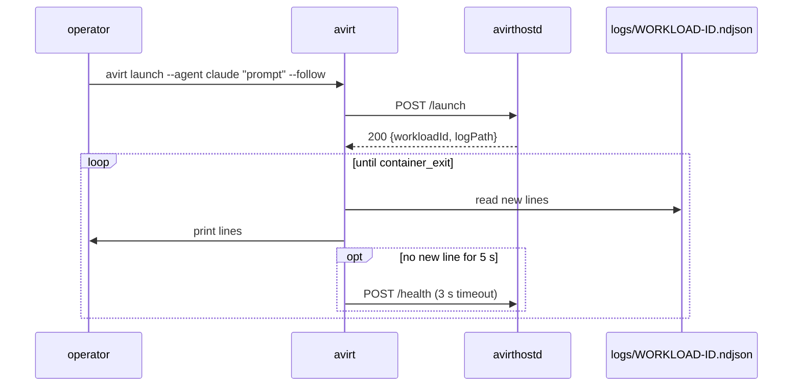
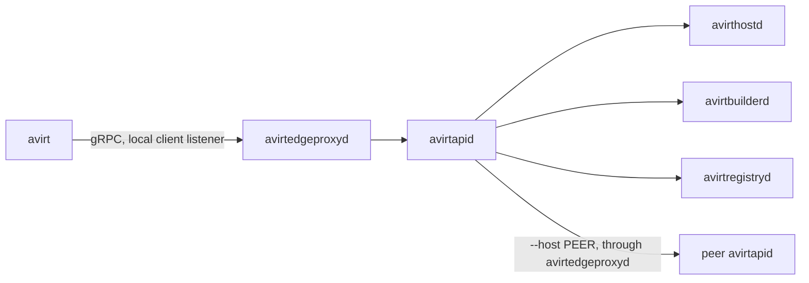

# Status: implemented

`avirt` is the operator command, from `crates/avirt`. It has one subcommand, `launch`. It talks to a running [avirthostd](./hostd-api.md) over its control API, cleartext HTTP/2 on loopback, using the request and response types, routes and default port from the `api` module of `avirt-core`.

## `launch`

```text
avirt launch --agent claude|codex "<prompt>" [--cwd DIR] [--follow] [--port PORT] [--url URL]
```

| Option | Default | Meaning |
| --- | --- | --- |
| `--agent` | Required | `claude` or `codex`, sent lowercase |
| `<prompt>` | Required | The prompt for the ACP session |
| `--cwd DIR` | None | Host directory to mount read-write at `/workspace`. avirt converts a relative path to an absolute path using the current directory. It neither resolves symlinks nor checks existence. |
| `--follow`, `-f` | Off | Print the workload log until the workload ends |
| `--port PORT` | `PORT`, else 8787 | Port of the local avirthostd |
| `--url URL` | `AVIRT_HOSTD_URL`, else `http://127.0.0.1:<port>` | avirthostd's base URL |

`launch` sends `POST /launch` with `{"agent","prompt","cwd"}`, omitting `cwd` when `--cwd` isn't given. On a 2xx reply it prints two lines on stdout, the workload ID and the absolute log path that avirthostd returned:

```text
workload 7e759259
log      /Users/me/avirt/logs/7e759259.ndjson
```

It prints nothing else on success: no request body and no environment value.

## Following

With `--follow`, `avirt` polls the log path every 300 ms. Each pass reads the bytes appended since the last pass, prints every complete line verbatim (the raw NDJSON envelope, decoded as lossy UTF-8), and holds back a trailing partial line. It parses each printed line as JSON and stops after the chunk that holds the `container_exit` meta event, which is always the last line. Text inside agent traffic never stops log following, and a missing log file causes a retry on the next pass.

When no complete line has arrived for 5 s, it sends `POST /health` with a 3 s timeout. An answer resets the timer. No answer ends the follow with an error.

`--follow` reads the file directly, so it works only on the machine avirthostd runs on, as a user who can read avirthostd's 0600 log files. A `--url` specifying another machine launches there, but `--follow` can't read that machine's log.



## Errors and exit codes

| Exit | When | Message on stderr |
| --- | --- | --- |
| 0 | The launch succeeded, and with `--follow` the log reached `container_exit`, whatever the workload container's own exit code | None |
| 1 | avirthostd is unreachable | ``cannot reach avirthostd at URL; is `avirthostd` running?``, followed by the cause |
| 1 | avirthostd refused the launch with a non-2xx status | `launch failed (STATUS): MESSAGE`, with avirthostd's `error` text |
| 1 | The 2xx reply isn't a launch response | `unexpected launch response` |
| 1 | `--follow` gave up | `avirthostd stopped answering and the log has stopped growing; giving up` |
| 2 | A usage error: a missing or unknown flag, or an `--agent` other than `claude` or `codex` | clap's usage message |

The [avirthostd API](./hostd-api.md#control-api) describes refusals. Status 400 covers bodies over 64 KiB or invalid JSON, unknown agents, empty prompts, a `cwd` that isn't absolute or contains `:`, and missing credentials. avirthostd returns 503 during shutdown. For other failures, it returns 500 with details only in its own output.

Through mise, `mise run launch <agent> "<prompt>"` runs `avirt launch --agent <agent> "<prompt>"`, and extra flags go after `--`, such as `mise run launch claude "Reply with pong" -- --cwd DIR --follow`.

# Status: planned

`avirt` provides the operator CLI and TUI for a host. It doesn't own resources (see [components](./components.md#host-services)). Every command except the local ones (`context`, `workspace init`, `workspace config`, `completion` and `version`) is a gRPC call to avirtapid through avirtedgeproxyd's local client listener. avirtapid forwards each call with the caller's identity in `x-avirt-caller`, to avirthostd, avirtbuilderd or avirtregistryd, or to an enrolled peer's avirtapid. The planned command-line tool never talks to avirthostd directly and omits `--port` and `--url`. `launch --follow` and `logs` stream through avirtapid without reading log files.

[avirtadmin](./admin-cli.md) provides host administration commands, and [avirtguest](./guest-cli.md) provides commands inside a workload container. All three tools share the command names, flags, output formats, and exit codes on this page wherever their functions overlap.



## Contexts and authentication

`avirt` reaches avirtedgeproxyd's local client listener through `edgeproxy.sock` in the runtime directory, a Unix socket, 0600 and owned by the user (see [trust boundaries](./trust-boundaries.md#listeners)).

The socket's mode authenticates the caller. `avirt` lacks a token, key, or certificate. avirtedgeproxyd identifies the caller as the local user principal (see [components](./components.md#open-questions)). Calls made this way include `via: "client"` in their Cedar context.

A **context** names how `avirt` reaches a host. Contexts live in `~/.config/avirt/config.toml`, or under `$XDG_CONFIG_HOME/avirt/`:

```toml
current-context = "laptop"

[contexts.laptop]
socket = "/var/folders/xy/abc/T/avirt-501/edgeproxy.sock"   # default: $TMPDIR/avirt-<uid>/edgeproxy.sock
namespace = "team-a"                                        # default: default

[contexts.studio]
socket = "/var/folders/xy/abc/T/avirt-501/edgeproxy.sock"
host = "mac-studio.example.com"                             # an enrolled peer, reached through the local avirtapid
namespace = "default"
```

| Key | Default | Meaning |
| --- | --- | --- |
| `socket` | `$TMPDIR/avirt-<uid>/edgeproxy.sock` | The local client listener |
| `host` | None, this host | An enrolled peer's peer host name, its fully qualified DNS name (see [peer host names](./peering.md#peer-host-names)). Every call goes to the local avirtapid, which forwards it to that peer's avirtapid, where the peer's policy applies to the caller's fully qualified identity and the peer's enrollment limits the routes. |
| `namespace` | `default` | The namespace for commands that take `--namespace` |

The context in use is `--context NAME`, else `AVIRT_CONTEXT`, else `current-context`, else a built-in context with every key at its default. `--socket`, `--host` and `--namespace` override the context's keys for one command. Remote calls always pass through the local host's avirtapid because the network doesn't expose a client listener.

| Command | Does |
| --- | --- |
| `avirt context list` | Lists contexts and marks the current one |
| `avirt context show [NAME]` | Prints a context with its defaults filled in |
| `avirt context use NAME` | Sets `current-context` |
| `avirt context set NAME [--socket PATH] [--host HOST] [--namespace NS]` | Creates or updates a context |
| `avirt context rm NAME` | Removes a context |
| `avirt whoami` | Prints the principal the host sees for this caller, and its trust domain |

## Command tree

```text
avirt
├── launch --agent AGENT PROMPT [launch flags]
├── workload
│   ├── list [--selector K=V]... [--watch]
│   ├── inspect WORKLOAD
│   ├── wait WORKLOAD [--timeout DURATION]
│   ├── stop WORKLOAD [--grace DURATION]
│   └── rm WORKLOAD
├── port
│   ├── publish WORKLOAD PORT [--protocol tcp|http] [--expires DURATION]
│   ├── list WORKLOAD
│   └── rm WORKLOAD PORT
├── service
│   ├── create NAME --port PORT (--workload WORKLOAD --target-port PORT | --host-local ADDRESS) [--alias ALIAS]... [--label K=V]...
│   ├── list [--selector K=V]...
│   ├── inspect NAME
│   └── rm NAME
├── session
│   ├── list WORKLOAD
│   ├── attach WORKLOAD [--session ID] [--from SEQ]
│   ├── prompt WORKLOAD TEXT [--session ID]
│   ├── cancel WORKLOAD [--session ID]
│   ├── answer WORKLOAD TOOL-CALL-ID OPTION-ID [--session ID]
│   └── end WORKLOAD [--session ID]
├── logs WORKLOAD [--follow] [--source SOURCE]... [--since SEQ|TIME]
├── namespace
│   ├── list
│   └── inspect NS
├── peer
│   ├── list
│   └── inspect HOST
├── workspace ...                    (see workspaces below)
├── context list | show | use | set | rm
├── whoami
├── tui
├── completion SHELL
└── version
```

`WORKLOAD` is any name of a workload in the command's namespace: its short ID, `<alias>-<id>`, its generated name, or its canonical UUIDv7. avirthostd resolves the name to the workload's canonical entity before it authorizes anything, so the form used never changes the outcome (see [components](./dns.md#avirt-hostnames)).

## Global flags

| Flag | Default | Meaning |
| --- | --- | --- |
| `--context NAME` | `AVIRT_CONTEXT`, else `current-context` | The context |
| `--socket PATH` | The context's `socket` | The local client listener |
| `--host HOST` | The context's `host` | Run the command on an enrolled peer |
| `--namespace NS`, `-n NS` | The context's `namespace` | The namespace for namespaced commands |
| `--output FORMAT`, `-o FORMAT` | `text` | `text` or `json` (see [output formats](#output-formats)) |

## Workloads

```text
avirt launch --agent claude|codex PROMPT
    [--namespace NS] [--alias ALIAS] [--label K=V]...
    [--workspace REF [--fresh require|prefer|any] [--allow-local] | --cwd DIR]
    [--mode MODE] [--binding ID]... [--policy REF]
    [--interactive [--idle-limit DURATION]] [--approval auto|operator|reject]
    [--publish PORT[/tcp|/http]]... [--follow]
```

| Flag | Meaning |
| --- | --- |
| `--agent` | The harness, `claude` or `codex` |
| `PROMPT` | The ACP session's first prompt |
| `--alias ALIAS` | The workload's alias, a DNS label of at most 54 characters, rejected rather than truncated |
| `--label K=V` | A label, repeatable. avirthostd refuses keys under `avirt.internal/`. |
| `--workspace REF` | A workspace reference in the grammar of [workspace references](./workspaces.md#workspace-references). `dir:PATH` builds the directory first, as `avirt workspace build` does. |
| `--fresh`, `--allow-local` | As in [resolution](./workspaces.md#resolution) |
| `--cwd DIR` | A directory on avirthostd's host, mounted read-write at `/workspace`. It excludes `--workspace`. avirt refuses it with `--host`. |
| `--mode MODE` | The agent's initial mode, included in the configuration layer (see [ACP](./acp.md)) |
| `--binding ID` | A credential binding to attach, repeatable (see [egress credentials](./egress-credentials.md#bindings)) |
| `--policy REF` | The workload's policy reference. Default: the host's default for the namespace. |
| `--interactive` | Keep the session open after each turn, until an operator ends it, `--idle-limit` passes with no turn running (default 1 h), or the workload stops (see [session lifecycle](./acp.md#session-lifecycle-1)) |
| `--approval POLICY` | The method for answering permission requests: `auto` (default), `operator` or `reject` (see [client capabilities](./acp.md#client-capabilities-1)) |
| `--publish PORT[/PROTO]` | A port publication made at launch, repeatable. `PROTO` is `tcp` (default) or `http`. |
| `--follow`, `-f` | Stream the workload log until `container_exit`, as `avirt logs --follow` does |

`launch` prints the workload's short ID, generated name, namespace and canonical UUIDv7, and its local avirt hostname. With `--follow` it then prints the log, and exits 0 when the workload's exit code is 0 and 8 otherwise. A child workload that `avirt` launches has the local user as its `avirt.internal/creator` and `avirt.internal/root` (see [workload management](./components.md#workload-management)).

| Command | Does |
| --- | --- |
| `avirt workload list` | Lists the namespace's live workloads: short ID, generated name, alias, agent, state, age, and creator. `--selector K=V` filters by label. Repeated selectors require all matches. `--watch` keeps the list open and prints each change. |
| `avirt workload inspect WORKLOAD` | Shows the immutable workload configuration (namespace, IDs, labels, image digest, workspace image digest, overlay digest, policy reference, binding ids), its port publications and current mediator generation, plus its delegation chain |
| `avirt workload wait WORKLOAD` | Waits until the workload ends, then exits 0 for exit code 0 and 8 otherwise. `--timeout` gives up with exit 6. |
| `avirt workload stop WORKLOAD` | Stops the workload. avirthostd tears the workload down in the order in [lifecycle](./lifecycle.md#teardown). `--grace` bounds the wait before avirthostd forcibly stops the workload. |
| `avirt workload rm WORKLOAD` | Deletes an ended workload's retained record and logs, and stops it first if it's live |

## Labels and namespaces

Set labels only at launch with `--label`. They remain immutable afterwards. avirthostd authorizes each key with `set_label`, and sets the `avirt.internal/` keys itself (see [namespaces and labels](./components.md#namespaces-and-labels)). `--selector` on `workload list` and `service list` selects by label.

Choose a namespace with `--namespace`. It remains fixed for the workload's life. Operators list and inspect namespaces, and [avirtadmin](./admin-cli.md#namespaces) creates and removes them.

| Command | Does |
| --- | --- |
| `avirt namespace list` | Lists the namespaces the caller may see |
| `avirt namespace inspect NS` | A namespace with its workload count and services, plus its workspace repositories |

## Ports and services

| Command | Does |
| --- | --- |
| `avirt port publish WORKLOAD PORT` | Adds a port publication (see [ingress](./workload-topology.md#ingress)). `--protocol` is `tcp` or `http`, and `--expires` ends it early. It ends no later than the workload. |
| `avirt port list WORKLOAD` | Lists the workload's publications with their names and expiry |
| `avirt port rm WORKLOAD PORT` | Revokes a publication. Its open ingress connections close. |
| `avirt service create NAME` | Creates a service record on `--port`, whose backend is a workload's published port (`--workload` and `--target-port`) or an authorized host-local service (`--host-local ADDRESS`) |
| `avirt service list`, `inspect NAME`, `rm NAME` | Lists, shows, and removes service records |

## Sessions

The session commands are the operations of the session control API, which avirthostd relays to the workload's main workload process (see [session control API](./acp.md#session-control-api)). `--session` names one session of a multi-session workload, and defaults to the workload's only or most recent session.

| Command | Does |
| --- | --- |
| `avirt session list WORKLOAD` | Lists the workload's sessions with their ids and states |
| `avirt session attach WORKLOAD` | Streams one session's updates and permission requests, rendered as text, or as the envelopes the log contains with `-o json`. `--from` starts at an envelope `seq`. The stream ends with the session. |
| `avirt session prompt WORKLOAD TEXT` | Sends one prompt to an idle session. avirtacp refuses a prompt while a turn runs, and avirt reports exit 5. In a multi-session workload, a prompt with no `--session` opens a new session. |
| `avirt session cancel WORKLOAD` | Cancels the running turn, as ACP `session/cancel` |
| `avirt session answer WORKLOAD TOOL-CALL-ID OPTION-ID` | Answers one pending permission request, for a launch with `--approval operator`. Only the first answer takes effect. |
| `avirt session end WORKLOAD` | Ends one session |

`attach` shows a session as it happens, and `logs` reads the durable workload log, which also holds turns no operator attached to.

## Logs

```text
avirt logs WORKLOAD [--follow] [--source acp|egress|meta|stdio]... [--since SEQ|TIME]
```

`logs` reads the workload log that avirthostd keeps (see [log format](./hostd-api.md#envelope)) through avirtapid. `--source` selects envelopes by kind, repeatable: `acp` for both JSON-RPC directions, `egress` for `conn`, `http` and `dns` events, `meta` for meta events, and `stdio` for the workload container's stdout, stderr, and console records. The default is every source except `stdio`. `--since` starts at a sequence number or an RFC 3339 time. `--follow` keeps the stream open and ends after `container_exit`.

Workload logs can contain prompts and tool output as well as account details. `read_log` authorizes each source separately, so a policy can allow `egress` and `meta` and withhold `acp` and `stdio`. What each source can contain, and what's redacted before it's written, is in [observability](./observability.md#content-and-redaction).

## Workspaces

[Workspaces](./workspaces.md) lists the workspace commands. Each one maps to an RPC and a Cedar action as follows. `init` and `config` are local and call nothing.

| Command | RPC | Cedar action |
| --- | --- | --- |
| `avirt workspace init [DIR]`, `config [DIR]` | None | None |
| `avirt workspace build [DIR] [--ref REF] [--tag TAG] [--follow]` | `WorkspaceBuilder/StartBuild`, then `WorkspaceRegistry/UploadBuildInputs` for host sources, then `WorkspaceBuilder/ReadBuildLog` with `--follow` | `build_workspace` |
| `avirt workspace builds list` | `WorkspaceBuilder/ListBuilds` | `inspect_build` |
| `avirt workspace builds logs ID` | `WorkspaceBuilder/ReadBuildLog` | `inspect_build` |
| `avirt workspace builds cancel ID` | `WorkspaceBuilder/CancelBuild` | `cancel_build` |
| `avirt workspace prebuild add POLICY` | `WorkspaceBuilder/AddPrebuildPolicy` | `watch_workspace` |
| `avirt workspace prebuild list` | `WorkspaceBuilder/ListPrebuildPolicies` | `inspect_watch` |
| `avirt workspace prebuild rm NAME` | `WorkspaceBuilder/RemovePrebuildPolicy` | `unwatch_workspace` |
| `avirt workspace lock [DIR] [--update [NAME]]` | `WorkspaceRegistry/Resolve` per include | `pull_workspace` (`purpose: include`) |
| `avirt workspace search` | `WorkspaceRegistry/Search` | `pull_workspace` per result |
| `avirt workspace list [REPOSITORY]` | `WorkspaceRegistry/ListRepositories`, `ListTags` | `pull_workspace` per result |
| `avirt workspace inspect REF` | `WorkspaceRegistry/Get`, `Referrers` | `pull_workspace` |
| `avirt workspace resolve REF` | `WorkspaceRegistry/Resolve` | `pull_workspace` per candidate (`purpose: client`) |
| `avirt workspace pull REF --output DIR` | `WorkspaceRegistry/Pull` | `pull_workspace` (`purpose: client`) |
| `avirt workspace push DIR REPOSITORY[:TAG]` | `WorkspaceRegistry/Push` | `push_workspace` |
| `avirt workspace import oci:REF [REPOSITORY[:TAG]]` | `WorkspaceRegistry/Import` | `import_workspace` |
| `avirt workspace export REF DESTINATION` | `WorkspaceRegistry/Export` | `export_workspace` |
| `avirt workspace rm REF` | `WorkspaceRegistry/Delete` | `delete_workspace` |

`StartBuild` returns the build id and a grant for that build's staging inputs, and `UploadBuildInputs` accepts host source layers only under that grant. The build's own authorization is `build_workspace`, evaluated by avirtbuilderd before any byte is uploaded.

## Peers

Enroll peers with [avirtadmin](./admin-cli.md#peers-and-enrollment), as [peering](./peering.md#avirt) specifies. An operator lists them and runs commands on one with `--host` or a context's `host`.

| Command | Does |
| --- | --- |
| `avirt peer list` | Enrolled peers with peer host names and trust domains, listener addresses, states, bundle expiry, and allowed routes |
| `avirt peer inspect HOST` | Shows one peer |

On a peer, workload and namespace names are the peer's, and the peer authorizes the caller's fully qualified identity under its own policy.

## TUI

`avirt tui` opens a terminal UI on the current context. It shows the namespace's workloads, kept current with `Workloads/WatchWorkloads`, and for the selected workload its details, its log or its attached session, with keys for `stop`, `rm`, `session prompt`, `session cancel` and `session answer`. Every view and key corresponds to the command of the same name over the same RPC, authorized in the same way.

## Output formats

| Format | Commands that return a result | Streaming commands (`launch --follow`, `logs`, `session attach`, `workload list --watch`, `workspace build --follow`, `workspace builds logs`) |
| --- | --- | --- |
| `text` (default) | Tables and key-value blocks for people, with no stability guarantee | Rendered lines |
| `json` | One JSON document on stdout | NDJSON, one object per line. For logs, each line is the envelope exactly as avirthostd stored it. |

Errors go to stderr. With `-o json`, an error is one JSON object on stderr, `{"error":{"code":"PERMISSION_DENIED","message":"…","exit":3}}`. No command prints a secret value, a placeholder value, a request body, or an environment value.

## Exit codes

The same codes apply to `avirt`, [avirtadmin](./admin-cli.md#exit-codes), and [avirtguest](./guest-cli.md#exit-codes).

| Exit | Meaning | gRPC status |
| --- | --- | --- |
| 0 | Success | `OK` |
| 1 | Any error not listed below | `UNKNOWN`, `INTERNAL`, `DATA_LOSS` and others |
| 2 | Usage error. An unknown flag or missing argument, or failed local validation such as a malformed label or alias | `INVALID_ARGUMENT` |
| 3 | Denied by Cedar or a workload management constraint, or because the server refuses the caller | `PERMISSION_DENIED`, `UNAUTHENTICATED` |
| 4 | Not found: no such workload, service, namespace, peer, build, or image | `NOT_FOUND` |
| 5 | Conflict. The object already exists or its state prevents the command. This includes removal of an image a live workload references | `ALREADY_EXISTS`, `FAILED_PRECONDITION`, `ABORTED` |
| 6 | Unavailable. The host temporarily refuses requests while draining, during lockdown, with a required host service degraded, or beyond its resource budget. Also applies when `--timeout` passes | `UNAVAILABLE`, `RESOURCE_EXHAUSTED`, `DEADLINE_EXCEEDED` |
| 7 | Unreachable: no connection to the socket or the peer | None, the server never received the call |
| 8 | The workload ended with a non-zero exit code or a `container_error`, for `launch --follow` and `workload wait` | None |

## API and policy map

Every RPC is in the `avirt.v1` package. avirtapid forwards it to the service in the Served by column, and that service evaluates the action against the host policy snapshot with the caller as principal and `via: "client"` in the context (see [egress policies](./egress-policies.md#enforcement-points)). Every action and entity is in the avirt Cedar schema (see [egress policies](./egress-policies.md#schema-text)).

| Command | RPC | Served by | Cedar action | Resource |
| --- | --- | --- | --- | --- |
| `launch` | `Workloads/CreateWorkload` | avirthostd | `create_workload`, plus `set_label` per label, `attach_binding` per binding, `publish_port` per `--publish`, and `launch_workspace` for `--workspace` | The `Namespace`, then each label's `Namespace`, each `Binding`, the new `Workload`, the `WorkspaceImage` |
| `workload list` | `Workloads/ListWorkloads`, `Workloads/WatchWorkloads` | avirthostd | `list_workloads` | `Namespace` |
| `workload inspect`, `workload wait` | `Workloads/GetWorkload`, `Workloads/WaitWorkload` | avirthostd | `inspect_workload` | `Workload` |
| `workload stop` | `Workloads/StopWorkload` | avirthostd | `stop_workload` | `Workload` |
| `workload rm` | `Workloads/DeleteWorkload` | avirthostd | `delete_workload` | `Workload` |
| `port publish` | `Ports/PublishPort` | avirthostd | `publish_port` | `Workload` |
| `port list` | `Ports/ListPorts` | avirthostd | `inspect_workload` | `Workload` |
| `port rm` | `Ports/UnpublishPort` | avirthostd | `unpublish_port` | `Workload` |
| `service create` | `Services/CreateService` | avirthostd | `publish_service`, plus `set_label` per label | `Service` |
| `service list` | `Services/ListServices` | avirthostd | `list_services` | `Namespace` |
| `service inspect` | `Services/GetService` | avirthostd | `inspect_service` | `Service` |
| `service rm` | `Services/DeleteService` | avirthostd | `delete_service` | `Service` |
| `session list` | `Sessions/ListSessions` | avirthostd, relaying the session control API | `inspect_workload` | `Workload` |
| `session attach` | `Sessions/Attach` | avirthostd, relaying the session control API | `attach_session` | `Workload` |
| `session prompt`, `cancel`, `answer` | `Sessions/Prompt`, `Cancel`, `AnswerPermission` | avirthostd, relaying the session control API | `prompt_session`, `cancel_session`, `answer_permission` | `Workload` |
| `session end` | `Sessions/End` | avirthostd, relaying the session control API | `end_session` | `Workload` |
| `logs`, `launch --follow` | `Logs/ReadLog` | avirthostd | `read_log`, with `source` in the context | `Workload` |
| `namespace list` | `Namespaces/ListNamespaces` | avirthostd | `list_namespaces` | `Host` |
| `namespace inspect` | `Namespaces/GetNamespace` | avirthostd | `inspect_namespace` | `Namespace` |
| `peer list`, `peer inspect` | `Peers/ListPeers`, `Peers/GetPeer` | avirthostd | `list_peers`, `inspect_peer` | `Host`, `Peer` |
| `whoami` | `Identity/WhoAmI` | avirtapid | None | None |
| `workspace ...` | See [workspaces](#workspaces) | avirtbuilderd, avirtregistryd | See [workspaces](#workspaces) | `WorkspaceRepository`, `WorkspaceImage` |

`Host::"<td>"` is the host itself, keyed by its trust domain, the resource of host-scoped actions. A command run with `--host` requires two authorization checks. Local avirtedgeproxyd checks the local host policy snapshot's `connect` for avirtapid's call to the peer. The peer's avirthostd checks the command's action against the peer's host policy snapshot, using the caller's identity qualified by this host.

avirthostd authorizes commands specifying a workload by a name form (short ID, alias, or generated name) on the resolved canonical `Workload`. The name itself never controls authorization.

# Open questions

1. **Ended workloads.** `workload wait`, `workload inspect` and `logs` on an ended workload need avirthostd to keep its exit record and workload log after teardown. How long avirthostd retains an ended workload's record and logs remains open, as does what `workload rm` removes.
2. **The local user principal.** The Cedar principal for a caller on the local client listener, and how it's qualified when a command runs on a peer with `--host`, is open (see [components](./components.md#open-questions)).
3. **Prompt-less launch.** Whether `launch --interactive` can start a workload without a prompt remains open. Such a session would use only `session prompt` for prompts.
4. **Main workload process choice.** `launch` starts avirtacp, the ACP main workload process. How a caller asks for avirtagent or avirtexec instead, and what `--agent` means for avirtexec, is open.
