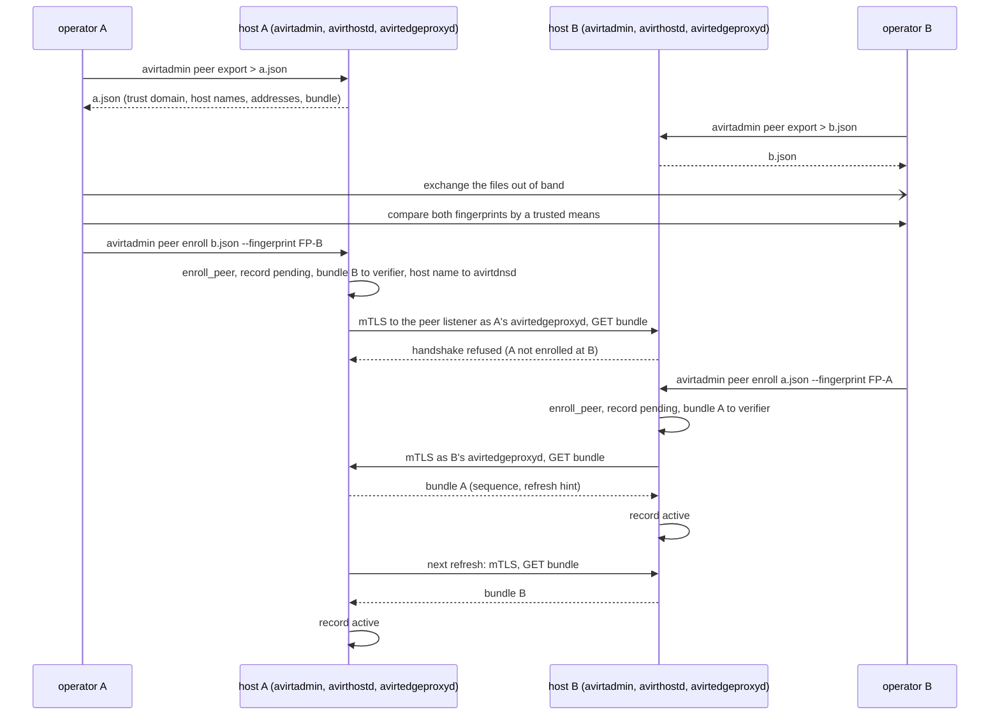
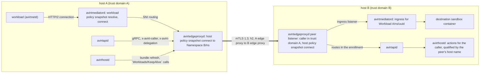

# Status: planned

The current code lacks peering. This document describes planned behavior throughout.

A **peering** joins two avirt hosts so that workloads on one reach workloads and services on the other, and so that callers on one manage workloads on the other. Each host is its own trust domain, `<install-id>.avirt` (see [identity](./identity.md#trust-domain-and-ids)), with a separate CA key on each host. avirtedgeproxyd is the only component that opens a connection off the host, and it's the policy enforcement point for each connection between hosts: each side's avirtedgeproxyd evaluates its own host policy snapshot, and neither side accepts the other's decision as authorization. Federated identity, the peer listener's caller rules and the trust boundaries are in [identity](./identity.md#federation) and [trust boundaries](./trust-boundaries.md#listeners). This document specifies the rest.

## Peers' host names

The **peer's host name**, `<host>`, identifies a peer. It must be the peer's real fully qualified DNS name, such as `mac-studio.example.com` or the tailnet name `studio.example.ts.net`. avirt takes it from the peer's enrollment file at enrollment rather than assigning a name.

- **Own host names.** Each host lists its own fully qualified names in the host setting `peering.hosts`, which defaults to the machine's fully qualified host name when it has at least two labels. Its enrollment file contains them, and avirtedgeproxyd's SVID includes each of them as a DNS SAN beside its SPIFFE ID (see [peer listener](#peer-listener)).
- **Syntax.** `<host>` is lowercase ASCII, at least two labels, each label 1 to 63 characters of `a`-`z`, `0`-`9` and `-`, not starting or ending with `-`, with no trailing dot. An internationalized name uses its A-label (`xn--`) form. `<host>` is at most 116 characters, the cap in [DNS](./dns.md#internal-names), so the longest an internal name under a peer's host name, `<alias>-<id>.<ns>.workload.<host>`, is at most 137 + 116 = 253 characters.
- **Name forms.** A peer workload is `<id>.<ns>.workload.<host>`, `<alias>-<id>.<ns>.workload.<host>` or `<generated>.<ns>.workload.<host>`, and a peer service is `<name>.<ns>.svc.<host>` or `<alias>.<ns>.svc.<host>`. Internal names under a peer's host name have no short form without `<ns>`.
- **Parsing.** In a name with at least four labels, `<host>` is everything after the third label. The name is an internal name under a peer's host name only if its third label is `workload` or `svc`, its first two labels are valid for that form, and `<host>` is the host name of an `active` peer (see [enrollment record](#enrollment-record)). Any other name, including the peer's host name itself, any other name under it, a name under a peer that's not `active`, and a name under a host that's not enrolled, isn't an internal name: it resolves normally and is classified as an external endpoint.
- **Matching.** The peer's avirtedgeproxyd must present `<host>` as a DNS SAN on each connection, along with `spiffe://<peer td>/service/avirtedgeproxyd`. avirtedgeproxyd refuses a connection whose certificate lacks that DNS SAN.
- **Qualification.** Cedar entities, `avirt` contexts and `--host` use the full `<host>`, with no alias: `Peer::"mac-studio.example.com"`, `Namespace::"mac-studio.example.com/team-a"`, `Workload::"mac-studio.example.com/team-a/<uuid>"`.
- **One name per enrollment.** For a peer whose enrollment file lists more than one name, enrollment uses the first name unless `--host` chooses another from the file's list. Enrollment refuses a name absent from the file.
- **Uniqueness.** One enrollment exists per peer trust domain and per peer's host name. Enrollment refuses an existing trust domain under any name. Names already in use or in this host's own `peering.hosts` also fail enrollment. Names under `avirt.internal` fail enrollment, as does this host's own trust domain.
- **Name changes.** The peer's host name remains immutable for the life of the enrollment. A name change requires enrolling the peer again: `avirtadmin peer revoke` and then `peer enroll` from a new enrollment file. `peer set` never changes it.
- **Policy references.** Enrolling a name that the current policy sets already reference requires `--accept-policy-references`, and avirtadmin lists the referencing policy `@id`s before it asks.

## Enrollment

Enrollment is mutual and out of band. Each host's operator exports an enrollment file, the operators exchange files, and each operator enrolls the other's file on their own host after comparing its fingerprint by a means they already trust (such as in person or on a call). A peering is active only once both hosts have enrolled each other.

### Enrollment file

`avirtadmin peer export > host.json` writes this host's enrollment file, a JSON object with `version` set to 1 and these fields:

| Field | Value |
| --- | --- |
| `trust_domain` | This host's trust domain |
| `hosts` | This host's fully qualified names, from `peering.hosts` |
| `addresses` | The peer listener's addresses, in preference order, from the host configuration and `--address` (see [addresses](#addresses)) |
| `bundle` | This host's trust bundle in the JWKS format of [bundle endpoint](#bundle-endpoint), containing each root currently in the bundle |
| `created` | The time of writing the file |

The enrollment file excludes private keys and secrets. The fingerprint covers `trust_domain` and `bundle` but excludes the peer's host name. Each connection checks that name against the DNS SANs of a certificate that chains to the fingerprinted bundle. `addresses` are hints the enrolling operator can override.

### Fingerprint

To compute the fingerprint, sort all root certificates in `bundle` bytewise by their DER encodings, then concatenate those encodings. Compute SHA-256 over the trust domain's bytes followed by a NUL byte and that concatenation. avirtadmin shows it as the first 20 characters of its lowercase base32 encoding in five groups of four, such as `k3qz-7f2m-a9xe-p4wd-n6tc`, and the full digest with `--long`. `avirtadmin peer fingerprint` shows this host's own fingerprint. A root rotation changes the fingerprint, and a peer that's already enrolled follows it through bundle refresh, never through a new comparison.

### Enrolling

`avirtadmin peer enroll host.json --fingerprint FP` enrolls a peer from its enrollment file, given as a path or as `-` for standard input:

1. It parses the file and refuses one whose `version` it doesn't support, whose `created` is more than 7 days old, whose bundle lacks an unexpired root, or whose roots aren't name-constrained to the file's trust domain.
2. It shows the trust domain, the file's host names, the peer's host name for the record, and the fingerprint. With `--fingerprint FP` it compares them and refuses on a mismatch. Without it, it asks the operator to confirm on a terminal, and without a terminal it refuses.
3. avirthostd validates the name and the trust domain against [peers' host names](#peers-host-names), then evaluates `enroll_peer`. It writes the enrollment record to `peers/` in its state directory (see [lifecycle](./lifecycle.md#durable-state)) and adds the `Peer` entity to its next entity revision.
4. avirtedgeproxyd installs the peer's bundle in its verifier, and the peer's host name reaches avirtdnsd, which answers internal names under that peer's host name once the record enters `active`. The record starts in `pending`.
5. avirthostd fetches the peer's bundle through avirtedgeproxyd at once, and then on the refresh schedule. The first fetch that completes mutual TLS and returns a valid bundle moves the record to `active`. Until the peer has enrolled this host too, the peer refuses the handshake and the record stays `pending`.

The enrollment file's bundle is the bootstrap bundle: the first connection to the peer authenticates it with that bundle, and each later connection with the most recently fetched one.



### Enrollment record

| Field | Value |
| --- | --- |
| `host` | The peer's host name, a fully qualified DNS name |
| `trust_domain` | The peer's trust domain |
| `addresses` | The configured addresses, and those learned by discovery (see [addresses](#addresses)) |
| `bundle`, `sequence` | The peer's current bundle and its `spiffe_sequence` |
| `distrusted` | Fingerprints of the root certificates that this host never accepts for the peer again (see [revocation and removal](#revocation-and-removal)) |
| `routes` | The avirtapid services and RPCs that the peer's callers may use here (see [control-plane calls](#control-plane-calls)) |
| `state` | `pending`, `active` or `suspended` |
| `reachable` | False after three consecutive failed dials or refreshes, true again after the next success |
| `enrolled`, `last_handshake`, `last_refresh`, `last_error` | Times and the last failure reason |

| State | Meaning | Peer listener | Internal names under a peer's host name |
| --- | --- | --- | --- |
| `pending` | Enrolled here, no mutual handshake yet | Accepts the peer | Not internal names: they resolve normally. avirthostd attempts bundle fetches, which the peer refuses until it enrolls this host. |
| `active` | A mutual handshake and a bundle fetch have succeeded | Accepts the peer | internal names, routed to the peer, whether `reachable` is true or not |
| `suspended` | `avirtadmin peer suspend` | Refuses the peer and closes its open connections | Not internal names: they resolve normally |

## Trust bundles

### Bundle endpoint

avirtedgeproxyd serves this host's bundle on its peer listener at `GET /avirt/peer/v1/bundle`, to enrolled peers only, over the same mutual TLS as each other peer route. The body is a SPIFFE trust bundle in the JWKS format of the SPIFFE federation standard: one key per root certificate with `use` set to `x509-svid` and the certificate in `x5c`, plus `spiffe_sequence` and `spiffe_refresh_hint`. Each bundle change increases `spiffe_sequence` to a value greater than all its previous values. `spiffe_refresh_hint` is 300 seconds.

Client authentication at this endpoint prevents conformance with the SPIFFE `https_spiffe` bundle endpoint. SPIFFE software other than avirt can't fetch it.

### Refresh

avirthostd refreshes each enrolled peer's bundle at the interval (in seconds) specified by `spiffe_refresh_hint` in the last bundle it accepted, and immediately after enrollment. The request goes through avirtedgeproxyd's egress listener as avirthostd's own connection, and avirtedgeproxyd opens it to the peer as `/service/avirtedgeproxyd`. avirthostd accepts the fetched bundle only if:

- the server presented `spiffe://<peer td>/service/avirtedgeproxyd`, chaining to the peer's current bundle.
- its `spiffe_sequence` is higher than the current one.
- it contains at least one unexpired root, each root is name-constrained to the peer's trust domain, and no root is in the record's `distrusted` set.

If a bundle fails any check, avirthostd rejects it whole and records the failure in `last_error`. The current bundle remains in force. On acceptance, avirthostd replaces the current bundle atomically. avirtedgeproxyd installs it in its verifier for each new handshake. After a refresh failure, avirthostd waits until the next interval before retrying.

### Root and issuing CA rotation

- **Issuing CA.** An issuing CA rotation leaves the peer's stored data unchanged. Each SVID includes its full chain, and peers trust only roots.
- **Root.** avirthostd adds a new root to its bundle 30 days before the current root expires (see [issuer](./identity.md#issuer)), and the bundle's `spiffe_sequence` increases. avirthostd signs no issuing CA with the new root until each `active` peer has fetched a bundle that holds it, as avirtedgeproxyd observes from the authenticated fetches on its peer listener, or until 7 days have passed. The old root leaves the bundle when it expires.
- **Unplanned root rotation.** `avirtadmin ca rotate --root` follows the same rules.

If a peer skips bundle fetches throughout the 30-day overlap, it retains only the old root after expiry. Peering then fails authentication in both directions until a new enrollment (see [failure modes](#failure-modes)).

### Revocation and removal

| Command | Effect |
| --- | --- |
| `avirtadmin peer suspend HOST` | avirtedgeproxyd stops accepting the peer and closes each open connection authenticated by its trust domain, at once, ending each stream on them. The internal names under that peer's host name are no longer internal names, so avirtedgeproxyd stops dialing the peer. The record, its bundle, and its policy references remain. |
| `avirtadmin peer resume HOST` | Returns the record to `pending` and refreshes at once. |
| `avirtadmin peer distrust-root HOST FINGERPRINT` | Removes the root with that fingerprint (the SHA-256 of its DER, in the same encoding as the peer fingerprint) from the peer's bundle and adds it to `distrusted`, so no later refresh can return it. avirtedgeproxyd closes connections whose peer chain uses that root. A bundle left with no root suspends the peer. |
| `avirtadmin peer revoke HOST` | Removes the enrollment and its bundle from the verifier. avirtedgeproxyd closes each connection with the peer, and the next entity revision excludes the `Peer` entity. The internal names under that peer's host name become ordinary names and resolve normally. avirthostd stops each workload created here from that peer, as when its creator stops sending `Workloads/KeepAlive` calls (see [workload management across hosts](#workload-management-across-hosts)). |

Changing the verifier affects new handshakes. avirtedgeproxyd closes each existing connection whose peer trust domain the host no longer trusts, or whose chain uses a distrusted root. Revocation is local and immediate on the host that runs it. The other host sees refused handshakes from then on, and its record's `reachable` becomes false.

For a compromised peer root, the peer's operator rotates the root and this host's operator runs `distrust-root` for the compromised one. The bundle that a refresh replaces authenticates that refresh.

## Discovery and transport

### Addresses

An enrollment record contains one or more addresses for the peer listener, each a `host:port` with a DNS name or an IP literal. The first is always `<host>:8788`, the peer's host name at the default port, unless `--address` at enrollment or `peer set` replaces it. avirtedgeproxyd dials them in order and uses the first that completes the handshake with the peer's exact SPIFFE ID. Discovery only supplies addresses: no address source authenticates a peer, and an address serves only as a dialing hint.

| Source | How |
| --- | --- |
| Static | The peer's host name, the enrollment file's `addresses`, and `avirtadmin peer set HOST --address ADDR`, repeatable. At each dial, avirtedgeproxyd resolves a DNS name through its own resolver, bypassing avirtdnsd. |
| mDNS and DNS-SD | Off by default. With `peering.mdns = true` in the host configuration, avirthostd announces `_avirt-peer._tcp.local` with the peer listener's port and a TXT record `tdh=` holding the first 16 bytes of SHA-256 over the trust domain, base32. It browses for the same type and adds a discovered address to the record whose trust domain hashes to that value, after the addresses configured statically. A discovered address expires with its mDNS TTL. A peer's host name under `local`, such as `mac-studio.local`, is itself resolved by mDNS. `avirtadmin peer discover` lists announcements on the LAN, for enrollment. |
| Tailnet | A tailnet such as Tailscale is a network like any other. A peer's MagicDNS name, such as `studio.example.ts.net`, can be the peer's host name. A tailnet address is a static address. The peer port binds to the tailnet interface through `peering.listen`. The tailnet's own node identity and ACLs aren't avirt identities: the mutual TLS handshake still authenticates the peer. |

Constraint: avirtedgeproxyd's `private-dest` check refuses non-global and host addresses for workload egress (see [edge proxy egress](./egress.md#edge-proxy-egress)). A connection to the peer listener of an enrolled peer isn't workload egress. It may dial a private, CGNAT, or link-local address only if that address appears in the peer's record or a DNS name in the record resolves to it. Addresses assigned to this host's own interfaces remain forbidden.

avirt lacks NAT traversal. In each direction of a peering, the dialing host must connect to the other host's peer listener. Possible paths include a public address or port forward, a VPN, or a tailnet. A host with only outbound connectivity to its peer can send streams but can't receive them. Its peer can't refresh its bundle.

### Peer listener

| Item | Value |
| --- | --- |
| Bind | `peering.listen`, a list of `address:port`, empty by default, for the host's peer port. avirtedgeproxyd binds the listener on the host. With it empty, the host has no peer listener and can only dial out. The default port is 8788. In the all-in-one server image, this is the one port the container publishes for peering. |
| Transport | TCP, TLS 1.3 only, mutual, ALPN `h2` only |
| Server identity | `spiffe://<td>/service/avirtedgeproxyd`, with each name in `peering.hosts` as a DNS SAN. A dialing peer requires the URI SAN and the DNS SAN of the peer's host name it recorded. |
| Client identity | Exactly `spiffe://<peer td>/service/avirtedgeproxyd` of a peer whose state isn't `suspended`, verified against that trust domain's own bundle only, never against another peer's bundle or this host's |
| Validity | A peer certificate's `not_before` may be up to 5 minutes after this host's clock. `not_after` has no tolerance. |
| Routes | `CONNECT` to local published ports and services, the gRPC services in the peer's `routes`, and `GET /avirt/peer/v1/bundle` |

Each stream on the peer listener includes exactly one `x-avirt-caller`, the originating principal's SPIFFE ID, which must be in the trust domain of the connection's peer. avirtedgeproxyd refuses a missing, repeated, unparseable, or foreign one with 403 (see [workload topology](./workload-topology.md#ingress)). avirtedgeproxyd maps it to a Cedar principal and to `via`:

| `x-avirt-caller` | Principal | `via` | Allowed on |
| --- | --- | --- | --- |
| `spiffe://<peer td>/ns/<ns>/workload/<uuid>` | `Workload::"<host>/<ns>/<uuid>"` | `egress` | `CONNECT` |
| `spiffe://<peer td>/ns/<ns>/workload/<uuid>/guest-cli` | `Workload::"<host>/<ns>/<uuid>"` | `guest-cli` | Routes |
| `spiffe://<peer td>/service/avirthostd` | `HostService::"<host>/avirthostd"` | `service` | `Workloads/KeepAlive` only |
| A peer's local or web UI user | Open (see [open questions](#open-questions)) | `client` | Routes |

avirtedgeproxyd refuses any other identity with 403. This host lacks records of a peer's generations, so generation fencing doesn't apply to peer identities. Before forwarding, the source avirtedgeproxyd fences its own callers.

### Peer connections

Each host's avirtedgeproxyd keeps a pool of h2 connections to each peer it dials, and multiplexes each stream bound for that peer onto them, whoever the caller is. A connection authenticates only the two hosts' avirtedgeproxyd identities. Each stream includes its own caller.

- **Workload streams.** h2 `CONNECT`, transporting opaque bytes. The source avirtedgeproxyd rewrites `:authority` from the peered form to the peer's own local form, so `7e759259.team-a.workload.mac-studio.example.com:8080` reaches the peer as `7e759259.team-a.workload.host.avirt.internal:8080`.
- **Control-plane calls.** gRPC over h2, for the routes in [control-plane calls](#control-plane-calls).
- **Bundle fetches.** `GET /avirt/peer/v1/bundle`.
- **Headers.** Each stream includes `x-avirt-caller`, `x-request-id` (a UUIDv7 that the source avirtedgeproxyd draws per stream, used only to correlate both hosts' events), `traceparent` unless the host configuration turns it off (see [propagation](./observability.md#propagation)), and for a workload management call `x-avirt-delegation` (see [workload management across hosts](#workload-management-across-hosts)). The source avirtedgeproxyd removes each other `x-avirt-*` header.
- **Liveness.** h2 `PING` at 30 s intervals. A connection with two unanswered pings, or a transport error, is dead, and each stream on it ends.
- **Limits.** Host settings bound the connections per peer, the concurrent streams per peer, and the concurrent streams per caller identity from a peer. avirtedgeproxyd refuses a stream past a limit with 503.
- **Protocols.** HTTP/3 and QUIC aren't used on the peer listener.

## What crosses a peering

| Crosses | How | Authorized by |
| --- | --- | --- |
| Workload-to-workload connections to published ports | h2 `CONNECT`, opaque bytes | Source workload's avirtmediatord, source avirtedgeproxyd, destination avirtedgeproxyd, destination workload's avirtmediatord `ingress` |
| Connections to services | h2 `CONNECT`, opaque bytes | The same, without `ingress` for a service with a host-local backend |
| Control-plane calls | gRPC from avirtapid to the peer's avirtapid | The source avirtedgeproxyd's `connect`, the peer's enrollment routes, and the peer's own action |
| Workspace images | Explicit imports, through the peer's avirtapid | `import_workspace` here, `pull_workspace` at the peer |
| Trust bundles | `GET /avirt/peer/v1/bundle` | Enrollment |
| Trace context | `traceparent` only | Host configuration |

These never cross a peering:

- **Secrets.** Credential values, placeholders, bindings and binding references, provider configuration, and avirtsecretsd records. A workload created on a peer gets only the peer's own bindings, under the peer's policy.
- **Keys.** Any private key, the SPIFFE CA, the MITM CAs, and each SVID other than the two hosts' avirtedgeproxyd SVIDs.
- **Policy.** Policy sets, policy snapshots, invariants, and decisions. Each host's policy remains private to that host. Its decisions don't bind the other host.
- **Audit and logs.** Audit logs, workload logs and audit records stay on the host that wrote them. A peer reads a workload's log only through `Logs/ReadLog` on its routes, under the peer's own `read_log` policy, which is a control-plane call and not audit delivery.
- **DNS queries.** avirtdnsd answers each internal name under a peer's host name locally (see [DNS](#dns)).
- **Topology.** This host never reveals its other peers to a peer. Peer routes exclude `Peers/*`, and avirt never forwards a stream to a third host.

### Workload traffic

A workload connects to a peer's workload or service by its internal name under that peer's host name:

1. avirtmediatord on the source host resolves the internal name under the peer's host name to `Namespace::"<host>/<ns>"` (see [name resolution](./egress-policies.md#name-resolution)). Next come the workload policy snapshot's `resolve` and `connect` checks. After these checks, avirtmediatord sends the stream to its own avirtedgeproxyd through avirthostd's SNI routing, as for each internal name.
2. At the source avirtedgeproxyd, authorization of avirtmediatord SVID includes generation fencing. It evaluates the host policy snapshot's `connect` for the source `Workload` and `Namespace::"<host>/<ns>"`, then rewrites `:authority`. On a connection to the peer, it opens the stream with `x-avirt-caller` set to the source workload's SPIFFE ID.
3. avirtedgeproxyd on the destination host checks the caller's trust domain and resolves the local name to its own entity. Then it evaluates its host policy snapshot's `connect` for `Workload::"<source host>/<ns>/<uuid>"` and connects to the destination workload's avirtmediatord's ingress listener or to a host-local backend, as for a local caller (see [edge proxy egress](./egress.md#edge-proxy-egress)).
4. avirtmediatord on the destination host evaluates `ingress` for the peer `Workload` in `x-avirt-caller`. This mapping matches avirtedgeproxyd's. For this mapping, the workload policy snapshot supplies the enrolled peers' trust domains and names.

Refusals preserve the peer's status. Source workload's avirtmediatord receives that status, which the source avirtedgeproxyd's event records as `peer_status`.



### Control-plane calls

`avirt --host <host>`, a context with `host` set (see [operator CLI](./operator-cli.md#contexts-and-authentication)), and avirtguest with `--host` all send their call to the local avirtapid, which forwards it through the local avirtedgeproxyd to the peer's avirtapid.

1. Locally, avirtedgeproxyd evaluates the host policy snapshot's `connect` for avirtapid and for the originating principal, with `Peer::"<host>"` as the resource, `port` 0 and the originating `via`.
2. The peer's avirtedgeproxyd accepts the call only if its gRPC service or RPC is in the enrollment's `routes`, and refuses any other with 403 before it reaches avirtapid.
3. On acceptance, the peer's avirtapid forwards it to the serving component, which evaluates the action against the peer's host policy snapshot, with the caller as principal, qualified by the peer's host name (see [entities](#entities)).

`routes` lists avirtapid services (`Workloads`) or single RPCs (`Workloads/GetWorkload`), and is empty at enrollment. Its entries must exclude `Peers/*`. avirtapid on the peer never forwards a peer caller's call to another peer.

### Workspace images

A workspace reference resolves only in the local avirtregistryd. Resolution never contacts a peer, and no selector (`github:`, `git:` or a repository tag) matches a peer's image. A peer's image enters this host only by an explicit import:

```text
avirt workspace import peer:<host>/<ns>/<name>[:<tag>|@<digest>] [REPOSITORY[:TAG]]
```

1. avirtregistryd evaluates `import_workspace` for the caller, with `registry` set to `peer:<host>`.
2. It calls the peer's `WorkspaceRegistry` through avirtedgeproxyd, identifying the caller in `x-avirt-caller`. The peer evaluates `pull_workspace` with `purpose` set to `peer-import`, for the caller, qualified by the peer's host name.
3. It pulls the manifest, the config and each layer, verifying each digest against the manifest, and stores the image with producer `import`, its source recorded as `peer:<host>/<repository>@<digest>`, and the peer's own producer recorded as `peer_producer`.

`peer_producer` records only the peer's assertion, and `launch_workspace` policies can read it. A launch on a peer with `--host` resolves the reference at the peer, in the peer's registry, under the peer's policy.

### DNS

avirtdnsd answers a name only when it's an internal name under an `active` peer's host name (see [parsing](#peers-host-names)): `*.<ns>.workload.<host>` or `*.<ns>.svc.<host>`, with a first label valid for the form. The answer is the address the peer's first address resolves to. Other names under `<host>` resolve normally as public names through avirtedgeproxyd's DNS proxy (see [workload DNS](./egress.md#workload-dns)). These include the peer's host name itself, other names under it, and peered forms for `pending` or `suspended` peers. Connections to these names use external endpoint policy. DNS queries for internal names under a peer's host name remain local to each host. The peer's avirtedgeproxyd resolves its own local names. avirtmediatord routes by name and ignores the address in the answer (see [internal names](./dns.md#internal-names)).

## Policy

### Entities

A `Peer` entity represents an enrolled peer, and a peer's namespaces are in it, so `principal in Peer::"<host>"` matches each identity from that peer and `resource in Peer::"<host>"` each internal name under that peer's host name.

| Entity | Id | Parents | Attributes | Source |
| --- | --- | --- | --- | --- |
| `Peer` | `<host>` | None | `trust_domain` | avirthostd's entity revision, from the enrollment records |
| `Namespace` (peer) | `<host>/<ns>` | Its `Peer` | None | Built at evaluation from the internal name under the peer's host name or the asserted caller |
| `Workload` (peer) | `<host>/<ns>/<uuid>` | Its peer `Namespace` | None, and no tags | Built at evaluation from the asserted caller |
| `HostService` (peer) | `<host>/<name>` | None | None | Built at evaluation from the asserted caller |

The `Peer` entity, `Namespace in [Peer]`, `Peer` as a `connect` resource, the actions `enroll_peer`, `update_peer`, `revoke_peer`, `list_peers` and `inspect_peer`, and the `pull_workspace` purpose `peer-import` are in the [schema](./egress-policies.md#schema-text).

### Evaluation on each side

| Point | Host | Principal | Resource | Sees |
| --- | --- | --- | --- | --- |
| Source workload's avirtmediatord | Source | The source `Workload` with its attributes and tags | `Namespace::"<host>/<ns>"` | The peer and namespace in the name, the port. Nothing below the namespace. |
| Source avirtedgeproxyd | Source | The source `Workload`, or avirtapid and the originating principal | `Namespace::"<host>/<ns>"`, or `Peer::"<host>"` for a control-plane call | The same, plus `via` |
| Destination avirtedgeproxyd | Destination | `Workload::"<source host>/<ns>/<uuid>"` without attributes or tags | The local `Workload` or `Service` with attributes and tags | Only the source's peer, namespace, and UUIDv7 |
| Destination workload's avirtmediatord | Destination | The same peer `Workload` | The local `Workload` | The same, plus `port` and `protocol` |
| Destination avirthostd and the other serving components | Destination | The caller, qualified by the peer's host name | The local resource | The caller, the asserted delegation chain (see below), `via` |

Each host evaluates in its own mode: the source applies its namespace modes to its own workloads, and the destination applies its host default to each peer caller (see [modes](./egress-policies.md#modes)).

A peer asserts identities in its own trust domain only, and this host can't verify anything about them beyond that. Any policy that grants something to `Peer::"<host>"` or to a peer namespace grants it to whatever that peer chooses to assert, including after a compromise of that peer.

### Workload management across hosts

A caller on host A manages workloads on host B only through B's avirtapid, under B's policy. The constraints in [workload management](./components.md#workload-management) hold on B as follows:

- **No greater authority.** The creator's authority on A remains unknown to B. A peer creator can create a workload only in a namespace where B's policy permits it. Binding attachment requires B's policy to permit that peer principal to attach the binding (`attach_binding`). A peer creator can assign only a policy reference that B's policy makes assignable by it. Peer principals lack their own bindings on B.
- **Reserved labels.** A peer creator never sets a label under `avirt.internal/`.
- **Delegation chain.** A's avirtapid sends `x-avirt-delegation: root=<principal>; depth=<n>` with each workload management call from a workload, with the root and depth that A's avirthostd recorded for the caller. B records the child's `avirt.internal/creator` as the fully qualified creator, `<host>/<ns>/<uuid>`, and `avirt.internal/root` as the asserted root qualified by the peer, `<host>/<root>`. The child's depth is the asserted depth plus one, `context.depth` in `create_workload` is that value, and B's own depth cap applies to it. The delegation chain is an assertion with A's trust only.
- **Lifetime.** A workload created on B by a workload on A stops unless A keeps confirming that its creator is alive. A's avirthostd records the child from the create response and, while the creator lives, calls `Workloads/KeepAlive` on B for it at 60 s intervals, as `/service/avirthostd`. B accepts the call only from the creator's trust domain and only for workloads that peer created. B stops the child when A stops it, when no `Workloads/KeepAlive` call has arrived for 5 minutes, or when B revokes the peer. A child with B's policy permission for detachment continues without `Workloads/KeepAlive` calls.
- **No self-escalation.** As on one host.
- **Host scope.** B's avirtapid never forwards a peer caller's call to another host, so a chain of hosts is always a chain of separate calls, each subject to authorization on its destination host.
- **No host administration.** Peer principals lack access to avirtadmin's actions, and `enroll_peer`, `update_peer` and `revoke_peer` take only `Admin`.
- **Audit.** Each host records the call in its own host audit log. A records the forwarded call with the caller and the peer. B records the call with the caller qualified by the peer's host name, the action, the resource, and the asserted delegation chain.

### Examples

On host A, `laptop.example.ts.net`, workloads in `team-a` may reach `team-a` on the peer `mac-studio.example.com`, and its `ci` workloads may manage workloads there:

```cedar
@id("team-a-to-mac-studio")
permit (principal in Namespace::"team-a", action in [Action::"resolve", Action::"connect"], resource in Namespace::"mac-studio.example.com/team-a");

@id("team-a-ci-to-mac-studio-control")
permit (principal in Namespace::"team-a", action == Action::"connect", resource == Peer::"mac-studio.example.com")
when { context.via == "guest-cli" && principal.hasTag("role") && principal.getTag("role") == "ci" };
```

On `mac-studio.example.com`, which enrolled host A as `laptop.example.ts.net`, `team-a` on host A may connect to the `db` service and create workloads in `remote-ci` at most three levels deep, and no peer may attach any binding:

```cedar
@id("laptop-team-a-db")
permit (principal in Namespace::"laptop.example.ts.net/team-a", action == Action::"connect", resource == Service::"team-a/db");

@id("laptop-ci-creates")
permit (principal in Namespace::"laptop.example.ts.net/team-a", action == Action::"create_workload", resource == Namespace::"remote-ci")
when { context.via == "guest-cli" && context.depth <= 3 };

@id("no-peer-bindings")
forbid (principal in Peer::"laptop.example.ts.net", action == Action::"attach_binding", resource);
```

## Topology

Peering is pairwise and never transitive:

- A stream that arrives on the peer listener goes only to a local destination: avirtedgeproxyd never forwards it to another peer.
- avirtapid never forwards a peer caller's call to another peer.
- A peered form under a host that's not an `active` peer of this host isn't an internal name, whatever another peer knows: it resolves normally and is an external endpoint.

A host may enroll any number of peers, each with its own record, bundle, connection pool, and limits. A mesh of n hosts is n(n − 1)/2 mutual enrollments.

## Failure modes

| Failure | Effect on new flows | Effect on open flows | Recovery |
| --- | --- | --- | --- |
| Peer unreachable | New streams fail: 502 for a dial failure, 504 after the 10 s connect timeout. Control-plane calls fail with `UNAVAILABLE`, exit 7 in `avirt`. The peer stays `active`, so avirtdnsd still answers internal names under that peer's host name. | Streams on a connection that fails end with `error: "peer-lost"`. Streams never resume. | Automatic once a dial succeeds. After three failures the record's `reachable` is false. |
| Partition | As for an unreachable peer, for each direction without connectivity to the other host | Streams end when liveness fails, within about 60 s. After 5 minutes without `Workloads/KeepAlive` calls, avirthostd stops workloads created from the other side unless they have detached status. | Automatic. A workload stopped for missing `Workloads/KeepAlive` calls stays stopped. |
| Bundle refresh fails | None while the current bundle verifies the peer | None | The next interval. The record keeps `last_error`. |
| Bundle or name mismatch after installing the peer again, a broken root chain, or a certificate without the recorded peer's host name | Each handshake with the peer fails, recorded as `peer-auth-failed`, in both directions | Connections close at their next handshake, and at the latest when the peer certificate expires | `avirtadmin peer revoke`, then a new enrollment from a new enrollment file |
| Bundle expired: each root the record holds has expired | As for a mismatch | As for a mismatch | As for a mismatch |
| Clock skew beyond 5 minutes | Handshakes fail on validity, recorded as `peer-clock-skew` | Open connections close at the peer certificate's `not_after` as seen locally | Synchronize the clocks |
| Local host policy snapshot expired | avirtedgeproxyd denies each stream to and from peers with rule `snapshot-expired` | Re-evaluated and closed (see [revocation of open flows](./egress-policies.md#revocation-of-open-flows)) | Applying a valid host policy snapshot |
| Peer's host policy snapshot expired | The peer refuses, and avirtedgeproxyd relays the status | The peer closes them | At the peer |
| Peer suspended or revoked here | Names under that peer's host name resolve normally and are external endpoints, so avirtedgeproxyd stops sending to the peer | Closed at once | `peer resume`, or a new enrollment |
| Policy change on either side | Evaluated against the new policy snapshot | Each host's avirtedgeproxyd and each avirtmediatord re-evaluates its own open flows | None needed |

## Observability and audit

Each host records its own side of each peered flow. A host never sends these events to its peer.

- **Source avirtedgeproxyd.** One `conn` event per peer stream, attributed to the source workload, with `src: "edgeproxy"`, `peer`, `request_id`, the destination name, `peer_status` and the byte counts (see [events](./egress.md#events-1)).
- **Destination avirtedgeproxyd.** One `conn` event per peer stream, attributed to the destination workload, with `src: "edgeproxy"`, `peer`, `request_id` and the caller in `x-avirt-caller`.
- **Destination workload's avirtmediatord.** Its `ingress` decision event, with the peer caller.
- **Host audit log.** avirthostd records enrollment, each state change, suspension, distrust and revocation, each bundle accepted or rejected with its sequence and reason, each peer connection opened and closed with the handshake outcome (`peer-auth-failed`, `peer-clock-skew`), `Workloads/KeepAlive` calls and the workloads stopped for missing them, and each forwarded and received control-plane call (see [audit logs](./observability.md#audit-logs)). avirtauditd delivers enrollment changes and handshake failures as Authentication (3002), and control-plane calls as API Activity (6003) (see [audit events](./observability.md#audit-events)).
- **Correlation.** `request_id` is the same on both hosts' events for one stream, so two operators can join their records without sharing them.
- **Metrics.** `avirt.peer.connections`, `avirt.peer.streams`, `avirt.peer.handshake_failures` (with `avirt.reason`), `avirt.peer.bundle_age` and `avirt.peer.rtt`, from avirtedgeproxyd and avirthostd, each with `avirt.peer.host`, an attribute bounded by the number of enrolled peers.

## Commands

### avirtadmin

Each `avirtadmin peer` command performs host administration on avirthostd's admin socket, as `Admin::"uid:<uid>"` (see [admin CLI](./admin-cli.md#peers-and-enrollment)).

| Command | Does | Cedar action |
| --- | --- | --- |
| `avirtadmin peer export [--address ADDR]...` | Writes this host's enrollment file to standard output | None |
| `avirtadmin peer fingerprint [--long]` | Prints this host's fingerprint | None |
| `avirtadmin peer enroll FILE\|- [--host FQDN] [--fingerprint FP] [--address ADDR]... [--route ROUTE]... [--accept-policy-references]` | Enrolls a peer from its enrollment file (see [enrolling](#enrolling)) | `enroll_peer` |
| `avirtadmin peer list`, `peer inspect HOST` | Lists peers with their state, trust domain, addresses, bundle sequence and root expiry, routes and last refresh, or shows one with its roots' fingerprints | `list_peers`, `inspect_peer` |
| `avirtadmin peer set HOST [--address ADDR]... [--route ROUTE]... [--remove-route ROUTE]...` | Changes a peer's addresses and routes, never the peer's host name | `update_peer` |
| `avirtadmin peer refresh HOST` | Refreshes the peer's bundle now | `update_peer` |
| `avirtadmin peer suspend HOST`, `peer resume HOST` | Suspends or resumes a peer | `update_peer` |
| `avirtadmin peer distrust-root HOST FINGERPRINT` | Distrusts one of the peer's roots | `update_peer` |
| `avirtadmin peer revoke HOST` | Removes the enrollment | `revoke_peer` |
| `avirtadmin peer discover [--timeout DURATION]` | Lists `_avirt-peer._tcp` announcements on the LAN, with their addresses and trust domain hashes, marking enrolled ones | None |

### avirt

`avirt peer list` and `avirt peer inspect HOST` show the peers for operators who aren't administrators, under `list_peers` and `inspect_peer` (see [peers](./operator-cli.md#peers)). Each other command runs on a peer with `--host HOST` or a context's `host`. `avirt whoami --host HOST` prints the principal the peer sees for this caller, qualified by the peer's host name the peer recorded for this host.

# Open questions

1. **Peer user principals.** The local and web UI user principals are open (see [components](./components.md#open-questions)), and so is how a peer represents another host's user, as `<host>/<user>` or otherwise.
2. **Peer entities below the namespace.** The source host resolves an internal name under a peer's host name to that peer's namespace (see [egress policies](./egress-policies.md#open-questions)). Whether a peer exports a catalog of the services it lets a peer see, so the source can resolve service names and their aliases to `Service::"<host>/<ns>/<name>"` entities, is open.
3. **One-way reachability.** A host without inbound connectivity can't receive streams. Its peer can't refresh its bundle. Whether a peer may open reverse streams on a connection the other host dialed is open. Push delivery of bundles is also an open question.
4. **A conformant bundle endpoint.** Whether a host also serves its bundle without client authentication, as a SPIFFE `https_spiffe` bundle endpoint, for federation with non-avirt SPIFFE deployments, is open.
5. **Short-code enrollment.** Whether enrollment also offers a short one-time code that both hosts exchange online under a password-authenticated key exchange, instead of exchanging enrollment files, is open.
6. **HTTP/3.** Whether the peer listener also serves HTTP/3 over QUIC is open.
7. **`Workloads/KeepAlive` timing.** Whether host settings define the 60 s `Workloads/KeepAlive` interval and the 5-minute limit, or the creator's host sets them per child, is open.
