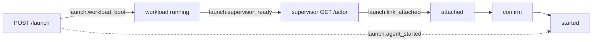

# Status: planned

Each table lists metrics with these columns:

| Column | Meaning |
| --- | --- |
| Definition | The exact start and end points |
| Where | The component that records the metric |
| How | Span, histogram, counter, gauge, log event, or external benchmark |
| Runtimes | Containerization, the Apple container CLI, Docker Desktop, or all three |
| Class | **SLO** for a candidate service-level objective, **diag** for a diagnostic |

Stages that exist only in the planned design (gated launch, the link, SVIDs, TLS termination) apply to Containerization and Docker.

# Actor lifecycle

| Metric | Definition | Unit | Where | How | Runtimes | Class |
| --- | --- | --- | --- | --- | --- | --- |
| `launch.accept` | `POST /launch` received → 200 response sent | ms | Controller | Span | All | diag |
| `launch.workload_boot` | `run_workload` called → the workload's init process running | ms | Controller | Span | All | diag |
| `launch.supervisor_ready` | `run_supervisor` called → the supervisor's first `GET /actor` | ms | Controller | Span | Containerization, Docker | diag |
| `launch.link_attached` | Supervisor ready → `attached` received by the runner | ms | Runner | Span | Containerization, Docker | diag |
| `launch.agent_started` | `POST /launch` received → `started` sent by the runner (adapter spawned, on the CLI runtime) | ms | Controller | Span across the actor log's timestamps | All | SLO |
| `teardown.duration` | Workload exit observed → `container_exit` written | ms | Controller | Span | All | diag |
| `teardown.release` | `runtime.release` called → returned | ms | Controller | Span | All | diag |
| `sweep.duration` | Startup sweep started → controller listening | ms | Controller | Span | All | diag |
| `sweep.items` | VMs, containers, networks, volumes and directories removed by the startup sweep, by kind | count | Controller | Counter | All | diag |

# ACP session

| Metric | Definition | Unit | Where | How | Runtimes | Class |
| --- | --- | --- | --- | --- | --- | --- |
| `acp.initialize` | `initialize` request written to the adapter → response read | ms | Runner | Span | All | diag |
| `acp.first_update` | `session/prompt` written → first `session/update` read | ms | Runner | Span, or derived from the tap envelopes' `ts` | All | SLO |
| `acp.prompt_turn` | `session/prompt` written → turn end (the prompt response under ACP v1, idle after activity under ACP v2) | s | Runner | Histogram | All | diag |
| `acp.tool_call` | A `tool_call` update → the matching `tool_call_update` with a terminal status | ms | Runner | Histogram, or derived from the log | All | diag |
| `acp.permission` | `session/request_permission` read → the approval written | ms | Runner | Histogram | All | diag |

# Link

| Metric | Definition | Unit | Where | How | Runtimes | Class |
| --- | --- | --- | --- | --- | --- | --- |
| `link.rtt` | Echo round trip of a small payload across the link, including the controller's vsock splice where present | µs | Bench harness | External benchmark | Containerization, Docker | diag |
| `link.throughput` | Sustained bytes per second per direction on one CONNECT stream across the link | MB/s | Bench harness | External benchmark | Containerization, Docker | diag |
| `link.stream_setup` | CONNECT stream opened by the runner → response headers received. On the CLI runtime: `proxy.sock` connect → `200` read. | ms | Runner | Histogram | All | diag |
| `link.mtls_handshake` | Transport connected → TLS 1.3 handshake complete with the peer ID authorized, per side | ms | Runner, supervisor, controller | Histogram | Containerization, Docker | diag |
| `svid.issue` | CSR sent → SVID received, end to end, plus the controller's signing time | ms | Supervisor, runner, controller | Histogram | Containerization, Docker | diag |
| `svid.rotation` | `rotate` pushed → new connection carrying the new SVID in use and GOAWAY sent on the old one | ms | Controller, supervisor | Span | Containerization, Docker | diag |
| `link.reconnect` | Supervisor loss detected by the runner (freeze) → SIGCONT after the new generation's `confirm` | ms | Runner | Histogram | Containerization, Docker | SLO |
| `link.frozen_total` | Total time the agent spent frozen during one actor | ms | Runner | Counter | Containerization, Docker | diag |

# Egress

| Metric | Definition | Unit | Where | How | Runtimes | Class |
| --- | --- | --- | --- | --- | --- | --- |
| `egress.connect_setup` | CONNECT head received by the supervisor → `200` written | ms | Supervisor | Histogram | All | SLO |
| `egress.dns` | Name lookup started → addresses returned | ms | Supervisor | Histogram | All | diag |
| `egress.dial` | First upstream dial started → connected | ms | Supervisor | Histogram | All | diag |
| `egress.tls_accept` | `200` written → downstream TLS handshake complete | ms | Supervisor | Histogram | Containerization, Docker | diag |
| `egress.leaf` | Leaf certificate cache miss → leaf ready, plus the cache hit ratio | µs, ratio | Supervisor | Histogram, counter | Containerization, Docker | diag |
| `egress.tls_added_latency` | Request completion time through termination minus through the opaque path, for the same request | ms | Bench harness | External benchmark | Containerization, Docker | diag |
| `egress.tls_added_throughput` | Throughput through termination relative to the opaque path, for the same transfer | ratio | Bench harness | External benchmark | Containerization, Docker | diag |
| `egress.policy_eval` | Rule evaluation started → decision, per connection and per request | µs | Supervisor | Histogram | All | diag |
| `egress.substitution` | Credential substitution and leak scan, per request, including body scanning | µs | Supervisor | Histogram | Containerization, Docker | diag |
| `egress.codex_refresh` | Intercepted refresh request received → synthesized response sent, plus the controller's `POST /actor/codex/refresh` time | ms | Supervisor, controller | Span | Containerization, Docker | diag |
| `egress.decisions` | Connections and requests by `decision` (`allow`, `deny`, `would-deny`) and by `rule` | count | Supervisor | Counter, from the egress events | All | diag |
| `egress.errors` | Failures by kind: `bad-request`, `private-dest`, `plain-http`, DNS, dial, timeout, `shutdown`, `credential-misplaced` | count | Supervisor | Counter, from the egress events | All | diag |
| `egress.bytes` | `bytes_up` and `bytes_down` per connection and per actor | bytes | Supervisor | Counter, from the egress events | All | diag |

# Uplink and logging

| Metric | Definition | Unit | Where | How | Runtimes | Class |
| --- | --- | --- | --- | --- | --- | --- |
| `uplink.latency` | Line read by the runner's tap (envelope `ts`) → line written to `logs/<actor-id>.ndjson` | ms | Runner, controller | Histogram | All | SLO |
| `log.write_rate` | Envelopes and bytes written per second, per actor log and in total | count/s, bytes/s | Controller | Counter | All | diag |
| `uplink.backpressure` | Time the runner's uplink sender waits for flow-control window, and its queue depth | ms, count | Runner | Histogram, gauge | All | diag |
| `log.line_truncated` | `line_truncated` events, by writer (runner or controller) | count | Runner, controller | Counter, from the log | All | diag |
| `uplink.replay` | Envelopes replayed on resume, deduplicated by `seq`, and `uplink_gap` events | count | Runner, controller | Counter | Containerization, Docker | diag |

# Resources per actor

| Metric | Definition | Unit | Where | How | Runtimes | Class |
| --- | --- | --- | --- | --- | --- | --- |
| `mem.workload` | Workload memory: guest `memory.current` for a VM, the container's cgroup on Docker | MiB | Runner, controller | Gauge, peak and steady | All | diag |
| `mem.supervisor` | Supervisor memory, measured the same way | MiB | Supervisor, controller | Gauge | All | diag |
| `cpu.workload`, `cpu.supervisor` | CPU seconds consumed per actor, per role | s | Controller | Counter | All | diag |
| `mem.controller`, `cpu.controller` | Controller RSS and CPU, including the host-side cost of in-process VMs on Containerization | MiB, s | Controller | Gauge, counter | All | diag |
| `disk.actor` | Bytes on disk per actor: writable root filesystem, `containers/<id>/`, `actors/<id>/` and its logs | MiB | Controller | Gauge | All | diag |
| `disk.caches` | Sizes of the kernel cache, the initfs and the image store | MiB | Controller | Gauge | Containerization | diag |
| `concurrency.max_actors` | The largest number of simultaneous actors for which `launch.agent_started`, `acp.first_update`, `egress.connect_setup` and `uplink.latency` stay within their objectives | count | Bench harness | External benchmark | All | SLO |

# Build and artifacts

| Metric | Definition | Unit | Where | How | Runtimes | Class |
| --- | --- | --- | --- | --- | --- | --- |
| `build.rust_cold` | Clean `cargo build --workspace` start → finish | s | CI, bench harness | External benchmark | All | diag |
| `build.rust_incremental` | `cargo build --workspace` after a one-file change in `agentvmm-core` | s | CI, bench harness | External benchmark | All | diag |
| `build.swift_shim` | Shim build from source (including Containerization) start → finish, and the same with `AGENTVMM_SWIFTSHIM_DIR` set | s | CI (macOS) | External benchmark | Containerization | diag |
| `build.images` | `mise run build-images`, cold and with cached layers | s | CI, bench harness | External benchmark | All | diag |
| `size.images` | Workload and supervisor image sizes | MiB | CI | External benchmark | All | diag |
| `size.binaries` | `agentvmm-controller`, `agentvmm`, `agentvmm-supervisor` and `agentvmm-runner` sizes, per target | MiB | CI | External benchmark | All | diag |
| `size.dylib` | Swift shim dylib size | MiB | CI (macOS) | External benchmark | Containerization | diag |

# Reliability counters

| Metric | Definition | Unit | Where | How | Runtimes | Class |
| --- | --- | --- | --- | --- | --- | --- |
| `runtime.create_failures` | VM or container creation failures by cause: XPC and Virtualization.framework create or start errors, non-zero `container` or `docker` exits | count | Controller | Counter | All | diag |
| `runtime.retries` | Link dials, controller-channel dials and uplink connect attempts beyond the first, per actor | count | Supervisor, runner | Counter | All | diag |
| `supervisor.restarts` | Supervisor restarts per actor, and actors ended because restarts ran out | count | Controller | Counter | Containerization, Docker | diag |
| `actor.errors` | `container_error` events by reason | count | Controller | Counter, from the log | All | diag |
| `sweep.findings` | Items found at startup that a previous controller left, by kind | count | Controller | Counter | All | diag |
| `codex.writeback` | `auth_writeback` outcomes by reason string (implemented), and refresh outcomes (planned) | count | Controller | Counter, from the log | All | diag |

# Collection

Status: planned.

- Each binary records the spans, histograms and counters above with `tracing`.
- When `OTEL_EXPORTER_OTLP_ENDPOINT` is set, they are exported as OTLP.
- Otherwise each actor's summaries are written into its log as `meta` `metric` events: through the uplink for the runner, through the events stream for the supervisor, and directly for the controller.
- Counters marked "from the log" can also be derived from existing actor log events.
- A `mise run bench` harness runs the external benchmarks: link RTT and throughput, the TLS termination overhead, `concurrency.max_actors`, and the build and size measurements.

See [roadmap](./roadmap.md) for the phases that introduce the planned stages.
