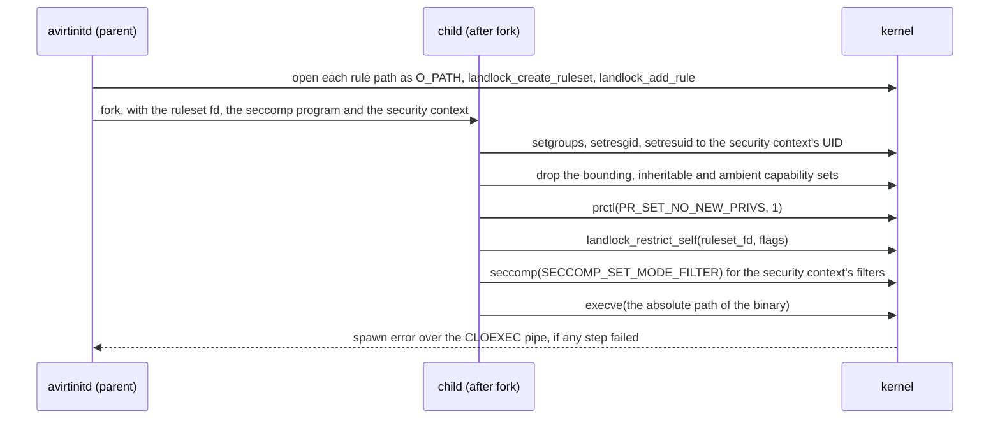
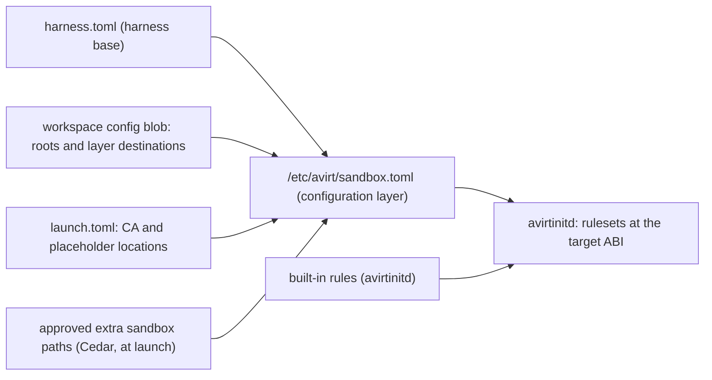

# Status: implemented

The repository lacks Landlock code or a dependency on the `landlock` crate. Processes in the workload container run outside Landlock domains. The layers below Landlock that do exist are in [workload hardening](./workload-hardening.md):

- avirtinitd starts the adapter through `setpriv` as uid 1000 with all five capability sets at zero and `no_new_privs` set (see [agent process](./workload-hardening.md#agent-process)).
- avirtinitd applies two seccomp filters (`seccompiler`, default allow) to itself with all threads before it starts the adapter, and the adapter inherits them: `socket()` with `AF_VSOCK`, `AF_NETLINK` or `AF_PACKET` returns `EAFNOSUPPORT`, and the io_uring syscalls return `EPERM` (see [seccomp](./workload-hardening.md#seccomp)).
- the agent writes wherever file ownership and modes let uid 1000 write.

# Status: planned

Landlock is the filesystem, port and scope layer of the workload sandbox. avirtinitd's launcher applies one Landlock ruleset per security context between fork and exec, alongside the process's UID, capabilities and seccomp filter (see [security contexts](./workload-hardening.md#security-contexts)). avirtinitd itself runs in no Landlock domain, because each child would inherit it.

## Kernel and ABI

### ABI features

| ABI | Mainline kernel | Adds | avirt use |
| --- | --- | --- | --- |
| 1 | 5.13 | Filesystem rights: `EXECUTE`, `WRITE_FILE`, `READ_FILE`, `READ_DIR`, `REMOVE_DIR`, `REMOVE_FILE`, `MAKE_CHAR`, `MAKE_DIR`, `MAKE_REG`, `MAKE_SOCK`, `MAKE_FIFO`, `MAKE_BLOCK`, `MAKE_SYM` | Mandatory |
| 2 | 5.19 | `REFER`: link or rename across directories | Mandatory |
| 3 | 6.2 | `TRUNCATE` | Mandatory |
| 4 | 6.7 | `NET_BIND_TCP` and `NET_CONNECT_TCP` port rules | Mandatory |
| 5 | 6.10 | `IOCTL_DEV`: ioctl on newly opened character and block devices | Mandatory |
| 6 | 6.12 | Scopes: `SCOPE_ABSTRACT_UNIX_SOCKET` and `SCOPE_SIGNAL` | Mandatory |
| 7 | 6.15 | Audit logging of denials, with the `LOG_SAME_EXEC_OFF`, `LOG_NEW_EXEC_ON` and `LOG_SUBDOMAINS_OFF` flags to `landlock_restrict_self` | Best effort |
| 8 | 7.0 | `RESTRICT_SELF_TSYNC`: enforce on each thread of the process | Not used |
| 9 | 7.1 | `RESOLVE_UNIX`: connecting or sending to path Unix sockets created outside the domain | Best effort |
| 10 | 7.2 | `NET_BIND_UDP` and `NET_CONNECT_SEND_UDP` port rules, and quiet-logging controls | Not used until the `landlock` crate supports it |
| 11 | After 7.2 | `RESTRICT_SELF_NO_NEW_PRIVS`: set `no_new_privs` only if enforcement succeeds | Not used |

Landlock trace events (`/sys/kernel/tracing/events/landlock/`) aren't in either workload kernel, and avirt doesn't use them.

### Workload kernels

| Runtime | Kernel | Landlock configuration | ABI | Denial audit records |
| --- | --- | --- | --- | --- |
| Containerization | Kata Containers 3.32.0 arm64 `vmlinux`, Linux 6.18.35, pinned by sha256 (see [compute runtimes](./compute-runtimes.md#guest-artifacts)) | `CONFIG_SECURITY_LANDLOCK=y` from Kata's `landlock.conf` fragment, and `CONFIG_AUDIT=y` and `CONFIG_AUDITSYSCALL=y` from its `lsm.conf` fragment. No fragment sets `CONFIG_LSM`, so the kernel's default list applies, and that list includes `landlock`. | 7 | Available to guest root, one VM per workload |
| Docker Desktop | LinuxKit 7.0.14, shared by each container (see [Docker Desktop runtime](./compute-runtimes.md#docker-desktop-runtime)) | Landlock enabled and usable unprivileged with `no_new_privs`. Docker's default seccomp profile allows `landlock_create_ruleset`, `landlock_add_rule` and `landlock_restrict_self`. | 8 | Not available to the workload container (see [denials](#denials)) |
| <!-- Abbreviated project glossary runtime name. --><!-- vale project.WordList = NO -->Apple container CLI<!-- vale project.WordList = YES --> | The same Kata kernel as Containerization | As Containerization | 7 | Not used: avirt removes the <!-- Abbreviated reference to the Apple container CLI runtime. --><!-- vale project.WordList = NO -->CLI runtime<!-- vale project.WordList = YES --> before adding Landlock |

Constraint: the configured ABI is what the running kernel reports, not what its build configuration implies. A kernel command line `lsm=` that omits `landlock` gives ABI 0. avirtinitd probes the ABI in each workload container at boot with `landlock_create_ruleset(NULL, 0, LANDLOCK_CREATE_RULESET_VERSION)`.

### Mandatory and best-effort rights

The **lowest supported ABI is 6**. avirtinitd refuses to start any workload process on a kernel that reports less, and the workload ends before avirtnetd starts with the error `landlock abi <n> below 6`. The **target ABI** is the lower of the probed ABI and ABI 9, the highest the `landlock` crate supports.

| Right or feature | ABI | Level | Without it |
| --- | --- | --- | --- |
| Each filesystem right of ABI 1 to 5, handled in each ruleset | 1 to 5 | Mandatory | avirtinitd refuses the launch |
| `NET_BIND_TCP`, `NET_CONNECT_TCP`, in the security contexts that handle them (see [network rules](#network-rules)) | 4 | Mandatory | avirtinitd refuses the launch |
| `SCOPE_ABSTRACT_UNIX_SOCKET`, `SCOPE_SIGNAL`, in each ruleset | 6 | Mandatory | avirtinitd refuses the launch |
| Denial logging (`LOG_NEW_EXEC_ON`, `LOG_SUBDOMAINS_OFF`) | 7 | Best effort | Denials surface only as errno in the process |
| `RESOLVE_UNIX` rules on the sockets each process may connect to | 9 | Best effort | Unix socket file modes and `SO_PEERCRED` checks alone govern connects |
| UDP port rules | 10 | Not requested | Loopback-only networking and the seccomp socket-domain allowlist govern UDP |

## Library and launcher

### The `landlock` crate

`avirt-core` depends on `landlock = "0.4.7"`, Linux targets only, as it does on `seccompiler`. The crate's `ABI` enum runs from `V1` to `V9`. It provides:

- `Ruleset` with `handle_access` (`AccessFs`, `AccessNet`) and `scope` (`Scope::AbstractUnixSocket`, `Scope::Signal`), then `create`.
- `RulesetCreated` with `add_rule` and `add_rules` for `PathBeneath` (from a `PathFd`, an `O_PATH` descriptor) and `NetPort`.
- `set_compatibility` from the `Compatible` trait, with `CompatLevel::BestEffort` (the default), `SoftRequirement` and `HardRequirement`.
- `log_same_exec`, `log_new_exec`, `log_subdomains` and `all_threads` for the `landlock_restrict_self` flags of ABI 7 and 8.
- `From<RulesetCreated> for Option<OwnedFd>`, which yields the ruleset descriptor.

avirtinitd sets `CompatLevel::HardRequirement` on each ruleset. avirtinitd decides best effort once, explicitly. It computes each security context's requested rights from the target ABI (omitting the preceding best-effort rows when the ABI lacks them), and then requires each requested right. A ruleset that the kernel can't honor exactly fails to build, so what's recorded is what's enforced.

### Building and applying

avirtinitd builds each ruleset in the parent, before fork, and the child only enforces it:

```rust
let created = Ruleset::default()
    .set_compatibility(CompatLevel::HardRequirement)
    .handle_access(AccessFs::from_all(target_abi))?
    .handle_access(profile.handled_net)?   // only when the profile handles a TCP right
    .scope(Scope::from_all(target_abi))?
    .create()?
    .add_rules(profile.path_rules(target_abi))?
    .add_rules(profile.port_rules())?;
let ruleset_fd: OwnedFd = Option::<OwnedFd>::from(created).ok_or(LaunchError::NoRuleset)?;
```



Constraints:

- avirtinitd uses more than one thread, so the child between fork and exec must not perform memory allocation. It calls `landlock_restrict_self` directly on the ruleset descriptor with `libc::syscall`, not `RulesetCreated::restrict_self`, and passes the flags itself.
- Use flags `LANDLOCK_RESTRICT_SELF_LOG_NEW_EXEC_ON | LANDLOCK_RESTRICT_SELF_LOG_SUBDOMAINS_OFF` at target ABI 7 or later, and 0 below it. The launcher creates the domain before `execve`. Without `LOG_NEW_EXEC_ON`, the kernel wouldn't log denials by the executed program. `LOG_SUBDOMAINS_OFF` leaves denials by domains a harness creates for itself, such as Codex's tool sandbox, to that harness.
- The child after fork has one thread, so `TSYNC` isn't needed.
- The launcher enforces Landlock before seccomp, so seccomp filters don't have to permit the launcher's own remaining syscalls, and the security context's filters govern only the executed program.
- The ruleset permits executing the binary itself and, for a <!-- Linker term. --><!-- vale ai-tells.OverusedVocabulary = NO -->dynamically linked<!-- vale ai-tells.OverusedVocabulary = YES --> binary, its ELF interpreter, because `execve` runs inside the new domain.
- Rules attach to inodes. Each rule path must exist when avirtinitd builds the ruleset, so avirtinitd builds a security context's ruleset only after it has created the paths the security context names (the workspace roots, `/home/agent/.codex`, `/run/avirt/ca.pem` and the sockets).
- Any failure fails the spawn, and the process doesn't start (see [startup and failure semantics](./components.md#startup-and-failure-semantics)).

## Rule notation

Each ruleset handles each filesystem right of the target ABI and denies access unless a rule grants it. The tables use these right sets:

| Set | Rights |
| --- | --- |
| `ro` | `READ_FILE`, `READ_DIR` |
| `rx` | `ro`, `EXECUTE` |
| `rw` | `ro`, `WRITE_FILE`, `TRUNCATE`, `REMOVE_DIR`, `REMOVE_FILE`, `MAKE_DIR`, `MAKE_REG`, `MAKE_SYM`, `REFER` |
| `rwx` | `rw`, `EXECUTE`, `MAKE_SOCK`, `MAKE_FIFO` |
| `file-r` | `READ_FILE` on one file |
| `file-rw` | `READ_FILE`, `WRITE_FILE` on one file |
| `exec` | `READ_FILE`, `EXECUTE` on one file |
| `pty` | `READ_FILE`, `WRITE_FILE`, `IOCTL_DEV` on `/dev/ptmx` and beneath `/dev/pts` |
| `sock-dir` | `READ_DIR`, `MAKE_SOCK`, `REMOVE_FILE` on a directory where the process creates its listening sockets |
| `unix` | `RESOLVE_UNIX` on one socket path, at target ABI 9 only |

Never grant `MAKE_CHAR` or `MAKE_BLOCK` to any process. Grant `IOCTL_DEV` only in `pty`.

**The paths each helper needs** to run are: `ro` on `/usr/lib` and `/proc`, `file-r` on `/etc/ld.so.cache`, `ro` on `/sys/fs/cgroup`, `file-rw` on `/dev/null`, `file-r` on `/dev/urandom`, and `exec` on its own binary and on `/usr/lib/ld-linux-aarch64.so.1`. `/bin`, `/sbin` and `/lib` are symlinks into `/usr` in the avirt base, and resolving a symlink doesn't need a right. Mount `/proc` with `hidepid=invisible` to limit each process to its own UID's entries.

## Per-process rulesets

### Agent

The agent's security context covers the adapter and each tool it starts, as uid 1000 in the agent cgroup. avirtinitd launches the adapter by the absolute path in `harness.toml`, at the main workload process's request.

| Path | Rights | Input |
| --- | --- | --- |
| `/usr`, `/opt` | `rx` | Built-in. Covers the system tools, the avirt binaries, the workspace's `/usr/local` and `/opt` additions, and `/opt/agent` with the harness and its runtime. |
| `/etc` | `ro` | Built-in. Covers `/etc/avirt`, the managed configuration paths, `/etc/passwd`, `/etc/resolv.conf` and the system CA bundle. |
| `/workspace` | `rwx` | Built-in |
| `/home/agent` | `rwx` | Built-in. Covers each workspace root under the home, such as `.cache`, and the harness's own state such as `/home/agent/.codex`. |
| `/tmp` | `rwx` | Built-in |
| `/dev/shm` | `rw` | Built-in |
| `/dev/null`, `/dev/zero`, `/dev/full` | `file-rw` | Built-in |
| `/dev/random`, `/dev/urandom` | `file-r` | Built-in |
| `/dev/ptmx`, `/dev/pts` | `pty` | `harness.toml`, when it declares `pty = true` |
| `/proc` | `ro` | Built-in |
| `/sys/fs/cgroup`, `/sys/devices/system/cpu` | `ro` | Built-in |
| `/run/avirt/ca.pem`, `/run/avirt/ca-bundle.pem` | `file-r` | Configuration layer, from the CA variables in `launch.toml` |
| `/run/avirt/agent/guest.sock`, `/run/avirt/agent/mcp.sock` | `unix` | Built-in |
| Each workspace layer destination outside `/usr`, `/opt`, `/etc` and the writable roots | `rx` | Workspace config blob |
| Each approved extra sandbox path | As approved | Policy (see [extra sandbox paths](#extra-sandbox-paths)) |

Outside those entries, the ruleset denies access. The agent can't access `/run` beyond the four entries preceding, `/var`, `/root`, `/srv`, `/mnt`, `/boot`, the rest of `/sys` and `/dev`. It can't write anywhere under `/usr`, `/opt`, `/etc` or `/proc`.

For the reserved paths in [workload hardening](./workload-hardening.md#reserved-paths), these rules give the following access:

| Reserved path | Agent access |
| --- | --- |
| `/usr/local/bin/avirt*` | `rx` |
| `/etc/passwd`, `/etc/group`, `/etc/shadow`, `/etc/gshadow`, `/etc/resolv.conf`, `/etc/hosts`, the system CA bundle | `ro`, and file modes keep `/etc/shadow` and `/etc/gshadow` unreadable |
| `/opt/agent` | `rx` |
| `/etc/avirt` and the managed configuration paths | `ro` |
| `/run` | Only the CA files and the agent sockets preceding |
| `/proc` | `ro` |
| `/sys` | `ro` on `/sys/fs/cgroup` and `/sys/devices/system/cpu` only |
| `/dev` | Only the device nodes preceding |

### Harness additions

`harness.toml` may add to the agent's security context, within the limits in [extra sandbox paths](#extra-sandbox-paths):

| Key | Effect |
| --- | --- |
| `adapter` | The adapter's absolute path. It must be under `/opt/agent`, which the base already grants `rx`. |
| `sandbox.pty` | Adds `pty` |
| `sandbox.read` | Adds `ro` or `rx` rules for paths outside the agent's built-in rules |
| `sandbox.write` | Adds `rwx` rules, only beneath `/workspace`, `/home/agent` or `/tmp`, which the agent's built-in rules already cover, so it doesn't add access and documents the harness's writable state |

A harness that sandboxes its own tools with Landlock, such as Codex's tool sandbox, stacks its domain inside the agent's. The kernel allows 16 stacked domains, and the agent's domain is the first.

### avirtmcp and avirtguest

The agent starts both, so both run in the agent's domain and inherit the agent ruleset. avirtinitd doesn't launch them or apply its own security context to them. Each one restricts itself further at startup with a nested ruleset of its own, applied with `landlock_restrict_self` and the default flags:

| Process | Paths | TCP | Scopes |
| --- | --- | --- | --- |
| avirtmcp | `ro` on `/usr/lib` and `/proc`, `file-r` on `/etc/ld.so.cache`, `unix` on `/run/avirt/agent/mcp.sock`, nothing writable | Bind and connect handled, no rules | Both |
| avirtguest | The same, with `unix` on `/run/avirt/agent/guest.sock` | Bind and connect handled, no rules | Both |

Both are inside the agent's trust boundary (see [compromise scope](./trust-boundaries.md#compromise-scope)). The nested rulesets limit what a fault in either binary can access, and they don't separate either one from the agent.

### Main workload process

avirtacp, avirtagent or avirtexec, as `avirt-run`. The runner doesn't execute anything. avirtinitd launches the adapter for it.

| Path | Rights |
| --- | --- |
| The paths each helper needs | As preceding |
| `/etc/avirt/launch.toml` | `file-r` |
| `/run/avirt/streams/run.sock`, `/run/avirt/init/run.sock` | `unix` |

### avirtnetd

As `avirt-net`.

| Path | Rights |
| --- | --- |
| The paths each helper needs | As preceding |
| `/run/avirt/streams` | `sock-dir` |
| `/run/avirt/agent` | `sock-dir` |
| `/run/avirt/mediator.sock`, `/run/avirt/init/net.sock` | `unix` |

avirtnetd reads its bootstrap SVID from an inherited descriptor. It inherits its DNS stub sockets and forward proxy listener and doesn't open any other file.

### avirtguestd

As `avirt-guest`, in the `avirt-ws` group.

| Path | Rights |
| --- | --- |
| The paths each helper needs | As preceding |
| Each workspace root from the workspace image's `roots` (`/workspace` and each directory destination under `/home/agent`) | `rw`, without `EXECUTE`, `MAKE_SOCK` or `MAKE_FIFO` |
| Its workspace snapshot directory | `rw` |
| `/run/avirt/streams` | `sock-dir`, for its listener `/run/avirt/streams/guestd.sock` |
| `/run/avirt/init/guestd.sock` | `unix` |

avirtguestd resolves paths beneath a root without following symlinks out of it. The ruleset enforces the same boundary in the kernel. A symlink inside a root that points elsewhere can't open anything outside the roots or workspace snapshot directory, except the paths each helper needs.

### Build jobs

The build runner (avirtexec in build mode) runs as root in the build VM under the build security context, with no Landlock ruleset. Constraint: a Landlock domain denies `mount` and `pivot_root`, which BuildKit's OCI worker needs. The build VM is the boundary for build commands, and command builds run only on a runtime with `isolation = VmPerWorkload` (see [build jobs](./workspace-build.md#build-jobs)). avirtnetd in the build VM runs under its usual ruleset.

### Mediator

avirtinitd in mediator mode launches avirtmediatord and avirtmedproxyd with rulesets in the same way, on the mediator VM's kernel (the same Kata kernel on Containerization) or the shared LinuxKit kernel on Docker Desktop. avirtmedproxyd starts its Envoy under its own UID, and between fork and exec applies the Envoy's ruleset as a nested domain inside its own. avirtmcp and avirtguest restrict themselves the same way. avirtmedproxyd's ruleset covers its Envoy's paths as well as its own.

| Process | Paths | TCP |
| --- | --- | --- |
| avirtmediatord (`avirt-med`) | The paths each helper needs, `sock-dir` on the directory holding its status socket and the socket on which it hands the Envoy's SVID to avirtmedproxyd, `unix` on `/run/avirt/hostd.sock` and `/run/avirt/svc.sock` | Bind and connect handled, no rules |
| avirtmedproxyd (`avirt-envoy`) | The paths each helper needs, `exec` on the Envoy binary, `ro` on the Envoy's bootstrap file and on `libavirtenvoy`'s shared object, `sock-dir` on the directory of its xDS and SDS socket and on the directories of `/run/avirt/workload.sock` and `/run/avirt/ingress.sock`, `unix` on avirtmediatord's sockets, `/run/avirt/hostd.sock` and `/run/avirt/svc.sock` | Bind and connect handled, no rules |
| avirtmedproxyd's Envoy (`avirt-envoy`, nested) | The paths each helper needs, `ro` on its bootstrap file and on `libavirtenvoy`'s shared object, `sock-dir` on the directories of `/run/avirt/workload.sock` and `/run/avirt/ingress.sock`, `unix` on the xDS and SDS socket, `/run/avirt/hostd.sock` and `/run/avirt/svc.sock` | Bind and connect handled, no rules |

## Network rules

Landlock port rules match the port only, never the address. The workload container and the mediator have no interface other than loopback. A TCP connection can leave a container only through avirtnetd and the workload's HTTP/2 connection to its mediator (see [runtime-provided sockets](./workload-topology.md#runtime-provided-sockets)).

| Process | `NET_BIND_TCP` | `NET_CONNECT_TCP` |
| --- | --- | --- |
| Agent | Not handled | Not handled |
| avirtnetd | Handled, no rules | Not handled |
| Main workload process, avirtguestd | Handled, no rules | Handled, no rules |
| avirtmcp, avirtguest (nested) | Handled, no rules | Handled, no rules |
| avirtmediatord, avirtmedproxyd, and its Envoy | Handled, no rules | Handled, no rules |

- **Agent.** The agent binds and connects to its own servers on loopback for development and for published ports. The only other loopback listeners are avirtnetd's forward proxy and DNS stub, which serve the agent.
- **avirtnetd.** avirtinitd binds avirtnetd's forward proxy listener and the DNS stub's port 53 sockets and hands them over, so avirtnetd binds nothing itself. Its reverse proxy connects to the agent's published ports, which change while the workload runs. A domain can't change after exec, so the ruleset doesn't handle connect.
- **Everything else** has no TCP at all.
- **UDP** has no Landlock rule at ABI 9 or below. When the target ABI reaches 10 and the crate supports it, limit the agent's UDP sends to port 53 and deny each helper's UDP.

## Scopes

Each ruleset sets both ABI 6 scopes:

- `SCOPE_SIGNAL`: a process may signal only processes in its own domain or a nested one. The agent can signal its own tools. It can't signal a helper, avirtinitd, or the runtime's init.
- `SCOPE_ABSTRACT_UNIX_SOCKET`: a process may connect only to abstract Unix sockets created in its own domain or a nested one. Abstract sockets have no file mode, so this scope is the only layer that keeps the agent off an abstract socket created by any other workload process or by the runtime.

## Configuration

### Inputs

avirthostd resolves each input into one file, `/etc/avirt/sandbox.toml`, when it composes the workload, and writes it into the configuration layer. avirtinitd builds each ruleset from that file, its built-in rules and the probed ABI.



| Input | Source | Contributes |
| --- | --- | --- |
| Built-in rules | avirtinitd, compiled in | Each helper's ruleset, and the agent's built-in rows |
| `harness.toml` | `/opt/agent/harness.toml` | The adapter path, `sandbox.pty`, `sandbox.read`, `sandbox.write`, and the managed configuration paths, which stay `ro` |
| Workspace roots | The workspace image config's `roots` (see [workspace image format](./workspaces.md#workspace-image-format)) | avirtguestd's `rw` rules. Each root is under `/workspace` or `/home/agent`, within the agent's existing rules. |
| Workspace destinations | The config blob's `layers[].destinations` (see [destinations](./workspaces.md#destinations)) | `rx` rules for the agent on destinations outside the agent's built-in rules, such as a directory a `pre-source` hook installs under `/var/lib`. A destination never adds a write. |
| Configuration layer | `/etc/avirt/launch.toml` (see [configuration layer](./workload-lifecycle.md#configuration-layer)) | `file-r` on the CA files. Each placeholder path must lie in the agent's writable set, or avirthostd refuses the configuration layer. |
| Policy | Cedar, evaluated by avirthostd at launch order step 1 | The approved extra sandbox paths |

### Extra sandbox paths

Operators can add extra sandbox paths to the agent's security context within fixed limits, and nothing can add paths to any other security context. Workspaces can't request an extra sandbox path: their destinations add read and execute rules only.

An extra sandbox path is a launch option, `sandbox.read` or `sandbox.write` with a list of absolute paths, given to `avirt launch` or in a `create_workload` request. avirthostd authorizes each path with the Cedar action `extend_sandbox`, whose principal is the caller, whose resource is the new workload's `Namespace`, and whose context holds `via`, `path` and `access` (`read` or `write`). The default denies all paths. A workload that creates another workload through `guest-cli` can request only paths and access its own `sandbox.toml` grants it (see [workload management](./components.md#workload-management)).

Limits, which avirthostd checks before policy and avirtinitd checks again on the document:

- A `write` path is never a reserved path, and never beneath `/usr`, `/etc`, `/opt`, `/bin`, `/sbin`, `/lib`, `/boot`, `/root`, `/run`, `/proc`, `/sys` or `/dev`. It grants `rwx`.
- Never place a `read` path beneath `/run/avirt` (other than the files the agent's security context already names), `/sys` other than `ro`, or `/dev`. It grants `rx`.
- No extra sandbox path removes a handled right or a scope, grants `MAKE_CHAR`, `MAKE_BLOCK` or `IOCTL_DEV`, or adds a port rule.
- Each extra sandbox path must exist in the composed root filesystem. Otherwise, avirtinitd must create it at boot as uid 1000 with mode 0755.

### Schema

`/etc/avirt/sandbox.toml` is part of the configuration layer, so the configuration layer's digest in the immutable workload configuration covers its content, and only avirthostd writes it.

```toml
version = 1
min_abi = 6

[agent]
pty = true                                   # from harness.toml

[[agent.rule]]
path = "/var/lib/postgresql"
access = "rx"
source = "workspace"                         # workspace, harness or extra

[[agent.rule]]
path = "/var/tmp"
access = "rwx"
source = "extra"
policy = "dev-may-extend-var-tmp"             # the deciding Cedar policy id

[guestd]
roots = ["/workspace", "/home/agent/.cache"]
```

| Key | Type | Meaning |
| --- | --- | --- |
| `version` | Integer | The document format, 1 |
| `min_abi` | Integer | The lowest supported ABI, always 6 |
| `agent.pty` | Boolean | Adds `pty` to the agent's security context |
| `agent.rule` | Array of tables | Rules added to the agent's built-in rows, each with `path`, `access` (`ro`, `rx` or `rwx`), `source`, and `policy` for an extra sandbox path |
| `guestd.roots` | Array of paths | avirtguestd's workspace roots |

The helpers' security contexts have no keys: they come only from avirtinitd's built-in rules.

### Recording and logging

avirtinitd writes one `sandbox` meta event for each process it launches, before the process execs. avirtmcp, avirtguest, and avirtmedproxyd's Envoy define their nested rulesets in their binaries and don't log them.

| Field | Value |
| --- | --- |
| `process` | The security context name: `agent`, `main_process`, `netd`, `guestd`, `mediatord` or `medproxyd` |
| `uid` | The UID it runs as |
| `abi` | The probed ABI |
| `target_abi` | The ABI used to build the ruleset |
| `handled_fs`, `handled_net`, `scopes` | The handled rights and scopes, by name |
| `rules` | Each path rule as `{path, access, source}`, and each port rule |
| `omitted` | The best-effort rights left out because the ABI lacks them |
| `logging` | Whether denial logging is on (target ABI 7 or later, on a runtime that delivers audit records) |
| `digest` | The SHA-256 of the canonical JSON of the fields preceding |

The `start` meta event includes the digest of `sandbox.toml`. To reproduce a launch's rulesets, use the workload configuration (the configuration layer digest) and the image digests together with the probed ABI.

### Verification at launch

1. **Probe.** At boot, avirtinitd probes the ABI before starting avirtnetd. It refuses a value below 6.
2. **Build.** Build each ruleset with `HardRequirement`. A right the kernel can't honor fails the build.
3. **Sandbox self-test.** Before it launches the agent, avirtinitd forks one probe child under the agent's security context with no exec. The child checks that `open("/etc/avirt/.canary", O_CREAT|O_WRONLY)` fails with `EACCES` and that creating and removing a file under `/tmp` succeeds, and exits with a status that says which check failed. A failed self-test ends the workload before any agent process exists, with the error `landlock self-test failed: <check>`.
4. **Record.** avirtinitd writes each `sandbox` event, and the self-test's outcome as `{"self_test": "pass"}` in the agent's event.

## Interaction with other layers

### Guarantees by layer

| Guarantee | Enforced by |
| --- | --- |
| The agent writes only under `/workspace`, `/home/agent`, `/tmp`, `/dev/shm`, the listed device nodes, and approved extra sandbox paths | Landlock. File ownership and modes add a second check for root-owned paths. Writes never affect layers 1 to 4 (see [layer stack](./workload-lifecycle.md#layer-stack)). |
| The agent can't open helper sockets | Socket file modes and helper ownership, `SO_PEERCRED` checks at each listener, and Landlock `RESOLVE_UNIX` at ABI 9 |
| The agent can't access an abstract Unix socket outside its domain | Landlock's abstract socket scope only |
| The agent can't signal or trace a helper | UID separation, Landlock's signal scope, Landlock's ptrace rule, the seccomp denylist for `ptrace`, `process_vm_*` and `pidfd_*`, and `hidepid=invisible` |
| The agent can't read a helper's memory or descriptors | UID separation, `hidepid=invisible` and the seccomp denylist. Landlock doesn't restrict reopening pipes and sockets through `/proc/<pid>/fd`. These layers alone provide that guarantee. |
| No workload process gains privilege | `no_new_privs`, zero capabilities, and no setuid, setgid or file capability in any layer (see [content rules](./workspaces.md#content-rules)). Landlock requires `no_new_privs` for an unprivileged domain. |
| Processes can't change the filesystem topology around their rules | Landlock denies `mount` and `pivot_root` in a domain. The seccomp denylist blocks the mount family, `setns` and new user namespaces, and no process holds `CAP_SYS_ADMIN` or `CAP_SYS_CHROOT`. |
| Workload processes can't access a host Unix socket or a network | The runtime's absence of a network interface, the seccomp socket-domain allowlist with `AF_VSOCK` denied, and avirtnetd as the only path to the workload's HTTP/2 connection to its mediator. Landlock port rules keep the helpers off TCP. |
| A helper executes only its own binary | Landlock's `exec` rule, and the seccomp denial of `memfd_create` and `execveat` with `AT_EMPTY_PATH` |
| The agent can't freeze, thaw, or leave the agent cgroup | Root ownership of the cgroup files, and Landlock's `ro` on `/sys/fs/cgroup` |
| A guest-kernel compromise stays in one workload | A VM per workload container and per mediator on Containerization. On Docker Desktop each workload shares one kernel (see [Docker Desktop runtime](./compute-runtimes.md#docker-desktop-runtime)). |

### What seccomp must block

Landlock confines filesystem, port, and scope access only. The seccomp filters (see [denylist](./workload-hardening.md#denylist)) must deny these for each Landlock-confined process, and the regression suite checks each:

- `unshare` and `clone` with `CLONE_NEWUSER`, except in the tool sandbox of the Codex security context. A new user namespace grants capabilities in it, including `CAP_SYS_CHROOT`, which Landlock doesn't deny.
- `ptrace`, `process_vm_readv`, `process_vm_writev`, `pidfd_getfd` and `pidfd_send_signal`.
- `memfd_create`, and `execveat` with `AT_EMPTY_PATH`.
- the mount family, `pivot_root` and `setns`.
- `bpf`, `perf_event_open`, `userfaultfd`, and module and `kexec` loading.
- the io_uring syscalls.
- each socket domain other than `AF_UNIX`, `AF_INET` and `AF_INET6`.

Seccomp must allow `landlock_create_ruleset`, `landlock_add_rule` and `landlock_restrict_self`, so that a harness can stack its own domain, and must allow `seccomp(SECCOMP_SET_MODE_FILTER)` for the same reason.

## Failure and observability

### Denials

A denied filesystem access returns `EACCES`, or `EXDEV` for a link or rename that `REFER` refuses. A denied TCP bind or connect returns `EACCES`. A signal or abstract socket connect that a scope refuses returns `EPERM`.

On Containerization (ABI 7, `CONFIG_AUDIT=y`), the kernel emits an `AUDIT_LANDLOCK_ACCESS` record for each logged denial and an `AUDIT_LANDLOCK_DOMAIN` record when a logged domain is first seen and when it ends.

avirtinitd opens a `NETLINK_AUDIT` socket at boot before its own seccomp filter. It joins the `AUDIT_NLGRP_READLOG` multicast group with `CAP_AUDIT_READ` and drops that capability once the socket is open. It turns each access record into a `landlock_denial` meta event, `src: workload`:

| Field | Value |
| --- | --- |
| `process` | The security context name, matched from the domain id in the domain record |
| `pid`, `exe` | From the record |
| `blockers` | The denied rights, such as `fs.make_reg` or `net.connect_tcp` |
| `path` or `port` | The object of the denied access |

avirtinitd writes `landlock_denial` events up to a per-workload rate that's a host setting, and reports the rest as one `landlock_denials_dropped` event with a count each second. avirtauditd delivers both as OCSF records with the `src` label kept. With no audit daemon registered, the kernel also prints each record to the VM console with kernel rate limiting. avirthostd receives the console output through `bootLog`.

On Docker Desktop the workload container doesn't receive audit records. The kernel's audit stream is host-wide, reading it needs `CAP_AUDIT_READ`, and the workload container's outer layer drops that capability, so no workload can read another workload's records. A denial there appears only as the errno in the denied process, and the `sandbox` event records `logging: false`.

### Missing ABI

| Probed ABI | Effect |
| --- | --- |
| 0 (Landlock off or absent) | The workload ends before avirtnetd starts, with `landlock abi 0 below 6` |
| 1 to 5 | The same, with the probed value |
| 6 | The rulesets enforce each mandatory right. They don't log denials or include a `RESOLVE_UNIX` rule. The `sandbox` events list both under `omitted`. |
| 7 or 8 | As 6, with denial logging when audit records arrive from the runtime |
| 9 or later | Each right avirt requests, with `RESOLVE_UNIX` rules |

If building or applying a security context's ruleset fails, the launcher doesn't start the process. For the agent, the workload ends before any agent process exists (see [startup and failure semantics](./components.md#startup-and-failure-semantics)).

## Testing

These checks join the [regression suite](./roadmap.md#regression-suite) in phase 11. Each bypass check runs inside the agent's own process tree, by prompting the agent to run the script, and must fail fast with the errno given. Paths where file modes would allow the access show that Landlock denies it.

| Check | Expected |
| --- | --- |
| Create a file in `/var/tmp` (mode 1777, so file modes allow it) | `EACCES` |
| Read `/dev/kmsg` and list `/sys/class/net` (both readable by mode) | `EACCES` |
| Write `/etc/avirt/x`, `/opt/agent/x`, `/usr/local/bin/x`, `/run/avirt/x` | `EACCES` |
| `truncate -s 0 /etc/avirt/launch.toml` | `EACCES` |
| `ln /etc/hostname /workspace/h` | `EXDEV` or `EACCES` |
| `mkfifo /tmp/f`, a script written to `/workspace` and run, `mv /tmp/a /workspace/a` | Succeed |
| Connect to the abstract socket `@avirt-self-test`, which avirtinitd creates in launches with the regression option set | `EPERM` |
| `kill -0 1` | `EPERM` |
| `unshare -U`, `memfd_create`, `ptrace` | `EPERM` |
| On Containerization, after the `/var/tmp` check | A `landlock_denial` event with `blockers` `fs.make_reg` and the path, before `container_exit` |
| On Docker Desktop | No `landlock_denial` event, and the agent's `sandbox` event has `logging: false` |
| Each `sandbox` event | `abi` 7 on Containerization and 8 on Docker Desktop, the agent's `self_test` is `pass`, and each helper's security context lists the rules in this document |
| Codex workspace-write tool commands, Node, npm, and git | Still pass, on both runtimes |

Lifecycle checks:

- with the guest booted with an `lsm=` list that omits `landlock` (a host test setting), the workload ends with `landlock abi 0 below 6` and no agent process ever exists.
- with an `extend_sandbox` request that policy doesn't permit, avirthostd refuses the launch at step 1 and names the deciding policy, and a permitted `/var/tmp` extra sandbox path makes the first check succeed.

# Open questions

1. **ABI in the running Apple guest (phase 11).** The Kata 6.18.35 configuration implies ABI 7 with Landlock in the default `CONFIG_LSM` list. Check that the probe returns 7 inside a Containerization workload and that a `NETLINK_AUDIT` reader receives `AUDIT_LANDLOCK_ACCESS` records there.
2. **Docker Desktop kernel audit.** Whether LinuxKit 7.0.14 has `CONFIG_AUDIT` matters only to the host's console. Check whether the Docker Desktop VM's kernel log receives denial records from containers at a rate that matters.
3. **Codex's tool sandbox.** Whether Codex's workspace-write sandbox stacks its own Landlock domain cleanly inside the agent's, and whether it needs user namespaces (see [roadmap](./roadmap.md#open-questions)).
4. **avirtguestd's paths.** The workspace snapshot directory has no fixed path, and the design assigns `/run/avirt/streams/guestd.sock` to both avirtguestd's listener and one of avirtnetd's local service sockets. Each needs one owner and one path before avirtguestd's ruleset can name them.
5. **Statically linked helpers.** If avirt uses static binaries, the paths each helper needs lose `/usr/lib`, `/etc/ld.so.cache` and the ELF interpreter, which narrows each helper's read set.
6. **Agent read access to `/var`.** The agent's security context doesn't grant access under `/var`, so tools that read `/var/lib` or `/var/cache` from the avirt base fail unless a workspace destination specifies the path. Check the positive checks and common toolchains against that.
