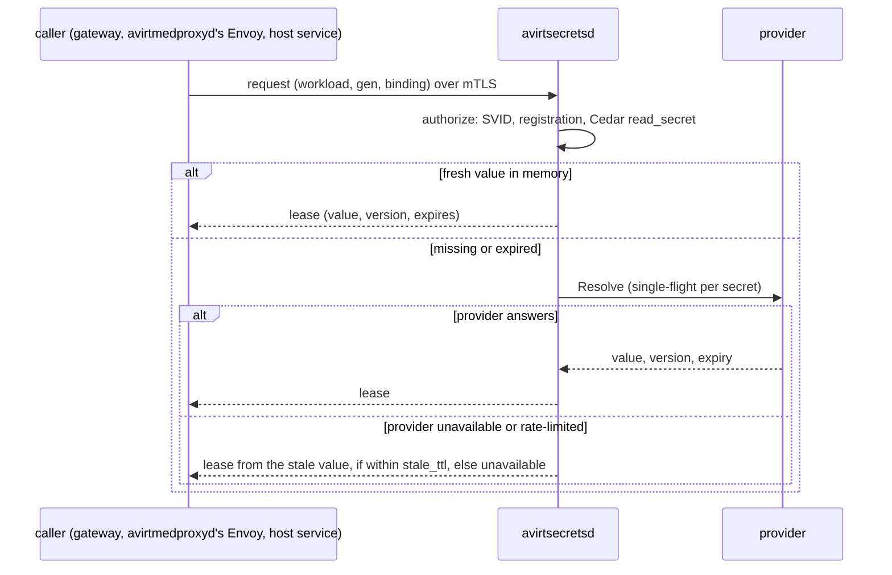
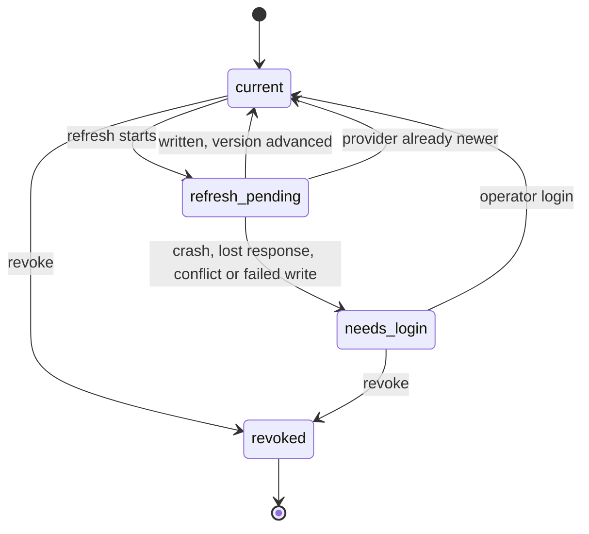

# Overview

avirtsecretsd is the host's secrets broker. It is the only component that reads a secret provider, refreshes a credential or writes one back, and it hands each caller only the values that the caller's identity, the workload's registered bindings and the host policy snapshot allow. This document covers the broker and provider side. How a credential reaches a request, as a placeholder in the workload container and a real value injected at a gateway or avirtmedproxyd, is in [egress credentials](./egress-credentials.md). The provider integrations are in [1Password](./secrets-1password.md) and [macOS Keychain](./secrets-keychain.md).

# Status: implemented

avirtsecretsd does not exist. avirthostd holds the two credentials the current code uses:

- **Claude.** avirthostd reads `CLAUDE_CODE_OAUTH_TOKEN` from its own environment per launch, refuses a claude launch with a 400 when it is unset or empty, and passes it to the workload container by name with `-e`, so the value never appears on argv. `mise run serve` loads it from the gitignored `mise.local.toml`.
- **Codex.** avirthostd reads `~/.codex/auth.json` (or `$CODEX_HOST_HOME/auth.json`) per launch, seeds a private copy for the workload, and writes a refreshed copy back to the host file when the workload ends, under the `auth.json.lock` flock.

The seed, the write-back rules and the `auth_writeback` outcomes are in [egress credentials](./egress-credentials.md#codex). The per-workload connection token (`AVIRT_CONNECTION_TOKEN`) and mediator secret that avirthostd draws for each workload are identity material, described in [identity](./identity.md#status-implemented).

# Status: planned

## Secret model

### Secrets and references

A **secret** is a named record in avirtsecretsd. It names where the value comes from and how avirtsecretsd treats it, and never holds the value itself.

```yaml
name: github-deploy
scope: team-a                                # a namespace, or "host"
provider: op-work                            # a configured provider instance
ref: op://Engineering/GitHub deploy key/token
kind: opaque                                 # opaque, oauth, document or tls
cache_ttl: 15m
owner: provider                              # provider, or avirtsecretsd for a credential it refreshes
```

| Field | Meaning |
| --- | --- |
| `name` | The secret's name, unique within its scope. Its Cedar entity is `Secret::"<scope>/<name>"`. |
| `scope` | `host`, or a namespace on this host. A namespace-scoped secret can back only bindings attached to workloads in that namespace. |
| `provider` | The name of a provider instance in avirtsecretsd's configuration |
| `ref` | The provider reference, in that provider's syntax (see [providers](#providers)) |
| `kind` | `opaque` (one value), `oauth` (an access token with an optional refresh token, refreshed by avirtsecretsd), `document` (a structured value such as Codex's `auth.json`, from which avirtsecretsd derives fields), or `tls` (a certificate chain and key) |
| `cache_ttl` | How long a fetched value is served from memory before avirtsecretsd fetches it again, capped by the provider's maximum and by the value's own expiry |
| `stale_ttl` | How long past its expiry a value may still be served while its provider is unavailable (see [fetch, caching and refresh](#fetch-caching-and-refresh)) |
| `owner` | `provider` when the provider's copy is authoritative and avirtsecretsd only reads it, `avirtsecretsd` when avirtsecretsd refreshes the credential and writes it back (see [write-back](#write-back)) |
| `tags` | String keys and values, which become the `Secret` entity's Cedar tags, such as `purpose: model` |

A **secret reference** is how every other record names a secret: `secret:<scope>/<name>`. A binding's `secret` field is a secret reference (see [egress credentials](./egress-credentials.md#bindings)), and so is each credential a host service is configured with, such as avirtregistryd's registry logins. A provider reference (`env:NAME`, `op://…`, `keychain://…`) appears only in a secret's own record, so no other component ever learns where a value lives.

### Versions

Every value avirtsecretsd fetches gets a **version**: the provider's own version where it has one, such as a 1Password item version or a Keychain item's modification date, and otherwise an opaque id that avirtsecretsd derives in memory from the value with a per-process key. A version id never reveals the value, and two fetches of the same value get the same id within one avirtsecretsd process. Every lease and every event names the version it carries.

### Scoping

Each value avirtsecretsd hands out is scoped four ways:

| Scope | Bound by |
| --- | --- |
| Namespace | The secret's `scope`. A binding backed by a namespace-scoped secret is attachable only to workloads in that namespace. |
| Workload | A **lease** is issued for one workload's UUIDv7. A placeholder belongs to one workload and one binding (see [egress credentials](./egress-credentials.md#placeholders)). |
| Binding | A lease and a placeholder name exactly one binding, and are honored only at that binding's credential injector |
| Generation | A lease issued to avirtmedproxyd's Envoy or for a gateway serving it names the mediator generation. A superseded generation's leases are revoked when its successor is confirmed. |

A lease is `{lease_id, secret, version, workload, gen, binding, caller, expires}`. Its `expires` is at most the secret's `cache_ttl` remaining and the value's own expiry, so no caller holds a value longer than avirtsecretsd would cache it.

## Providers

A **provider** is a source of secret values. avirtsecretsd's configuration names each provider instance, its type and its own bootstrap credential, if it needs one.

| Type | Reference syntax | Read | Write | Where |
| --- | --- | --- | --- | --- |
| `env` | `env:NAME`, a variable in avirtsecretsd's environment at start | Yes | No | Built in, every host |
| `file` | `file:/absolute/path`, a file readable by avirtsecretsd's UID only, read without following symlinks, a regular file of at most 1 MiB, and re-read when it changes | Yes | Yes, atomically | Built in, every host |
| `codex` | `codex:<dir>`, a Codex home holding `auth.json`, whose tokens avirtsecretsd owns and refreshes | Yes | Yes, under `auth.json.lock` | Built in, every host |
| `github-app` | `github-app:<id>`, a GitHub App whose private key is itself a secret, from which avirtsecretsd mints installation tokens with the binding's repositories, permissions and `lifetime` | Mints | No | Built in, every host |
| `keychain` | `keychain://<service>/<account>` | Yes | Yes | Built in, macOS only (see [macOS Keychain](./secrets-keychain.md)) |
| `1password` | `op://<vault>/<item>/[<section>/]<field>` | Yes | Yes | Plugin (see [1Password](./secrets-1password.md)) |

avirtsecretsd reads `env` values once at start and then removes them from its own environment. A configuration that names a provider type the host does not support, such as `keychain` on Linux, fails to load with an error naming the provider.

### Provider plugin interface

Built-in providers implement a Rust trait inside avirtsecretsd. Every other provider is a **plugin**: a separate executable that avirtsecretsd starts, supervises and talks to over gRPC on a socket pair it creates, so the plugin opens no listener. Both kinds expose the same operations:

| Operation | Does |
| --- | --- |
| `Describe` | Returns the plugin's name, version, protocol version and capabilities: `batch`, `write`, `versions`, `watch` and `interactive` |
| `Configure` | Passes the instance's non-secret configuration, and its bootstrap credential on an inherited file descriptor |
| `Resolve` | Fetches one or more references in one call, and returns for each a value, a version, an optional expiry, or a typed error |
| `Write` | Writes a value to one reference, conditional on the version the caller last read. Only with the `write` capability. |
| `Watch` | Streams change notices for references, where the provider can push them. Only with the `watch` capability. Without it, avirtsecretsd polls by `cache_ttl`. |
| `Health` | Returns the instance's state: `ready`, `degraded`, `rate-limited` (with the time it ends), `unauthenticated`, `needs-user` or `locked` |

Typed errors are `not-found`, `denied`, `unauthenticated`, `needs-user`, `locked`, `rate-limited`, `conflict` (a `Write` whose version check failed), `unavailable` and `invalid`. A plugin error message never carries a value, and avirtsecretsd logs only the error type and the reference's secret name.

A plugin process:

- starts from an empty environment, with only `PATH`, `HOME`, `TMPDIR` and, when the provider is off-host, `HTTPS_PROXY` naming avirtsecretsd's local egress socket;
- holds no SVID, and reaches the network only through avirtsecretsd, which carries its connections to avirtedgeproxyd as `/service/avirtsecretsd` under the host policy snapshot;
- runs under avirtsecretsd's UID on the Mac host, and under its own UID in the all-in-one server image;
- is restarted with exponential backoff, at most 5 times in 10 minutes, after which its instance is `degraded` until a slow-backoff restart succeeds.

A plugin's protocol version must be one avirtsecretsd supports, or avirtsecretsd refuses to configure it and marks the instance `degraded`.

## Fetch, caching and refresh



- **In memory only.** avirtsecretsd holds every value in memory, in pages locked against swap where the OS allows, and zeroizes it on eviction. No value is written to disk, to a log or to an event.
- **Single flight.** Concurrent requests for the same secret share one `Resolve`. Requests for different secrets of one provider instance are batched into one `Resolve` when the provider has the `batch` capability.
- **TTL.** A value is fresh for its secret's `cache_ttl`, capped by the provider's maximum and by the value's own expiry. The default is 5 minutes, and each provider document sets its own default and cap.
- **Refresh.** A secret with a live lease is fetched again at 80 % of its TTL, so callers rarely wait. A secret with no live lease is fetched only on demand.
- **Stale values.** When a provider is `unavailable` or `rate-limited`, avirtsecretsd serves the last value it fetched for up to the secret's `stale_ttl` past its expiry (default 1 hour), never past the value's own expiry, and never after the secret is revoked. Each stale lease is an event.
- **Negative caching.** A `not-found` or `denied` result is cached for 30 seconds.
- **Watch.** A change notice from a provider with `watch` marks the value stale at once and triggers a fetch.

## Write-back

A secret whose `owner` is `avirtsecretsd` is a credential that avirtsecretsd itself keeps current, such as an OAuth refresh token that rotates on every use. Exactly one avirtsecretsd process owns it, and no caller ever receives its refresh token.

1. avirtsecretsd takes the provider's write lock where it has one (`auth.json.lock` for `codex`), and re-reads the value.
2. If the provider's version is newer than the one it last read, another writer already refreshed it, and avirtsecretsd uses that value.
3. Otherwise it records the secret as `refresh-pending` in its refresh state file (`state.journal`), performs the refresh upstream through avirtedgeproxyd, single-flight across workloads, and writes the result with `Write`, conditional on the version it read.
4. It records the outcome, issues new leases, and for a placeholder-backed binding sends the new values with placeholders on the `placeholders` stream (see [egress credentials](./egress-credentials.md#codex-refresh)).

The upstream exchange consumes the old refresh token before avirtsecretsd can persist the new one, so a crash, a lost response, a `conflict` or a failed `Write` between the exchange and the write leaves the outcome uncertain. avirtsecretsd then marks the secret `needs-login` instead of retrying. A `needs-login` secret refuses every refresh and every lease until an operator logs in again and clears it with `avirtadmin secret login`, and each transition is an event.



For Codex, the `codex` provider writes `auth.json` with the procedure the current avirthostd write-back uses: the flock, the first-only `auth.json.pre-avirt-backup`, an exclusive 0600 temp file, fsync, and a rename over the host file (see [egress credentials](./egress-credentials.md#codex)). The provider's version is the file's `last_refresh`.

## Authorization

avirtsecretsd authorizes every call in three steps, and a call that fails any of them gets no value:

1. **Identity.** The caller's SVID is one the API lists (see [APIs](#apis)), and a mediator SVID is of a live workload and its current generation, from the live generation set avirthostd publishes (see [identity](./identity.md#authorization)).
2. **Registration.** For a workload-scoped call, the binding is one avirthostd registered for that workload, used at its registered credential injector. A gateway names the workload and generation it acts for, which must equal those in the avirtmedproxyd SVID on the connection it serves.
3. **Policy.** avirtsecretsd evaluates `read_secret` against the host policy snapshot from avirtpolicyd, with the caller as principal and the secret as resource. Nothing is permitted by default.

| Caller | SVID | Obtains | Through |
| --- | --- | --- | --- |
| avirthostd | `/service/avirthostd` | Nothing secret: it registers workloads, bindings and generations, validates secret and binding references, and receives each workload's placeholders | Registration API |
| avirtmediatord | `/ns/<ns>/workload/<uuid>/mediator/<gen>` | Its own workload's placeholders and placeholder copies of files, for `confirm` | Broker API |
| avirtmedproxyd's Envoy (libavirtenvoy) | `/ns/<ns>/workload/<uuid>/mediator/<gen>/medproxy` | Its own workload's placeholders, for the placeholder misuse check, and the short-lived values of its workload's mediator-injected bindings | Broker API, SDS |
| avirtmodelgwd | `/service/avirtmodelgwd` | The real value behind a placeholder, for one request of a workload it is serving, and Codex refreshes | Broker API |
| avirtmcpgwd | `/service/avirtmcpgwd` | The upstream credential for one of a workload's MCP bindings | Broker API |
| avirtregistryd | `/service/avirtregistryd` | The secrets its configuration names, such as off-host registry logins | Service API |
| avirtbuilderd | `/service/avirtbuilderd` | The secrets its configuration names, such as a token for watching a private repository, outside any build job | Service API |
| avirthostd, for avirtadmin | `/service/avirthostd`, carrying `Admin::"uid:<uid>"` | Secret and provider administration, never a value | Admin API |

A build job's avirtmedproxyd is like any other: its source credential is a mediator-injected binding for the fetch step (see [workspace builds](./workspace-build.md#build-jobs)).

### Cedar

avirtsecretsd evaluates `read_secret`, `manage_secret`, `manage_provider` and `manage_binding` against the host policy snapshot. Their entities and actions are in the [egress policies schema](./egress-policies.md#schema-text).

`read_secret` has `via` `mediator` for avirtmedproxyd's Envoy, whose principal is its own `Workload`, `gateway` for a gateway acting for a workload, whose principal is the gateway's `HostService` and whose context names the binding, and `service` for a host service's own credential. `manage_secret` has `operation` `define`, `update`, `rotate`, `revoke`, `import`, `login` or `list`. A host-scoped secret has no parent `Namespace`.

```cedar
@id("modelgwd-model-secrets")
permit (principal == HostService::"avirtmodelgwd", action == Action::"read_secret", resource)
when { context.via == "gateway" && resource.hasTag("purpose") && resource.getTag("purpose") == "model" };

@id("team-a-mediator-git")
permit (principal in Namespace::"team-a", action == Action::"read_secret", resource in Namespace::"team-a")
when { context.via == "mediator" && context has binding && context.binding.injector == "mediator" };

@id("registry-credentials")
permit (principal == HostService::"avirtregistryd", action == Action::"read_secret", resource)
when { context.via == "service" && resource.hasTag("purpose") && resource.getTag("purpose") == "registry" };

@id("admins-manage-secrets")
permit (principal == Admin::"uid:501", action == Action::"manage_secret", resource);
```

## APIs

Every API is on avirtsecretsd's host service listener, `services/avirtsecretsd.sock`, with mutual TLS 1.3 and the caller's SVID checked before any application byte (see [trust boundaries](./trust-boundaries.md#listeners)). avirtsecretsd presents `/service/avirtsecretsd`. Mediators reach it on the mediator's outbound socket to avirthostd, which routes the connection by SNI `avirtsecretsd.svc.<td>` without terminating TLS (see [workload topology](./workload-topology.md#sni-routing)). Each API carries a protocol version, and avirtsecretsd refuses one it does not support with a named error.

| API | Callers | Operations |
| --- | --- | --- |
| Registration | `/service/avirthostd` only | `RegisterWorkload` (namespace, UUIDv7, generation, binding ids and credential injectors; returns the issued placeholders), `SetGeneration`, `DeregisterWorkload`, `Resync` (the full set of live workloads with their placeholder sets, after either side restarts, after which avirtsecretsd removes every registration not in it), `ValidateReferences` (secret and binding references in a workload configuration or a component's configuration), and a stream on which avirtsecretsd sends its events |
| Broker | avirtmediatord, avirtmedproxyd's Envoy, avirtmodelgwd, avirtmcpgwd | `placeholders`, `resolve_placeholder`, `mcp_credential`, `codex_refresh` and `revocations`, as defined in [egress credentials](./egress-credentials.md#credential-broker-api-and-sds). Each value it returns is a lease. |
| SDS | avirtmedproxyd's Envoy | Envoy's secret discovery service over gRPC, below |
| Service | `/service/avirtregistryd`, `/service/avirtbuilderd` | `GetCredential` for a secret reference the component's configuration names, returning a lease, and never for a workload's binding |
| Admin | `/service/avirthostd`, for avirtadmin | `DefineSecret`, `UpdateSecret`, `RotateSecret`, `RevokeSecret`, `ImportSecret` (a value written into a provider that has `write`), `Login` (clears `needs-login` after a new login), `ListSecrets`, `DefineProvider`, `RemoveProvider`, `ProviderStatus`, `DefineBinding`, `ListBindings` and `RemoveBinding`. No operation returns a value. |

avirtadmin reaches the Admin API only through avirthostd's admin socket, where avirthostd authenticates it by peer credentials and forwards the `Admin::"uid:<uid>"` principal (see [components](./components.md#host-services)). The commands are in [avirtadmin](./admin-cli.md#secrets-providers-and-bindings).

### SDS

avirtsecretsd's SDS serves Envoy `Secret` resources by name to avirtmedproxyd's Envoy alone, which can subscribe only to the names below.

| Caller | Resource names | Resource type |
| --- | --- | --- |
| avirtmedproxyd's Envoy | `binding/<binding id>`, for its own workload's bindings whose credential injector is `mediator` | `generic_secret`: the short-lived value libavirtenvoy injects |

- **Generation fencing.** An SDS stream from avirtmedproxyd's Envoy is accepted only for a live workload at its current generation. When avirthostd reports a new generation with `SetGeneration`, avirtsecretsd closes the superseded generation's streams once the successor is confirmed, and that generation's leases end with them.
- **Short-lived values.** A `generic_secret` carries the value of one lease. avirtsecretsd pushes a new version before the lease expires, and removes the resource when the secret is revoked, the binding is withdrawn or the workload is deregistered.
- **No TLS identity from avirtsecretsd.** avirtsecretsd serves no SVID, key or trust bundle. avirtedgeproxyd obtains its own `/service/avirtedgeproxyd` SVID from avirthostd's issuer socket and serves it, the SPIFFE bundle and the active peers' bundles to its Envoy over local SDS, and is never sent a `generic_secret`, a placeholder or a refresh token. avirtmedproxyd's Envoy gets its own SVID from avirtmedproxyd's local SDS (see [identity](./identity.md#rotation)).

## Rotation and revocation

- **Rotation at the provider.** When a provider's version changes, at a refresh, a watch notice or an admin `RotateSecret` that forces a fetch, avirtsecretsd issues later leases with the new version, sends a revocation for the old one on each gateway's `revocations` stream, and pushes the new version over SDS to avirtmedproxyd's Envoy. Placeholders do not change, because a placeholder names a binding, not a value.
- **Rotation by avirtsecretsd.** An `oauth` or `codex` secret owned by avirtsecretsd rotates through [write-back](#write-back). A minted credential is minted again before its `lifetime` ends.
- **Revocation.** `RevokeSecret` makes avirtsecretsd evict the value, refuse every new lease for it, remove its SDS resources, and send a revocation on every gateway's `revocations` stream, after which the gateway drops its cached value. A revoked secret stays revoked until an `UpdateSecret` or `RotateSecret` restores it.
- **Workload end and superseded generations.** `DeregisterWorkload` ends every lease, placeholder and minted credential of the workload at once and closes its SDS streams. A superseded generation's leases end as [egress credentials](./egress-credentials.md#generation-fencing) describes.
- **Bound on exposure.** A caller that misses a revocation holds a value at most until its lease's `expires`.

How each change reaches a credential injector, and what happens to a workload's requests, is in [egress credentials](./egress-credentials.md#rotation-and-revocation).

Rotating the value inside the provider, such as issuing a new token, is the provider owner's task. avirtsecretsd picks the new value up at its next fetch.

## Audit events

avirtsecretsd sends every event to avirthostd on the registration stream. avirthostd writes a workload-scoped event into that workload's log with `src: "secrets"`, and sends a host-scoped event to avirtoteld as an OpenTelemetry log record. No event carries a value, a placeholder, a token or a provider error message.

| Event | Fields |
| --- | --- |
| `secret_lease` | `secret`, `version`, `caller`, `workload`, `gen`, `binding`, `via`, `expires`, `stale` |
| `secret_denied` | `secret`, `caller`, `workload`, `gen`, `binding`, `step` (`identity`, `registration` or `policy`), `rule`, `policy_version` |
| `secret_fetch` | `secret`, `provider`, `version`, `outcome` (`ok` or an error type), `batched` |
| `secret_refresh` | `secret`, `state` (`refresh-pending`, `current` or `needs-login`), `version` |
| `secret_writeback` | `secret`, `provider`, `outcome` (`written`, `provider newer`, `conflict` or `failed`) |
| `secret_rotated`, `secret_revoked` | `secret`, `version`, `principal` |
| `provider_state` | `provider`, `state`, `until` for `rate-limited` |
| `workload_registered`, `workload_deregistered` | `workload`, `gen`, `bindings` |

avirtauditd delivers the workload-scoped events with the rest of the workload log, keeping `src`.

## Failure behavior

avirtsecretsd is an required host service (see [components](./components.md#all-in-one-server-image)).

| Event | Effect |
| --- | --- |
| avirtsecretsd is down or degraded | avirthostd refuses new launches with 503. Running gateways keep serving from their leases until each expires, then fail the request with 503. avirtmedproxyd refuses requests that need a mediator-injected credential. A running agent never sees a real value either way. |
| avirtsecretsd restarts | Its cache, leases, minted credentials and SDS streams are gone. avirthostd resyncs every live workload with its generation, bindings and placeholders, and avirtsecretsd honors those placeholders again. Callers reconnect and receive new leases. A secret that was `refresh-pending` comes back as `needs-login`. |
| A provider is unavailable or rate-limited | Stale values are served within `stale_ttl`, then requests for that provider's secrets fail with 503 and a `provider_state` event. Other providers are unaffected. |
| A provider is `unauthenticated`, `needs-user` or `locked` | Every fetch from it fails at once with the error type, cached values are served until they expire, and the state is an event. Only an operator action clears it. |
| avirtpolicyd is unreachable | avirtsecretsd keeps evaluating its current host policy snapshot until it expires, then denies every `read_secret` (see [egress policies](./egress-policies.md#policy-failure-behavior)). |
| A plugin crashes | It is restarted with backoff, and its instance is `unavailable` meanwhile. |

avirtsecretsd is ready once it holds its SVID, has loaded its configuration and serves its listener. Readiness never waits on a provider.

## Storage at rest

avirtsecretsd keeps no store of secret values, sealed or otherwise. Values live in their providers and in avirtsecretsd's memory only, and minted credentials in memory only, for their lifetime. Its state directory (`secretsd/` under avirt's state directory, see [lifecycle](./lifecycle.md#durable-state), 0700) holds:

| Path | Holds |
| --- | --- |
| `secrets.d/` | Secret records and provider instance configurations, with no values |
| `bindings.d/` | Binding records (see [egress credentials](./egress-credentials.md#bindings)) |
| `state.journal` | Each owned secret's refresh state (`current`, `refresh-pending`, `needs-login`, `revoked`) and the last version read, fsynced on every transition |

Records in `secrets.d/` and `bindings.d/` are written only through the Admin API.

## Bootstrapping

- **Its own identity.** avirtsecretsd obtains `/service/avirtsecretsd` from avirthostd's issuer socket with a one-time enrollment token, and then rotates it with its current SVID (see [identity](./identity.md#attestation)). avirthostd starts first and never depends on avirtsecretsd.
- **Its providers' credentials.** A provider instance that needs a credential, such as a 1Password service account token, names it by a reference to the provider's own credential, which must be in a local provider: `keychain://…` on the Mac host, or `file:` or `env:` anywhere. Such a reference to a remote provider is refused when the configuration loads, so no chain of providers can loop.
- **Delivery.** avirtsecretsd resolves each such reference itself and passes the value to the plugin on an inherited file descriptor, never on argv or in the plugin's environment.

## Placement

| | Mac host | All-in-one server image |
| --- | --- | --- |
| Process | A launchd agent in the user's login session, under the user's UID | A host service under its own UID, started by avirtinitd in server mode in step 2 (see [components](./components.md#all-in-one-server-image)) |
| Providers | `env`, `file`, `codex`, `github-app`, `keychain`, `1password` with a service account or the desktop app | `env`, `file`, `codex`, `github-app`, `1password` with a service account. `keychain` is unavailable. |
| Bootstrap credentials | The login keychain | Files mounted by the container platform's secret mechanism, read with `file:`, or `env:` |
| User presence | 1Password desktop app approval (see [1Password](./secrets-1password.md#authentication)) | None: every provider is unattended |
| Signing | Developer ID signed with a stable designated requirement (see [macOS Keychain](./secrets-keychain.md#code-signing-and-entitlements)) | None |

# Open questions

1. **Binding namespace scope.** Secrets are host-scoped or namespace-scoped here. Whether bindings are namespace-scoped too is open (see [components](./components.md#open-questions)).
2. **Host-scoped audit record.** Host-scoped events go to avirtoteld only. Whether they also need a durable record that avirtauditd reads, beside the workload logs, is open.
3. **Plugin egress enforcement.** The 1Password desktop app is reached over local IPC and needs no egress. How the host enforces that a plugin opens no connection except through avirtsecretsd's egress socket is open (see [off-host enforcement](./networking.md#off-host-enforcement)).
4. **Memory locking.** Whether avirtsecretsd requires locked pages for values, and what it does on a host that refuses them, is open.
