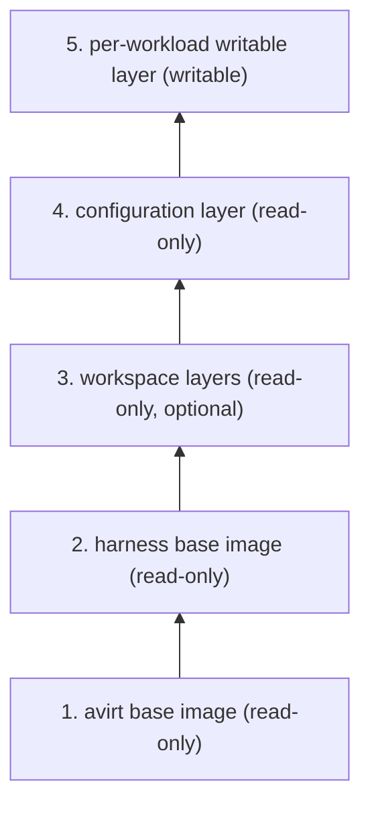
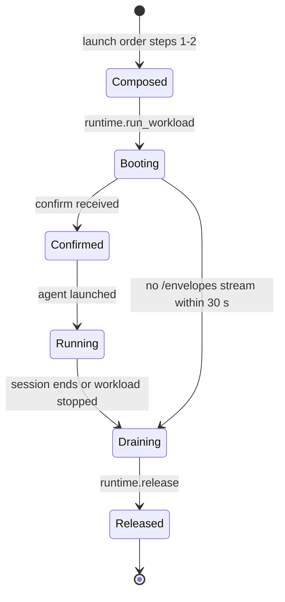

# Status: implemented

A sandbox container runs one image per agent, `avirt-workload-claude:dev` or `avirt-workload-codex:dev`, each built from `ubuntu:26.04` with Node, the adapter, avirtinitd, and the `agent` user (see [ACP adapter process](./acp.md#adapter-process)). The Apple container CLI runtime gives each sandbox container the image's layers read-only and its own writable layer, and deletes the container at teardown. On the Containerization runtime, avirthostd has avirtvmd's prepare step unpack the image's layers into a read-only 8 GiB ext4 root filesystem under `cache/rootfs/`. avirtvmd clones it with APFS `clonefile` into the workload's `containers/<id>/` directory, the sandbox container writes to that clone. Teardown removes the directory. The images lack a shared base image and workspace or configuration layers. avirthostd supplies configuration for each launch at run time: avirthostd mounts the Codex scratch home at `CODEX_HOME` and the `cwd` host directory at `/workspace` (see [credentials](./egress-credentials.md#codex)), and passes the rest in the environment (see [avirthostd API](./hostd-api.md)).

# Status: planned

The workload's launch and teardown order is in [lifecycle](./lifecycle.md#launch-order). This document covers the contents of the sandbox container's root filesystem and what happens to it from creation to removal.

## Layer stack

A sandbox container's root filesystem is a stack of five layers. Later layers take precedence where two layers write the same path.

| Layer | Holds | Mode | Produced by | When | Cached in |
| --- | --- | --- | --- | --- | --- |
| 1. avirt base | The OS userland with `ca-certificates`, the `agent` user (uid 1000) and home, the per-process UIDs and the `avirt-ws` group, `/workspace`, and the avirt guest binaries: avirtinitd, avirtnetd, avirtguestd, avirtacp, avirtagent, avirtexec, avirtmcp, and avirtguest. Its image config sets the entrypoint (avirtinitd) and the working directory (`/workspace`), and has no `USER`. | Read-only | avirt's image build | During the build, once per avirt release | avirtregistryd, as a build base, and avirthostd's content-addressed cache |
| 2. Harness base | One harness and its adapter, under `/opt/agent` only, with any runtime they need (for both agents, Node), and the harness config file `/opt/agent/harness.toml`. Its image config adds `AVIRT_AGENT` and nothing else. | Read-only | avirt's image build, `FROM` the avirt base | Once per harness version, during image build | avirthostd's content-addressed cache and avirtregistryd's build bases |
| 3. Workspace | The layers of one workspace image: sources, dependencies, caches and system additions (see [workspaces](./workspaces.md)) | Read-only | avirtbuilderd, or a user push or import through avirtregistryd | Before the launch, at build or push time | avirtregistryd, avirthostd's content-addressed cache, and the composed root filesystem or composed image |
| 4. Configuration layer | The harness's settings, its MCP configuration, the CA bundle wiring, the placeholder locations and `launch.toml` (see [configuration layer](#configuration-layer)) | Read-only | avirthostd | At launch, in launch order step 2 | avirthostd's content-addressed cache, by digest |
| 5. Per-workload writable layer | Every write made inside the sandbox container, by avirtinitd, avirtnetd, avirtacp, avirtagent, avirtexec, avirtguestd, and the agent | Writable | The runtime | At workload creation, in launch order step 3 | Nowhere. It exists for the sandbox container's lifetime. `runtime.release` deletes it. |

Read-only means that writes inside the sandbox container leave the layer's stored form unchanged. A write to a path from layers 1 to 4 copies it up into layer 5. Ownership, modes, and Landlock determine which paths a process inside the sandbox container may write (see [Landlock](./landlock.md#agent)), and uid 1000 writes only under `/workspace`, `/home/agent`, `/tmp` and `/dev/shm`.

Launches without a workspace or with a `cwd` host directory omit layer 3. A `cwd` directory mounts at `/workspace`. `/proc`, `/sys`, `/dev` and `/run/avirt` are absent from layers. During boot the runtime and avirtinitd mount or create them. Content rules exclude them from layers 3 and 4.

The mediator image isn't part of this stack. It's a separate image with avirtinitd and avirtmediatord. The avirt builder image (see [workspaces](./workspace-build.md#build-jobs)) derives from the avirt base like a harness base, with `git`, avirt's layer tool and BuildKit in place of a harness.

## Base images

The avirt base contains the OS and every avirt guest binary. It excludes harness and workspace content. Tools such as `git` and `ripgrep`, language toolchains and system packages come from workspaces, which install them in their `pre-source` and `dependencies` stages (see [workspaces](./workspace-build.md#build-stages-and-the-containerfile)).

Each harness base is `FROM` the avirt base, and these constraints hold for every harness base:

- Its layers write only under `/opt/agent`. A harness base that writes any other path, or that adds a whiteout, fails the image build.
- Its layer chain begins with exactly the avirt base's layer `diff_ids`, so a workspace bound to the avirt base composes onto every harness base (see [base image reference](./workspaces.md#base-image-reference)).
- Every harness base excludes configuration, including all settings files. It also excludes MCP configuration, credentials, placeholders, and CA material. Layer 4 supplies the configuration.
- avirtinitd launches the adapter by the absolute path in `harness.toml`, and launches every avirt binary by its absolute path, so a workspace's toolchain on `PATH` never replaces either.

`harness.toml` specifies the harness and its adapter command. It also specifies managed configuration paths where the harness reads configuration that overrides project and user configuration, such as Claude Code's `/etc/claude-code/` (see [`harness.toml`](./acp.md#harnesstoml)). It also contains the harness's additions to the Landlock rules, `sandbox.pty`, `sandbox.read` and `sandbox.write` (see [harness additions](./landlock.md#harness-additions)). avirthostd reads `harness.toml` from the content-addressed cache when it composes a sandbox container. Workspace layers must avoid the managed configuration paths of the harness used for launch (see [content rules](./workspaces.md#content-rules)). How each harness treats project-level configuration that a workspace places under `/workspace` is in [Claude workspace configuration](./acp-claude.md#workspace-configuration) and [Codex workspace configuration](./acp-codex.md#workspace-configuration).

A workspace built on the avirt base binds to the avirt base and composes onto every harness base. Building a workspace on a harness base binds it to that base, and composition requires that same base.

## Configuration layer

To build the configuration layer for each launch, avirthostd reads `harness.toml` and the launch's options, including agent and mode plus model and MCP settings. Other inputs include the workspace image's roots and layer destinations and the extra paths approved at launch. It's one OCI layer, reproducible in the same way as the layers avirt produces for workspaces, and its content depends only on those inputs, so launches with the same inputs share one layer by digest. The immutable workload configuration records the layer's digest beside the image and workspace digests.

| Content | Path | Holds |
| --- | --- | --- |
| Managed settings | The harness's managed configuration paths, such as `/etc/claude-code/managed-settings.json` | The harness settings avirt sets for every launch of that harness, with the launch's mode |
| MCP configuration | The harness's managed MCP configuration | One server, avirtmcp, by its absolute path |
| `launch.toml` | `/etc/avirt/launch.toml` | The environment avirtinitd gives the agent and the placeholder locations |
| CA variables | `/etc/avirt/launch.toml` | The CA variables (`NODE_EXTRA_CA_CERTS`, `SSL_CERT_FILE`, `CURL_CA_BUNDLE`, `REQUESTS_CA_BUNDLE`, `GIT_SSL_CAINFO`, `npm_config_cafile` and `CODEX_CA_CERTIFICATE`) pointing at `/run/avirt/ca.pem` and `/run/avirt/ca-bundle.pem` (see [CA delivery](./egress.md#ca-delivery-into-the-workload)) |
| Placeholder locations | `/etc/avirt/launch.toml` | The name of each environment variable and the path of each file that receives a placeholder, such as `CLAUDE_CODE_OAUTH_TOKEN` and `/home/agent/.codex/auth.json` |
| `sandbox.toml` | `/etc/avirt/sandbox.toml` | Every input to the workload's Landlock rulesets, resolved at composition (see [Landlock schema](./landlock.md#schema)) |

The configuration layer excludes secrets, placeholder values, and CA certificates. Placeholder values and the workload's MITM CA arrive in `confirm` (see [launch handshake](./workload-topology.md#launch-handshake)), and avirtinitd writes them at boot at the paths the configuration layer names. avirtinitd writes placeholder files that the harness rewrites, such as Codex's `auth.json`, into layer 5.

Only the configuration layer may write `/etc/avirt` or a harness's managed configuration paths. avirthostd checks it against that list before it composes a sandbox container, and never accepts one from a workspace or a client.

## Assembly per runtime

avirthostd assembles the stack at launch order step 3, after it has pulled and checked the workspace image and built the configuration layer. The composition of layers 1 to 3 is the one in [composing the root filesystem](./workspaces.md#composing-the-root-filesystem).

| Runtime | Layers 1 and 2 | Layer 3 | Layer 4 | Layer 5 |
| --- | --- | --- | --- | --- |
| Containerization | avirthostd's content-addressed cache keeps an unpacked ext4 root filesystem for the avirt base, and one for each harness base, made by cloning the avirt base's with APFS `clonefile` and unpacking the harness layers into the clone | A composed root filesystem in `cache/rootfs/` per pair of harness base and workspace image, cloned from the harness base's with the workspace layers unpacked into it | Unpacked into the sandbox container's own clone of the composed root filesystem (or of the harness base's, with no workspace), before the VM starts | The sandbox container's clone is the VM's writable root block device, in `containers/<id>/`. Its writes are the clone's own blocks. |
| Docker Desktop | Loaded through the Docker API into the containerd image store, which shares the avirt base's layers between the harness bases by digest | Part of a composed image whose layers are the harness base's, the workspace layers and the configuration layer, loaded as an OCI archive that contains only the blobs the store lacks | The last layer of the composed image, with its `diff_id` appended to the image config | The container's writable layer |
| Apple container CLI | The implemented images, with no split | Not supported | None | The container's writable layer |

Constraints:

- On the Containerization runtime, the content-addressed cache, `cache/rootfs/` and `containers/` are in one APFS volume, because `clonefile` doesn't cross volumes. All three are in the runtime directory (see [lifecycle](./lifecycle.md#runtime-directory-additions)).
- On the Containerization runtime, a sandbox container's root block device has a fixed size, a host setting charged in resource admission. Writes past it fail with `ENOSPC` inside the sandbox container.
- On Docker Desktop, avirthostd tags a composed image `avirt.internal/composed:<hex>`, where `<hex>` is the hex of the composed manifest's SHA-256, and labels it with the harness base, workspace, and configuration digests.

Composed root filesystems and composed images are cache entries. avirthostd garbage-collects a composed root filesystem with its source workspace image, a configuration layer and the composed images that contain it once no live workload configuration references it, and the avirt base and harness bases as the content-addressed cache's retention rules say (see [operational ownership](./components.md#operational-ownership)). The startup cleanup keeps every cache entry.

## Boot, running, and teardown

1. **Composed.** avirthostd resolves and pulls the workspace image. It checks the base image reference against the harness base and the content rules against the harness's managed configuration paths. It then builds and checks the configuration layer before assembling the stack. Nothing has run yet, and layer 5 is empty.
2. **Booting.** The runtime starts the sandbox container with avirtinitd as PID 1. avirtinitd mounts `/proc` with `hidepid=invisible` and creates `/run/avirt` and the agent cgroup. It reads `harness.toml` and `launch.toml` before starting avirtnetd. avirtinitd sets workspace roots' setgid bit and default ACLs (see [security contexts](./workload-hardening.md#security-contexts)) and writes `/etc/resolv.conf`, all into layer 5.
3. **Confirmed.** avirtinitd writes `/run/avirt/ca.pem` and `/run/avirt/ca-bundle.pem` and appends the MITM CA to the system bundle in layer 5. It writes each placeholder file at the path `launch.toml` names. It then starts the main workload process and avirtguestd.
4. **Running.** avirtinitd launches the adapter as uid 1000 with the environment from `launch.toml`, the placeholder values, and the CA settings. avirt omits proxy variables by default. The optional loopback forward proxy remains available. The agent and its tools write only into layer 5. Their writes leave layers 1 to 4, the workspace image, and the host unchanged.
5. **Draining.** The main workload process ends, avirtinitd kills the agent cgroup, and avirtnetd drains the `/envelopes` stream (see [teardown](./lifecycle.md#teardown)).
6. **Released.** `runtime.release` deletes the sandbox container: on the Containerization runtime the VM and its `containers/<id>/` directory with the clone, and on Docker Desktop the container with its writable layer. This removes layer 5 and avirtguestd's workspace snapshots. The cached layers 1 to 4 remain.

# Open questions

1. **More than one workspace image.** A launch takes one workspace image, which may contain many layers. Whether a launch can stack more than one workspace image is open. If allowed, their base image references need a combination rule.
2. **Tools in the avirt base.** The avirt base excludes `git`, while the regression suite's positive checks run `git clone`. Whether `git` belongs in the avirt base or the checks should run with a workspace providing `git` is open.
3. **Placeholders in the configuration layer.** Placeholder values arrive in `confirm`, and avirtinitd writes them at boot. Codex placeholders change on refresh. Whether avirthostd could put placeholders in the configuration layer instead remains open.
