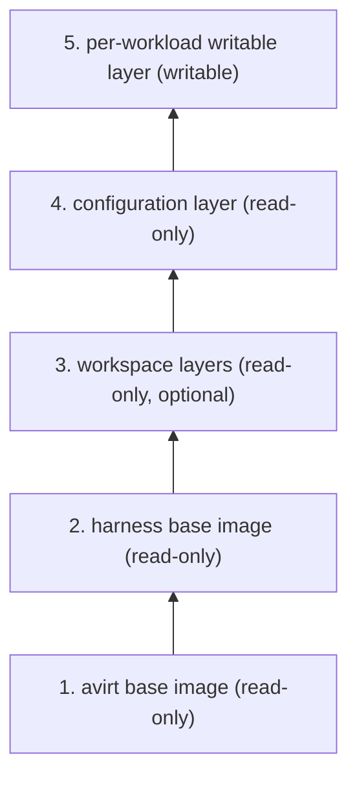
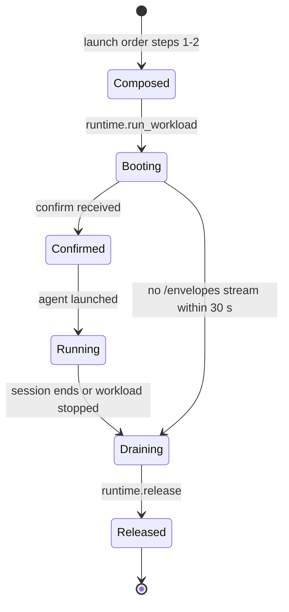

# Status: implemented

A workload container runs one image per agent, `avirt-workload-claude:dev` or `avirt-workload-codex:dev`, each built from `ubuntu:26.04` with Node, the adapter, avirtinitd and the `agent` user (see [ACP adapter process](./acp.md#adapter-process)). The Apple container CLI runtime gives each workload container the image's layers read-only and its own writable layer, and deletes the container at teardown. There is no shared base image, no workspace layer and no configuration layer. Per-launch configuration reaches the workload container at run time: avirthostd mounts the Codex scratch home at `CODEX_HOME` and the `cwd` host directory at `/workspace` (see [credentials](./egress-credentials.md#codex)), and passes the rest in the environment (see [avirthostd API](./hostd-api.md)).

# Status: planned

The workload's launch and teardown order is in [lifecycle](./lifecycle.md#launch-order). This document covers what the workload container's root filesystem is made of and what happens to it from creation to removal.

## Layer stack

A workload container's root filesystem is a stack of five layers. A later layer wins where two layers write the same path.

| Layer | Holds | Mode | Produced by | When | Cached in |
| --- | --- | --- | --- | --- | --- |
| 1. avirt base | The OS userland with `ca-certificates`, the `agent` user (uid 1000) and home, the helper users and the `avirt-ws` group, `/workspace`, and the avirt guest binaries: avirtinitd, avirtnetd, avirtguestd, avirtacp, avirtagent, avirtexec, avirtmcp and avirtguest. Its image config sets the entrypoint (avirtinitd) and the working directory (`/workspace`), and has no `USER`. | Read-only | avirt's image build | At build time, once per avirt release | avirtregistryd, as a build base, and avirthostd's content-addressed cache |
| 2. Harness base | One harness and its adapter, under `/opt/agent` only, with any runtime they need (for both agents, Node), and the harness config file `/opt/agent/harness.toml`. Its image config adds `AVIRT_AGENT` and nothing else. | Read-only | avirt's image build, `FROM` the avirt base | At build time, once per harness version | avirtregistryd, as a build base, and avirthostd's content-addressed cache |
| 3. Workspace | The layers of one workspace image: sources, dependencies, caches and system additions (see [workspaces](./workspaces.md)) | Read-only | avirtbuilderd, or a user push or import through avirtregistryd | Before the launch, at build or push time | avirtregistryd, avirthostd's content-addressed cache, and the composed root filesystem or composed image |
| 4. Configuration layer | The harness's settings, its MCP configuration, the CA bundle wiring, the placeholder locations and `launch.toml` (see [configuration layer](#configuration-layer)) | Read-only | avirthostd | At launch, in launch order step 2 | avirthostd's content-addressed cache, by digest |
| 5. Per-workload writable layer | Every write made inside the workload container, by avirtinitd, the helpers and the agent | Writable | The runtime | At workload creation, in launch order step 3 | Nowhere. It lives with the workload container and is deleted by `runtime.release`. |

Read-only means that no write inside the workload container reaches the layer's stored form: a write to a path from layers 1 to 4 is a copy-up into layer 5. Which paths a process inside the workload container may write at all is decided by ownership, modes and Landlock (see [sandbox](./sandbox.md#agent)), and uid 1000 writes only under `/workspace`, `/home/agent`, `/tmp` and `/dev/shm`.

A launch without a workspace has no layer 3. A launch with a `cwd` host directory has no layer 3 either, and the directory is a mount at `/workspace`, not a layer. `/proc`, `/sys`, `/dev` and `/run/avirt` are never in a layer: the runtime and avirtinitd mount or create them at boot, and the content rules keep layers 3 and 4 out of them.

The mediator image is not part of this stack. It is a separate image with avirtinitd, avirtmediatord, avirtmedproxyd, Envoy and libavirtenvoy. The avirt builder image (see [workspaces](./workspace-build.md#build-jobs)) is derived from the avirt base like a harness base, with `git`, avirt's layer tool and BuildKit in place of a harness.

## Base images

The avirt base holds the OS and every avirt guest binary, and nothing a harness or a workspace provides. Tools such as `git` and `ripgrep`, language toolchains and system packages come from workspaces, which install them in their `pre-source` and `dependencies` stages (see [workspaces](./workspace-build.md#build-stages-and-the-containerfile)).

Each harness base is `FROM` the avirt base, and these constraints hold for every harness base:

- Its layers write only under `/opt/agent`. A harness base that writes any other path, or that adds a whiteout, fails the image build.
- Its layer chain begins with exactly the avirt base's layer `diff_ids`, so a workspace bound to the avirt base composes onto every harness base (see [base image reference](./workspaces.md#base-image-reference)).
- It holds no configuration: no settings file, no MCP configuration, no credential or placeholder, and no CA material. Those come from layer 4.
- avirtinitd launches the adapter by the absolute path in `harness.toml`, and launches every avirt binary by its absolute path, so a workspace's toolchain on `PATH` never replaces either.

`harness.toml` names the harness, its adapter command, and its managed configuration paths: the paths where the harness reads configuration that overrides project and user configuration, such as Claude Code's `/etc/claude-code/` (see [`harness.toml`](./acp.md#harnesstoml)). It also carries the harness's sandbox additions, `sandbox.pty`, `sandbox.read` and `sandbox.write` (see [harness additions](./sandbox.md#harness-additions)). avirthostd reads `harness.toml` from the content-addressed cache when it composes a workload container. Workspace layers may not touch the managed configuration paths of the harness they are launched with (see [content rules](./workspaces.md#content-rules)). How each harness treats project-level configuration that a workspace places under `/workspace` is in [Claude workspace configuration](./acp-claude.md#workspace-configuration) and [Codex workspace configuration](./acp-codex.md#workspace-configuration).

A workspace built on the avirt base binds to the avirt base and composes onto every harness base. A workspace built on a harness base binds to that harness base, and composes only onto it.

## Configuration layer

avirthostd builds the configuration layer for each launch from `harness.toml`, the launch's options (the agent, its mode, and its model and MCP settings), the workspace image's roots and layer destinations, and the extra sandbox paths approved at launch. It is one OCI layer, reproducible in the same way as the layers avirt produces for workspaces, and its content depends only on those inputs, so launches with the same inputs share one layer by digest. avirthostd records the layer's digest in the immutable workload configuration beside the image and workspace digests.

| Content | Path | Holds |
| --- | --- | --- |
| Managed settings | The harness's managed configuration paths, such as `/etc/claude-code/managed-settings.json` | The harness settings avirt sets for every launch of that harness, with the launch's mode |
| MCP configuration | The harness's managed MCP configuration | One server, avirtmcp, by its absolute path |
| `launch.toml` | `/etc/avirt/launch.toml` | The environment avirtinitd gives the agent beyond the proxy variables, and the placeholder locations |
| CA variables | `/etc/avirt/launch.toml` | The CA variables (`NODE_EXTRA_CA_CERTS`, `SSL_CERT_FILE`, `CURL_CA_BUNDLE`, `REQUESTS_CA_BUNDLE`, `GIT_SSL_CAINFO`, `npm_config_cafile` and `CODEX_CA_CERTIFICATE`) pointing at `/run/avirt/ca.pem` and `/run/avirt/ca-bundle.pem` (see [CA delivery](./egress.md#ca-delivery-into-the-workload)) |
| Placeholder locations | `/etc/avirt/launch.toml` | The name of each environment variable and the path of each file that receives a placeholder, such as `CLAUDE_CODE_OAUTH_TOKEN` and `/home/agent/.codex/auth.json` |
| `sandbox.toml` | `/etc/avirt/sandbox.toml` | Every input to the workload's Landlock rulesets, resolved at composition (see [sandbox schema](./sandbox.md#schema)) |

The configuration layer holds no secret, no placeholder value and no CA certificate. Placeholder values and the workload's MITM CA arrive in `confirm` (see [launch handshake](./workload-topology.md#launch-handshake)), and avirtinitd writes them at boot at the paths the configuration layer names. A placeholder file the harness rewrites, such as Codex's `auth.json`, is written into layer 5.

The configuration layer is the only layer that may write `/etc/avirt` or a harness's managed configuration paths. avirthostd checks it against that list before it composes a workload container, and it is never produced from a workspace or by a client.

## Assembly per runtime

avirthostd assembles the stack at launch order step 3, after it has pulled and checked the workspace image and built the configuration layer. The composition of layers 1 to 3 is the one in [composing the root filesystem](./workspaces.md#composing-the-root-filesystem).

| Runtime | Layers 1 and 2 | Layer 3 | Layer 4 | Layer 5 |
| --- | --- | --- | --- | --- |
| Containerization | avirthostd's content-addressed cache keeps an unpacked ext4 root filesystem for the avirt base, and one for each harness base, made by cloning the avirt base's with APFS `clonefile` and unpacking the harness layers into the clone | A composed root filesystem in `cache/rootfs/` per pair of harness base and workspace image, cloned from the harness base's with the workspace layers unpacked into it | Unpacked into the workload container's own clone of the composed root filesystem (or of the harness base's, with no workspace), before the VM starts | The workload container's clone is the VM's writable root block device, in `containers/<id>/`. Its writes are the clone's own blocks. |
| Docker Desktop | Loaded through the Docker API into the containerd image store, which shares the avirt base's layers between the harness bases by digest | Part of a composed image whose layers are the harness base's, the workspace layers and the configuration layer, loaded as an OCI archive that carries only the blobs the store lacks | The last layer of the composed image, with its `diff_id` appended to the image config | The container's writable layer |
| Apple container CLI | The implemented images, with no split | Not supported | None | The container's writable layer |

Constraints:

- On the Containerization runtime, the content-addressed cache, `cache/rootfs/` and `containers/` are in one APFS volume, because `clonefile` does not cross volumes. All three are in the runtime directory (see [lifecycle](./lifecycle.md#runtime-directory-additions)).
- On the Containerization runtime, a workload container's root block device has a fixed size, a host setting charged in resource admission. Writes past it fail with `ENOSPC` inside the workload container.
- On Docker Desktop, a composed image is tagged `avirt.internal/composed:<hex>`, where `<hex>` is the hex of the composed manifest's SHA-256, and carries the harness base, workspace and configuration digests as labels.

Composed root filesystems and composed images are cache entries. avirthostd garbage-collects a composed root filesystem with the workspace image it was built from, a configuration layer and the composed images that carry it once no live workload configuration references it, and the avirt base and harness bases as the content-addressed cache's retention rules say (see [operational ownership](./components.md#operational-ownership)). The startup cleanup keeps every cache entry.

## Boot, running and teardown

1. **Composed.** avirthostd resolves and pulls the workspace image, checks its base image reference against the harness base and its content rules against the harness's managed configuration paths, builds and checks the configuration layer, and assembles the stack. Nothing has run yet, and layer 5 is empty.
2. **Booting.** The runtime starts the workload container with avirtinitd as PID 1. avirtinitd mounts `/proc` with `hidepid=invisible`, creates `/run/avirt` and the agent cgroup, reads `harness.toml` and `launch.toml`, and starts avirtnetd. Workspace roots get their setgid bit and default ACLs (see [security contexts](./workload-hardening.md#security-contexts)), and `/etc/resolv.conf` is written, all into layer 5.
3. **Confirmed.** avirtinitd writes `/run/avirt/ca.pem` and `/run/avirt/ca-bundle.pem`, appends the MITM CA to the system bundle in layer 5, and writes each placeholder file at the path `launch.toml` names. It then starts the main workload process and avirtguestd.
4. **Running.** avirtinitd launches the adapter as uid 1000 with the environment from `launch.toml`, the placeholder values and the proxy variables. Every write the agent and its tools make lands in layer 5, and none reaches layers 1 to 4, the workspace image or the host.
5. **Draining.** The main workload process ends, avirtinitd kills the agent cgroup, and avirtnetd drains the `/envelopes` stream (see [teardown](./lifecycle.md#teardown)).
6. **Released.** `runtime.release` deletes the workload container: on the Containerization runtime the VM and its `containers/<id>/` directory with the clone, and on Docker Desktop the container with its writable layer. Layer 5 is gone, avirtguestd's workspace snapshots with it, and the cached layers 1 to 4 stay.

# Open questions

1. **More than one workspace image.** A launch takes one workspace image, which may hold many layers. Whether a launch can stack several workspace images, and how their base image references combine, is open.
2. **Tools in the avirt base.** The avirt base carries no `git`, while the regression suite's positive checks run `git clone`. Whether `git` belongs in the avirt base or the checks run with a workspace that provides it is open.
3. **Placeholders in the configuration layer.** Placeholder values arrive in `confirm` and are written at boot. Whether avirthostd could put them in the configuration layer instead, given that Codex placeholders change on refresh, is open.
