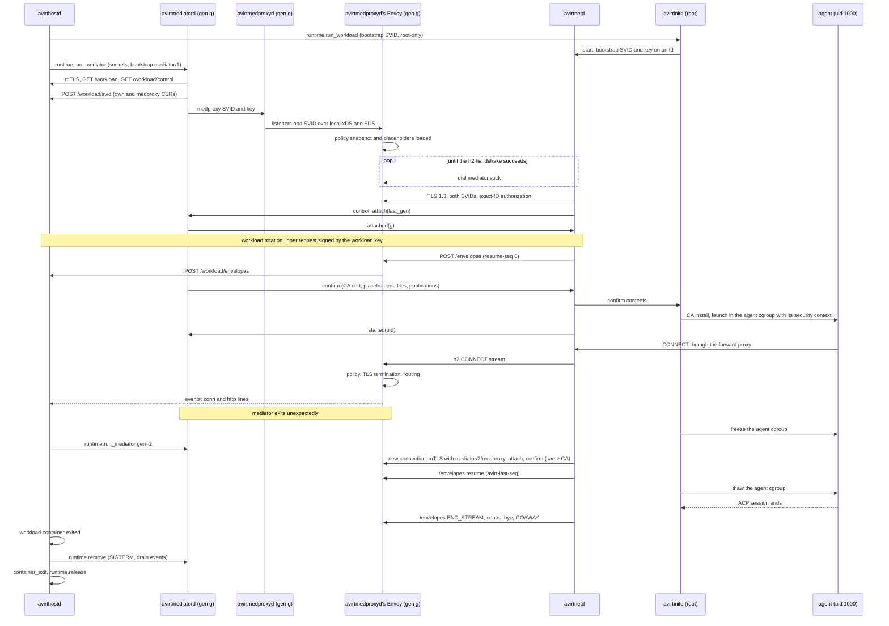

# Status: implemented

## Sockets

The workload container uses `--network none`. The runtime mounts two Unix socket files into it with `-v` from the workload's private directory `workloads/<id>/` (0700). For each mounted socket file, the runtime forwards connections to the host process listening on it. Both files are mode 0600 on the host, which maps through, so only root in the workload container can open them.

| Guest path | Host listener | Carries |
| --- | --- | --- |
| `/run/avirt/mediator.sock` | Mediator | The workload's HTTP/2 connection to its mediator, which today carries only log envelopes, on its one request `POST /workloads/<id>/stream`. The mediator forwards its bytes unchanged to avirthostd. |
| `/run/avirt/proxy.sock` | Mediator | The CONNECT proxy (see [egress](./egress.md)) |

To connect to avirthostd, the mediator dials its socket `hostd/hostd.sock` (directory 0700, socket 0600). Each connection starts with a one-line connection header naming its kind, the workload and the mediator's secret (see [identity](./identity.md)), read within 5 s:

- `WORKLOAD <id> <secret>`: `avirthostd` binds the connection to that workload and serves only that workload's `POST /workloads/<id>/stream` route over it. The mediator then forwards the HTTP/2 bytes unchanged between avirtinitd (client) and avirthostd's stream handler (server).
- `EGRESS <id> <secret>`: plain NDJSON egress events, one per proxied connection. `avirthostd` wraps each in the log envelope with `dir: "egress"`. avirthostd accepts only one event connection per workload.

At startup, the mediator opens the `EGRESS` connection. It dials a `WORKLOAD` connection only when the workload's first bytes arrive on `mediator.sock`, so a readiness probe (connect and close) costs avirthostd nothing.

## Connection to the mediator

`avirtinitd` connects to `mediator.sock` within 5 s and completes the HTTP/2 handshake within 5 s. It sends `POST /workloads/<id>/stream` with its connection token (`AVIRT_CONNECTION_TOKEN`), then waits 4 s for the response headers. Retries wait 300 ms. The total limit is 15 s. A 403, 404, 409, or 410 ends retries. A socket file without a listener accepts a connection but never responds, so each step has a timeout. Starting the TCP proxy to `proxy.sock` and the agent requires avirthostd's acceptance of that request. Otherwise, `avirtinitd` fails with a message that identifies the mediator.

## TCP proxy to `proxy.sock`

`avirtinitd` listens on an ephemeral `127.0.0.1` port. It forwards each connection to `proxy.sock`. The agent connects to it through `HTTPS_PROXY` and the related variables (see [workload hardening](./workload-hardening.md)).

Forwarded sockets must never half-close. With a `-v` socket-file mount, sending `SHUT_WR` immediately after the last write loses the peer's reply. To avoid that loss, the TCP proxy omits forwarding a client's end-of-stream. After the client finishes, each read on the other direction has a 30 s idle timeout. When the host side ends or a read idles out, the proxy notifies the client and closes. The log can show a proxied connection lasting longer than the client's connection.

# Status: planned

## Runtime-provided sockets

The workload container and the mediator have no network interface other than loopback. Each connection they make is on a Unix socket that the compute runtime provides (see [compute runtimes](./compute-runtimes.md) and [networking](./networking.md)). The workload container has exactly one, for the workload's HTTP/2 connection to its mediator. The mediator has four.

| Socket | Container end | Host end | Initiated by | TLS client and server |
| --- | --- | --- | --- | --- |
| Workload connection | Workload container: `/run/avirt/mediator.sock`, dialed by avirtnetd. Mediator: `/run/avirt/workload.sock`, served by avirtmedproxyd's Envoy. | avirthostd, which forwards the bytes unchanged | The workload side | avirtnetd, avirtmedproxyd's Envoy |
| Connection to avirthostd | Mediator: `/run/avirt/hostd.sock` | avirthostd | avirtmediatord and avirtmedproxyd's Envoy | The mediator process, avirthostd |
| Outbound socket to avirthostd | Mediator: `/run/avirt/svc.sock` | avirthostd's SNI routing | avirtmediatord and avirtmedproxyd's Envoy | The mediator process, the destination |
| avirtmedproxyd's ingress listener | Mediator: `/run/avirt/ingress.sock`, served by avirtmedproxyd's Envoy | avirthostd's SNI routing | avirthostd, for avirtedgeproxyd | avirtedgeproxyd's Envoy, avirtmedproxyd's Envoy |

- **Containerization.** A vsock connection between avirthostd and the guest backs each socket. The runtime's vsock-to-Unix-socket forwarder presents this connection as the Unix socket in the table. The workload VM's vsock device has exactly one host listener, for the workload's connection, which avirthostd forwards unchanged to the current mediator generation's `workload.sock`. This lets avirtnetd open a new connection to its mediator whenever it needs one. Each other host listener is on the mediator VM's device. seccomp denies `AF_VSOCK` to each workload process, so only the runtime's forwarder uses the workload VM's vsock device.
- **Docker Desktop.** The workload's connection goes through a per-workload Docker named volume. The mediator's connection to avirthostd and its outbound socket to avirthostd are single-file bind mounts of the host's `workloads/<id>/c.sock` and `workloads/<id>/s.sock`. avirtmedproxyd's ingress listener is open (see [components](./components.md#open-questions)).

Each vsock connection, bind mount, and named volume transports ciphertext only.

## SNI routing

avirthostd reads only the TLS ClientHello's SNI on each connection on a mediator's outbound socket, and forwards the connection unchanged to the destination the SNI names, if that destination is in the workload's allowed set:

| SNI | Destination | Allowed when |
| --- | --- | --- |
| `<name>.svc.<td>` | The host service's listener `services/<name>.sock` | Always, for avirtsecretsd, avirtpolicyd, avirtdnsd, avirtoteld, avirtmcpgwd and avirtmodelgwd, and for avirtregistryd from a build job's outbound socket only |
| `edgeproxy.svc.<td>` | avirtedgeproxyd's egress listener | Always |

avirthostd also serves one host-side listener for avirtedgeproxyd's Envoy alone, `services/ingress-relay.sock`, checked with peer credentials (`LOCAL_PEERCRED` on macOS, `SO_PEERCRED` on Linux). A connection there specifies its destination by SNI `<uuid>.ingress.<td>`, and avirthostd forwards it unchanged to that workload's avirtmedproxyd ingress listener at its current generation. avirthostd closes connections with missing or unknown SNI, or destinations outside the set, before forwarding any bytes. It forwards TLS unchanged. The destination authenticates the caller by its SVID and checks authorization (see [trust boundaries](./trust-boundaries.md#listeners)).

SNI routing in avirthostd excludes direct routes between mediators. Only avirtedgeproxyd connects to a mediator's ingress listener, through `services/ingress-relay.sock`.

## HTTP/2 streams

| Layer | avirtmedproxyd's Envoy | avirtnetd |
| --- | --- | --- |
| TLS 1.3 (mutual, SPIFFE) | Server | Client |
| HTTP/2 | Server | Client |

One HTTP/2 connection per mediator generation carries each stream. avirtnetd opens each stream, and avirtmedproxyd's Envoy routes each one:

| Stream | Request | Opened for | Routed to |
| --- | --- | --- | --- |
| control | `POST /control`, always the first stream | avirtnetd | avirtmediatord, NDJSON messages in both directions for the life of the connection |
| envelopes | `POST /envelopes` with `avirt-resume-seq: N` | Envelopes from avirtinitd, the main workload process and avirtnetd, each carrying a `seq` | avirthostd, `POST /workload/envelopes` |
| egress | `CONNECT host:port`, one per agent connection | avirtnetd's forward proxy | The egress pipeline (see [egress](./egress.md#avirtmedproxyd-pipeline)) |
| <!-- Project glossary term. --><!-- vale project.WordList = NO -->guest CLI<!-- vale project.WordList = YES --> | `POST /guest-cli` | avirtguest's gRPC, through `guest.sock` | avirtedgeproxyd, then avirtapid, under the `guest-cli` principal (see [identity](./identity.md#trust-domain-and-ids)) |
| MCP | `POST /mcp` | avirtmcp, through `mcp.sock` | avirtmcpgwd |
| DNS | `POST /dns`, long-lived | avirtnetd's stub resolver, with length-prefixed DNS messages in both directions | libavirtenvoy's DNS policy, then avirtdnsd for avirt names or avirtedgeproxyd's DNS proxy for public names (see [egress](./egress.md#workload-dns)) |
| OTLP | `POST /otlp` | avirtnetd and the main workload process | avirtoteld, with `x-avirt-src: workload` (see [observability](./observability.md#opentelemetry-logs)) |
| inbound connection notices | `POST /inbound-notices`, long-lived | avirtnetd | libavirtenvoy, which sends one notice per inbound connection |
| ingress | `POST /ingress` with `avirt-ingress-id: I` | avirtnetd, accepting an inbound connection notice | The inbound connection waiting under `I` (see [ingress](#ingress)) |

An egress stream's response includes the pipeline's status, including avirtedgeproxyd's 403 `private-dest`, 502, and 504. The `/control`, `/envelopes`, `/dns` and `/inbound-notices` streams have reserved flow-control windows, so bulk egress and ingress streams can't starve them.

avirtnetd dials `/run/avirt/mediator.sock` with a 50 ms to 1 s backoff, because dials made before avirtmedproxyd's Envoy listens fail, for up to the 30 s launch budget (see [lifecycle](./lifecycle.md#launch-order)). An ended workload container and one awaiting readiness look identical to the mediator. avirthostd must stop the mediator explicitly.

## Launch handshake

After the mutual TLS handshake (see [identity](./identity.md)):

1. avirtnetd → `{"t":"attach","last_gen":G,"proto":P}`. avirtmediatord refuses an unsupported control protocol version with `{"t":"refused","reason":"protocol"}`.
2. avirtmediatord → `{"t":"attached","gen":g}`, echoing the generation from its SVID.
3. The first rotation of each SVID (see [identity](./identity.md#rotation)).
4. avirtnetd opens the `/envelopes` stream, and avirthostd accepts it.
5. avirtmediatord → `{"t":"confirm","gen":g,"ca_pem":…,"env":{…placeholders…},"files":{"codex/auth.json":…},"mode":"audit","policy_version":V,"publications":[…]}`
6. avirtnetd hands the `confirm` contents to avirtinitd. avirtinitd installs the MITM CA and writes the files. It starts the main workload process and avirtguestd, and launches the agent at the main workload process's request (see [components](./components.md#workload)). avirtnetd replies `{"t":"started","pid":P}`.

avirtmediatord sends `confirm` only once all these hold: its workload configuration fetch succeeded, rotation of its own SVID and the SVID of avirtmedproxyd's Envoy has completed, avirtmedproxyd's Envoy has its listeners, libavirtenvoy holds a valid policy snapshot and the workload's placeholders, loading the MITM CA has completed, and avirthostd has reported the accepted `/envelopes` stream with `{"t":"envelopes_accepted"}` on `GET /workload/control`. libavirtenvoy reports its policy snapshot and placeholder readiness to avirtmediatord on a local status socket. Agent processes start only after `confirm`.

## Freeze and reconnect

avirtnetd distinguishes three transitions of its connection to the mediator:

- **Rotation.** After an SVID rotation, avirtnetd opens a new connection to the same generation with its current SVID. It sends `{"t":"reattach","gen":g}` on a new `/control` stream, then resumes the `/envelopes` stream by `seq` and reopens its `/dns` and `/inbound-notices` streams. Only after these steps does it send GOAWAY on the old connection. Streams already open on the old connection may finish. Rotation leaves the processes running.
- **Reconnect.** When a connection fails, avirtnetd reconnects to the same generation in the same way. Until attachment to a connection of the current or a higher generation, avirtnetd reports the disconnected state to avirtinitd. avirtinitd adds a `connection` freeze reason.
- **Replacement.** A mediator with a higher generation completes the handshake, `attach` and `confirm`, and supersedes the older generation.

While any freeze reason exists, avirtinitd writes `1` to the agent cgroup's `cgroup.freeze` and waits until `cgroup.events` shows `frozen 1`. The freeze covers each process in the agent cgroup, including tools that left the agent's process group, and leaves avirtnetd, the main workload process, and avirtguestd running. If attachment and confirmation of a connection to the same or a higher generation complete within 30 s, avirtinitd removes the `connection` freeze reason. Missing the 30 s deadline makes avirtinitd write `1` to `cgroup.kill` and exit 2 with `error: mediator lost`. After removing the reason, avirtinitd writes `0` and the agent resumes only when no freeze reason remains. Egress connections open through the lost connection end. Clients retry them.

A workload container whose guest lacks a writable cgroup v2 hierarchy with `cgroup.freeze` and `cgroup.kill` doesn't start its agent.

`avirthostd` restarts a mediator that exits unexpectedly, at most twice per workload, each time with the generation incremented. Once confirmation of a newer generation completes, avirtnetd sends GOAWAY on any older connection, and avirthostd fences the older generation at each host listener (see [identity](./identity.md#authorization)).

## Resuming after reconnect

`avirthostd` writes each envelope to the workload log before counting its `seq` as written. It tracks the highest written `seq` and returns it as `avirt-last-seq` when the `/envelopes` stream resumes. avirtnetd replays from a 4 MiB ring of sent envelopes and writes a `meta` `envelope_gap` event when the ring no longer covers the gap. `avirthostd` deduplicates by `seq`. Envelopes on the `/envelopes` stream include `src: "workload"` (see [trust boundaries](./trust-boundaries.md#event-provenance)). avirthostd stamps `src`, `workload` and `gen` on each envelope and event from the authenticated connection it arrived on, overriding any value the producer supplied, and keeps one `seq` domain per producer. Each line avirthostd writes includes `prev`, the hash of the line before it (see [observability](./observability.md#integrity)). avirthostd caps each workload's log by size. Past a soft cap it slows the `/envelopes` stream and the workload's events through flow control, so producers refuse new work with 503 rather than drop records. At the hard cap it ends the workload with a `container_error` that identifies the cap.

## Ingress

A guest port is reachable from outside the workload container only through a port publication, and only through avirtedgeproxyd. avirthostd stores port publications as versioned state, separate from the immutable workload configuration. Launch requests or later API calls add them, subject to the `publish_port` action for each publication.

| Field | Meaning |
| --- | --- |
| `workload` | The publishing workload, and with it its short ID and namespace |
| `port` | A `127.0.0.1` port in the workload container, or the built-in `guestd` target, which avirtnetd forwards to `/run/avirt/streams/guestd.sock` |
| `protocol` | `tcp` for opaque bytes, or `http` |
| `expires` | When the publication ends, at the latest with the workload. avirtedgeproxyd and the destination avirtmedproxyd both enforce it locally. |

A published port is reachable as `<name>.<ns>.workload.host.avirt.internal:<port>`, and a service record (see [components](./components.md#avirtedgeproxyd)) can name it as its backend. Who may connect is policy: avirtedgeproxyd's host policy snapshot and the destination workload's `ingress` action.

The destination avirtmedproxyd receives each inbound connection from its own host's avirtedgeproxyd, on avirtmedproxyd's ingress listener:

- **Same host.** The source avirtmedproxyd sends an h2 CONNECT stream with the avirt name as `:authority` to this host's avirtedgeproxyd. avirtedgeproxyd resolves the name to its entity and evaluates the host policy snapshot. It opens a new mutual TLS connection as `/service/avirtedgeproxyd` on the destination's ingress listener, with the source identity in `x-avirt-caller`.
- **Peered host.** The source avirtmedproxyd sends the stream to its own avirtedgeproxyd, which forwards it to the peer's avirtedgeproxyd over mutual TLS with federated bundles (see [peering](./peering.md#workload-traffic)). The peer's avirtedgeproxyd evaluates its own host policy snapshot and connects to the destination as in the same-host path. The source avirtedgeproxyd connects to the peer's peer listener and sets `x-avirt-caller` to the originating workload's identity, in its own trust domain. The receiving avirtedgeproxyd accepts it only if that identity is in the trust domain of the peer's avirtedgeproxyd SVID that authenticated its connection, and otherwise refuses the stream with 403. Each avirtedgeproxyd sets `x-avirt-caller` itself on the stream it originates.
- **avirtapid.** avirtapid reaches services through avirtedgeproxyd in the same way.

The <!-- Project glossary term. --><!-- vale project.WordList = NO -->guest CLI<!-- vale project.WordList = YES --> stream takes the same first hop the other way round: avirtmedproxyd sends it to avirtedgeproxyd, which authorizes the `guest-cli` principal against the host policy snapshot and forwards it to avirtapid.

The destination avirtmedproxyd accepts ingress connections only from `/service/avirtedgeproxyd`. It then:

1. evaluates the workload policy snapshot's `ingress` action for the caller in `x-avirt-caller` and the port.
2. sends the inbound connection notice `{"t":"ingress","id":I,"port":…}` on the `/inbound-notices` stream.
3. waits for avirtnetd's `POST /ingress` with `avirt-ingress-id: I`, and forwards bytes between the two.

avirtnetd accepts a notice only for an unexpired port in its current publication set, which arrives in `confirm` and in later `{"t":"publications"}` control messages. A revoked or expired publication closes its open ingress streams. avirtnetd connects only to `127.0.0.1:<port>`, excluding its own forward proxy port, DNS stub, and any other port it holds. Within `/run/avirt`, it connects only to `streams/guestd.sock` for the `guestd` target. For that target it passes the caller's identity, so avirtguestd can check authorization for each operation.

## Sequence

## Connection to avirthostd

`avirthostd` serves one listener per workload for the mediator's connection to avirthostd (see [runtime-provided sockets](#runtime-provided-sockets)). Its listener identity binds the workload. avirtmediatord and avirtmedproxyd's Envoy are h2 clients over mutual TLS 1.3, each with its own SVID and its own routes (see [identity](./identity.md#authorization)).

| Request | Caller | Purpose |
| --- | --- | --- |
| `GET /workload` | avirtmediatord | One JSON document per generation: `gen`, the namespace, the workload's short ID and alias, its labels, the policy reference, the MITM CA cert and key, the credential binding references, and the port publications. It excludes credential values. Held in memory only. |
| `GET /workload/control` | avirtmediatord | Long-lived. avirthostd pushes `rotate`, `bundle`, `publications` and `stop` as NDJSON. |
| `POST /workload/svid` | avirtmediatord | A CSR for its own ID or for avirtmedproxyd's Envoy's, or a forwarded workload-signed request (see [identity](./identity.md#rotation)). Returns the SVID and the current bundle. |
| `POST /workload/envelopes` | avirtmedproxyd's Envoy | The workload's `/envelopes` stream, forwarded body for body |
| `POST /workload/events` | avirtmedproxyd's Envoy | NDJSON events, written as `dir: "egress"` lines with `src: "mediator"` |

Stderr from avirtmediatord, avirtmedproxyd, and avirtmedproxyd's Envoy goes to `logs/<workload-id>.mediator.log`. Losing the connection to avirthostd makes avirtmediatord exit, followed by the mediator container. Inside the workload container, the agent freezes. avirthostd restarts the mediator or tears the workload down.

# Open questions

1. **Session control stream.** Whether avirtacp's session control stream is its own HTTP/2 stream on the workload's connection to its mediator or a message type on `/control` is open (see [ACP](./acp.md#session-control-api)).
2. **OTLP stream limits.** The `/otlp` stream's flow-control share and per-workload rate limit are open (see [observability](./observability.md#open-questions)).
