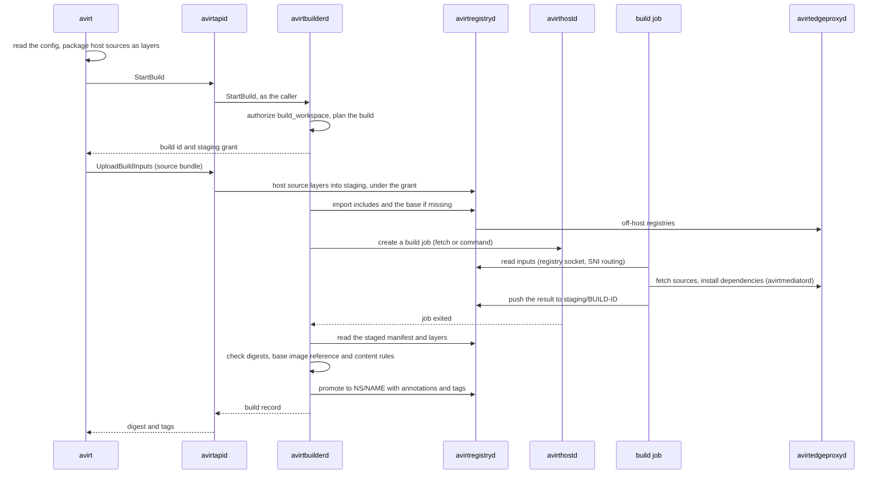

# Status: planned

This document covers how avirtbuilderd builds workspace images. The workspace image format, the config file, references and root filesystem composition are in [workspaces](./workspaces.md), and the registry builds push to is in [workspace registry](./workspace-registry.md).

## Builds

The build queue, build records, watch registrations, and observed ref heads belong to avirtbuilderd. Its only SVID is `/service/avirtbuilderd`. Signing keys and host control API access remain unavailable to it. It never parses source content or executes build commands itself.

avirtbuilderd serves a gRPC `WorkspaceBuilder` service on its host service listener, which avirtapid forwards for clients: `StartBuild`, `ListBuilds`, `GetBuild`, `ReadBuildLog`, `CancelBuild`, `AddPrebuildPolicy`, `ListPrebuildPolicies` and `RemovePrebuildPolicy`. The commands that call them are in [operator CLI](./operator-cli.md#workspaces).

### Build kinds

| Kind | When | Where it runs |
| --- | --- | --- |
| Assembly | The command-line tool produces each layer from host sources, without includes, hooks, or a Containerfile | avirtbuilderd, without a build job: it checks the command-line tool's layers and assembles the manifest |
| Fetch | A remote `git` or `github` source or an include exists (without hooks or a Containerfile) | A build job that runs only `git` and avirt's layer tool |
| Command | Hooks or a Containerfile exist | A build job that also runs BuildKit |

### Build jobs

A build job is a workload that avirthostd creates for avirtbuilderd: a workload container and its mediator, created like any workload but with the build security context. It belongs to the workspace's namespace and has the reserved labels `avirt.internal/build` (the build id) and `avirt.internal/workspace` (the repository), so policy can tell it apart from agent workloads.

- **Image.** The workload container runs the avirt builder image, which holds avirtinitd, avirtnetd, avirtexec in build mode, `git`, avirt's layer tool and BuildKit. The build's base image and the input layers are inputs to the build, never the job's own root filesystem.
- **Identity.** The job's only SVID is its workload SVID in avirtnetd. It has no connection to avirthostd of its own beyond its mediator's, and no access to avirtapid: avirthostd refuses any `guest-cli` stream for a build job.
- **Inputs.** avirtnetd serves a registry socket to the build runner, and avirtmediatord forwards it to avirtregistryd through avirthostd's SNI routing under the job's identity. avirtregistryd grants the job read access to exactly the base image, the source bundle and the include digests of its build, read access to the cache scopes in [caching](#caching), and write access to `staging/<build-id>` only.
- **Network.** Each other connection goes through avirtnetd's forward proxy, the build job's avirtmediatord and avirtedgeproxyd, under the job's workload policy snapshot. The build policy for the job permits the sources' hosts for the fetch and the package registries the host policy names for commands.
- **Credentials.** A private source's credential, such as a short-lived GitHub installation token, is a mediator-injected credential binding for the source's host. The real credential remains outside the job. The mediator intercepts only the fetch step's connections for injection. Build commands use connections without interception or injected credentials. Their environment trusts only the base image's CA bundle.
- **Security context.** avirtinitd runs the build runner as root inside the build VM with the build security context, which permits the namespaces and mounts BuildKit's OCI worker needs, without applying a Landlock ruleset to it (see [build jobs in sandbox](./sandbox.md#build-jobs)). Build commands run in BuildKit containers with the VM's loopback network, so they reach only avirtnetd's proxy.
- **Limits.** avirthostd admits the job against the host's resource budgets like any workload, with a wall-clock deadline, and tears it down when it ends. Only the job's logs and its pushes to `staging/<build-id>` persist.
- **Logs.** avirthostd writes the job's workload log and stdio log as it does for other workloads. `avirt workspace builds logs` reads them through avirtapid.

Command builds require a runtime with `isolation = VmPerWorkload`. On Docker Desktop, where each workload container shares one kernel, avirtbuilderd runs assembly and fetch builds and refuses command builds with `build requires vm isolation` (see [compute runtimes](./compute-runtimes.md#docker-desktop-runtime)).

### Build pipeline



Only promotion can place a build result in a workspace repository. avirtbuilderd writes the promoted manifest itself and computes annotations from the build it requested. It checks all job output before using it in an annotation, a tag, or the index.

### Caching

BuildKit in a command build imports and exports its cache through the registry socket, to `cache/<ns>/<name>`, in scopes keyed by ref. A build of a ref reads the scope of its own ref and of the repository's default branch, and writes only the scope of its own ref. These scopes prevent a pull request build from writing a cache that a default branch build reads.

## Build stages and the Containerfile

A build runs its steps in this order, and each step that runs commands adds layers over the previous one:

1. Start with the build's base image (`build.base`).
2. Run `pre-source` hook commands for system packages.
3. Add the `dependencies` stage's source layers, then its include layers, in config order.
4. Install dependencies with the `dependencies` hook commands.
5. Add the `source` stage's source layers, then its include layers, in config order.
6. Run the `post-source` hook commands.
7. Build the Containerfile when it exists.

The step order follows how often their inputs change. A `dependencies` stage source takes only manifests and lockfiles, so step 4 stays cached until one of them changes, and an edit to the source tree reruns only steps 5 to 7. Dependency layers sit below source layers in the image. Their placement lets a host keep them across source edits.

All layers over the build's base image form the workspace image. A build without hooks or a Containerfile has base image reference `none`.

The Containerfile's first stage is `FROM workspace`, where `workspace` names the result of steps 1 to 6, and it can also use `dependencies`, the result of steps 1 to 4. It may have further stages, and its final stage must descend from `workspace`. avirtbuilderd translates the hooks into stages of the same build, so hooks and a Containerfile together form one build.

```dockerfile
FROM workspace
WORKDIR /workspace
RUN npm ci && npm run build
```

## Tags

A tag points at one manifest at a time, and pushing another manifest under the same tag moves it. Each promoted manifest gets an **immutable tag**, `build-<build id>` (build ids are ULIDs, so the tag is always valid), that no other build reuses and only retention or `avirt workspace rm` removes. Without this tag, moving the mutable tag would leave the manifest untagged. Registries commonly garbage-collect untagged manifests, as most off-host registries' retention rules do. The immutable tags also keep avirtregistryd's index rebuildable: listing a repository's tags and reading each manifest recovers each image record.

A build can also have **mutable tags**: `--tag` for an on-demand build, and the rendered `tag-format` for a prebuild. Mutable tags move, and `github:` and `git:` selectors never read them. These selectors use annotations through the index. avirt makes mutable tags valid OCI tags by replacing each character outside `[A-Za-z0-9_.-]` with `-`. A leading `.` or `-` becomes `_`. For a tag longer than 128 characters, avirt retains the first 115 characters, then appends `-` and the first 12 hex characters of the SHA-256 of the untruncated tag. `dev.avirt.workspace.tag-key` records the mutable tag before sanitization. Each build is also addressable by its manifest digest.

## Prebuild configurations

A **prebuild configuration** tells avirtbuilderd which refs of one repository to keep built. An operator registers its TOML file with `avirt workspace prebuild add`. The file must remain outside the repository it builds. A repository's own files can't control ref selection for builds, promotion destinations, or retention periods.

```toml
name = "bar-previews"
repository = "github:foo/bar"         # or "git:<url>"
workspace = "team-a/bar"              # the workspace repository builds are promoted to
refs = 'ref.default || ref.kind == "pull" || (ref.kind == "branch" && ref.short.startsWith("feat/"))'
tag-format = "{{ ref.short }}"
config = "tree"                       # default; or a path whose content is registered with the configuration
lock = "tree"                         # default; or "refresh"

[triggers]
schedule = "0 */6 * * *"
events = ["push", "pull_request.opened", "pull_request.synchronize", "pull_request.closed"]
poll-interval = "60s"

[retention]
keep-per-ref = 3
closed-pull-requests = "7d"
```

| Key | Default | Meaning |
| --- | --- | --- |
| `name` | Required | The configuration's name, unique on the host |
| `repository` | Required | A `github:` or `git:` reference with no selector |
| `workspace` | Required | The workspace repository for build promotion. Promotion ignores the built config's `name` and `namespace`. |
| `refs` | `ref.default` | A CEL expression over each ref (see [expressions](./workspaces.md#expressions)). avirtbuilderd keeps an image built for each ref it accepts. |
| `tag-format` | None | A template for each build's mutable tag (see [tags](#tags)) |
| `config` | `tree` | `tree` reads `.avirt-workspace.toml` from each built commit, with the zero-config defaults when there is none. A path registers that file's content with the configuration and uses it for each ref. |
| `lock` | `tree` | `tree` uses the built commit's lockfile. `refresh` resolves each entry fresh. |
| `triggers.schedule`, `triggers.events`, `triggers.poll-interval` | None, none, `60s` | What starts builds, below |
| `retention.keep-per-ref`, `retention.closed-pull-requests` | `3`, `7d` | Which of the configuration's images avirtregistryd keeps |

- **What a prebuild builds.** For each accepted ref, avirtbuilderd builds the workspace config at the ref's commit, with the source selected by the `primary` key fixed to the configured repository at that commit. A config whose source selected by the `primary` key is another repository, or that specifies a source read on the host, fails that ref's build with `config not buildable by policy`. avirtbuilderd checks `build_workspace` for each build, as for any other build. Policy still limits pull requests that edit the config to access new hosts or owners. Their hooks and Containerfile run in a build job, as for any command build.
- **Schedule.** `triggers.schedule` is a five-field cron expression in the host's time zone. Each run rebuilds each accepted ref whose newest image is older than the schedule interval, which refreshes images whose dependencies moved while their sources didn't.
- **Events.** avirtbuilderd polls the repository at `triggers.poll-interval` with conditional requests, and derives events from the ref heads it observes. `push` is a branch or tag head that moved. `pull_request.opened` and `pull_request.synchronize` are a new or moved `refs/pull/<n>/head`. `pull_request.closed` is a pull request that closed, and it builds the base branch when the pull request merged. An event builds only refs that `refs` accepts.
- **Retention.** avirtregistryd keeps the `keep-per-ref` newest images per ref that the configuration produced, deletes the images of a closed pull request once `closed-pull-requests` has passed, and never deletes an image that a live workload's configuration references. Deleting an image removes its immutable tag with it.

## Policy

| Action | Evaluated by | Resource | Context |
| --- | --- | --- | --- |
| `build_workspace` | avirtbuilderd, per build | `WorkspaceRepository` | `via`, `kind` (`assembly`, `fetch` or `command`), `source_types`, `source_hosts` and `github_owners` (sets of strings), `includes` (a set of image references), `provenance`, `config_source`, `secret_allows` (a set of patterns), `trigger`, `ref`, `owner`, and `prebuild_policy` for a prebuild |
| `watch_workspace` | avirtbuilderd, per prebuild configuration registration | `WorkspaceRepository` (the configuration's `workspace`) | `via`, `repository` (the watched remote), `config` (`tree` or `registered`), `events`, `schedule` |

The existing `resolve`, `connect`, and `request` actions in [egress policies](./egress-policies.md#actions) control a build job's network access. The principal is the job's `Workload`, distinguished by its `avirt.internal/build` tag. avirtedgeproxyd evaluates avirtregistryd's and avirtbuilderd's off-host connections as it does each host daemon's.

```cedar
@id("team-a-builds-from-own-org")
permit (principal, action == Action::"build_workspace", resource in Namespace::"team-a")
when { ["github.com"].containsAll(context.source_hosts) && ["team-a"].containsAll(context.github_owners) };

@id("build-jobs-reach-npm")
permit (principal, action == Action::"connect", resource)
when { principal.hasTag("avirt.internal/build") && resource has host && resource.host == "registry.npmjs.org" && resource.port == 443 };
```

## Trust boundaries

| Listener | Where | Transport | Caller identity | Allowed operations |
| --- | --- | --- | --- | --- |
| avirtbuilderd (`services/avirtbuilderd.sock`) | Host, avirtbuilderd | Host service listener | avirtapid with `x-avirt-caller`, avirthostd (job exit reports) | `WorkspaceBuilder` calls, each authorized by Cedar |

| Compromised | Can reach | Can't reach |
| --- | --- | --- |
| Build job (root in the workload container in the build VM) | Its own inputs and staging repository. Its cache scope and anything its workload policy snapshot allows through avirtedgeproxyd. Writing anything into its staging output. | Any workspace repository, tag or annotation (only avirtbuilderd promotes), another build's inputs or staging, real credentials, avirtapid, avirthostd's control API, any signing key |
| avirtbuilderd | Starting build jobs and promoting chosen outputs. Writing any annotation | Running commands on the host, any SVID other than its own, avirthostd's control API beyond creating build jobs |

# Open questions

1. **Webhook delivery.** avirtbuilderd derives events by polling. Delivery of GitHub webhooks to a host through a relay or a peer remains open.
2. **Secret content scanning.** The denylist matches paths. Whether avirtbuilderd also scans layer content for credentials before promotion, and whether a finding fails the build or only flags it, is open.
3. **SSH-only remotes.** Credential injection over HTTPS can't fetch a remote without an HTTPS form. This limit applies to avirtbuilderd's ref polling and to build jobs. Support for SSH remotes and storage of their keys remain open.
4. **Signing.** Whether to sign avirtbuilderd's promoted images and which key to use remain open. Allowing `launch_workspace` to require a signature through `Referrers` is also open.
5. **Build job namespace.** A build job runs in the workspace's namespace. Using a separate namespace for builds would prevent agent policy from matching them by namespace. Whether to use one remains open.
6. **Directory sources in prebuilds.** A prebuild refuses a `directory` source, even one whose `path` stays inside the built tree. Reading such a source from the fetched tree in a prebuild remains an open question.
