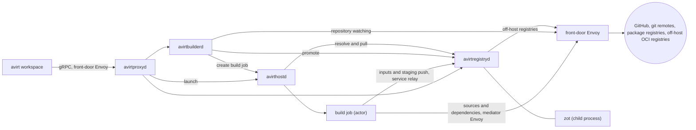
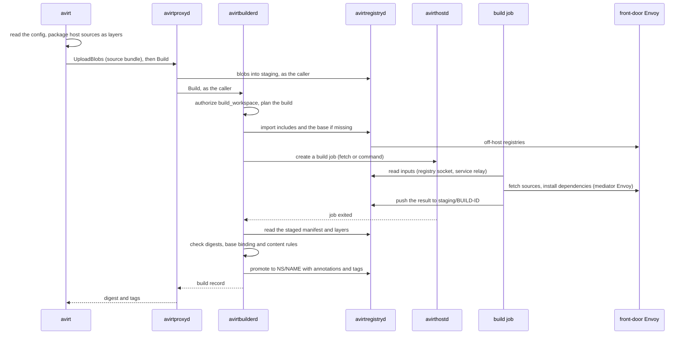

# Status: planned

A **workspace** is the content a workload starts with beyond its base image: a source tree, the dependencies installed for it, caches, and individual files. A **workspace image** is an OCI artifact that carries a workspace as a stack of layers, and avirthostd overlays it onto the workload's base image when it creates the workload. A workspace is not necessarily one top-level folder: one workspace image can place content under `/workspace`, under the agent's home such as `~/.cache`, and at individual system paths such as `/usr/local/bin/some-script`. A workspace does not have to come from a version control checkout.

| Component | Role for workspaces |
| --- | --- |
| avirt | Reads `.avirt-workspace.toml`, packages local sources, and sends every `avirt workspace` command to avirtproxyd |
| avirtproxyd | Forwards `avirt workspace` commands to avirtbuilderd, avirtregistryd and avirthostd with the caller's identity |
| avirtbuilderd | Schedules on-demand builds, runs warm build policies, watches repositories, runs each build that processes untrusted content in a disposable sandboxed build job, and checks every output before it is admitted |
| avirtregistryd | Stores workspace images in an embedded OCI registry, keeps avirt's secondary index of them, serves the search and resolve API, and makes every off-host registry connection |
| avirthostd | Resolves a workspace reference at launch, authorizes the launch, pulls the image into its artifact store, composes the workload's root filesystem, and records the resolved digest in the immutable actor configuration |
| avirtpolicyd | Distributes the Cedar policy that governs build, push, pull, export and launch-from-workspace |



## Workspace image format

A workspace image is an OCI image manifest (image spec v1.1) with these fields:

| Field | Value |
| --- | --- |
| `artifactType` | `application/vnd.dev.avirt.workspace.v1` |
| `config.mediaType` | `application/vnd.dev.avirt.workspace.config.v1+json` |
| `layers[].mediaType` | `application/vnd.oci.image.layer.v1.tar+zstd` for layers avirt produces. Included layers keep their own `tar+gzip` or `tar+zstd` media type. |
| `layers[].annotations` | `dev.avirt.workspace.origin` (`source`, `include`, `pre-source`, `dependencies`, `post-source` or `containerfile`), `dev.avirt.workspace.stage` (`dependencies` or `source`), `dev.avirt.workspace.origin-index` (the position of the source or include in the config), `org.opencontainers.image.title` for a source or include with a `name`, and `org.opencontainers.image.source` and `org.opencontainers.image.revision` for a layer from a version control source |
| `annotations` | The `dev.avirt.*` and `org.opencontainers.image.*` annotations in [annotations](#annotations) |

The layers apply in manifest order, above the base image's layers, and a later layer wins where two layers write the same path. A workspace image carries no environment, entrypoint, user or working directory: those come from the base image.

The config blob records:

- `platform`: always `linux/arm64`;
- `base`: the base binding, either `none` or `{ "name": "<base reference>", "digest": "<base platform manifest digest>", "index_digest": "<index digest, when the base was resolved through an index>", "diff_ids": [...] }`;
- `roots`: the workspace roots, which are `/workspace` and every directory destination under `/home/agent`;
- `layers`: for each layer, its origin, its destinations, and for a version control source the canonical remote URL, the ref and the commit;
- `config_digest`: the digest of the resolved `.avirt-workspace.toml`, with every default filled in;
- `lock`: every include digest and source commit the build resolved, in the form of the [lockfile](#lockfile);
- `provenance`: `reproducible` or `local` (see [local provenance](#local-provenance));
- `secret_allows`: the denylist patterns that `secrets.allow` lifted for this build, when there are any.

### Base binding

A build that runs no commands produces a workspace image with base binding `none`, which overlays onto any workload image. A build that runs commands (build hooks or a Containerfile) produces layers that depend on the base it ran on, and its base binding records that base's manifest digest and its layer `diff_ids`. Such a workspace image overlays only onto a workload image whose layer chain begins with exactly those `diff_ids`. Both agent workload images are built from the avirt workload base image, so a workspace built on that base overlays onto either agent's image. avirthostd refuses a launch that breaks the binding with `workspace bound to another base`.

A bound image also carries the standard `org.opencontainers.image.base.name` and `org.opencontainers.image.base.digest` annotations, and an unbound image carries neither. The image spec does not say whether `base.digest` is an index digest or a platform manifest digest. avirt always records the platform manifest digest, since that is what pins the layers and the libraries that dependency caches link against, and records the index digest in `dev.avirt.workspace.base-index` when the base was resolved through an index. The spec intends these annotations for an image that contains its base's layers, which a workspace image does not, so a workspace image is never runnable on its own. avirthostd's check uses the config blob's `diff_ids`, which is stricter than the digest. The annotations exist so that search and other OCI tooling can read the binding without fetching the config blob.

### Destinations

| Destination | Meaning | Owner | Writable by the agent |
| --- | --- | --- | --- |
| `/workspace` and below | The main workspace root, and the default destination of every directory, git and github source | uid 1000 | Yes |
| `${workload.home}` and below | The workload user's home, `/home/agent`, for caches and tool state such as `${workload.home}/.cache`, `.npm`, `.cargo` and `.local` | uid 1000 | Yes |
| `/usr/local` and `/opt` below, except `/opt/agent` | System additions such as scripts and toolchains | uid 0 | No |
| Any other path a build command writes | Packages a pre-source hook installs, such as files under `/usr` and `/var/lib` | As written by the command | No |

A destination may not contain `~`, and a config that uses one fails with `~ in destination`. `~` in a source `path` means the invoking user's home on the host, and letting it also mean the workload user's home would give one config two homes under one spelling. `${workload.home}` is the workload user's home, which is `/home/agent` in every avirt workload image; the variable keeps configs valid if that changes. It is the only variable a destination may use. Write access for the agent follows from the Landlock rules in [workload hardening](./workload-hardening.md#process-profiles): content outside `/workspace`, `/home/agent` and `/tmp` is read-only to the agent whatever its mode.

### Content rules

avirtbuilderd checks every layer of a workspace image before admitting it, and avirthostd checks again before it composes a root filesystem. A layer that breaks a rule fails the build, or the launch, with the rule named.

- **Reserved paths.** No entry, whiteout or opaque whiteout may touch `/run`, `/proc`, `/sys`, `/dev`, `/opt/agent`, any avirt binary in the base image (`/usr/local/bin/avirt*`), `/etc/passwd`, `/etc/group`, `/etc/shadow`, `/etc/gshadow`, `/etc/resolv.conf`, `/etc/hosts`, or the system CA bundle (`/etc/ssl/certs`, `/usr/local/share/ca-certificates`, `/usr/share/ca-certificates`).
- **Entry types.** Regular files, directories, symlinks and hard links only. Device nodes, FIFOs and sockets are refused.
- **Modes.** No setuid or setgid bit, and no file capability (`security.capability` xattr).
- **Ownership.** Entries under `/workspace` and `/home/agent` are owned by uid 1000 and gid 1000, and entries from sources and includes elsewhere by uid 0. avirt rewrites ownership on the layers it produces from sources and includes, and refuses any layer owned by a helper UID.
- **Paths.** Every entry name is relative, contains no `..` segment, and is valid UTF-8. A symlink or hard link may point anywhere, but no later entry in the same layer is written through a symlink.
- **Size.** Each layer and the whole image are capped, as are the entry count and the length of any path. The caps are host settings.
- **Secrets.** No entry matches the built-in or host denylist (see [secret exclusion](#secret-exclusion)), less the patterns that the config blob's `secret_allows` records. This repeats the build-time filter and catches pushed and imported images that never went through it.

Layers avirt produces are reproducible: entries are sorted, timestamps are set to the commit time for a version control source and to the build's start time otherwise, and no other metadata is kept.

## Workspace config

`.avirt-workspace.toml` sits in the directory `avirt workspace build` runs in. It is TOML, every key is kebab-case, and every key is optional.

```toml
name = "acp-experiments"            # default: the primary git repository's name, else the directory name
namespace = "default"               # the avirt namespace that owns the workspace repository

[build]
base = "default/avirt-workload-base:latest"   # default: the host's workload base image
containerfile = ".avirt-workspace.containerfile"  # default; used when the file exists

[build-hooks.pre-source]
commands = ["apt-get update", "apt-get install -y --no-install-recommends jq"]
user = "root"                       # default for pre-source
workdir = "/"                       # default for pre-source

[build-hooks.dependencies]
commands = ["npm ci"]
user = "agent"                      # default for dependencies
workdir = "/workspace"              # default for dependencies

[build-hooks.post-source]
commands = ["npm run build"]
user = "agent"                      # default for post-source
workdir = "/workspace"              # default for post-source

[secrets]
deny = ["config/credentials.*"]     # added to the built-in and host denylists
allow = [".npmrc"]                  # lifts a built-in pattern, subject to policy

[[sources]]                         # manifests and lockfiles only, so npm ci stays cached
name = "lockfiles"
type = "directory"
path = "."
destination = "/workspace"
stage = "dependencies"
paths = ["package.json", "package-lock.json"]

[[sources]]
type = "directory"                  # default when not in a Git-owned directory
path = "."
destination = "/workspace"
excludes-file = ".avirtignore"      # default

[[sources]]
type = "file"
path = "~/.local/bin/some-script"
destination = "/usr/local/bin/some-script"
mode = 0o755

[[sources]]
type = "git"                        # default when in a Git-owned directory
remote = "origin"                   # default when that remote exists
# remote-url = "https://github.com/foo/bar.git"  # or set the remote explicitly

[[sources]]
type = "github"
repository = "foo/bar"
branch = "main"                     # one ref; a warm build policy chooses which refs stay built
destination = "/workspace/bar"

[[sources]]
type = "git"
path = "~/Code/shared-library"
destination = "/workspace/shared-library"
local = true                        # inferred when no remote is configured
allow-dirty = true

[[includes]]                        # a whole image
reference = "oci:ghcr.io/foo/bar:v1"
digest = "sha256:..."               # optional pin; the build fails if the reference resolves elsewhere

[[includes]]                        # selected layers, with path selection and remapping
reference = "oci:ghcr.io/foo/baz"
layers-expr = 'annotations["org.opencontainers.image.title"] == "scanner-rules.toml"'
include-paths = ["scanner-rules.toml"]
remap = [{ from = "/", to = "/workspace/.scanner" }]

[[includes]]                        # a search, resolved the way a launch reference is
reference = "github:team-a/rules@main"
filter = 'image.annotations["dev.avirt.build.provenance"] == "reproducible"'
```

A `mode` is a TOML octal integer (`0o755`) or a string of octal digits (`"0755"`). TOML has no `0755` integer form.

### Top-level keys

| Key | Default | Meaning |
| --- | --- | --- |
| `name` | The primary git or github source's repository name, else the directory name, lowercased to a DNS label | The workspace repository's name in avirtregistryd |
| `namespace` | `default` | The avirt namespace that owns the repository. The repository is `<namespace>/<name>`. |
| `build.base` | The host's workload base image | The image that build commands run on. It must be in avirtregistryd. |
| `build.containerfile` | `.avirt-workspace.containerfile` | The Containerfile, resolved in the primary source's tree, used when it exists |
| `build-hooks.pre-source`, `build-hooks.dependencies`, `build-hooks.post-source` | None | Tables with `commands` (a list of shell commands, each run with `/bin/sh -c`), `user` and `workdir` (see [build stages](#build-stages-and-the-containerfile)) |
| `secrets.deny`, `secrets.allow` | None | Denylist patterns this workspace adds and lifts (see [secret exclusion](#secret-exclusion)) |

Ref selection, warm build triggers, retention and friendly tags live in a [warm build policy](#warm-build-policies), never in this file.

The **primary source** is the first `git` or `github` source, or the source with `primary = true`. Its remote and revision are the image's `org.opencontainers.image.source` and `org.opencontainers.image.revision`, and its tree is where the Containerfile is resolved.

### Sources

Each source produces one layer. Every source takes `destination`, `primary`, `stage` (`dependencies` or `source`, default `source`; see [build stages](#build-stages-and-the-containerfile)), and `name`, which becomes the layer's `org.opencontainers.image.title` and must be unique among the config's sources and includes.

| Type | Keys | Defaults | Read by |
| --- | --- | --- | --- |
| `directory` | `path`, `destination`, `paths`, `excludes-file`, `excludes` | `path = "."`, `destination = "/workspace"`, `excludes-file = ".avirtignore"` | The CLI, on the host |
| `file` | `path`, `destination`, `mode` | `mode` is the host file's mode with the setuid, setgid and sticky bits cleared | The CLI, on the host |
| `git` (local) | `path`, `destination`, `paths`, `local`, `allow-dirty`, `include-git-dir`, `excludes-file` | `path = "."`, `destination = "/workspace"`, `local` is inferred as `true` when the repository has no `remote` and no `remote-url`, `allow-dirty = false`, `include-git-dir = true` | The CLI, on the host |
| `git` (remote) | `path`, `remote`, `remote-url`, `revision`, `branch`, `tag`, `depth`, `submodules`, `lfs`, `destination`, `include-git-dir` | `remote = "origin"` when it exists, `revision` is the local `HEAD` commit when `path` is a Git-owned directory, `depth` is unset (full history), `submodules = false`, `lfs = false` | The build job |
| `github` | `repository`, `revision`, `branch`, `tag`, `destination`, `depth`, `submodules`, `lfs`, `include-git-dir` | The head of the default branch, `destination = "/workspace"` | The build job |

- **Directory.** The tree under `path`, less the paths that `excludes-file` (gitignore syntax) and `excludes` (a list of gitignore patterns) match. With `paths`, a list of gitignore patterns, the source takes only the files they match, which is how a `dependencies` stage source takes just manifests and lockfiles. `.avirt-workspace.toml`, `.avirt-workspace.lock`, `.avirt-workspace.containerfile` and `.avirtignore` are always excluded.
- **File.** One host file, written at `destination` with `mode`.
- **Local git.** The tracked files at `HEAD`, plus `.git` when `include-git-dir` is true. With `allow-dirty = true` it also takes the working tree's modified tracked files and its untracked files that are not ignored. With `allow-dirty = false` a dirty working tree fails the build with `dirty working tree`. Files that git ignores and files that `excludes-file` matches are always excluded, and `paths` narrows the source as it does for a directory.
- **Remote git.** The repository at `remote-url`, or at the URL of `remote` in the local repository, fetched at `revision`, or at the head of `branch` or `tag`. The local working tree is never read. A build whose revision is not on the remote fails with `commit not on remote`. An SSH remote of a host with a known HTTPS form, such as `git@github.com:foo/bar.git`, is fetched as `https://github.com/foo/bar.git`.
- **GitHub.** The repository `owner/name` on GitHub, fetched at `revision`, or at the head of `branch` or `tag`, else at the head of the default branch. It differs from a remote `git` source in authenticating with a GitHub installation token and in recording the `dev.avirt.image.github.*` annotations. A source names one ref. Which refs stay built is a [warm build policy](#warm-build-policies)'s decision, and a warm build replaces the primary source's ref with the ref it is building.

Sources read on the host are honoured only for a build that the CLI starts from a local config, and they give the build local provenance. A warm build fails with `config not buildable by policy` when the config it reads names a `directory`, `file` or local `git` source.

### Local provenance

A build with any source read on the host has **local provenance**: its content came from one machine's files and cannot be rebuilt from anything avirt can fetch. avirtbuilderd records it as `dev.avirt.build.provenance = local`, in the config blob, and as the image's `provenance` attribute for policy. Every other build is `reproducible`. A local build stays local unless the caller forces otherwise:

- `github:` and `git:` selectors never resolve to a local image, so a laptop build never stands in for a ref's image. It is reachable by digest, by the tag `avirt workspace build` printed, or through `dir:`.
- `avirt workspace export` refuses a local image.
- Warm builds never produce one.

`--allow-local` on `resolve`, `launch` and `export` lifts the first two restrictions for one command. Its use reaches policy as `context.allow_local` on `launch_workspace` and `export_workspace`, so a namespace can forbid it outright.

### Includes

An include takes layers from another OCI image, and finds it the way a launch finds a workspace image. `reference` is a reference in the grammar of [workspace references](#workspace-references), except `dir:`, and avirtregistryd resolves it with `Resolve`, narrowed by `filter`. A reference with a tag or a selector names a moving target, so the build pins what it resolved in the [lockfile](#lockfile).

| Key | Default | Meaning |
| --- | --- | --- |
| `reference` | Required | A local, `oci:`, `github:` or `git:` reference |
| `digest` | None | A pin. The build fails with `include digest mismatch` when `reference` resolves to another manifest. |
| `filter` | None | A CEL expression over each candidate `image`, as in `Search` |
| `name`, `stage` | None, `source` | As for a source. `name` applies only when one layer is selected. |
| `layers-expr` | Every layer | A CEL expression evaluated per layer descriptor (see [expressions](#expressions)) |
| `include-paths`, `exclude-paths` | Every path, none | Glob patterns over the paths in the selected layers |
| `remap` | None | A list of `{ from, to }` prefix rewrites, applied after path selection |

An include is applied as one layer per selected layer, after path selection and remapping, and the content rules apply to the result. avirtregistryd fetches off-host includes and mirrors them into the local registry. Path selection and remapping read layer content, so they run in the build job.

### Lockfile

`.avirt-workspace.lock` sits next to the config. It records, for each include, the manifest digest its reference resolved to, and for each remote `git` or `github` source that names a `branch` or `tag` rather than a `revision`, the commit it resolved to. A build uses the locked values when the lockfile exists and an entry still matches its config entry, and resolves and writes any entry that is missing or stale. `avirt workspace lock [--update [NAME]]` writes the lockfile, or refreshes one entry or all of them. Builds are therefore repeatable until someone updates the lock on purpose, as with `uv.lock` or `Cargo.lock`.

The resolved values are also recorded in the image's config blob, under `lock`, so an image's inputs can be read back whether or not anyone committed the lockfile. A warm build uses the built commit's lockfile unless its policy sets `lock = "refresh"`, which is how warm builds pick up new include images and branch heads without a commit.

### Secret exclusion

Every source, fetched sources included, is filtered through a **denylist** before its layer is written. A matching entry is dropped from the layer and listed in the build record by path, never by content. The denylist is the union of three lists:

| List | Set by | Holds |
| --- | --- | --- |
| Built-in | avirt | `.env` and `.env.*` (except `.env.example`), `.netrc`, `.npmrc`, `.pypirc`, `.git-credentials`, `.docker/config.json`, `.ssh/`, `.aws/`, `.config/gcloud/`, `.config/gh/hosts.yml`, `.kube/config`, `*.pem`, `*.key`, and the default SSH private key names |
| Host | The host config | Patterns the host's operator adds, each optionally marked as not liftable |
| Workspace | `secrets.deny` | Patterns the workspace adds |

Patterns use gitignore syntax and match at any depth below each source's root. `secrets.allow` lifts a built-in or host pattern for one workspace, except a host pattern marked as not liftable. Lifted patterns reach policy as `context.secret_allows` on `build_workspace`, and the image's config blob records them, so the content rules at launch know what was lifted.

With `include-git-dir`, `.git` is copied with credentials removed: avirt rewrites `.git/config` without credentials in remote URLs and without `credential.*` or `http.*.extraheader` entries.

### Build stages and the Containerfile

A build runs its steps in this order, and each step that runs commands adds layers above the previous one:

1. the base image;
2. the `pre-source` hook commands, for system packages;
3. the source layers, then the include layers, of the `dependencies` stage, in config order;
4. the `dependencies` hook commands, for installing dependencies;
5. the source layers, then the include layers, of the `source` stage, in config order;
6. the `post-source` hook commands;
7. the Containerfile, when it exists.

The steps are ordered by how often their inputs change. A `dependencies` stage source takes only manifests and lockfiles, so step 4 stays cached until one of them changes, and an edit to the source tree reruns only steps 5 to 7. The dependency layers also sit below the source layers in the image, so a host keeps them across source edits.

The workspace image is every layer above the base image. A build with no hooks and no Containerfile has base binding `none`.

The Containerfile's first stage is `FROM workspace`, where `workspace` names the result of steps 1 to 6, and it can also use `dependencies`, the result of steps 1 to 4. It may have further stages, and its final stage must descend from `workspace`. avirtbuilderd translates the hooks into stages of the same build, so hooks and a Containerfile together form one build.

```dockerfile
FROM workspace
WORKDIR /workspace
RUN npm ci && npm run build
```

### Zero-config defaults

`avirt workspace build` in a directory with no `.avirt-workspace.toml` builds as though the config had one source and every other key at its default:

- in a Git-owned directory, a `git` source of the repository root into `/workspace`, using the `origin` remote when it exists and `local = true` otherwise;
- otherwise, a `directory` source of `.` into `/workspace`, excluding what `.avirtignore` matches.

A directory that holds only `README.md` and is not in a Git-owned directory yields a workspace image with one layer, holding `/workspace/README.md` owned by uid 1000, and base binding `none`. `avirt workspace init` writes the inferred config to `.avirt-workspace.toml`.

### Expressions

Every expression is CEL. Expressions are evaluated with a cost limit, have no I/O, and must return the type the table gives. A filter that fails to evaluate rejects its candidate and records the error on the build.

| Key | Returns | Variables |
| --- | --- | --- |
| `refs` (warm build policy) | `bool` | `ref`, `repository` |
| `layers-expr` | `bool` | `annotations` (map of string to string, the layer descriptor's annotations), `mediaType`, `digest`, `size` (int), `index` (int, the layer's position), `image` (`{ digest, annotations }` for the included manifest) |
| `filter` (include) | `bool` | `image`, the image record as `Search` exposes it |
| `tag-format` (warm build policy) | `string` per `{{ }}` | `ref`, `repository`, `build` (`{ id, time }`) |

`ref` is the same object in every expression: `{ name, short, kind, sha, protected, default, pull_request }`. `name` is the full ref name such as `refs/pull/12/head`, `short` is the branch or tag name or the pull request number as a string, `kind` is `branch`, `tag` or `pull`, `sha` is the object the ref points at, `protected` and `default` are booleans, and `pull_request` is the pull request number, or 0. `repository` is `{ owner, name, full_name, default_branch, private }`. In `tag-format`, each `{{ <expression> }}` is a CEL expression whose string result replaces it.

### Tags

A tag points at one manifest at a time, and pushing another manifest under the same tag moves it. Every promoted manifest therefore gets an **immutable tag**, `build-<build id>` (build ids are ULIDs, so the tag is always valid), that no other build reuses and only retention or `avirt workspace rm` removes. Without it, a manifest whose friendly tag moved on would be left untagged, and registries commonly garbage-collect untagged manifests, as most off-host registries' retention rules do. The immutable tags also keep avirtregistryd's index rebuildable: listing a repository's tags and reading each manifest recovers every image record.

A build can also carry **friendly tags**: `--tag` for an on-demand build, and the rendered `tag-format` for a warm build. Friendly tags move, and `github:` and `git:` selectors never read them; they select by annotations through the index. A friendly tag is made valid as an OCI tag: every character outside `[A-Za-z0-9_.-]` becomes `-`, a leading `.` or `-` becomes `_`, and a tag longer than 128 characters keeps its first 115 characters followed by `-` and the first 12 hex characters of the SHA-256 of the untruncated tag. `dev.avirt.workspace.tag-key` records the friendly tag before sanitization. Every build is also addressable by its manifest digest.

## Warm build policies

A **warm build policy** tells avirtbuilderd which refs of one repository to keep built. It is a TOML file that an operator registers with `avirt workspace warm add`, never a file in the repository it builds: a repository's own files cannot choose which of its refs get built, where the results are promoted, or how long they are kept.

```toml
name = "bar-previews"
repository = "github:foo/bar"         # or "git:<url>"
workspace = "team-a/bar"              # the workspace repository builds are promoted to
refs = 'ref.default || ref.kind == "pull" || (ref.kind == "branch" && ref.short.startsWith("feat/"))'
tag-format = "{{ ref.short }}"
config = "tree"                       # default; or a path whose content is registered with the policy
lock = "tree"                         # default; or "refresh"

[triggers]
schedule = "0 */6 * * *"
events = ["push", "pull_request.opened", "pull_request.synchronize", "pull_request.closed"]
poll-interval = "60s"

[retention]
keep-per-ref = 3
closed-pull-requests = "7d"
```

| Key | Default | Meaning |
| --- | --- | --- |
| `name` | Required | The policy's name, unique on the host |
| `repository` | Required | A `github:` or `git:` reference with no selector |
| `workspace` | Required | The workspace repository builds are promoted to. The built config's `name` and `namespace` are ignored. |
| `refs` | `ref.default` | A CEL expression over each ref (see [expressions](#expressions)). avirtbuilderd keeps an image built for every ref it accepts. |
| `tag-format` | None | A template for each build's friendly tag (see [tags](#tags)) |
| `config` | `tree` | `tree` reads `.avirt-workspace.toml` from each built commit, with the zero-config defaults when there is none. A path registers that file's content with the policy and uses it for every ref. |
| `lock` | `tree` | `tree` uses the built commit's lockfile. `refresh` resolves every entry fresh. |
| `triggers.schedule`, `triggers.events`, `triggers.poll-interval` | None, none, `60s` | What starts builds, below |
| `retention.keep-per-ref`, `retention.closed-pull-requests` | `3`, `7d` | Which of the policy's images avirtregistryd keeps |

- **What a warm build builds.** For each accepted ref, avirtbuilderd builds the workspace config at the ref's commit, with the primary source fixed to the policy's repository at that commit. A config whose primary source is another repository, or that names a source read on the host, fails that ref's build with `config not buildable by policy`. Each build is authorized with `build_workspace` like any other, so a pull request that edits the config to reach new hosts or owners is still bounded by policy, and its hooks and Containerfile run in a build job like any command build.
- **Schedule.** `triggers.schedule` is a five-field cron expression in the host's time zone. Each run rebuilds every accepted ref whose newest image is older than the schedule interval, which refreshes images whose dependencies moved while their sources did not.
- **Events.** avirtbuilderd polls the repository at `triggers.poll-interval` with conditional requests, and derives events from the ref heads it observes. `push` is a branch or tag head that moved. `pull_request.opened` and `pull_request.synchronize` are a new or moved `refs/pull/<n>/head`. `pull_request.closed` is a pull request that closed, and it builds the base branch when the pull request merged. An event builds only refs that `refs` accepts.
- **Retention.** avirtregistryd keeps the `keep-per-ref` newest images per ref that the policy produced, deletes the images of a closed pull request once `closed-pull-requests` has passed, and never deletes an image that a live actor's configuration references. Deleting an image removes its immutable tag with it.

## Annotations

avirtbuilderd sets these annotations on every manifest it promotes. A manifest that a user pushes keeps its own annotations, and avirtregistryd's index records it as user-produced (see [producers](#producers)).

| Annotation | Value |
| --- | --- |
| `org.opencontainers.image.source` | The primary source's canonical remote URL, such as `https://github.com/foo/bar` |
| `org.opencontainers.image.revision` | The primary source's commit SHA |
| `org.opencontainers.image.created` | The build's completion time, RFC 3339 |
| `dev.avirt.image.kind` | `workspace` |
| `dev.avirt.image.git.remote` | The primary source's canonical remote URL |
| `dev.avirt.image.git.ref` | The full ref built, such as `refs/heads/feat/hello` or `refs/pull/12/head` |
| `dev.avirt.image.git.branch` | The branch name, when the ref is a branch, such as `feat/hello` |
| `dev.avirt.image.git.tag` | The tag name, when the ref is a tag |
| `dev.avirt.image.git.pull-request` | The pull request number, when the ref is a pull request ref |
| `dev.avirt.image.git.commit` | The commit SHA |
| `dev.avirt.image.git.commit-time` | The committer time, RFC 3339 |
| `dev.avirt.image.git.default-branch` | `true` when the ref is the repository's default branch at build time |
| `dev.avirt.image.git.dirty` | `true` for a local git source built with uncommitted changes |
| `dev.avirt.image.github.repository` | `owner/name` |
| `dev.avirt.image.github.repository-id` | GitHub's numeric repository id, which survives a rename |
| `org.opencontainers.image.base.name` | The base reference the build ran on, for a bound image |
| `org.opencontainers.image.base.digest` | The base's platform manifest digest, for a bound image |
| `dev.avirt.workspace.base-index` | The base's index digest, when the base was resolved through an index |
| `dev.avirt.workspace.config-digest` | The digest of the resolved config |
| `dev.avirt.workspace.tag-key` | The friendly tag before sanitization |
| `dev.avirt.workspace.config-source` | `local`, `tree`, `registered` or `zero-config` |
| `dev.avirt.build.id` | avirtbuilderd's build id |
| `dev.avirt.build.trigger` | `manual`, `schedule`, or the event name, such as `pull_request.synchronize` |
| `dev.avirt.build.trust-domain` | The trust domain of the host that built it |
| `dev.avirt.build.provenance` | `reproducible`, or `local` for a build with a source read on the host |
| `dev.avirt.build.warm-policy` | The warm build policy's name, for a warm build |

A build with several version control sources records each one's remote, ref and commit in its config blob and in its layer annotations, and the manifest-level `dev.avirt.image.git.*` annotations describe the primary source.

## Workspace references

A workspace reference names one workspace image, or a rule that selects one. `avirt launch --workspace` and every `avirt workspace` command that takes an image accept this grammar:

```abnf
reference   = local / oci / github / git / dir
local       = repo [ ":" tag ] [ "@" digest ]          ; <ns>/<name> in avirtregistryd
oci         = "oci:" registry "/" path [ ":" tag ] [ "@" digest ]
github      = "github:" owner "/" repo [ "@" selector ]
git         = "git:" url [ "@" selector ]
dir         = "dir:" path                               ; CLI only
selector    = "branch:" name / "tag:" name / "pr:" 1*DIGIT
            / "ref:" full-ref / "sha:" 7*64HEXDIG / bare
bare        = 40HEXDIG / 64HEXDIG                        ; a full commit SHA
            / name                                       ; otherwise, a branch name
digest      = "sha256:" 64HEXDIG
```

| Reference | Matches |
| --- | --- |
| `team-a/app:main`, `team-a/app@sha256:...` | That tag or digest in avirtregistryd |
| `oci:ghcr.io/foo/bar:v1` | That off-host image, which avirtregistryd imports before use |
| `github:foo/bar` | `dev.avirt.image.github.repository == "foo/bar"` and `dev.avirt.image.git.default-branch == "true"` |
| `github:foo/bar@feat/hello`, `github:foo/bar@branch:feat/hello` | `dev.avirt.image.git.branch == "feat/hello"` |
| `github:foo/bar@tag:v1.2.0` | `dev.avirt.image.git.tag == "v1.2.0"` |
| `github:foo/bar@pr:12` | `dev.avirt.image.git.pull-request == "12"` |
| `github:foo/bar@ref:refs/pull/12/merge` | `dev.avirt.image.git.ref == "refs/pull/12/merge"` |
| `github:foo/bar@sha:1a2b3c4`, `github:foo/bar@<40 hex>` | `dev.avirt.image.git.commit` starts with the given hex |
| `git:https://example.com/x.git@main` | `dev.avirt.image.git.remote` is the canonical form of the URL, with the selector as above |
| `dir:.` | The CLI builds the directory as `avirt workspace build` does, then launches the resulting digest |

A `github:` reference matches by `dev.avirt.image.github.repository-id` once avirtregistryd has seen the repository, so a renamed repository still matches. Remote URLs are canonicalized before comparison: lowercase scheme and host, no credentials, no trailing `.git` or `/`, and an SSH form of a known host rewritten to its HTTPS form.

### Resolution

avirthostd resolves a reference by calling avirtregistryd's `Resolve`, and records only the resolved digest in the actor configuration.

1. avirtregistryd selects the candidates that match the reference.
2. It drops candidates whose base binding the launch's workload image does not satisfy, candidates that are not builder-produced unless policy permits user-produced images (see [policy](#policy)), candidates with local provenance unless `--allow-local` was given, and candidates the caller may not `pull_workspace`. Friendly tags play no part in selection.
3. For a branch, tag or pull request selector, it ranks the remaining candidates by whether their commit is the ref head avirtbuilderd last observed, then by commit time, then by build time. For a commit selector, it ranks by build time.
4. It returns the first candidate together with its staleness: whether the ref head has moved past its commit.
5. With `--fresh=require`, a stale or missing result makes avirthostd ask avirtbuilderd for a build of the head and wait for it. With `--fresh=prefer`, the default, a stale result is used and the staleness is reported. With `--fresh=any`, staleness is ignored.

A reference with a digest skips selection. avirthostd then authorizes `launch_workspace` for the resolved image (see [launch order](./lifecycle.md#launch-order)). A launch takes either a workspace or a `cwd` host directory, and a launch that gives both is refused with 400.

## avirtregistryd

avirtregistryd is a host component with the SPIFFE ID `spiffe://<td>/service/avirtregistryd`. It wraps **zot**, which it runs as a supervised child process, and it adds avirt's secondary index of workspace images, the search and resolve API, authorization, and every off-host registry connection.

| Item | Value |
| --- | --- |
| Registry | zot, a pinned release verified by SHA-256, with its storage under avirtregistryd's durable state directory (`registry/`) |
| zot extensions enabled | `search` (used internally for referrers and base and derived image queries) and `scrub` |
| zot extensions disabled | `sync`, `ui`, `userprefs`, `events`, `metrics` |
| zot listener | Loopback TCP with TLS, accepting only the client certificate that avirtregistryd mints at start from a private CA it keeps in memory. No other process can complete a handshake. |
| zot storage | The local filesystem, with deduplication and garbage collection on |
| Index | A SQLite database in avirtregistryd's durable state directory (`registry-index.db`) |
| Off-host connections | Imports, include mirroring and exports, all through the front-door Envoy with credentials obtained from avirtsecretsd |
| Repository names | `<ns>/<name>` for workspaces, `mirror/<host>/<path>` for imported images and includes, `staging/<build-id>` for build outputs before promotion, `cache/<ns>/<name>` for build caches |

zot opens no connection of its own: with `sync` disabled it never reaches another registry, so the off-host rule holds through avirtregistryd. Every write to zot passes through avirtregistryd, which updates the index in the same operation and reconciles the index against zot's catalog at start and on a schedule.

On a direct host install avirtregistryd starts zot before it serves its own listener, restarts zot with exponential backoff, and exits if zot cannot start. In the all-in-one server image avirtregistryd starts in step 5 of the startup order in [components](./components.md#all-in-one-server-image), before avirtbuilderd.

### Producers

The index records each manifest's **producer** from the authenticated identity that wrote it, never from its annotations:

- `builder`: promoted by avirtbuilderd after its output checks;
- `user:<principal>`: pushed through `avirt workspace push`;
- `import`: imported from an off-host registry by `avirt workspace import` or as an include.

Resolution and policy use the producer. A user-pushed manifest's `dev.avirt.*` annotations are indexed and searchable, and they carry the trust of their producer only.

### Search API

avirtregistryd serves a gRPC `WorkspaceRegistry` service on its host component listener. avirtproxyd forwards it for clients, and avirthostd and avirtbuilderd call it directly.

| Call | Does |
| --- | --- |
| `Search(filter, page)` | Returns image records matching a filter, newest first. The filter is structured fields (repository, namespace, annotation equality and prefix, producer, base, created range) and an optional CEL expression over `image`. |
| `Resolve(reference, workload_image, fresh)` | Returns the selected digest, the ranked candidates with the reason each was dropped or ranked, and the staleness |
| `Get(digest)` | Returns one image record, its manifest and its config blob |
| `ListRepositories(namespace)`, `ListTags(repository)` | Lists what the caller may pull |
| `ListRefs(repository)` | Lists each ref avirtbuilderd watches for that repository, its observed head and its newest image |
| `Referrers(digest, artifact_type)` | Lists referrers such as signatures, SBOMs and build provenance, from zot's referrers API |
| `Watch(filter)` | Streams index changes |
| `Delete(digest)` | Deletes a manifest that no live actor references |

An image record holds the repository, tags, manifest digest, `artifactType`, every manifest annotation, the producer, the push time, the total and per-layer sizes, the base binding, the provenance, each layer's origin, the build id and trigger, the referrers, the last time a launch resolved it, and the live actors that reference it. Every result is filtered by `pull_workspace` for the caller, so search reveals only what the caller may pull.

The OCI distribution API (`/v2/`) is not served to clients. `avirt workspace pull` and `avirt workspace push` move content through `WorkspaceRegistry` calls that avirtproxyd forwards.

## Builds

avirtbuilderd owns the build queue, build records, watch registrations and the ref heads it observes. It holds no SVID beyond its own `/service/avirtbuilderd`, no signing keys, and no host control API access. It never parses source content or executes build commands itself.

### Build kinds

| Kind | When | Where it runs |
| --- | --- | --- |
| Assembly | Every layer is produced by the CLI from host sources, with no includes, no hooks and no Containerfile | avirtbuilderd, without a build job: it checks the CLI's layers and assembles the manifest |
| Fetch | There is a remote git or github source or an include, and no hooks or Containerfile | A build job that runs only `git` and avirt's layer tool |
| Command | There are hooks or a Containerfile | A build job that also runs BuildKit |

### Build jobs

A build job is an actor that avirthostd creates for avirtbuilderd: a workload and its mediator, created like any workload but with the build profile. It is in the workspace's namespace and carries the reserved labels `avirt.internal/build` (the build id) and `avirt.internal/workspace` (the repository), so policy can tell it apart from agent workloads.

- **Image.** The workload runs the avirt builder image, which holds avirtinitd, avirtnetd, avirtexec in build mode, `git`, avirt's layer tool and BuildKit. The base image and the input layers are inputs to the build, never the job's own root filesystem.
- **Identity.** The job's only SVID is its workload SVID in avirtnetd. It has no avirthostd channel of its own beyond its mediator's, and no access to avirtproxyd: avirthostd refuses any `guest-cli` stream for a build job.
- **Inputs.** avirtnetd serves a registry socket to the build runner, and the mediator Envoy forwards it to avirtregistryd through the service relay under the job's identity. avirtregistryd grants the job read access to exactly the base image, the source bundle and the include digests of its build, read access to the cache scopes in [caching](#caching), and write access to `staging/<build-id>` only.
- **Network.** Every other connection goes through avirtnetd's loopback proxy, the job's mediator Envoy and the front-door Envoy, under the job's Cedar snapshot. The build policy for the job permits the sources' hosts for the fetch and the package registries the host policy names for commands.
- **Credentials.** A private source's credential, such as a short-lived GitHub installation token, is a mediator-injected credential binding for the source's host, so the job never holds the real credential. Only the fetch step's connections are intercepted for injection. Connections from build commands are not intercepted and carry no injected credential, and the commands' environment trusts only the base image's CA bundle.
- **Process profile.** avirtinitd runs the build runner as root inside the build VM with the build profile, which permits the namespaces and mounts BuildKit's OCI worker needs. Build commands run in BuildKit containers with the VM's loopback network, so they reach only avirtnetd's proxy.
- **Limits.** avirthostd admits the job against the host's resource budgets like any actor, with a wall-clock deadline, and tears it down when it ends. Nothing from the job persists except what it pushed to `staging/<build-id>` and its logs.
- **Logs.** The job's actor log and stdio log are written like any actor's, and `avirt workspace builds logs` reads them through avirtproxyd.

Command builds require a runtime with `isolation = VmPerWorkload`. On Docker Desktop, where every actor shares one kernel, avirtbuilderd runs assembly and fetch builds and refuses command builds with `build requires vm isolation` (see [compute runtimes](./compute-runtimes.md#docker-desktop-runtime)).

### Build pipeline



Promotion is the only way a build result reaches a workspace repository. avirtbuilderd writes the promoted manifest itself, with annotations it computes from what it asked to be built, so nothing the job writes reaches an annotation, a tag or the index unchecked.

### Caching

BuildKit in a command build imports and exports its cache through the registry socket, to `cache/<ns>/<name>`, in scopes keyed by ref. A build of a ref reads the scope of its own ref and of the repository's default branch, and writes only the scope of its own ref. A pull request build therefore never writes a cache that a default branch build reads.

## Applying the overlay

At launch avirthostd pulls the resolved workspace image's manifest, config and layers from avirtregistryd into its artifact store, verifying every digest, checks the base binding and the content rules, and composes the workload's root filesystem as the workload image's layers followed by the workspace layers, with the per-actor writable layer above them. Writes the agent makes stay in the writable layer and never reach the workspace image or the host.

| Runtime | How the overlay is applied |
| --- | --- |
| Containerization | avirthostd keeps an unpacked ext4 root filesystem per workload image in its image store, and a composed root filesystem per pair of workload image and workspace image in `cache/rootfs/`. It builds a composed one by cloning the base's with APFS `clonefile` and unpacking the workspace layers into the clone. Each workload gets its own `clonefile` copy of the composed root filesystem as its writable root block device, so launching from a cached pair copies no file data. |
| Docker Desktop | avirthostd writes an image manifest whose layers are the workload image's layers followed by the workspace layers, and whose config is the workload image's config with the workspace layers' `diff_ids` appended. It loads it through the Docker API as an OCI archive that carries only the workspace blobs, tagged `avirt.internal/composed:<workload digest>-<workspace digest>`, and the containerd image store reuses the workload image's layers by digest. The container's writable layer is per actor, as for any container. |
| Apple container CLI | Not supported. A workspace launch on that runtime is refused with 400. |

Composed root filesystems and composed images are cache entries. avirthostd garbage-collects them with the workspace images they were built from, and the startup sweep keeps them, as it keeps the other caches in [lifecycle](./lifecycle.md#sweep).

avirtguestd's workspace roots for the actor are the image's `roots`, so its workspace and snapshot tools cover `/workspace` and the directory destinations under `/home/agent`.

## CLI

Every `avirt workspace` command except `init` and `config` reaches avirtproxyd over gRPC through the front-door Envoy's local client listener, and avirtproxyd forwards it with the caller's identity in `x-avirt-caller`.

| Command | Does | avirtproxyd forwards to |
| --- | --- | --- |
| `avirt workspace init [DIR]` | Writes the inferred config to `.avirt-workspace.toml` | Nothing, local only |
| `avirt workspace config [DIR]` | Prints the resolved config with every default filled in | Nothing, local only |
| `avirt workspace build [DIR] [--ref REF] [--tag TAG] [--follow]` | Packages host sources, uploads them, and starts a build | avirtregistryd (blobs), avirtbuilderd (build) |
| `avirt workspace builds list`, `logs ID`, `cancel ID` | Lists, follows and cancels builds | avirtbuilderd |
| `avirt workspace warm add POLICY`, `list`, `rm NAME` | Registers, lists and removes warm build policies | avirtbuilderd |
| `avirt workspace lock [DIR] [--update [NAME]]` | Writes `.avirt-workspace.lock`, or refreshes one entry or all of them | avirtregistryd |
| `avirt workspace search [--filter CEL] [--annotation K=V] [--repository R]` | Searches the index | avirtregistryd |
| `avirt workspace list [REPOSITORY]` | Lists repositories, or tags with their image records | avirtregistryd |
| `avirt workspace inspect REF` | Shows an image record, its layers, provenance and referrers | avirtregistryd |
| `avirt workspace resolve REF [--image IMAGE] [--fresh MODE] [--allow-local]` | Shows what a launch would resolve, with the candidates | avirtregistryd |
| `avirt workspace pull REF --output DIR` | Writes the image as an OCI layout on the host | avirtregistryd |
| `avirt workspace push DIR REPOSITORY[:TAG]` | Pushes an OCI layout as a user-produced image | avirtregistryd |
| `avirt workspace import oci:REF [REPOSITORY[:TAG]]` | Imports an off-host image | avirtregistryd |
| `avirt workspace export REF DESTINATION [--allow-local]` | Pushes a workspace image to an off-host registry | avirtregistryd |
| `avirt workspace rm REF` | Deletes an image no live actor references | avirtregistryd |
| `avirt launch AGENT PROMPT --workspace REF [--fresh MODE] [--allow-local]` | Launches with a workspace | avirthostd |

## Policy

avirtbuilderd, avirtregistryd and avirthostd each evaluate the host's Cedar snapshot from avirtpolicyd for the actions they own. The evaluator supplies the `WorkspaceRepository` and `WorkspaceImage` entities from avirtregistryd's index with each request, and the namespace hierarchy comes from the snapshot's entity revision.

| Element | Values |
| --- | --- |
| Entities | `WorkspaceRepository::"<ns>/<name>"`, `in Namespace::"<ns>"`. `WorkspaceImage::"<ns>/<name>@<digest>"`, in its repository, with attributes `producer` (`builder`, `user` or `import`), `provenance` (`reproducible` or `local`), `base` (a digest or `none`), `source` and `revision` (when present), `trigger`, and its manifest annotations as tags. |
| Principals | The caller that avirtproxyd forwards, `HostService::"avirtbuilderd"` for warm builds, which carry the warm build policy's owner as `context.owner`, `HostService::"avirthostd"` pulling for a launch, and a build job's `Workload` reading its inputs |

| Action | Evaluated by | Resource | Context |
| --- | --- | --- | --- |
| `build_workspace` | avirtbuilderd, per build | `WorkspaceRepository` | `kind` (`assembly`, `fetch` or `command`), `source_types`, `source_hosts` and `github_owners` (sets of strings), `includes` (a set of image references), `provenance`, `config_source`, `secret_allows` (a set of patterns), `trigger`, `ref`, `owner`, and `warm_policy` for a warm build |
| `watch_workspace` | avirtbuilderd, per warm build policy registration | `WorkspaceRepository` (the policy's `workspace`) | `repository` (the watched remote), `config` (`tree` or `registered`), `events`, `schedule` |
| `push_workspace` | avirtregistryd, per manifest write | `WorkspaceRepository` | `producer` |
| `pull_workspace` | avirtregistryd, per read, search result and resolve candidate | `WorkspaceImage` | `purpose` (`client`, `launch`, `build-input` or `include`) |
| `import_workspace`, `export_workspace` | avirtregistryd | `WorkspaceRepository` | `registry` (the off-host registry host), `reference`, and `allow_local` for an export |
| `delete_workspace` | avirtregistryd | `WorkspaceImage` | None |
| `launch_workspace` | avirthostd, at launch order step 1 | `WorkspaceImage` | `namespace` (the workload's `Namespace` entity), `agent`, `workload_image`, `allow_local` |

A build job's network access is governed by the existing `resolve`, `connect` and `request` actions in [egress](./egress.md#policy), with the job's `Workload` as principal and its `avirt.internal/build` tag distinguishing it. The front-door Envoy evaluates avirtregistryd's and avirtbuilderd's off-host connections as it does every host daemon's.

```cedar
@id("team-a-builds-from-own-org")
permit (principal, action == Action::"build_workspace", resource in Namespace::"team-a")
when { ["github.com"].containsAll(context.source_hosts) && ["team-a"].containsAll(context.github_owners) };

@id("prod-launches-builder-images-only")
forbid (principal, action == Action::"launch_workspace", resource)
when { context.namespace == Namespace::"prod" && resource.producer != "builder" };

@id("prod-launches-reproducible-only")
forbid (principal, action == Action::"launch_workspace", resource)
when { context.namespace == Namespace::"prod" && resource.provenance == "local" };

@id("build-jobs-reach-npm")
permit (principal, action == Action::"connect", resource)
when { principal.hasTag("avirt.internal/build") && resource has host && resource.host == "registry.npmjs.org" && resource.port == 443 };
```

## Trust boundaries

| Listener | Where | Transport | Caller identity | Allowed operations |
| --- | --- | --- | --- | --- |
| avirtregistryd (`services/avirtregistryd.sock`) | Host, avirtregistryd | Host component listener | avirtproxyd with `x-avirt-caller`, avirtbuilderd, avirthostd, and build job mediator Envoys of live actors and current generations | `WorkspaceRegistry` calls for avirtproxyd, avirtbuilderd and avirthostd, each authorized by Cedar. For a build job, the OCI distribution API on its own grant only. |
| zot (`127.0.0.1:<port>`) | Host, zot | Loopback TCP, mutual TLS with a private CA | avirtregistryd only | The OCI distribution API and zot's search extension |
| avirtbuilderd (`services/avirtbuilderd.sock`) | Host, avirtbuilderd | Host component listener | avirtproxyd with `x-avirt-caller`, avirthostd (job exit reports) | Build, build record, log and watch calls, each authorized by Cedar |

| Compromised | Can reach | Cannot reach |
| --- | --- | --- |
| Build job (guest root in the build VM) | Its own inputs, its staging repository, its cache scope, and what its Cedar snapshot allows through the front-door Envoy. Writing anything into its staging output. | Any workspace repository, tag or annotation (only avirtbuilderd promotes), another build's inputs or staging, real credentials, avirtproxyd, avirthostd's control API, any signing key |
| avirtregistryd | Every stored workspace image, and the registry credentials it obtains from avirtsecretsd. Serving a forged index or forged content to avirthostd. | Running content: avirthostd verifies every digest it pulls against the resolved manifest, so forged content fails at launch, while a forged resolution is bounded by `launch_workspace` on the image record it returns |
| avirtbuilderd | Starting build jobs, promoting what it chooses, and writing any annotation | Running commands on the host, any SVID other than its own, avirthostd's control API beyond creating build jobs |

# Open questions

1. **Webhook delivery.** avirtbuilderd derives events by polling. Whether GitHub webhooks can reach a host, through a relay or through a peer, is open.
2. **Snapshots to workspace images.** Whether an avirtguestd snapshot of a running workload can be committed as a new workspace image, and under which producer, is open.
3. **Peer resolution.** Whether a workspace reference can resolve to an image held by a peer host's avirtregistryd, and how such an image's producer is trusted, is open.
4. **Zero-config in a repository with a remote.** The zero-config git source fetches the local `HEAD` commit from `origin`, so unpushed commits fail with `commit not on remote` and the working tree is never read. Whether zero-config should use a local git source instead, which would give the build local provenance, is open.
5. **Secret content scanning.** The denylist matches paths. Whether avirtbuilderd also scans layer content for credentials before promotion, and whether a finding fails the build or only flags it, is open.
6. **SSH-only remotes.** A remote with no HTTPS form cannot be fetched through the front-door Envoy with credential injection. Whether SSH remotes are supported, and how their keys are held, is open.
7. **Signing.** Whether avirtbuilderd's promoted images are signed, by what key, and whether `launch_workspace` can require a signature through `Referrers`, is open.
8. **The guest CLI.** Whether `guest-cli` may search workspaces or start builds from inside a workload is open.
9. **Build job namespace.** A build job runs in the workspace's namespace. Whether builds get a separate namespace so that agent policy never matches them by namespace is open.
10. **Who can pull a local image.** Local provenance keeps an image out of selector resolution and exports. Whether it is also pullable only by the principal that built it is open.
11. **`github` and `git` sources.** With ref selection in warm build policies, a `github` source is a remote `git` source with GitHub authentication and annotations. Whether to fold it into `git` with a provider key is open.
12. **Directory sources in warm builds.** A warm build refuses a `directory` source, even one whose `path` stays inside the built tree. Whether such a source reads from the fetched tree in a warm build is open.
