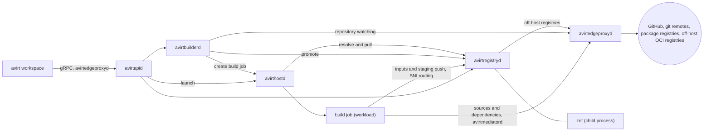

# Status: planned

A **workspace** is the content a workload container starts with beyond its harness base image: a source tree, the dependencies installed for it, caches, and individual files. The **workspace image** is an OCI artifact that contains a workspace as a stack of layers, and avirthostd composes it onto the workload container's harness base image when it creates the workload. Workspace content can span folders, including `/workspace` and paths in the agent's home such as `~/.cache`. Images can also place individual files at system paths such as `/usr/local/bin/some-script`. Workspaces don't require a version control checkout.

| Component | Role for workspaces |
| --- | --- |
| avirt | Reads `.avirt-workspace.toml` and packages local sources. Sends every `avirt workspace` command to avirtapid |
| avirtapid | Forwards `avirt workspace` commands to avirtbuilderd, avirtregistryd and avirthostd with the caller's identity |
| avirtbuilderd | Watches repositories and schedules on-demand builds. Runs prebuild policies. Runs each build processing untrusted content in a disposable sandboxed build job and checks every output before admission |
| avirtregistryd | Stores workspace images in an embedded OCI registry with avirt's secondary index. Serves search and resolution and makes every off-host registry connection |
| avirthostd | Resolves the workspace reference and authorizes the launch. Pulls the image into its content-addressed cache and composes the workload container's root filesystem. Records the resolved digest in the immutable workload configuration |
| avirtpolicyd | Distributes the Cedar policy that governs build, push, pull, export and launch-from-workspace |



avirtbuilderd and its builds are in [workspace builds](./workspace-build.md), and avirtregistryd is in [workspace registry](./workspace-registry.md).

## Workspace image format

A workspace image is an OCI image manifest (image spec v1.1) with these fields:

| Field | Value |
| --- | --- |
| `artifactType` | `application/vnd.dev.avirt.workspace.v1` |
| `config.mediaType` | `application/vnd.dev.avirt.workspace.config.v1+json` |
| `layers[].mediaType` | `application/vnd.oci.image.layer.v1.tar+zstd` for layers avirt produces. Included layers keep their own `tar+gzip` or `tar+zstd` media type. |
| `layers[].annotations` | `dev.avirt.workspace.origin` (`source`, `include`, `pre-source`, `dependencies`, `post-source` or `containerfile`), `dev.avirt.workspace.stage` (`dependencies` or `source`), `dev.avirt.workspace.origin-index` (the position of the source or include in the config), `org.opencontainers.image.title` for a source or include with a `name`, and `org.opencontainers.image.source` and `org.opencontainers.image.revision` for a layer from a version control source |
| `annotations` | The `dev.avirt.*` and `org.opencontainers.image.*` annotations in [annotations](#annotations) |

The layers apply in manifest order, on top of the harness base image's layers. Later layers take precedence where two layers write the same path. Workspace images exclude the environment, entrypoint, user, and working directory, which come from the harness base image.

The config blob records:

- `platform`: always `linux/arm64`.
- `base`: the base image reference, either `none` or `{ "name": "<base reference>", "digest": "<base platform manifest digest>", "index_digest": "<index digest, when the base was resolved through an index>", "diff_ids": [...] }`.
- `roots`: the workspace roots, which are `/workspace` and every directory destination under `/home/agent`.
- `layers`: each layer's origin and destinations, plus the canonical remote URL, ref, and commit for version control sources.
- `config_digest`: the digest of the resolved `.avirt-workspace.toml`, with every default filled in.
- `lock`: every include digest and source commit the build resolved, in the form of the [lockfile](#lockfile).
- `provenance`: `reproducible` or `local` (see [images built from local sources](#images-built-from-local-sources)).
- `secret_allows`: the denylist patterns that `secrets.allow` lifted for this build, when there are any.

### Base image reference

A build without commands produces a workspace image with base image reference `none`, which composes onto any harness base image. Commands in build hooks or a Containerfile produce layers that depend on the build's base. Within the base image reference, avirt records the base's manifest digest and layer `diff_ids`. Such a workspace image composes only onto a harness base image whose layer chain begins with exactly those `diff_ids`. Harness base images must begin with the avirt base image's layers and add layers only under `/opt/agent` (see [workload lifecycle](./workload-lifecycle.md#base-images)), allowing workspaces built on the avirt base to compose onto every harness base. Workspaces built on a harness base compose only onto that base. avirthostd refuses a launch that breaks the base image reference with `workspace bound to another base`.

A bound image also contains the standard `org.opencontainers.image.base.name` and `org.opencontainers.image.base.digest` annotations, and an unbound image omits both. The image spec doesn't say whether `base.digest` is an index digest or a platform manifest digest. avirt always records the platform manifest digest, since that's what pins the layers and the libraries that dependency caches link against, and records the index digest in `dev.avirt.workspace.base-index` when resolution of the base used an index. The spec intends these annotations for an image that contains its base's layers, which a workspace image doesn't, so a workspace image is never runnable on its own. avirthostd's check uses the config blob's `diff_ids`, which is stricter than the digest. The annotations exist so that search and other OCI tooling can read the base image reference without fetching the config blob.

### Destinations

| Destination | Meaning | Owner | Writable by the agent |
| --- | --- | --- | --- |
| `/workspace` and below | The main workspace root, and the default destination of every `directory`, `git`, and `github` source | uid 1000 | Yes |
| `${workload.home}` and below | The workload user's home, `/home/agent`, for caches and tool state such as `${workload.home}/.cache`, `.npm`, `.cargo` and `.local` | uid 1000 | Yes |
| `/usr/local` and `/opt` below, except `/opt/agent` | System additions such as scripts and toolchains | uid 0 | No |
| Any other path a build command writes | Packages a pre-source hook installs, such as files under `/usr` and `/var/lib` | As written by the command | No |

A destination may not contain `~`, and a config that uses one fails with `~ in destination`. `~` in a source `path` means the invoking user's home on the host, and letting it also mean the workload user's home would give one config two homes under one spelling. `${workload.home}` refers to the workload user's home at `/home/agent` in every avirt workload image. The variable keeps configs valid if that changes. It's the only variable a destination may use. Write access for the agent follows from its Landlock ruleset (see [sandbox](./sandbox.md#agent)), which avirthostd builds from the roots and layer destinations (see [sandbox inputs](./sandbox.md#inputs)): content outside `/workspace`, `/home/agent`, `/tmp` and `/dev/shm` is read-only to the agent whatever its mode.

### Content rules

avirtbuilderd checks every layer of a workspace image before admitting it, and avirthostd checks again before it composes a root filesystem. A layer that breaks a rule fails the build, or the launch, with the rule named.

- **Reserved paths.** Entries, whiteouts, and opaque whiteouts must avoid `/run`, `/proc`, `/sys`, `/dev`, `/opt/agent`, any avirt binary in the avirt base image (`/usr/local/bin/avirt*`), `/etc/passwd`, `/etc/group`, `/etc/shadow`, `/etc/gshadow`, `/etc/resolv.conf`, `/etc/hosts`, `/etc/avirt`, or the system CA bundle (`/etc/ssl/certs`, `/usr/local/share/ca-certificates`, `/usr/share/ca-certificates`). At launch avirthostd also refuses any entry under the managed configuration paths and the harness user paths that the harness base's `harness.toml` names, such as `/home/agent/.claude` and `/home/agent/.codex`, so a workspace can't mark `/workspace` trusted in the harness's own state (see [workload lifecycle](./workload-lifecycle.md#base-images) and [`harness.toml`](./acp.md#harnesstoml)).
- **Entry types.** Only regular files, directories, symlinks, and hard links. avirt refuses device nodes, FIFOs, and sockets.
- **Modes.** No setuid or setgid bit, and no file capability (`security.capability` xattr).
- **Ownership.** uid 1000 and gid 1000 own entries under `/workspace` and `/home/agent`. uid 0 owns entries from sources and includes elsewhere. avirt rewrites ownership on the layers it produces from sources and includes, and refuses any layer owned by a helper UID.
- **Paths.** Entry names must use relative paths in valid UTF-8 without `..` segments. Symlinks and hard links may point anywhere. Later entries in the same layer must never write through symlinks.
- **Size.** Host settings cap each layer and the whole image. They also cap the entry count and length of any path.
- **Secrets.** Entries must avoid the built-in denylist and host denylist (see [secret exclusion](#secret-exclusion)), less the patterns that the config blob's `secret_allows` records. This repeats the build-time filter and catches pushed and imported images that never went through it.

avirt produces reproducible layers by sorting entries and setting timestamps to the commit time for version control sources or the build's start time otherwise. It discards other metadata.

## Workspace config

`.avirt-workspace.toml` sits in the directory `avirt workspace build` runs in. It's TOML, every key is kebab-case, and every key is optional.

```toml
name = "acp-experiments"            # default: the primary git repository's name, else the directory name
namespace = "default"               # the avirt namespace that owns the workspace repository

[build]
base = "default/avirt-workload-base:latest"   # default: the host's avirt base image
containerfile = ".avirt-workspace.containerfile"  # default; used when the file exists

[build-hooks.pre-source]
commands = ["apt-get update", "apt-get install -y --no-install-recommends jq"]
user = "root"                       # default for pre-source
workdir = "/"                       # default for pre-source

[build-hooks.dependencies]
commands = ["npm ci"]
user = "agent"                      # default for dependencies
workdir = "/workspace"              # default for dependencies

[build-hooks.post-source]
commands = ["npm run build"]
user = "agent"                      # default for post-source
workdir = "/workspace"              # default for post-source

[secrets]
deny = ["config/credentials.*"]     # added to the built-in and host denylists
allow = [".npmrc"]                  # lifts a built-in pattern, subject to policy

[[sources]]                         # manifests and lockfiles only, so npm ci stays cached
name = "lockfiles"
type = "directory"
path = "."
destination = "/workspace"
stage = "dependencies"
paths = ["package.json", "package-lock.json"]

[[sources]]
type = "directory"                  # default when not in a Git-owned directory
path = "."
destination = "/workspace"
excludes-file = ".avirtignore"      # default

[[sources]]
type = "file"
path = "~/.local/bin/some-script"
destination = "/usr/local/bin/some-script"
mode = 0o755

[[sources]]
type = "git"                        # default when in a Git-owned directory
remote = "origin"                   # default when that remote exists
# remote-url = "https://github.com/foo/bar.git"  # or set the remote explicitly

[[sources]]
type = "github"
repository = "foo/bar"
branch = "main"                     # one ref; a prebuild policy chooses which refs stay built
destination = "/workspace/bar"

[[sources]]
type = "git"
path = "~/Code/shared-library"
destination = "/workspace/shared-library"
local = true                        # inferred when no remote is configured
allow-dirty = true

[[includes]]                        # a whole image
reference = "oci:ghcr.io/foo/bar:v1"
digest = "sha256:..."               # optional pin; the build fails if the reference resolves elsewhere

[[includes]]                        # selected layers, with path selection and remapping
reference = "oci:ghcr.io/foo/baz"
layers-expr = 'annotations["org.opencontainers.image.title"] == "scanner-rules.toml"'
include-paths = ["scanner-rules.toml"]
remap = [{ from = "/", to = "/workspace/.scanner" }]

[[includes]]                        # a search, resolved the way a launch reference is
reference = "github:team-a/rules@main"
filter = 'image.annotations["dev.avirt.build.provenance"] == "reproducible"'
```

A `mode` is a TOML octal integer (`0o755`) or a string of octal digits (`"0755"`). TOML has no `0755` integer form.

### Top-level keys

| Key | Default | Meaning |
| --- | --- | --- |
| `name` | The primary `git` or `github` source's repository name, else the directory name, lowercased to a DNS label | The workspace repository's name in avirtregistryd |
| `namespace` | `default` | The avirt namespace containing the repository. The repository is `<namespace>/<name>`. |
| `build.base` | The host's avirt base image | The image that build commands run on: the avirt base or a harness base (see [workload lifecycle](./workload-lifecycle.md#base-images)). It must be in avirtregistryd. |
| `build.containerfile` | `.avirt-workspace.containerfile` | The Containerfile, resolved in the primary source's tree, used when it exists |
| `build-hooks.pre-source`, `build-hooks.dependencies`, `build-hooks.post-source` | None | Tables with `commands` (a list of shell commands, each run with `/bin/sh -c`), `user` and `workdir` (see [build stages](./workspace-build.md#build-stages-and-the-containerfile)) |
| `secrets.deny`, `secrets.allow` | None | Denylist patterns this workspace adds and lifts (see [secret exclusion](#secret-exclusion)) |

Ref selection, prebuild triggers, retention and mutable tags live in a [prebuild policy](./workspace-build.md#prebuild-policies), never in this file.

The **primary source** is the first `git` or `github` source, or the source with `primary = true`. Its remote and revision are the image's `org.opencontainers.image.source` and `org.opencontainers.image.revision`, and its tree provides the location for resolving the Containerfile.

### Sources

Each source produces one layer. Every source takes `destination`, `primary`, `stage` (`dependencies` or `source`, default `source`, see [build stages](./workspace-build.md#build-stages-and-the-containerfile)), and `name`, which becomes the layer's `org.opencontainers.image.title` and must be unique among the config's sources and includes.

| Type | Keys | Defaults | Read by |
| --- | --- | --- | --- |
| `directory` | `path`, `destination`, `paths`, `excludes-file`, `excludes` | `path = "."`, `destination = "/workspace"`, `excludes-file = ".avirtignore"` | The command-line tool, on the host |
| `file` | `path`, `destination`, `mode` | `mode` is the host file's mode with the setuid, setgid, and sticky bits cleared | The command-line tool, on the host |
| `git` (local) | `path`, `destination`, `paths`, `local`, `allow-dirty`, `include-git-dir`, `excludes-file` | `path = "."`, `destination = "/workspace"`, `local` defaults to `true` when the repository lacks both `remote` and `remote-url`, `allow-dirty = false`, `include-git-dir = true` | The command-line tool, on the host |
| `git` (remote) | `path`, `remote`, `remote-url`, `revision`, `branch`, `tag`, `depth`, `submodules`, `lfs`, `destination`, `include-git-dir` | `remote = "origin"` when it exists, `revision` is the local `HEAD` commit when `path` is a Git-owned directory, `depth` is unset (full history), `submodules = false`, `lfs = false` | The build job |
| `github` | `repository`, `revision`, `branch`, `tag`, `destination`, `depth`, `submodules`, `lfs`, `include-git-dir` | The head of the default branch, `destination = "/workspace"` | The build job |

- **Directory.** The tree under `path`, less the paths that `excludes-file` (gitignore syntax) and `excludes` (a list of gitignore patterns) match. With `paths`, a list of gitignore patterns, the source takes only the files they match, which is how a `dependencies` stage source takes just manifests and lockfiles. Directory sources always exclude `.avirt-workspace.toml`, `.avirt-workspace.lock`, `.avirt-workspace.containerfile`, and `.avirtignore`.
- **File.** One host file, written at `destination` with `mode`.
- **Local git.** The tracked files at `HEAD`, plus `.git` when `include-git-dir` is true. With `allow-dirty = true` it also takes the working tree's modified tracked files and its untracked files that aren't ignored. With `allow-dirty = false` a dirty working tree fails the build with `dirty working tree`. Local git sources always exclude files that git ignores or `excludes-file` matches. `paths` narrows the source as it does for a directory.
- **Remote git.** The repository at `remote-url`, or at the URL of `remote` in the local repository, fetched at `revision`, or at the head of `branch` or `tag`. Remote sources never read the local working tree. A build whose revision isn't on the remote fails with `commit not on remote`. Fetches use the HTTPS form of SSH remotes for known hosts, such as `https://github.com/foo/bar.git` for `git@github.com:foo/bar.git`.
- **`github`.** The repository `owner/name` on GitHub, fetched at `revision`, or at the head of `branch` or `tag`, else at the head of the default branch. It differs from a remote `git` source in authenticating with a GitHub installation token and in recording the `dev.avirt.image.github.*` annotations. A source specifies one ref. Which refs stay built is a [prebuild policy](./workspace-build.md#prebuild-policies)'s decision, and a prebuild replaces the primary source's ref with the ref it's building.

Only builds that the command-line tool starts from a local config accept sources read on the host. Such sources make the build produce an image built from local sources. A prebuild fails with `config not buildable by policy` when the config it reads names a `directory`, `file` or local `git` source.

### Images built from local sources

A build with any source read on the host produces **an image built from local sources**: its content came from one machine's files, and avirt can't rebuild it from inputs it can fetch. avirtbuilderd records it as `dev.avirt.build.provenance = local`, in the config blob, and as the image's `provenance` attribute for policy. Every other build is `reproducible`. A local build remains local unless the caller forces otherwise:

- `github:` and `git:` selectors never resolve to a local image, so a laptop build never replaces a ref's image in resolution. It's reachable by digest, by the tag `avirt workspace build` printed, or through `dir:`.
- `avirt workspace export` refuses a local image.
- Prebuilds never produce one.

`--allow-local` on `resolve`, `launch` and `export` lifts the first two restrictions for one command. Policy receives its value as `context.allow_local` on `launch_workspace` and `export_workspace`, so a namespace can forbid it outright.

### Includes

An include takes layers from another OCI image, and finds it the way a launch finds a workspace image. `reference` is a reference in the grammar of [workspace references](#workspace-references), except `dir:`, and avirtregistryd resolves it with `Resolve`, narrowed by `filter`. Tags and selectors can change. The build pins resolved values in the [lockfile](#lockfile).

| Key | Default | Meaning |
| --- | --- | --- |
| `reference` | Required | A local, `oci:`, `github:` or `git:` reference |
| `digest` | None | A pin. The build fails with `include digest mismatch` when `reference` resolves to another manifest. |
| `filter` | None | A CEL expression over each candidate `image`, as in `Search` |
| `name`, `stage` | None, `source` | As for a source. `name` applies only when the include selects one layer. |
| `layers-expr` | Every layer | A CEL expression evaluated per layer descriptor (see [expressions](#expressions)) |
| `include-paths`, `exclude-paths` | Every path, none | Glob patterns over the paths in the selected layers |
| `remap` | None | A list of `{ from, to }` prefix rewrites, applied after path selection |

After path selection and remapping, the build applies an include as one layer per selected layer. Content rules apply to the result. avirtregistryd fetches off-host includes and mirrors them into the local registry. Path selection and remapping read layer content, so they run in the build job.

### Lockfile

`.avirt-workspace.lock` sits next to the config. It records, for each include, the manifest digest its reference resolved to, and for each remote `git` or `github` source that specifies a `branch` or `tag` rather than a `revision`, the commit it resolved to. A build uses the locked values when the lockfile exists and an entry still matches its config entry, and resolves and writes any entry that's missing or stale. `avirt workspace lock [--update [NAME]]` writes the lockfile, or refreshes one entry or every entry. Builds are repeatable until someone updates the lock on purpose, as with `uv.lock` or `Cargo.lock`.

The image's config blob also records resolved values under `lock`, allowing callers to read image inputs regardless of whether anyone committed the lockfile. A prebuild uses the built commit's lockfile unless its policy sets `lock = "refresh"`, which is how prebuilds pick up new include images and branch heads without a commit.

### Secret exclusion

Before writing layers, the build filters every source, including fetched sources, through a **denylist**. Matching entries never enter the layer. Build records list their paths without content. The denylist combines three lists:

| List | Set by | Holds |
| --- | --- | --- |
| Built-in | avirt | `.env` and `.env.*` (except `.env.example`), `.netrc`, `.npmrc`, `.pypirc`, `.git-credentials`, `.docker/config.json`, `.ssh/`, `.aws/`, `.config/gcloud/`, `.config/gh/hosts.yml`, `.kube/config`, `*.pem`, `*.key`, and the default SSH private key names |
| Host | The host config | Patterns the host's operator adds, each optionally marked as not liftable |
| Workspace | `secrets.deny` | Patterns the workspace adds |

Patterns use gitignore syntax and match at any depth below each source's root. `secrets.allow` lifts a built-in or host pattern for one workspace, except a host pattern marked as not liftable. Policy receives lifted patterns as `context.secret_allows` on `build_workspace`. The image's config blob records them for the content checks at launch.

With `include-git-dir`, avirt copies `.git` without credentials. It rewrites `.git/config` without credentials in remote URLs and without `credential.*` or `http.*.extraheader` entries.

### Zero-config defaults

`avirt workspace build` in a directory with no `.avirt-workspace.toml` builds as though the config had one source and every other key at its default:

- in a Git-owned directory, a `git` source of the repository root into `/workspace`, using the `origin` remote when it exists and `local = true` otherwise.
- otherwise, a `directory` source of `.` into `/workspace`, excluding what `.avirtignore` matches.

A directory that holds only `README.md` and isn't in a Git-owned directory yields a workspace image with one layer, holding `/workspace/README.md` owned by uid 1000, and base image reference `none`. `avirt workspace init` writes the inferred config to `.avirt-workspace.toml`.

### Expressions

All expressions use CEL with a cost limit and without I/O. Results must have the type in the table. A filter execution failure rejects its candidate and records the error on the build.

| Key | Returns | Variables |
| --- | --- | --- |
| `refs` (prebuild policy) | `bool` | `ref`, `repository` |
| `layers-expr` | `bool` | `annotations` (map of string to string, the layer descriptor's annotations), `mediaType`, `digest`, `size` (int), `index` (int, the layer's position), `image` (`{ digest, annotations }` for the included manifest) |
| `filter` (include) | `bool` | `image`, the image record as `Search` exposes it |
| `tag-format` (prebuild policy) | `string` per `{{ }}` | `ref`, `repository`, `build` (`{ id, time }`) |

`ref` is the same object in every expression: `{ name, short, kind, sha, protected, default, pull_request }`. `name` is the full ref name such as `refs/pull/12/head`, `short` is the branch or tag name or the pull request number as a string, `kind` is `branch`, `tag` or `pull`, `sha` is the object the ref points at, `protected` and `default` are booleans, and `pull_request` is the pull request number, or 0. `repository` is `{ owner, name, full_name, default_branch, private }`. In `tag-format`, each `{{ <expression> }}` is a CEL expression whose string result replaces it.

## Annotations

avirtbuilderd sets these annotations on every manifest it promotes. User-pushed manifests preserve their annotations, and avirtregistryd's index records them as user-produced (see [producers](./workspace-registry.md#producers)).

| Annotation | Value |
| --- | --- |
| `org.opencontainers.image.source` | The primary source's canonical remote URL, such as `https://github.com/foo/bar` |
| `org.opencontainers.image.revision` | The primary source's commit SHA |
| `org.opencontainers.image.created` | The build's completion time, RFC 3339 |
| `dev.avirt.image.kind` | `workspace` |
| `dev.avirt.image.git.remote` | The primary source's canonical remote URL |
| `dev.avirt.image.git.ref` | The full ref built, such as `refs/heads/feat/hello` or `refs/pull/12/head` |
| `dev.avirt.image.git.branch` | The branch name, when the ref is a branch, such as `feat/hello` |
| `dev.avirt.image.git.tag` | The tag name, when the ref is a tag |
| `dev.avirt.image.git.pull-request` | The pull request number, when the ref is a pull request ref |
| `dev.avirt.image.git.commit` | The commit SHA |
| `dev.avirt.image.git.commit-time` | The committer time, RFC 3339 |
| `dev.avirt.image.git.default-branch` | `true` when the ref is the repository's default branch at build time |
| `dev.avirt.image.git.dirty` | `true` for a local git source built with uncommitted changes |
| `dev.avirt.image.github.repository` | `owner/name` |
| `dev.avirt.image.github.repository-id` | GitHub's numeric repository id, which remains unchanged after a rename |
| `org.opencontainers.image.base.name` | The base reference the build ran on, for a bound image |
| `org.opencontainers.image.base.digest` | The base's platform manifest digest, for a bound image |
| `dev.avirt.workspace.base-index` | The base's index digest, when resolution of the base used an index |
| `dev.avirt.workspace.config-digest` | The digest of the resolved config |
| `dev.avirt.workspace.tag-key` | The mutable tag before sanitization |
| `dev.avirt.workspace.config-source` | `local`, `tree`, `registered` or `zero-config` |
| `dev.avirt.build.id` | avirtbuilderd's build id |
| `dev.avirt.build.trigger` | `manual`, `schedule`, or the event name, such as `pull_request.synchronize` |
| `dev.avirt.build.trust-domain` | The trust domain of the host that built it |
| `dev.avirt.build.provenance` | `reproducible`, or `local` for a build with a source read on the host |
| `dev.avirt.build.prebuild-policy` | The prebuild policy's name, for a prebuild |

For builds with more than one version control source, the config blob and layer annotations record each source's remote, ref, and commit. Manifest-level `dev.avirt.image.git.*` annotations describe the primary source.

## Workspace references

A workspace reference specifies one workspace image, or a rule that selects one. `avirt launch --workspace` and every `avirt workspace` command that takes an image accept this grammar:

```abnf
reference   = local / oci / github / git / dir
local       = repo [ ":" tag ] [ "@" digest ]          ; <ns>/<name> in avirtregistryd
oci         = "oci:" registry "/" path [ ":" tag ] [ "@" digest ]
github      = "github:" owner "/" repo [ "@" selector ]
git         = "git:" url [ "@" selector ]
dir         = "dir:" path                               ; CLI only
selector    = "branch:" name / "tag:" name / "pr:" 1*DIGIT
            / "ref:" full-ref / "sha:" 7*64HEXDIG / bare
bare        = 40HEXDIG / 64HEXDIG                        ; a full commit SHA
            / name                                       ; otherwise, a branch name
digest      = "sha256:" 64HEXDIG
```

| Reference | Matches |
| --- | --- |
| `team-a/app:main`, `team-a/app@sha256:...` | That tag or digest in avirtregistryd |
| `oci:ghcr.io/foo/bar:v1` | That off-host image, which avirtregistryd imports before use |
| `github:foo/bar` | `dev.avirt.image.github.repository == "foo/bar"` and `dev.avirt.image.git.default-branch == "true"` |
| `github:foo/bar@feat/hello`, `github:foo/bar@branch:feat/hello` | `dev.avirt.image.git.branch == "feat/hello"` |
| `github:foo/bar@tag:v1.2.0` | `dev.avirt.image.git.tag == "v1.2.0"` |
| `github:foo/bar@pr:12` | `dev.avirt.image.git.pull-request == "12"` |
| `github:foo/bar@ref:refs/pull/12/merge` | `dev.avirt.image.git.ref == "refs/pull/12/merge"` |
| `github:foo/bar@sha:1a2b3c4`, `github:foo/bar@<40 hex>` | `dev.avirt.image.git.commit` starts with the specified hex |
| `git:https://example.com/x.git@main` | `dev.avirt.image.git.remote` is the canonical form of the URL, with the same selector rules as GitHub references |
| `dir:.` | The command-line tool builds the directory as `avirt workspace build` does, then launches the resulting digest |

A `github:` reference matches by `dev.avirt.image.github.repository-id` once avirtregistryd has seen the repository, so a renamed repository still matches. Before comparison, avirtregistryd canonicalizes remote URLs. It converts scheme and host to lowercase and removes credentials and trailing `.git` or `/`. For known hosts, it rewrites SSH URLs to HTTPS.

### Resolution

avirthostd resolves a reference by calling avirtregistryd's `Resolve`, and records only the resolved digest in the workload configuration.

1. avirtregistryd selects the candidates that match the reference.
2. It drops candidates whose base image reference the launch's harness base image doesn't meet. It also drops images without a builder producer unless policy permits user-produced images (see [policy](#policy)), any image built from local sources unless the caller passes `--allow-local`, and images the caller may not `pull_workspace`. Selection ignores mutable tags.
3. For a branch, tag or pull request selector, it ranks the remaining candidates by whether their commit is the ref head avirtbuilderd last observed, then by commit time, then by build time. For a commit selector, it ranks by build time.
4. It returns the first candidate together with its staleness: whether the ref head has moved past its commit.
5. With `--fresh=require`, a stale or missing result makes avirthostd ask avirtbuilderd for a build of the head and wait for it. The default `--fresh=prefer` uses a stale result and reports its staleness. With `--fresh=any`, avirthostd ignores staleness.

A reference with a digest skips selection. avirthostd then authorizes `launch_workspace` for the resolved image (see [launch order](./lifecycle.md#launch-order)). A launch takes either a workspace or a `cwd` host directory. avirthostd refuses a launch that supplies both with 400.

## Composing the root filesystem

At launch avirthostd pulls the resolved workspace image's manifest, config and layers from avirtregistryd into its content-addressed cache, verifying every digest, checks the base image reference and the content rules, and composes the workload's root filesystem as the harness base's layers followed by the workspace layers, then the configuration layer, with the per-workload writable layer on top (see [workload lifecycle](./workload-lifecycle.md#layer-stack)). Writes the agent makes stay in the writable layer and never reach the workspace image or the host.

| Runtime | Root filesystem composition |
| --- | --- |
| Containerization | avirthostd keeps an unpacked ext4 root filesystem per harness base in its content-addressed cache, and a composed root filesystem per pair of harness base and workspace image in `cache/rootfs/`. It builds a composed one by cloning the harness base's with APFS `clonefile` and unpacking the workspace layers into the clone. Each workload container gets its own `clonefile` copy of the composed root filesystem as its writable root block device, with the configuration layer unpacked into it, so a launch from a cached pair copies only the configuration layer's file data. |
| Docker Desktop | avirthostd writes an image manifest whose layers are the harness base's layers followed by the workspace layers and the configuration layer, and whose config is the harness base's config with those layers' `diff_ids` appended. It loads it through the Docker API as an OCI archive that contains only the blobs the store lacks, tagged `avirt.internal/composed:<hex>` with the hex of the composed manifest's SHA-256, and the containerd image store reuses the harness base's layers by digest. The container's writable layer is per workload, as for any container. |
| Apple container CLI | avirthostd refuses a workspace launch on this runtime with 400. |

Composed root filesystems and composed images are cache entries. avirthostd garbage-collects them with their source workspace images. Startup cleanup keeps them along with the other caches in [lifecycle](./lifecycle.md#startup-cleanup).

avirtguestd's workspace roots for the workload are the image's `roots`, so its workspace and workspace snapshot tools cover `/workspace` and the directory destinations under `/home/agent`.

## Commands

The `avirt workspace` commands, and `avirt launch --workspace`, are in [operator CLI workspaces](./operator-cli.md#workspaces).

## Policy

avirtbuilderd, avirtregistryd and avirthostd each check the host policy snapshot from avirtpolicyd for the actions they handle. The evaluator supplies the `WorkspaceRepository` and `WorkspaceImage` entities from avirtregistryd's index with each request, and the namespace hierarchy comes from the snapshot's entity revision.

| Element | Values |
| --- | --- |
| Entities | `WorkspaceRepository::"<ns>/<name>"`, `in Namespace::"<ns>"`. `WorkspaceImage::"<ns>/<name>@<digest>"`, in its repository, with attributes `producer` (`builder`, `user` or `import`), `provenance` (`reproducible` or `local`), `base` (a digest or `none`), `source` and `revision` (when present), `trigger`, and its manifest annotations as tags. |
| Principals | The caller that avirtapid forwards, `HostService::"avirtbuilderd"` for prebuilds, which contain the prebuild policy's owner as `context.owner`, `HostService::"avirthostd"` pulling for a launch, and a build job's `Workload` reading its inputs |

| Action | Evaluated by | Resource | Context |
| --- | --- | --- | --- |
| `launch_workspace` | avirthostd, at launch order step 1 | `WorkspaceImage` | `namespace` (the workload's `Namespace` entity), `agent`, `workload_image`, `allow_local` |

The build actions are in [workspace builds](./workspace-build.md#policy), and the registry actions in [workspace registry](./workspace-registry.md#policy).

```cedar
@id("prod-launches-builder-images-only")
forbid (principal, action == Action::"launch_workspace", resource)
when { context.namespace == Namespace::"prod" && resource.producer != "builder" };

@id("prod-launches-reproducible-only")
forbid (principal, action == Action::"launch_workspace", resource)
when { context.namespace == Namespace::"prod" && resource.provenance == "local" };
```

# Open questions

1. **Snapshots to workspace images.** Whether to convert an avirtguestd workspace snapshot of a running workload container into a new workspace image remains open. The producer for such images also remains open.
2. **Zero-config in a repository with a remote.** The zero-config git source fetches the local `HEAD` commit from `origin`, so unpushed commits fail with `commit not on remote` and the source never reads the working tree. Whether zero-config should use a local git source instead remains open. That choice would make the build produce an image built from local sources.
3. **The guest CLI.** Whether `guest-cli` may search workspaces or start builds from inside a workload container is open (see [guest CLI](./guest-cli.md#open-questions)).
4. **`github` and `git` sources.** With ref selection in prebuild policies, a `github` source is a remote `git` source with GitHub authentication and annotations. Whether to represent it as `git` with a provider key is open.
